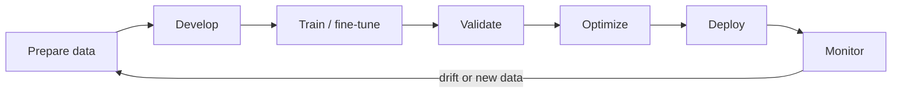

# NCA-AIIO · AI 基础设施与运营


## 考纲要点


### 领域 1 — AI 基础知识（38%）


> 来源：`MBaranekTech/nvidia-nca-aiio-study-notes` · `domains/01-essential-ai-knowledge.md` · [原文链接](https://github.com/MBaranekTech/nvidia-nca-aiio-study-notes/blob/main/domains/01-essential-ai-knowledge.md) · 语言：英文原文 · 中译版


# 领域 1 — AI 基础知识（38%）

> **目标：** 解释 AI 生命周期，比较训练与推理，并把每个主要的 NVIDIA 软件组件放到正确的层级。

**大纲覆盖：** 软件栈 · 训练与推理 · AI/ML/DL · 应用场景 · NVIDIA 解决方案 · 开发生命周期 · CPU 与 GPU

## 1. AI、ML 与 DL

- **人工智能** 是让系统完成与人类智能相关任务的宏大目标。
- **机器学习** 是一种从数据中学习模式的 AI 方法，而不是仅依赖手工编写的规则。
- **深度学习** 是基于多层神经网络的 ML。它通常能从 GPU 并行中获益。

生成式 AI 会创造新内容；它是一种应用场景，而不是所有 AI 的同义词。常见工作负载包括计算机视觉、自然语言处理、推荐系统、语音、预测、机器人、数字孪生和药物研发。

## 2. 训练与推理

| 关注点 | 训练 | 推理 |
|---|---|---|
| 目标 | 学习模型参数 | 使用已训练好的模型 |
| 典型优先级 | 吞吐、规模、训练时长 | 延迟、吞吐、单请求成本 |
| 数据流 | 反复进行前向/反向传播 | 通常仅前向传播 |
| 内存 | 参数、激活值、梯度、优化器状态 | 参数加上运行时状态/缓存 |
| 扩展方式 | 通常多 GPU/多节点 | 从边缘设备到大型服务集群 |

这些只是倾向，而不是铁律。批量推理可能以最大化吞吐为目标；实时分布式训练同样可能对延迟敏感。

## 3. CPU 与 GPU

CPU 拥有数量不多但较为精密的核心，针对串行工作、分支处理、操作系统职责和通用场景的低延迟做了优化。GPU 拥有大量并行执行单元和高内存带宽，因此对 AI 所需的重复矩阵/张量运算非常高效。

一个有用的模型是**异构计算**：CPU 负责编排并处理控制密集型工作；GPU 加速高度并行的工作。Tensor Core 加速混合精度的矩阵运算。在精度仍可接受的前提下，降低精度可以提升速度和容量。

## 4. NVIDIA 软件栈

自硬件向上思考：

```text
Applications and workflows
NIM / Triton / application frameworks
TensorRT / RAPIDS / domain SDKs
cuDNN and accelerated libraries
CUDA platform and runtime
Driver + container runtime integration
GPU / DPU / network hardware
```



关键区别：

| 组件 | 主要作用 |
|---|---|
| CUDA | 并行计算平台、编程模型、运行时与工具 |
| cuDNN | 面向深度神经网络的 GPU 加速图元 |
| TensorRT | 优化并执行推理 |
| Triton Inference Server | 大规模提供来自多种框架的模型服务 |
| NIM | 带标准 API、经过打包且受支持的推理微服务 |
| RAPIDS | GPU 加速的数据科学库 |
| NCCL | 多 GPU/多节点集合通信 |
| AI Enterprise | 企业级软件套件、支持服务与经过验证的部署选项 |

## 5. 模型生命周期

简化后的生命周期是：收集/准备数据 → 开发模型 → 训练/微调 → 验证 → 优化 → 部署 → 监控 → 重新训练或下线。

MLOps 通过版本管理、流水线、模型注册表、部署自动化、可观测性、治理和漂移监控，让这一生命周期变得可重复。容器提升了可移植性，但宿主机仍需要兼容的驱动和容器运行时集成。

## 6. 方案选型线索

- **需要更快的推理？** 优化考虑 TensorRT；服务/打包考虑 Triton 或 NIM。
- **需要 GPU 间的集合通信？** 考虑 NCCL 和高速 scale-out 网络结构。
- **需要 GPU 数据科学？** 考虑 RAPIDS。
- **需要 GPU 遥测与诊断？** 考虑 DCGM。
- **需要 Kubernetes 上的 GPU 软件生命周期管理？** 考虑 GPU Operator。

## 自测

1. 为什么增加 GPU 并不会自动加速控制密集型的串行代码？
2. TensorRT 和 Triton 有何不同？
3. 哪种状态使训练通常比推理更占用内存？
4. 为什么“推理总是优先考虑延迟”是一个不安全的绝对化说法？

<p align="right"><a href="../README.md">↑ 返回指南</a> · <a href="02-ai-infrastructure.md">下一篇：AI 基础设施 →</a></p>

---


### 领域 2 — AI 基础设施（40%）


> 来源：`MBaranekTech/nvidia-nca-aiio-study-notes` · `domains/02-ai-infrastructure.md` · [原文链接](https://github.com/MBaranekTech/nvidia-nca-aiio-study-notes/blob/main/domains/02-ai-infrastructure.md) · 语言：英文原文 · 中译版


# 领域 2 — AI 基础设施（40%）

<p align="center">
  
</p>

> **目标：** 将工作负载需求转化为计算、拓扑、网络、存储、设施与部署方面的选择。

**大纲覆盖：** 硬件选型 · 扩展 · 供电与制冷 · 云与本地部署 · 集群 · 设施 · 网络 · DPU

## 1. 从工作负载出发

基础设施选择要跟随工作负载：模型规模、精度、数据集、批大小、延迟目标、并发数、可靠性、数据局部性、合规要求和预算。瓶颈可能在计算、GPU 显存容量、显存带宽、互连、网络、存储、CPU 输入流水线、供电或制冷。

纵向扩展是在节点内增加能力；横向扩展是增加节点。当通信、同步、存储或不均衡主导了有效计算时，扩展效率就会下降。

## 2. GPU 拓扑

- **PCIe** 将设备连接到宿主机，并可支持 GPU 对等访问。
- **NVLink** 在受支持的系统中提供高带宽的 GPU 间互连。
- **NVSwitch** 在受支持的平台上构建高带宽的多 GPU 连接。
- **InfiniBand 或高速以太网** 提供 scale-out 的节点间网络结构。

拓扑很重要：标称的 GPU 数量几乎说明不了通信路径、局部性、超售比或端到端性能。

## 3. 听起来相似的数据路径

| 技术 | 端点 | 主要收益 |
|---|---|---|
| CUDA P2P | 受支持系统拓扑中的 GPU ↔ GPU | 避免通过宿主机内存中转 |
| GPUDirect RDMA | GPU 内存 ↔ 第三方 PCIe 设备（通常是 NIC） | 直接的网络/设备数据传输 |
| GPUDirect Storage | GPU 内存 ↔ 受支持的存储路径 | 数据 I/O 避免 CPU 回弹缓冲 |

选择技术之前，先确定两端的端点。

## 4. 网络设计

AI 集群通常按用途划分流量：计算、存储、带内管理和带外管理。设计方式各不相同；四张网络结构并非放之四海而皆准的定律。

重要概念包括带宽、延迟、抖动、丢包、拥塞、超售、拓扑、冗余和东西向流量。分布式训练对集合通信和尾延迟非常敏感。RDMA 允许以较低的 CPU 开销直接访问内存；RoCE 在以太网上承载 RDMA，需要精心设计网络结构，而 InfiniBand 则是专门构建的高性能网络结构。

## 5. 存储与数据流水线

仅有容量是不够的。需要考虑吞吐、IOPS、延迟、元数据速率、小文件行为、并行访问、缓存、局部性、持久性和检查点模式。如果 GPU 在等数据，那么更快的 GPU 也解决不了流水线瓶颈。

## 6. 设施：供电与制冷

规划要超出设备 TDP。还应包括 CPU、内存、网络、存储、供电转换、冗余、机架密度、增长余量和制冷开销。在稳态下，移除的热量等于消耗的功率。高密度部署可能需要液冷和设施改造。

实用的设施概念：

- **kW** 是瞬时功率；**kWh** 是随时间累计的能量。
- **PUE** = 设施总能耗 / IT 设备能耗；越接近 1 越好。
- 冗余供电与制冷可提升可用性，但会增加成本和容量要求。
- 铭牌最大值、设计负载和实测典型负载是不同的输入。

## 7. 本地部署与云

| 本地部署 | 云 |
|---|---|
| 更强的物理控制能力和数据局部性 | 更快的获取速度和弹性容量 |
| 前期资本支出和更长的采购周期 | 按用量计费和可用性约束 |
| 需要自行负责设施和生命周期 | 由供应商运营底层设施 |
| 在稳定高利用率下可能更经济 | 对波动性或临时性需求可能更经济 |

混合方案的决策涉及数据引力、网络出口、数据主权、技能储备、利用率、交付周期和运维模式——不只是按小时计算的算力价格。

## 8. DPU 心智模型

像 NVIDIA BlueField 这样的 DPU 使用专用计算单元和加速器处理基础设施服务。记住三个动词：**卸载**、**加速**和**隔离**网络、存储与安全任务。这可以释放宿主机的 CPU 周期，并把基础设施控制与租户工作负载分离开来。

## 自测

1. 为什么把 GPU 数量翻倍，带来的加速远小于 2 倍？
2. 哪条数据路径适合 GPU 到存储的流量？
3. 为什么机架功率并不等于各 GPU TDP 值之和？
4. 在什么情况下云的弹性优势会超过更高的稳态单位成本？

<p align="right"><a href="01-essential-ai-knowledge.md">← AI 基础知识</a> · <a href="../README.md">↑ 指南</a> · <a href="03-ai-operations.md">AI 运维 →</a></p>

---


### 领域 3 — AI 运维（22%）


> 来源：`MBaranekTech/nvidia-nca-aiio-study-notes` · `domains/03-ai-operations.md` · [原文链接](https://github.com/MBaranekTech/nvidia-nca-aiio-study-notes/blob/main/domains/03-ai-operations.md) · 语言：英文原文 · 中译版


# 领域 3 — AI 运维（22%）

<p align="center">
  
</p>

> **目标：** 为加速基础设施选择合适的管理、监控、调度、故障排查和虚拟化方式。

**大纲覆盖：** 数据中心管理 · 监控 · 编排 · 作业调度 · GPU 指标 · 虚拟化

## 1. 观察整个系统

要监控设施、节点、网络结构、存储、GPU、调度器和应用。GPU 利用率偏低的症状可能源自存储、网络、CPU 预处理、批大小、同步、放置策略或应用本身。

GPU 信号包括利用率、显存使用量、显存带宽活动、温度、功耗、时钟频率、降频原因、ECC 错误、XID 事件、互连计数器以及进程/作业归属。要针对需要采取行动的状况设置告警；应结合趋势和工作负载上下文，而不是孤立地看某一个指标。

## 2. 工具边界

| 工具 | 主要职责 |
|---|---|
| `nvidia-smi` / NVML | 本地查询与管理接口 |
| DCGM | 面向集群的 GPU 遥测、健康、诊断、拓扑与作业统计 |
| DCGM Exporter | 将 DCGM 指标暴露给 Prometheus |
| Base Command Manager | 集群置备以及生命周期/管理工作流 |
| GPU Operator | 在 Kubernetes 中自动化 NVIDIA GPU 软件组件 |
| Kubernetes scheduler | 在资源和约束条件下放置 Pod |
| Slurm | 调度作业并分配 HPC/AI 集群资源 |

GPU Operator 负责安装和管理 GPU 使能组件。它不是 Horizontal Pod Autoscaler，也不会因为应用需求而添加集群节点。

## 3. 调度与编排

调度器把资源请求与可用资源匹配起来，执行策略并让工作排队。良好的运维需要准确的资源请求、拓扑感知、配额、优先级、隔离和计量审计。多节点作业可能需要 gang scheduling，以便所有必需的 worker 同时启动。

容器把应用程序及其依赖打包在一起。Kubernetes 编排容器化服务；Slurm 常用于批处理以及紧耦合的 HPC/AI 工作负载。二者可以共存，而且单靠任何一个标签都不保证高效的 GPU 利用率。

## 4. GPU 共享与虚拟化

| 方式 | 隔离性 | 典型用途 |
|---|---|---|
| Passthrough | 虚拟机独占物理 GPU | 最大化的直接访问 |
| vGPU | 由中间层代理的虚拟 GPU 配置文件 | 借助厂商技术栈整合虚拟机 |
| MIG | 受支持 GPU 上硬件分区的 GPU 资源 | 可预期的隔离切片 |
| Time-slicing | 按时间共享执行 | 更高并发，但隔离性弱 |

MIG 提供专用资源分区和故障隔离；时间分片不具备同等的内存隔离或故障隔离。能力和实例数量取决于具体的 GPU 与软件版本——请查阅当前的支持表。

## 5. 故障排查顺序

1. 界定影响、范围和近期变更。
2. 检查调度器/作业状态和应用日志。
3. 对比 GPU、CPU、内存、存储和网络的时间线。
4. 查看健康事件、温度、功耗、降频和错误。
5. 验证拓扑与放置假设。
6. 安全复现问题，隔离单一变量，并记录结果。

不要把 100% 利用率普遍视为好事，也不要把低利用率普遍视为坏事。目标是服务水平性能、可靠性和单位成本下的有效产出——而不是某一个仪表板数字。

## 自测

1. 哪些证据可以区分热降频与输入供给不足？
2. 为什么 GPU Operator 不能取代自动扩缩容器？
3. 什么情况下 MIG 比时间分片更合适？
4. 调度器要把多节点作业妥善放置，需要什么？

<p align="right"><a href="02-ai-infrastructure.md">← AI 基础设施</a> · <a href="../README.md">↑ 返回指南</a></p>

---


### 参考来源与时效性


> 来源：`MBaranekTech/nvidia-nca-aiio-study-notes` · `resources/SOURCES.md` · [原文链接](https://github.com/MBaranekTech/nvidia-nca-aiio-study-notes/blob/main/resources/SOURCES.md) · 语言：英文原文 · 中译版


# 参考来源与时效性

技术性结论应优先依据官方文档。社区资源对学习策略有帮助，但不能作为最终依据。

## 考试权威来源

- [NCA-AIIO 认证页面与当前考试大纲](https://www.nvidia.com/en-us/learn/certification/ai-infrastructure-operations-associate/) — 核查于 2026-10-22
- [NVIDIA AI Infrastructure and Operations Fundamentals](https://www.nvidia.com/en-us/training/academy/course-detail/?id=course%3A16071291) — 核查于 2026-10-22

## 技术参考

- [CUDA 文档](https://docs.nvidia.com/cuda/)
- [TensorRT 文档](https://docs.nvidia.com/deeplearning/tensorrt/)
- [Triton Inference Server 文档](https://docs.nvidia.com/deeplearning/triton-inference-server/)
- [NVIDIA GPU Operator 文档](https://docs.nvidia.com/datacenter/cloud-native/gpu-operator/)
- [DCGM 文档](https://docs.nvidia.com/datacenter/dcgm/)
- [MIG 用户指南](https://docs.nvidia.com/datacenter/tesla/mig-user-guide/)
- [GPUDirect RDMA 文档](https://docs.nvidia.com/cuda/gpudirect-rdma/)
- [GPUDirect Storage 文档](https://docs.nvidia.com/gpudirect-storage/)
- [NCCL 文档](https://docs.nvidia.com/deeplearning/nccl/)
- [NVIDIA 网络文档](https://docs.nvidia.com/networking/)

## 灵感来源与学习策略

- [ziash/nvidia-nca-aiio-study-guide](https://github.com/ziash/nvidia-nca-aiio-study-guide) — 结构上的启发；未复制任何文字或课程截图
- [Eason Tech Talk: 16-hour plan and confusing topics](https://easontechtalk.com/nvidia-nca-aiio-exam/) — 实用的备考视角

## 更新本指南

当考试细节或技术事实发生变化时：

1. 使用官方来源更新相关笔记；
2. 如果考试细节有变，更新本文件及 README 中的核查日期；
3. 避免用脆弱的产品冷知识取代通用概念；
4. 在提交信息中记录重要变更。

---


### NCA-AIIO 官方考试大纲（2026-09-29）


> 来源：`cterpening/certification-study-library` · `data/objective-snapshots/nca-aiio-official-objectives-2026-09-29.txt` · [原文链接](https://github.com/cterpening/certification-study-library/blob/main/data/objective-snapshots/nca-aiio-official-objectives-2026-09-29.txt) · 语言：英文原文 · 中译版


NVIDIA-Certified Associate  
AI Infrastructure and Operations  
(NCA-AIIO)

## 考试大纲

下表概述了认证考试所涵盖的主题领域，以及每个科目在考试中所占的比例。

| 主题领域 | 占考试比例 | 涵盖的主题 |
|---|---|---|
| Essential AI Knowledge（AI 基础知识） | 38% | 描述 AI 环境中使用的 NVIDIA 软件栈。<br>比较训练与推理在架构需求与考量上的异同。<br>区分 AI、机器学习与深度学习的概念。<br>解释促成近期 AI 快速改进与普及的因素。<br>解释关键的 AI 用例与行业。<br>解释各类 NVIDIA 解决方案的目的与用例。<br>描述与 AI 开发及部署生命周期相关的软件组件。<br>比较 GPU 与 CPU 架构。 |
| AI Infrastructure（AI 基础设施） | 40% | 确定特定 AI 训练任务用例的硬件要求。<br>针对不同用例横向扩展 GPU 基础设施。<br>识别数据中心内供电与散热要求相关的关键概念与高阶规格。<br>阐述本地部署（on-prem）与云基础设施相比的关键优势、挑战与考量因素。<br>识别加速基础设施集群的关键组件与考量事项。<br>识别设施（facility）要求。<br>确定 AI 工作负载的网络需求。<br>识别并说明数据中心网络协议与关键概念。<br>识别高速数据中心网络方案及其用例。<br>阐述 DPU 在数据中心中的目的与优势。 |
| AI Operations（AI 运维） | 22% | 描述 AI 数据中心管理与监控的核心要点。<br>描述 AI 集群编排与作业调度的核心要点。<br>阐述与 GPU 监控相关的关键度量指标与判据。<br>识别虚拟化加速基础设施时的关键考量事项。 |

---


### NCA-AIIO 考试大纲


> 来源：`cterpening/certification-study-library` · `data/objective-snapshots/archive/nca-aiio-99feae0bb9bd6c7ade80eddfb848aaddde0582ee7a739302e65411babb367ed7.txt` · [原文链接](https://github.com/cterpening/certification-study-library/blob/main/data/objective-snapshots/archive/nca-aiio-99feae0bb9bd6c7ade80eddfb848aaddde0582ee7a739302e65411babb367ed7.txt) · 语言：英文原文 · 中译版


NVIDIA 认证助理
AI 基础设施与运维
(NCA-AIIO)
考试大纲
下表概述了认证考试所涵盖的主题领域，以及每个主题在考试中所占的比重。
主题领域
考试占比
涵盖的主题
AI 基础知识：
38%
描述 AI 环境中使用的 NVIDIA 软件栈。
比较并对比训练与推理在架构上的需求与考量因素。
辨析 AI、机器学习与深度学习这三个概念。
说明促成近期 AI 快速进步与普及的因素。
说明关键的 AI 用例与行业。
说明各类 NVIDIA 解决方案的目的与用例。
描述与 AI 开发及部署生命周期相关的软件组件。
比较并对比 GPU 与 CPU 架构。
AI 基础设施
40%
确定特定 AI 训练任务用例的硬件需求
针对不同用例扩展 GPU 基础设施
确定数据中心内与供电和散热要求相关的关键概念与高级规格
阐明本地部署与云基础设施相比的关键优势、挑战与考量因素
确定加速基础设施集群的关键组件与考量因素
确定设施要求
确定 AI 工作负载的网络需求
识别并说明数据中心网络协议与关键概念
识别高速数据中心网络方案及其用例
说明 DPU 在数据中心中的目的与优势
AI 运维
22%
描述 AI 数据中心管理与监控的基本要素。
描述 AI 集群编排与作业调度的基础要素。
阐明与 GPU 监控相关的关键度量指标与判定标准。
确定虚拟化加速基础设施时的关键考量因素。
练习题
通过样题熟悉主题以及你在认证考试中可能遇到的题型。
学习模式
作答每道题目后立即获得反馈，包括正确答案、解释以及延伸阅读的链接。
在学习模式下尝试练习题

---


### NVIDIA 认证专员：AI 基础设施与运维 (NCA-AIIO) 学习指南


> 来源：`cterpening/certification-study-library` · `guides/NCA-AIIO-nvidia-ai-infrastructure-operations-associate.md` · [原文链接](https://github.com/cterpening/certification-study-library/blob/main/guides/NCA-AIIO-nvidia-ai-infrastructure-operations-associate.md) · 语言：英文原文 · 中译版


# NVIDIA 认证专员：AI 基础设施与运维 (NCA-AIIO) 学习指南


**目标分布表（2026 年 11 月 23 日）。** NVIDIA 公布了 22 个主题。Essential AI Knowledge（AI 基础知识）占八个主题（38%），AI Infrastructure（AI 基础设施）占十个主题（40%），AI Operations（AI 运维）占四个主题（22%）。基础设施部分措辞的变化并未改变原有的教学范围。归档版大纲中还包含较早的资源与实践类标签。修订版学习指南的完整来源验证仍在进行中。[来源与学习资源](../docs/research/2026-11-23-refresh-23.md#nca-aiio)

> **独立的 AI 辅助资源 —— 历史来源与目标已核对；人工复核待完成。** 全部 22 项公开目标、六页学习指南、交付细节及部分运维文档已于 2026 年 9 月 29 日完成审阅。本地工作簿通过了 34 项检查；其中八项基础设施实践仍处于提案状态。参见[深度审阅报告](../docs/research/2026-09-29-nca-aiio-deep-review.md)。参见[覆盖记录](../docs/SOURCE-VALIDATION.md#nca-aiio-coverage-record)。

**当前基线：** NCA-AIIO 是一门正在开设的英文、远程监考的专员级考试，共 50 题，限时一小时。认证页面标注价格为 125 美元；单独查看 DGX 学习路径卡片时显示为 135 美元。请以认证页面作为考试依据，并在购买前核对 Certiverse 结账总价。<br>
**即将发生的变化：** 2026 年 9 月 29 日查看的认证页面上没有任何改版或停考公告。<br>
**先决条件：** 认证页面列出的是基本的数据中心知识要求。所链接的学习指南建议具备相关学历和企业经验；但并未将其标注为强制报考条件。其培训课程明确为可选项。<br>
**有效期：** NVIDIA 表示该证书有效期为两年，可通过重新参加考试来续期。注册前请重新核对政策、价格和可选的交付方式。

**请核实最新信息 —— 考试政策：** NVIDIA 表示考试只公布通过/不通过，不给分数。其公开 FAQ 规定：重考需间隔 14 天；从首次购买考试起算的 12 个月内最多尝试五次；远程监考不设间隔期。注册前请检查具体的预约、身份核验与考场便利条件；本次审阅未执行任何预约操作，也未安装安全浏览器。[项目政策](https://www.nvidia.com/en-us/learn/certification/)

## 如何使用本指南


把基础设施当作一条以证据支撑的路径来学习：工作负载需求 → 计算与显存行为 → 服务器/GPU 拓扑 → 网络与存储的数据流动 → 机房容量 → 受支持的软件栈 → 调度器/编排器的资源分配 → 遥测与诊断 → 安全变更或升级上报。不要把它变成一道"背产品名称"的练习题。对于每一个选项，都要说明它解决了什么约束、用什么信号来验证，以及可能引入什么故障。

使用只读检查、模拟器、文档以及你有权操作的硬件。未经审批、没有维护计划和回滚方案时，绝不要在共享/生产设备上运行压力测试、重置、固件、网络结构或分区相关命令。

> **关于关联条目：** `Related item:` 提示框用于补充先决条件、架构或运维方面的背景信息。它有助于理解该主题，但并不表示 NVIDIA 在公开考试大纲中使用了这一表述。

## 考试大纲对照表


**当前考试大纲：** 官网与[官方学习指南 PDF](https://dam-cdn.nvd.orangelogic.com/AssetLink/x874j05hy3m3r2sor84kpvp70750m468.pdf)在八个知识主题、十个基础设施主题和四个运维主题上保持一致。该 PDF 带有 2026 年 1 月的版本标记；仅凭该标记并不能确定考试切换日期。被监测的目标与生命周期快照未发生变化。

| 主题领域 | 权重 | 需要产出的证据 |
|---|---:|---|
| Essential AI Knowledge | 38% | 从工作负载到技术栈的映射；AI/ML/DL 与 CPU/GPU 推理分析；训练与推理对比；NVIDIA 解决方案选型 |
| AI Infrastructure | 40% | 计算、显存、拓扑、网络、存储、供电/散热以及本地部署/云部署的决策记录 |
| AI Operations | 22% | 管理、调度/编排、GPU 健康遥测以及虚拟化/分区运维操作手册 |

## 1. AI 基础知识（Essential AI Knowledge）— 38%


### 1.1 AI、机器学习与深度学习


人工智能是执行智能行为相关任务的系统所要达成的宏大目标。机器学习从样本中学习模式，而不是把每一条规则都编码进去。深度学习使用分层的神经网络，并受益于并行的张量/矩阵运算。生成式 AI 生成新内容；它只是一个工作负载家族，并不是所有 AI 系统的同义词。

监督学习使用带标签的样本，无监督学习在没有目标标签的情况下发现结构，强化学习则通过动作/奖励的交互来学习。训练改变模型参数。验证支持模型选择与调优。测试用于估计模型在留出数据上的表现。推理是把训练好的模型应用到新输入上。要把这些阶段区分开来，因为它们的基础设施特征各不相同。

### 1.2 GPU 为何能加速 AI


CPU 的核心数量较少但较为精密，针对多样、延迟敏感的控制流做了优化。GPU 拥有大量执行单元，专为高吞吐的并行工作而设计。神经网络训练与推理包含大量矩阵/张量算术运算，可以拆分到多个 GPU 资源上并行执行。但这并不意味着每个工作负载都是 GPU 受限的：预处理、控制平面工作、序列化、网络和存储仍然可能受 CPU 或 I/O 限制。

要理解各部分的作用，而不是背诵晶体管级别的细节：

- CUDA 为通用 NVIDIA GPU 计算提供编程平台和软件接口。
- CUDA core 执行通用并行算术运算；Tensor Core 加速 AI 中大量使用的受支持矩阵运算。
- GPU 高带宽显存保存模型参数、激活值、优化器状态和工作数据。显存容量可能和原始算力同等重要。
- PCIe 将设备连接到主机；NVLink 和 NVSwitch 在受支持的拓扑中提供更高带宽的 GPU/CPU 或 GPU/GPU 通路。
- NCCL 提供感知拓扑的集合通信原语，例如用于多 GPU 工作的 all-reduce。
- 在受支持的系统上，GPUDirect 技术可以减少 GPU、网络或存储之间的数据路径拷贝以及 CPU 的参与。

`Related item:` **算术强度与瓶颈。** 快速加速器也可能苦于等待数据。在建议增加 GPU 之前，先问清楚限制资源到底是算力、设备显存、互连、网络、存储、CPU 预处理，还是功耗/散热余量。

### 1.3 训练与推理是两种不同的系统


训练通常强调持续吞吐、大显存容量、检查点持久性，以及跨多 GPU/多节点的高效集合通信。长时间运行的任务一旦失败，可能浪费大量时间和算力。推理通常强调请求延迟、并发能力、可用性、可预测的尾部表现以及每次有效响应的成本。批量推理可能类似以吞吐为导向的训练运维；交互式推理则不然。

先写一份需求说明表，包含模型/数据规模、精度、批量/并发、延迟或完成时间目标、可用性、隐私、数据驻留、检查点/恢复点、增长与预算。之后再选择硬件和拓扑。只有当工作本身可以并行、且通信与数据供给能让这些 GPU 保持高产时，增加 GPU 才有意义。

### 1.4 NVIDIA 软件与解决方案栈


按层次来思考：

1. **系统与固件：** DGX/HGX 或认证系统、CPU、GPU、DPU、显存、本地存储、NIC/HCA、BMC 以及网络结构组件。
2. **操作系统与驱动：** 受支持的 Linux/DGX OS 或云镜像、NVIDIA 驱动、在需要时配置的 Fabric Manager，以及与 CUDA 运行时的兼容性。
3. **加速库/框架：** CUDA 以及 cuDNN、NCCL 等工作负载库；优化过的 PyTorch/TensorFlow 及其他框架容器。
4. **打包与目录：** NVIDIA Container Toolkit 将容器连接到 GPU；NGC 分发受支持的容器、模型、Helm chart 和各类制品。
5. **优化与服务：** TensorRT 优化受支持的推理图；Triton Inference Server 以批处理、并发和指标的方式提供模型服务；NIM 将受支持的推理微服务打包。
6. **集群运维：** Kubernetes 与 GPU Operator 负责云原生的资源生命周期；Slurm 负责排队的批处理/HPC 调度；Base Command Manager 负责 AI/HPC 集群的部署与管理；DCGM 和 exporter 负责 GPU 遥测与健康状况。
7. **企业/平台层：** NVIDIA AI Enterprise 提供企业级支持的软件套件；DGX、BasePOD 和 SuperPOD 描述的是逐步更广的、经过验证的系统/平台形态。

不要声称某个具名产品对所有环境都是必需的。要依据所需的支持能力、规模、生命周期归属、工作负载形态和既有平台来选型。

`Related item:` **兼容性矩阵。** 驱动、CUDA 运行时、框架/容器、GPU 架构、operator 和编排版本共同构成一份契约。"最新"并不等于兼容的证据；要记录经过测试的版本，并查阅当前的支持矩阵。

### 1.5 使用场景与采用动因


AI 工作负载横跨计算机视觉、自然语言处理、推荐、预测、仿真、科学计算、机器人技术和生成式系统。近期的采用趋势反映了更大的数据集/模型、更好的算法、更强的加速器性能、成熟的框架、云端访问能力以及可直接部署的预训练模型。把每个使用场景映射到具体的结果与风险上，而不是只映射到一个模型：诊断辅助、安全控制器和营销助手对准确率、延迟、可用性和治理的要求各不相同。

## 2. AI 基础设施（AI Infrastructure）— 40%


### 2.1 从工作负载出发做容量估算


从工作本身出发，而不是从偏好的系统出发。估算模型加上运行时的显存占用、训练时的激活值/优化器状态或推理时的 key/value 缓存、批量/并发、数据速率、检查点体量和通信量。有意识地选择精度和并行方式。数据并行、张量并行、流水线并行和专家并行分发的是工作的不同部分，并带来不同的通信模式。

扩展有三个边界：

- **向上扩展（Scale up）：** 更快/更大的 GPU 和更强的节点内拓扑可以缩短协作距离，但存在上限。
- **向外扩展（Scale out）：** 更多节点可以增加容量，但需要低延迟、高带宽的网络结构、高效的集合通信以及运维上的一致性。
- **共享/分区：** MIG、vGPU、时间切片或调度器分配可以提升利用率，但隔离性、兼容性、性能可预测性和许可情况各不相同。

容量规划依据的是有效产出工作量，而不是已安装的加速器数量。要跟踪排队时间、任务完成情况、有效 token/样本数、利用率、显存余量、通信占比、失败次数以及能耗/成本。

### 2.2 节点与集群组件


一个加速节点组合了 CPU、系统内存、GPU、本地存储、供电/散热、管理控制器和网络适配器。GPU 局部性很重要：哪些 GPU 共享 NVLink/NVSwitch 通路、PCIe 交换机或 CPU NUMA 域，会改变通信性能。在集群层面，要在逻辑上区分：

- 用于分布式工作负载流量的计算网络结构；
- 用于数据集和检查点的存储/数据路径；
- 用于部署和恢复的管理/带内与带外路径；
- 用于用户访问和推理访问的客户端/服务网络。

物理设计还需要考虑机架、配电、散热、结构化布线、检修空间、消防、物理安防以及受支持的环境范围。机房容量属于架构的一部分，而不是安装后期才处理的事项。

`Related item:` **故障域。** 一个机架、ToR 交换机、供电回路、冷却回路或共享存储服务都可能同时拖垮许多节点。可用性评估必须建模相关故障、备件、更换时间以及降容运行。

### 2.3 供电与散热


实际部署要依据厂商的系统规格和经过认证的设计方案。在概念上要区分铭牌容量、预期功耗、瞬态峰值以及可用电路/散热的余量。供电效率与散热能力共同限制密度。风冷在某种机架密度下可能适用，而在另一种密度下则需要直接液冷或不同的机房设计。

要记录公用供电/馈电冗余、UPS/发电机预案、PDU 容量、电压/电流、机架密度、气流/液流分配、温度/泄漏监测以及应急流程。在没有工程评审的情况下，不要把一台服务器的热设计外推到整个机架。

### 2.4 网络与数据流动


Ethernet 是常见的数据中心通用网络，支持路由/交换方式的管理、存储和工作负载流量。InfiniBand 广泛用于低延迟、高吞吐的 HPC/AI 网络结构。RoCE 在配置好的 Ethernet 网络结构上承载 RDMA。RDMA 让受支持的端点以更少的 CPU/内核参与访问远端内存；GPUDirect RDMA 可以让网络路径更直接地连接到 GPU 显存。

要了解以下方面的作用：

- NIC 与 HCA 的区别及其受支持的网络结构/协议；
- 交换机、leaf/spine 拓扑、链路聚合与冗余路径；
- 带宽、延迟、抖动、超售以及拥塞/丢包行为；
- MTU 一致性、路由、寻址、DNS/NTP 以及管理面的可达性；
- 光模块/线缆/收发器以及端到端认证；
- 遥测计数器、错误、丢包、重传与链路健康状况。

在受支持的架构中，DPU 会卸载并加速网络、安全、存储等基础设施功能，有助于隔离或释放主机 CPU 的工作负载。它并不是 CPU 或交换机的通用替代品。

`Related item:` **集合通信。** 分布式训练可能需要频繁同步。由于拓扑、拥塞、rail 映射或单条链路降级等原因，看起来健康的网络仍可能与 all-reduce 模式不匹配。

### 2.5 存储与数据路径


AI 存储必须能在所需并发下提供数据集、写入检查点并保留制品。要考虑容量、聚合与单客户端吞吐、元数据性能、小文件与大文件的差异、缓存/本地 NVMe、并行/对象/文件访问、持久性、复制、备份与恢复。GPUDirect Storage 可以缩短受支持的 GPU/存储路径，但需要端到端的硬件/软件兼容性。

要保护数据来源与权限。高吞吐并不足以成为把敏感训练数据复制到无人管理的临时空间的理由。要测量 stage-in 时间、加速器饥饿时间、检查点耗时、恢复时间以及数据错误。

**实践深度 —— 检查点预算：** 在一个最初的规划示例中，8 个 worker 在 80 秒内各写入 40 GiB。聚合载荷目标为 320 GiB / 80 s = 4 GiB/s，而这还没算上协议、元数据、争用和持久性方面的开销。标称 4 GiB/s 的设备规格没有任何余量，也无法证明并发检查点或恢复能够成功。要测量整条路径并保留一次恢复结果。NVIDIA 的[2023 年 1 月存储文章](https://developer.nvidia.com/blog/tips-on-scaling-storage-for-ai-training-and-inferencing/)解释了为什么容量增长、吞吐和维护期可用性需要分开规划。它给出的一般性建议和示例并不构成当前硬件选型规模的保证。

### 2.6 本地部署、云与混合


本地基础设施可以提供数据驻留、控制力、可预测的预留容量和更深的拓扑选择，但需要资本投入、较长的机房建设周期、生命周期技能和备用容量。云可以加快接入、提供弹性和地域选择，但会引入服务配额、出口流量/数据引力、实例可得性、共同责任划分和持续成本等考量。托管/机房托管（colocation）与混合模式可以对这些取舍进行切分。

要结合工作负载的时长与波动性、数据位置、监管要求、延迟、预留/排队行为、人员能力、刷新周期、灾难恢复、支持和总成本来比较各选项。可移植性并不是自动具备的：镜像、身份、网络、存储、调度器、可观测性和数据传输行为都需要专门设计。

## 3. AI 运维（AI Operations）— 22%


### 3.1 把部署与管理当作一个生命周期


维护一份从机房/机架到系统、BMC、NIC/HCA、GPU UUID、固件、OS/内核、驱动、CUDA/容器运行时和编排标签的资产清单。使用受支持的、带版本管理的镜像并实施配置管控。在投产前完成老化（burn-in）与验收；保留序列号、拓扑、基线诊断结果和支持权益。

变更需要依赖检查、维护窗口、工作负载排空、备份/配置导出、分阶段发布、验证和回滚。固件、驱动和 operator 升级是相互关联的变更。软件包安装成功并不能证明 CUDA 应用、集合通信、监控和调度器仍然正常。

**请核实最新信息 —— 版本发布行为：** 所查看的 [GPU Operator 发布说明](https://docs.nvidia.com/datacenter/cloud-native/gpu-operator/latest/release-notes.html)列出 26.7.1。其中描述了一项等待驱动校验的 operand 启动修复，以及在后续重新配置 MIG 之前从驱动 595.91.07 升级到 615.71.09 时存在的一个已知 H100 问题。请把这视为需要仔细阅读具体升级路径和恢复流程的理由，而不是改动本机的建议。此前的 26.7.0 说明引入了 `GPUCluster`/DRA 路径，它无法与 `ClusterPolicy` 在同一个集群中共存，并且有各自的先决条件。不要把旧的安装配方照搬到这个路径上。

### 3.2 调度与编排


Slurm 跨节点和资源对排队任务进行调度，适合批处理/HPC 和训练类工作。Kubernetes 为容器化的服务和任务协调期望状态；NVIDIA GPU Operator 在受支持的集群中自动化 driver/toolkit/device-plugin/feature-discovery/MIG/DCGM 等组件。两者都可以支持多种工作负载类型；应基于平台契约来选择，而不是看口号。

资源请求必须反映 GPU 或 MIG 设备、CPU、内存、存储、网络/拓扑和时间。队列/分区、配额、优先级、抢占和预留要在公平性与业务优先级之间取得平衡。节点标签/污点或约束可以把任务放到兼容的 GPU/拓扑资源池上。要记录工作负载为何处于等待、被驱逐、被抢占或利用率不足的状态。

`Related item:` **组调度与拓扑感知。** 分布式任务可能需要所有 worker 同时到位，并受益于在高带宽局部性范围内的放置。分配到分散或不完整的资源上，可能浪费容量或导致超时。

### 3.3 监控 GPU 与系统


`nvidia-smi` 适用于本地识别和只读状态查看。DCGM 提供面向集群的观测、健康检查、诊断与集成能力；DCGM Exporter 把指标暴露给 Prometheus 等监控系统。Base Command Manager 或其他管理平台补充了集群批量部署与运维能力。具体命令和字段含义请查阅最新文档。

要观察多个层次：

- GPU 在位情况、驱动状态、利用率和显存分配；
- 温度、功耗、时钟频率以及降频（throttling）原因；
- ECC 及其他错误/事件计数器、Xid 事件和健康策略；
- PCIe/NVLink/网络结构流量与错误；
- CPU、RAM、磁盘、网络、文件系统以及 BMC/机房健康状况；
- 调度器队列、任务失败/重试以及有效吞吐；
- 适用时的推理延迟/吞吐/错误以及模型层面的质量。

高利用率不一定就是好事，低利用率也不一定就是坏事。要把遥测数据与工作负载阶段、基线、拓扑和服务结果关联起来分析。GPU 可能忙于执行低效的工作；延迟类服务也可能在刻意保留余量的情况下保持健康。

**实践深度 —— 遥测契约：** 在解释某个数值之前，先确认字段 ID、类型、单位、实体、时间戳和采集状态。DCGM 字段 203 以整数百分比报告 GPU 利用率；字段 1613 报告浮点比值。因此 80 和 0.8 描述的可能是同一次观测。显存字段 252 以 MiB 报告；1627 报告字节数。它们是契约不同的不同字段。做算术运算之前先检查带类型的空值/不支持值；字段不可用并不能证明没有活动。本地工作簿用明确的状态值建模了这条边界。[DCGM 字段定义](https://docs.nvidia.com/datacenter/dcgm/latest/reference/field-identifiers.html)。

[Exporter 参考文档](https://docs.nvidia.com/datacenter/dcgm/latest/reference/dcgm-exporter-metrics.html)区分了字段指标与 exporter 自有计数。`DCGM_FI_DEV_XID_ERRORS` 是一个表示错误码的 gauge，因此数值上升并不等于事故次数。窗口化的 Xid 采样计数与累计观测记录含义不同；采集节奏、初始化和重置都很重要。配置本身并不保证运行时的字段支持。要把 exporter/DCGM 版本一并记录下来，并在聚合前区分物理 GPU、MIG 实例和负载标签。

### 3.4 安全地诊断与升级上报


按证据顺序来：界定影响与受影响范围；检查近期变更与维护；查看调度器/服务状态；确认节点/GPU 可见性；比较健康、热/功耗和错误信号；检查网络/存储路径；只在授权且安全的前提下复现；必要时排空/隔离节点；然后再采集厂商支持包。

不要仅仅因为某条命令存在就去重置 GPU、重启驱动、更改 MIG 模式或运行高强度诊断。这些操作可能终止工作负载或影响节点。要记录时间戳、任务/节点/GPU ID、版本、日志、拓扑、命令、结果和恢复情况。

### 3.5 虚拟化与 GPU 共享

GPU 直通（passthrough）把一块物理 GPU 分配给某个 VM，性能强劲、工作负载可见性简单，但分配粒度较粗。在受支持的虚拟化/许可栈下，NVIDIA vGPU 在多个 VM 之间共享受支持的 GPU。MIG 将受支持的 GPU 切分为彼此隔离的 GPU 实例，每个实例拥有专属的计算与内存资源。时间切片（time slicing）提升并发能力，但不具备 MIG 的硬件分区特性。

选择时应综合考虑工作负载规模、隔离性、确定性、密度、平台、实时迁移/支持需求以及许可。要验证 GPU、驱动、hypervisor/容器平台以及工作负载都支持所选模式。只有当 profile 与实际的内存/算力需求相匹配、并管理好碎片时，切分才能提升利用率。

**实践深度 —— 分配不等于容量：** [时间切片文档](https://docs.nvidia.com/datacenter/cloud-native/gpu-operator/latest/gpu-sharing.html) 指出，副本（replica）并不提供 MIG 式的内存或故障隔离。申请多个副本并不意味着算力按比例增加。可选的 `failRequestsGreaterThanOne` 准入规则可以拒绝这类请求，但它并不会凭空产生算力配额。在文档描述的 device-plugin 时间切片配置下，DCGM Exporter 无法把指标关联到具体的容器。Operator 同样不会自动监控其时间切片 ConfigMap 的变更。请在获得授权的环境中验证文档给出的更新路径与更新结果。

[MIG 概念](https://docs.nvidia.com/datacenter/tesla/mig-user-guide/latest/concepts.html) 区分了 GPU 实例（GI）与其中的计算实例（CI）：同一 GI 内的 CI 共享该 GI 的内存与计算引擎。把同一份 GI 内存按每个 CI 各算一次，就等于凭空捏造容量。物理 GPU 总量、已分配的 GI 容量和逻辑副本数属于不同的核算层级。实际可用的 profile 以及合法的放置方式取决于 GPU 与驱动；下面给出的合成数字并不是受支持 profile 的规格说明。[部署注意事项](https://docs.nvidia.com/datacenter/tesla/mig-user-guide/latest/deployment-considerations.html) 还区分了不同 GPU 世代以及会造成中断的模式切换。实际部署时应使用当前的矩阵与完整流程。

## 已执行的本地遥测与容量工作簿


这个原创的、仅依赖标准库的 Python 示例会解析合成的 JSON，并检查归一化、过期/未知值、实体作用域以及重复容量。把它当作普通 Python 脚本运行即可。它不写入任何文件，也不调用任何 GPU、网络、集群或云服务。`None` 表示该示例无法给出可用的测量结果。真实的采集器必须先转换 DCGM 带类型的空值/错误值；它既不是 DCGM 绑定，也不是 Prometheus 解析器。

```python
import copy
import json
import math

# Original synthetic records, not a DCGM or Prometheus wire format.

# An upstream collector must first translate typed DCGM blank/error values.

CONTRACT = {
    203: ("gpu_utilization", "percent", 0.01, 100, {"GPU"}, int),
    1613: ("gpu_utilization", "ratio", 1, 1, {"GPU"}, float),
    252: ("memory_used", "MiB", 1048576, None, {"GPU", "GI", "CI"}, int),
    1627: ("memory_used", "bytes", 1, None, {"GPU", "GI", "CI"}, int),
}

def normalize(record, now=1000, max_age=30):
    if type(record["field_id"]) is not int:
        raise ValueError("field ID must be an integer")
    if record["field_id"] not in CONTRACT:
        raise ValueError("unknown field contract")
    name, unit, scale, ceiling, entities, kind = CONTRACT[record["field_id"]]
    if record["entity"] not in entities or not record["entity_id"]:
        raise ValueError("wrong entity scope or missing identity")
    if record["unit"] != unit:
        raise ValueError("unit does not match field ID")
    timestamp = record["timestamp"]
    if type(timestamp) is not int or timestamp > now:
        raise ValueError("invalid or future timestamp")
    status = record["status"]
    if status not in {"valid", "unsupported", "blank", "error"}:
        raise ValueError("unknown collection status")
    if status != "valid" or now - timestamp > max_age:
        return None
    value = record["value"]
    valid_type = type(value) is int if kind is int else type(value) in {int, float}
    if not valid_type or not math.isfinite(value) or value < 0:
        raise ValueError("invalid numeric value")
    if ceiling is not None and value > ceiling:
        raise ValueError("outside field range")
    return (name, record["entity"], record["entity_id"], value * scale)

def unique_capacity(rows):
    # Each row must represent one already identified physical GPU or one GI.
    # Caller keeps those two levels separate; never add a parent and its children.
    if len({row["level"] for row in rows}) > 1:
        raise ValueError("mixed accounting levels")
    capacities = {}
    for row in rows:
        level = row["level"]
        if level not in {"GPU", "GI"}:
            raise ValueError("unsupported accounting level")
        key = (row["gpu_uuid"], row.get("gi_id") if level == "GI" else None)
        memory = row["memory_mib"]
        if not key[0] or (level == "GI" and key[1] is None):
            raise ValueError("missing identity")
        if type(memory) is not int or memory <= 0:
            raise ValueError("invalid capacity")
        if key in capacities and capacities[key] != memory:
            raise ValueError("conflicting inventory for one entity")
        capacities[key] = memory
    return sum(capacities.values())

passed = 0

def check(condition):
    global passed
    assert condition
    passed += 1

def rejects(fn, value):
    try:
        fn(value)
    except ValueError:
        check(True)
    else:
        raise AssertionError("expected invalid fixture to be rejected")

raw = '''[
 {"field_id":203,"unit":"percent","entity":"GPU","entity_id":"GPU-A","timestamp":990,"status":"valid","value":80},
 {"field_id":1613,"unit":"ratio","entity":"GPU","entity_id":"GPU-A","timestamp":990,"status":"valid","value":0.8},
 {"field_id":252,"unit":"MiB","entity":"GI","entity_id":"GPU-A/GI-0","timestamp":990,"status":"valid","value":10},
 {"field_id":1627,"unit":"bytes","entity":"GI","entity_id":"GPU-A/GI-0","timestamp":990,"status":"valid","value":10485760}
]'''
samples = json.loads(raw)
check(normalize(samples[0]) == normalize(samples[1]))
check(normalize(samples[2]) == normalize(samples[3]))
base = samples[0]
check(normalize(dict(base, value=0))[-1] == 0)
check(normalize(dict(base, timestamp=970)) is not None)
check(normalize(dict(base, timestamp=969)) is None)
for status in ("unsupported", "blank", "error"):
    check(normalize(dict(base, status=status, value=9223372036854775794)) is None)
for changes in (
    {"unit": "ratio"}, {"field_id": 9999}, {"field_id": True},
    {"entity": "GI"}, {"entity_id": ""}, {"timestamp": 1001},
    {"timestamp": True}, {"status": "invented"}, {"value": True},
    {"value": -1}, {"value": 101}, {"value": 80.5},
):
    rejects(normalize, dict(base, **changes))
rejects(normalize, dict(samples[1], value=float("nan")))
rejects(normalize, dict(samples[1], value=float("inf")))
rejects(normalize, dict(samples[1], value=1.1))
check(normalize(dict(samples[1], value=1))[-1] == 1)

physical = [dict(level="GPU", gpu_uuid="GPU-A", memory_mib=65536,
                 replica=i) for i in range(8)]
check(unique_capacity(physical) == 65536)
check(sum(r["memory_mib"] for r in physical) == 524288)
instances = [dict(level="GI", gpu_uuid="GPU-A", gi_id=0,
                  ci_id=i, memory_mib=10240) for i in range(2)]
check(unique_capacity(instances) == 10240)
instances.append(dict(level="GI", gpu_uuid="GPU-A", gi_id=1,
                      ci_id=0, memory_mib=20480))
check(unique_capacity(instances) == 30720)
rejects(unique_capacity, physical + instances)
conflict = copy.deepcopy(physical)
conflict[1]["memory_mib"] = 131072
rejects(unique_capacity, conflict)
rejects(unique_capacity, [dict(instances[0], gi_id=None)])
rejects(unique_capacity, [dict(physical[0], memory_mib=True)])
rejects(unique_capacity, [dict(physical[0], level="CI")])
check(unique_capacity([]) == 0)

print(json.dumps(dict(normalized_utilization=normalize(samples[0])[-1],
                     normalized_memory_bytes=normalize(samples[2])[-1],
                     eight_replicas_physical_mib=unique_capacity(physical),
                     three_compute_instances_gi_mib=unique_capacity(instances),
                     checks=passed), sort_keys=True))
print(f"{passed} local telemetry and capacity checks passed")
```
验证结果是**34 项检查通过**：利用率归一化为 0.8，10 MiB 归一化为 10,485,760 字节。8 个合成副本仍然只代表一块 65,536 MiB 的物理 GPU。3 条 CI 记录跨越 2 个 GI，总计 30,720 MiB；重复出现的第一个 GI 只计一次。空清单只有在明确已知为空列表时才返回零，而不是在发现失败时返回零。该测试夹具信任实体标识与采集状态。它不探测硬件、不校验真实的 MIG profile、不实现完整的输入校验、不证明隔离性，也不确立应用性能。

## 综合场景


### 场景 1：分布式训练平台


团队需要支持大 checkpoint 的多节点训练。要把模型/数据/精度与恢复目标换算为每节点的内存、GPU 数量和拓扑；选择横向扩展的网络结构（fabric），并做兼顾 NCCL 的验证；确定并行存储与 checkpoint 窗口的规模；选用 Slurm 或其他获得授权的调度器；定义队列公平性、拓扑感知放置、DCGM/网络结构/存储遥测以及感知故障域的重启测试。证据包包含需求假设、拓扑/数据路径图、兼容性矩阵、集合通信基线、checkpoint/恢复结果以及回滚与升级处理路径。

### 场景 2：共享推理服务


多个团队都需要低延迟推理，但各服务单独占用整块 GPU 会造成资源闲置。要对照内存、隔离性和尾延迟需求，比较整卡分配、MIG、vGPU 与时间切片。基于受支持的 GPU Operator 组件设计 Kubernetes 方案，涵盖放置、配额与健康信号；验证批处理/并发行为以及故障恢复。如果延迟、错误率或租户隔离出现退化，就不能把密度提升称为成功。

### 场景 3：本地部署与云端扩展


需求增长快于现有设施的承载能力。要把机房的电力/制冷条件与采购交付周期，同云端配额、拓扑、存储/数据搬运以及持续成本进行对比。还应纳入安全/数据驻留、人员技能、支持与恢复等因素。有充分理由的混合方案可以把受管控的数据和稳定的训练容量保留在本地，同时用已批准的云容量应对突发负载——但前提是身份、镜像、可观测性、数据传输和成本管控都经过验证。

每个场景都是原创的建议性实践。针对训练场景，要包含 checkpoint 的计算过程和实际可用的恢复判据。针对共享推理，要说明为什么副本数量和缺失的按容器遥测无法确立租户隔离。针对扩展场景，在分配突发流量之前，先比较单点故障之后的可用容量与稳定需求。

## 实操证据实验室


以下八项活动均为**建议性内容**，学习时间为作者估算。只有上面那个独立的本地工作簿是真正执行过的。请使用公开文档、本地模拟器或获得授权的实验室硬件。要明确标注模拟得到的证据，并将其与实测的硬件结果区分开。

1. **工作负载到基础设施的映射（3–5 小时）：** 定义一个训练工作负载和一个推理工作负载。估算内存、算力、数据、延迟/吞吐、可用性与恢复要求；选定一种基础设施模式，并记录被否决的备选方案。
2. **拓扑与数据路径实验（3–5 小时）：** 为一个有文档记录的系统绘制 CPU/NUMA、PCIe、GPU/NVLink/NVSwitch、NIC/HCA 以及存储路径的拓扑图。标出可能的瓶颈，以及可用于验证每个瓶颈的计数器/工具。
3. **机房设施与容量练习（3–4 小时）：** 仅依据公开的系统规格，编制一份机架级的电力/制冷/布线/故障域检查清单。不要把这项练习当作可直接部署的电气/机电设计。
4. **网络/存储基准测试计划（4–6 小时）：** 为带宽、延迟、集合通信、存储吞吐/元数据以及 checkpoint 恢复定义安全的验收测试。明确基线、负载、成功判据、隔离性验证与回滚方案。
5. **只读 GPU 观测（3–5 小时）：** 在获得授权的 GPU 环境中，清点版本与拓扑，观测工作负载利用率、内存、温度、功耗和错误。把各类信号与工作负载阶段关联起来；不做任何有破坏性的更改。
6. **调度器/编排器推理（5–8 小时）：** 部署一个一次性的 Kubernetes GPU 实验环境，或对 Slurm 作业进行建模。演示资源申请、兼容性放置、队列/挂起诊断、故障与恢复。保存清单/配置、事件和经验总结。
7. **共享方案决策（3–5 小时）：** 为三个租户比较直通、vGPU、MIG 和时间切片。制定 profile、隔离性、碎片、许可/支持和重新配置方面的判据；可选地在获得授权的受支持硬件上查看 MIG 状态。
8. **运维证据包（5–8 小时）：** 针对一个场景，汇总资产清单、兼容性矩阵、仪表盘/告警、变更计划、节点排空/隔离流程、事件时间线、支持包检查清单以及变更后验证。

## 就绪度检查

1. 你能区分 AI、ML、深度学习、训练和推理吗？
   **答案：** AI 是宏观领域；ML 学习模式，深度学习使用多层神经网络模型。训练更新参数；推理应用这些参数。
2. 为什么 GPU 能加速张量密集型工作，又在什么时候会让它们空等？
   **答案：** 并行算术适合 GPU，但数据加载、CPU 工作、显存容量或通信都可能让 GPU 处于等待状态。
3. CPU、CUDA core、Tensor Core 和 GPU 显存有何不同？
   **答案：** CPU 处理多样化的控制类工作；CUDA core 执行并行算术，Tensor Core 加速受支持的矩阵运算，显存则存放工作集。
4. PCIe、NVLink、NVSwitch、NCCL 和 GPUDirect 各起什么作用？
   **答案：** PCIe 连接设备与主机；NVLink/NVSwitch 提供受支持的加速器互连路径；NCCL 实现集合通信；GPUDirect 缩短受支持的数据传输路径。
5. 训练和交互式推理的要求有何不同？
   **答案：** 训练优先考虑有效吞吐、同步和检查点；交互式推理还需要可预测的尾延迟和服务可用性。
6. 你能把一个工作负载映射到全部七层软件/基础设施层上吗？
   **答案：** 依次梳理硬件、操作系统/驱动、库/框架、打包、服务化、集群管理和企业级支持；为每一层指定负责人和兼容性检查。
7. CUDA、cuDNN、NGC、TensorRT、Triton 和 NIM 各自贡献什么？
   **答案：** CUDA 是编程平台，cuDNN 支持神经网络图元，NGC 分发制品，TensorRT 优化推理，Triton 提供模型服务，NIM 则打包推理服务。
8. DGX、HGX、BasePOD 或 SuperPOD 模式在什么情况下适用？
   **答案：** 当其规模、经过验证的拓扑和支持约定与需求匹配时，采用有文档记载的系统或平台模式；仅凭产品名称不构成设计。
9. 为什么兼容性矩阵比“用最新版”更有用？
   **答案：** 相互兼容且受支持的版本共同构成一个依赖集合。单独某个组件更新可能破坏该集合，或改变运维行为。
10. 蓝图预期的采用驱动因素和 AI 用例有哪些？
   **答案：** 数据、算法、加速计算和可部署的工具链推动采用扩大；把视觉、语言、推荐等工作负载与可衡量的业务需求对应起来。
11. 你能估算显存、通信、存储和恢复需求吗？
   **答案：** 要计入参数、激活值或缓存、并发度、数据馈送、集合通信流量、检查点体积和恢复目标；先说明假设再做容量估算。
12. scale-up、scale-out 和共享分别解决哪些不同的约束？
   **答案：** scale-up 提升单个节点的能力，scale-out 把负载分布到多个节点，共享则划分访问权限。它们的显存、通信或隔离上限各不相同。
13. 为什么 GPU 装机数量是一个较弱的容量指标？
   **答案：** 已安装的设备可能处于空闲、被碎片化、不健康或在等待 I/O。应当统计在所需故障条件下真正有效的吞吐和可用容量。
14. NUMA/PCIe/GPU/NIC 的局部性如何影响工作负载？
   **答案：** 跨越 NUMA 边界或更慢的互连边界会增加数据搬移和争用。要在目标工作负载下验证实际的 CPU/GPU/NIC 路径。
15. 集群中的哪些路径应当分离，哪些应当有意合并？
   **答案：** 识别计算、存储、服务和管理路径；任何合并都需要明确的容量、隔离和恢复证据。
16. 哪些相互关联的机架/网络结构/供电/存储故障值得关注？
   **答案：** 单个机架、交换机、配电、冷却回路或存储故障都可能影响大量节点；要对关联损失和恢复时间建模。
17. 铭牌功率、预期功耗、瞬时需求和可用功率有何不同？
   **答案：** 铭牌值是额定值，预期功耗取决于工作负载，瞬时需求持续时间很短，可用容量还要考虑工程限制和余量。
18. 制冷设计在什么时候会限制加速器密度？
   **答案：** 密度受散热能力、气流、环境限制和冗余制约。应采用经过认证的机房设计，而不是靠 GPU 数量估算。
19. Ethernet、InfiniBand、RoCE、RDMA 和 GPUDirect 之间是什么关系？
   **答案：** Ethernet 和 InfiniBand 提供网络结构；RoCE 在以太网上承载 RDMA；GPUDirect RDMA 连接受支持的网络与 GPU 显存路径。
20. 哪些带宽、延迟、丢包和拥塞信号值得关注？
   **答案：** 要结合应用各个阶段测量吞吐、延迟分布、错误、丢包和拥塞；链路指示灯正常说明不了什么。
21. DPU 能带来什么价值，又替代不了什么？
   **答案：** DPU 可以卸载受支持的网络、安全和存储功能。CPU、交换机和运维责任仍然各自有其角色。
22. 为什么集合通信性能会暴露隐藏的坏链路？
   **答案：** 同步的工作进程会暴露最慢的那条路径。在断定增加总带宽能解决问题之前，先检查拓扑和逐链路的证据。
23. 除容量之外，哪些存储特性更重要？
   **答案：** 除了存储容量，吞吐、元数据、并发检查点写入、延迟、持久性和恢复行为同样重要。
24. 如何保护暂存路径和临时（scratch）路径中受管控的数据？
   **答案：** 对暂存副本与源数据一视同仁地施加身份、权限、溯源、保留和清理要求；高速临时空间不是治理的例外。
25. 你能客观地比较本地部署、云、托管和混合模式吗？
   **答案：** 针对指定的工作负载，比较数据位置、机房交付周期、配额、数据传输、技能、支持、恢复和总成本。
26. 哪些清单/配置数据支撑可复现的运维？
   **答案：** 记录序列号和稳定的 GPU 标识、拓扑、版本、配置、基线测量结果和变更历史。
27. 为什么固件、驱动、CUDA 和 Operator 的变更是相互关联的？
   **答案：** 工作负载会跨越所有这些层；要把它们受支持的组合和恢复路径作为一次协调的变更来验证。
28. Slurm 调度与 Kubernetes 调谐有什么不同？
   **答案：** Slurm 分配排队的批处理作业；Kubernetes 调谐容器化的期望状态。两者都需要经过深思熟虑的资源与放置策略。
29. GPU Operator 如何简化集群生命周期，又带来哪些约束？
   **答案：** Operator 会自动化受支持的 GPU 组件，但会引入版本、权限、平台和升级方面的约束。请选用它受支持的安装路径。
30. 配额、优先级、抢占和预留如何影响公平性？
   **答案：** 配额限制用量，优先级排序工作，抢占会中断工作，预留则保留容量；要评估饥饿现象和业务影响。
31. 为什么分布式作业可能需要 gang/拓扑感知的放置？
   **答案：** 分布式作业可能要求工作进程同时就位并具备快速局部性；部分分配或分散分配会浪费资源或让作业停滞。
32. `nvidia-smi`、DCGM 和 DCGM Exporter 能告诉你什么？
   **答案：** 它们分别暴露本地状态、被纳管的 GPU 健康状况/字段，以及导出的指标；但字段支持情况、单位、标识和时间新鲜度仍需核实。
33. 哪些 GPU 信号需要结合工作负载和基线来解读？
   **答案：** 利用率、功耗、温度、显存和错误都需要工作负载阶段和基线作为上下文。不受支持或过期的读数不能当作健康状态下的零值。
34. 处理故障时，安全的取证顺序是什么？
   **答案：** 先确立影响范围、近期变更、放置情况、可观测性和关联证据，再升级到受控复现或带破坏性的恢复操作。
35. 哪些重置、诊断或分区操作会中断工作负载？
   **答案：** 重置、模式切换、驱动重启和压力诊断都会中断工作。请严格遵循已授权的操作流程和恢复计划。
36. 直通、vGPU、MIG 和时间分片有何不同？
   **答案：** 直通分配一块物理 GPU；vGPU 使用受支持的虚拟化栈；MIG 对资源进行分区；时间分片共享执行，但不提供同等的显存/故障隔离。
37. 分区配置文件如何造成容量碎片化？
   **答案：** 空闲容量可能被分散在不兼容的放置位置或配置文件之间。CI 共享父级 GI 的显存，而副本不会增加物理显存。
38. 你能为三个场景决策全部提供证据支撑吗？
   **答案：** 针对每个提出的场景，说明约束条件、被否决的备选方案、验证信号和恢复判据；设计层面的文字描述不算实测证据。
39. 你能在不进行未授权变更的情况下完成全部八个实验吗？
   **答案：** 只在不依赖硬件的情况下执行本地工作簿。其他活动需要经过授权的环境，在实际执行之前必须保持“拟议”标注。
40. 你是否重新核查过实时蓝图、考务政策和结账价格？
   **答案：** 使用当前的标准页面和项目政策；在结账时解决 USD125 与 USD135 标价不一致的问题。不要臆测及格分数。

### 评估要点


- **达标（Ready）：** 你能把工作负载、机房、计算、网络结构、存储、软件和运维决策串联起来，并指出验证和恢复证据。
- **需复习（Review）：** 你认得产品名称，却无法追溯瓶颈、兼容性依赖或安全的运维响应。
- **有差距（Gap）：** 你靠猜测做硬件容量估算，把利用率等同于结果，或者会在未获授权的情况下执行带破坏性的命令。请回到需求清单和实验环节。

## 复核检查 — 2026 年 10 月 29 日


NVIDIA 当前的页面仍然列出同样的 38/40/22 百分比蓝图、50 道题和 60 分钟考试。该页面现在还链接了带 Learning Mode 的样题，可提供即时反馈；这是备考材料，并非新的蓝图。NVIDIA 10 月发布的 DGX Spark 版本列出了 DGX OS 7.6.0、Linux 7.0 内核支持、cloud-init 置备、对 64 GB 和 128 GB 系统的支持，以及 10 月下旬发布的 DGX Spark Skills（用于设备故障排查、集群化、维护和问题上报升级）。这些发布说明仅适用于 Founders Edition，不得推广到合作伙伴系统或企业集群流程。[DGX Spark release notes](https://docs.nvidia.com/dgx/dgx-spark/release-notes.html)。

## 学习资源


这不是完整清单。请从官方考纲入手，针对已证实的能力缺口选择资源。公开元数据于 2026 年 9 月 29 日核查过；未访问课程内部内容和结账页面。除非明确标注为官方公布的时长，下述时间均为作者对选择性学习的估算。

| 资源 | 获取方式 | 预计耗时 |
|---|---|---|
| [认证与考纲](https://www.nvidia.com/en-us/learn/certification/ai-infrastructure-operations-associate/) | 公开；标准 22 个主题的考纲范围，以及 USD125 的考试标价 | 1–2 小时做映射梳理 |
| [官方学习指南 PDF](https://dam-cdn.nvd.orangelogic.com/AssetLink/x874j05hy3m3r2sor84kpvp70750m468.pdf) | 公开；共六页，包含可选的单元映射和阅读建议 | 1–2 小时做映射梳理 |
| [认证政策](https://www.nvidia.com/en-us/learn/certification/) | 公开；预约、诚信规范、补考与续期 | 30–45 分钟 |
| [AI 基础设施与运维基础](https://www.nvidia.com/en-us/training/academy/course-detail/?id=course:15139841) | 付费/需账号；公开的课程外壳缺少填充内容。标准页面和学习路径页面仍然列出该课程 | 公布 7 小时；另需自行安排 12–20 小时练习 |
| [PDF 中链接的 Academy 路径](https://academy.nvidia.com/en/course/ai-infrastructure-operations-fundamentals/?cm=64727) | 会重定向到通用培训页面；在该地址未确认有课程大纲或课时访问权限 | 该地址下的具体时长未经核实 |
| [DGX 平台与数据中心学习路径](https://www.nvidia.com/en-us/learn/learning-path/dgx-data-center/) | 公开索引；付费与非付费路径混合。基础课程卡片列出 USD50/7 小时；考试卡片仍列出 USD135，而标准价格为 USD125 | 1–2 小时做选择；具体课程各有不同 |
| [DGX 文档](https://docs.nvidia.com/dgx/) | 公开入口；包含 Mission Control、Base Command Manager、系统与平台参考 | 6–12 小时阅读选定平台内容 |
| [存储扩展文章](https://developer.nvidia.com/blog/tips-on-scaling-storage-for-ai-training-and-inferencing/) | 公开，2023 年 1 月 25 日；讲的是容量/性能/可用性规划，不是当前的容量估算规范 | 30–60 分钟，外加需求清单 |
| [DCGM 文档](https://docs.nvidia.com/datacenter/dcgm/latest/contents.html) | 监控与诊断的公开入口 | 2–4 小时入门了解 |
| [DCGM 字段标识符](https://docs.nvidia.com/datacenter/dcgm/latest/reference/field-identifiers.html) | 公开；用于查证确切的 ID、类型、单位和实体支持情况 | 2–3 小时选择性阅读与练习 |
| [DCGM Exporter 指标](https://docs.nvidia.com/datacenter/dcgm/latest/reference/dcgm-exporter-metrics.html) | 公开；指标配置、字段/计数差异以及标签边界 | 2–3 小时 |
| [GPU Operator 概览](https://docs.nvidia.com/datacenter/cloud-native/gpu-operator/latest/) | 公开；生命周期组件和平台链接 | 2–4 小时 |
| [GPU Operator 发布说明](https://docs.nvidia.com/datacenter/cloud-native/gpu-operator/latest/release-notes.html) | 公开；具体的组件和升级注意事项因版本而异 | 针对指定版本 1–2 小时 |
| [GPU 时间分片](https://docs.nvidia.com/datacenter/cloud-native/gpu-operator/latest/gpu-sharing.html) | 公开；副本、隔离、遥测和配置方面的限制 | 2–3 小时；集群部分可选 |
| [MIG 用户指南](https://docs.nvidia.com/datacenter/tesla/mig-user-guide/latest/) | 公开文档入口 | 30 分钟入门了解 |
| [MIG 概念](https://docs.nvidia.com/datacenter/tesla/mig-user-guide/latest/concepts.html) | 公开；GI/CI 边界与配置文件放置 | 1–2 小时 |
| [MIG 部署注意事项](https://docs.nvidia.com/datacenter/tesla/mig-user-guide/latest/deployment-considerations.html) | 公开；查阅当前 GPU/平台的前置条件和完整变更流程 | 1–2 小时选择性复习 |
| [第三方 NCA-AIIO 备考课程](https://www.udemy.com/course/nca-aiio-bootcamp/) | 付费；公开抓取被 HTTP403 拦截。此前提到的 2026 年 6 月/约 7 小时的说法和课程质量未重新核实 | 当前时长未经核实 |

请避免使用靠记忆复述的考题、题库泄题和“保过”题库。这些备考提示和场景均为原创教学材料。本次复核未访问付费题目、私有课程、账号或基础设施服务。

---


### NCA-AIIO 考纲逐条要点


> 来源：`junze-xu/NVIDIA-AI-Certification-Notes` · `docs/nca-aiio/exam-objectives.md` · [原文链接](https://github.com/junze-xu/NVIDIA-AI-Certification-Notes/blob/main/docs/nca-aiio/exam-objectives.md) · 语言：中文原文


# NCA-AIIO 考纲逐条要点

> 来源：英伟达官方考试页面 · [AI Infrastructure and Operations Associate](https://www.nvidia.cn/training/certification/ai-infrastructure-operations-associate/)
>
> ⚠️ 版权归 NVIDIA 所有；本仓只整理覆盖度清单，不含 PDF 副本。

## 域 1 · AI 基础知识（考试权重 38%）

| # | 考点 | 状态 |
|---|---|---|
| 1.1 | 描述 AI 环境中使用的 NVIDIA 软件栈 | ⬜ |
| 1.2 | 比较并对比训练与推理架构的需求与注意事项 | ⬜ |
| 1.3 | 区分 AI、机器学习与深度学习的概念 | ⬜ |
| 1.4 | 解释 AI 快速发展与应用普及的成因 | ⬜ |
| 1.5 | 说明 AI 的主要应用场景与相关行业用例 | ⬜ |
| 1.6 | 说明各类 NVIDIA 解决方案的用途与应用场景 | ⬜ |
| 1.7 | 描述与 AI 开发和部署生命周期相关的软件组成部分 | ⬜ |
| 1.8 | 比较并对比 GPU 与 CPU 架构 | ⬜ |

## 域 2 · AI 基础架构（考试权重 40%）

| # | 考点 | 状态 |
|---|---|---|
| 2.1 | 识别特定 AI 训练任务场景的硬件需求 | ⬜ |
| 2.2 | GPU 基础架构在不同场景下的扩展 | ⬜ |
| 2.3 | 识别数据中心内供电和散热的关键概念及高层需求 | ⬜ |
| 2.4 | 对比本地部署 (On-Prem) 与云架构的主要优势、挑战以及要求的差异 | ⬜ |
| 2.5 | 识别加速基础架构集群的关键组件与需求 | ⬜ |
| 2.6 | 识别设施要求 | ⬜ |
| 2.7 | 确定 AI 工作负载的网络需求 | ⬜ |
| 2.8 | 识别并描述数据中心网络协议及关键概念 | ⬜ |
| 2.9 | 识别高速数据中心网络条件及其适用场景 | ⬜ |
| 2.10 | 解释 DPU 在数据中心中的用途与优势 | ⬜ |

## 域 3 · AI 运营（考试权重 22%）

| # | 考点 | 状态 |
|---|---|---|
| 3.1 | 描述 AI 数据中心管理与监控的基本要素 | ⬜ |
| 3.2 | 描述 AI 集群编排与作业调度的基本要素 | ⬜ |
| 3.3 | 阐述与 GPU 监控相关的关键指标和标准 | ⬜ |
| 3.4 | 识别虚拟化加速基础架构的关键注意事项 | ⬜ |

## 推荐阅读

- 📝 **实战备考笔记（7 大高频易混考点）** → [notes/01-exam-focus-guide](./notes/01-exam-focus-guide.md)
- 官方 Study Guide（中文版，Web PDF）：[直链](https://images.nvidia.cn/aem-dam/zh_cn/Solutions/training/certification/nvt-certification-exam-study-guide-aiio-web-cn.pdf)
- [NVIDIA 官方认证页](https://www.nvidia.cn/training/certification/ai-infrastructure-operations-associate/)

---


### NCA-AIIO · AI 基础架构与运维


> 来源：`junze-xu/NVIDIA-AI-Certification-Notes` · `docs/nca-aiio/overview.md` · [原文链接](https://github.com/junze-xu/NVIDIA-AI-Certification-Notes/blob/main/docs/nca-aiio/overview.md) · 语言：中文原文


# NCA-AIIO · AI 基础架构与运维

> [英伟达官方认证页](https://www.nvidia.cn/training/certification/ai-infrastructure-operations-associate/)

## 考试基本信息

| 项目 | 详情 |
|---|---|
| 考试编号 | NCA-AIIO |
| 等级 | Associate（入门级） |
| 考试时长 | **60 分钟** |
| 题目数量 | **50 题**（每题平均 1.2 分钟） |
| 题型 | 单选题 / 多选题 |
| 考试语言 | 英语 |
| 考试费用 | **125 美元**（部分地区另计税费） |
| 考试形式 | 在线远程监考 |
| 证书有效期 | 2 年（可重考续证） |

## 面向人群

- 系统管理员、DevOps、网络工程师、IT 经理
- 数据中心技术人员、解决方案架构师
- Linux / 嵌入式 / 运维背景

## 高频易混考点（7 个）

> 详见 [notes/01-exam-focus-guide](./notes/01-exam-focus-guide.md)

1. **MIG 最多切 7 个**（非 8 个），A30 只有 4 个
2. **GPU Operator 管软件部署**，HPA 管扩缩容
3. **DCGM 看 GPU**，**BCM 看集群**
4. **DPU 三使命**：卸载 / 加速 / 隔离
5. **GDS↔存储 / RDMA↔网卡 / P2P↔GPU** — 看清传输端点
6. **H100: 1GbE 给 BMC，10GbE 带内起步**，SuperPOD 4 网
7. **训练重吞吐量，推理重时延**（设计侧重，非绝对规则）

## 考点权重

| 模块 | 权重 | 一句话抓总 |
|---|---|---|
| AI 基础知识 | 38% | NVIDIA 软件栈 + 训练推理负载差异 + GPU vs CPU |
| AI 基础架构 | 40% | DGX 拓扑 + 运维 + DPU 贯穿半张卷 |
| AI 运营 | 22% | DCGM + 排障 + 虚拟化加速 |

> 完整考纲逐条见 [exam-objectives.md](./exam-objectives.md)。

## 官方 Study Guide

[中文版 PDF](https://images.nvidia.cn/aem-dam/zh_cn/Solutions/training/certification/nvt-certification-exam-study-guide-aiio-web-cn.pdf)

---


### NCA-AIIO 考纲逐条要点（来源：英伟达官方 Study Guide）


> 来源：`junze-xu/NVIDIA-AI-Certification-Notes` · `nca-aiio/exam-objectives.md` · [原文链接](https://github.com/junze-xu/NVIDIA-AI-Certification-Notes/blob/main/nca-aiio/exam-objectives.md) · 语言：中文原文


# NCA-AIIO 考纲逐条要点（来源：英伟达官方 Study Guide）

> 原文出处：NVIDIA NCA-AIIO Study Guide (中文版) · 6 页 · 2024.10 版本
> 每行对应官方 exam objectives 一个可考点；✅ = 已有对应 notes/ 覆盖

---

## 域 1 · AI 基础知识（考试权重 38%）

| # | 考点 | 覆盖 |
|---|---|---|
| 1.1 | 描述 AI 环境中使用的 NVIDIA 软件堆栈 | [notes/01-ai-基础架构.md](notes/01-ai-基础架构.md) 🟡 |
| 1.2 | 比较和对比训练和推理架构的要求和注意事项 | ⬜ |
| 1.3 | 区分 AI、机器学习和深度学习的概念 | [notes/01-ai-基础架构.md](notes/01-ai-基础架构.md) 🟡 |
| 1.4 | 解释促成近期 AI 快速改进和采用的因素 | ⬜ |
| 1.5 | 说明关键的 AI 用例和行业 | ⬜ |
| 1.6 | 说明各种 NVIDIA 解决方案的用途和用例 | ⬜ |
| 1.7 | 描述与 AI 开发和部署生命周期相关的软件组件 | ⬜ |
| 1.8 | 比较和对比 GPU 和 CPU 架构 | ⬜ |

**推荐培训**：AI 基础架构和运营基础（DLI S-NP-04）第 1、2、4、5、7、14 单元

**推荐阅读**：
- [NVIDIA TensorRT](https://developer.nvidia.com/tensorrt)
- [Deep Learning Training vs. Inference — Medium](https://medium.com/)
- [Understanding Machine Learning Inference — Run:ai](https://www.run.ai/)
- [Tips on Scaling Storage for AI — NVIDIA Blog](https://blogs.nvidia.com/)
- [What Is Machine Learning — IBM](https://www.ibm.com/)
- [Machine Learning: What It Is and Why It Matters — SAS](https://www.sas.com/)
- [What Are Large Language Models Used For? — NVIDIA Blog](https://blogs.nvidia.com/)
- [NVIDIA GPU Operator — NVIDIA Blog](https://blogs.nvidia.com/)
- [CPU vs GPU — Intel](https://www.intel.com/)

---

## 域 2 · AI 基础架构（考试权重 40%）

| # | 考点 | 覆盖 |
|---|---|---|
| 2.1 | 理解使用数据挖掘、数据可视化和类似技术从大型数据集中提取见解的过程 | ⬜ |
| 2.2 | 使用统计性能指标（损失函数 / 解释方差比例）比较模型 | ⬜ |
| 2.3 | 在高级团队成员的监督下进行数据分析 | ⬜ |
| 2.4 | 使用专用软件创建图形、图表或其他可视化效果，以传达数据分析结果 | ⬜ |
| 2.5 | 识别关系和趋势或任何可能影响研究结果的因素 | ⬜ |

**推荐培训**：DLI S-NP-04 第 4、7.1、10、7.4、8、11、12.4 单元

**推荐阅读**：
- [Offloading Workloads With BlueField DPU — NVIDIA Blog](https://blogs.nvidia.com/)
- [NVIDIA DGX SuperPOD Reference Architecture — NVIDIA Docs](https://docs.nvidia.com/)
- [Power Constraints and AI Workloads — LinkedIn](https://www.linkedin.com/)
- [Introduction to NVIDIA DGX H100 — NVIDIA Docs](https://docs.nvidia.com/)
- [InfiniBand Key Features — NVIDIA Academy Vimeo](https://vimeo.com/)
- [Modernizing GPU Network Data Transfer With NVSwitch — AMAX](https://www.amax.com/)
- [Accelerating IO in the Modern Data Center — NVIDIA Blog](https://blogs.nvidia.com/)

---

## 域 3 · AI 运营（考试权重 22%）

| # | 考点 | 覆盖 |
|---|---|---|
| 3.1 | 说明 AI 数据中心管理和监控要点 | ⬜ |
| 3.2 | 说明 AI 集群编排和作业调度要点 | ⬜ |
| 3.3 | 阐明与监控 GPU 相关的关键措施和标准 | ⬜ |
| 3.4 | 确定虚拟化加速基础设施的关键注意事项 | [notes/01-ai-基础架构.md](notes/01-ai-基础架构.md) 🟡 |

**推荐培训**：DLI S-NP-04 第 5、8、13、14 单元

**推荐阅读**：
- [Baseboard Management Controller — NVIDIA Docs](https://docs.nvidia.com/)
- [NVIDIA Base Command](https://www.nvidia.com/)
- [NVIDIA DCGM](https://developer.nvidia.com/dcgm)
- [Out-of-Band Management Networks — Dell Technologies](https://www.delltechnologies.com/)
- [Kubernetes Documentation](https://kubernetes.io/)
- [Job Scheduling in a Cloud Environment — Samsung SDS](https://www.samsungsds.com/)
- [What Is a Container? — Docker](https://www.docker.com/)
- [Slurm Workload Manager — SchedMD](https://slurm.schedmd.com/)
- [6 Reasons for Low GPU Utilization — Run:ai](https://www.run.ai/)
- [NVIDIA MIG](https://www.nvidia.com/)

---

## 考试适用人群摘要

> 面向刚开始接触 AI 运营和基础架构，但需要了解和阐述数据中心环境和本地环境中采用 AI 的不同组件和方面的 IT 专业人员。
> 考生需要了解企业中的 AI 和 ML、AI 运营的基本任务和要求、AI 部署所需的软件和硬件、NVIDIA 软件/硬件和网络。

---

## 相关工作职责要求

1. 了解 AI 工作负载和用例
2. 区分 AI 和机器学习概念
3. 描述专门针对 AI 的数据中心运营的关键概念
4. 基本了解 AI 环境的网络需求
5. 深入了解 GPU 和 DPU 及其与 CPU 架构的区别
6. 与专业管理员协作，支持或负责 AI 数据中心的运营
7. 了解集群编排和管理、作业调度和监控要点
8. 说明如何在 AI 工作负载中使用虚拟化环境
9. 了解 AI 部署所使用的 NVIDIA 软件和硬件

---


### NCA-AIIO — 考试概览与蓝图


> 来源：`vikiev/NVIDIA-Cert-Prep` · `nca-aiio/00-exam-overview-blueprint.md` · [原文链接](https://github.com/vikiev/NVIDIA-Cert-Prep/blob/main/nca-aiio/00-exam-overview-blueprint.md) · 语言：英文原文 · 中译版


# NCA-AIIO — 考试概览与蓝图

**NVIDIA Certified Associate: AI Infrastructure and Operations**

| 项目 | 详情 |
|---|---|
| 题目数量 | 50 |
| 考试时长 | 60 分钟（每题约 72 秒 — 时间相当宽裕） |
| 费用 | 125 美元（Certiverse，线上监考） |
| 先决条件 | "对数据中心基础设施有基本了解" |
| 有效期 | 2 年 |

## 官方蓝图 → 笔记映射

| 领域 | 权重 | 笔记文件 |
|---|---|---|
| 1. 必备 AI 知识 | **38%** | `01-domain1-essential-ai-knowledge.md` |
| 2. AI 基础设施 | **40%** | `02-domain2-ai-infrastructure.md` |
| 3. AI 运维 | **22%** | `03-domain3-ai-operations.md` |

### 领域 1 要点（官方）
- 描述 AI 环境中使用的 NVIDIA 软件栈。
- 比较训练与推理在架构需求/考量上的差异。
- 区分 AI、机器学习与深度学习。
- 解释 AI 快速改进/普及背后的因素。
- 主要 AI 用例与行业。
- 各类 NVIDIA 解决方案的用途/适用场景。
- AI 生命周期（开发→部署）中的软件组件。
- GPU 与 CPU 架构对比。

### 领域 2 要点（官方）
- AI 训练用例的硬件需求；按用例扩展 GPU 基础设施。
- 供电/散热的核心概念与规格。
- 本地部署 vs 云端：优势/挑战。
- 加速集群的组成部分；机房要求。
- AI 工作负载的网络需求；数据中心网络协议/概念；
  高速网络选项与用例。
- DPU 的用途与收益。

### 领域 3 要点（官方）
- AI 数据中心管理与监控要点。
- 集群编排与作业调度要点。
- 监控 GPU 的指标/判据。
- 加速基础设施虚拟化（MIG/vGPU）。

## 备考计划（业余时间 1–2 周）

| 天数 | 任务 |
|---|---|
| 1–2 | DLI 课程 "AI Infrastructure & Operations Fundamentals" 第 1–7 单元 |
| 3 | 完成 DLI 课程（网络、运维、虚拟化单元） |
| 4 | 阅读笔记 01 + 研读软件栈速查表（`04-cheat-sheet-nvidia-stack.md`） |
| 5 | 阅读笔记 02；重点：NVLink/NVSwitch、IB vs 以太网、DPU/BlueField |
| 6 | 阅读笔记 03；重点：DCGM 指标、MIG vs vGPU、Slurm vs K8s |
| 7 | 练习题做 2 遍；复盘错题 |

## 题型提示

- 产品名称匹配是重点考查内容：要知道哪个产品做什么
  （速查表里有完整的交叉对照表）。
- 训练与推理的对比反复出现（数据量、延迟、
  批大小、硬件侧重点）。
- 预计会考简单的带宽/带宽量级推理：NVLink > PCIe > 以太网
  横向扩展层级。

---


### 领域蓝图 —— 全部 22 个子领域


> 来源：`ziash/nvidia-nca-aiio-study-guide` · `00-exam-overview/domain-blueprint.md` · [原文链接](https://github.com/ziash/nvidia-nca-aiio-study-guide/blob/main/00-exam-overview/domain-blueprint.md) · 语言：英文原文 · 中译版


# 领域蓝图 —— 全部 22 个子领域

NCA-AIIO 官方考试涵盖三个领域，并划分为 22 个计分子领域。

## 领域 1 — AI 基础知识 (38%)

| 子领域 | 主题 |
|---|---|
| 1.1 | AI 环境中的 NVIDIA 软件栈 |
| 1.2 | 训练与推理的架构需求差异 |
| 1.3 | AI vs ML vs DL |
| 1.4 | 近期 AI 改进与普及背后的因素 |
| 1.5 | 主要 AI 用例与行业 |
| 1.6 | NVIDIA 解决方案：用途与用例 |
| 1.7 | AI 开发/部署生命周期中的软件组件 |
| 1.8 | GPU 与 CPU 架构对比 |

## 领域 2 — AI 基础设施 (40%)

| 子领域 | 主题 |
|---|---|
| 2.1 | 特定 AI 训练任务用例的硬件要求 |
| 2.2 | 扩展 GPU 基础设施 |
| 2.3 | 供电与散热要求 |
| 2.4 | 本地部署 vs 云端 |
| 2.5 | 加速基础设施的集群组件 |
| 2.6 | 机房设施要求 |
| 2.7 | AI 工作负载的网络要求 |
| 2.8 | 数据中心网络协议与关键概念 |
| 2.9 | 高速数据中心网络选项与用例 |
| 2.10 | DPU 的用途与收益 |

## 领域 3 — AI 运维 (22%)

| 子领域 | 主题 |
|---|---|
| 3.1 | AI 数据中心管理与监控要点 |
| 3.2 | 集群编排与作业调度 |
| 3.3 | GPU 监控的关键度量指标 |
| 3.4 | 加速基础设施的虚拟化 |

## 领域权重可视化

```
领域 1 — AI 基础知识              38%  ████████████████████░░░░░░░░░░
领域 2 — AI 基础设施              40%  ████████████████████████░░░░░░
领域 3 — AI 运维                  22%  █████████████░░░░░░░░░░░░░░░░░
```

共 50 道题 · 60 分钟 · 及格分数未公开

---


## 速查表


### NVIDIA AI 生态核心组件速查


> 来源：`junze-xu/NVIDIA-AI-Certification-Notes` · `docs/nca-aiio/cheatsheets/chapter-01.md` · [原文链接](https://github.com/junze-xu/NVIDIA-AI-Certification-Notes/blob/main/docs/nca-aiio/cheatsheets/chapter-01.md) · 语言：中文原文


# NVIDIA AI 生态核心组件速查

## 软件栈层级关系

AI 软件栈呈三层金字塔结构，上层依赖下层：

```
  ┌─────────────────────────┐
  │   框架：PyTorch / TF    │
  ├─────────────────────────┤
  │  cuDNN    │  TensorRT   │
  │ (训练加速) │  (推理优化)  │
  ├─────────────────────────┤
  │          CUDA           │
  │     (并行计算基础)       │
  └─────────────────────────┘
```

- **CUDA**：所有 GPU 计算的地基，提供并行编程模型
- **cuDNN**：训练侧原语库，被框架隐式调用，开发者无需直接使用
- **TensorRT**：推理侧优化器，接收训练后模型 → 生成 .plan 引擎

:::tip 记忆口诀
**C**reate（CUDA 创建）、**D**evelop（cuDNN 开发/训练）、**D**eploy（TensorRT 部署）
:::

## NGC Catalog 能拿到什么

NGC 是 NVIDIA 的官方资源中心，提供四类工件：

| 类型 | 内容 | 典型用途 |
|------|------|----------|
| 容器 | PyTorch、TensorFlow、RAPIDS、Triton | 开箱即用的 GPU 环境 |
| 预训练模型 | .onnx / .pth / .plan 文件 | 迁移学习起点 |
| Helm Charts | K8s 部署模板 | 生产环境快速上线 |
| SDK 与资源 | Notebook、示例代码 | 学习与原型验证

:::caution 高频陷阱
**容器里不含模型！** 模型是独立的工件，需要单独下载并挂载到容器中。
:::

## RAPIDS 还是 PyTorch

两者都用 GPU，但解决不同问题：

| 维度 | RAPIDS | PyTorch / TensorFlow |
|------|--------|---------------------|
| 适用领域 | 数据科学（经典 ML） | 深度学习 |
| 对标 CPU 库 | pandas、scikit-learn、NetworkX、SciPy | 无（领域独特） |
| 代表模块 | cuDF、cuML、cuGraph、cuSignal | nn、optim、DataLoader |
| 典型场景 | ETL、特征工程、聚类分析 | 图像分类、NLP、生成式 AI |

:::note 一句话区分
问自己：是不是深度神经网络？是 → PyTorch/TF；否 → RAPIDS。
:::

## Triton Inference Server 核心能力

Triton 是 NVIDIA 推荐的推理服务平台，关键特性：

1. **多后端**：同时服务 TensorRT、ONNX、PyTorch、TensorFlow、Python 模型
2. **动态批处理**：服务端自动合并请求，无需客户端改动
3. **多模型共存**：同一端口并行运行多个模型及多个版本
4. **A/B 测试**：按版本切流量，方便模型迭代

**高频场景**：题目出现"多个模型、统一入口、在线切换版本" → 选 Triton。

## TensorRT 优化路径

训练好的模型进入 TensorRT 后经历四步优化：

| 步骤 | 做什么 | 效果 |
|------|--------|------|
| 层融合 | 将相邻算子（如 conv + BN + ReLU）合并为一个kernel | 减少内存搬运 |
| 精度校准 | FP32 → FP16 或 INT8 | 吞吐量翻倍或四倍 |
| Kernel 调优 | 为当前 GPU 架构挑选最快算子实现 | 榨干硬件性能 |
| 内存优化 | 动态分配张量显存 | 降低内存峰值 |

## 免费 NGC 与 AI Enterprise 差异

| 对比项 | 公共 NGC | NVIDIA AI Enterprise |
|--------|----------|---------------------|
| 成本 | 免费 | 按 GPU 订阅 |
| 安全补丁 | 社区节奏 | NVIDIA 承诺 30 天内 |
| 技术支持 | 社区论坛 | 企业级 SLA + 专家 |
| 平台认证 | 无 | VMware、Red Hat、K8s 认证 |
| 长期支持 | 否 | LTS 版本可用 |

:::tip
考试中出现"企业生产环境"、"合规认证"、"SLA 保证" → AI Enterprise。
:::

## 部署流水线全景

完整的 AI 应用上线路径：

```
NGC 容器 → 获取模型 → TensorRT 优化 → Triton 部署 → 客户端调用
（环境搭建） （预训练/自训练） （可选但推荐） （服务化）  （HTTP/gRPC）
```

记住：优化步骤**可选**但不跳过——生产环境强烈推荐。

---


### AI/ML/DL 基础与 GPU 架构速查


> 来源：`junze-xu/NVIDIA-AI-Certification-Notes` · `docs/nca-aiio/cheatsheets/chapter-02.md` · [原文链接](https://github.com/junze-xu/NVIDIA-AI-Certification-Notes/blob/main/docs/nca-aiio/cheatsheets/chapter-02.md) · 语言：中文原文


# AI/ML/DL 基础与 GPU 架构速查

## 三大机器学习范式

| 范式 | 训练数据 | 信号来源 | 典型任务 |
|------|----------|----------|----------|
| 监督学习 | 标注好的 (X,Y) 对 | 预测与真值的误差 | 图像分类、房价预测 |
| 无监督学习 | 纯数据、无标签 | 数据内部结构（距离、密度） | 聚类、异常检测 |
| 强化学习 | 环境交互 + 奖励 | 累计奖励最大化 | 游戏 AI、机器人控制 |

:::caution 高频陷阱
题目描述"一堆没有标签的数据" → **无监督学习**，不是监督也不是强化。
:::

## 训练与推理的本质差异

训练与推理不是同一件事的两个阶段，它们在多个维度上有着根本区别：

| 维度 | 训练阶段 | 推理阶段 |
|------|----------|----------|
| 计算过程 | 前向传播 + 反向传播 | 仅前向传播 |
| 内存占用 | 高（激活值 + 梯度 + 优化器状态） | 低（仅激活值） |
| 时间跨度 | 数小时 ~ 数周 | 毫秒 ~ 秒 |
| 吞吐量 | 每秒 100-1000 个样本 | 每秒 1K-100K 个样本 |
| 常用精度 | FP32 或混合精度 | FP16 或 INT8 |
| 批大小 | 16-512 | 实时：1 / 批量：8-128 |

:::tip 速记
反向传播是训练耗时的罪魁祸首——推理比训练快 10-100 倍。
:::

## GPU 为什么比 CPU 适合 AI

CPU 有 8-64 个复杂核心，GPU 有数千个简单核心。AI 计算的核心操作是矩阵乘法，天然可并行：

| 组件 | A100 规格 | 作用 |
|------|-----------|------|
| CUDA Core | 6,912 个 | 通用并行计算 |
| Tensor Core | 432 个（第 3 代） | 矩阵运算专用，比 CUDA Core 快 10-20 倍 |
| 显存 | 40GB 或 80GB HBM2 | 决定模型和批大小上限 |
| 显存带宽 | 1,555 GB/s | 大模型训练的关键瓶颈 |
| FP16 算力 | 312 TFLOPS | 半精度训练，比 FP32 快一倍 |
| INT8 算力 | 624 TOPS | 推理加速，比 FP32 快四倍 |

## 三大超参数调优要点

| 超参数 | 常用范围 | 太高会怎样 | 太低会怎样 |
|--------|----------|------------|------------|
| 学习率 | 1e-4 ~ 1e-2 | 损失爆炸、无法收敛 | 收敛极慢、易陷局部最优 |
| 批大小 | 16 ~ 512 | 显存不足、泛化下降 | 训练慢、梯度噪声大 |
| 训练轮数 | 10 ~ 200 | 过拟合 | 欠拟合 |

**迭代次数计算**：100K 样本 ÷ 200 批大小 = 每轮 500 次迭代；50 轮总计 25,000 次权重更新。

## 分类评估指标速查

### 混淆矩阵四象限

```
              预测为正    预测为负
实际为正  │    TP    │    FN    │
实际为负  │    FP    │    TN    │
```

### 三类核心指标

| 指标 | 公式 | 回答什么问题 |
|------|------|-------------|
| 精度 (Precision) | TP / (TP + FP) | 预测为正的样本中，真正正确的比例 |
| 召回率 (Recall) | TP / (TP + FN) | 所有真实正例中，被模型捕获的比例 |
| F1 分数 | 2 × P × R / (P + R) | 精度与召回率的调和平均 |

### 场景与指标的对应

- **垃圾邮件过滤** → 高精度（别把正常邮件扔进垃圾箱）
- **癌症筛查** → 高召回率（宁可误诊也不能漏诊）
- **通用搜索引擎** → F1 平衡

:::caution
降低分类阈值 → 更多样本被判为正 → 召回率上升但精度下降。考试常考这个 trade-off。
:::

## 推理精度与速度权衡

| 数据类型 | 相对速度 | 精度损失 | 适用场景 |
|----------|----------|----------|----------|
| FP32 | 1× 基线 | 几乎为零 | 训练、医疗诊断等精度敏感场景 |
| FP16 | 约 2× | 不足 0.5% | 大多数推理场景 |
| INT8 | 约 4× | 1-2% | 延迟敏感的生产推理 |

:::tip
"30fps 实时 + 低于 20ms 延迟" → INT8；"医疗影像不能出错" → FP16 或 FP32。
:::

## 数据预处理关键步骤

| 步骤 | 做什么 | 为什么重要 |
|------|--------|-----------|
| 归一化 | 特征缩放到 [0,1] 或 [-1,1] | 避免大数值特征主导梯度 |
| 数据增强 | 翻转、裁剪、旋转图像 | 制造"伪数据"、缓解过拟合 |
| 训练/验证/测试划分 | 典型 70/15/15 或 80/10/10 | 测试集必须全程不可见 |

:::note 经典现象
训练准确率 95%、测试准确率 60% → 典型过拟合。原因：epoch 过多 / 数据不足 / 缺少正则化。
:::

---


### GPU 服务器架构速查


> 来源：`junze-xu/NVIDIA-AI-Certification-Notes` · `docs/nca-aiio/cheatsheets/chapter-03.md` · [原文链接](https://github.com/junze-xu/NVIDIA-AI-Certification-Notes/blob/main/docs/nca-aiio/cheatsheets/chapter-03.md) · 语言：中文原文


# GPU 服务器架构速查

## PCIe 各代带宽对照

| 代际 | x16 单向带宽 | 适用场景 |
|------|-------------|----------|
| PCIe Gen3 | ~16 GB/s | 老旧服务器，GPU 间通信需求低 |
| PCIe Gen4 | ~32 GB/s | 当前主流，一般数据流工作负载 |
| PCIe Gen5 | ~64 GB/s | 最新服务器，但仍远不及 NVLink |

:::note
PCIe 每一代带宽翻倍，但即便是 Gen5 也只有 NVLink 的约 1/10。
:::

## NVLink 与平台规格

| 平台 | 单 GPU 互连带宽 | NVLink 通道数 |
|------|-----------------|---------------|
| A100 NVLink | 600 GB/s 双向 | 12 条 |
| H100 NVLink | 900 GB/s 双向 | 18 条 |

:::tip 记忆法
NVLink 相对 PCIe Gen4 快约 18-28 倍，是分布式训练不可或缺的互连技术。
:::

## DGX 系统 vs HGX 平台

| 系统 | GPU 数量 | NVSwitch 芯片数 | 二分带宽 | 单 GPU 带宽 |
|------|----------|----------------|----------|------------|
| DGX A100 | 8 × A100 | 6 | 4.8 TB/s | 600 GB/s |
| DGX H100 | 8 × H100 | 18 | 7.2 TB/s | 900 GB/s |

:::caution 关键区分
- **DGX** = NVIDIA 出厂的完整系统（交钥匙方案）
- **HGX** = 提供给 OEM 厂商的底板组件（需 OEM 集成整机）
- H100 的 NVSwitch 数量是 A100 的 3 倍
:::

## GPU 互连代码速查

`nvidia-smi topo -m` 输出中的互连代码含义：

| 代码 | 含义 | 带宽级别 |
|------|------|----------|
| NV#（如 NV12） | # 条 NVLink 通道 | 高速：600-900 GB/s |
| PHB | PCIe Host Bridge | 中速：~32 GB/s（经过 CPU） |
| SYS | 系统级连接 | 低速：多跳路径 |

:::tip
NV12 = 12 条通道 = A100 拓扑。数字越大直接通道越多。PHB 意味着 PCIe 瓶颈。
:::

## 场景与平台匹配

| 需求 | 推荐方案 | 原因 |
|------|----------|------|
| GPU 间带宽 >400 GB/s | HGX 或 DGX（带 NVLink） | PCIe 最高仅 ~64 GB/s |
| 8 卡分布式训练 | DGX 或 HGX 8-GPU | NVSwitch 提供全连接拓扑 |
| 多租户推理（隔离优先） | HGX 4-GPU 或独立 PCIe GPU | 不需要高带宽互连 |
| 4 卡训练预算敏感 | HGX 4-GPU 底板 | NVLink mesh，比 DGX 便宜 |
| 快速部署、无需集成 | DGX 系统 | 出厂验证 + 技术支持 |

## 常见陷阱汇编

1. **PCIe Gen5 不是 NVLink 的替代品**：Gen5 x16 ≈ 64 GB/s，A100 NVLink 600 GB/s → 差 9 倍以上
2. **单独一块 H100 不支持 NVLink**：必须搭配带 NVSwitch 的 HGX 底板
3. **DGX A100 二分带宽 = 4.8 TB/s**，不是 7.2 TB/s（后者是 H100）
4. **HGX ≠ DGX**：HGX 是组件，DGX 是整机
5. **nvidia-smi topo** 中 PHB 代表 PCIe 桥接（慢），NV## 代表 NVLink（快）

## 快速计算公式

- **PCIe 带宽**：Gen 数 × 2 GB/s/通道 × 16 通道（例：Gen4 = 4×2×16 ≈ 32 GB/s）
- **二分带宽**：GPU 数量 × 单 GPU 带宽（例：8 × 600 = 4.8 TB/s）
- **带宽比**：NVLink / PCIe Gen4 ≈ 600/32 ≈ 快 18-20 倍

---


### AI 集群网络与存储速查


> 来源：`junze-xu/NVIDIA-AI-Certification-Notes` · `docs/nca-aiio/cheatsheets/chapter-04.md` · [原文链接](https://github.com/junze-xu/NVIDIA-AI-Certification-Notes/blob/main/docs/nca-aiio/cheatsheets/chapter-04.md) · 语言：中文原文


# AI 集群网络与存储速查

## 网络技术对比

| 网络类型 | 带宽 | 延迟 | 拥塞机制 | 网络内计算 | 每端口成本 |
|----------|------|------|----------|-----------|-----------|
| InfiniBand NDR | 400 Gb/s (50 GB/s) | 低于 700 ns | 基于信用（硬件） | SHARP | $3,000-4,000 |
| InfiniBand HDR | 200 Gb/s (25 GB/s) | 低于 1 μs | 基于信用（硬件） | SHARP | $2,000-3,000 |
| 400GbE RoCEv2 | 400 Gb/s | 2-5 μs | PFC | 不支持 | $800-1,200 |
| 100GbE RoCEv2 | 100 Gb/s | 3-8 μs | PFC | 不支持 | $400-600 |

:::tip 选网口诀
需要 低于 1 μs 延迟 → InfiniBand；需要兼容现有以太网设备 → RoCEv2。
:::

## GPUDirect RDMA 原理

GPUDirect RDMA 是 NVIDIA 的高性能数据传输技术：

- **零拷贝**：GPU 内存 ↔ 网络 ↔ GPU 内存，不经过系统内存
- **内核绕过**：用户空间程序直接向网卡提交 RDMA 指令
- **CPU 卸载**：CPU 不参与数据搬运
- **延迟**：2-5 μs，相比非 GPUDirect 降低一个数量级

:::caution
GPUDirect 必须运行在支持 RDMA 的网络上（InfiniBand 或 RoCE）。标准 TCP/IP 不支持。
:::

## BlueField DPU 技术规格

| 参数 | BlueField-3 |
|------|-------------|
| CPU | 16× Arm Cortex-A78 @ 3.0 GHz |
| 网络 | 400 Gb/s 或 2×200 Gb/s |
| 内存 | 16-32 GB DDR5 |
| 存储接口 | PCIe Gen5 NVMe |

DPU 的四大卸载能力：

1. **网络层**：RDMA 传输、VxLAN/GENEVE 隧道、IPsec 加密
2. **存储层**：NVMe-oF、NVMe/TCP、virtio-blk 虚拟块设备
3. **安全层**：线速加密、防火墙规则、DDoS 防护
4. **效果**：为网络/存储任务节省 30-40% CPU 利用率

:::note
DPU 卸载的是网络/存储协议处理，**不是** AI 计算任务。释放出来的 CPU/GPU 资源用于训练。
:::

## 检查点带宽计算

```
所需带宽（GB/s）= 模型大小（GB）/ 目标写入时间（秒）
```

**示例**：一个 350 GB 的模型需要在 2 分钟内完成检查点：

- 基础带宽：350 / 120 ≈ 2.92 GB/s
- 加上 20% 冗余：2.92 × 1.2 ≈ **3.5 GB/s 最低需求**

## 存储性能需求分层

| 操作类型 | 瓶颈维度 | 典型需求 |
|----------|----------|----------|
| 检查点写入 | 带宽（大块顺序写） | 3-20 GB/s |
| 训练数据加载 | 带宽（大块顺序读） | 10-50 GB/s |
| 元数据操作 | IOPS（文件创建、目录遍历） | 100K-500K IOPS |

## 并行文件系统选择

| 系统 | 典型带宽 | IOPS | 适用场景 |
|------|----------|------|----------|
| Lustre | 3-30 GB/s | 200K-1M | 通用场景，成熟稳定 |
| GPFS/Spectrum Scale | 5-40 GB/s | 500K-2M | 企业级高可靠场景 |
| WekaFS | 20-100 GB/s | 2M-10M | 超高性能，价格溢价 |
| NFS | 0.5-2 GB/s | 20K-50K | 小型集群（低于 16 节点） |

### Lustre 条带设置

```bash
# 为目录设置条带计数（新文件自动继承）
lfs setstripe -c 8 /lustre/checkpoints

# 查看当前条带配置
lfs getstripe /lustre/checkpoints
```

:::caution 高频陷阱
条带计数设成 1 是常见瓶颈——尽管总存储空间很大，却只有 1-2 个 OST 在工作。检查点建议设为 4-8。
:::

## 存储决策树

- **训练检查点** → Lustre/GPFS（带宽 >3 GB/s，并行写入）
- **小数据集（低于 1 TB）** → NFS 可用
- **中等规模（1-50 TB）** → Lustre/GPFS，调高条带
- **海量数据（>50 TB）** → 并行 FS 或从 S3 预缓存到本地 NVMe
- **归档备份** → S3 对象存储（成本低、持久性强）

:::note
S3 对象存储不适合做实时训练存储——高延迟 + 最终一致性。
:::

---


### GPU 虚拟化、多租户与容量规划速查


> 来源：`junze-xu/NVIDIA-AI-Certification-Notes` · `docs/nca-aiio/cheatsheets/chapter-05.md` · [原文链接](https://github.com/junze-xu/NVIDIA-AI-Certification-Notes/blob/main/docs/nca-aiio/cheatsheets/chapter-05.md) · 语言：中文原文


# GPU 虚拟化、多租户与容量规划速查

## MIG 与 vGPU 技术对比

MIG（Multi-Instance GPU）和 vGPU 解决不同场景问题：

| 对比维度 | MIG | vGPU |
|----------|-----|------|
| 工作负载 | 容器 / 裸金属 | 虚拟机（ESXi、KVM 等） |
| 隔离方式 | 硬件分区（专用显存和算力） | 软件共享调度 |
| QoS 保障 | 是（独占资源） | 否（动态分配） |
| 单 GPU 最大实例 | 7 个（A100 / H100） | 最多 24 个（A30） |
| 实时迁移 | 不支持 | 支持（vMotion） |
| 适用场景 | 多租户训练、批量推理 | VDI、数据科学 VM、开发测试 |
| 支持的 GPU | A100、A30、H100 | A2、A10、A16、A30、A40 |

:::caution 考试口诀
题目提到"虚拟机"或"实时迁移" → **vGPU**（MIG 不支持 VM）。
:::

## MIG Profile 配置（A100 80GB）

| Profile 名称 | 算力占比 | 显存 | 单卡可创建数量 |
|-------------|---------|------|--------------|
| 7g.80gb | 100% | 80 GB | 1 |
| 3g.40gb | 3/7 | 40 GB | 2 |
| 2g.20gb | 2/7 | 20 GB | 3 |
| 1g.10gb | 1/7 | 10 GB | 7 |

创建命令示例：

```bash
# 创建 3 个 2g.20gb 实例
sudo nvidia-smi mig -cgi 9,9,9 -C
```

:::note
只有 1g profile 能创建最多 7 个实例，混合 profile 会减少总数。
:::

## GPU 功耗规格

| GPU 型号 | TDP | 典型用途 |
|---------|-----|---------|
| A100 | 350 W | 训练与 HPC |
| H100 | 700 W | 大模型训练 |
| A30 | 165 W | 多实例推理 |
| A10 | 150 W | 混合 AI + 图形 |
| L40 | 300 W | 训练 + 渲染 |

### 机架功率计算示例（8× H100 机架）

| 步骤 | 计算 |
|------|------|
| GPU 总功耗 | 8 × 700 W = 5.6 kW |
| 加系统开销（40-50%） | 5.6 × 1.5 ≈ 8-10 kW |
| 考虑 PSU 效率（80%） | 10 / 0.8 = **PDU 处 12.5 kW** |

## 散热容量计算

**核心换算**：`1 kW = 3,412 BTU/小时`（所有电能最终转化为热能）

**示例**：机架功耗 10 kW → 所需散热 = 10 × 3,412 = **34,120 BTU/小时**

### 散热方案选择阈值

| 机架功耗 | 推荐散热方式 |
|----------|-------------|
| 低于 15 kW | 传统风冷 |
| 15-25 kW | 热通道封闭 + 高效风冷 |
| >25 kW | 液冷（后门热交换器 / 直触芯片） |

### 风冷 vs 液冷

| 因素 | 风冷 | 液冷 |
|------|------|------|
| 最大机架密度 | ~15 kW | 50+ kW |
| PUE 效率 | 1.3-1.5 | 1.1-1.2 |
| 投资成本 | 较低 | 较高 |
| 运维复杂度 | 简单 | 复杂，存在漏液风险 |

## 容量规划公式

### 训练工作负载

```
训练时间 = 数据集大小 / (GPU 数量 × 单 GPU 吞吐量)
```

**示例**：500 TB 数据集、单 GPU 吞吐 2 TB/小时、目标 10 小时完成 →

所需 GPU = 500 / (10 × 2) = **25 块 GPU**

### 推理工作负载

```
所需 GPU = 目标 RPS / 单 GPU 当前 RPS
并发流数 = 目标 RPS / (1 / 单请求延迟)
```

**示例**：单 GPU 处理 1,000 req/s，目标 5,000 req/s → 需 5 块 GPU。

## 常见陷阱汇编

1. **MIG 不支持 VM**：题目中 VM + 硬件隔离需求 → vGPU
2. **散热计算用 PDU 输入功率**：不是仅算 GPU TDP，要加上系统开销与 PSU 损耗
3. **线性扩展假设**：考试默认为线性扩展，除非题目提及通信开销
4. **PSU 效率约 80%**：输入 PDU 功率 = 设备功耗 ÷ 0.8
5. **A30 vGPU 上限**：最多支持 24 个 vGPU 虚拟机
6. **BTU 换算固定用 3,412**：不要混淆为 1,000

---


### Kubernetes 与 Slurm 编排速查


> 来源：`junze-xu/NVIDIA-AI-Certification-Notes` · `docs/nca-aiio/cheatsheets/chapter-06.md` · [原文链接](https://github.com/junze-xu/NVIDIA-AI-Certification-Notes/blob/main/docs/nca-aiio/cheatsheets/chapter-06.md) · 语言：中文原文


# Kubernetes 与 Slurm 编排速查

## 编排器应用场景

| 工作负载类型 | 首选编排器 | 原因 |
|-------------|-----------|------|
| 实时推理 API（长期运行） | Kubernetes | 自动扩缩容、负载均衡、滚动更新 |
| 批量模型训练 | Slurm | Gang 调度、MPI 集成、回填调度 |
| MLOps 流水线（容器化） | Kubernetes | CI/CD 原生集成、Helm 管理 |
| 多节点 HPC 仿真 | Slurm | InfiniBand 原生支持、紧耦合作业 |

:::tip 记忆口诀
**K8s = 长期运行、弹性推理**；**Slurm = 批量作业、刚性分配**。
:::

## Kubernetes GPU 资源配置

GPU 资源在 Pod 中以扩展资源请求：

```yaml
resources:
  requests:
    nvidia.com/gpu: 2  # requests 必须 = limits
  limits:
    nvidia.com/gpu: 2
```

关键约束：
- 资源名为 `nvidia.com/gpu`
- 仅支持整数值（不支持 GPU 分片）
- `requests` 必须等于 `limits`（不可超卖）
- 需要部署 NVIDIA GPU Device Plugin DaemonSet

## Pod 调度控制

**Node Selector**（简单场景）：

```yaml
nodeSelector:
  nvidia.com/gpu.product: NVIDIA-A100-SXM4-80GB
```

**Pod 反亲和性**（分散副本，避免同节点）：

```yaml
affinity:
  podAntiAffinity:
    requiredDuringSchedulingIgnoredDuringExecution:
    - topologyKey: kubernetes.io/hostname
      labelSelector:
        matchLabels:
          app: inference-service
```

:::note 拓扑域说明
- `kubernetes.io/hostname`：每个节点最多 1 个 Pod
- `topology.kubernetes.io/zone`：每个可用区最多 1 个 Pod
:::

## Slurm GPU 调度指令

### Gres 语法

```bash
# 4 个节点，每节点 2 块 GPU = 共 8 块
sbatch --nodes=4 --gres=gpu:2 train.sh

# 指定 GPU 类型
sbatch --gres=gpu:a100:4 train.sh

# 指定高显存型号
sbatch --gres=gpu:a100-80gb:2 train.sh
```

:::caution 高频陷阱
`--gres=gpu:4` = **每节点** 4 块；`--gpus=4` = **整个作业** 共 4 块。差异要分清。
:::

### Slurm 常用参数速查

| 参数 | 含义 | 示例 |
|------|------|------|
| `--nodes=N` | 节点数量 | `--nodes=4` |
| `--gres=gpu:N` | 每节点 GPU 数 | `--gres=gpu:2` |
| `--ntasks-per-node=N` | 每节点任务数 | `--ntasks-per-node=1` |
| `--cpus-per-task=N` | 每任务 CPU 数 | `--cpus-per-task=16` |
| `--mem=XG` | 每节点内存 | `--mem=256G` |
| `--time=HH:MM:SS` | 最大运行时间 | `--time=48:00:00` |

## Base Command 平台

### Base Command Manager（BCM）

- 面向 DGX 系统的本地集群管理方案
- 提供 Web 界面、LDAP/AD 集成、作业提交与监控
- 底层调度引擎为 Slurm

### Base Command Platform（BCP）

- 统一作业调度与数据管理平台
- 支持本地或云部署
- 可对接 Slurm（批量）或 Kubernetes（容器）
- 提供数据集版本管理、作业模板、多租户隔离

:::tip 考试定位
BCP 是**管理层**，不是调度器替代品。底层仍然依赖 Slurm 或 K8s 完成实际调度。
:::

## GPU Device Plugin 工作流程

```
① Device Plugin DaemonSet 发现节点上的 GPU
② 向 kubelet 注册 nvidia.com/gpu 扩展资源
③ Kubelet 向调度器广播 GPU 容量
④ 调度器根据请求将 Pod 分配到合适节点
⑤ Device Plugin 将具体 GPU ID 注入容器环境
```

## 常见陷阱汇编

1. **GPU 不可超卖**：K8s 中 `requests < limits` 对 GPU 无效
2. **gres vs gpus**：`--gres=gpu:4` = 每节点；`--gpus=4` = 总计
3. **反亲和性拓扑域**：优先用 `kubernetes.io/hostname` 做节点级分散
4. **BCP 不替代调度器**：它是上层管理层，需要 K8s/Slurm 支撑
5. **Node Selector 不保证资源**：没有反亲和性约束时，多 Pod 仍可能挤在同一节点

---


### GPU 监控、故障排查与优化速查


> 来源：`junze-xu/NVIDIA-AI-Certification-Notes` · `docs/nca-aiio/cheatsheets/chapter-07.md` · [原文链接](https://github.com/junze-xu/NVIDIA-AI-Certification-Notes/blob/main/docs/nca-aiio/cheatsheets/chapter-07.md) · 语言：中文原文


# GPU 监控、故障排查与优化速查

## nvidia-smi 关键命令

| 命令 | 功能 | 考试要点 |
|------|------|----------|
| `nvidia-smi` | 基础状态概览 | 显存、温度、功耗、利用率 |
| `nvidia-smi --query-gpu=utilization.gpu,memory.used --format=csv` | 精确查询指标 | 注意指标名称拼写 |
| `nvidia-smi --loop=5` | 每 5 秒刷新 | `--loop=N`，N 为秒数 |
| `nvidia-smi -i 0` | 仅查看 GPU 0 | 用 `-i` 指定编号 |
| `nvidia-smi -r` | 重置 GPU | 用于卡死的 GPU，慎用 |

## 关键指标健康阈值

| 指标 | 正常范围 | 异常判断 | 考试频率 |
|------|----------|----------|----------|
| GPU 利用率 | 训练时 70-100% | 低于 50% 可能存在数据瓶颈 | 高频 |
| 显存占用 | 训练时 80-95% | >95% 有 OOM 风险 | 高频 |
| 温度 | 60-75 °C | >80 °C 触发降频 | 有 |
| 功耗 | 训练时接近 TDP | 持续满载需检查散热 | 有 |

## DCGM 企业监控架构

DCGM（Data Center GPU Manager）是 NVIDIA 企业级 GPU 监控方案：

```
Host Engine (nv-hostengine)
  └── 节点 Agent（每节点一个）
       └── GPU 组（逻辑集合）
            └── 健康策略 / 告警规则
```

### DCGM 关键命令

| 命令 | 作用 |
|------|------|
| `nv-hostengine` | 启动 DCGM 守护进程 |
| `dcgmi discovery -l` | 列出所有 GPU |
| `dcgmi group -c mygroup` | 创建 GPU 组 |
| `dcgmi health -g 1 -c` | 检查组健康状态 |
| `dcgmi profile --start --group 1` | 启动 Profiling |
| `dcgmi stats -g 1 -e` | 查看统计数据 |

:::tip
DCGM 支持 Prometheus 导出，适合多节点集群的集中监控。
:::

## 驱动 vs CUDA 兼容性

| CUDA 版本 | 最低驱动版本 | 发布时间 |
|-----------|-------------|----------|
| 12.4 | 530.30.02 | 2024 Q1 |
| 12.3 | 525.60.13 | 2023 Q4 |
| 12.2 | 525.60.13 | 2023 Q3 |
| 12.1 | 525.60.13 | 2023 Q2 |
| 12.0 | 525.60.13 | 2022 Q4 |
| 11.8 | 520.61.05 | 2022 Q3 |

:::caution
`nvidia-smi` 看到 GPU **不代表** CUDA 能工作。必须确认驱动版本 ≥ CUDA 所需的最低驱动。
:::

## 常见 GPU 问题排查

| 问题现象 | 根因 | 解决方案 |
|----------|------|----------|
| CUDA 显存不足 | 批大小过大或内存泄漏 | 减小批大小 / 梯度检查点 / 混合精度 |
| GPU 利用率低 | 数据加载跟不上 GPU | 增加 DataLoader workers 数 |
| 温度过高 + 降频 | 散热不足 | 检查风扇、环境温度、功率限制 |
| nvidia-smi 正常但 CUDA 失败 | 驱动版本与 CUDA 不匹配 | 升级驱动 |
| 某块 GPU 始终空闲 | 应用逻辑跳过该 GPU | 检查 CUDA_VISIBLE_DEVICES |

## 内存优化技术对比

| 技术 | 显存节省 | 额外开销 | 考试频率 |
|------|----------|----------|----------|
| 混合精度 (FP16) | ~50% | 极小（需 Loss Scaling） | 高频 |
| 梯度检查点 | 40-60% | 计算时间增加 20-30% | 高频 |
| 减小批大小 | 线性节省 | 训练变慢、收敛性变化 | 总是选项 |
| 梯度累积 | 0%（模拟更大 batch） | 每一步更多迭代 | 中等 |

:::tip 组合优化
FP16 + 梯度检查点 → 理论上批大小可增加到原来的 4 倍。
:::

## Profiling 工具选择

| 工具 | 适用场景 | 输出形式 |
|------|----------|----------|
| nvidia-smi | 快速查看终端指标 | 命令行 |
| DCGM | 多节点集群监控 | Prometheus |
| Nsight Systems | CPU-GPU 交互瓶颈分析 | 时间线 GUI |
| Nsight Compute | 单个 CUDA Kernel 级优化 | 详细 Kernel 指标 |
| TensorBoard Profiler | 训练循环中的算子级分析 | TF/PyTorch op 时间线 |

:::note 定位规则
**Nsight Systems 看全局**；**Nsight Compute 看细节**；**DCGM 看生产**。
:::

## 批大小估算公式

```
最大批大小 ≈ (GPU 显存 - 模型权重 - 开销) / 单样本激活值显存
```

- FP32 激活值：批大小 × 序列长度 × 隐藏维度 × 层数 × 4 字节
- FP16 激活值：批大小 × 序列长度 × 隐藏维度 × 层数 × 2 字节

## 快速诊断六步法

```
① GPU 是否被识别？ → nvidia-smi（无输出 = 驱动问题）
② CUDA 是否可用？ → 运行测试代码（失败 = 驱动/CUDA 不匹配）
③ 利用率偏低？ → 数据管道瓶颈，增加 workers
④ 显存过高？ → 减小 batch 或启用优化
⑤ 温度过高？ → 检查散热系统
⑥ 某 GPU 空闲？ → 应用逻辑或设备分配问题
```

---


### 应试策略与高频考点速查


> 来源：`junze-xu/NVIDIA-AI-Certification-Notes` · `docs/nca-aiio/cheatsheets/chapter-08.md` · [原文链接](https://github.com/junze-xu/NVIDIA-AI-Certification-Notes/blob/main/docs/nca-aiio/cheatsheets/chapter-08.md) · 语言：中文原文


# 应试策略与高频考点速查

## 考试基本参数

| 指标 | 数值 | 策略要点 |
|------|------|----------|
| 总题数 | 50 | 预留 15 道余量给难题 |
| 时长 | 90 分钟 | 平均每题 1.8 分钟 |
| 及格线 | ~70%（35/50） | 允许错约 15 题，不必恐慌 |
| 题型 | 仅单选题 | 无多选题 |
| 交付方式 | 远程在线 | 提前测试考试环境 |

## 域权重与题目预估

| 考试域 | 权重 | 约多少题 | 复习优先级 |
|--------|------|----------|-----------|
| AI 基础设施 | 40% | ~20 | 最高（题量最多） |
| AI 基础 | 38% | ~19 | 高（量第二） |
| AI 平台 | 22% | ~11 | 中（不可跳过） |

## 时间管理检查点

| 完成题数 | 应耗时 | 状态判断 |
|----------|--------|----------|
| 10 | 18 分钟 | 正常节奏 |
| 25 | 45 分钟 | 正好过半 |
| 40 | 72 分钟 | 正常（剩 18 分钟复查） |
| 45 | 81 分钟 | 稍慢（仅做快速复查） |

## 四类题型应对方法

| 题型 | 占比 | 时间分配 | 解题策略 |
|------|------|----------|----------|
| 情境题 | 40% | 2-2.5 分钟 | 提取硬性需求 → 排除违规项 → 应用软性偏好 |
| 服务选择 | 30% | 1.5-2 分钟 | 排除错误类别 → 按场景匹配剩余选项 |
| 配置题 | 20% | 1-1.5 分钟 | 需要记住具体数值或语法，无步骤分 |
| 概念题 | 10% | 1 分钟 | 快速作答，不确定就先标记后跳 |

## 排除法三步走（情境题）

**第 1 步：提取硬性条件**
- 混合云还是纯本地？
- 延迟或吞吐量的硬性指标？
- 是否需要合规认证？
- 规模（GPU 节点数）有无要求？

**第 2 步：排除不满足的选项**
- 题目需要 64 块 GPU → 单节点方案的排除
- 需要高可用 → 无冗余的方案排除
- 训练 GPU 做推理场景 → 选错类别的排除

**第 3 步：应用软性偏好**
- 成本优化优先 → 功能相当时选更便宜的
- 复杂度最小化 → 能托管不自管
- 面向未来 → 选当前主流技术而非已弃用的

## 高频错误答案模式

| 模式 | 典型表现 | 本质问题 |
|------|----------|----------|
| 过度工程 | 无需多区域却加了多区域 | 增加成本无收益 |
| 不计成本 | 简单推理却选 H100 | 便宜方案可行时不应浪费 |
| 过时方案 | 新项目仍推荐 V100 | 已退出产品线的技术 |
| 唯新是从 | 只因 H100 最新就选 | 推理场景 L40S 可能更合适 |

## nvidia-smi 数据诊断

| 观察数据 | 问题方向 |
|----------|----------|
| GPU 15% + 显存 95% | 显存瓶颈（batch 过大或数据加载慢） |
| GPU 98% + 显存 30% | 计算瓶颈（模型复杂度高或需更强 GPU） |
| GPU 12% + 显存 15% | 利用率不足（调度问题，非 GPU 本身问题） |
| 温度 >85°C + 功率满载 | 热降频（散热不足） |
| 温度正常 + 功率低于 50% | 低利用率（轻载正常现象） |

## 容量规划公式

```
所需总容量 = 基础需求 × (1 + 冗余百分比)
所需单元数 = 所需总容量 / 单单元容量
```

**示例**：60,000 次请求/小时，开销 20%，单 GPU 处理 2,000 次请求/小时

- 总容量：60,000 × 1.2 = 72,000
- GPU 数量：72,000 / 2,000 = **36 块**

:::caution
不要先算基础值再加冗余最后取整——会累积误差。每一步完整计算。
:::

## 关键词解读

| 题干措辞 | 实际含义 | 注意点 |
|----------|----------|--------|
| "成本效益" | 满足所有需求后最小化成本 | 仍需满足所有硬性需求 |
| "高可用" | 冗余 + 故障转移 + 在线 SLA | ≠ 灾难恢复 |
| "可扩展" | 可线性增长（通常 GPU 数） | 可能需要多节点架构 |
| "最小化复杂度" | 功能相同时优先托管/简单方案 | 是平局打破者，非首要条件 |
| "预算不受限" | 不能按成本排除选项 | 不意味着一定要选最贵的 |

## 最后 10 分钟复查策略

1. **优先复查情境题和服务选择题**（分值高、有套路）
2. **用排除法**：排除 2 个明显错项，正确率从 25% 跃升到 50%
3. **策略性改答案**：有依据时改，凭直觉不改
4. **绝不空题**：错答不扣分，空答一定没分

## 核心记忆

- **情境题流程**：需求 → 排除 → 偏好
- **服务选择流程**：错误类别 → 错误层级 → 正解
- **故障排查**：分析题目数据，不要套练习中的模式
- **容量计算**：先乘冗余系数再除单元容量
- **绝不假设**：只基于题目明确给出的信息答题

---


### NCA-AIIO 速查表 — NVIDIA 产品交叉对照（考前务必背熟）


> 来源：`vikiev/NVIDIA-Cert-Prep` · `nca-aiio/04-cheat-sheet-nvidia-stack.md` · [原文链接](https://github.com/vikiev/NVIDIA-Cert-Prep/blob/main/nca-aiio/04-cheat-sheet-nvidia-stack.md) · 语言：英文原文 · 中译版


# NCA-AIIO 速查表 — NVIDIA 产品交叉对照（考前务必背熟）

## 硬件

| 产品 | 是什么 | 考试抓手 |
|---|---|---|
| DGX | 交钥匙 AI 设备/超级计算机（DGX A100/H100/B200，Station/Spark） | "完整系统"类答案 |
| HGX | 面向 OEM 服务器的 8-GPU 基板 | "OEM 围绕它构建" |
| Grace | Arm 数据中心 CPU；GH200/GB200 超级芯片以一致性 NVLink 配对 CPU+GPU | CPU-GPU 协同 |
| BlueField-2/3 | DPU：NIC + Arm CPU + 加速器，运行 DOCA | 卸载网络/存储/安全 |
| ConnectX-7/8 | SmartNIC/HCA（RDMA NIC） | 纯 NIC 与 DPU 的区别 |
| Quantum-2/3 | InfiniBand 交换机（NDR 400G / XDR） | IB 网络结构 |
| Spectrum-4/X800 | 面向 AI 的以太网交换机（400G） | Spectrum-X 平台 |
| Spectrum-X | 以太网 AI 网络结构：Spectrum-4 + BlueField SuperNIC + 自适应路由 + 遥测 | "具备 IB 级性能的以太网" |

## 互连

| 技术 | 范围 | 速率等级 |
|---|---|---|
| NVLink | GPU↔GPU（节点内） | 每 GPU 单向聚合约 900+ GB/s |
| NVSwitch | 节点内的全网状 NVLink 网络结构 | 任意 GPU 之间线速互联 |
| PCIe Gen5 x16 | 主机↔GPU 的备选路径 | 双向约 64 GB/s |
| InfiniBand NDR | 节点间 RDMA | 每端口 400 Gb/s |
| Ethernet 400G RoCEv2 | 以太网上的节点间 RDMA | 每端口 400 Gb/s |

## 软件栈（自下而上）

驱动 → CUDA toolkit → CUDA-X 库 → 框架 → 应用。

| 层/名称 | 用途 |
|---|---|
| CUDA | 计算平台 + C/C++/Python 编程模型 |
| cuDNN | 深度学习图元 |
| cuBLAS | 线性代数 |
| NCCL | 多 GPU/多节点集合通信（all-reduce 等） |
| RAPIDS | GPU 版 pandas/scikit（cuDF/cuML） |
| TensorRT / TensorRT-LLM | 推理优化引擎 |
| Triton Inference Server | 多框架模型服务 |
| NIM | 打包好的推理微服务 |
| NeMo | LLM 训练/定制框架 |
| NVIDIA AI Enterprise | 含 vGPU+NIM+支持服务的授权软件栈 |
| NGC | 容器/模型目录 + CLI |
| GPUDirect RDMA / Storage | NIC/存储直接 DMA 到 GPU 显存 |
| Magnum IO | 智能 IO 子系统的总称 |

## 运维产品

| 产品 | 作用 |
|---|---|
| nvidia-smi | 本地 GPU 状态/配置 CLI |
| DCGM | 整个机群的 GPU 监控/诊断/策略 |
| NVSM | DGX 系统健康框架 |
| Base Command Manager (BCM) | 本地集群管理 + Slurm（原 CMU） |
| Base Command Platform | SaaS/DGX Cloud 工作负载管理 |
| Mission Control | ND 上较新的 AI 工厂运维服务（要认得这个名字） |
| GPU Operator / Network Operator | K8s 中驱动/RDMA 的自动化 |
| UFM | InfiniBand 网络结构管理/监控 |
| NetQ / What Just Happened (WJH) | 以太网网络结构监控 / 微秒级事件取证 |
| DOCA | DPU 软件框架（驱动 + SDK） |

## MIG 切片命名解析
`<g#>.<mem>` — 例如 **3g.40gb** = 使用 7 个计算切片中的 3 个，40 GB HBM。
最大隔离度 = 1g 切片（A100 上最多 7 个）。

## 值得记住的数字（近似值，考试够用）
- DGX H100 节点 ≈ 8×H100，约 10 kW，32 pFlops FP8 级
- H100 80GB 上的 HBM3 • 每 GPU NVLink ≈ 900 GB/s • PCIe5 x16 ≈ 64 GB/s
- 良好的 PUE ≈ ≤1.3 • 风冷实际上限为每机柜几十 kW → 更高则需液冷

---


## 记忆卡


### NVIDIA AI 软件生态 — 知识卡片


> 来源：`junze-xu/NVIDIA-AI-Certification-Notes` · `docs/nca-aiio/flashcards/chapter-01.md` · [原文链接](https://github.com/junze-xu/NVIDIA-AI-Certification-Notes/blob/main/docs/nca-aiio/flashcards/chapter-01.md) · 语言：中文原文


# NVIDIA AI 软件生态 — 知识卡片

## 卡片 1

**Q：CUDA、cuDNN、TensorRT 三者的层次关系是什么？**

A：CUDA 是最底层的并行计算平台，cuDNN 构建在 CUDA 之上提供训练原语，TensorRT 构建在 CUDA 之上优化推理。可以简记为：
- **C**UDA = 基础设施层（地基）
- **c**uDNN = 训练加速层（盖楼）
- **T**ensorRT = 推理部署层（装修）

---

## 卡片 2

**Q：NGC Catalog 提供了哪几类工件？请列举至少 3 种。**

A：
1. **容器**：PyTorch、TensorFlow、RAPIDS、Triton 等框架容器
2. **预训练模型**：.pth、.onnx、.plan 等格式的模型文件
3. **Helm Charts**：Kubernetes 部署模板
4. **SDK 与资源**：代码示例、Notebook、文档

:::caution 高频陷阱
容器和模型是分开的！一个容器本身不包含模型，模型需要单独下载。
:::

---

## 卡片 3

**Q：RAPIDS 包含哪些核心库？它们对标哪些 CPU 库？**

A：
| GPU 库 | 对标 CPU 库 | 用途 |
|--------|-----------|------|
| cuDF | pandas | GPU DataFrame 操作 |
| cuML | scikit-learn | GPU 经典机器学习 |
| cuGraph | NetworkX | GPU 图分析 |
| cuSignal | SciPy.signal | 信号处理 |

---

## 卡片 4

**Q：RAPIDS 和 PyTorch/TensorFlow 的最大区别是什么？**

A：RAPIDS 面向**数据科学**（经典 ML），对标的是 pandas、scikit-learn 这类库；PyTorch/TensorFlow 面向**深度学习**。简言之：
- 不是什么深度神经网络 → cuML / cuDF
- 涉及深度神经网络 → PyTorch / TensorFlow

---

## 卡片 5

**Q：Triton Inference Server 支持哪些网络协议？**

A：HTTP/REST 和 gRPC。两种协议都支持动态批处理（dynamic batching），动态批处理是服务端特性，不依赖具体协议。

:::tip
考试出现"多模型共存、统一端点、在线版本切换" → 考虑 Triton。
:::

---

## 卡片 6

**Q：TensorRT 的优化包括哪些具体技术？请说出 3 种。**

A：
1. **层融合**：将相邻算子合并为一个 kernel（如 conv + BN + ReLU）
2. **精度校准**：FP32 → FP16 或 INT8
3. **Kernel 自动调优**：为当前 GPU 选择最快的算子实现

:::note
TensorRT 不训练模型，它只优化已经训练好的模型。
:::

---

## 卡片 7

**Q：NVIDIA AI Enterprise 相比免费 NGC 有哪些额外价值？**

A：
- 企业级 SLA 技术支持
- 低于 30 天安全补丁承诺
- 平台认证（VMware、Red Hat、Kubernetes）
- 长期支持 (LTS) 版本

---

## 卡片 8

**Q：NGC 中的 "Model Ensemble" 是什么？**

A：Ensemble 是多个模型按流水线顺序或并行执行的配置。例如：预处理模型 → 主模型 → 后处理模型，对外暴露为单一请求端点，在 `config.pbtxt` 中定义。

---

## 卡片 9

**Q：AI Enterprise 支持哪些虚拟化平台？**

A：VMware vSphere、Red Hat OpenShift、Kubernetes、Ubuntu/RHEL 裸机。"认证"意味着这些配置经过 NVIDIA 测试和验证，保证兼容性。

---

## 卡片 10

**Q：在公共 NGC 和私有 NGC 注册表之间如何选择？**

A：公共注册表免费开放、社区支持；私有注册表组织专用，存储自定义模型和容器，需要 NGC 账户 + 组织设置。公共容器不提供企业级 SLA。

---


### AI/ML/DL 基础与 GPU 架构 — 知识卡片


> 来源：`junze-xu/NVIDIA-AI-Certification-Notes` · `docs/nca-aiio/flashcards/chapter-02.md` · [原文链接](https://github.com/junze-xu/NVIDIA-AI-Certification-Notes/blob/main/docs/nca-aiio/flashcards/chapter-02.md) · 语言：中文原文


# AI/ML/DL 基础与 GPU 架构 — 知识卡片

## 卡片 1

**Q：训练过程和推理过程在计算上的核心差异是什么？**

A：训练需要**反向传播**（计算梯度 + 更新权重），推理只做**前向传播**。反向传播使训练比推理慢 10-100 倍，且显存占用远高于推理。

---

## 卡片 2

**Q：在 GPU 内部，存储层级从最快的寄存器到最慢的全局内存依次是什么？**

A：寄存器（每线程）→ 共享内存（每 block，48-164 KB）→ L1 缓存 → L2 缓存（6-40 MB）→ 全局内存（16-80 GB）。

:::tip
共享内存比全局内存快约 100 倍 —— 对矩阵运算优化至关重要。
:::

---

## 卡片 3

**Q：精度（Precision）公式是什么？什么场景对精度要求最高？**

A：精度 = TP / (TP + FP)。回答"在所有预测为正的样本中，有多少是正确的？"

**高精度场景**：垃圾邮件过滤（不能误判重要邮件）、定向广告（不能浪费预算在错误受众）。

---

## 卡片 4

**Q：召回率（Recall）公式是什么？什么场景对召回率要求最高？**

A：召回率 = TP / (TP + FN)。回答"在所有真实正例中，模型捕获了多少？"

**高召回率场景**：癌症筛查（不能漏诊）、欺诈检测（必须抓住所有欺诈行为）。

---

## 卡片 5

**Q：NVIDIA A100 的 CUDA Core 和 Tensor Core 数量规格是多少？**

A：6,912 个 CUDA Core（通用并行计算）+ 432 个 Tensor Core（第 3 代，矩阵运算专用，比 CUDA Core 快 10-20 倍）。

---

## 卡片 6

**Q：批大小（Batch Size）对训练有什么影响？**

A：
- **更大 batch** → 消耗更多显存、训练更快（更多并行）、但泛化性变差
- **更小 batch** → 显存占用少、训练更慢、但泛化性更好
- 典型 16-512 范围

---

## 卡片 7

**Q：学习率过高和过低分别会导致什么问题？**

A：
- **过高**：损失爆炸或振荡，模型无法收敛
- **过低**：训练极慢，容易陷入局部最优
- 典型范围：0.0001 ~ 0.01

---

## 卡片 8

**Q：三种机器学习范式各自需要什么类型的训练数据？**

A：
- **监督学习**：标注数据（X→Y 对）
- **无监督学习**：未标注数据（结构发现）
- **强化学习**：环境交互信号 + 奖励

:::caution
考试中描述"没有标签的数据集" → 无监督学习。
:::

---

## 卡片 9

**Q：F1 分数是什么？什么场景优先使用？**

A：F1 = 2 × (精度 × 召回率) / (精度 + 召回率)，是两者的**调和平均**。对单项指标偏低的情况惩罚更重。

**F1 场景**：假阳性和假阴性代价相当时。

---

## 卡片 10

**Q：GPU 为什么比 CPU 更适合做矩阵乘法？**

A：GPU 拥有数千个简单核心（CPU 只有 8-64 个复杂核心），矩阵乘法天然可并行化。M×N 和 N×P 矩阵相乘需要 M×N×P 次运算，GPU 大规模并行执行。

:::note
CPU 时钟 3-4 GHz，GPU 1-2 GHz，但 GPU 靠核心数量取胜。
:::

---

## 卡片 11

**Q：Epoch、Batch、Iteration 之间的关系是什么？**

A：
- **Epoch**：完整遍历一次数据集
- **Batch**：一次处理的数据子集（如 256 样本）
- **Iteration**：一次权重更新（处理一个 Batch）

**示例**：10,000 样本、批大小 100 → 每 Epoch 100 次 Iteration。

---

## 卡片 12

**Q：INT8、FP16、FP32 在推理中的速度-精度权衡？**

A：
| 精度 | 相对速度 | 精度损失 |
|------|----------|----------|
| INT8 | 快 4 倍 | 1-2% |
| FP16 | 快 2 倍 | 不足 0.5% |
| FP32 | 基线 | 几乎为零 |

---


### 服务器架构与 GPU 互连 — 知识卡片


> 来源：`junze-xu/NVIDIA-AI-Certification-Notes` · `docs/nca-aiio/flashcards/chapter-03.md` · [原文链接](https://github.com/junze-xu/NVIDIA-AI-Certification-Notes/blob/main/docs/nca-aiio/flashcards/chapter-03.md) · 语言：中文原文


# 服务器架构与 GPU 互连 — 知识卡片

## 卡片 1

**Q：PCIe Gen4 x16 的单向带宽大约是多少？**

A：约 32 GB/s 双向。各代翻倍关系：Gen3 ≈ 16 GB/s，Gen4 ≈ 32 GB/s，Gen5 ≈ 64 GB/s。即使 Gen5 也远不及 NVLink。

---

## 卡片 2

**Q：A100 和 H100 各自的 NVLink 带宽是多少？**

A：
- **A100**：600 GB/s 双向（12 条 NVLink 通道）
- **H100**：900 GB/s 双向（18 条 NVLink 通道）

---

## 卡片 3

**Q：DGX A100 的二分带宽是多少？使用了多少颗 NVSwitch 芯片？**

A：4.8 TB/s 的二分带宽（8 × A100 × 600 GB/s），使用 6 颗 NVSwitch 芯片。

---

## 卡片 4

**Q：DGX H100 的二分带宽是多少？使用了多少颗 NVSwitch 芯片？**

A：7.2 TB/s 的二分带宽（8 × H100 × 900 GB/s），使用 18 颗 NVSwitch 芯片（A100 的 3 倍）。

---

## 卡片 5

**Q：HGX 平台和独立 PCIe GPU 的使用场景有什么不同？**

A：
- **HGX**：GPU 间带宽需求 >200 GB/s，需要 NVLink 互连（如多卡训练）
- **独立 PCIe**：GPU 独立工作（推理、隔离训练），带宽限于 ~32-64 GB/s

---

## 卡片 6

**Q：`nvidia-smi topo -m` 输出中的 "NV12" 代码代表什么？**

A：NV12 表示两块 GPU 之间有 12 条 NVLink 直接连接（高速通路）。NV 后面的数字越大 = 通道越多 = 带宽越高。

---

## 卡片 7

**Q：`nvidia-smi topo -m` 输出中的 "PHB" 代码代表什么？**

A：PHB = PCIe Host Bridge，表示 GPU 之间通过 CPU/芯片组的 PCIe 总线通信（约 32 GB/s），是一条慢速路径。

---

## 卡片 8

**Q：DGX A100 系统中 GPU 和 NVSwitch 的数量分别是多少？**

A：8 × A100 GPU + 6 × NVSwitch 芯片。打造了完整的 NVLink 全互连拓扑，每 GPU 600 GB/s。

---

## 卡片 9

**Q：HGX 基板和 DGX 系统有什么核心区别？**

A：
- **HGX**：NVIDIA 提供给 OEM 厂商的组件级别底板（含 GPU + NVSwitch）
- **DGX**：NVIDIA 出厂的完整交钥匙系统

HGX 需要 OEM 集成整机，DGX 出厂即验证优化。

---

## 卡片 10

**Q：nvidia-smi topo 输出的互连代码中，NV##、PHB、SYS 的速度排序是什么？**

A：NV##（最快，直连 NVLink）> PHB（PCIe 桥接）> SYS（多跳系统连接，最慢）。

---

## 卡片 11

**Q：需要 GPU 间带宽 >400 GB/s 时，应该选择什么平台？**

A：必须选择带 NVSwitch 的 HGX 或 DGX 平台。PCIe Gen5 x16 仅 ~64 GB/s，无法满足。

---

## 卡片 12

**Q：nvidia-smi topo -m 命令的作用是什么？**

A：显示 GPU 互连拓扑矩阵。其中：
- `NV##` = NVLink 通道数（直连，快）
- `PHB` = PCIe Host Bridge（经 CPU/芯片组，慢）
- `SYS` = 多跳系统连接（最慢）

---


### AI 集群网络与存储 — 知识卡片


> 来源：`junze-xu/NVIDIA-AI-Certification-Notes` · `docs/nca-aiio/flashcards/chapter-04.md` · [原文链接](https://github.com/junze-xu/NVIDIA-AI-Certification-Notes/blob/main/docs/nca-aiio/flashcards/chapter-04.md) · 语言：中文原文


# AI 集群网络与存储 — 知识卡片

## 卡片 1

**Q：InfiniBand NDR 的带宽和典型延迟是多少？**

A：400 Gb/s（50 GB/s），交换机间典型延迟低于 700 纳秒。是 HDR 带宽的两倍。

---

## 卡片 2

**Q：400GbE 上的 RoCEv2 与 InfiniBand NDR 的延迟差异是多少？**

A：
- RoCEv2：2-5 μs
- InfiniBand NDR：低于 1 μs（典型 700 ns）

RoCEv2 延迟高 3-5 倍，但多数 AI 工作负载可接受。

---

## 卡片 3

**Q：GPUDirect RDMA 消除了 GPU 间通信中的哪些开销？**

A：消除了三项开销：
1. CPU 参与（CPU 不再做数据搬运）
2. 系统内存拷贝（GPU 内存直通 GPU 内存）
3. 内核上下文切换（用户空间直接提交 RDMA 指令）

延迟从 20-30 μs 降至 2-5 μs。

---

## 卡片 4

**Q：BlueField-3 DPU 能卸载哪些类型的任务？**

A：
- **网络层**：RDMA 传输（RoCE、IB）、覆盖网络（VxLAN、GENEVE）
- **存储层**：NVMe-oF 协议
- **安全层**：IPsec 加密

效果：CPU 利用率降低 30-40%，但其**不做 ML 运算**。

---

## 卡片 5

**Q：Lustre 文件系统的条带计数（stripe count）参数控制什么？**

A：控制一个文件分布到多少个 OST（Object Storage Target）。默认是 1（单个 OST），检查点场景推荐 4-8。

```bash
lfs setstripe -c 8 /lustre/checkpoints
```

:::caution
低条带计数 = 即使底层总容量很大，也只有少数 OST 在工作，是常见瓶颈。
:::

---

## 卡片 6

**Q：InfiniBand 和 RoCEv2 在 AI 训练集群中各自适合什么场景？**

A：
- **InfiniBand**：需要低于 1 μs 延迟、>128 GPU 规模、纯 RDMA 工作负载、预算充足
- **RoCEv2**：2-5 μs 延迟可接受、混合工作负载（管理 + 训练）、已有以太网基础设施、成本敏感

---

## 卡片 7

**Q：检查点写入的带宽需求如何计算？**

A：
```
带宽（GB/s）= 模型大小（GB）/ 目标写入时间（秒）
```

示例：350 GB 模型要在 2 分钟（120 秒）内完成检查点 → 350 / 120 ≈ 2.92 GB/s。建议加 20% 冗余。

---

## 卡片 8

**Q：并行文件系统（Lustre、GPFS）和 NFS 各自适合什么训练场景？**

A：
- **并行文件系统**：带宽需求 >5 GB/s、节点 >32、频繁检查点、随机访问
- **NFS**：带宽低于 2 GB/s、节点小于 16、不频繁写入、简单数据集

---

## 卡片 9

**Q：InfiniBand 的 SHARP 技术有什么优势？**

A：SHARP（Scalable Hierarchical Aggregation and Reduction Protocol）让交换机内部执行 all-reduce 计算，将 all-reduce 延迟降低 5-10 倍。**仅 InfiniBand 可用，RoCEv2 不支持。**

---

## 卡片 10

**Q：S3 对象存储适合做实时训练存储吗？**

A：**不适合**。S3 的 GET 延迟 10-100 ms，最终一致性模型，无法支持检查点和实时数据加载。S3 适合：初始数据摄取、大数据集（>100 TB）归档、不频繁访问场景。

---

## 卡片 11

**Q：500 GB 模型检查点的 IOPS 需求和带宽需求分别是什么性质？**

A：
- **数据写入**：带宽受限（大块顺序写），关键指标是 GB/s
- **元数据操作**：IOPS 受限（文件创建、目录操作），需要 100K-500K IOPS

---

## 卡片 12

**Q：InfiniBand 自适应路由与静态路由对 AI 工作负载有什么影响？**

A：
- **自适应路由**：动态绕开拥塞路径，延迟一致性高
- **静态路由**：特定链路持续拥塞，延迟变化可达 10-20 倍

:::tip
低利用率 + 高延迟方差 → 静态路由配置错误。
:::

---


### GPU 虚拟化、多租户与容量规划 — 知识卡片


> 来源：`junze-xu/NVIDIA-AI-Certification-Notes` · `docs/nca-aiio/flashcards/chapter-05.md` · [原文链接](https://github.com/junze-xu/NVIDIA-AI-Certification-Notes/blob/main/docs/nca-aiio/flashcards/chapter-05.md) · 语言：中文原文


# GPU 虚拟化、多租户与容量规划 — 知识卡片

## 卡片 1

**Q：MIG 单 GPU 最多支持多少个隔离实例？**

A：7 个实例（A100 / H100 上）。每个实例有专用显存和计算资源，用于多租户 AI 训练，不用于 VDI。

---

## 卡片 2

**Q：MIG 和 vGPU 的使用场景有何不同？**

A：
- **MIG**：容器 / 裸金属、需要硬件 QoS 隔离、多租户 AI 训练、固定资源分配
- **vGPU**：基于 VM 的工作负载、需要实时迁移（vMotion）、VDI、动态资源分配

:::caution
MIG 不支持 VM！题目出现"虚拟机" → 选 vGPU。
:::

---

## 卡片 3

**Q：NVIDIA A100 和 H100 的 TDP 分别是多少？**

A：
- A100：350 W（8 卡 = 2.8 kW）
- H100：700 W（8 卡 = 5.6 kW）

H100 的单卡功耗是 A100 的 2 倍。

---

## 卡片 4

**Q：kW 到 BTU/小时的换算系数是多少？**

A：1 kW = 3,412 BTU/小时。

示例：10 kW 机架需要 10 × 3,412 = 34,120 BTU/小时的散热能力。用于 HVAC 选型。

---

## 卡片 5

**Q：训练时间的容量规划公式是什么？**

A：
```
训练时间 = 数据集大小 / (GPU 数量 × 单 GPU 吞吐量)
```

变式（求 GPU 数）：`GPU 数量 = 数据集大小 / (目标时间 × 单 GPU 吞吐量)`

示例：500 TB 数据集、2 TB/h 每 GPU、目标 10 h → 500 / (10 × 2) = 25 块 GPU。

---

## 卡片 6

**Q：推理服务的 GPU 数量如何计算？**

A：
```
GPU 数量 = 目标 RPS / 单 GPU RPS
```

示例：1 GPU 处理 1,000 req/s，需要 5,000 req/s → 5 块 GPU。默认假设线性扩展。

并发流计算公式：`并发流 = 目标 RPS / (1 / 单请求延迟)`

---

## 卡片 7

**Q：风冷和液冷的决策标准是什么？**

A：
- **风冷**：低于 15 kW/机架、成本较低、维护简单
- **液冷**：>15 kW/机架、效率高 30-50%、高密度 GPU（8+ H100）必需

液冷不一定总是更好 —— 取决于实际机架密度。

---

## 卡片 8

**Q：高密度 AI 机架（>10 kW）为什么推荐热通道封闭？**

A：隔离设备排出的热空气与进气口，防止热空气回流，允许提高进气温度，从而提升散热效率。

---

## 卡片 9

**Q：为什么散热计算要用 PDU 输入功率而不是设备额定功耗？**

A：80% 效率的 PSU 自身会发热（200 W 损耗）。10 kW 负载 → 实际消耗 12.5 kW → 需按 12.5 kW 计算散热。

---

## 卡片 10

**Q：MIG、vGPU 和 PCIe GPU 最大实例数对比？**

A：
- MIG（A100/H100）：最多 7 个实例/GPU
- vGPU（A30）：最多 24 个 VM/GPU
- 独立 PCIe GPU：1 个工作负载/GPU

---

## 卡片 11

**Q：PSU 效率对散热计算的影响是什么？**

A：80% 效率意味着 20% 的能量变成热量（未送达组件）。10 kW 负载 = 12.5 kW 消耗，需按 12.5 kW 设计散热。

---

## 卡片 12

**Q：容量规划时"线性扩展"假设意味着什么？**

A：在没有明确说明通信开销的情况下，考试默认扩展是线性的（即 2 块 GPU 的速度是 1 块 GPU 的 2 倍）。

---


### Kubernetes 与 Slurm 编排 — 知识卡片


> 来源：`junze-xu/NVIDIA-AI-Certification-Notes` · `docs/nca-aiio/flashcards/chapter-06.md` · [原文链接](https://github.com/junze-xu/NVIDIA-AI-Certification-Notes/blob/main/docs/nca-aiio/flashcards/chapter-06.md) · 语言：中文原文


# Kubernetes 与 Slurm 编排 — 知识卡片

## 卡片 1

**Q：Kubernetes 和 Slurm 分别适合什么类型的 AI 工作负载？**

A：
- **Kubernetes**：容器化推理服务、MLOps 流水线、需要自动扩展/负载均衡的微服务
- **Slurm**：HPC 批量训练作业、多节点 MPI 工作负载、有复杂调度策略的 GPU 集群

简记：**K8s = 服务**，**Slurm = 批量**。

---

## 卡片 2

**Q：Kubernetes Pod 中请求 4 块 GPU 的正确 YAML 语法是什么？**

A：
```yaml
resources:
  requests:
    nvidia.com/gpu: 4
  limits:
    nvidia.com/gpu: 4
```

:::caution
requests 必须等于 limits，GPU 不可超卖。资源名称是 `nvidia.com/gpu`（不是 `gpu`）。
:::

---

## 卡片 3

**Q：在 Slurm 中，跨 4 个节点每节点请求 2 块 A100 GPU 的指令是什么？**

A：
```bash
#SBATCH --nodes=4
#SBATCH --gres=gpu:a100:2
```

注意：`--gres=gpu:<类型>:<数量>` 是**每节点**的 GPU 数量。总 GPU = 节点数 × 每节点 GPU。

---

## 卡片 4

**Q：在 Kubernetes 中，使用 Pod 反亲和性跨节点分散副本时，topologyKey 应设为？**

A：`topologyKey: kubernetes.io/hostname`

- `hostname`：每个节点最多 1 个 Pod
- `zone/region`：每个可用区/区域最多 1 个 Pod

---

## 卡片 5

**Q：Slurm 中 `--gres=gpu:4` 和 `--gpus=4` 的区别是？**

A：
- `--gres=gpu:4`：**每节点** 4 块 GPU
- `--gpus=4`：**整个作业** 共 4 块 GPU

:::caution 高频考点
`--gres=gpu:4` = 每节点；`--gpus=4` = 总计。分清差异！
:::

---

## 卡片 6

**Q：Base Command Manager (BCM) 的主要用途是什么？**

A：本地 DGX 集群管理，功能包括：用户/组管理、AD/LDAP 集成、Web UI 作业提交、监控、资源策略。底层与 Slurm 配合工作。

---

## 卡片 7

**Q：Kubernetes GPU Device Plugin 做什么？**

A：作为 DaemonSet 运行在每个节点上：
1. 发现节点上的 GPU
2. 向 kubelet 注册 `nvidia.com/gpu` 扩展资源
3. 在 Pod 调度到该节点后，将具体 GPU ID 注入容器

:::note
没有 Device Plugin，Kubernetes 无法调度 GPU Pod。
:::

---

## 卡片 8

**Q：Kubernetes Pod 能否超分 GPU（设置 requests < limits）？**

A：**不能。** GPU 是扩展资源，不可超分。requests 必须等于 limits。设置 `limits > requests` 会导致验证错误或异常行为。

---

## 卡片 9

**Q：Base Command Platform (BCP) 和 Base Command Manager (BCM) 的区别？**

A：
- **BCP**：统一作业调度/监控平台（SaaS 或本地），支持 Slurm/K8s 后端、数据集管理
- **BCM**：DGX 系统本地集群管理

BCP 是超集，BCM 专注 DGX 场景。两者都是管理层，不替代底层调度器。

---

## 卡片 10

**Q：Kubernetes 中 nodeSelector 和 nodeAffinity 的区别？**

A：
- **nodeSelector**：简单的键值匹配（如 `gpu-type: a100`）
- **nodeAffinity**：支持复杂逻辑（OR/NOT）、`required` 和 `preferred` 两种策略

简单场景用 nodeSelector，需要 OR/NOT 逻辑时用 nodeAffinity。

---

## 卡片 11

**Q：Slurm 中 `--ntasks-per-node=1` 在深度学习场景下意味着什么？**

A：每个节点运行 1 个任务。深度学习训练通常是单任务多 GPU 模式（一个进程使用节点上的所有 GPU），所以通常设为 1。

---

## 卡片 12

**Q：在多节点训练场景下，Slurm 推荐使用哪种任务数设置？**

A：`--ntasks-per-node=1`（每个节点一个训练进程）。分布式训练框架（如 PyTorch DDP）在节点内部通过环境变量协调 GPU，不需要多个任务。

---


### GPU 监控、故障排查与优化 — 知识卡片


> 来源：`junze-xu/NVIDIA-AI-Certification-Notes` · `docs/nca-aiio/flashcards/chapter-07.md` · [原文链接](https://github.com/junze-xu/NVIDIA-AI-Certification-Notes/blob/main/docs/nca-aiio/flashcards/chapter-07.md) · 语言：中文原文


# GPU 监控、故障排查与优化 — 知识卡片

## 卡片 1

**Q：nvidia-smi 命令每 5 秒刷新一次 GPU 利用率和温度，正确语法是？**

A：
```bash
nvidia-smi --loop=5
```

若要以 CSV 格式查询特定指标：
```bash
nvidia-smi --query-gpu=utilization.gpu,memory.used,temperature.gpu --format=csv --loop=5
```

指标名称拼写必须精确：`utilization.gpu`、`memory.used`。

---

## 卡片 2

**Q：DCGM 架构的四个核心组件是什么？**

A：
1. **Host Engine**（nv-hostengine）：中央守护进程
2. **Agent**：每节点轻量进程
3. **Group**：逻辑 GPU 集合
4. **Policy**：健康检查和告警规则

---

## 卡片 3

**Q：GPU 热降频通常从什么温度开始？正常工作温度范围是多少？**

A：
- **正常工作**：60-75°C
- **热降频起点**：80-85°C（GPU 降低时钟频率保护自己）
- **临界温度**：>90°C（可能关机）

---

## 卡片 4

**Q：CUDA 12.4 需要的最低驱动版本是多少？**

A：530.30.02 或更高。驱动版本必须 ≥ CUDA 版本的最低要求。

:::caution
升级 CUDA 后忘记更新驱动 → CUDA 不可用。nvidia-smi 正常不代表 CUDA 能工作！
:::

---

## 卡片 5

**Q：Nsight Systems 和 Nsight Compute 分别用于什么 profiling 场景？**

A：
- **Nsight Systems**：系统级时间线、CPU-GPU 交互、数据流水线瓶颈
- **Nsight Compute**：单个 CUDA kernel 优化、内存带宽、warp 效率

先用 Systems 找到慢的 kernel，再用 Compute 深入分析。

---

## 卡片 6

**Q：为什么 nvidia-smi 能显示 GPU，但训练代码报 "no CUDA-capable device"？**

A：驱动版本与 CUDA 版本不匹配。nvidia-smi 使用驱动层面的 API（正常工作），但 CUDA 运行时需要兼容的驱动版本。解决：升级驱动。

---

## 卡片 7

**Q：混合精度（FP16）训练相比 FP32 能节省多少显存？**

A：激活和梯度约减少 50%（16 位 vs 32 位）。模型权重通常保持 FP32 确保数值稳定。使用 AMP（自动混合精度）+ 损失缩放防止下溢。

---

## 卡片 8

**Q：DCGM 中为 ID 为 5 的 GPU 组启动 profiling 的命令是？**

A：
```bash
dcgmi profile --start --group 5
```

常见流程：`dcgmi group -c` 创建组 → `dcgmi group -a` 添加 GPU → `dcgmi profile --start` 启动。

---

## 卡片 9

**Q：GPU 利用率 45%、显存 30%，但训练速度慢。瓶颈在哪里？**

A：**数据流水线瓶颈** —— GPU 空闲等待 CPU 预处理数据。解决方案：增加 DataLoader 的 `num_workers`、启用预取（prefetch）、使用 GPU 加速预处理（NVIDIA DALI）。

:::tip
低 GPU 利用率 + 低显存 = GPU 等数据（CPU 瓶颈）。
:::

---

## 卡片 10

**Q：遇到 "CUDA out of memory" 错误时，有哪些常见解决方案？（列举 4 个）**

A：
1. 减小批大小（最直接）
2. 启用梯度检查点（省 40-60%）
3. 使用混合精度 FP16
4. 调用 `torch.cuda.empty_cache()` 释放碎片

:::note
清理缓存解决的是碎片问题，不增加总容量。
:::

---

## 卡片 11

**Q：nvidia-smi 查询中，GPU 利用率和显存占用的精确指标名是什么？**

A：
- GPU 利用率：`utilization.gpu`（百分比）
- 显存占用：`memory.used`（MB）

常见错误写法：`gpu.utilization`、`gpu_util`、`memory_used`。

---

## 卡片 12

**Q：梯度累积（Gradient Accumulation）的作用和限制是什么？**

A：在 N 次前向传播后再更新权重，模拟更大 batch。

- **作用**：在不增加显存的情况下模拟大 batch 训练
- **限制**：不减少单步显存占用 —— 如果当前 batch 已经 OOM，梯度累积帮不了
- **区别**：梯度检查点才是省显存的技术，梯度累积是"用时间换空间"的策略

---


### 应试策略与高频考点 — 知识卡片


> 来源：`junze-xu/NVIDIA-AI-Certification-Notes` · `docs/nca-aiio/flashcards/chapter-08.md` · [原文链接](https://github.com/junze-xu/NVIDIA-AI-Certification-Notes/blob/main/docs/nca-aiio/flashcards/chapter-08.md) · 语言：中文原文


# 应试策略与高频考点 — 知识卡片

## 卡片 1

**Q：NCA-AIIO 考试的题数、时间限制和及格线是多少？**

A：
- 50 题，90 分钟（平均每题 1.8 分钟）
- 及格线约 70%（需答对 35 题，可错 15 题）
- 仅单选题，无多选题

---

## 卡片 2

**Q：NCA-AIIO 各考试域的权重分布是什么？**

A：
| 域 | 权重 | 约多少题 |
|----|------|----------|
| AI 基础设施 | 40% | ~20 题 |
| AI 基础 | 38% | ~19 题 |
| AI 平台 | 22% | ~11 题 |

前两个域占了总分的 78%，是复习重点。

---

## 卡片 3

**Q：完成 10 题时应该用掉多少时间？完成 25 题时呢？**

A：
- 完成 10 题 ≈ 18 分钟（正常节奏）
- 完成 25 题 ≈ 45 分钟（正好过半）
- 完成 40 题 ≈ 72 分钟（留 18 分钟复查）

---

## 卡片 4

**Q：情境题中最常见的三种错误答案模式是什么？**

A：
1. **过度工程**：增加不必要的功能和复杂度
2. **不计成本**：无理由选择最贵的方案
3. **过时技术**：使用已弃用的产品方案

:::tip 破解口诀
不确定时，选更简单、更便宜、更现代的方案。
:::

---

## 卡片 5

**Q：情境题排除法的正确步骤顺序是？**

A：
1. 提取题目中的所有硬性需求（规模、延迟、合规等）
2. 排除**任何**不满足需求的选项
3. 在剩余选项中应用软性偏好（成本、复杂度、性能）

---

## 卡片 6

**Q：nvidia-smi 显示"显存 95%、利用率 15%"表示什么问题？**

A：**显存瓶颈**。GPU 在等待数据加载，常见原因：批大小过大、数据加载管道效率低。

对比模式：
- 显存 95% + GPU 15% → 显存瓶颈
- 显存 30% + GPU 98% → 计算瓶颈
- 显存 15% + GPU 12% → 利用率不足

---

## 卡片 7

**Q：复查时应该优先处理哪些题型？**

A：优先复查**情境题**和**服务选择题**。这两类有技巧可用（排除法），复查能提分。概念题复查价值低。

---

## 卡片 8

**Q：成本敏感的推理场景下，什么 GPU 通常是错误答案？**

A：**H100**。它是为训练和高性能计算优化的，不是成本效益推理的选择。推理成本优化应看 L40S 或 A10。

---

## 卡片 9

**Q：带 25% 开销计算 60,000 req/h、单 GPU 处理 3,000 req/h 需要多少 GPU？**

A：
```
总容量 = 60,000 × 1.25 = 75,000 req/h
GPU 数 = 75,000 / 3,000 = 25 块
```

:::caution
先乘开销系数，再除 —— 不要分步取整。
:::

---

## 卡片 10

**Q：题目说"预算不是首要考量"意味着什么？**

A：
- ✅ 意味着：不要仅按价格排除选项
- ❌ 不意味着：一定要选最贵的方案

考试考的是**合适方案**，不是最大花费。

---

## 卡片 11

**Q：只剩 10 分钟、还有 6 道标记题，应该按域权重还是题型优先复查？**

A：按**题型**优先。情境题和服务选择题的排除法能快速拿分；而基础架构题和平台题每题分值相同。

---

## 卡片 12

**Q：NCA-AIIO 考试中，做容量规划题的正确计算顺序是什么？**

A：先算**含开销的总需求**，再除以**单单元容量**，最后**向上取整**。不要在中间步骤取整 —— 会累积误差。

---


### NCA-AIIO Anki 记忆卡


> 来源：`mgonzalezo/nvidia-ai-infra-certs` · `nca-aiio/anki/NCA-AIIO-anki-deck.txt` · [原文链接](https://github.com/mgonzalezo/nvidia-ai-infra-certs/blob/main/nca-aiio/anki/NCA-AIIO-anki-deck.txt) · 语言：英文原文 · 中译版


AI、机器学习与深度学习之间有何区别？;<b>AI</b> 是最宏观的领域；<b>机器学习</b> 是使用数据驱动模型的子集；<b>深度学习</b> 是利用神经网络的 ML 子集。
InfiniBand 网络结构运行需要哪个软件组件？;<b>OpenSM</b>（开放子网管理器）。<br><br><i>背景：</i> 负责管理拓扑、交换机配置与路由。
与以太网相比，InfiniBand 的主要优势是什么？;<b>更低的延迟。</b><br><br><i>背景：</i> 微秒级延迟对 AI 集群至关重要。
深度学习工作流的哪个阶段最能从多节点架构中获益？;<b>训练。</b><br><br><i>背景：</i> 将庞大的计算/内存需求分布到各节点可以缩短耗时。
大语言模型 (LLM) 的基础架构概念是什么？;<b>Transformer 模型。</b><br><br><i>背景：</i> 使用自注意力机制（例如 BERT、GPT）。
NVIDIA NIM 的主要优势是什么？;<b>快速且简单的部署。</b><br><br><i>背景：</i> 将模型与依赖项及经过优化的运行时打包，可直接用于生产环境。
NVIDIA Merlin 主要面向哪类工作负载而设计？;<b>推荐系统。</b>
H100 GPU 最多支持多少个 MIG 实例？;<b>7</b> 个。
DGX H100 有多少个 1 Gb 以太网<i>带内</i>网络连接？;<b>0</b> 个。<br><br><i>背景：</i> 它使用高速 ConnectX-7 作为带内网络，1 Gb 端口用于带外管理 (BMC)。
在 DGX 系统上，用哪个命令检查 GPU 利用率？;<b>nvidia-smi</b>。
Slurm 在 AI 集群中有什么作用？;<b>协助进行作业调度与资源分配。</b>
NVIDIA GPUDirect RDMA 的主要收益是什么？;<b>支持 GPU 与网络之间的直接数据传输（绕过 CPU/操作系统）。</b>
关于 Kubernetes 编排，以下哪两项说法是正确的？;1. <b>高级调度能力。</b><br>2. <b>负载均衡。</b>
数据中心管理员应使用哪个工具进行企业级规模的 GPU 监控？;<b>NVIDIA DCGM</b>（Data Center GPU Manager）。
DCGM 的主要功能是什么？;<b>监控 GPU 健康状况、性能和功耗。</b>
对大规模深度学习训练而言，最关键的网络特性是什么？;<b>高吞吐与低延迟。</b>
在利用率不均衡的集群中，如何平衡工作负载？;<b>将 GPU Operator 与 Kubernetes 结合使用，以进行动态调度。</b>
为什么作业调度器在资源受限的集群中很重要？;<b>它能高效分配资源并优化执行。</b>
AI 集群标准的容器编排工具是什么？;<b>Kubernetes。</b>
在 AI 中使用容器的主要优势是什么？;<b>确保应用执行环境的一致性。</b>
DGX A100 中有多少块 Mellanox ConnectX-6 VPI 网卡？;<b>8</b> 块。
AI 集群中通常有多少个彼此独立的网络结构？;<b>4</b> 个。<br><br><i>背景：</i> 计算、存储、带内管理、带外管理。
哪个平台支持在 C++/Python 中进行并行编程并提供扩展机制？;<b>CUDA。</b>
哪个软件组件支持多 GPU 训练任务的分布式执行？;<b>CUDA</b>（通信由 NCCL 提供支持）。
为什么在实例规格相同的情况下，不同云服务商的性能仍会有差异？;<b>各家在优化实现和软件栈上存在差异。</b>
哪个工具可以发现整个集群中 GPU 利用率的不均衡？;<b>NVIDIA DCGM。</b>
如何主动发现 GPU 健康问题？;<b>配置 NVIDIA DCGM 的健康检查与告警。</b>
在高负载下如何解决欺诈检测（Fraud Detection）的延迟尖峰？;<b>实施模型并行。</b><br><br><i>背景：</i> 将模型拆分到多块 GPU 上以提升吞吐量。
如何定位推理性能下降的原因？;<b>使用 nvidia-smi 分析 GPU 显存占用。</b>
哪个行业通过预测性维护（Predictive Maintenance）从 AI 中获益？;<b>制造业。</b>
如何优化训练集群中的 GPU 利用率？;<b>使用 NVIDIA MIG 对 GPU 进行分区。</b>
哪种技术最适合多租户 GPU 虚拟化？;<b>NVIDIA vGPU 技术。</b>
哪个指标最适合识别未被充分利用的 GPU？;<b>GPU 核心利用率。</b><br><br><i>背景：</i> 衡量活跃处理时间与空闲时间的对比。
如何高效应对不可预测的需求尖峰？;<b>采用混合云模型。</b><br><br><i>背景：</i> 稳定负载放在本地部署，尖峰负载放到云上。
集群编排最高效的方案是什么？;<b>基于 Kubernetes 的动态分配。</b>
哪种网络特性可以降低节点间训练延迟？;<b>支持 RDMA 的 InfiniBand。</b>
在 DGX 上诊断 GPU 性能问题应查看哪个日志？;<b>NVIDIA GPU 利用率日志 (nvidia-smi)。</b>
分布式训练的关键网络因素是什么？;<b>部署支持 RDMA 的 InfiniBand。</b>
哪个指标可以发现多租户集群中的资源争用？;<b>跨作业的 GPU 利用率。</b>
训练架构与推理架构有何不同？;<b>训练</b> = 性能/吞吐量。<br><b>推理</b> = 低延迟。
推动 AI 普及的主要因素是哪两个？;1. <b>高性能 GPU。</b><br>2. <b>海量的数据。</b>
关于 GPU 与 CPU，下列哪种描述是准确的？;<b>GPU</b> = 并行任务（核心数量多）。<br><b>CPU</b> = 串行任务（核心能力强）。
NVIDIA GPU Operator 包含以下哪两个组件？;1. <b>GPU 驱动程序。</b><br>2. <b>DCGM。</b>
训练与推理的网络架构有何差异？;<b>训练</b> 需要高带宽。<br><b>推理</b> 需要低延迟。
"GPU 利用率"实际上衡量的是什么？;<b>GPU 主动处理数据的时间占比。</b>
哪种技术可以让 GPU 在无需 CPU 参与的情况下访问存储？;<b>GPUDirect Storage。</b>
哪种软件支持 GPU 虚拟化？;<b>NVIDIA vGPU。</b>
为什么要使用多节点训练？;<b>模型太大，单块 GPU 的显存装不下。</b>
哪项 RDMA 特性可以降低 CPU 利用率？;<b>网络适配器上的硬件卸载。</b>
哪个工具用于企业级规模的 AI 基础设施管理？;<b>NVIDIA Base Command Manager。</b>
本地部署（On-Prem）基础设施的一项关键优势是什么？;<b>数据安全与数据主权。</b>
带外管理（Out-of-Band Management）用于什么？;<b>脱离生产网络独立管理设备。</b>
高密度数据中心的三项主要约束是什么？;<b>电力、散热与物理空间。</b>
与本地部署 GPU 基础设施相比，云端的关键优势是什么？;<b>更低的入门成本门槛（运营支出 vs 资本支出）。</b>
哪种 GPU 核心可模拟真实光照效果？;<b>光线追踪核心（Ray Tracing Cores）。</b>
DPU 的用途是什么？;<b>卸载、加速并隔离基础设施工作负载（网络/安全/存储）。</b>
哪种方案最适合实时协作/渲染？;<b>搭载 RTX GPU 的 NVIDIA 认证服务器。</b>
DGX OS 基于哪个 Linux 发行版构建？;<b>Ubuntu（LTS）。</b>
哪种 GPU 最适合训练自动驾驶汽车网络？;<b>NVIDIA H100。</b>
理想的 PUE（电能利用效率）值是多少？;<b>1.2</b>（表明效率很高）。
InfiniBand 的三项关键特性是什么？;1. <b>低延迟。</b><br>2. <b>高带宽。</b><br>3. <b>CPU 卸载。</b>

---


### 1.5 主要 AI 用例与行业


> 来源：`ziash/nvidia-nca-aiio-study-guide` · `01-essential-ai-knowledge/05-use-cases-industries.md` · [原文链接](https://github.com/ziash/nvidia-nca-aiio-study-guide/blob/main/01-essential-ai-knowledge/05-use-cases-industries.md) · 语言：英文原文 · 中译版


# 1.5 主要 AI 用例与行业

## 考试考查内容

哪些 AI 能力适用于哪些行业，以及由哪些 NVIDIA 产品/平台来支撑。

---

## 按 AI 能力划分的用例

### 生成式 AI
- **文本生成 / LLM：** 副驾驶助手、聊天机器人、摘要、代码生成、文档起草
- **图像合成：** 产品设计、营销、药物分子生成
- **视频生成：** 娱乐、自动驾驶车辆用的合成训练数据
- **NVIDIA 方案：** Blackwell B200/B300（训练）、H100/L40S（推理）；NeMo 框架

### 计算机视觉
- **目标检测 / 分类：** 制造质检、医学影像、自动驾驶车辆
- **视频分析：** 安防监控、零售客流、体育分析
- **NVIDIA 方案：** NVIDIA Metropolis（智慧城市/零售）、Holoscan（医疗）、L40S/L4 用于推理

### 自然语言处理 (NLP)
- **语义搜索：** 企业知识检索、法律文书审阅
- **翻译：** 实时多语言客户支持
- **情感分析：** 金融交易信号、品牌监测
- **NVIDIA 方案：** NeMo、TensorRT-LLM、H100/B200

### 推荐系统
- **协同过滤、深度学习排序：** 电商、流媒体、社交媒体
- **NVIDIA 方案：** NVIDIA Merlin（端到端推荐系统框架）、A100/H100 用于训练

### 自主系统
- **自动驾驶车辆：** 感知、路径规划、传感器融合
- **机器人：** 抓取放置、仓储自动化、手术机器人
- **NVIDIA 方案：** NVIDIA DRIVE 平台（汽车）、Isaac（机器人）、Orin SoC

### 高性能计算 (HPC) + AI
- **科学仿真：** 气候建模、分子动力学、计算流体力学
- **药物研发：** 蛋白质结构预测（AlphaFold 级模型）、虚拟筛选
- **NVIDIA 方案：** Grace CPU、Hopper H100、DGX SuperPOD

---

## 行业及其 AI 应用

| 行业 | 主要 AI 应用 | NVIDIA 平台 |
|---|---|---|
| **医疗健康与生命科学** | 医学影像诊断、药物研发、基因组学、手术机器人 | Clara（医学影像）、BioNeMo（药物研发） |
| **金融服务** | 欺诈检测、算法交易、风险建模、反洗钱 (AML) | RAPIDS（数据分析）、Morpheus（网络安全） |
| **制造业** | 预测性维护、视觉检测、数字孪生、机器人 | Metropolis、Isaac、Omniverse |
| **零售与电商** | 推荐引擎、需求预测、无收银员门店 | Merlin（推荐系统）、Metropolis（视觉） |
| **电信** | 网络优化、预测性维护、5G RAN 处理 | AI-RAN、面向电信的 BlueField DPU |
| **能源** | 地震分析、设备故障预测、智能电网优化 | HPC 集群、DGX 系统 |
| **媒体与娱乐** | AI 内容创作、超分辨率、渲染加速、VFX | L40S、Omniverse、DLSS |
| **政府与国防** | 情报分析、物流优化、自主系统 | NVIDIA-Certified Systems、边缘 AI |

---

## AI 工厂 vs AI 云

根据 NVIDIA 课程，AI 基础设施存在两种不同的部署模式：

**AI 工厂：**
- 专为单个或少数几个超大规模 AI 训练工作负载而构建
- 运行最大的 AI 模型（万亿参数级）
- 使用基于 NVLink 的纵向扩展网络结构 + InfiniBand 实现横向扩展
- 示例：NVIDIA DGX SuperPOD、超大规模云厂商内部的训练集群

**AI 云：**
- 面向超大规模、多租户的服务，承载多种多样的 AI 工作负载
- 以不同的模型规模和任务类型同时服务众多用户
- 使用基于 Ethernet 的网络（在云规模下更灵活/更具成本效益）
- 示例：AWS、Azure、GCP 的 GPU 实例

---

## 自测

1. 哪个 NVIDIA 平台专为端到端推荐系统开发而设计？
2. AI 工厂与 AI 云部署有什么区别？
3. 哪个 NVIDIA SDK 面向医学影像 AI？
4. 请说出两个金融行业特有的 AI 用例。
5. 哪个 NVIDIA 平台负责 5G RAN 处理与电信 AI 工作负载？

<details>
<summary>参考答案</summary>
1. NVIDIA Merlin<br>
2. AI 工厂：为单个或少数几个超大规模训练工作负载而专门构建；使用 NVLink + InfiniBand；旨在单个作业上获得最高吞吐。AI 云：多租户、工作负载多样、并发用户/模型众多；使用 Ethernet 网络；旨在兼顾灵活性与多作业的资源利用率。<br>
3. NVIDIA Clara<br>
4. 以下任意两项：欺诈检测、算法交易、风险建模、反洗钱 (AML)、信用评分、客户流失预测。<br>
5. NVIDIA AI-RAN；BlueField DPU 用于在 5G 部署中卸载 RAN 处理负载。
</details>

---


### 闪卡 —— NCA-AIIO


> 来源：`ziash/nvidia-nca-aiio-study-guide` · `practice/flashcards.md` · [原文链接](https://github.com/ziash/nvidia-nca-aiio-study-guide/blob/main/practice/flashcards.md) · 语言：英文原文 · 中译版


# 闪卡 —— NCA-AIIO

按领域组织的问答对。用这些内容做间隔重复（每个答案下方为兼容 Anki 的格式）。

---

## Domain 1 —— 必备 AI 知识

**Q: AI、ML 和 DL 有什么区别？**  
A: AI 是最宽泛的概念（任何对人类智能的模拟）。ML 是能从数据中学习的 AI。DL 是使用多层神经网络的 ML。每个 DL 系统都是 ML，每个 ML 系统都是 AI，但反之不成立。

---

**Q: NCCL 是什么缩写，它有什么作用？**  
A: NVIDIA Collective Communications Library（NVIDIA 集合通信库）。为跨多 GPU、多节点的分布式训练提供 GPU 间的集合操作（all-reduce、all-gather、broadcast、reduce-scatter）。

---

**Q: 什么是 Transformer 架构，它为什么催生了现代 LLM？**  
A: Transformer 用自注意力并行处理所有 token（而 RNN 是顺序处理）。这带来：(1) 高效的 GPU 利用率，(2) 捕捉长程依赖，(3) 极强的可扩展性。每个主流 LLM（GPT、LLaMA、Gemini）都基于 Transformer。

---

**Q: 说出三个 NVIDIA 软件框架及其用途。**  
A: TensorRT（推理优化）、Triton Inference Server（生产级推理服务）、NeMo（LLM/ASR/TTS 训练与微调）。同样正确的还有：RAPIDS（GPU 数据科学）、DOCA（BlueField DPU 编程）、NCCL（分布式训练通信）。

---

**Q: VDI 和虚拟桌面工作负载推荐使用哪个 GPU 家族？**  
A: Ada Lovelace —— 具体是 NVIDIA L4（VDI/VPC）或 L40（虚拟工作站）。L4 的 TDP 仅 72W，适合标准服务器插槽。

---

**Q: Blackwell 在架构上与 Hopper 有何不同？**  
A: Blackwell（B200）新增：(1) 支持 FP4 的第 2 代 Transformer Engine，(2) 第 5 代 NVLink 达 1.8 TB/s（Hopper 为 900 GB/s），(3) 2080 亿晶体管（Hopper 为 800 亿），(4) 硬件解压引擎，(5) Secure AI enclave。显存类型同样是 HBM3e，但容量与带宽更大。

---

**Q: 什么是 RLHF，它属于 AI 生命周期中的哪个阶段？**  
A: 基于人类反馈的强化学习（Reinforcement Learning from Human Feedback）。它属于训练/微调阶段。人类评审对模型输出排序 → 用这些排序训练奖励模型 → 再用 RL 让 LLM 针对奖励模型进行微调。用于对齐（ChatGPT 的关键要素）。

---

## Domain 2 —— AI 基础设施

**Q: scale-up 与 scale-out GPU 基础设施有什么区别？**  
A: Scale-up：向单个节点添加 GPU（通过 NVLink/NVSwitch 连接，带宽极高，容错较弱）。Scale-out：向集群添加节点（通过 InfiniBand/Ethernet 连接，单链路带宽较低，容错健壮）。生产集群两者并用。

---

**Q: NVSwitch 在 DGX H100 中的作用是什么？**  
A: NVSwitch 在全部 8 块 GPU 之间构建了完全无阻塞的全互联 NVLink fabric。任意 GPU 都能同时以完整 NVLink 带宽与其他任意 GPU 通信 —— 这对集合操作（all-reduce）至关重要。DGX H100 使用 4× NVSwitch 芯片。

---

**Q: 什么是 PUE，什么数值代表世界一流的数据中心？**  
A: Power Usage Effectiveness = 设施总供电功率 / IT 设备供电功率。1.0 是理想值（理论值）。1.1–1.2 属于世界一流（超大规模水平）。数值越高，意味着在制冷/基础设施上的能源浪费越多。

---

**Q: AI Fabric（东西向）与控制/用户接入网络（南北向）有什么区别？**  
A: 东西向（AI Fabric）：训练期间的 GPU 间梯度交换；要求高带宽、低延迟、无阻塞拓扑、RDMA。南北向：用户接入、管理、互联网；耦合松散，TCP 即可接受，拓扑可以超售。

---

**Q: 什么是 RDMA，为什么 AI 网络要用它？**  
A: Remote Direct Memory Access（远程直接内存访问）。它让一台机器无需经过远端 CPU 或操作系统，就能直接读写另一台机器的内存。优势：零拷贝、绕过内核、延迟 < 1 µs、CPU 开销极低。是 AI 训练中 InfiniBand 和 RoCE 的关键。

---

**Q: RoCE 自适应路由和拥塞控制需要哪些硬件组件？**  
A: BlueField-3 DPU（每台服务器上）+ Spectrum-4 交换机。两者必须协同工作。Spectrum-4 负责自适应路由决策；BlueField-3 处理顺序交付和拥塞信号。

---

**Q: DPU（数据处理单元）的三大职能是什么？**  
A: (1) 卸载 —— 把基础设施任务（网络、存储、安全）从服务器 CPU 上卸载下来。(2) 加速 —— 用硬件加速器比 CPU 更快地执行这些任务。(3) 隔离 —— 把基础设施功能迁移到独立的安全域，即使主机操作系统被攻破，该安全域依然安全。

---

**Q: 什么是 GPUDirect RDMA？**  
A: 让网络适配器（NIC）直接读写 GPU 内存、绕过 CPU 内存的技术。它消除了分布式训练中的 GPU→CPU 内存拷贝，减少 PCI 事务、CPU 占用和端到端延迟。

---

**Q: 三种散热方式及其大致最大机架功率密度？**  
A: 风冷：约 30 kW/机架。直接液冷（DLC）：50–80 kW/机架。浸没式冷却：100+ kW/机架。

---

**Q: Quantum-X800（Q3400-RA）交换机的规格是什么？**  
A: 144 个端口 × 800 Gbps = 115.2 Tbps 总带宽。第 4 代 NVIDIA SHARP。支持自适应路由、拥塞控制。用于 AI Factory 的 InfiniBand fabric。

---

**Q: 哪一代 InfiniBand 每端口可提供 400 Gbps？**  
A: NDR（Next Data Rate）InfiniBand。XDR（Extra Data Rate，Quantum-X800）每端口可提供 800 Gbps。

---

**Q: NVIDIA GB300 NVL72 中有多少块 GPU 和多少颗 Grace CPU？**  
A: 72 块 Blackwell Ultra（B300）GPU + 36 颗 Grace CPU。全部由 NVLink 5 连接。总计：20 TB GPU 显存、14 TB CPU 内存、130 TB/s NVLink 带宽。

---

## Domain 3 —— AI 运维

**Q: DCGM 是什么缩写，它的主要能力有哪些？**  
A: Data Center GPU Manager。能力包括：(1) GPU 健康状况监控，(2) 主动诊断（压力测试），(3) 遥测数据采集（数百项指标），(4) 策略管理（功耗上限、时钟频率）。

---

**Q: Slurm 中申请 8 块 GPU 的 GRES 参数是什么？**  
A: `--gres=gpu:8`

---

**Q: MIG 与 vGPU 隔离有什么区别？**  
A: MIG：硬件分区 —— 每个实例拥有物理独占的 SM、HBM、L2 和带宽。具备真正的性能隔离与错误隔离。vGPU：软件时间片轮转 —— 各实例轮流共享硬件。属于软隔离；一个行为异常的虚拟机可能影响其他实例。

---

**Q: NVIDIA GPU Operator 在 Kubernetes 集群上会安装什么？**  
A: NVIDIA 驱动、CUDA runtime、DCGM、NVIDIA Device Plugin（把 GPU 暴露为 K8s 资源）、Node Feature Discovery、MIG Manager、NVIDIA Container Toolkit —— 即完整的 GPU 软件栈，作为一个整体统一管理。

---

**Q: 哪种 ECC 错误类型不可纠正、必须做页面退役？**  
A: 双比特错误（DBE）。单比特错误（SBE）由硬件纠正。DBE 表明硬件已经退化，需要采取措施。

---

**Q: 什么是 gang scheduling（成组调度），为什么 AI 训练需要它？**  
A: 在作业启动之前，一次性分配该作业所需的全部节点/GPU。之所以必需：如果只分配到作业所需 GPU 中的一部分，这些 GPU 会在等待其余部分期间空占显存 —— 浪费宝贵算力，还可能造成死锁。

---

**Q: 三种 GPU 虚拟化方式分别是什么，各在什么场景下使用？**  
A: (1) 直通（Passthrough）：整块 GPU 分配给一个虚拟机，性能最高，无法共享。(2) vGPU：多个虚拟机通过时间片共享 GPU，需要 NVIDIA AI Enterprise 授权，适合 VDI。(3) MIG：硬件分区实例，具备真正隔离，每块 GPU 最多可切 7 个实例（A100/H100），最适合带 QoS 的多租户推理。

---

**Q: GPU 散热问题在什么温度下应引起运维关注？**  
A: > 85°C 告警；> 90°C 严重。热降频（时钟频率下降）通常在 83–87°C 左右开始（取决于 GPU 型号），会在不知不觉中降低性能。

---

**Q: Redfish 与 IPMI 有什么区别？**  
A: 两者都是 BMC 管理协议。IPMI（v2.0）是 1998 年的遗留二进制协议。Redfish 是 DMTF 推出的现代 REST/JSON API（约 2015 年）。在现代服务器平台上，Redfish 正逐步取代 IPMI（Dell iDRAC9+、HPE iLO 5+）。

---


### 练习与术语表


> 来源：`ziash/nvidia-nca-aiio-study-guide` · `practice/index.md` · [原文链接](https://github.com/ziash/nvidia-nca-aiio-study-guide/blob/main/practice/index.md) · 语言：英文原文 · 中译版


# 练习与术语表

在考试之前检验你的知识。所有题目均为原创 —— 没有题库泄露。

| 文件 | 内容 |
|---|---|
| [术语表](glossary/) | 考试各域中的所有缩写与术语 |
| [闪卡](flashcards/) | 按子域划分的问答对 —— 非常适合间隔重复 |
| [自测](self-quiz/) | 完整的原创练习题及答案 |

---


## 易混考点


### NCA-AIIO 备考：7 个高频易混考点


> 来源：`junze-xu/NVIDIA-AI-Certification-Notes` · `docs/nca-aiio/notes/01-exam-focus-guide.md` · [原文链接](https://github.com/junze-xu/NVIDIA-AI-Certification-Notes/blob/main/docs/nca-aiio/notes/01-exam-focus-guide.md) · 语言：中文原文


# NCA-AIIO 备考：7 个高频易混考点

> 来源整合自 [Eason Cao 的实战备考经验](https://easontechtalk.com/zh-CN/nvidia-nca-aiio-exam/)（已获作者授权思路整合）。
>
> ⚠️ 本文整合自第三方备考经验，仅覆盖易混考点，**不能替代完整考试大纲**。
> 时间分配仍以官方 38%／40%／22% 领域占比为准。

---

---

## 考试基本信息（补充）

| 项目 | 内容 |
|---|---|
| 考试时长 | 60 分钟 |
| 题目数量 | **50 题**（平均每题只有 1.2 分钟） |
| 考试费用 | 125 美元（部分地区另计税费） |
| 考试语言 | 英语 |
| 考试形式 | 在线远程监考 |
| 有效期 | 两年（可通过重考取证） |

---

## 速记口诀

| 一句话 | 详情 |
|---|---|
| MIG 最多切 **7** 个（ flagship 卡） | A30 最多 4 个 |
| GPU Operator 管**软件**，HPA 管**扩缩** | 职责单一 |
| DCGM 看**GPU**，BCM 看**集群** | 监控粒度不同 |
| DPU 三使命：**卸载/加速/隔离** | offload / accelerate / isolate |
| GDS↔存储，RDMA↔网卡，P2P↔GPU | 看清传输**端点** |
| H100：1GbE 给 BMC，10GbE 带内起步 | 4 套 SuperPOD 网络 |
| 训练看**吞吐量**，推理看**时延** | 设计侧重点 |

---

## 7 大易混考点详解

### 1. MIG 最多可切 7 个（不是 8 个）

| GPU 型号 | 最大 MIG 实例数 |
|---|---|
| A100、H100、H200、B200、GB200 | **7 个** |
| A30 | 4 个 |
| RTX PRO Blackwell | 2 或 4 个（因型号而异） |

- 超出上限的工作负载可能改用 **time-slicing**（时间分片）或其他软件共享机制
- time-slicing **没有**显存或故障隔离（MIG 有）
- 👉 考试会考"A100/H100 切 8 个对不对？"→ **错，最多 7 个**

### 2. GPU Operator vs HPA / Cluster Autoscaler

| 工具 | 职责 |
|---|---|
| **GPU Operator** | 部署 + 管理 NVIDIA 软件组件：驱动、Container Toolkit、Device Plugin、DCGM Exporter |
| **HPA** | 根据负载自动扩缩**应用副本** |
| **Cluster Autoscaler** | 根据调度需求扩缩**集群节点** |

> ⚠️ GPU Operator **不会** 自动扩缩副本或节点！

### 3. DCGM vs Base Command Manager (BCM)

| 工具 | 层级 | 职责 |
|---|---|---|
| **DCGM** | 节点级 | GPU 遥测、诊断、健康检查、拓扑、作业统计（温度/功耗/XID） |
| **BCM** | 集群级 | 部署、工作负载管理、基础设施监控 |

**速记**：题目强调"集群部署"→ BCM；强调"GPU 健康/遥测"→ DCGM

### 4. DPU 三大使命：Offload / Accelerate / Isolate

以 BlueField 为例：

| 使命 | 解释 |
|---|---|
| **Offload**（卸载） | 从主机 CPU 接管基础设施服务（网络、存储、安全） |
| **Accelerate**（加速） | 用专用硬件引擎处理这些服务（比通用 CPU 快） |
| **Isolate**（隔离） | 将基础设施控制平面与应用工作负载物理隔离 |

> BlueField = 把 CPU 不擅长的活拿过来、干得更快、还互不干扰

### 5. GDS vs GPUDirect RDMA vs CUDA P2P

| 技术 | 数据路径 | 避免的中转 |
|---|---|---|
| **GPUDirect Storage (GDS)** | GPU ↔ 本地/远程**存储** | CPU 系统内存中转 |
| **GPUDirect RDMA** | GPU ↔ **第三方 PCIe 设备**（通常=网卡） | 数据存到主机内存 |
| **CUDA P2P** | GPU ↔ **GPU**（同系统内） | 主机内存中转 |

**解题关键**：先找"两端"是什么
- 网络数据进显存 → **GPUDirect RDMA**
- 文件/块 I/O GPU 直读 → **GDS**
- 同一系统内 GPU 显存互访 → **CUDA P2P**

### 6. DGX H100 端口与 SuperPOD 网络

| 接口类型 | 速率 | 用途 |
|---|---|---|
| BMC 管理口 | **1 GbE** RJ45 | 带外管理（IPMI） |
| 带内系统管理 | **10 GbE** 起步 | 系统管理流量 |

DGX H100 SuperPOD 参考架构：**4 套独立网络**

| 网络 | 用途 |
|---|---|
| 计算网络 | GPU 间数据交换 |
| 存储网络 | 存储访问 |
| 带内管理网络 | 系统管理 |
| 带外管理网络 | BMC/IPMI |

> ⚠️ 这是参考设计，不是所有 AI 集群的统一规则

### 7. 训练 vs 推理设计侧重

| 维度 | 训练 | 推理 |
|---|---|---|
| **侧重** | 吞吐量（throughput） | 时延（latency） |
| 批次大小 | 大 batch | 小 batch |
| 网络要求 | InfiniBand 等高带宽低延迟 | 不一定需要 IB |
| 精度 | FP32/FP16/BF16 | INT8/FP8 等低精度 |
| 优化工具 | PyTorch, Megatron | TensorRT, Triton |

> ⚠️ 这是常见侧重，**不是绝对规则**。现实中存在大批次推理、低精度训练。

---

## 备考方法论（三阶段）

| 阶段 | 时间 | 内容 |
|---|---|---|
| 1. 官方课程打基础 | ~8h | Coursera / Academy 同名课程 |
| 2. 模拟题诊断 | ~4h | ExamPro NCA-AIIO + 复盘错题 |
| 3. 整理笔记 | ~4h | AI 生成模拟题 + 精简笔记 |

**高 ROI 方法**：用 Gemini/LLM 根据笔记生成练习题，多次命中遗漏知识点。

## 推荐资源

| 资源 | 链接 |
|---|---|
| 官方认证页 | [NVIDIA 官网](https://www.nvidia.cn/training/certification/ai-infrastructure-operations-associate/) |
| Study Guide (PDF) | [Web PDF](https://images.nvidia.cn/aem-dam/zh_cn/Solutions/training/certification/nvt-certification-exam-study-guide-aiio-web-cn.pdf) |
| Coursera 课程 | [AI Infrastructure and Operations Fundamentals](https://www.coursera.org/) |
| NVIDIA Academy | [AIIO Fundamentals](https://www.nvidia.cn/training/certification/) |
| ExamPro | [NCA-AIIO](https://exampro.co/) |

---

> 📜 版权声明：本文备考经验整合自 Eason Cao（FANNG / AWS SA Pro / CKA）。
> 原始技术内容 © NVIDIA Corporation。本页面仅做思路整理与转述，未复制原文段落。

---

> 📌 **完整速查表 + 知识卡片 + 模拟卷**：关注公众号「JunzeXuInfra」回复「NCA-AIIO」领取 PDF 全家桶。

---


### 域 1 · AI 基础架构（权重 40%）学习笔记（进行中）


> 来源：`junze-xu/NVIDIA-AI-Certification-Notes` · `nca-aiio/notes/01-ai-基础架构.md` · [原文链接](https://github.com/junze-xu/NVIDIA-AI-Certification-Notes/blob/main/nca-aiio/notes/01-ai-基础架构.md) · 语言：中文原文


# 域 1 · AI 基础架构（权重 40%）学习笔记（进行中）
> 来源：S-NP-04 单元 7「数据中心架构概览」沉淀（2026-10），待与官方 Study Guide 逐条对齐。

## 互连三层（先背分工，考试最爱混）
| 层 | 技术 | 解决什么 |
|---|---|---|
| 卡↔卡 | NVLink | 单节点内 GPU 点对点高带宽（Blackwell 五世代 NVLink → 576 卡互连域） |
| 全互连 | NVSwitch | 多 GPU 无阻塞交换 |
| 节点↔节点 | InfiniBand + ConnectX | 跨节点网络（ConnectX-7 = 400Gb/s） |

## DGX Hopper 关键数字（背表）
8 GPU ｜ 10× ConnectX-7（峰值约 1 TB/s）｜ 2× Xeon 8480C 共 112 核 ｜ 2TB 内存 ｜ 30TB NVMe ｜ 32 PFLOPS ｜ 8U

## 超级芯片配对（对应用场景记忆）
- Grace Hopper：推荐系统 / 图数据库
- Grace Blackwell：1 CPU + 2 GPU、900GB/s → 万亿参数 LLM
- Grace CPU：纯 CPU 密度场景

## 单卡虚拟化边界
- MIG：每卡最多 7 个完全隔离实例（独立 HBM/缓存/核心），仅 Blackwell/Hopper 支持
- vGPU：多 VM 共享一卡；vPC/vApps=知识员工，RTX vWS=设计师

## DPU
三使命：卸载 / 加速 / 隔离；BlueField-3 = 400Gb/s（Eth 或 NDR IB）；DOCA 是 DPU 的开放 SDK（不是 CUDA）

## 芯片代际数字
Blackwell：2080 亿晶体管、二代 Transformer 引擎；Hopper：800 亿；Ada：四代 Tensor Core、能效约 2×

**Exam note**: 问「节点间通信」选 IB/ConnectX，问「节点内 GPU 通信」选 NVLink——层级别错。
**Common mistake**: 把 MIG 当 vGPU（MIG=硬件切分实例，vGPU=虚拟化共享）。

---


### NVIDIA NCA-AIIO 学习指南


> 来源：`ziash/nvidia-nca-aiio-study-guide` · `index.md` · [原文链接](https://github.com/ziash/nvidia-nca-aiio-study-guide/blob/main/index.md) · 语言：英文原文 · 中译版


# NVIDIA NCA-AIIO 学习指南
{: .fs-9 }

完整的备考资料，助你通过 **NVIDIA Certified Associate: AI Infrastructure and Operations (NCA-AIIO)** 认证 —— 学习笔记、官方课程截图、架构图，以及来自真实企业 AI 部署的实战经验。
{: .fs-6 .fw-300 }

[从考试概览开始](00-exam-overview/){: .btn .btn-primary .fs-5 .mb-4 .mb-md-0 .mr-2 }
[跳转到领域 1](01-essential-ai-knowledge/){: .btn .fs-5 .mb-4 .mb-md-0 }

---

## NCA-AIIO 是什么？

**NVIDIA Certified Associate: AI Infrastructure and Operations** 考试用于验证你是否能够在企业级规模上部署、管理和优化 GPU 加速的 AI 基础设施。该考试由厂商颁发、采用在线监考，并被各类超大规模云服务商、系统集成商以及建设 AI 数据中心的企业 IT 团队广泛认可。

| | |
|---|---|
| **题目数量** | 50 |
| **考试时长** | 60 分钟 |
| **费用** | 125 美元 |
| **有效期** | 2 年 |
| **形式** | 在线监考（Pearson VUE） |

---

## 三个考试领域

```
38% ████████████████░░░░░░░░░░  领域 1 — AI 基础知识
40% ████████████████████░░░░░░  领域 2 — AI 基础设施
22% ███████████░░░░░░░░░░░░░░░  领域 3 — AI 运维
```

### [领域 1 — AI 基础知识 (38%)](01-essential-ai-knowledge/)
NVIDIA 软件栈 · 训练 vs 推理 · AI/ML/DL 基础 · 普及驱动力 · 用例场景 · GPU vs CPU · AI 生命周期

### [领域 2 — AI 基础设施 (40%)](02-ai-infrastructure/)
硬件要求 · GPU 横向扩展 (NVLink/NVSwitch) · 供电与散热 · 本地部署 vs 云端 · 集群组件 · 网络（InfiniBand/RoCE/以太网） · DPU 与 BlueField · 存储

### [领域 3 — AI 运维 (22%)](03-ai-operations/)
数据中心管理 · 编排 (Kubernetes/Slurm) · GPU 监控 (DCGM) · 虚拟化 (MIG/vGPU)

---

## 如何使用本指南

1. **先看[考试概览](00-exam-overview/)** —— 了解各领域权重与备考策略。
2. **按领域 1 → 2 → 3 依次学习** —— 每个章节都包含笔记、图示和自测题。
3. **配合领域 2 一起使用 [NVIDIA 产品组合参考](nvidia-portfolio/)** —— 它是硬件类题目的产品交叉索引。
4. **用[练习与术语表](practice/)检验自己** —— 考前用记忆卡和原创测验题自测。
5. **阅读[现场笔记](field-notes/)** —— 了解考试主题背后的真实场景。

---

## 快速参考 —— 推荐的 NVIDIA 培训

自学课程：**"AI Infrastructure and Operations Fundamentals"**（在 NVIDIA DLI 上约需 7 小时）

与考试领域对应的关键单元：

| 单元 | 主题 | 对应领域 |
|---|---|---|
| 1 | AI Transformation Across Industries | 1.5 |
| 2 | Introduction to Artificial Intelligence | 1.3, 1.4 |
| 4 | Accelerating AI With GPUs | 1.8, 2.1 |
| 5 | AI Software Ecosystems | 1.1, 1.7 |
| 7.1 | Data Center Platform | 2.5 |
| 7.4 | Data Center Transformation with DPUs | 2.10 |
| 8 | Networking for AI | 2.7–2.9 |
| 10–11 | Energy-Efficient Computing | 2.3, 2.6 |
| 12.4 | AI in the Cloud | 2.4 |
| 13 | AI Data Center Management & Monitoring | 3.1, 3.3 |
| 14 | Orchestration, MLOps, and Job Scheduling | 3.2, 3.4 |

---

*CC BY 4.0 · 与 NVIDIA Corporation 无隶属关系 · 不含考试泄题内容*

---


### 2.8 数据中心网络协议与核心概念


> 来源：`ziash/nvidia-nca-aiio-study-guide` · `02-ai-infrastructure/08-networking-protocols.md` · [原文链接](https://github.com/ziash/nvidia-nca-aiio-study-guide/blob/main/02-ai-infrastructure/08-networking-protocols.md) · 语言：英文原文 · 中译版


# 2.8 数据中心网络协议与核心概念

## 考试考点

InfiniBand 与 Ethernet 的对比、RDMA 的工作机理、GPUDirect RDMA，以及为什么 CPU 卸载对 AI 网络至关重要。

---

## InfiniBand


**InfiniBand（IB）** 只有一个目标：成为性能最高的数据中心互连。

关键事实：
- 高吞吐、**低延迟**（低于 1 微秒）、低处理开销
- 从第一天起就原生支持 RDMA —— 不像 RoCE 那样是后加上去的
- 由 **InfiniBand Trade Association（IBTA）** 维护
- 连接了 TOP500 超算榜单中超过 50% 的系统
- 在 AI Factory 中用于 E-W 网络结构

### InfiniBand 速率世代

| 世代 | 单链路速率 | 说明 |
|---|---|---|
| SDR | 10 Gbps | 早期 |
| DDR | 20 Gbps | 早期 |
| QDR | 40 Gbps | 早期 |
| FDR | 56 Gbps | 早期 |
| EDR | 100 Gbps | 仍有部署 |
| HDR | 200 Gbps | 常见于 H100 集群 |
| NDR | 400 Gbps | H100/B200 的当前标准 |
| **XDR（QM9700）** | **800 Gbps** | NVIDIA Quantum-X800；当前世代 |

### InfiniBand 拓扑


胖树（Fat-tree）拓扑：计算节点位于叶层，Spine 交换机位于顶层。在无阻塞胖树中，聚合上联带宽等于聚合下行带宽 —— 没有超额订阅。任意节点之间都可以同时以满线速通信。

---

## RDMA —— 远程直接内存访问

### 概念：DMA 与 RDMA 的区别


**DMA（Direct Memory Access，直接内存访问）：** 设备无需 CPU 介入即可直接访问主机内存。GPU 本身就已经在使用 DMA 在其自身内存与其它位置之间传输数据。

**RDMA：** 把 DMA 扩展到网络之上。一台机器可以读取或写入**远端**机器的 GPU/CPU 内存 —— 远端机器的 CPU 与操作系统被完全旁路。

### RDMA 的工作方式


不使用 RDMA（传统 TCP）：
```
Application → OS Kernel → TCP stack → NIC → Network → NIC → TCP stack → OS Kernel → Application
(multiple copies; CPU involved every step; high latency; high CPU utilization)
```

使用 RDMA：
```
Application (user space) → RDMA NIC (HCA) → Network → RDMA NIC → Application
(zero copy; CPU offloaded; sub-microsecond latency)
```

RDMA 的优势：
- **高效数据传输** —— 旁路操作系统，实现尽可能快的数据搬运
- **CPU 卸载** —— 带硬件加速的 InfiniBand HCA 负责处理 RDMA；CPU 得以专用于应用工作
- **低功耗/低制冷量** —— 网络所需的 CPU 计算更少 = 功耗更低
- **高效计算** —— 降低对电力、制冷与空间的要求
- **支持：** 消息传递、socket、存储协议（NVMe-oF）

---

## GPUDirect RDMA


标准 RDMA 发送 GPU 数据时需要绕道 CPU 内存：
```
GPU Memory → CPU Memory (copy) → NIC → Network
```

**GPUDirect RDMA** 让 NIC 能够直接从 GPU 内存读取、直接向 GPU 内存写入 —— CPU 拷贝环节被消除：
```
GPU Memory → NIC → Network → NIC → GPU Memory
```

优势：
- **省去完整的拷贝操作** —— 消除 GPU→CPU→NIC 的拷贝
- **减少 PCI 事务** —— 更少的 PCIe 穿越
- **降低 CPU 占用** —— 数据搬运过程中 CPU 不参与
- **改善端到端延迟** —— 对训练中的梯度 all-reduce 至关重要

正是这一组合让大规模分布式 AI 训练变得切实可行：InfiniBand + GPUDirect RDMA + NVLink。

---

## 面向 AI 工作负载的以太网

### 标准以太网在 AI 场景下的局限


Ethernet 是通用的网络标准 —— 但它最初是针对 TCP 流量、超额订阅拓扑与统计复用而设计的。对于 AI：
- **TCP 开销过大** —— 内核介入会增加延迟并占用 CPU
- **标准以太网是有损的** —— 拥塞时丢包；TCP 重传会造成延迟尖峰
- **ECMP 负载均衡** —— 标准的基于哈希的 ECMP 会造成流冲突（"哈希极化"）

### RoCE —— 基于融合以太网的 RDMA

**RoCE（RDMA over Converged Ethernet）** 把 RDMA 语义带入以太网基础设施：
- 使用标准以太网物理层（端口、线缆、收发器）
- 在以太网帧之上运行 InfiniBand 传输层
- 需要**无损以太网**（PFC —— Priority Flow Control）以避免丢包
- 用于以成本/灵活性为优先的 AI Cloud 部署

### RoCE 的两种类型
| | RoCEv1 | RoCEv2 |
|---|---|---|
| 层级 | 仅二层 | 三层（可 IP 路由） |
| 范围 | 同一子网 | 可跨子网路由 |
| 现状用途 | 早期 | 标准 |

---

## 协议对比

| | InfiniBand | RoCE | TCP/Ethernet |
|---|---|---|---|
| 延迟 | < 1 µs | 1–3 µs | 10–100 µs |
| CPU 开销 | 极低（卸载到 HCA） | 极低 | 高 |
| 丢包处理 | 设计上无损 | 需要 PFC（无损配置） | 有损可接受（TCP 重传） |
| 部署场景 | AI Factory、HPC | AI Cloud、混合环境 | 传统 IT |
| NVIDIA 产品 | Quantum-X800 | Spectrum-X | Spectrum |

---

## 自测题

1. RDMA 是什么的缩写？与标准 TCP 相比它解决了什么问题？
2. DMA 与 RDMA 有什么区别？
3. 哪一代 InfiniBand 提供每链路 400 Gbps？
4. GPUDirect RDMA 从数据传输路径中消除了什么？
5. RoCE 需要什么网络配置才能避免丢包？

<details>
<summary>答案</summary>
1. Remote Direct Memory Access（远程直接内存访问）。标准 TCP 要求操作系统内核参与每一次网络操作，消耗 CPU 周期并增加延迟。RDMA 允许一台机器在不涉及远端 CPU 或操作系统的情况下直接读写另一台机器的内存 —— 消除内核开销并实现亚微秒级延迟。<br>
2. DMA：设备无需 CPU 介入即可访问本机内存。RDMA：网络中的设备无需远端 CPU 或操作系统介入即可访问远端机器的内存 —— 它把 DMA 语义扩展到了网络链路之上。<br>
3. NDR（Next Data Rate）InfiniBand —— 每端口 400 Gbps。XDR（Quantum-X800）提供每端口 800 Gbps。<br>
4. GPUDirect RDMA 消除了数据路径中的 CPU 内存拷贝：GPU Memory → NIC → Network（去掉 GPU→CPU→NIC 的绕行）。这既节省了拷贝操作，又减少了 PCI 事务，并让 CPU 不再参与数据传输路径。<br>
5. 无损以太网 —— 具体来说是 PFC（Priority Flow Control），它通过按优先级生成暂停帧来防止拥塞时的丢包。没有无损以太网，RoCE 数据包会被丢弃，RDMA 性能将彻底崩塌。
</details>

---


### 如何为第一座 AI 集群定规模


> 来源：`ziash/nvidia-nca-aiio-study-guide` · `field-notes/01-sizing-a-first-cluster.md` · [原文链接](https://github.com/ziash/nvidia-nca-aiio-study-guide/blob/main/field-notes/01-sizing-a-first-cluster.md) · 语言：英文原文 · 中译版


# 如何为第一座 AI 集群定规模

*现场笔记 —— 源自部署企业级 GPU 集群的实际经验，已做脱敏处理，不含任何专有数据。*

---

## 没人问对的那个问题

有人说"我们需要一个用于 AI 的 GPU 集群"时，第一个问题几乎总是问错了。"需要多少块 GPU？"完全取决于你跑的是什么、你什么时候需要它，以及你是否真正验证过瓶颈在算力，而不是数据、软件或人。

在打开电子表格之前：

1. **你要跑什么？** —— 从零训练？微调？推理？还是在不同时段三样都要做？
2. **你要训练的最大模型是多大？** —— 这决定了你所需的最小 GPU 显存占用
3. **你的出结果时间要求是什么？** —— 2 周的实验窗口和 6 小时的截止时间，算完全是两回事
4. **你有训练数据吗？** —— 没有数据管道的 GPU 集群就是一台昂贵的电暖器

---

## 以显存为先的规模规划

GPU **显存**需求是硬约束。装不进 VRAM 的模型，你没法压缩它。

### LLM 训练的粗略公式
```
GPU memory needed (bytes) = model parameters × bytes per parameter × overhead factor

FP16/BF16 training:  parameters × 2 bytes × ~4 (weights + gradients + optimizer states)
Example: 7B model    7,000,000,000 × 2 × 4 = 56 GB
Example: 70B model   70,000,000,000 × 2 × 4 = 560 GB
```

要训练 70B 模型，你至少需要合计 560 GB 的 GPU 显存 → 最少 7× H100 80GB（这还只是模型状态，不含激活值）。

### 推理显存（更简单）
```
Inference memory = parameters × bytes per parameter × quantization factor

FP16:    parameters × 2 bytes
INT8:    parameters × 1 byte
FP4:     parameters × 0.5 bytes

Example: 70B in FP16 = 140 GB → needs 2× H100 80GB minimum
Example: 70B in INT8 = 70 GB → fits on 1× H100 80GB
```

---

## 算力规模规划：一种代理方法

在不做性能剖析的情况下，用利用率目标来估算：

1. 以 GPU 小时估算每周的算力需求（与 ML 团队沟通）
2. 加上 30% 的冗余，用于迭代、调试和失败的任务
3. 除以每周 168 小时，得到稳态所需的 GPU 数量
4. 再加 20% 的余量以应对突发

示例：
- ML 团队说"我们每周跑 5 个实验，每个约 8 GPU 小时"
- 5 × 8 = 40 GPU 小时 × 1.3 冗余 = 52 GPU 小时/周
- 52 / 168 = 0.31 块 GPU 稳态
- 最低可行方案：1 块 GPU 加上排队机制
- 面向团队的实用配置：4–8 块 GPU（这样实验不必排队好几天）

---

## 网络与存储 —— 被遗忘的瓶颈

两个经典错误：

**错误 1：省钱的网络**  
在多节点训练集群里使用 10GbE。在 10 Gbps 下，7B 模型的一次梯度 all-reduce 每步要花几秒。而用 400 Gbps InfiniBand，只需几毫秒。对大模型而言，训练时间几乎与网络带宽呈线性关系。

**原则：** 多节点训练，每块 GPU 至少分配 1× 100 Gbps NIC。严肃的集群，每块 GPU 至少 400 Gbps InfiniBand。

**错误 2：用 NFS 存放训练数据**  
把训练数据集挂在 NFS 上，然后困惑于为什么 GPU 利用率只有 40%。NFS 撑不住数百个并发数据 worker 的随机读吞吐。请使用并行文件系统（WEKA、Lustre），或者至少使用以固态存储为后端的高 IOPS NFS 设备。

**原则：** 标准图像分类场景，每 8 块 GPU 至少配置 10 GB/s 的聚合存储吞吐。对于使用大规模 token 化数据集的 LLM 训练，请先做性能剖析。

---

## 在你定任何规格之前该问设施团队的问题

"每个机架的最大供电能力和制冷能力是多少？你们的升级时间表是什么？"

如果答案是"每机架 10 kW，没有液冷计划"，那你就只能上 L40S 级别的服务器或更低。DGX H100 需要约 30 kW 制冷能力的机架。GB300 NVL72 需要约 120 kW。为机房选错硬件，代价高昂。

---

## 来自首批集群项目的经验

- **先买一个节点，验证整个技术栈，然后再下单其余部分。** 交付周期长，退货极少。一台能暴露你的存储、网络或软件栈集成问题的 DGX，比一个只部署了一半的 20 节点集群更有价值。

- **从第一天就规划好你的 OOB 网络。** 你需要远程给节点断电重启、给它做镜像、诊断硬件故障。事后补装 BMC 网络非常痛苦。

- **尽早并经常做 checkpoint。** 不做 checkpoint 的训练任务，意味着一次电压波动或硬件故障就会损失数天的工作量。请基于可接受的恢复时间，而不是图方便，来设定 checkpoint 间隔。

- **你的第一个瓶颈会让你意想不到。** 它几乎从来不是规格表上写的那一项。加更多 GPU 之前先做性能剖析。

---


### 现场笔记


> 来源：`ziash/nvidia-nca-aiio-study-guide` · `field-notes/index.md` · [原文链接](https://github.com/ziash/nvidia-nca-aiio-study-guide/blob/main/field-notes/index.md) · 语言：英文原文 · 中译版


# 现场笔记

来自企业级 AI 基础设施部署的实战经验 —— 已脱敏处理，不含任何客户/厂商机密数据，也不含受 NDA 约束的数字。以第一人称书写，标注日期，带主观观点。

**免责声明：** 这里的一切内容都是基于通用工程经验的原创写作。不包含任何专有信息、客户名称或厂商特定的合同条款。

## 主题

| 文件 | 内容 |
|---|---|
| [为第一座集群定规模](01-sizing-a-first-cluster/) | 如何针对某个使用场景估算 GPU 数量、存储和网络 |
| [经验教训](lessons-learned/) | 简短经验教训的滚动记录，每条一个要点 |

---


### 经验教训


> 来源：`ziash/nvidia-nca-aiio-study-guide` · `field-notes/lessons-learned.md` · [原文链接](https://github.com/ziash/nvidia-nca-aiio-study-guide/blob/main/field-notes/lessons-learned.md) · 语言：英文原文 · 中译版


# 经验教训

*滚动记录 —— 每个要点一条经验，标注日期。已脱敏处理，不含任何客户或厂商机密信息。*

---

## 2026

**2026 年 5 月 —— InfiniBand 布线比预想更重要**  
一个采用 NDR 400G InfiniBand 并搭配廉价无源铜缆 DAC 的集群，在布线长度超过 5 米的场景下，all-reduce 吞吐量比预期低了 40%。换成有源光缆（AOC）后，吞吐量立刻恢复。在 200G 及以上速率下使用 InfiniBand，一定要用厂商认证的线缆 —— 无源铜缆有严格的传输距离限制，而数据表往往低估了这一点。

**2026 年 5 月 —— GPU 利用率 99% 不等于训练高效**  
有个训练任务通过 `nvidia-smi` 显示 99% 的 GPU 利用率，但 MFU（Model FLOP Utilization）只有约 18%。根本原因：大量小规模 CUDA kernel 启动，启动开销很高，而不是持续的 Tensor Core 计算。GPU 利用率衡量的是"是否有什么在执行"，而不是"Tensor Core 是否在跑"。要用 DCGM 的 `DCGM_FI_PROF_TENSOR_ACTIVE` 指标来衡量实际的 Tensor Core 利用率。

**2026 年 5 月 —— 在验证之前，默认 RDMA 不可用**  
部署完一个 RoCE 集群后，梯度 all-reduce 比预期慢。原因是以太网 fabric 上没有配置 PFC（Priority Flow Control），NCCL 只好回退到 TCP。RoCE 要求无损以太网 —— PFC 必须端到端启用，包括 ToR 交换机和上联端口。缺少 PFC 时，丢包会毁掉 RDMA 会话的性能。跑工作负载之前先用 `perftest` 或 `ib_write_bw` 做测试。

**2026 年 5 月 —— 固件版本不匹配是隐形的杀手**  
ConnectX 网卡固件、GPU 驱动、CUDA 和 NCCL 之间存在复杂的相互依赖。跑一套版本不匹配的组合会引发微妙的训练不稳定 —— loss 出现尖峰，看起来像是超参数问题。务必锁定完整的软件栈（驱动 + CUDA + NCCL + 框架）并在投产前测试这组组合。用 NGC 容器来管理这件事。

**2026 年 5 月 —— 存储分层很快就能收回成本**  
采用两级存储布局（面向活跃训练数据集的快速 NVMe 支撑并行文件系统 + 面向归档的廉价 S3 兼容对象存储），让我们在数据集规模一个季度内增长 3 倍时躲过了一场存储容量危机。热层很贵 —— 别拿它存冷数据。分层策略要从第一天就设计好，而不是等到空间快用完时才动手。

---

*有新的条目就随时添加。每条控制在 2–4 句话。所有内容都要标日期。*

---


### NVIDIA 产品组合参考


> 来源：`ziash/nvidia-nca-aiio-study-guide` · `nvidia-portfolio/index.md` · [原文链接](https://github.com/ziash/nvidia-nca-aiio-study-guide/blob/main/nvidia-portfolio/index.md) · 语言：英文原文 · 中译版


# NVIDIA 产品组合参考

考试中提到的所有 NVIDIA 硬件与软件产品的横向参考。请配合 Domain 1 和 Domain 2 的笔记一起使用 —— 这就是考试题目所取材的产品目录。

## 各章节

| 文件 | 内容 |
|---|---|
| [GPU](gpus/) | Blackwell (B200/B300)、Hopper (H100/H200)、Ada Lovelace (L40S)、Grace CPU |
| [Superchip](superchips/) | GH200、GB200、GB300 —— CPU+GPU 组合封装 |
| [DGX 系统](dgx-systems/) | DGX H100/B200/B300、GB300 NVL72、RTX PRO Server |
| [网络硬件](networking/) | ConnectX、BlueField、Quantum-X800、Spectrum-X、Photonics 交换机 |
| [软件栈](software/) | CUDA、NGC、AI Enterprise、Triton、TensorRT、NeMo、DOCA、Base Command |

---


## 笔记


### 速查表


> 来源：`MBaranekTech/nvidia-nca-aiio-study-notes` · `CRAM-SHEET.md` · [原文链接](https://github.com/MBaranekTech/nvidia-nca-aiio-study-notes/blob/main/CRAM-SHEET.md) · 语言：英文原文 · 中译版


# 速查表

## 高价值区分点

- **训练：** 学习权重；前向 + 反向传播；通常以吞吐为导向。
- **推理：** 使用已学得的权重；通常以延迟/成本为导向。
- **CUDA：** 平台/运行时。**cuDNN：** 神经网络图元。**TensorRT：** 推理优化/运行时。**Triton：** 模型服务器。**NIM：** 打包的推理微服务。
- **DCGM：** GPU 健康/遥测。**Base Command Manager：** 集群管理。**GPU Operator：** Kubernetes 上的 GPU 软件生命周期管理。
- **NVLink/NVSwitch：** 单机扩展（scale-up）的 GPU 连接。**InfiniBand/以太网：** 跨机扩展（scale-out）的网络连接。
- **P2P：** GPU ↔ GPU。**GPUDirect RDMA：** GPU ↔ NIC/PCIe 设备。**GDS：** GPU ↔ 存储。
- **MIG：** 在受支持的 GPU 上进行硬件分区与隔离。**Time-slicing（时间分片）：** 按时间共享，但不提供同等的内存/故障隔离。
- **DPU：** 卸载、加速、隔离基础设施服务。
- **kW：** 功率。**kWh：** 能量。**PUE：** 设施总能耗 / IT 能耗。

## 场景线索

| 如果题目强调…… | 首先应评估的概念 |
|---|---|
| GPU 健康、XID、ECC、温度 | DCGM |
| Kubernetes 驱动/device-plugin 生命周期 | GPU Operator |
| 优化后的推理执行 | TensorRT |
| 通过 API 提供模型服务 | Triton 或 NIM；查看打包/支持方面的线索 |
| 跨 GPU 的集合通信操作 | NCCL + 拓扑/网络结构 |
| 存储到 GPU 的直连数据路径 | GPUDirect Storage |
| 网络设备直接访问 GPU 内存 | GPUDirect RDMA |
| 在一块受支持的 GPU 上做租户隔离 | MIG 或 vGPU，取决于部署模式 |
| 网络/安全消耗 CPU 周期 | DPU |
| 输入阶段 GPU 经常空闲 | 数据/CPU/存储/网络流水线 |

## 应试方法

50 题 60 分钟，平均每题 72 秒。先判断题目所属领域和确切约束条件。排除那些解决的是相邻问题的选项。把没把握的题标记下来，继续往下做，并用剩余时间检查“总是”“只有”“每一个”这类绝对化表述。

---


### 术语表


> 来源：`MBaranekTech/nvidia-nca-aiio-study-notes` · `GLOSSARY.md` · [原文链接](https://github.com/MBaranekTech/nvidia-nca-aiio-study-notes/blob/main/GLOSSARY.md) · 语言：英文原文 · 中译版


# 术语表

- **BMC：** 基板管理控制器（Baseboard management controller），用于服务器的带外管理。
- **Collective：** 跨进程/GPU 的通信操作，例如 all-reduce。
- **CUDA：** NVIDIA 并行计算平台与编程模型。
- **DCGM：** Data Center GPU Manager，用于遥测、诊断和健康管理。
- **DPU：** 数据处理单元（Data processing unit），用于加速并隔离基础设施服务。
- **ECC：** 纠错码内存；可检测并纠正某些内存错误。
- **GPU Operator：** 面向 NVIDIA GPU 软件栈的 Kubernetes operator。
- **HPC：** 高性能计算。
- **InfiniBand：** 支持 RDMA 的高吞吐、低延迟数据中心互连。
- **MIG：** Multi-Instance GPU；在受支持的 GPU 上进行硬件分区。
- **MLOps：** 用于模型开发、部署与运维可重复开展的实践和工具。
- **NCCL：** NVIDIA 集合通信库。
- **NVLink：** 面向受支持的 NVIDIA 设备的高带宽互连。
- **NVML：** NVIDIA 管理库，用于监控和管理 GPU 设备。
- **NVSwitch：** 交换结构，在受支持的系统中实现高带宽 GPU 连接。
- **PUE：** 电源使用效率：设施总能耗除以 IT 能耗。
- **RDMA：** 远程直接内存访问，CPU 参与度低。
- **RoCE：** 在融合以太网上承载的 RDMA。
- **Slurm：** 常见于 HPC/AI 集群的工作负载管理器与调度器。
- **Tensor Core：** 针对矩阵/张量运算优化的 GPU 执行单元。
- **TDP：** 热设计功耗；它是一项设计输入参数，而不是完整的设施功率估算。
- **vGPU：** NVIDIA 虚拟 GPU 技术，用于在虚拟机之间共享 GPU 资源。

---


### 练习答案与解析


> 来源：`MBaranekTech/nvidia-nca-aiio-study-notes` · `practice/answers.md` · [原文链接](https://github.com/MBaranekTech/nvidia-nca-aiio-study-notes/blob/main/practice/answers.md) · 语言：英文原文 · 中译版


# 练习答案与解析

1. **B.** CPU 输入流水线正在“饿死”GPU；增加加速器并不会消除瓶颈。
2. **A.** TensorRT 负责优化并运行推理。DCGM 监控 GPU；Slurm 调度作业；BlueField 是 DPU 平台。
3. **B.** GPU Operator 管理这些 Kubernetes GPU 使能组件。自动扩缩容器解决的是另一类扩展问题。
4. **B.** GPUDirect Storage 面向存储到 GPU 的数据搬移，同时避免 CPU 回弹缓冲。
5. **B.** 扩展会引入开销并暴露瓶颈；有效的并行工作很少随设备数量完美增长。
6. **B.** 温度本身只是上下文；明确的热降频原因才能把高温与性能受限联系起来。
7. **B.** DPU 会卸载、加速并隔离网络、存储与安全服务。
8. **C.** MIG 在受支持的产品上提供硬件分区。时间分片交错访问，但不提供同等的隔离。
9. **A.** DCGM 提供 GPU 遥测、健康、诊断、拓扑和作业统计。
10. **A.** 同步的 worker 都在等待集合通信，因此网络结构延迟和拖尾节点都很关键。
11. **B.** PUE 是设施总能耗除以 IT 设备能耗。
12. **A.** 两端是第三方 PCIe 设备（NIC）和 GPU 内存：GPUDirect RDMA。
13. **B.** 容器提升了可移植性，但并不包含内核驱动；仍然需要宿主机/运行时兼容的集成。
14. **B.** 云可以缩短采购周期并匹配临时性需求。其他说法并非云固有的优势。
15. **B.** 单一利用率指标不是目标所在；结果、可靠性、效率和工作负载上下文才是。

## 分数解读

- **13–15：** 基础扎实；逐题查清每一个错题，并核实当前的产品细节。
- **10–12：** 良好的开端；回顾相关领域，稍后重新测试。
- **0–9：** 在下一次限时作答之前，先学完所有领域笔记和官方基础课程。

这份小测验并不能预测考试结果，也无法覆盖大纲中的每一项目标。

**继续：** [复习速查表 →](../CRAM-SHEET.md) · [返回指南 →](../README.md)

---


### 原创练习题


> 来源：`MBaranekTech/nvidia-nca-aiio-study-notes` · `practice/questions.md` · [原文链接](https://github.com/MBaranekTech/nvidia-nca-aiio-study-notes/blob/main/practice/questions.md) · 语言：英文原文 · 中译版


# 原创练习题

请选择最佳答案。这些是独立编写的学习题，不是回忆来的考试内容。

> **建议用时：** 18 分钟。除了作答之外，也请记录你的自信程度；猜对了同样能指出需要复习的主题。

1. 某训练作业的 GPU 利用率只有 20%，而 CPU 核心在准备图像时已满载。应该首先处理什么？
   - A. 增加更多 GPU
   - B. 优化或并行化输入流水线
   - C. 启用 MIG
   - D. 降低网络 MTU

2. 哪个组件主要用于优化神经网络推理图和内核？
   - A. TensorRT
   - B. DCGM
   - C. Slurm
   - D. BlueField

3. 某个 Kubernetes 团队需要自动部署驱动、device plugin、Container Toolkit 和 DCGM Exporter。最合适的是？
   - A. Triton
   - B. GPU Operator
   - C. Horizontal Pod Autoscaler
   - D. NCCL

4. 某个受支持的应用需要在存储与 GPU 内存之间建立直连数据路径。哪项技术最相关？
   - A. CUDA P2P
   - B. GPUDirect Storage
   - C. MIG
   - D. NVML

5. 为什么 8 块 GPU 可能达不到单块 GPU 的 8 倍性能？
   - A. GPU 无法并行执行
   - B. 通信、同步、I/O 和串行工作都会增加开销
   - C. CPU 会禁用 GPU 内存
   - D. 分布式作业只使用推理

6. 哪个指标最能直接反映与散热相关的 GPU 约束？
   - A. 模型参数量
   - B. 热降频原因加上温度升高
   - C. 存储容量
   - D. 调度器队列长度

7. DPU 的主要价值主张是什么？
   - A. 取代所有 GPU 用于模型训练
   - B. 卸载并隔离基础设施服务
   - C. 增加数据集标注量
   - D. 编译 CUDA 内核

8. 哪项陈述最能比较 MIG 与时间分片？
   - A. 两者都保证完全相同的硬件隔离
   - B. 时间分片的内存隔离更强
   - C. MIG 对受支持的硬件资源做分区；时间分片按时间共享执行
   - D. MIG 是一种存储协议

9. 某个团队需要 GPU 健康检查、诊断和集群遥测。哪个工具最接近？
   - A. DCGM
   - B. TensorRT
   - C. cuDNN
   - D. NIM

10. 哪种工作负载特征最常会放大对 scale-out 网络延迟的敏感度？
    - A. 紧同步的分布式训练
    - B. 单纯 CPU 的单个脚本
    - C. 离线归档存储
    - D. BMC 固件清单

11. PUE 为 1.2 描述的是什么？
    - A. GPU 利用率为 120%
    - B. 设施总能耗是 IT 设备能耗的 1.2 倍
    - C. 每个机架使用 1.2 kW
    - D. 制冷不消耗能量

12. 某 NIC 必须在受支持的 PCIe 拓扑上与 GPU 内存直接交换数据。哪项能力适用？
    - A. GPUDirect RDMA
    - B. GPUDirect Storage
    - C. 仅 CUDA P2P
    - D. vGPU

13. 关于容器，哪项陈述最准确？
    - A. 它们消除了宿主机驱动兼容性问题
    - B. 它们打包应用程序，但 GPU 访问仍取决于兼容的宿主机集成
    - C. 它们会自动扩展集群节点
    - D. 它们取代工作负载调度器

14. 对于短期的实验性项目，哪个因素最有力地支持使用云？
    - A. 需要拥有物理机架
    - B. 快速置备和弹性容量
    - C. 保证数据传输成本为零
    - D. 不需要治理

15. 最好的运维目标是什么？
    - A. 不管工作负载如何，都让每块 GPU 保持 100% 利用率
    - B. 借助带上下文的指标来优化服务目标、可靠性和单位成本下的有效产出
    - C. 对每一个指标采样都告警
    - D. 不采集应用指标

---

**做完了？** [查看解析 →](answers.md)

---


### NCA-AIIO 官方考试大纲


> 来源：`cterpening/certification-study-library` · `data/objective-snapshots/nca-aiio-official-objectives.txt` · [原文链接](https://github.com/cterpening/certification-study-library/blob/main/data/objective-snapshots/nca-aiio-official-objectives.txt) · 语言：英文原文 · 中译版


NVIDIA-Certified Associate  
AI Infrastructure and Operations  
(NCA-AIIO)

## NCA-AIIO 考试备考主题与推荐阅读

### Essential AI Knowledge（AI 基础知识） — 38%

- 描述 AI 环境中使用的 NVIDIA 软件栈。
- 比较训练与推理在架构需求与考量上的异同。
- 区分 AI、机器学习与深度学习的概念。
- 解释促成近期 AI 快速改进与普及的因素。
- 解释关键的 AI 用例与行业。
- 解释各类 NVIDIA 解决方案的目的与用例。
- 描述与 AI 开发及部署生命周期相关的软件组件。
- 比较 GPU 与 CPU 架构。

### AI Infrastructure（AI 基础设施） — 40%

- 确定特定 AI 训练任务用例的硬件要求。
- 针对不同用例横向扩展 GPU 基础设施。
- 识别数据中心内供电与散热要求相关的关键概念与高阶规格。
- 阐述本地部署（on-prem）与云基础设施相比的关键优势、挑战与考量因素。
- 识别加速基础设施集群的关键组件与考量事项。
- 识别设施（facility）要求。
- 确定 AI 工作负载的网络需求。
- 识别并说明数据中心网络协议与关键概念。
- 识别高速数据中心网络方案及其用例。
- 阐述 DPU 在数据中心中的目的与优势。

### AI Operations（AI 运维） — 22%

- 描述 AI 数据中心管理与监控的核心要点。
- 描述 AI 集群编排与作业调度的核心要点。
- 阐述与 GPU 监控相关的关键度量指标与判据。
- 识别虚拟化加速基础设施时的关键考量事项。

---


### NCA-AIIO 推荐培训课程


> 来源：`junze-xu/NVIDIA-AI-Certification-Notes` · `docs/nca-aiio/dli-courses.md` · [原文链接](https://github.com/junze-xu/NVIDIA-AI-Certification-Notes/blob/main/docs/nca-aiio/dli-courses.md) · 语言：中文原文


# NCA-AIIO 推荐培训课程

> 来源：[英伟达官方认证页](https://www.nvidia.cn/training/certification/ai-infrastructure-operations-associate/) · 培训部分。以下课程来自 NVIDIA DLI，具体定价与开课时间以官网为准。

## 推荐培训

| 课程编号 | 课程名称 | 形式 | 时长 | 语言 | 参考费用 |
|---|---|---|---|---|---|
| S-NP-04 | AI 基础架构和运营基础 | 在线自主培训 | — | 中文 | 见官网 |

## 报名与购买

- [购买考试券（NVIDIA 官方）](https://www.nvidia.cn/training/certification/#book-cn-exam)
- [NVIDIA DLI 中文官网](https://www.nvidia.cn/training/)

> 注：NVIDIA 培训与考试由 NVIDIA DLI 团队运营，具体费用、课时、优惠请以其官网实时信息为准。

---


### NCA-AIIO 练习题（原创 — 非真题泄露）


> 来源：`vikiev/NVIDIA-Cert-Prep` · `nca-aiio/05-practice-questions.md` · [原文链接](https://github.com/vikiev/NVIDIA-Cert-Prep/blob/main/nca-aiio/05-practice-questions.md) · 语言：英文原文 · 中译版


# NCA-AIIO 练习题（原创 — 非真题泄露）

先作答，再对照底部的答案与解析。

1. 关于训练与推理，下列哪项说法是正确的？
   a) 两者都需要完全相同的网络结构
   b) 训练以批为单位消耗大规模数据集；推理更强调实时响应
   c) 推理总是比训练需要更多 GPU
   d) 训练只运行量化模型

2. 数据科学家需要 GPU 加速的 pandas 式分析。应使用哪个库？
   a) cuDNN  b) RAPIDS cuDF  c) Triton  d) NCCL

3. 在软件栈中，紧接在 NVIDIA 驱动之上的是什么？
   a) PyTorch  b) CUDA toolkit/runtime  c) Kubernetes  d) NGC 目录

4. 哪个功能能把一块物理 GPU 切分为多个带独立显存的隔离实例？
   a) vGPU  b) MIG  c) NVSwitch  d) 时间切片

5. BlueField DPU 的主要用途是什么？
   a) 更快地渲染图形
   b) 把网络/存储/安全从主机 CPU 上卸载
   c) 取代服务器 CPU
   d) 给主机增加 HBM

6. 分布式训练中，跨节点的梯度 all-reduce 使用哪个库？
   a) NCCL  b) cuBLAS  c) TensorRT  d) DALI

7. 哪个平台被设计为带自适应路由和按流遥测的以太网 AI 网络结构？
   a) Quantum-2  b) Spectrum-X  c) NVLink  d) GPUDirect

8. 训练作业中 GPU 显存占用很高但 SM 利用率约为 0%。最可能的原因是什么？
   a) 热降频  b) 数据管道供给不足，GPU 饿着（输入瓶颈）
   c) ECC 错误  d) MIG 配置错误

9. 哪个工具提供与 Grafana 集成的全机群 GPU 监控/诊断？
   a) nvidia-smi  b) DCGM  c) nvcc  d) NeMo

10. InfiniBand 网络结构的配置/路由决策由谁做出？
    a) BGP  b) Subnet Manager  c) STP  d) DHCP

11. 哪个产品是包含 8 块 GPU 的 OEM 基板？
    a) DGX  b) HGX  c) Grace  d) OVX

12. 节点内使用 NVSwitch 的关键优势是什么？
    a) 连接存储阵列
    b) 节点内任意 GPU 到任意 GPU 的全带宽
    c) 取代 PCIe 承载 NIC
    d) 加密节点间流量

13. 某公司需要按服务器提供隔离的多租户基础设施（防火墙/零信任卸载）。最合适的是？
    a) Spectrum-4  b) BlueField DPU  c) MIG  d) Triton

14. 哪个授权/产品把带支持服务的推理微服务与企业级 SLA 打包在一起？
    a) NGC 免费版  b) NVIDIA AI Enterprise  c) Omniverse  d) CUDA-X 免费库

15. 超出风冷实际能力的机柜功率密度需要什么？
    a) 更高的 PUE  b) 液冷/直接接触式冷却  c) 更多 UPS  d) 220V 插座

16. BCM 集群中与 Slurm 配套使用的容器集成插件是：
    a) Pyxis  b) Kubelet  c) 仅 Enroot  d) Helm

17. 日志中的 "XID" 条目与什么有关？
    a) 网络丢包  b) GPU 错误事件  c) 存储延迟  d) 许可证过期

18. 单个 DGX 节点内部 GPU↔GPU 数据的最快路径是什么？
    a) 以太网 RoCEv2  b) InfiniBand NDR  c) NVLink/NVSwitch  d) PCIe Gen5

19. 关于 MIG 切片 `2g.20gb`，哪种说法正确？（A100 级）
    a) 总共 2 GB 显存
    b) 两个计算切片并分配 20 GB
    c) 运行在两块 GPU 上
    d) 两个 vGPU 配置文件

20. 本地部署 vs 云端：支持本地部署 DGX 集群的最有力理由是什么？
    a) 初始部署更快
    b) 数据引力/合规性 + 稳态利用率的经济性
    c) 没有散热要求
    d) 零 CapEx

## 答案与解析

1-b（考试中的经典配对）。2-b。3-b。4-b（vGPU = 虚拟机共享，而非硅片切分）。
5-b。6-a。7-b（Quantum = IB）。8-b — 经典的瓶颈类问题；利用率低 =
GPU 在等数据。
9-b。10-b（LID/RID，而非 IP/BGP）。11-b。12-b。
13-b（DPU = 基础设施隔离；MIG = GPU 租户隔离）。14-b。
15-b。16-a（Enroot 是运行时；Pyxis 把它集成进 Slurm）。
17-b。18-c。19-b。20-b。

评分指南：20 分中答对 18 分以上 → 报名考试；低于 14 分 → 重读笔记 02+03。

---


### 1.1 AI 环境中的 NVIDIA 软件栈


> 来源：`ziash/nvidia-nca-aiio-study-guide` · `01-essential-ai-knowledge/01-nvidia-software-stack.md` · [原文链接](https://github.com/ziash/nvidia-nca-aiio-study-guide/blob/main/01-essential-ai-knowledge/01-nvidia-software-stack.md) · 语言：英文原文 · 中译版


# 1.1 AI 环境中的 NVIDIA 软件栈

## 考试考查内容

NVIDIA 软件生态中各主要层级的名称、用途及其相互关系 —— 从裸金属驱动一直到应用框架。

---

## 软件栈总览

```
┌─────────────────────────────────────────────────────────────┐
│              AI Applications & Services                      │
│   (LLM inference, recommendation, computer vision, etc.)    │
├──────────────┬──────────────┬──────────────┬────────────────┤
│   TensorRT   │     NeMo     │    RAPIDS    │   Triton IS    │
│  (inference  │  (LLM/ASR/  │  (data sci)  │  (inference    │
│   optim.)    │   TTS fw.)   │              │   serving)     │
├──────────────┴──────────────┴──────────────┴────────────────┤
│              NVIDIA AI Enterprise (software suite)           │
├──────────────────────────────────────────────────────────────┤
│                    NGC (Container Registry)                   │
├──────────────────────────────────────────────────────────────┤
│           CUDA / cuDNN / cuBLAS / NCCL / cuSPARSE           │
│                   (compute primitives)                        │
├──────────────────────────────────────────────────────────────┤
│              GPU Driver + CUDA Runtime                        │
├──────────────────────────────────────────────────────────────┤
│                   GPU Hardware                                │
└──────────────────────────────────────────────────────────────┘
```

---

## 逐层解析

### CUDA —— 基础

**CUDA**（Compute Unified Device Architecture，统一计算设备架构）是 NVIDIA 的并行计算平台和编程模型。它通过对 C/C++/Python 的扩展，将 GPU 上数千个核心开放给通用程序使用。

- 2007 年推出；如今已是 GPU 计算的事实标准
- 所有 NVIDIA AI 框架（PyTorch、TensorFlow、JAX）底层都在 CUDA 上执行
- CUDA 工具包包含：编译器（nvcc）、运行时库、调试器、性能分析器（Nsight）

**构建在 CUDA 之上的关键库：**

| 库 | 用途 |
|---|---|
| **cuDNN** | 深度神经网络优化图元（卷积、池化、归一化） |
| **cuBLAS** | GPU 加速的 BLAS（矩阵/向量运算） |
| **NCCL** | 面向多 GPU/多节点的集合通信（all-reduce、broadcast）—— 分布式训练的关键 |
| **cuSPARSE** | 稀疏矩阵运算 |
| **RAPIDS** | GPU 加速的数据科学（见下文） |

---

### NGC —— NVIDIA GPU Cloud

**NGC** 是 NVIDIA 面向 GPU 优化容器、预训练模型和 SDK 的目录。

- 包含 PyTorch、TensorFlow、JAX、TensorRT、NeMo 等 —— 全部预先配置并完成性能调优
- 容器有版本号，并针对特定的 GPU 驱动 + CUDA 组合做过测试
- 可在本地部署使用（拉取到自己的服务器），也可直接在主流云 GPU 实例上使用
- **免费访问** —— NGC 是一个目录，而不是云服务

**对企业 AI 的意义：** 无需手动安装并管理 20 个相互依赖的库，你只需拉取一个 NGC 容器，其中所有内容都已预先配置好。这是 NVIDIA 认证 AI 部署的标准起点。

---

### NVIDIA AI Enterprise

**NVIDIA AI Enterprise** 是全栈、企业级的软件套件，可运行在 NVIDIA 认证的硬件上（裸金属、VMware vSphere、Red Hat OpenShift 等）。

- 包含：NVIDIA Triton Inference Server、TensorRT、NeMo、RAPIDS、CUDA-X 库
- 附带 NVIDIA 提供的**企业级支持 SLA**（对生产部署至关重要）
- 按 GPU 授权 —— 年度订阅制
- 支持在虚拟机（vGPU）上运行 AI，并具备与裸金属相同的性能保障

---

### TensorRT —— 推理优化

**TensorRT** 是 NVIDIA 用于高性能深度学习推理的 SDK。

- 接收训练好的模型（ONNX、TensorFlow、PyTorch），针对目标 GPU 进行优化
- 优化手段：层融合、精度校准（FP32 → FP16 → INT8 → FP4）、内核自动调优、内存布局优化
- 相比直接运行原始框架，延迟降低 2–10 倍，吞吐更高
- **TensorRT-LLM**：专为大语言模型推理扩展（分页 KV cache、in-flight batching、continuous batching）

---

### Triton Inference Server

**NVIDIA Triton Inference Server**（开源）提供标准化的 HTTP/gRPC 推理服务框架。

- 支持任意模型格式：TensorRT、ONNX、PyTorch TorchScript、TensorFlow SavedModel、Python 自定义后端
- 动态批处理：自动将并发请求合批，以最大化 GPU 利用率
- 并发模型执行：在一块 GPU 上同时运行多个模型
- 模型管理：运行时加载/卸载模型，无需重启服务器
- 与 Kubernetes 集成以实现横向扩展

---

### NeMo —— 对话式 AI 框架

**NVIDIA NeMo** 是一个开源框架，用于构建、训练和微调大语言模型、自动语音识别（ASR）以及文本转语音（TTS）模型。

- 基于 PyTorch Lightning 构建；通过 Megatron-LM 进行分布式训练
- 支持 LLM 微调（SFT、RLHF、PEFT/LoRA）
- NGC 上提供预训练模型合集
- NeMo Guardrails：为生产环境中的 LLM 应用增加安全性/话题控制

---

### RAPIDS —— GPU 加速的数据科学

**RAPIDS** 是一套开源库，用于将数据科学流水线完全加速到 GPU 上运行：

| 库 | 对应物 | 用途 |
|---|---|---|
| cuDF | pandas | GPU 上的 DataFrame 运算 |
| cuML | scikit-learn | GPU 上的 ML 算法 |
| cuGraph | NetworkX | GPU 上的图分析 |
| cuSpatial | GeoPandas | 地理空间分析 |

RAPIDS 可与 PyTorch 和 TensorFlow 集成 —— GPU 加速的预处理结果可直接送入 GPU 训练，无需 CPU↔GPU 往返传输。

---

## 软件栈关系（考试速记）

```
Need to run inference fast?         → TensorRT
Need to serve inference at scale?   → Triton Inference Server
Need to train/fine-tune an LLM?     → NeMo (+ NCCL for multi-GPU)
Need GPU-accelerated data prep?     → RAPIDS
Need enterprise support + vGPU?     → NVIDIA AI Enterprise
Need optimized containers/models?   → NGC
All of the above built on:          → CUDA
```

---

## 自测

1. NCCL 的全称是什么？为什么它对分布式训练至关重要？
2. TensorRT 在部署前会对训练好的模型做什么？
3. NGC 与 NVIDIA AI Enterprise 有什么区别？
4. 哪个 NVIDIA 框架用于训练大语言模型和对话式 AI？
5. 某组织希望在具备企业级支持的 VMware 虚拟机上运行 AI 模型。哪个 NVIDIA 产品可以满足需求？

<details>
<summary>参考答案</summary>
1. NVIDIA Collective Communications Library。它在多节点的多 GPU 之间提供 all-reduce、broadcast 等集合运算 —— 对分布式训练中的梯度同步至关重要。<br>
2. TensorRT 针对特定 GPU 优化模型：融合层、校准精度（FP32→INT8）、自动调优内核。优化结果是延迟显著降低的 TensorRT Engine。<br>
3. NGC 是免费提供的 GPU 优化容器与模型目录。NVIDIA AI Enterprise 是付费软件套件，包含企业级 SLA 支持，除 NGC 内容外还提供 vGPU 支持与生产级工具。<br>
4. NeMo（NVIDIA NeMo）<br>
5. NVIDIA AI Enterprise —— 它已在 VMware vSphere（配合 vGPU）上获得认证，并提供企业级支持。
</details>

---


### 1.2 训练与推理的架构需求


> 来源：`ziash/nvidia-nca-aiio-study-guide` · `01-essential-ai-knowledge/02-training-vs-inference.md` · [原文链接](https://github.com/ziash/nvidia-nca-aiio-study-guide/blob/main/01-essential-ai-knowledge/02-training-vs-inference.md) · 语言：英文原文 · 中译版


# 1.2 训练与推理的架构需求

## 考试考查内容

训练与推理工作负载在算力、显存和延迟方面的不同特征 —— 以及各自对应的 NVIDIA 硬件与软件目标。

---

## AI 部署的两个阶段

```
┌──────────────────────────────────────────────────────────────┐
│  TRAINING                          INFERENCE                  │
│                                                               │
│  Objective: Find model weights     Objective: Use weights to  │
│  that minimize loss function       answer a query fast        │
│                                                               │
│  Runs: Once (or iteratively)       Runs: Millions of times    │
│  Duration: Hours to weeks          Duration: Milliseconds     │
│  Users: Data scientists            Users: End-users/apps      │
└──────────────────────────────────────────────────────────────┘
```

---

## 训练需求

### 计算特征
- **海量 FLOPS** —— 每次前向 + 反向传播需要数十亿到数万亿次乘加运算
- **FP16/BF16 训练** —— 现代训练大多采用 BF16（动态范围优于 FP16），并使用 Tensor Core 加速
- **梯度计算** —— 反向传播需要存储所有中间激活值；对显存非常饥渴

### 显存需求
- **大模型显存** —— GPT-4 级模型合计需要数十 TB 的 GPU 显存
- **高显存带宽** —— 权重加载与梯度累加会压满 HBM 带宽
- **分布式训练需要 NVLink + InfiniBand** —— 模型并行、数据并行和流水线并行会横跨多块 GPU

### 并行策略

| 策略 | 分布式对象 | 适用场景 |
|---|---|---|
| **数据并行** | 小批量数据分发到各 GPU | 模型可放入单块 GPU；扩展吞吐 |
| **模型/张量并行** | 模型层/张量分布到各 GPU | 模型超出单块 GPU 容量 |
| **流水线并行** | 各层划分为流水线阶段 | 很深的模型，配合微批处理流水线 |
| **序列并行** | 长上下文注意力 | 超长序列 |

NCCL 负责跨 GPU/节点的 all-reduce 操作，用于同步梯度。

### 训练的最佳硬件
- **H100 SXM5 / B200 SXM** —— 高 HBM 带宽，第 4/5 代 NVLink，最高密度算力
- **DGX H100 / DGX B200** —— 8 块 GPU 通过 NVSwitch 全互联；适合大模型训练
- **InfiniBand (HDR/NDR/800G)** —— 大规模多节点训练必需；RoCE 是替代方案

---

## 推理需求

### 计算特征
- **低延迟** —— 面向用户的应用要求 100ms 以内的响应时间
- **高吞吐** —— 同时服务大量并发用户
- **INT8 / FP8 / FP4 量化** —— 降低精度可在保持精度的同时，使吞吐相比 FP16 提升一倍或四倍

### 显存需求
- **KV cache** —— Transformer 推理会按每个 token、每层存储 key-value 张量；随上下文长度增长
- **模型能放入显存** —— 推理通常运行在单块 GPU 或小型 GPU 集群上
- **小批量场景下显存带宽比 FLOPS 更重要**（受显存带宽限制）

### 推理优化技术

| 技术 | 说明 |
|---|---|
| **量化** | FP32 → FP16 → INT8 → FP8 → FP4；减小权重体积并提升吞吐 |
| **层融合** | 将多个操作合并为一次内核启动（TensorRT） |
| **持续批处理（continuous batching）** | 在同一次前向传播中处理来自多个请求的 token，随到随处理 |
| **分页 KV cache** | 参照操作系统虚拟内存，将 KV cache 存放在非连续页中（TensorRT-LLM） |
| **投机解码** | 草稿模型生成候选结果；目标模型并行验证 |

### 推理的最佳硬件
- **H100 / B200** —— 面向需要最高吞吐的大语言模型推理
- **L40S** —— 兼顾推理与图形；中型模型下性价比高
- **L4** —— 面向小型模型的边缘/云推理；能效极高（72W TDP）
- **TensorRT** —— 部署到任何 NVIDIA GPU 前都应使用它优化模型

---

## 并排对比

| 维度 | 训练 | 推理 |
|---|---|---|
| 主要指标 | 吞吐（样本/秒、训练 token/秒） | 延迟（TTFT、生成 token/秒） |
| 精度 | FP32、BF16、FP16 | INT8、FP8、FP4、FP16 |
| 批量大小 | 大（提升 GPU 利用率） | 小到大（动态批处理） |
| 显存需求 | 很高（激活值 + 梯度 + 权重） | 中等（仅权重 + KV cache） |
| 通信 | 跨多块 GPU 的 all-reduce（NCCL） | 跨少量 GPU 的张量并行 |
| 关键 NVIDIA 工具 | NeMo、Megatron-LM、NCCL | TensorRT、Triton、TensorRT-LLM |
| 首选互连 | InfiniBand / NVLink | NVLink（节点内）、Ethernet（横向扩展） |

---

## 关键术语

- **TTFT (Time to First Token，首 token 时间)：** 从请求到返回第一个 token 的延迟 —— 对交互式应用至关重要
- **Tokens/sec：** 生成类工作负载的吞吐指标
- **MFU (Model FLOP Utilization，模型 FLOPS 利用率)：** 实际使用的理论峰值 FLOPS 占比；优秀的训练通常可达 40–60% MFU
- **批量大小：** 并行处理的样本数；越大 GPU 利用率越高，但延迟也越高

---

## 自测

1. 为什么训练需要存储所有中间激活值？
2. 为推理将模型从 FP16 量化为 INT8 的目的是什么？
3. 在分布式训练中，哪个 NCCL 操作用于跨 GPU 同步梯度？
4. 模型并行与数据并行有什么区别？
5. 哪款 NVIDIA GPU 专为单卡推理 + 专业可视化而设计？

<details>
<summary>参考答案</summary>
1. 反向传播会从输出端逐层回推到输入端来计算梯度。每一层都需要自己的输入激活值（前向传播时计算得到）才能计算梯度。因此必须保存所有激活值，直到反向传播完成。<br>
2. INT8 使用 8 位整数而非 16 位浮点数，在支持 INT8 的 Tensor Core 上可节省一半显存并将吞吐翻倍，代价只是极小的精度损失（校准量化可将该损失降到最低）。<br>
3. All-reduce —— 每块 GPU 起初持有本地梯度；all-reduce 之后，每块 GPU 都持有所有梯度之和，从而实现同步的权重更新。<br>
4. 数据并行：每块 GPU 都持有完整模型副本，但处理不同的数据批次；最后对梯度取平均。模型并行：模型本身被拆分到多块 GPU，各 GPU 持有不同的层或张量切片。<br>
5. L40S（Ada Lovelace）—— 单卡即可处理 AI 推理 + 渲染/可视化。
</details>

---


### 1.3 AI 与机器学习与深度学习


> 来源：`ziash/nvidia-nca-aiio-study-guide` · `01-essential-ai-knowledge/03-ai-ml-dl.md` · [原文链接](https://github.com/ziash/nvidia-nca-aiio-study-guide/blob/main/01-essential-ai-knowledge/03-ai-ml-dl.md) · 语言：英文原文 · 中译版


# 1.3 AI 与机器学习与深度学习

## 考试考查内容

AI、ML 与 DL 之间层层嵌套的定义 —— 以及知道哪些技术（神经网络、Transformer、CNN）属于哪个类别。

---

## 三个层层嵌套的领域

```
┌─────────────────────────────────────────────────────────┐
│  Artificial Intelligence (AI)                            │
│  Any technique enabling machines to mimic human         │
│  intelligence: reasoning, planning, perception, NLP     │
│                                                         │
│  ┌───────────────────────────────────────────────────┐  │
│  │  Machine Learning (ML)                             │  │
│  │  Systems that learn from data without being        │  │
│  │  explicitly programmed for each task               │  │
│  │                                                    │  │
│  │  ┌──────────────────────────────────────────────┐ │  │
│  │  │  Deep Learning (DL)                           │ │  │
│  │  │  ML using neural networks with many layers   │ │  │
│  │  │  (depth) — learns hierarchical features       │ │  │
│  │  │  directly from raw data                       │ │  │
│  │  └──────────────────────────────────────────────┘ │  │
│  └───────────────────────────────────────────────────┘  │
└─────────────────────────────────────────────────────────┘
```

---

## 定义

### 人工智能 (AI)
最宽泛的类别 —— 任何执行通常需要人类智能的任务的计算机系统。

- **示例：** 基于规则的专家系统、国际象棋引擎、语音识别、图像分类、语言翻译
- **不要求学习** —— 硬编码的决策树也属于 AI
- **不要求神经网络**

### 机器学习 (ML)
AI 的一个子集：系统从样本（数据）中学习，而不是遵循人类编写的显式规则。

**三种学习范式：**

| 范式 | 工作方式 | 示例 |
|---|---|---|
| **监督学习** | 从带标注的（输入，输出）样本对中学习 | 图像分类、回归、欺诈检测 |
| **无监督学习** | 在无标注数据中发现结构 | 聚类、异常检测、降维 |
| **强化学习** | 智能体通过环境给出的奖励/惩罚来学习 | 游戏对弈、机器人控制、推荐系统调优 |

**非深度 ML 算法示例：** 决策树、随机森林、梯度提升（XGBoost）、SVM、k-means、PCA

### 深度学习 (DL)
ML 的一个子集，使用**多层级的人工神经网络** —— 这里的"深度"指输入与输出之间的层数。层数越多，模型学到的特征越抽象。

**为什么深度学习主导了现代 AI：**
- 能从原始数据中自动学习特征（无需手工特征工程）
- 随数据和算力增长而扩展，这是浅层 ML 做不到的
- 得益于 GPU（GPU 并行让训练变得可行）和大型数据集

---

## 关键的深度学习架构

| 架构 | 全称 | 主要用途 |
|---|---|---|
| **CNN** | 卷积神经网络 | 图像识别、视频、空间数据 |
| **RNN/LSTM** | 循环神经网络 / 长短期记忆网络 | 序列数据（较早的方法，现已大多被取代） |
| **Transformer** | — | 语言模型、视觉、多模态（当前主流范式） |
| **GAN** | 生成对抗网络 | 图像合成、数据增强 |
| **Diffusion Model** | 扩散模型 | 图像/视频生成（Stable Diffusion、DALL-E） |

### Transformer 架构
当今几乎所有大语言模型（GPT、LLaMA、Gemini）以及许多视觉模型（ViT）的基础。关键创新：**注意力机制** —— 让序列中每个 token 都能关注其他所有 token，从而捕捉长程依赖关系。

**为什么 Transformer 需要 GPU：** 注意力机制是关于序列长度 n 的 O(n²) 矩阵运算。对于 128K token 的上下文窗口，这会产生巨量的矩阵乘法，而这类运算恰好非常适合 GPU Tensor Core。

---

## 总结表

| | AI | ML | DL |
|---|---|---|---|
| 需要从数据中学习 | 否 | 是 | 是 |
| 需要神经网络 | 否 | 否 | 是 |
| 需要 GPU | 否 | 有时需要 | 需要（大规模时） |
| 特征工程 | 手工 | 手工/自动 | 自动 |
| 示例 | 专家系统 | 随机森林 | GPT-4、ResNet |

---

## 自测

1. 使用 if/else 逻辑的基于规则的聊天机器人，属于 AI、ML 还是 DL？
2. 深度学习的"深"体现在哪里？
3. 目前主导大语言模型的是哪种神经网络架构？
4. 强化学习属于哪一种机器学习？
5. 为什么深度学习直到 2012 年前后才变得实用？

<details>
<summary>参考答案</summary>
1. 只属于 AI —— 它遵循显式规则，并未从数据中学习。<br>
2. 输入与输出之间的层数（深度）。层数越多，越能学到数据的抽象表示。<br>
3. Transformer 架构（采用自注意力机制）。<br>
4. 它本身就是一种独立范式 —— 有别于监督学习和无监督学习。智能体通过环境给出的奖励信号进行试错学习。<br>
5. 两个因素同时成熟：(1) GPU 变得可编程以支持通用计算（CUDA，2007 年），使训练变得可行；(2) 大规模带标注数据集开始出现（ImageNet，2009 年）。AlexNet（2012 年）彻底验证了这一组合。
</details>

---


### 1.4 近年 AI 进步与普及背后的推动因素


> 来源：`ziash/nvidia-nca-aiio-study-guide` · `01-essential-ai-knowledge/04-ai-adoption-drivers.md` · [原文链接](https://github.com/ziash/nvidia-nca-aiio-study-guide/blob/main/01-essential-ai-knowledge/04-ai-adoption-drivers.md) · 语言：英文原文 · 中译版


# 1.4 近年 AI 进步与普及背后的推动因素

## 考试考查内容

为什么 AI 在过去十年里进步如此显著 —— 数据、算力与算法进步的交汇，共同造就了现代深度学习。

---

## 现代 AI 进步的三大支柱

```
         Data          ×        Compute        ×      Algorithms
  (labeled datasets,      (GPU parallelism,         (Transformers,
   internet scale,         Tensor Cores,            attention, RLHF,
   synthetic data)         cloud AI infra)            scaling laws)
         │                      │                         │
         └──────────────────────┴─────────────────────────┘
                                │
                     Modern AI capabilities
                 (LLMs, image generation, AlphaFold,
                  autonomous driving, drug discovery)
```

---

## 1. 数据 —— 燃料

### 规模
- 2010 年之前：AI 研究使用数千到数百万条标注样本
- 如今：LLM 在数万亿 token 的互联网文本上训练；视觉模型使用数十亿张图像
- ImageNet（2009 年）：120 万张标注图像，促成了深度学习的突破

### 数据类型
- **带标注数据**（监督学习）：需要人工标注 —— 成本高昂，但对高精度分类器必不可少
- **无标注/自监督数据**（语言模型、BERT、GPT）：文本本身就是自监督的 —— "预测下一个词"不需要人工标签
- **合成数据**：AI 生成的数据用于训练（仿真、扩散模型生成训练图像）

### 数据速度
来自 IoT、日志、摄像头和用户交互的实时数据，意味着模型可以持续改进，并带来在线学习的机会。

---

## 2. 算力 —— 引擎

### GPU 并行
最重要的推动因素。深度学习本质上是大规模矩阵乘法 —— 对于典型的深度学习工作负载，GPU 执行这些运算比 CPU 快 100–1000 倍。

### Tensor Core 的演进
NVIDIA 每一代产品的有效训练吞吐大约翻倍：

| 年份 | GPU | Tensor Core 峰值 TFLOPS (FP16) |
|---|---|---|
| 2017 | V100 | 125 |
| 2020 | A100 | 312 |
| 2022 | H100 | 989 |
| 2024 | B200 | ~2,250 |

### 扩展定律 (Chinchilla / GPT)
已被实证验证：模型性能可预测地随算力与数据集规模扩展。这为研究者提供了路线图 —— "更多算力 + 更多数据 = 更好的模型" —— 也让大规模 GPU 投入变得合理。

### 云端 AI 基础设施
AWS、Azure、GCP 和 Oracle Cloud 让 GPU 集群无需前期资本投入即可使用，降低了组织试验大型 AI 模型的门槛。

---

## 3. 算法 —— 架构

### Transformer（2017 年 —— "Attention Is All You Need"）
在 Transformer 之前，RNN 逐 token 处理序列 —— 速度慢且难以应对长程依赖。Transformer 的自注意力机制可同时处理所有 token，并捕捉任意距离上的依赖关系。这带来：
- 训练时的并行化（更高的 GPU 利用率）
- 模型可扩展至万亿级参数
- GPT、BERT、LLaMA、Gemini、Claude，以及每一个现代 LLM

### 迁移学习与微调
先在大规模数据上预训练 → 再针对具体任务低成本微调。这让大模型在经济上变得可行：一次训练即可产出支撑数百个下游应用的基础模型。

### RLHF（基于人类反馈的强化学习）
用于使 LLM 与人类偏好对齐的技术（ChatGPT 取得突破的关键要素）。它让模型能够遵循指令、乐于助人，并避免有害输出。

### PEFT / LoRA（参数高效微调）
只微调一小部分参数（适配器），大幅降低微调的算力与存储成本。让没有大规模 GPU 集群的组织也能定制 LLM。

---

## 4. 生态成熟度

| 因素 | 影响 |
|---|---|
| **开源框架**（PyTorch、TensorFlow、JAX） | 降低开发门槛；形成庞大的社区 |
| **HuggingFace / 模型中心** | 预训练模型可免费获取；缩短价值实现周期 |
| **MLOps 工具**（MLflow、Kubeflow、W&B） | 让模型生命周期管理走向工业化 |
| **云 API**（OpenAI、Anthropic、Google） | 无需基础设施专业知识即可获得 AI 能力 |
| **NVIDIA NGC** | 提供开箱即用、经过认证、可直接部署的容器与模型 |

---

## 自测

1. 扩展定律认为决定模型质量的是哪两项资源？
2. 2017 年的哪项架构创新开启了现代 LLM 时代？
3. 自监督学习对大语言模型为何重要？
4. 什么是 RLHF，它解决了什么问题？
5. 请说出两项让企业更容易获得 GPU 算力的因素。

<details>
<summary>参考答案</summary>
1. 算力（FLOPS）和数据（token/参数量）—— Chinchilla 扩展定律给出了二者之间的最优比例。<br>
2. Transformer 架构（自注意力机制）—— 能够并行处理所有 token，并高效捕捉长程依赖。<br>
3. 语言建模（预测下一个 token）属于自监督 —— 不需要昂贵的人工标注。互联网提供了几乎无限的未标注文本，使得在万亿 token 规模的语料上训练成为可能。<br>
4. 基于人类反馈的强化学习。它先用人类排序数据训练奖励模型，再通过强化学习让 LLM 针对该奖励模型进行优化，从而将预训练 LLM 的输出与人类偏好对齐。<br>
5. 以下任意两项：云端 GPU 租用（AWS/Azure/GCP）、NVIDIA NGC 容器、每 FLOP 的 GPU 成本下降、通过 HuggingFace 获取预训练模型。
</details>

---


### 1.6 NVIDIA 解决方案：定位与用例


> 来源：`ziash/nvidia-nca-aiio-study-guide` · `01-essential-ai-knowledge/06-nvidia-solutions.md` · [原文链接](https://github.com/ziash/nvidia-nca-aiio-study-guide/blob/main/01-essential-ai-knowledge/06-nvidia-solutions.md) · 语言：英文原文 · 中译版


# 1.6 NVIDIA 解决方案：定位与用例

## 考试考查内容

针对给定工作负载，哪款 GPU/系统/软件最合适。考试经常给出具体场景，询问应由哪个 NVIDIA 产品系列来解决。

---

## GPU 产品系列及其适用工作负载


### Blackwell / Blackwell Ultra (B200, B300)


- **主要用途：** 生成式 AI、AI 推理、LLM 训练、LLM 推理、生物/AI 药物研发
- **架构亮点：**
  - 2080 亿个晶体管
  - 第 2 代 Transformer Engine（FP4/FP8/FP16/BF16）
  - 第 5 代 NVLink（每块 GPU 双向 1.8 TB/s）
  - HBM3e 高带宽显存
  - 安全 AI 飞地（Secure AI enclave）
  - 硬件解压引擎

**核心信息：** B200/B300 是"新工业革命的引擎" —— 这是 NVIDIA 对最庞大的生成式 AI 训练与推理任务的定位。

---

### Hopper (H100, H200)


- **主要用途：** 大语言模型、数据分析、对话式 AI、图像创作、自然语言处理、自动驾驶车辆
- **关键规格（H100 SXM5）：**
  - 80 GB HBM3（H100）/ 141 GB HBM3e（H200）
  - 3.35 TB/s 显存带宽（H100）/ 4.8 TB/s（H200）
  - 支持 FP8 的第 4 代 Tensor Core
  - 第 4 代 NVLink（900 GB/s）
  - Transformer Engine（按层自动切换 FP8/FP16）
  - 支持机密计算（Confidential Computing）

---

### Ada Lovelace (L40S, L40, L4)


- **主要用途：** 在一块 GPU 上兼顾生成式 AI 推理与图形；AI 视频、高端可视化、主流数据中心计算、VDI/VPC
- **关键规格（L40S）：**
  - 48 GB GDDR6（不是 HBM —— 带宽更低，但对推理 + 计算已经足够）
  - 第 4 代 Tensor Core、第 5 代 RT Core
  - 高级视频加速（AV1 编解码）
  - 数据中心的可扩展性、安全性与能效

**与 Hopper 的差异：** L40S 是"全能"卡 —— 单块 GPU 即可同时处理 AI 推理与渲染工作负载。H100 纯粹面向计算。

---

### Grace CPU


- **主要用途：** HPC、云计算、超大规模数据中心
- **架构：**
  - 基于 Arm（72 个 Arm Neoverse V2 核心）
  - NVIDIA 自有的内存子系统
  - 高度可扩展且能效高
  - 支持大容量内存与高带宽（LPDDR5X）
- **定位：** Grace Superchip（GH200、GB200）的构建模块；通过 NVLink-C2C 实现紧密的 CPU↔GPU 集成

---

### 数据中心 GPU 用例矩阵


该矩阵展示了 NVIDIA 针对各类工作负载推荐的 GPU：

| 工作负载 | 推荐 GPU |
|---|---|
| 深度学习训练与数据分析 | B200、GH200、H100、L40S |
| 深度学习推理 | B200、GH200、H100、L40S、L40、L4 |
| HPC 与科学计算与 AI | B200、GH200、H100、L40S |
| Omniverse / 渲染农场 | L40S |
| 虚拟工作站 | L40 |
| 虚拟桌面 (VDI) | L4 |
| AI 视频 | L40S、L4 |
| 边缘侧加速 | L4 |

---

## RTX PRO Server


- **产品：** NVIDIA RTX PRO 6000 Blackwell Server Edition GPU
- **定位：** 面向 AI *与* 可视化计算的旗舰级 Blackwell 数据中心平台
- **关键规格：**
  - 24,064 个 CUDA 并行处理核心
  - 752 个第 5 代 Tensor Core
  - 188 个第 4 代 RT Core

面向那些在数据中心环境中同时需要 AI 加速与照片级真实感渲染的工作负载（例如工程仿真、数字孪生）。

---

## 自测

1. 哪个 GPU 系列被描述为生成式 AI 领域的"新工业革命的引擎"？
2. 某企业需要单块 GPU 同时承担 LLM 推理和专业可视化，应该选哪个系列？
3. 与 Hopper 的 Transformer Engine 相比，Blackwell 架构新增了什么独特特性？
4. 哪款 NVIDIA GPU 推荐用于 VDI（虚拟桌面基础架构）？
5. B200 GPU 包含多少个晶体管？

<details>
<summary>参考答案</summary>
1. Blackwell / Blackwell Ultra（B200、B300）<br>
2. Ada Lovelace（L40S）<br>
3. 支持 FP4 的第 2 代 Transformer Engine（Hopper 为第 1 代，支持 FP8）<br>
4. L4（用于 VDI）；虚拟工作站则用 L40<br>
5. 2080 亿个晶体管
</details>

---


### 1.7 AI 开发与部署生命周期中的软件组件


> 来源：`ziash/nvidia-nca-aiio-study-guide` · `01-essential-ai-knowledge/07-ai-lifecycle.md` · [原文链接](https://github.com/ziash/nvidia-nca-aiio-study-guide/blob/main/01-essential-ai-knowledge/07-ai-lifecycle.md) · 语言：英文原文 · 中译版


# 1.7 AI 开发与部署生命周期中的软件组件

## 考试考查内容

AI/ML 生命周期的各个阶段、每个阶段由哪些工具承担，以及 NVIDIA 支持生产级 ML 工作流（MLOps）的具体产品。

---

## AI 生命周期

```
┌─────────────┐    ┌─────────────┐    ┌─────────────┐    ┌─────────────┐
│  1. Data    │───▶│  2. Model   │───▶│  3. Model   │───▶│  4. Deploy  │
│  Collection │    │  Training   │    │  Validation │    │  & Serve    │
│  & Prep     │    │             │    │             │    │             │
└─────────────┘    └─────────────┘    └─────────────┘    └─────────────┘
       │                  │                  │                  │
       ▼                  ▼                  ▼                  ▼
  Data pipelines     NeMo, PyTorch     Experiment         TensorRT +
  RAPIDS (GPU         Megatron-LM       tracking           Triton
  data prep)          NCCL (dist.)      MLflow             Kubernetes
                       DGX cluster      W&B                Base Command
                                                                │
                                                                ▼
                                                    ┌──────────────────┐
                                                    │  5. Monitor &    │
                                                    │  Iterate         │
                                                    │  DCGM, Grafana   │
                                                    │  model drift,    │
                                                    │  retraining      │
                                                    └──────────────────┘
```

---

## 阶段 1：数据收集与准备

### 关键活动
- 从多个来源摄取数据（数据库、对象存储、实时流）
- 清洗、去重、归一化、数据增强
- 标注（用于监督学习）—— 人工或 AI 辅助
- 特征工程（传统 ML）或分词（LLM）

### NVIDIA 工具
- **RAPIDS**（cuDF、cuML）：GPU 加速的数据处理 —— 在 GPU 上运行 pandas/scikit-learn 工作流
- **DALI (Data Loading Library，数据加载库)**：GPU 加速的数据增强流水线，消除视觉训练中的 CPU 瓶颈

### 存储要求
- 训练数据集可能达到 PB（拍字节）级规模
- 需要并行/分布式文件系统（Lustre、GPFS、WEKA）来提供高吞吐读取
- 热存储（NVMe/SSD）存放活跃的训练数据集；对象存储（S3 兼容）用于冷归档

---

## 阶段 2：模型训练

### 关键活动
- 超参数选择（学习率、批量大小、架构选择）
- 跨多块 GPU/节点的分布式训练
- 检查点（定期保存模型状态，以便从故障中恢复）
- 实验跟踪

### NVIDIA 工具
- **NeMo**：训练和微调 LLM、ASR、TTS
- **Megatron-LM**：NVIDIA 大规模 Transformer 训练的核心
- **NCCL**：多 GPU 训练的集合通信
- **NVIDIA Base Command Platform**：训练期间管理 DGX 集群、作业调度与监控

### 基础设施
- 配备 NVSwitch 的 DGX 系统（8 块 GPU，全互联 900GB/s）
- 用于多节点的 InfiniBand 网络结构（NDR 400G 或 800G/端口）
- 使用 Slurm 或 Kubernetes 进行作业调度

---

## 阶段 3：模型验证与实验

### 关键活动
- 在留出测试集上评估模型准确率
- 比较各次运行（实验跟踪）
- 超参数调优（手动或自动 —— 网格搜索、贝叶斯优化）
- 模型可解释性 / 解释性分析

### 常用工具
- **MLflow**：开源的实验跟踪、模型注册与制品管理
- **Weights & Biases (W&B)**：实验跟踪、可视化、超参数扫描
- **NVIDIA Triton** 模型分析器：对模型进行性能剖析，找出最优批量大小

---

## 阶段 4：部署与服务化

### 关键活动
- 针对目标硬件进行模型优化
- 搭建推理服务基础设施
- A/B 测试、金丝雀发布
- SLA 定义（p99 延迟、吞吐目标）

### NVIDIA 工具
- **TensorRT**：针对生产 GPU 优化模型；FP16/INT8/FP8/FP4 量化
- **TensorRT-LLM**：专为 LLM 推理（分页 KV cache、持续批处理）
- **Triton Inference Server**：生产环境服务；动态批处理、多模型、多后端
- **NVIDIA Fleet Command**：管理边缘/分支机构位置的推理部署

### 部署目标
- **云端：** 配备 GPU 节点的 Kubernetes Pod；基于队列深度通过 KEDA/HPA 自动扩缩
- **本地：** DGX 或 NVIDIA-Certified 服务器；Triton + Kubernetes，或裸金属部署
- **边缘：** NVIDIA Jetson（嵌入式 AI）；Orin 模块；使用 Fleet Command 进行管理

---

## 阶段 5：监控与迭代

### 关键活动
- 跟踪生产环境中的模型准确率（检测数据漂移、概念漂移）
- 监控基础设施健康状况（GPU 利用率、温度、显存）
- 在模型性能下降时触发重新训练
- 对新模型版本进行 A/B 测试

### NVIDIA 工具
- **DCGM** (Data Center GPU Manager，数据中心 GPU 管理器)：GPU 健康状况、利用率、错误跟踪
- **Prometheus + Grafana**：时序指标与仪表板（DCGM Exporter 将 DCGM 接入 Prometheus）
- **NVIDIA AI Enterprise**：包含监控集成与生命周期管理

---

## MLOps 流水线总结

```
Data Prep → Training → Validation → Registry → Deploy → Monitor → (retrain)
RAPIDS      NeMo       MLflow       NGC         TensorRT   DCGM
DALI        Megatron   W&B          Triton      Triton     Grafana
            NCCL                    Base Cmd    Kubernetes  MLflow
```

---

## 自测

1. 分布式训练中，哪个 NVIDIA 库负责 GPU 之间的通信？
2. 在部署阶段，TensorRT 的作用是什么？
3. 哪个 NVIDIA 工具管理 DGX 集群的作业以及训练期间的监控？
4. 高吞吐的训练数据访问需要哪种类型的存储？
5. 什么是模型漂移，为什么它会触发重新训练？

<details>
<summary>参考答案</summary>
1. NCCL（NVIDIA Collective Communications Library）<br>
2. TensorRT 针对特定 NVIDIA GPU 优化训练好的模型 —— 融合层、校准精度、自动调优内核，以在推理时最大化吞吐、最小化延迟。<br>
3. NVIDIA Base Command Platform<br>
4. 并行/分布式文件系统（Lustre、GPFS、WEKA、WekaFS）搭配 NVMe 支撑的存储 —— 它们提供训练期间"喂饱"GPU 所需的高 IOPS 与高带宽。<br>
5. 模型漂移：真实世界输入数据的分布偏离了训练时的分布，导致准确率随时间下降。当准确率跌破可接受阈值时，就需要在最新数据上重新训练模型。
</details>

---


### 1.8 GPU 与 CPU 架构


> 来源：`ziash/nvidia-nca-aiio-study-guide` · `01-essential-ai-knowledge/08-cpu-vs-gpu.md` · [原文链接](https://github.com/ziash/nvidia-nca-aiio-study-guide/blob/main/01-essential-ai-knowledge/08-cpu-vs-gpu.md) · 语言：英文原文 · 中译版


# 1.8 GPU 与 CPU 架构

## 考试考点

串行处理与并行处理的关键区别、GPU 为何主导 AI 工作负载，以及 NVIDIA 的各架构家族（Blackwell、Hopper、Ada Lovelace、Grace）如何对应特定的工作负载类型。

---

## CPU 与 GPU：核心差异


| | CPU | GPU |
|---|---|---|
| 优化方向 | **串行任务** | **并行任务** |
| 核心设计 | 少量强大的核心（4–128） | 数千个较简单的核心 |
| 指令模型 | 复杂指令集 | 简单、重复的指令 |
| 内存模型 | 大容量缓存层次，低延迟 | 高带宽，用大量线程隐藏延迟 |
| 典型用途 | 操作系统、数据库、业务逻辑 | 矩阵运算、卷积、渲染 |

**这对 AI 意味着什么：** 神经网络的训练与推理以矩阵乘法（GEMM 运算）为主。大型 transformer 的一次前向传播会同时执行数十亿次乘加运算 —— 这正是 GPU 大规模并行架构所擅长的。CPU 会把这些运算串行化，导致训练慢到无法接受。

---

## 不同工作负载对应不同架构


NVIDIA 维持着四种不同的处理器架构，各自面向不同的细分市场：

| 架构 | 产品 | 主要工作负载 |
|---|---|---|
| **Blackwell / Blackwell Ultra** | B200、B300 | 生成式 AI、AI 推理、LLM 训练与推理 —— *AI 工厂的引擎* |
| **Hopper** | H100、H200 | 数据分析、对话式 AI、语言处理 —— *全球 AI 基础设施的引擎* |
| **Ada Lovelace** | L40S、L40、L4 | 游戏、AI 加速图形、光线追踪、高端渲染 |
| **Grace** | Grace CPU | Superchip 组成模块、能效比、HPC 云 |

**考试陷阱：** Ada Lovelace（L40S）经常作为数据中心场景中*推理 + 图形兼顾*的 GPU 被考查 —— 它既能处理生成式 AI 推理，又能处理专业可视化，因此适合 VDI 和 AI 视频等工作负载，而 H100 这类纯 HPC GPU 并非为此设计。

---

## 需要掌握的关键 GPU 架构特性

### Tensor Core
内置于 NVIDIA GPU SM（Streaming Multiprocessor，流多处理器）中的专用矩阵运算加速器。每一代都会提升吞吐并新增精度格式：

| 代次 | GPU | 支持的精度 |
|---|---|---|
| 第 1 代 | Volta（V100） | FP16 |
| 第 2 代 | Turing（T4） | FP16、INT8、INT4 |
| 第 3 代 | Ampere（A100） | FP16、BF16、TF32、INT8、FP64 |
| 第 4 代 | Hopper（H100）、Ada（L40S） | 新增 FP8 |
| 第 5 代 | Blackwell（B200） | 新增 FP4、第 2 代 Transformer Engine |

### CUDA Core
通用着色器处理器。每个 SM 包含大量 CUDA Core 以及少量 Tensor Core。CUDA Core 负责非矩阵类工作负载（内存操作、激活函数等）。

### High Bandwidth Memory（HBM，高带宽内存）
直接安装在 GPU 封装上的堆叠式 DRAM。它提供的内存带宽远高于 GDDR：

- H100 SXM：**3.35 TB/s** 带宽（HBM3）
- B200：**8 TB/s** 带宽（HBM3e）—— 翻了一倍以上

对于 LLM 推理，内存带宽往往是瓶颈（每个 token 都要加载模型权重），因此 HBM 带宽是一项关键指标。

### NVLink（芯片间互连）
高速直连的 GPU 互连。既用于系统内部（GPU↔GPU），也用于 Superchip（CPU↔GPU）。每一代都会提升带宽：

- NVLink 3（Ampere）：600 GB/s 双向
- NVLink 4（Hopper）：900 GB/s 双向
- NVLink 5（Blackwell）：1.8 TB/s 双向

---

## 自测题

1. CPU 针对 \_\_\_ 任务做了优化；GPU 针对 \_\_\_ 任务做了优化。
2. 哪一种 NVIDIA GPU 架构被称为“全球 AI 基础设施的引擎”？
3. 在 NVIDIA 数据中心 GPU 中，哪种内存提供的带宽最高？
4. 工程师需要一块既能处理 LLM 推理、又能做专业图形渲染的 GPU（数据中心场景）。哪一系列符合？
5. Tensor Core 与 CUDA Core 各自的用途是什么？

<details>
<summary>答案</summary>
1. 串行；并行<br>
2. Hopper（H100）<br>
3. HBM（High Bandwidth Memory）<br>
4. Ada Lovelace（L40S）<br>
5. Tensor Core 专用于矩阵乘加（GEMM）—— 深度学习的核心运算。CUDA Core 负责通用并行计算任务。
</details>

---


### 第 1 域 —— AI 必备基础知识（38%）


> 来源：`ziash/nvidia-nca-aiio-study-guide` · `01-essential-ai-knowledge/index.md` · [原文链接](https://github.com/ziash/nvidia-nca-aiio-study-guide/blob/main/01-essential-ai-knowledge/index.md) · 语言：英文原文 · 中译版


# 第 1 域 —— AI 必备基础知识（38%）

这是考试中权重最高的领域。涵盖 NVIDIA 软件生态、AI/ML/DL 基础、GPU 与 CPU 架构，以及端到端的 AI 开发生命周期。

## 各子领域

| # | 主题 | 文件 |
|---|---|---|
| 1.1 | AI 环境中的 NVIDIA 软件栈 | [nvidia-software-stack](01-nvidia-software-stack/) |
| 1.2 | 训练与推理各自的架构需求 | [training-vs-inference](02-training-vs-inference/) |
| 1.3 | AI vs ML vs DL | [ai-ml-dl](03-ai-ml-dl/) |
| 1.4 | 近期 AI 进步与普及背后的推动因素 | [ai-adoption-drivers](04-ai-adoption-drivers/) |
| 1.5 | 主要 AI 用例与行业 | [use-cases-industries](05-use-cases-industries/) |
| 1.6 | NVIDIA 解决方案：用途与用例 | [nvidia-solutions](06-nvidia-solutions/) |
| 1.7 | AI 开发/部署生命周期中的软件组件 | [ai-lifecycle](07-ai-lifecycle/) |
| 1.8 | GPU 与 CPU 架构 | [cpu-vs-gpu](08-cpu-vs-gpu/) |

**学习提示：** 1.6 和 1.8 配有 NVIDIA 官方课程截图 —— 请仔细复习这些幻灯片，因为考试会考查具体的产品名称与能力。

---


### 2.1 特定 AI 训练任务用例的硬件要求


> 来源：`ziash/nvidia-nca-aiio-study-guide` · `02-ai-infrastructure/01-hardware-requirements.md` · [原文链接](https://github.com/ziash/nvidia-nca-aiio-study-guide/blob/main/02-ai-infrastructure/01-hardware-requirements.md) · 语言：英文原文 · 中译版


# 2.1 特定 AI 训练任务用例的硬件要求

## 考试考点

把 AI 工作负载类型对应到正确的 NVIDIA GPU/系统，理解为什么不同工作负载的硬件需求不同（内存、带宽、FLOPS、外形规格）。

---

## 按工作负载选择 GPU


NVIDIA 官方的工作负载与 GPU 对应关系：

| 工作负载 | 推荐 GPU | 原因 |
|---|---|---|
| **深度学习训练与数据分析** | B200、GH200、H100、L40S | 最高的 FLOPS + HBM 带宽，适合梯度计算 |
| **深度学习推理** | B200、GH200、H100、L40S、L40、L4 | 覆盖范围广；按模型规模和延迟需求选择 |
| **HPC、科学计算与 AI** | B200、GH200、H100、L40S | FP64 计算能力（H100）、大容量内存 |
| **Omniverse / 渲染农场** | L40S | RT Core + GPU 渲染；无需 HBM |
| **虚拟工作站** | L40 | 专业图形 + AI |
| **虚拟桌面（VDI）** | L4 | 低功耗；支持 vGPU；72W TDP |
| **AI 视频** | L40S、L4 | 硬件视频编解码引擎 |
| **边缘侧加速** | L4 | 低功耗；可装入标准 PCIe 插槽 |

---

## 决定 GPU 选型的硬件维度

### 1. GPU 内存（VRAM）
模型必须能装进 GPU 内存 —— 如果装不下，就要么采用跨多 GPU 的模型并行，要么换用内存更大的 GPU。

| GPU | 内存 | 类型 |
|---|---|---|
| H100 SXM5 | 80 GB | HBM3 |
| H200 SXM5 | 141 GB | HBM3e |
| B200 SXM | 192 GB | HBM3e |
| L40S | 48 GB | GDDR6 |
| L4 | 24 GB | GDDR6 |

**LLM 推理的经验法则：** 一个 FP16 的 70B 参数模型需要约 140 GB GPU 内存（2 字节 × 70B）。需要 2× H100 SXM（每个 80GB）或 1× B200（192GB）。

### 2. 内存带宽
对推理（小 batch size 时受内存带宽约束）和训练（在计算步之间加载权重/激活值）都至关重要。

| GPU | 内存带宽 |
|---|---|
| H100 SXM5 | 3.35 TB/s |
| H200 SXM5 | 4.8 TB/s |
| B200 | ~8 TB/s |
| L40S | 864 GB/s |

### 3. 计算 FLOPS（Tensor Core 吞吐）
对大批量训练至关重要。FLOPS 越高，每秒处理的样本越多。

| GPU | 峰值（BF16 Tensor Core） |
|---|---|
| A100 80GB | 312 TFLOPS |
| H100 SXM5 | 989 TFLOPS |
| B200 | ~2,250 TFLOPS |

### 4. 互连（用于多 GPU）
当模型或数据装不下一块 GPU 时，GPU 之间就必须通信。此时带宽往往是瓶颈。

- **NVLink（节点内）：** 900 GB/s（NVLink 4，Hopper）→ 1.8 TB/s（NVLink 5，Blackwell）
- **NVSwitch（系统内）：** 在 DGX 中为 8 块 GPU 提供全互联 NVLink
- **InfiniBand（跨节点）：** 每条链路 200/400/800 Gbps；多节点训练必备

### 5. 外形规格
- **SXM：** 高性能插槽；液冷；用于 DGX 系统；功耗上限最高（每块 GPU 700W–1000W）
- **PCIe：** 标准服务器卡；风冷或液冷；最大 TDP 较低；服务器兼容性更广
- **OAM（OCP Accelerator Module）：** 用于自定义的 hyperscaler 平台

---

## 容量规划示例：LLM 预训练集群

假设你要用 Hopper H100 预训练一个 70B 参数的 LLM：

| 需求 | 明细 |
|---|---|
| 每块 GPU 的模型内存 | 70B × 2 字节（BF16）= 140 GB → 仅权重就至少需要 2× H100 80GB |
| 优化器状态 | 混合精度下约为模型内存的 4 倍 → 合计约 560 GB |
| 训练集群 | 至少 8-GPU 的 DGX H100 节点；通常 64–512 个节点 |
| 网络 | 节点之间使用 NDR InfiniBand 400Gbps 每链路 |
| 存储 | 高吞吐并行文件系统（WEKA/Lustre）为训练数据供数 |

---

## 自测题

1. 虚拟桌面基础架构（VDI）推荐使用哪款 GPU？
2. 一个 FP16 的 141 GB 模型必须装进单块 GPU 做推理，哪款 GPU 装得下？
3. 为什么在低 batch size 的推理中，内存带宽比 FLOPS 更重要？
4. SXM 与 PCIe 外形规格有什么区别？
5. 大规模多节点 LLM 训练必须具备哪两种互连？

<details>
<summary>答案</summary>
1. NVIDIA L4 —— 24 GB GDDR6、72W TDP、支持 vGPU，专为 VDI 工作负载优化。<br>
2. H200 SXM5（141 GB HBM3e）—— 刚好装下该模型。<br>
3. 在低 batch size 下，GPU 大部分时间都在从内存加载模型权重（受内存约束）。只有在大 batch size、计算真正持续进行时，FLOPS 才会成为瓶颈。对于 LLM 的 token 生成（batch=1），带宽直接限制了每秒生成的 token 数。<br>
4. SXM 是用于 DGX 系统的高带宽插槽，支持最高 TDP（700–1000W）和完整的 NVLink 带宽。PCIe 使用标准服务器插槽，最大 TDP 较低，兼容任意服务器 —— 更灵活但峰值性能更低。<br>
5. NVLink/NVSwitch（每个节点内部，用于 GPU 间全互联通信）和 InfiniBand（跨节点，用于全集群范围的梯度 all-reduce）。
</details>

---


### 2.2 扩展 GPU 基础设施


> 来源：`ziash/nvidia-nca-aiio-study-guide` · `02-ai-infrastructure/02-gpu-scaling.md` · [原文链接](https://github.com/ziash/nvidia-nca-aiio-study-guide/blob/main/02-ai-infrastructure/02-gpu-scaling.md) · 语言：英文原文 · 中译版


# 2.2 扩展 GPU 基础设施

## 考试考点

Scale-up 与 scale-out 策略、NVLink、NVSwitch，以及 NVIDIA 的多 GPU 互连技术如何实现线性的性能扩展。

---

## Scale-Up 与 Scale-Out


| | Scale-Up（多 GPU） | Scale-Out（多节点） |
|---|---|---|
| **定义** | 在单台服务器中增加 GPU | 在集群中增加服务器 |
| **互连** | NVLink / NVSwitch（服务器内部） | InfiniBand / Ethernet（服务器之间） |
| **通信** | 极高带宽（900 GB/s – 1.8 TB/s） | 较低带宽（400 – 800 Gbps） |
| **延迟** | 亚微秒级 | 微秒级 |
| **负载均衡** | 节点内 GPU 之间 | 节点之间 |
| **容错** | **弱** —— 单台服务器故障即丢失全部 GPU | **健壮** —— 单节点故障只影响集群的一部分 |
| **适用场景** | 能装进单个节点的模型；对延迟敏感 | 单节点装不下的模型；追求最大规模 |

**考试提示：** 两者并不互斥 —— 生产级 AI 集群两者并用：在每个 DGX 节点内部做 scale-up，通过 InfiniBand 在节点之间做 scale-out。

---

## 多 GPU 系统：PCIe 瓶颈


早期多 GPU 系统使用 PCIe 交换机连接 GPU。问题在于：
- PCIe Gen4 x16 提供的双向带宽约 64 GB/s
- 神经网络层之间需要在 GPU 上交换大量激活张量
- PCIe 带宽成为瓶颈 —— GPU 花在等数据上的时间超过了计算时间
- 多 GPU 系统的实现**必须**具备高带宽的 GPU 间通信

这正是 NVIDIA 开发 NVLink 的原因 —— 消除 GPU 间通信的 PCIe 互连瓶颈。

---

## NVLink：GPU 间通信


**NVLink** 是 NVIDIA 专有的高速 GPU 互连技术。在 GPU 间传输中它取代了 PCIe。

- **NVLink-C2C（芯片到芯片）：** 芯片间直连，用于 Superchip 内部（Grace↔GPU）
- **NVLink 4（Hopper）：** 每块 GPU 总双向带宽 900 GB/s
- **NVLink 5（Blackwell）：** 每块 GPU 总双向带宽 1.8 TB/s
- **一致性内存：** 应用看到的是 GPU 与 CPU 统一的地址空间（在 Superchip 配置中）
- **接近线性的性能扩展：** 由于带宽不是瓶颈，通过 NVLink 连接的 GPU 增加后，性能几乎呈线性提升

### NVLink 各代次

| 代次 | GPU | 每块 GPU 总带宽 | 关键特性 |
|---|---|---|---|
| NVLink 2 | V100 | 300 GB/s | 首个主流 NVLink |
| NVLink 3 | A100 | 600 GB/s | SXM4 封装 |
| NVLink 4 | H100 | 900 GB/s | GH200 上采用 C2C |
| NVLink 5 | B200 | 1.8 TB/s | GB300 NVL72 中的第 5 代 |

---

## NVSwitch：GPU 全互联通信


**NVSwitch** 是一颗专用交换芯片，可在系统内所有 GPU 之间构建完全无阻塞的全互联 NVLink 网络结构。

- 没有 NVSwitch：GPU 通过数量有限的 NVLink 端口点对点连接 —— 并非所有 GPU 对都能同时通信
- **有了 NVSwitch：** 任意两块 GPU 都能同时以全带宽通信 —— 真正的全互联
- **DGX H100 包含 4× NVSwitch 芯片**，用于构建 8-GPU 全互联结构
- 每块 GPU 用自己的 NVLink 端口连接 NVSwitch，由其在 GPU 之间转发流量

### 全互联对 AI 为何重要
AI/HPC 工作负载需要集合通信操作：all-reduce（梯度同步）、all-gather（参数分发）、reduce-scatter。这些操作要求每块 GPU 同时与其他所有 GPU 交换数据。NVSwitch 让这些操作以完整 NVLink 带宽进行 —— 没有拥塞，没有瓶颈。

```
              NVSwitch (x4 in DGX H100)
                  /  |  |  |  \
    GPU0 --- GPU1 --- GPU2 --- GPU3
     |               |               |
    GPU4 --- GPU5 --- GPU6 --- GPU7
    
    Each GPU: full NVLink bandwidth to ALL other GPUs simultaneously
```

---

## DGX H100：实践中的 Scale-Up


DGX H100 是 NVIDIA 的参考级 AI 训练系统。关键规格：
- **8× H100 SXM5 80GB** Tensor Core GPU
- **4× NVSwitch** 提供 900 GB/s 的 GPU 全互连
- **2 TB** 系统内存
- **30 TB** NVMe SSD（本地高速模型检查点存储）
- **8× ConnectX-7 400Gbps InfiniBand** NIC（向其他 DGX 节点做 scale-out）
- **2× Intel Xeon Platinum 8480C** CPU
- AI 性能：**每秒 32 quadrillion 次运算**

物理设计：10U 机架式服务器，配有专用前面板、风扇模块、NVLink 交换机、电源和 ConnectX-7 网络模块。

---

## 自测题

1. scale-up 与 scale-out 之间的主要权衡是什么？
2. 在 NVLink 之前，PCIe 为何会成为多 GPU 系统的瓶颈？
3. 每块 H100 GPU 的 NVLink 总带宽是多少？
4. NVSwitch 解决了简单 NVLink 点对点连接无法解决的什么问题？
5. DGX H100 内含多少颗 NVSwitch 芯片？

<details>
<summary>答案</summary>
1. Scale-up：带宽极高（NVLink）、亚微秒级延迟，但受服务器尺寸限制且容错弱。Scale-out：容错健壮、规模近乎无限，但节点间带宽较低、延迟较高。<br>
2. PCIe 带宽（每插槽约 64 GB/s）远低于神经网络运算在 GPU 之间所需的数据交换速率。GPU 停顿等待数据，无法高效并行计算。<br>
3. 900 GB/s 双向（NVLink 4，Hopper）—— Blackwell（NVLink 5）将其提升到 1.8 TB/s。<br>
4. NVSwitch 让任意两块 GPU 能同时以全带宽通信。没有它时，一块 GPU 只能通过 NVLink 与直接相连的对等 GPU 通信。NVSwitch 构成一个无阻塞交叉开关，使 DGX 中全部 8 块 GPU 能同时与其他所有 GPU 交换数据而互不争用。<br>
5. 4× NVSwitch 芯片。
</details>

---


### 2.3 供电与散热要求


> 来源：`ziash/nvidia-nca-aiio-study-guide` · `02-ai-infrastructure/03-power-and-cooling.md` · [原文链接](https://github.com/ziash/nvidia-nca-aiio-study-guide/blob/main/02-ai-infrastructure/03-power-and-cooling.md) · 语言：英文原文 · 中译版


# 2.3 供电与散热要求

## 考试考点

GPU 热设计功耗（TDP）、机架功率密度等级、散热方式的取舍，以及作为数据中心效率指标的 PUE。

---

## 各产品的 GPU 功耗（TDP）

| GPU | 外形规格 | TDP |
|---|---|---|
| NVIDIA L4 | PCIe | 72 W |
| NVIDIA L40S | PCIe | 350 W |
| NVIDIA H100 | PCIe | 350 W |
| NVIDIA H100 | SXM5 | 700 W |
| NVIDIA B200 | SXM | ~1,000 W |
| NVIDIA GB300 NVL72（整机架） | 机架 | 整机架约 120 kW |

**关键要点：** 一台 DGX H100（8× H100 SXM5，每块 700W）仅 GPU 就消耗约 10.2 kW —— 还不含 CPU、内存、存储和网络。DGX H100 整机架总功耗约 10.2 kW。而 GB300 NVL72 整机架系统功耗约 120 kW。

这正是 AI 数据中心需要专门定制供电基础设施的原因 —— 传统企业机架的功率为 3–10 kW；而 AI 机架为 30–120+ kW。

---

## 机架功率密度的演进

```
Traditional enterprise IT:    3–10 kW / rack
AI-ready data center:        20–40 kW / rack
Modern GPU cluster:          40–80 kW / rack
DGX B200/GB300 dense:       80–120+ kW / rack
```

**实际影响：** 多数既有数据中心若不做供电与散热升级，物理上无法承载现代 GPU 集群。托管（Colocation）服务商越来越多地提供“AI-ready”机房，配备直接液冷（DLC）和 40–80 kW/机架的供电回路。

---

## 散热方式

### 风冷
- 使用 CRAC/CRAH 机组把冷空气送入服务器前进风口，并将热空气从后部排出
- 热通道/冷通道封闭可提升效率
- **实际极限：** 约 30 kW/机架，超过后热密度将难以管控
- 在标准机架部署中仍用于 L40S 级（350W PCIe）服务器

### 直接液冷（DLC）
- 水或冷却液直接流经安装在 GPU 芯片和 CPU 上的冷板
- 在热量进入机房空气之前就把热量从芯片带走
- 支持 50–80 kW/机架的功率密度
- DGX H100 SXM 配置及更高配置必备
- 后门式换热器：在机架后部做液冷，在热排风进入机房之前进行冷却

### 浸没式冷却
- 服务器浸没在介电液（矿物油或合成液）中
- 单相：液体保持液态，通过换热器带走热量
- 两相：液体沸腾，蒸汽在冷却器上凝结；效率极高
- 支持 100+ kW/机架，几乎无噪声
- 前期成本更高；需要专用设施
- 用于超密度的 GB300/B200 部署

### 对比

| 方式 | 最大密度 | 成本 | 改造难度 |
|---|---|---|---|
| 风冷（热/冷通道） | ~30 kW/机架 | 低 | 高（标准 CRAC 即可） |
| 直接液冷 | 50–80 kW/机架 | 中 | 中（需要铺管路） |
| 后门式 HX | ~40 kW/机架 | 中 | 中 |
| 浸没式 | 100+ kW/机架 | 高 | 低（需要专用设施） |

---

## PUE —— Power Usage Effectiveness（电能使用效率）

**PUE** 用于衡量数据中心使用能源的效率：

```
PUE = Total Facility Power / IT Equipment Power

Where:
  Total Facility Power = power consumed by ALL equipment (IT + cooling + lighting + UPS losses)
  IT Equipment Power = power consumed by servers, storage, networking only
```

| PUE | 评级 |
|---|---|
| 1.0 | 完美（理论值）—— 100% 的电力都用于 IT |
| 1.1–1.2 | 优秀 —— 超大规模数据中心（Google、Meta） |
| 1.3–1.4 | 良好 —— 专门建造的托管数据中心 |
| 1.5–1.7 | 一般 —— 较老的企业数据中心 |
| 2.0+ | 较差 —— 效率低下的老旧设施 |

**AI 数据中心采用直接液冷时目标为 PUE < 1.2**。风冷设施通常只能达到 1.3–1.5。

**考试陷阱：** PUE 越低效率越高。PUE 为 1.0 是完美值；数值越高意味着越多能量浪费在散热开销上。

---

## 供电基础设施要求

### 供电方式
- **三相电**是机架级 AI 部署的标准配置（在大电流下比单相更高效）
- **UPS（不间断电源）：** 在市电切换期间提供短时电池备份；通常可支撑 10–15 分钟，以便优雅关机
- **PDU（配电单元）：** 智能 PDU 可实现每路插口的功率监控与远程切换
- **冗余：** 关键任务训练集群采用 N+1 或 2N 供电路径

### 功率容量规划
```
Total AI rack power = GPU TDP × number of GPUs
                    + CPU TDP × number of CPUs  
                    + Storage (NVMe: ~10W per drive)
                    + Networking (ConnectX-7: ~20W per NIC)
                    + Memory, fans, board overhead

Rule of thumb: multiply calculated IT load × 1.25 for cooling overhead at PUE 1.25
```

---

## 自测题

1. SXM5 外形规格下 H100 的 TDP 是多少？
2. PUE 的全称是什么？哪个数值代表效率极高的数据中心？
3. 超过 40 kW 的机架必须采用哪种散热方式？
4. 为什么多数传统企业数据中心不做升级就无法承载 GPU 集群？
5. 某数据中心的 PUE 为 1.6，若 IT 设备消耗 1 MW，设施总用电量是多少？

<details>
<summary>答案</summary>
1. 700W TDP（H100 SXM5）。<br>
2. Power Usage Effectiveness。PUE = 1.1–1.2 表示效率优秀（超大规模级别）。越低越好；1.0 是理论完美值。<br>
3. 直接液冷（DLC）—— 要么是芯片直触冷板，要么是后门式换热器。超过约 30 kW/机架后风冷就变得不切实际。<br>
4. 传统数据中心按 3–10 kW/机架设计，采用标准风冷。而 GPU 机架需要 30–120+ kW/机架，这既超出了供电回路容量（PDU/断路器额定值），也超出了标准 CRAC 机组的制冷能力。<br>
5. 1.6 × 1 MW = 1.6 MW 的设施总功率（其中 0.6 MW 用于散热、照明和 UPS 损耗）。
</details>

---


### 2.5 加速基础设施的集群组件


> 来源：`ziash/nvidia-nca-aiio-study-guide` · `02-ai-infrastructure/05-cluster-components.md` · [原文链接](https://github.com/ziash/nvidia-nca-aiio-study-guide/blob/main/02-ai-infrastructure/05-cluster-components.md) · 语言：英文原文 · 中译版


# 2.5 加速基础设施的集群组件

## 考试考点

AI 集群的主要硬件组件 —— 计算节点（DGX 系统）、存储层次、网络，以及它们之间的连接方式。

---

## AI 集群架构总览

```
┌─────────────────────────────────────────────────────────────────┐
│                     AI CLUSTER                                   │
│                                                                  │
│  ┌──────────┐  ┌──────────┐  ┌──────────┐  ┌──────────┐        │
│  │ DGX Node │  │ DGX Node │  │ DGX Node │  │ DGX Node │  ...   │
│  │ 8× GPU   │  │ 8× GPU   │  │ 8× GPU   │  │ 8× GPU   │        │
│  └────┬─────┘  └────┬─────┘  └────┬─────┘  └────┬─────┘        │
│       │              │              │              │              │
│  ─────┴──────────────┴──────────────┴──────────────┴──────       │
│               InfiniBand / Ethernet AI Fabric (E-W)               │
│  ──────────────────────────────────────────────────────────       │
│                                                                   │
│  ┌──────────────────────────────────────────────────────────┐    │
│  │             Parallel Storage (WEKA / Lustre / GPFS)      │    │
│  └──────────────────────────────────────────────────────────┘    │
│                                                                   │
│  ─────────────────────────────────────────────────────────────   │
│               Management / Control Network (N-S)                  │
│  ─────────────────────────────────────────────────────────────   │
│                                                                   │
│  ┌──────────────┐  ┌──────────────┐  ┌─────────────────────┐    │
│  │ BMC/OOB Mgmt │  │ Job Scheduler│  │ Object / Cold Store  │    │
│  │   Network    │  │ (Slurm/K8s)  │  │ (S3-compatible)      │    │
│  └──────────────┘  └──────────────┘  └─────────────────────┘    │
└─────────────────────────────────────────────────────────────────┘
```

---

## 计算节点：DGX 系统

DGX 系列是 NVIDIA 专门打造的 AI 训练系统家族。


| 系统 | GPU | GPU 内存 | 主要用途 |
|---|---|---|---|
| DGX H100 | 8× H100 SXM5 80GB | 640 GB | LLM 训练、数据分析 |
| DGX B200 | 8× B200 SXM | 1.4 TB+ | 下一代生成式 AI |
| DGX B300 | 8× B300 SXM | ~1.6 TB | Blackwell Ultra，最高 AI 吞吐 |
| GB300 NVL72 | 72× Blackwell Ultra + 36× Grace | ~13 TB | 机架级最大规模的 AI 推理 |

### DGX H100 内部结构


- 8× H100 SXM5 Tensor Core GPU
- 4× NVSwitch（GPU 之间 900 GB/s 全互联）
- 2 TB 系统内存
- 30 TB NVMe 存储（用于检查点、本地数据集）
- 8× ConnectX-7 400 Gbps InfiniBand NIC
- 2× Intel Xeon Platinum 8480C CPU
- 物理形态：10U 机架单元

### GB300 NVL72：机架级 AI


NVIDIA 最先进的 AI 系统 —— 整个机架作为单一计算单元：
- **72 块 NVIDIA Blackwell Ultra GPU**（B300）
- **36 个 NVIDIA Grace CPU**
- **第 5 代 NVLink** 覆盖整个机架
- NVLink 带宽：总计 **130 TB/s**
- GPU 内存：总计 **20 TB**（带宽 576 TB/s）
- CPU 内存：**14 TB** LPDDR5X

---

## 存储组件

### 如何选择存储


为 AI 集群选择存储时，需要考虑：
- 数据如何写入？又如何读取？
- 访问频率如何？
- 存储能否以足够快的速度提供数据？
- 谁需要访问它？
- 系统故障时应当如何处理？
- 数据何时应当归档清理？

### 存储层次


| 层级 | 类型 | 特征 |
|---|---|---|
| **本地 NVMe** | 节点内 SSD | 最高 IOPS/带宽；仅本节点独享；用于检查点、临时数据 |
| **网络文件系统（NFS）** | 通过 NAS/网络共享 | 简单；带宽中等；适合小型数据集、代码、配置 |
| **并行/分布式文件系统** | Lustre、GPFS、WEKA | 可扩展至数千客户端同时访问；对训练数据提供高吞吐 |
| **对象存储** | S3 兼容 | 每 TB 成本最低；容量无上限；IOPS 较低；适合数据集归档、模型制品 |
| **其他** | HCI、磁带归档 | 特殊用途 |

### 网络文件系统


NFS（Network File System）：
- 最常见的共享存储协议
- 由 Sun Microsystems 于 1984 年开发
- 文件以块方式存储；在每个客户端看来文件系统都是本地的
- 性能可靠；接口简单
- 支持企业级特性：快照、数据复制、性能剖析
- 主要厂商：**Dell EMC**、**NetApp**、**Pure Storage**

**对训练工作负载：** 应优先使用并行文件系统（Lustre、GPFS、WEKA）—— 当数百块 GPU 同时读取训练批次时，NFS 会成为瓶颈。

---

## 网络组件

AI 集群中存在两种彼此独立的网络：

| 网络 | 方向 | 用途 | 技术 |
|---|---|---|---|
| **AI 网络结构（E-W）** | 东西向 | 训练期间 GPU 之间的梯度交换 | InfiniBand NDR/HDR 或 RoCE |
| **管理/用户网络（N-S）** | 南北向 | 用户访问集群、控制平面、互联网 | Ethernet（10/25/100G） |

完整细节参见 [2.7 网络要求](../07-networking-requirements/) 和 [2.9 高速网络选项](../09-high-speed-network-options/)。

---

## CPU 节点（主机服务器）

每个计算节点都需要一个 CPU 主机来：
- 运行操作系统和系统软件
- 管理 I/O、PCIe 总线、NVMe 存储
- 运行放不进 GPU 的前/后处理
- 承载作业调度器守护进程（Slurm agent、Kubernetes kubelet）

NVIDIA 可选方案：
- **Intel Xeon**（DGX H100 使用双路 Xeon Platinum 8480C）
- **AMD EPYC**（Dell、HPE 等厂商的 NVIDIA-Certified Servers）
- **NVIDIA Grace**（基于 ARM；用于 Superchip 配置）

---

## 自测题

1. DGX H100 内含多少颗 NVSwitch 芯片？它们提供了什么？
2. 在 500 节点的集群上进行训练并同时读取数据，需要哪种存储类型？
3. AI 集群中 E-W 流量与 N-S 流量有什么区别？
4. GB300 NVL72 包含多少块 GPU？
5. NFS 幻灯片中提到的三家存储厂商是哪三家？

<details>
<summary>答案</summary>
1. 4× NVSwitch 芯片。它们提供完全无阻塞的全互联 NVLink 网络结构，使任意 GPU 都能同时以完整的 900 GB/s 带宽与其他任意 GPU 通信。<br>
2. 并行/分布式文件系统（Lustre、GPFS、WEKA）—— 可扩展到数千个并发客户端并提供高聚合吞吐。NFS 会成为瓶颈。<br>
3. E-W（东西向）：同一集群内服务器之间的流量 —— 训练期间 GPU 之间的梯度通信。要求极高带宽（InfiniBand/RoCE）。N-S（南北向）：用户/互联网与集群之间的流量 —— 管理、作业提交、结果获取。使用标准 Ethernet。<br>
4. 72 块 Blackwell Ultra GPU（另有 36 个 Grace CPU）。<br>
5. Dell EMC、NetApp、Pure Storage。
</details>

---


### 2.6 AI 数据中心的设施要求


> 来源：`ziash/nvidia-nca-aiio-study-guide` · `02-ai-infrastructure/06-facility-requirements.md` · [原文链接](https://github.com/ziash/nvidia-nca-aiio-study-guide/blob/main/02-ai-infrastructure/06-facility-requirements.md) · 语言：英文原文 · 中译版


# 2.6 AI 数据中心的设施要求

## 考试考点

承载 GPU 高密度 AI 工作负载所需的物理基础设施要求 —— 电力、制冷、空间、连接性与安全。

---

## 为什么 AI 会改变设施要求

传统企业数据中心的标准是每机架 3–10 kW 并采用风冷。现代 AI 机架的功耗达 30–120+ kW —— 这不只是"同一种东西的更多"，而是需要一种根本不同的设施设计。

```
Traditional enterprise rack:  3–10 kW      → standard air cooling, standard PDU
AI-optimized rack (H100):    ~30 kW         → high-density air or rear-door DLC
AI rack (B200/DGX):          60–80 kW       → direct liquid cooling (mandatory)
GB300 NVL72 rack:            ~120 kW        → purpose-built liquid infrastructure
```

---

## 供配电基础设施

### 供电
- 高密度机架普遍采用**三相供电**（对大电流负载更高效）
- **每机架回路：** 30 kW 机架需要 30A @ 208V 三相回路；密度更高的机架需要更大容量
- **变压器就近部署：** 降压变压器应靠近机柜排布，以尽量减小电压降

### UPS（不间断电源）
- 在市电中断或发电机切换期间提供电池后备供电
- AI 训练作业可能持续数分钟到数小时 —— UPS 不能替代发电机，它的作用是衔接这一切换间隙
- 典型 UPS 后备时间：满载 10–15 分钟
- 类型：GPU 集群优选双变换在线式 UPS（干净电源，零切换时间）

### 冗余等级（Uptime Institute）
| 等级 | 冗余 | 预期可用性 |
|---|---|---|
| Tier I | 无（N） | 99.671% |
| Tier II | N+1 | 99.741% |
| Tier III | N+1，可并行维护 | 99.982% |
| Tier IV | 2N，完全容错 | 99.995% |

AI 训练集群通常以 **Tier III** 为目标 —— 可在不中断业务的情况下进行维护。完整的 Tier IV 会显著增加成本，如果训练作业能够做检查点并恢复，这笔成本往往并不划算。

### 发电机
- 柴油或天然气发电机提供超出 UPS 后备时间的持续供电
- 切换时间：手动（> 30s）或自动转换开关（ATS，< 10s）
- 发电机容量：必须覆盖全部 IT 负载以及制冷设备

---

## 制冷基础设施

*(完整细节参见 [2.3 电力与制冷](03-power-and-cooling/))*

### 机房级制冷组件
- **CRAC（机房专用空调）：** 传统架空地板机组；基于空气；实际可支撑约 30 kW/机架
- **CRAH（机房空气处理机组）：** 与建筑冷冻水系统配合使用；比自带冷源的 CRAC 更高效
- **冷冻水系统：** 冷水机组、冷却塔、水泵；大型数据中心制冷的中枢
- **直接液冷基础设施：** CDU（Coolant Distribution Units，冷却液分配单元）、歧管、机房冷冻水供回水

### 热/冷通道封闭
- 将冷侧进风与热侧排风分隔开
- 冷通道封闭：用门/顶板把冷通道围起来；热空气自由排出回到机房
- 热通道封闭：把热通道围起来；冷空气充满整个机房

---

## 空间与物理布局

### 架空地板
- 传统做法：架空地板提供送风静压箱，便于送风分配与线缆管理
- 在采用顶部走线与行级制冷（列内冷却器）时并不需要架空地板
- AI 集群常采用顶部线缆管理，并配合地漏（用于液冷泄漏处理）

### 楼板承重能力
- 标准数据中心楼板：100–150 kg/m²（约 300–450 lbs/ft²）
- 带液冷的 GPU 机架可能超过这一数值：DGX H100 重约 350 kg
- **在现有设施中安装 AI 机架之前必须进行结构评估**

### 机架单元（U）规划
- 1U = 1.75 英寸；标准机架为 42U
- DGX H100 = 10U
- GB300 NVL72 = 整机架（专门构建）
- 为 ToR 交换机、配线面板和线缆管理预留空间

---

## 连接性

### 外部网络连接
- 来自不同供应商的**多条物理路由分离的光纤路径** —— 楼宇层面不存在单点故障
- 在 Meet-Me Room（MMR）中与运营商和互联网交换中心做**交叉连接（cross-connect）**
- 带宽：100G、400G 上行链路，适用于外部数据传输量大的集群

### 内部网络走线
- InfiniBand 需要低损耗光纤，或 3m 以内的铜缆（DAC），更长距离则使用有源光缆（AOC）
- 胖树（Fat-tree）拓扑可能需要从计算节点到 Spine 交换机的结构化布线 —— 在机架安装之前就规划好线缆路径

---

## 物理安全

| 层级 | 措施 |
|---|---|
| **周界** | 围栏、车辆阻挡设施、安保人员 |
| **楼宇门禁** | 生物识别或刷卡门禁、气闸/互锁门（mantrap/airlock） |
| **数据中心楼层** | 独立的刷卡区域；摄像头覆盖（CCTV）；访客登记 |
| **机架级** | 可上锁的机架门；面向多租户的笼式隔离 |
| **带外管理（OOB）** | 与生产网络物理隔离的专用 IPMI/BMC 网络 |

---

## 部署 AI 机架前的检查清单

- [ ] 确认机架供电回路容量（按需 30–120 kW 每机架）
- [ ] 核实楼板承重等级能够支撑 GPU 机架重量
- [ ] 确定制冷方式（风冷 / 后门 DLC / 直接 DLC / 浸没式）
- [ ] 确认冷冻水供应可用（若采用 DLC）
- [ ] 为 InfiniBand 高密度连接规划线缆管理
- [ ] 确认冗余供电路径（UPS + 发电机）
- [ ] 评估外部带宽是否满足训练数据摄取与模型上传需求
- [ ] 核实物理安全措施满足合规要求

---

## 自测题

1. AI 训练集群最常对标哪个设施等级（Uptime Tier）？
2. 为什么楼板承重能力对 GPU 机架部署很重要？
3. 热通道/冷通道封闭的目的是什么？
4. 市电中断与发电机启动之间的间隙由谁来衔接？
5. 对于 40 kW 以上的机架，通常需要哪种制冷方式？

<details>
<summary>答案</summary>
1. Tier III —— 可并行维护，可用性 99.982%。它在提供冗余的同时避免了 Tier IV 的全部成本，而且训练作业在需要时可以做检查点/恢复。<br>
2. GPU 机架（例如约 350 kg 的 DGX H100）可能超过标准数据中心楼板的结构承重等级（通常为 100–150 kg/m²）。超出该值会带来结构损坏风险。因此必须进行荷载评估，并可能需要进行结构加固。<br>
3. 热/冷通道封闭可以防止冷侧送风在冷却服务器之前与热侧排风混合。没有封闭时冷热气流混合，会降低制冷效果，并迫使你过度配置制冷容量。<br>
4. UPS（不间断电源）—— 在发电机启动并稳定运行期间提供 10–15 分钟的电池后备供电。<br>
5. 直接液冷（DLC）—— 在 GPU/CPU 上加装冷板，由机房冷冻水供给。在 30–50 kW 区间也会使用后门换热器。
</details>

---


### 2.7 AI 工作负载的网络要求


> 来源：`ziash/nvidia-nca-aiio-study-guide` · `02-ai-infrastructure/07-networking-requirements.md` · [原文链接](https://github.com/ziash/nvidia-nca-aiio-study-guide/blob/main/02-ai-infrastructure/07-networking-requirements.md) · 语言：英文原文 · 中译版


# 2.7 AI 工作负载的网络要求

## 考试考点

AI 工作负载的网络需求与传统应用有何根本不同、AI Fabric（网络结构）与控制/用户接入网络的区别，以及 AI Factory 与 AI Cloud 之间的差别。

---

## AI 工作负载的网络要求


AI 网络需求的五个关键维度：

| 维度 | 传统应用 | AI 工作负载 |
|---|---|---|
| **网络拓扑** | 树型、星型 | 胖树（Fat-tree）、无阻塞 |
| **带宽** | 1–25 Gbps/服务器 | 400–800 Gbps/GPU |
| **延迟** | 毫秒级可接受 | 需要微秒级 |
| **协议** | TCP/IP（带重传） | RDMA（零拷贝、CPU 卸载） |
| **管理** | SNMP、标准监控 | AI 感知的遥测 |

---

## 网络至关重要：让 GPU 保持忙碌


核心问题：**GPU 只有在拿到数据时才能计算。** 在一个分布式训练作业中：

- 每次前向传播都需要从存储读取训练批量数据
- 每次反向传播都需要通过网络与所有其它 GPU 交换梯度
- 如果网络因等待数据而停滞，GPU 就会空转 —— 每 GPU 每小时 2–4 美元的算力就这样被浪费

网络的职责是让 GPU 的数据供给管线始终充满。这意味着：
- **高带宽：** 每个 GPU 数百 Gbps，用于供给训练数据并搬运梯度
- **低延迟：** 梯度 all-reduce 操作必须在下一步训练开始之前完成
- **低抖动：** 延迟波动会让部分 GPU 提前结束并等待 —— 形成浪费周期的 "GPU bubble"

---

## AI 数据中心中的两张网络

### AI Fabric（东西向）—— 纵向扩展网络


| 属性 | AI Fabric（E-W） | 控制/用户网络（N-S） |
|---|---|---|
| 流量模式 | 紧耦合的 GPU 间通信 | 松耦合的应用流量 |
| 协议 | RDMA（高带宽、低 CPU 开销） | TCP（标准、CPU 开销较高） |
| 带宽 | 高带宽、高利用率 | 低带宽流量、统计复用 |
| 延迟 | 低抖动容忍度（微秒级） | 高抖动容忍度（毫秒级可接受） |
| 拓扑 | 无阻塞（胖树、蜻蜓拓扑） | 可接受超额订阅拓扑 |
| 流量类型 | 突发性、可预测、集合通信操作 | 异构、统计复用 |

衡量 AI 优化网络的关键指标是 **一个 AI 训练作业从开始到完成所需的时长** —— 不是单个数据包的延迟或吞吐量，而是端到端的作业完成时间。

---

## AI Factory 与 AI Cloud


NVIDIA 按工作负载特征将 AI 数据中心部署分为两类：

### AI Factory
- **用途：** 单个或少数几个超大规模 AI 训练工作负载
- **模型：** 极大规模 AI 模型（万亿参数级）
- **网络：** NVLink 用于纵向扩展 + InfiniBand 用于横向扩展
- **拓扑：** 无阻塞胖树 InfiniBand
- **示例：** NVIDIA DGX SuperPOD、超大规模云厂商的内部训练集群

### AI Cloud
- **用途：** 超大规模多租户服务
- **工作负载：** 多个并发、多样化工作负载；大量较小作业
- **网络：** Ethernet（更灵活，规模化后每端口成本更低）
- **拓扑：** ECMP Ethernet，并使用 RDMA over Converged Ethernet（RoCE）
- **示例：** AWS、Azure、GCP 的 GPU 云

**考试提示：** AI Factory = NVLink + InfiniBand；AI Cloud = Ethernet + RoCE

---

## RDMA：协议基石

RDMA（Remote Direct Memory Access，远程直接内存访问）是支撑 AI 网络性能的协议。它允许 GPU/CPU 在**完全不涉及远端机器操作系统与 CPU** 的情况下读取或写入远端机器的内存。

优势：
- **零拷贝：** 数据直接在 GPU↔网络之间流动，无需经过 CPU 暂存缓冲区
- **CPU 卸载：** 消除操作系统内核开销（内核旁路）
- **低延迟：** 往返延迟低于 2 微秒
- **高带宽：** 高效跑满 400–800 Gbps 链路

RDMA 可运行在：
- **InfiniBand**（原生支持 —— RDMA 是 IB 的核心能力）
- **RoCE**（RDMA over Converged Ethernet）—— 把 RDMA 的优势带到标准以太网硬件上运行

完整的 RDMA 细节参见 [2.8 网络协议](08-networking-protocols/)。

---

## 每 GPU 的带宽需求

随着 GPU 性能提升，所需的网络带宽也随之提高：

| GPU 世代 | 算力（TFLOPS BF16） | 所需网络带宽 |
|---|---|---|
| A100（2020） | 312 | 200 Gbps |
| H100（2022） | 989 | 400 Gbps |
| B200（2024） | ~2,250 | 800 Gbps |

网络必须与算力成比例扩展 —— 否则更快的 GPU 只是更久地等待数据，训练速度并不会真正提升。

---

## 自测题

1. AI 集群中的 E-W（东西向）流量代表什么？
2. 为什么在 AI 训练网络中，低抖动比平均延迟更重要？
3. 就工作负载而言，AI Factory 与 AI Cloud 的根本区别是什么？
4. RDMA 是什么的缩写，它解决了什么 CPU 开销问题？
5. 哪张网络（N-S 还是 E-W）采用无阻塞拓扑，为什么？

<details>
<summary>答案</summary>
1. 分布式训练期间的 GPU 间梯度交换流量 —— 数据在同一集群内的服务器之间横向流动。这是 AI 训练网络结构中占主导地位的流量类型。<br>
2. 在分布式训练的 all-reduce 中，所有 GPU 必须同步。如果某个 GPU 出现高抖动（延迟尖峰），其余所有 GPU 都要等它 —— 形成一段空转计算的 "GPU bubble"。平均延迟会掩盖最坏情况下的尖峰；真正摧毁效率的正是最坏情况（抖动）。<br>
3. AI Factory：单个或少数几个面向最大模型的超大规模训练作业；专用、无阻塞的 InfiniBand 网络结构。AI Cloud：来自众多租户的多个并发多样化作业；成本优化的 Ethernet + RoCE。<br>
4. Remote Direct Memory Access（远程直接内存访问）。它允许一台机器在不涉及远端 CPU 或操作系统的情况下直接读写另一台机器的内存 —— 从而消除内核拷贝开销，显著降低 CPU 占用与延迟。<br>
5. E-W（AI Fabric）采用无阻塞拓扑。在无阻塞胖树中，任意两个 GPU 之间都可以同时以满线速通信 —— 没有超额订阅，也不存在拥塞。这对于所有 GPU 同时交换数据的集合通信操作至关重要。
</details>

---


### 2.9 高速数据中心网络方案与使用场景


> 来源：`ziash/nvidia-nca-aiio-study-guide` · `02-ai-infrastructure/09-high-speed-network-options.md` · [原文链接](https://github.com/ziash/nvidia-nca-aiio-study-guide/blob/main/02-ai-infrastructure/09-high-speed-network-options.md) · 语言：英文原文 · 中译版


# 2.9 高速数据中心网络方案与使用场景

## 考试考点

NVIDIA 网络产品组合 —— Quantum-X800 InfiniBand、Spectrum-X Ethernet、Photonics 交换机 —— 它们的规格，以及何时该选哪一个。

---

## NVIDIA 网络产品组合概览


NVIDIA 的网络产品组合覆盖 AI 集群中的所有网络分段：

| 分段 | 技术 | NVIDIA 产品 |
|---|---|---|
| **纵向扩展（节点内）** | NVLink + NVSwitch | NVLink Switch、NVSwitch |
| **横向扩展 E-W（节点间）** | InfiniBand | Quantum-X800、ConnectX-8 SuperNIC |
| **横向扩展 E-W（以太网方案）** | Ethernet + RoCE | Spectrum-X、BlueField-3 DPU |
| **N-S / 用户接入 / 存储管理** | Ethernet | Spectrum、BlueField-3 |

---

## 方案一：NVIDIA Quantum-X800 InfiniBand


**Quantum-X800（QM9700）** 是 NVIDIA 面向 AI Factory 的最新一代 InfiniBand 交换机平台。

### Quantum-X800 Q3400-RA 交换机
- **144 个端口**，每端口 800 Gb/s 连接能力
- **第 4 代 NVIDIA SHARP**（Scalable Hierarchical Aggregation and Reduction Protocol）—— 在*网络内*执行集合通信操作（all-reduce），减少 GPU 与主机之间的通信
- 自适应路由、拥塞控制
- 高级电源管理
- 交换机总带宽：**144 × 800 Gbps = 115.2 Tbps**

### ConnectX-8 SuperNIC（端点适配器）
- 每块 NIC **800 Gb/s** 端到端连接能力
- 同时支持 InfiniBand 与 Ethernet
- PCIe Gen6（最多 48 lanes）—— 可用的最高 CPU↔NIC 带宽
- 网内计算卸载

### 何时使用 Quantum-X800（InfiniBand）
- 运行最大规模训练作业的 AI Factory
- 要求最低延迟与每 GPU 最高带宽的场景
- 需要无阻塞胖树拓扑的场景
- SHARP 网内计算可缩短梯度 all-reduce 时间

---

## 方案二：NVIDIA Spectrum-X Ethernet


**Spectrum-X** 是全球首个专为 AI 打造的以太网平台。它把标准以太网连接能力与 RDMA 级性能结合起来。

### 组件

| 组件 | 说明 |
|---|---|
| **Spectrum-X Ethernet 交换机** | 具备 AI 优化路由与拥塞控制的专用以太网交换机 |
| **Spectrum-X Ethernet SuperNIC** | 带 RDMA 与 AI 卸载的 ConnectX-7/8 SmartNIC |

### Spectrum-X 软件栈
- Cumulus、NetQ、NVIDIA Air、RCP、CloudAI
- SAI/SPSDK、DOCA

### 关键能力
- **规模化下近乎完美的有效带宽** —— 专门设计为在大量并发流下仍保持接近线速的吞吐，消除标准以太网在 AI 工作负载下出现的带宽衰减
- **极低延迟** —— 在集群内 AI 流量上可与 InfiniBand 竞争
- **面向 NCCL 优化的 RoCE 扩展** —— 自适应路由、拥塞控制（见下文）
- 与 NVIDIA BlueField-3 DPU **紧密集成**，实现网内处理
- 在整个 NVIDIA 软件栈（CUDA、NCCL、AI Enterprise、DOCA）中**经过验证**

### 何时使用 Spectrum-X（Ethernet）
- AI Cloud 部署（多租户、多样化工作负载）
- 为运维简便而统一采用 Ethernet 的环境
- 当 InfiniBand 交换机的成本/管理开销难以承受时
- 需要企业级 AI 网络的 RoCE 工作负载

---

## 面向 AI 的以太网增强

### RoCE 自适应路由


**问题：** 标准 ECMP（Equal-Cost Multi-Path）路由通过哈希把流分配到路径上。大流量可能碰撞在同一路径上，而其它路径闲置 —— 导致一条路径拥塞、其它路径上的带宽被浪费。

**RoCE 自适应路由：**
- 在数据包（或 flowlet）粒度上做细粒度负载均衡
- 根据当前拥塞状态，把 RDMA 数据动态重新路由到可用路径上
- 使用 **Spectrum-4 交换机**监控各端口利用率并做出实时路由决策
- 在所有可用路径上实现**最优负载均衡**
- **提升网络利用率**并降低拥塞

### RoCE 拥塞控制


**问题：** 在 RoCE 所要求的无损以太网中，拥塞通过 PFC 暂停帧扩散 —— 一个端口拥塞就会暂停其上游流量，引发跨整个网络结构的队头阻塞（head-of-line blocking）。

**RoCE 拥塞控制：**
- 在源端限制*引发*拥塞的流的注入速率
- 降低交换机缓冲区占用 → 降低延迟
- 提升突发承受能力
- 机制：ECN（Explicit Congestion Notification）标记拥塞数据包；接收方通知发送方减速（DCQCN 算法）

### 组合要求


NVIDIA 完整的 RoCE 增强技术栈需要两个组件协同工作：
- **BlueField-3 DPU**（每台服务器上）—— 处理顺序交付与拥塞信号
- **Spectrum-4 交换机** —— 执行自适应路由并发送拥塞通知

> "NVIDIA 的 RoCE 自适应路由与拥塞控制以太网增强功能，需要 Spectrum-4 交换机与 BlueField-3 DPU 协同工作。"

---

## 方案三：NVIDIA Photonics 交换机


对于要求最高的横向扩展 AI 集群，NVIDIA 提供共封装光学（CPO）交换平台。

### 产品

| 产品 | 带宽 | 端口 | 制冷方式 |
|---|---|---|---|
| **Quantum-X Photonics**（Quantum 3450-LD） | **115 Tb/s** | 144 个 800G 端口（576 × 200G） | 液冷 |
| **Spectrum-X Photonics**（Spectrum SN6810） | **102.4 Tb/s** | 128 个 800G 端口（512 × 200G） | 液冷 |
| **Spectrum-X Photonics**（Spectrum SN6800） | **409.6 Tb/s** | 512 个 800G 端口（2048 × 200G） | 液冷 |

### 什么是共封装光学？
传统交换机使用可插拔收发器（QSFP、OSFP）—— 光模块是外置的。在 CPO 交换机中，光器件被直接集成到交换机 ASIC 的封装内。这消除了 ASIC 与收发器之间的电信号路径，大幅降低功耗，并支持更高的端口密度。

### 使用场景
把 AI Factory 扩展到**数百万颗 GPU** —— 光子平台专为需要超高密度与每比特带宽最低功耗的超大规模 AI 工厂建设而设计。

---

## 如何选择合适的网络方案

| 场景 | 推荐方案 | 原因 |
|---|---|---|
| 最大规模 LLM 训练，追求最高吞吐 | **Quantum-X800 IB** | 最低延迟、SHARP 网内计算、无阻塞 |
| 多租户 AI 云，偏好 Ethernet | **Spectrum-X** | Ethernet 运维、RoCE 自适应路由/拥塞控制 |
| 超大规模 AI 工厂（数百万颗 GPU） | **Photonics 交换机** | 超高密度、CPO 能效 |
| 同时需要 IB 与 Ethernet | ConnectX-8 SuperNIC | 一块适配器同时支持两种协议 |

---

## 自测题

1. Quantum-X800（Q3400-RA）交换机有多少个端口？速率是多少？
2. SHARP 是什么的缩写？它在网络中做什么？
3. RoCE 自适应路由与拥塞控制要正常工作，需要哪两个 NVIDIA 硬件组件？
4. 什么是共封装光学（CPO）？它为什么能支持更高的端口密度？
5. 什么情况下应选择 Spectrum-X 而不是 Quantum-X800？

<details>
<summary>答案</summary>
1. 144 个端口，每端口 800 Gb/s。<br>
2. Scalable Hierarchical Aggregation and Reduction Protocol（可扩展分层聚合与归约协议）。SHARP 直接在网络交换机内部执行集合通信操作（如用于梯度同步的 all-reduce）—— 从而减少 GPU 之间需要收发的数据量。<br>
3. BlueField-3 DPU（每台服务器上）+ Spectrum-4 交换机。两者必须同时存在并协同工作。<br>
4. 共封装光学把光器件直接集成进交换机 ASIC 的封装，消除了 ASIC 与外部收发器之间的电路径。这降低了功耗，消除了电接口的带宽瓶颈，从而实现更高的交换机聚合带宽。<br>
5. 适用情形：为多租户环境统一采用 Ethernet；偏好单一网络类型（Ethernet）带来的运维简便；AI Cloud 部署场景；缺乏 InfiniBand 运维经验时。Spectrum-X 用熟悉的 Ethernet 工具链为 RoCE 工作负载提供接近 InfiniBand 的性能。
</details>

---


### 2.10 DPU —— 数据处理单元的作用与收益


> 来源：`ziash/nvidia-nca-aiio-study-guide` · `02-ai-infrastructure/10-dpu.md` · [原文链接](https://github.com/ziash/nvidia-nca-aiio-study-guide/blob/main/02-ai-infrastructure/10-dpu.md) · 语言：英文原文 · 中译版


# 2.10 DPU —— 数据处理单元的作用与收益

## 考试考点

DPU 是什么、它的三大核心功能（卸载、加速、隔离）、BlueField-3 的规格、DOCA SDK，以及 NVIDIA-Certified Systems。

---

## NVIDIA DPU 驱动的数据中心变革


DPU 通过三项基础功能，让从云到数据中心再到边缘的**基础设施既安全又加速**：

### 1. 卸载（Offload）
> *把基础设施任务从服务器 CPU 上接管过来，让更多 CPU 算力可以用于运行应用。*

基础设施软件（网络、存储、安全）传统上运行在服务器 CPU 上，占用本可用于承载实际工作负载（ML 训练、推理、数据库查询）的核心。DPU 把这些功能卸载到 DPU 芯片上专用的 Arm 核心 + 加速器上执行。

### 2. 加速（Accelerate）
> *借助 DPU 芯片中的硬件加速，让基础设施功能运行得比 CPU 更快。*

DPU 芯片包含专用加速器，用于：
- 数据包处理（100–400 Gbps 线速）
- 加密（TLS/IPsec 卸载）
- 存储（NVMe-oF、压缩、去重）
- 正则表达式（安全模式匹配）

一块 CPU 只能处理约 10–40 Gbps 的加密流量。而一块 BlueField-3 DPU 借助硬件加密加速可处理 **400 Gbps**。

### 3. 隔离（Isolate）
> *把关键的数据平面与控制平面功能迁移到 DPU 上独立的域中，既让服务器 CPU 摆脱这些工作，也在 CPU 或其软件被攻破时保护这些功能。*

安全隔离：如果服务器操作系统被攻破（勒索软件、权限提升），DPU 会继续执行网络策略、加密与访问控制 —— 因为 DPU 运行在独立且被隔离的操作系统上，被攻破的主机无法触达。

---

## DPU 架构：芯片上的软件定义数据中心基础设施


### 传统服务器（不含 DPU）
```
CPU handles:
  ├── Application workload
  ├── VMs / Containers
  ├── Infrastructure Management
  ├── Software-Defined Security
  ├── Software-Defined Storage
  ├── Software-Defined Networking
  └── NIC (basic forwarding only)
```

### 采用 NVIDIA DPU 的服务器
```
CPU handles:              DPU handles:
  ├── Application           ├── Infrastructure Management
  ├── VMs/Containers        ├── Software-Defined Security
                            ├── Software-Defined Storage
                            ├── Software-Defined Networking
                            └── Acceleration Engine
```

**结果：** CPU 从基础设施开销中被解放出来 —— 它的全部核心都可用于实际工作负载。GPU 服务器受益尤为明显，因为 CPU 可以专注于数据预处理、检查点保存与编排，而不必处理网络/存储协议栈。

---

## NVIDIA BlueField-3 DPU


BlueField-3 是 NVIDIA 当前一代的 DPU，被描述为"400Gbps 基础设施计算平台"。

### 关键规格

| 特性 | 规格 |
|---|---|
| **网络** | **400GbE** 网络 |
| **可编程引擎** | 16× Arm A78 核心，64 位核心，用于基础设施服务 |
| **加速流水线** | 加密、正则、压缩、存储 |
| **零信任安全** | 平台安全、安全启动 |
| **可组合存储** | NVMe-oF，通过 PCIe 与 TCP 实现存储解耦 |

### BlueField-3 使用场景


| 领域 | 使用场景 |
|---|---|
| **云计算** | 裸金属置备、VM/容器隔离、私有/公有/混合云 |
| **网络安全** | 分布式安全、NGFW、微隔离 —— 在 NIC 处强制执行，独立于主机 |
| **HPC 与 AI** | 科学计算、加速 DLRM |
| **电信与边缘** | O-RAN、5G 边缘计算 |
| **数据存储** | HCI、Elastic Block Storage、Instance Storage（NVMe-oF 卸载） |
| **媒体流** | Visual High Quality、8K 视频、CDN |

---

## NVIDIA DOCA —— BlueField SDK


**DOCA**（Data Center Infrastructure on a Chip Architecture）是面向 BlueField DPU 编程的综合软件框架。

### DOCA 提供什么
- **统一软件框架**，覆盖所有 BlueField DPU 世代
- 覆盖以下领域的库：编排、安全、网络、存储、管理、遥测
- **加速库**，对外暴露 DPU 硬件加速器
- 跨世代软件兼容 —— 为 BlueField-2 编写的代码可在 BlueField-3 上运行

### DOCA 合作伙伴生态
DOCA 与主流平台厂商集成：

| 类别 | 合作伙伴 |
|---|---|
| 平台基础设施 | Canonical、Nutanix、Red Hat、VMware |
| 存储 | DDN、NetApp、VAST、WEKA |
| 网络安全 | Check Point、Cisco、Fortinet、Palo Alto、Aria (Arista) |
| 边缘 | CloudFlare、Juniper、StackPath |

---

## NVIDIA-Certified Systems


**NVIDIA-Certified Systems** 验证了规模化部署 NVIDIA GPU 与 DPU 硬件的最佳基线配置。

### 系统设计选项
- NVIDIA 服务器 GPU
- NVIDIA SmartNIC 与 DPU（BlueField）
- 主流合作伙伴服务器（Dell、HPE、Lenovo、Supermicro 等）
- NVIDIA 工作站 GPU
- 主流合作伙伴的笔记本电脑与台式机

### 认证验证什么

| 支柱 | 特性 |
|---|---|
| **性能** | AI 与数据科学加速、高速网络与 GPU 互连、快速视频编解码、高吞吐渲染 |
| **安全** | 网络加密卸载、密钥管理与安全启动 |
| **规模化** | 加速数据传输、Multi-Instance GPU (MIG) 支持 |

### 为什么重要
NVIDIA-Certified Systems *"简化了规模化加速计算的部署"* —— 企业获得的是经过验证、预先测试过的配置，而不是在采购之后才发现兼容性问题。

---

## DPU vs CPU vs GPU：各自负责什么

```
┌─────────────────────────────────────────────────────────────┐
│  GPU — AI/ML compute, rendering, HPC                        │
│  CPU — Application logic, orchestration, preprocessing      │
│  DPU — Network, storage, security (offloaded from CPU)      │
└─────────────────────────────────────────────────────────────┘

Together: The three-chip architecture that powers modern AI servers
```

DPU 有时被称为与 CPU、GPU 并列的计算**第三支柱** —— 三者分别针对不同类型的工作负载做了专门优化。

---

## 自测题

1. DPU 的三大核心功能是什么？
2. DPU 的隔离功能如何提升安全性？
3. DOCA 是什么？它为 DPU 开发者解决了什么问题？
4. 哪一代 BlueField 提供 400GbE 连接能力？
5. 什么是 NVIDIA-Certified System？它为什么重要？

<details>
<summary>答案</summary>
1. 卸载（把基础设施任务从 CPU 上卸载出去）、加速（借助硬件芯片比 CPU 更快地运行基础设施功能）、隔离（把数据平面/控制平面迁移到 DPU 的独立域以保障安全）。<br>
2. DPU 在 Arm 核心上运行自己的操作系统，这些核心在物理和逻辑上都与主机的 CPU 和操作系统相互分离。即使主机操作系统被攻破，攻击者也无法触及 DPU 的安全执行机制 —— 网络策略、加密与防火墙规则会继续独立运行。<br>
3. DOCA 是面向所有 BlueField DPU 世代编程的综合软件 SDK。它在各硬件世代之间提供统一 API，因此为某一 BlueField 世代编写的基础设施软件无需重写即可兼容后续世代。<br>
4. BlueField-3 —— 400GbE 网络。<br>
5. NVIDIA-Certified System 是经 NVIDIA 验证、具备最佳基线 GPU/DPU 配置的服务器（来自 Dell、HPE、Lenovo 等厂商）。认证会测试性能、安全性与可扩展性 —— 为企业提供有保证兼容的平台，而不是去应对未经测试的组合带来的集成问题。
</details>

---


### 领域 2 —— AI 基础设施（40%）


> 来源：`ziash/nvidia-nca-aiio-study-guide` · `02-ai-infrastructure/index.md` · [原文链接](https://github.com/ziash/nvidia-nca-aiio-study-guide/blob/main/02-ai-infrastructure/index.md) · 语言：英文原文 · 中译版


# 领域 2 —— AI 基础设施（40%）

权重最高的领域 —— 覆盖你在 AI 数据中心所需的一切：选型、构建、连接与存储。包含大量 NVIDIA 官方课程截图。

## 子领域

| # | 主题 | 文件 |
|---|---|---|
| 2.1 | 特定 AI 训练用例的硬件要求 | [hardware-requirements](01-hardware-requirements/) |
| 2.2 | 扩展 GPU 基础设施 | [gpu-scaling](02-gpu-scaling/) |
| 2.3 | 电力与制冷要求 | [power-and-cooling](03-power-and-cooling/) |
| 2.4 | 本地部署 vs 云 | [onprem-vs-cloud](04-onprem-vs-cloud/) |
| 2.5 | 加速基础设施的集群组件 | [cluster-components](05-cluster-components/) |
| 2.6 | 设施要求 | [facility-requirements](06-facility-requirements/) |
| 2.7 | AI 工作负载的网络要求 | [networking-requirements](07-networking-requirements/) |
| 2.8 | 数据中心网络协议与核心概念 | [networking-protocols](08-networking-protocols/) |
| 2.9 | 高速数据中心网络方案与使用场景 | [high-speed-network-options](09-high-speed-network-options/) |
| 2.10 | DPU 的作用与收益 | [dpu](10-dpu/) |

**学习提示：** 2.7–2.10 的截图最多，涉及的产品名称也最具体。要牢记 AI Fabric（E-W）与控制/用户接入网络（N-S）的区别；也要知道是哪款硬件（BlueField-3 + Spectrum-4）支撑了 RoCE 自适应路由与拥塞控制。

---


### 3.1 AI 数据中心管理与监控基础


> 来源：`ziash/nvidia-nca-aiio-study-guide` · `03-ai-operations/01-datacenter-management.md` · [原文链接](https://github.com/ziash/nvidia-nca-aiio-study-guide/blob/main/03-ai-operations/01-datacenter-management.md) · 语言：英文原文 · 中译版


# 3.1 AI 数据中心管理与监控基础

## 考试考查内容

带外管理、BMC/IPMI、NVIDIA Base Command Platform，以及日常管理大规模 AI 基础设施所使用的工具。

---

## 两个管理平面

```
┌────────────────────────────────────────────────────────────────┐
│  In-Band Management                                             │
│  • Uses production network (same cables as workload traffic)    │
│  • Requires the server OS to be running                         │
│  • Tools: SSH, SNMP, Kubernetes API, Slurm CLI                  │
│                                                                  │
│  Out-of-Band (OOB) Management                                   │
│  • Separate dedicated management network                        │
│  • Works regardless of server OS state                          │
│  • Can power cycle, image, diagnose before OS loads             │
│  • Tools: BMC, IPMI, Redfish, iDRAC (Dell), iLO (HPE)          │
└────────────────────────────────────────────────────────────────┘
```

---

## BMC — 基板管理控制器

**BMC** 是每台服务器主板上的一块专用微控制器，提供带外管理能力。

### BMC 能做什么
- **电源控制：** 开/关机、硬复位、正常关机 —— 即使操作系统已挂起
- **串口控制台访问（SOL）：** 远程查看服务器启动信息和操作系统控制台
- **硬件传感器监控：** CPU/内存/风扇/电源传感器读数
- **远程固件更新：** 无需接触物理设备即可完成 BIOS/UEFI 更新
- **硬件事件日志：** SEL（System Event Log）记录硬件错误
- **远程挂载介质：** 通过网络从 ISO 镜像启动

### BMC 协议
| 协议 | 用途 |
|---|---|
| **IPMI（Intelligent Platform Management Interface）** | 用于 BMC 通信的行业标准协议；v2.0 已被广泛支持 |
| **Redfish** | 取代 IPMI 的现代 REST API；基于 JSON；属于 DMTF 标准的一部分 |
| **iDRAC** | Dell 的 BMC 实现（iDRAC9 支持 Redfish） |
| **iLO** | HPE 的 BMC 实现 |

### 带外网络设计
- 每台服务器配备一个专用的 1GbE 管理端口（与生产网络使用不同的物理 NIC）
- 连接到独立的管理交换机（通过 VLAN 隔离或物理隔离）
- 仅可从管理 VLAN 访问 —— 不可从生产网络路由访问
- 即使在内核 panic、BIOS POST 或物理维护期间也能提供访问

---

## NVIDIA Base Command Platform

**NVIDIA Base Command Platform** 是面向基于 DGX 的集群的 AI 基础设施管理软件。

### 它提供什么
- **集群管理：** 大规模置备、配置和监控 DGX 系统
- **作业调度：** 面向 AI 训练作业的集成式工作负载调度器
- **软件生命周期：** 在整个集群中部署和更新操作系统、驱动、CUDA、NGC 容器
- **监控：** GPU 利用率、健康状态、告警、容量规划仪表板
- **多集群支持：** 在单一视图中管理多个 DGX 集群

### 与 NGC 的关系
Base Command Platform 负责编排运行 NGC 容器的作业。你定义一个指向 NGC 容器和数据集的训练作业；Base Command 负责调度、资源分配和监控。

### 谁在使用
拥有 DGX H100/B200 集群的企业客户。它是 NVIDIA 针对全天候运行 AI 工作负载的数百台 DGX 系统之运维复杂性给出的答案。

---

## 数据中心管理工具

### DCIM — 数据中心基础设施管理

DCIM 平台（例如 Sunbird、Nlyte、Vertiv）提供：
- 资产清单（物理机架位置、连接关系）
- 按机架/服务器进行电力监控
- 散热/热管理
- 容量规划
- 变更管理

对于 AI 数据中心而言，DCIM 与 GPU 级遥测（通过 DCGM）的集成构建了从物理功耗到单 GPU 计算利用率的完整技术栈。

### 监控技术栈

```
GPU Hardware Metrics
       │
       ▼
DCGM (Data Center GPU Manager)
       │
       ▼
DCGM Exporter (Prometheus format)
       │
       ▼
Prometheus (time-series collection)
       │
       ▼
Grafana (dashboards & alerting)
```

有关完整的 DCGM 细节，请参阅 [3.3 GPU 监控](03-gpu-monitoring/)。

---

## 管理网络拓扑

```
                ┌─────────────────┐
                │  Management     │
                │  Workstation    │
                └────────┬────────┘
                         │
                ┌────────┴────────┐
                │   OOB Switch    │  ← 1GbE dedicated
                │  (mgmt-only)    │
                └────────┬────────┘
              ┌──────────┴───────────┐
    ┌─────────┴──┐            ┌──────┴──────┐
    │  BMC (DGX1) │  ...      │  BMC (DGX N) │
    └─────────────┘            └─────────────┘
    (powered, always            (powered, always
     accessible)                 accessible)
```

即使在 BIOS POST、操作系统崩溃或网卡故障期间 —— BMC 仍可通过专用带外网络访问。

---

## 自测题

1. 带内管理与带外管理有什么区别？
2. 通过 BMC 能做、而 SSH 登录操作系统做不到的事情有哪些？
3. 哪种现代协议正在取代 IPMI 用于 BMC 通信？
4. 哪个 NVIDIA 平台负责管理 DGX 集群，包括作业调度和软件生命周期？
5. 为什么必须使用专用的带外网络，而不是使用生产网络访问 BMC？

<details>
<summary>答案</summary>
1. 带内管理使用生产网络，并要求服务器操作系统处于运行状态。带外管理使用独立的专用网络（连接到 BMC），无论操作系统处于何种状态都能工作 —— 即使服务器已关机、崩溃或停留在 BIOS 中。<br>
2. 使用 BMC 你可以：即使操作系统已挂起也能对服务器进行断电重启/复位；在操作系统加载之前于启动阶段访问串口控制台；独立于操作系统读取硬件传感器（温度、风扇、电源）；远程更新固件；通过网络挂载虚拟介质以重装操作系统。<br>
3. Redfish —— 一种由 DMTF 定义的、基于现代 REST/JSON 的 API，取代了较早的二进制 IPMI 协议。<br>
4. NVIDIA Base Command Platform。<br>
5. 如果生产网络同时承载工作负载流量与管理流量，一次网络故障或配置错误就可能彻底切断管理访问。专用带外网络可确保无论生产网络状态如何，管理访问始终可用。
</details>

---


### 3.2 集群编排与作业调度


> 来源：`ziash/nvidia-nca-aiio-study-guide` · `03-ai-operations/02-orchestration-scheduling.md` · [原文链接](https://github.com/ziash/nvidia-nca-aiio-study-guide/blob/main/03-ai-operations/02-orchestration-scheduling.md) · 语言：英文原文 · 中译版


# 3.2 集群编排与作业调度

## 考试考查内容

面向 AI 工作负载的 Kubernetes 与 Slurm 对比、NVIDIA GPU Operator、Run:ai，以及在生产集群中如何申请和分配 GPU 资源。

---

## AI 调度为何与众不同

传统计算调度器分配的是 CPU 核心。AI 调度器必须：
- 为作业分配**整块 GPU**（或 MIG 分区）
- 实施 **GPU 感知的成组调度（gang scheduling）** —— 一个训练作业需要其全部 GPU 同时启动，否则一个都不启动（部分分配会浪费 GPU 并导致死锁）
- 处理**异构资源** —— GPU 类型、显存、NVLink 拓扑、InfiniBand 局部性
- 支持**抢占** —— 终止低优先级作业以释放 GPU 给高优先级作业
- 跨团队/项目跟踪 **GPU 利用率与配额**

---

## Slurm — HPC 作业调度器

**Slurm**（Simple Linux Utility for Resource Management）是主流的 HPC 作业调度器，广泛用于 AI 训练集群。

### 架构

```
┌─────────────────┐     ┌─────────────────────────────────┐
│  Submit host     │────▶│           Slurm Controller       │
│  (sbatch, srun)  │     │  (slurmctld — tracks jobs,       │
└─────────────────┘     │   nodes, resource state)          │
                         └──────────────┬──────────────────┘
                                        │
                    ┌───────────────────┼───────────────────┐
                    │                   │                   │
              ┌─────┴────┐       ┌──────┴───┐       ┌──────┴────┐
              │  Node 1   │       │  Node 2   │       │  Node N   │
              │ (slurmd)  │       │ (slurmd)  │       │ (slurmd)  │
              └─────┬────┘       └──────┬───┘       └──────┬────┘
                    │                   │                   │
                GPU, CPU, RAM      GPU, CPU, RAM       GPU, CPU, RAM
```

### Slurm 关键概念

| 概念 | 说明 |
|---|---|
| **Partition（分区）** | 具有特定策略（优先级、时限、GPU 类型）的节点队列 |
| **Job（作业）** | 带有资源需求提交的工作单元 |
| **sbatch** | 提交批处理脚本（非交互式） |
| **srun** | 以交互方式或作业步骤的方式运行并行应用 |
| **GRES（Generic Resource）** | Slurm 跟踪 GPU 的方式：`--gres=gpu:8` 申请 8 块 GPU |
| **成组调度（Gang scheduling）** | 作业的所有节点同时分配 |

### 为什么在 AI 中使用 Slurm
- 成熟，在 HPC 环境中经过长期实战检验
- 出色的多节点作业支持
- 与 InfiniBand 拓扑感知调度集成（将作业分配到同一 IB 交换机上以获得最低延迟）
- 多数运行 AI 工作负载的传统 HPC 中心都采用它，与传统仿真并存

---

## Kubernetes — 容器编排

**Kubernetes (K8s)** 是容器化工作负载的主流平台，越来越多地用于 AI 推理，甚至用于训练。

### Kubernetes 中的 GPU 支持

如果缺乏 GPU 感知能力，Kubernetes 就无法调度 GPU 工作负载。需要三个层次：

**1. NVIDIA GPU Operator**
自动化部署在 Kubernetes 上运行 GPU 工作负载所需的一切：
- NVIDIA 驱动（内核模块）
- CUDA 运行时
- DCGM（监控）
- Node Feature Discovery（为节点打上 GPU 能力标签）
- Device Plugin（将 GPU 暴露为可调度的 Kubernetes 资源）
- MIG manager（配置 MIG 分区）
- Validator（检查整套技术栈是否工作正常）

GPU Operator 是一个 Kubernetes Operator，将上述所有组件作为一个整体进行管理 —— 一条 `helm install` 即可在每个节点上安装并管理整套 GPU 技术栈。

**2. NVIDIA Device Plugin**
将 NVIDIA GPU 暴露为 Kubernetes 资源：
```yaml
resources:
  requests:
    nvidia.com/gpu: "8"  # Request 8 GPUs
  limits:
    nvidia.com/gpu: "8"
```

**3. 容器运行时**
NVIDIA Container Toolkit (nvidia-docker2) 允许容器访问 GPU 硬件。每个节点都必须安装。

### Kubernetes 上的 AI 工作负载类型

| 工作负载 | Kubernetes 机制 |
|---|---|
| **批量训练** | Job 或 MPIJob（Kubeflow MPI Operator） |
| **分布式训练** | PyTorchJob、TFJob（Kubeflow Training Operator） |
| **推理服务** | Deployment + HPA（基于 GPU 利用率的自动扩缩容） |
| **Jupyter notebook** | 带 GPU 请求的 StatefulSet |

---

## Slurm 与 Kubernetes 对比

| 维度 | Slurm | Kubernetes |
|---|---|---|
| 主要用途 | HPC 批处理作业、大规模训练 | 容器化应用、推理、混合工作负载 |
| 调度模型 | 带优先级的作业队列 | 声明式 Pod 调度 |
| GPU 支持 | 原生 GRES 插件 | 通过 NVIDIA GPU Operator + Device Plugin |
| 多节点 MPI 作业 | 优秀（原生支持） | 良好（MPI Operator 插件） |
| 推理服务 | 并非为此设计 | 优秀 |
| 容器支持 | 支持（配合 enroot/pyxis） | 原生支持 |
| 实时扩缩容 | 手动 | 自动（HPA、KEDA） |
| 典型环境 | 科研 HPC、学术机构、企业 AI | 云原生企业、推理平台 |

**多数大型 AI 集群同时运行两者：** 用 Slurm 运行大型训练作业（研究人员对其非常熟悉）；用 Kubernetes 运行推理服务与 MLOps 流水线。

---

## Run:ai — 基于 Kubernetes 的 GPU 调度

**Run:ai** 是一个商业化的 Kubernetes 原生 GPU 调度平台，在标准 Kubernetes 之上增加了面向 AI 的能力：

- **GPU 切分（GPU fractions）：** 在多个作业之间共享一块 GPU（不是完整 MIG —— 属于软件层面的时间切片）
- **动态 GPU 分配：** 按需为作业分配 GPU；空闲时收回
- **保证配额 + 公平共享：** 团队获得有保障的 GPU 配额；空闲配额与他人共享
- **带检查点的抢占：** 抢占低优先级作业；若作业已保存检查点，则从最后一个检查点恢复
- **GPU 利用率分析：** 按项目、按用户的利用率报告

Run:ai 位于 Kubernetes 之上 —— 它增加了一个调度器，替代默认的 Kubernetes 调度器来调度 GPU 工作负载。

---

## Docker — 容器化

**Docker** 提供：
- **镜像打包：** 将应用 + 依赖库 + CUDA + 框架打包为可移植镜像
- **运行时隔离：** GPU 工作负载在容器中运行，不干扰宿主操作系统或其他容器
- **NGC 集成：** NVIDIA NGC 镜像是 Docker 镜像；`docker pull nvcr.io/nvidia/pytorch:24.01-py3`

NVIDIA Container Toolkit（`nvidia-ctk`）通过容器运行时使 Docker 容器能够访问 GPU 硬件。

---

## 自测题

1. NVIDIA GPU Operator 在 Kubernetes 集群上安装什么？
2. Slurm 如何为作业申请 GPU？
3. 什么是成组调度，它为什么对 AI 训练至关重要？
4. Run:ai 在标准 K8s 之上增加了哪些标准 K8s 所不具备的能力？
5. 大规模多节点分布式训练与推理服务各自通常更偏好哪个调度器？

<details>
<summary>答案</summary>
1. GPU Operator 会自动部署：NVIDIA 驱动、CUDA 运行时、DCGM（监控）、NVIDIA Device Plugin（将 GPU 暴露给 K8s 调度器）、Node Feature Discovery、MIG manager 以及 NVIDIA Container Toolkit —— 即每个节点上的整套 GPU 软件技术栈。<br>
2. 通过 GRES（Generic Resource Scheduling）标志：`--gres=gpu:8` 申请 8 块 GPU。SBATCH 脚本或 srun 命令中包含该标志。<br>
3. 成组调度会在作业启动之前同时分配分布式作业所需的全部节点/GPU。如果没有它，作业可能只拿到所需 8 个节点中的 7 个，并让这些 GPU 空闲等待第 8 个 —— 从而造成 GPU 浪费并可能引发死锁。<br>
4. GPU 切分（单块 GPU 的软件时间切片）、动态配额分配、团队之间的保证配额加公平共享调度，以及带检查点感知恢复的抢占 —— 这些能力超出了默认 Kubernetes 调度器为 GPU 工作负载所提供的能力。<br>
5. 大规模多节点分布式训练用 Slurm（HPC 出身、MPI 支持出色、拓扑感知放置）；推理服务用 Kubernetes（声明式部署、自动扩缩容、服务网格集成、滚动更新）。
</details>

---


### 3.3 GPU 监控关键指标


> 来源：`ziash/nvidia-nca-aiio-study-guide` · `03-ai-operations/03-gpu-monitoring.md` · [原文链接](https://github.com/ziash/nvidia-nca-aiio-study-guide/blob/main/03-ai-operations/03-gpu-monitoring.md) · 语言：英文原文 · 中译版


# 3.3 GPU 监控关键指标

## 考试考查内容

DCGM 的作用、运维人员关注的关键 GPU 指标，以及监控技术栈（DCGM → Prometheus → Grafana）是如何搭建起来的。

---

## DCGM — 数据中心 GPU 管理器

**DCGM（NVIDIA Data Center GPU Manager）** 是数据中心环境中监控和管理 GPU 健康状态的主要工具。

### DCGM 提供什么
- **健康监控：** 持续检查 GPU 健康状态并报告错误
- **诊断：** 运行主动诊断（内存测试、计算压力测试）以验证 GPU
- **遥测采集：** 实时采集每块 GPU 的数百项指标
- **作业统计：** 按作业统计 GPU 利用率、显存、功耗（与 Slurm/Kubernetes 集成时）
- **策略管理：** 设置 GPU 运行模式、功耗上限、时钟设置
- **NVML 绑定：** 基于 NVIDIA Management Library (NVML) 构建；`nvidia-smi` 使用的也是同一个库

### DCGM 部署

```
┌─────────────────────────────────────────────────────────┐
│  Each GPU node                                           │
│                                                          │
│  ┌──────────────┐    ┌───────────────────────────────┐  │
│  │  GPU Driver  │◄───│         DCGM daemon           │  │
│  │  (NVML)      │    │  (datacenter-gpu-manager.service)│ │
│  └──────────────┘    └───────────────┬───────────────┘  │
│                                      │ metrics           │
│                               ┌──────┴──────┐            │
│                               │ DCGM Exporter│            │
│                               │ (Prometheus  │            │
│                               │  format)     │            │
│                               └──────┬──────┘            │
└──────────────────────────────────────┼──────────────────┘
                                       │ scrape
                                  ┌────┴────┐
                                  │Prometheus│
                                  └────┬────┘
                                       │
                                  ┌────┴────┐
                                  │ Grafana  │
                                  └─────────┘
```

### DCGM Exporter
- 在 Kubernetes GPU 节点上以 sidecar 容器或 daemonset 方式运行
- 将 DCGM 指标转换为 **Prometheus 暴露格式**
- Prometheus 抓取 exporter 端点；Grafana 负责可视化

---

## 需要监控的关键 GPU 指标

### 利用率指标

| 指标 | 测量内容 | 健康值 |
|---|---|---|
| **GPU 利用率 (%)** | GPU 上有任意内核执行的时间百分比（SM 处于活跃状态） | 训练期间 > 80% |
| **SM 活跃率 (%)** | 正在执行 warp 的 SM 百分比 —— 比 GPU 利用率粒度更细 | 计算密集型场景 > 80% |
| **SM 占用率** | 活跃 warp 数与最大可能 warp 数之比 | 取决于工作负载 |
| **显存利用率 (%)** | GPU VRAM 的已使用比例 | < 95%（预留余量） |
| **Tensor 活跃率 (%)** | Tensor Core 执行的时间占比 | 对 AI 工作负载至关重要 |

**为什么 GPU 利用率 < 80% 是个问题：**
- CPU 成为数据预处理的瓶颈（DALI 可提供帮助）
- 网络成为梯度交换的瓶颈（带宽/延迟问题）
- 存储成为数据加载的瓶颈（需要更快的并行文件系统）
- 作业受内存限制（过多的小规模操作）

### 显存与带宽指标

| 指标 | 说明 |
|---|---|
| **GPU 显存使用量 (MB)** | VRAM 的绝对占用量 |
| **显存带宽利用率 (%)** | HBM 读写带宽相对于峰值的比例 |
| **NVLink 带宽 (GB/s)** | 每个 NVLink 端口上的吞吐量（Tx 与 Rx） |
| **PCIe 带宽** | CPU 与 GPU 之间通过 PCIe 的数据传输 |

### 功耗与温度指标

| 指标 | 说明 | 告警阈值 |
|---|---|---|
| **功耗 (W)** | 当前的 GPU 功耗 | 接近 TDP（例如 H100 SXM 为 700W） |
| **GPU 温度 (°C)** | 芯片温度 | > 85°C 为警告；> 90°C 为严重 |
| **显存温度 (°C)** | HBM 温度 | 通常随芯片温度变化 |
| **风扇转速 (RPM)** | 主动风扇转速（PCIe 卡） | 风扇转速升高 = 温度升高 |

**温度降频（thermal throttling）：** 当温度超过阈值（85–90°C）时，GPU 会自动降低时钟频率。这会在不知不觉中降低训练性能 —— 因此温度监控对于及早发现散热问题至关重要。

### 错误指标

| 指标 | 说明 |
|---|---|
| **ECC 单比特错误 (SBE)** | 已纠正的内存错误 —— 错误率偏高意味着可能存在硬件故障 |
| **ECC 双比特错误 (DBE)** | 不可纠正的内存错误 —— 需要页面退役（page retirement）；应升级为更换硬件 |
| **XID 错误** | GPU 驱动级错误码；XID 79 = GPU 掉出总线；XID 48 = ECC DBE |
| **NVLink 错误** | NVLink 通道上的错误 —— 可能指示线缆或连接器问题 |

---

## NVLink 带宽监控

对于多 GPU 节点，NVLink 带宽是分布式训练期间的关键指标：

```
During all-reduce (gradient sync):
  Expected: each GPU transmitting 900 GB/s (full NVLink 4 bandwidth)
  Actual < 80% of peak → investigation needed:
    - Job using tensor parallelism correctly?
    - NVLink health errors?
    - Gradient compression applied?
```

---

## 常见监控场景

### 场景 1：训练作业慢于预期
按顺序检查：
1. GPU 利用率 —— 是否 < 70%？ → CPU/数据流水线瓶颈
2. NVLink 带宽 —— 是否低于预期？ → 通信瓶颈
3. SM 活跃率 —— 利用率高但依然很慢？ → 受显存带宽限制的工作负载
4. GPU 温度 —— 是否因降频而降低了时钟频率？

### 场景 2：意外的 GPU 错误
1. 在 DCGM 或 `nvidia-smi -q` 中检查 XID 错误以获取错误码
2. 运行 DCGM 诊断：`dcgmi diag -r 3`（级别 3 = 长时间 GPU 压力测试）
3. 检查 ECC 双比特错误 → 页面退役或更换 GPU
4. 审查 NVLink 错误计数器

### 场景 3：功耗/散热告警
1. 所有 GPU 的单卡功耗都接近 TDP → 可能已达到数据中心的功率上限
2. 温度 > 85°C → 检查冷却系统；确认气流；检查 DLC 流量
3. DCGM 中的降频事件 → 临时降低时钟频率 → 性能下降

---

## 关键 DCGM 字段 ID（考试参考）

| DCGM 字段 | 指标名称 |
|---|---|
| DCGM_FI_DEV_GPU_UTIL | GPU 利用率 (%) |
| DCGM_FI_DEV_MEM_COPY_UTIL | 显存复制引擎利用率 |
| DCGM_FI_DEV_FB_USED | 帧缓冲（GPU 显存）已使用量 |
| DCGM_FI_DEV_GPU_TEMP | GPU 温度 |
| DCGM_FI_DEV_POWER_USAGE | 功耗 (W) |
| DCGM_FI_DEV_NVLINK_BANDWIDTH_TOTAL | NVLink 总带宽 |
| DCGM_FI_DEV_ECC_SBE_VOL_TOTAL | 单比特 ECC 错误（易失） |
| DCGM_FI_DEV_ECC_DBE_VOL_TOTAL | 双比特 ECC 错误（易失） |

---

## 自测题

1. DCGM 的全称是什么？它的四项主要能力是什么？
2. DCGM Exporter 在 Kubernetes 监控技术栈中扮演什么角色？
3. GPU 利用率 (%) 实际测量的是什么？
4. ECC 双比特错误的意义是什么？
5. GPU 温度达到多少时运维人员应当排查散热问题？

<details>
<summary>答案</summary>
1. 数据中心 GPU 管理器（Data Center GPU Manager）。能力：健康监控、主动诊断、遥测采集以及策略管理（时钟/功耗上限配置）。<br>
2. DCGM Exporter 将 DCGM 指标转换为 Prometheus 暴露格式，并通过 HTTP 端点对外提供。Prometheus 在每个节点上抓取该端点；Grafana 查询 Prometheus 以创建仪表板和告警。<br>
3. GPU 利用率 (%) 衡量的是在采样周期内至少有某个内核在 GPU 上执行的时间百分比（SM 处于活跃状态）。它**不**衡量 SM 被利用得有多充分 —— 一个内核仅在 128 个 SM 中的 1 个上运行时，GPU 利用率仍显示为 100%。SM 活跃率 (%) 提供了更细的粒度。<br>
4. ECC 双比特错误 (DBE) 是不可纠正的内存错误。GPU 硬件无法修复它们（与单比特错误不同）。受影响的内存页必须退役，而持续出现的 DBE 错误则表明存在硬件故障，需要更换 GPU。<br>
5. > 85°C 为警告级别；> 90°C 为严重 —— 需立即排查。温度降频大约在 83–87°C 开始（取决于 GPU），并会通过降低 GPU 时钟在不知不觉中降低性能。
</details>

---


### 3.4 加速基础设施虚拟化


> 来源：`ziash/nvidia-nca-aiio-study-guide` · `03-ai-operations/04-virtualization.md` · [原文链接](https://github.com/ziash/nvidia-nca-aiio-study-guide/blob/main/03-ai-operations/04-virtualization.md) · 语言：英文原文 · 中译版


# 3.4 加速基础设施虚拟化

## 考试考查内容

三种 GPU 虚拟化方式（MIG、vGPU、直通）、它们的使用场景与权衡取舍，以及各支持哪些 NVIDIA 产品。

---

## 为什么要虚拟化 GPU？

一块物理 GPU 价格昂贵（1 万–3 万美元）。不做虚拟化的话：
- 每个用户/工作负载独占一块 GPU —— 大多数用户无法充分利用一块 GPU
- 共享基础设施上的工作负载之间没有隔离
- 没有服务质量 (QoS) 保证

GPU 虚拟化能够实现：
- **多租户：** 多个用户/VM/容器共享一块 GPU
- **隔离：** 工作负载之间互不干扰
- **QoS：** 为每个工作负载保障资源分配
- **更高的利用率：** 原本被单个大作业闲置的 GPU 可以由多个小作业填满

---

## 三种虚拟化方式

```
┌────────────────────────────────────────────────────────────────┐
│  Physical GPU (e.g., H100 80GB)                                 │
│                                                                  │
│  Method 1: GPU Passthrough                                      │
│  ┌──────────────────────────────────────────────────────────┐   │
│  │          VM gets the ENTIRE GPU — no sharing             │   │
│  └──────────────────────────────────────────────────────────┘   │
│                                                                  │
│  Method 2: vGPU (NVIDIA Virtual GPU)                            │
│  ┌────────────┐ ┌────────────┐ ┌────────────┐ ┌────────────┐   │
│  │  VM 1      │ │  VM 2      │ │  VM 3      │ │  VM 4      │   │
│  │ vGPU 20GB  │ │ vGPU 20GB  │ │ vGPU 20GB  │ │ vGPU 20GB  │   │
│  └────────────┘ └────────────┘ └────────────┘ └────────────┘   │
│  (time-sliced, shared GPU — software-based partitioning)        │
│                                                                  │
│  Method 3: MIG (Multi-Instance GPU)                             │
│  ┌──────────┐ ┌──────────┐ ┌──────────┐ ┌──────────┐          │
│  │  MIG 1   │ │  MIG 2   │ │  MIG 3   │ │  MIG 4   │  ...     │
│  │ 20GB HBM │ │ 20GB HBM │ │ 10GB HBM │ │ 10GB HBM │          │
│  │ SM slice │ │ SM slice │ │ SM slice │ │ SM slice │          │
│  └──────────┘ └──────────┘ └──────────┘ └──────────┘          │
│  (hardware-partitioned — fully isolated, no interference)       │
└────────────────────────────────────────────────────────────────┘
```

---

## 方式 1：GPU 直通（GPU Passthrough）

### 是什么
Hypervisor（VMware ESXi、KVM、Hyper-V）通过 PCIe 直通（也称 SR-IOV VF 直通或 VFIO）将整块物理 GPU 分配给单个 VM。

### 特征
- 该 VM 对整块 GPU 拥有**独占、专用**的访问权
- 在 VM 内部与裸金属 GPU 访问表现完全一致
- **不支持共享** —— 一块 GPU 对应一个 VM
- 性能最高 —— 没有虚拟化开销
- GPU 必须从主机移除并分配给 VM

### 使用场景
- 工作负载需要整块 GPU 和最高性能时
- 在专用 VM 上运行单个高优先级训练作业
- 不支持 MIG 或 vGPU 的遗留应用

### 局限
- 不支持共享 → 如果工作负载无法充分利用 GPU，利用率会很差
- 不支持 VM 实时迁移（GPU 状态无法迁移）
- 每块物理 GPU 只能对应一个 VM

---

## 方式 2：vGPU — NVIDIA Virtual GPU

### 是什么
NVIDIA vGPU 是一种基于软件的 GPU 虚拟化技术，让多个 VM 共享一块物理 GPU。GPU 通过时间切片被共享 —— 每个 VM 获得有保障的 GPU 计算时间片。

### 工作原理
- **NVIDIA Virtual GPU Manager**（vGPU Manager）作为插件运行在 hypervisor 中
- 物理 GPU 以多个虚拟 GPU 实例的形式暴露给 VM
- 每个 VM 安装 vGPU 客户机驱动
- GPU 资源通过时间复用共享（不像 MIG 那样做空间分区）

### vGPU 配置文件（以 A100 80GB 为例）
| 配置文件 | 显存 | 使用场景 |
|---|---|---|
| A100-80C | 80 GB | 独占整块 GPU 进行计算（1 个 VM） |
| A100-40C | 40 GB | 2 个 VM 共享一块 GPU |
| A100-20C | 20 GB | 4 个 VM 共享一块 GPU |
| A100-10C | 10 GB | 8 个 VM 共享一块 GPU |

### vGPU 版本
| 版本 | 工作负载 |
|---|---|
| **vCS（Virtual Compute Server）** | AI/ML 推理、HPC、数据科学 |
| **vWS（Virtual Workstation）** | 专业图形、设计 |
| **vPC（Virtual PC）** | VDI、Windows 桌面 |

### 使用场景
- VDI（Virtual Desktop Infrastructure）—— 多个用户共享 GPU 以获得图形加速的虚拟桌面
- 多租户 AI 推理 —— 许多用户共享推理算力
- 无需为每位用户配备专用硬件的企业级 AI

### 局限
- 时间切片：VM 轮流使用 —— 多个 VM 争抢时可能出现延迟尖峰
- 显存隔离是软隔离（显存被分区，但错误隔离不像 MIG 那样由硬件强制）
- 需要 NVIDIA AI Enterprise 许可证

---

## 方式 3：MIG — Multi-Instance GPU

### 是什么
**MIG（Multi-Instance GPU）** 是一种硬件级 GPU 分区技术，随 Ampere（A100）架构一同推出。GPU 被划分为最多 **7 个硬件隔离的 GPU 实例**，每个实例拥有自己的：
- 专用 SM 切片
- 专用 HBM 显存分区
- 专用 L2 缓存切片
- 专用显存带宽
- 专用 PCIe 带宽

### 为什么硬件隔离很重要
在 vGPU 时间切片模式下，某个 VM 上失控的进程会导致所有 VM 出现延迟尖峰（共享硬件状态、上下文切换）。在 MIG 中，每个实例拥有物理上独立的资源 —— **一个实例无法影响另一个实例的性能或显存**。

### 支持的 GPU
- **A100**（SXM4 和 PCIe）：最多 7 个 MIG 实例
- **H100**（SXM5 和 PCIe）：最多 7 个 MIG 实例
- **A30**：最多 4 个 MIG 实例
- **H200**：最多 7 个 MIG 实例

### MIG 实例配置文件（以 A100 80GB 为例）

| 实例配置文件 | SM 数 | GPU 显存 | 每块 GPU 的数量 |
|---|---|---|---|
| 1g.10gb | 1/7 | 10 GB | 7 |
| 2g.20gb | 2/7 | 20 GB | 3 |
| 3g.40gb | 3/7 | 40 GB | 2 |
| 4g.40gb | 4/7 | 40 GB | 1 |
| 7g.80gb | 7/7 | 80 GB | 1（MIG 模式下的完整 GPU） |

### MIG 与 Kubernetes
借助 **NVIDIA GPU Operator** 和 **MIG Manager**：
```yaml
resources:
  requests:
    nvidia.com/mig-3g.40gb: "1"  # Request one 3g.40gb MIG instance
```

每个 Pod 都会获得一个有保障、互相隔离的 40 GB 分区。

### 使用场景
- 对 QoS 和隔离有严格要求的多租户 AI 推理
- 同时运行多个小模型并保障吞吐量
- 多名数据科学家共享生产 GPU 集群的开发环境
- 单块 GPU 可同时服务多个实验的研究集群

---

## 对比矩阵

| 维度 | 直通 | vGPU | MIG |
|---|---|---|---|
| 隔离类型 | 整块 GPU，硬件 | 时间切片，软件 | 硬件分区 |
| 租户数量 | 每块 GPU 1 个 | 每块 GPU 最多 8–16 个 | 每块 GPU 最多 7 个（A100/H100） |
| 性能隔离 | 不适用（专用） | 软隔离（时间共享） | **硬隔离（硬件）** |
| 显存隔离 | 完整 | 分区（软） | **分区（硬）** |
| VM 实时迁移 | 不支持 | 支持（有一定限制） | 不支持 |
| 支持硬件 | 任意 NVIDIA GPU | NVIDIA AI Enterprise GPU | A100、H100、A30、H200 |
| 是否需要许可证 | 不需要 | NVIDIA AI Enterprise | 不需要（内置于受支持的 GPU 中） |
| 最适用场景 | 极致性能、单租户 | VDI、软多租户 | 生产级多租户、QoS |

---

## 决策指南

```
Is GPU isolation/QoS critical (regulated, SLA-bound)?
    YES → Use MIG (if GPU supports it) or passthrough (1 tenant)
    
Does GPU support MIG (A100/H100)?
    YES → Use MIG for multi-tenancy with hardware isolation
    NO  → Use vGPU for soft multi-tenancy
    
Do you need full GPU performance for one workload?
    YES → Passthrough (or 7g.80gb MIG profile)
    
VDI / multiple Windows desktop users?
    → vGPU (vPC or vWS profile)
```

---

## 自测题

1. A100 或 H100 GPU 上最多有多少个 MIG 实例？
2. MIG 隔离与 vGPU 隔离的关键区别是什么？
3. 哪种虚拟化方式不需要特殊的 NVIDIA 许可证？
4. 一个由 4 名用户组成的数据科学团队需要共享一块 H100，每人需要保障 20 GB 显存。应该用哪种方式？
5. 哪种 GPU 形式（直通、vGPU、MIG）支持 VM 实时迁移？

<details>
<summary>答案</summary>
1. 最多 7 个 MIG 实例（在 A100/H100 80GB 上使用 1g.10gb 配置文件）。<br>
2. MIG 使用硬件分区 —— 每个实例拥有物理上专用的 SM、HBM 显存、L2 缓存和带宽。一个实例确实不会影响另一个实例。vGPU 使用软件时间切片 —— 各实例轮流共享硬件状态；一个行为异常的实例可能导致其他实例出现延迟尖峰。<br>
3. GPU 直通（以及 MIG）—— 两者使用的驱动都随 NVIDIA 标准软件一起提供。vGPU 需要 NVIDIA AI Enterprise 许可证。<br>
4. MIG —— 在 H100 上配置 4× 2g.20gb 实例。每位用户获得一个有保障、硬件隔离的 20 GB 分区，用户之间互不干扰。<br>
5. vGPU（在受支持的 hypervisor 上配合 NVIDIA Virtual GPU Manager）支持 VM 实时迁移，但有一定限制。直通和 MIG 不支持实时迁移，因为 GPU 状态绑定在特定的物理位置。
</details>

---


### 领域 3 — AI 运维（22%）


> 来源：`ziash/nvidia-nca-aiio-study-guide` · `03-ai-operations/index.md` · [原文链接](https://github.com/ziash/nvidia-nca-aiio-study-guide/blob/main/03-ai-operations/index.md) · 语言：英文原文 · 中译版


# 领域 3 — AI 运维（22%）

涵盖 AI 数据中心的 day-2 运维：在硬件上线运行之后，如何管理、调度、监控和虚拟化 GPU 资源。

## 子领域

| # | 主题 | 文件 |
|---|---|---|
| 3.1 | AI 数据中心管理与监控基础 | [datacenter-management](01-datacenter-management/) |
| 3.2 | 集群编排与作业调度 | [orchestration-scheduling](02-orchestration-scheduling/) |
| 3.3 | GPU 监控关键指标 | [gpu-monitoring](03-gpu-monitoring/) |
| 3.4 | 加速基础设施虚拟化 | [virtualization](04-virtualization/) |

**学习提示：** 要掌握 DCGM（遥测/诊断）、Base Command（DGX 集群管理）以及 Slurm/Kubernetes（作业调度）之间的区别。掌握 A100/H100 上的三种 MIG GPU 实例配置文件，以及何时使用 MIG、vGPU 或直通。

---


### NVIDIA DGX 系统


> 来源：`ziash/nvidia-nca-aiio-study-guide` · `nvidia-portfolio/dgx-systems.md` · [原文链接](https://github.com/ziash/nvidia-nca-aiio-study-guide/blob/main/nvidia-portfolio/dgx-systems.md) · 语言：英文原文 · 中译版


# NVIDIA DGX 系统

专为 AI 训练打造的系统 —— "AI 基础设施的黄金标准。"

---

## DGX 系统产品线


| 系统 | GPU | 核心定位 |
|---|---|---|
| DGX H100/H200 | 8× H100/H200 SXM | 针对 AI 及所有基于 transformer 的工作负载优化 |
| DGX B200 | 8× B200 SXM | 采用 NVIDIA Blackwell 构建；从训练到推理以及所有其他基于 transformer 的工作负载 |
| DGX B300 | 8× B300 SXM | 最新的 Blackwell Ultra；单节点 AI 吞吐量最高 |
| DGX GB200 | 多个 GB200 | 领导级训练；基础模型训练 |
| DGX GB300 NVL72 | 72× B300 + 36× Grace | NVIDIA 最先进的 Superchip AI 服务器机架 |

---

## DGX H100 —— 黄金标准


> "世界上首台具备数据中心级算力的 AI 系统。"

| 组件 | 规格 |
|---|---|
| GPU | 8× NVIDIA H100 SXM5 80GB Tensor Core GPU |
| GPU 互连 | 4× NVSwitch（全互联，每 GPU 900 GB/s） |
| 系统内存 | 2 TB |
| 存储 | 30 TB NVMe SSD |
| 网络 | 8× ConnectX-7 400 Gbps InfiniBand NIC |
| CPU | 2× Intel Xeon Platinum 8480C |
| AI 性能 | 每秒 32 quadrillion 次运算 |

### DGX H100 物理设计


- **形态规格：** 10U 机架单元
- 组件：前面板（电源、I/O）、风扇模块、NVLink 交换机、8× H100 GPU、NVMe 硬盘、电源、4× ConnectX-7 网络模块、主板托盘

---

## GB300 NVL72 —— 机架级 AI


> "为 AI 推理时代而生。"

GB300 NVL72 不是一台单独的服务器 —— 它把整个机架当作一个计算单元：

| 组件 | 规格 |
|---|---|
| GPU | 72× NVIDIA Blackwell Ultra (B300) |
| CPU | 36× NVIDIA Grace CPU |
| NVLink 代际 | 第 5 代 |
| NVLink 带宽 | 合计 **130 TB/s** |
| GPU 显存 | 合计 **20 TB**，带宽 576 TB/s |
| CPU 内存 | **14 TB** LPDDR5X |

**核心概念：** 全部 72 块 GPU 通过第 5 代 NVLink 互联 —— 它们在机架尺度上构成一个统一的计算 fabric。机架内的节点之间不存在 InfiniBand"跳数"；一切由 NVLink 相连。

---

## RTX PRO Server


> "面向 AI 与可视化计算的最强大 Blackwell 数据中心平台"

NVIDIA RTX PRO 6000 Blackwell Server Edition GPU：

| 规格 | 数值 |
|---|---|
| CUDA 并行处理核心 | 24,064 |
| Tensor Core | 752（第 5 代） |
| RT Core | 188（第 4 代） |
| 架构 | Blackwell |
| 目标场景 | 数据中心中的 AI 工作负载 + 专业可视化 |

RTX PRO Server 面向的是这样一类组织：它们需要在同一套服务器基础设施上同时承载高性能 AI 推理**和**照片级真实感渲染、仿真或数字孪生工作负载。

---

## DGX 与 NVIDIA-Certified 服务器对比

| | DGX 系统 | NVIDIA-Certified 服务器 |
|---|---|---|
| 制造方 | NVIDIA | 第三方 OEM（Dell、HPE、Lenovo 等） |
| 配置 | 固定，由 NVIDIA 设计 | 可变，经 NVIDIA 认证 |
| 支持 | NVIDIA 支持（可选） | OEM 支持 |
| 使用场景 | 极致性能；NVIDIA 参考设计 | 灵活部署，沿用既有厂商关系 |
| GPU 选项 | NVIDIA SXM（性能最高） | 依 OEM 而定，可选 PCIe 或 SXM |

---


### NVIDIA 网络硬件


> 来源：`ziash/nvidia-nca-aiio-study-guide` · `nvidia-portfolio/networking.md` · [原文链接](https://github.com/ziash/nvidia-nca-aiio-study-guide/blob/main/nvidia-portfolio/networking.md) · 语言：英文原文 · 中译版


# NVIDIA 网络硬件

完整的协议与使用场景背景参见 [Domain 2.8](../02-ai-infrastructure/08-networking-protocols/) 和 [Domain 2.9](../02-ai-infrastructure/09-high-speed-network-options/)。

---

## 产品组合总览


| 产品家族 | 技术 | 在集群中的角色 |
|---|---|---|
| ConnectX / SuperNIC | InfiniBand + Ethernet | 服务器侧 NIC（终端适配器） |
| BlueField-3 | DPU（SmartNIC） | 基础设施卸载、安全、存储 |
| Quantum-X800 | InfiniBand 交换机 | 东西向 AI fabric（横向扩展） |
| Spectrum-X | Ethernet 交换机 | 东西向 AI fabric（Ethernet 方案） |
| Spectrum | 标准 Ethernet | 南北向管理/用户网络 |
| Photonics 交换机 | CPO IB/Eth | 超高密度横向扩展 |

---

## ConnectX —— 服务器适配器（SuperNIC）

| 产品 | 带宽 | 关键特性 |
|---|---|---|
| ConnectX-7 | 400 Gbps | InfiniBand + Ethernet 双模；PCIe Gen5 |
| ConnectX-8 | **800 Gbps** | PCIe Gen6，48 lanes；InfiniBand + Ethernet；AI 计算卸载 |

ConnectX-8 是 Blackwell 时代服务器的标准 NIC —— 800 Gbps 正好匹配 B200 GPU 的网络需求。

---

## BlueField-3 DPU


| 规格 | BlueField-3 |
|---|---|
| 网络 | 400 GbE |
| Arm 核心 | 16× Arm A78 核心 |
| 加速器 | 加密、正则、压缩、NVMe-oF |
| SDK | DOCA |
| 安全 | Zero-Trust、安全启动 |
| 存储 | 可组合 NVMe-oF |

BlueField-3 既是高性能 NIC（400 GbE），也是运行基础设施工作负载的可编程 DPU。当需要 RoCE 自适应路由 + 拥塞控制时，BlueField-3 必须与 Spectrum-4 交换机搭配使用。

---

## Quantum-X800 InfiniBand


### Quantum-X800 Q3400-RA 交换机
| 规格 | 数值 |
|---|---|
| 端口 | 144 × 800 Gbps |
| 总带宽 | 115.2 Tbps |
| SHARP 代际 | 第 4 代 |
| 特性 | 自适应路由、拥塞控制、电源管理 |

### 使用场景
AI Factory —— 极致性能、最低延迟、SHARP 网络内计算

---

## Spectrum-X Ethernet


| 特性 | 说明 |
|---|---|
| 协议 | Ethernet（标准物理层） |
| RDMA | RoCEv2，搭载 NVIDIA 增强特性 |
| 路由 | 自适应路由（需要 Spectrum-4 + BlueField-3） |
| 拥塞控制 | 通过 BlueField-3 DPU 实现 DCQCN |
| 软件 | Cumulus、NetQ、Air、RCP、DOCA |

**核心主张：** "全球首个面向 AI 的 Ethernet 平台" —— 在标准 Ethernet 基础设施上提供接近 InfiniBand 的 RDMA 性能。

---

## Photonics 交换机


面向超大规模 AI Factory 的共封装光学（CPO）：

| 产品 | 带宽 | 端口 | 散热 |
|---|---|---|---|
| Quantum-X Photonics (3450-LD) | 115 Tb/s | 144 × 800G (576 × 200G) | 液冷 |
| Spectrum SN6810 | 102.4 Tb/s | 128 × 800G (512 × 200G) | 液冷 |
| Spectrum SN6800 | **409.6 Tb/s** | 512 × 800G (2048 × 200G) | vLiquid |

---

## 快速选型指南

| 场景 | 选择 |
|---|---|
| AI Factory，追求最大吞吐量 | Quantum-X800 IB + ConnectX-8 |
| AI Cloud，走标准化 Ethernet | Spectrum-X + BlueField-3 |
| 基础设施安全卸载 | BlueField-3 DPU |
| 超大规模的百万 GPU | Photonics 交换机 |
| 管理/用户接入网络 | Spectrum（标准 Ethernet） |

---


### NVIDIA Superchip


> 来源：`ziash/nvidia-nca-aiio-study-guide` · `nvidia-portfolio/superchips.md` · [原文链接](https://github.com/ziash/nvidia-nca-aiio-study-guide/blob/main/nvidia-portfolio/superchips.md) · 语言：英文原文 · 中译版


# NVIDIA Superchip

Superchip 通过 **NVLink-C2C** 将 Grace CPU 与一块或多块 GPU die 组合在一起 —— 这是一种芯片间互连，可提供一致（coherent）、高带宽的 CPU↔GPU 内存访问，远远超出 PCIe 的能力。

---

## NVLink-C2C：成就 Superchip 的关键

标准服务器：CPU 与 GPU 通过 PCIe 通信（约 64 GB/s）。这会造成内存拷贝瓶颈 —— 数据在 CPU 内存与 GPU 内存之间移动缓慢。

借助 NVLink-C2C 的 Superchip：
- CPU 与 GPU 共享**一致的内存地址空间** —— 软件看到的是同一个统一的内存池
- 应用可以从 CPU 访问 GPU 内存，反之亦然，无需显式的拷贝操作
- 带宽：NVLink-C2C 提供 900 GB/s（GH200）到 1.8 TB/s（GB300）—— 比 PCIe 快 10–25 倍

---

## GH200 Grace Hopper Superchip


**组合：** Grace CPU + 通过 NVLink-C2C 连接的 H100 GPU

| 特性 | 数值 |
|---|---|
| GPU | NVIDIA H100 SXM（80 GB HBM3 或 96 GB HBM3e） |
| CPU | NVIDIA Grace（72 核 Arm） |
| GPU 显存 | 96 GB HBM3e |
| CPU 内存 | 624 GB LPDDR5X |
| NVLink-C2C 带宽 | 900 GB/s 双向 |
| 主要用途 | AI 训练、HPC、需要大统一内存的科学计算 |

**主要工作负载：** 将大规模内存访问模式与 GPU 计算相结合的科学 AI 应用 —— 计算流体力学、分子动力学、基因组学、大上下文窗口的 LLM 微调。

---

## GB200 Grace Blackwell Superchip


**组合：** Grace CPU + 通过 NVLink-C2C 连接的**两块** Blackwell B200 GPU

| 特性 | 数值 |
|---|---|
| GPU | 2× NVIDIA Blackwell B200 |
| CPU | NVIDIA Grace（72 核 Arm） |
| GPU 显存 | 约 384 GB HBM3e（2× B200） |
| CPU 内存 | LPDDR5X |
| NVLink-C2C | 第 2 代 |
| 关键能力 | 应用可一致地访问跨两块 GPU 与 CPU 的统一内存 |

**主要工作负载：** 规模化生成式 AI、科学多任务仿真、面向 3D 数据的能效型 transformer 模型。

---

## Grace Superchip


**组合：** 通过 NVLink-C2C 连接的两颗 Grace CPU die（纯 CPU Superchip）

| 特性 | 数值 |
|---|---|
| CPU | 2× Grace（2× 72 = 144 个 Arm 核心） |
| 互连 | NVLink Chip-2-Chip (C2C)，900 GB/s 双向 |
| 内存 | LPDDR5X（大带宽） |
| TDP | 面向能效比优化的 HPC 设计 |
| 形态规格 | 旗舰级 x86-64 工作站或服务器平台替代方案 |

**主要用途：**
- 面向处理海量数据的数据中心的高性能 CPU
- 能效计算 —— 面向云与超大规模场景设计
- 科学计算与数据分析（不配 GPU）
- 作为 GB200/GB300 Superchip 系统中的 CPU 构建模块

---

## Superchip 对比

| | GH200 | GB200 | Grace Superchip |
|---|---|---|---|
| CPU | 1× Grace | 1× Grace | 2× Grace |
| GPU | 1× H100 | 2× B200 | 无 |
| GPU 显存 | 96 GB | 约 384 GB | — |
| CPU 内存 | 624 GB LPDDR5X | LPDDR5X | LPDDR5X |
| NVLink-C2C 代际 | 第 1 代 | 第 2 代 | 第 1 代 |
| 关键差异点 | 面向 AI/HPC 的大统一内存 | 最强的 Blackwell AI 算力 | 纯 CPU、能效比 HPC |

---


### 术语表 —— NCA-AIIO 缩写与术语


> 来源：`ziash/nvidia-nca-aiio-study-guide` · `practice/glossary.md` · [原文链接](https://github.com/ziash/nvidia-nca-aiio-study-guide/blob/main/practice/glossary.md) · 语言：英文原文 · 中译版


# 术语表 —— NCA-AIIO 缩写与术语

来自三个考试域的所有缩写与关键术语，按字母顺序排列。

---

## A

**AI (Artificial Intelligence)** —— 让机器执行通常需要人类智能才能完成的任务的任何技术。涵盖 ML 与 DL 的总称。

**AI Enterprise (NVIDIA AI Enterprise)** —— NVIDIA 的全栈、企业级 AI 软件套件。包含 TensorRT、Triton、NeMo、RAPIDS。附带企业级支持 SLA。vGPU 部署必需。

**AI Factory** —— 为单个或少数几个超大规模训练工作负载专门构建的 AI 数据中心。使用 NVLink + InfiniBand。与 AI Cloud 形成对比。

**AI Cloud** —— 多租户超大规模 AI 基础设施，同时服务多种多样的并发工作负载。使用 Ethernet + RoCE。示例：AWS、Azure、GCP GPU 云。

**ATS (Automatic Transfer Switch)** —— 在市电中断时自动将供电从市电切换到发电机的电气开关。切换时间 < 10 秒。

**AOC (Active Optical Cable)** —— 两端均带有有源（供电）收发器的光纤线缆。用于长度超过 3 米的 InfiniBand 链路。

---

## B

**BF16 (Brain Float 16)** —— 16 位浮点格式，含 8 位指数位和 7 位尾数位。因动态范围更宽，训练时优于 FP16。自 Ampere 架构起由 Tensor Core 原生支持。

**BlueField (BlueField-3)** —— NVIDIA 的 DPU 产品线。BlueField-3 提供 400 GbE 网络 + Arm 核心 + 硬件加速器。通过 DOCA 编程。

**BMC (Baseboard Management Controller)** —— 服务器主板上的专用微控制器，提供带外管理。可在脱离主机 OS 的情况下实现电源控制、控制台访问与硬件监控。

---

## C

**CapEx (Capital Expenditure)** —— 购买硬件/基础设施的前期成本。本地部署属于 CapEx 密集型。

**C2C (Chip-to-Chip)** —— 一种 NVLink 变体，用于在单个 Superchip 内直接互连 CPU 与 GPU 裸片（例如 GH200 中的 Grace+H100）。提供一致性内存访问。

**CRAC (Computer Room Air Conditioning)** —— 数据中心用的整体式制冷机组。实际极限约为每机架 30 kW。

**CRAH (Computer Room Air Handler)** —— 与楼宇冷冻水系统相连的空气处理机组。面向大型部署时比 CRAC 更高效。

**CUDA (Compute Unified Device Architecture)** —— NVIDIA 的并行计算平台与编程模型。所有 NVIDIA AI 软件的基础。

**cuDNN** —— NVIDIA 的 GPU 加速深度学习图元库。PyTorch、TensorFlow、JAX 在底层使用它。

---

## D

**DAC (Direct Attach Copper)** —— 用于短距 InfiniBand 或以太网连接的被动式铜缆（最长约 3 米）。

**DCGM (Data Center GPU Manager)** —— NVIDIA 的 GPU 监控与诊断框架。提供健康监控、遥测、主动诊断和策略管理。

**DCIM (Data Center Infrastructure Management)** —— 用于管理数据中心物理资产的软件：电力、制冷、空间与连接性。

**DCN (Data Center Networking)** —— 数据中心内部网络基础设施的统称。

**DL (Deep Learning)** —— ML 的子集，使用含大量层的神经网络。现代 AI 的基础（transformer、CNN、扩散模型）。

**DLC (Direct Liquid Cooling)** —— 冷却液直接流至 GPU/CPU 冷板上的冷却方式。机架功率超过 40 kW 时必须采用。

**DMA (Direct Memory Access)** —— 设备无需 CPU 参与即可直接访问主机内存。

**DOCA (Data Center Infrastructure on a Chip Architecture)** —— NVIDIA 用于编程 BlueField DPU 的 SDK。为各代 BlueField 提供统一 API。

**DPU (Data Processing Unit)** —— 计算的第三根支柱（与 CPU、GPU 并列）。卸载、加速并隔离基础设施任务（网络、存储、安全）。NVIDIA 的对应产品：BlueField。

---

## E

**E-W (East-West)** —— 同一集群内部服务器之间的流量。在 AI 中：GPU 之间的梯度交换。要求高带宽与低延迟。

**ECC (Error Correction Code)** —— 内存保护技术。单比特错误（SBE）可纠正；双比特错误（DBE）无法纠正，需要进行页面退役（page retirement）。

**ECN (Explicit Congestion Notification)** —— 一种网络机制，交换机对拥塞数据包打标记，接收方据此向发送方发出降速信号（用于 RoCE 拥塞控制中的 DCQCN）。

---

## F

**FP4 / FP8 / FP16 / FP32** —— 浮点精度格式。精度越低 → 显存占用越小 + 吞吐越高。FP4 在 Blackwell 中引入。

**Fat-tree** —— 上行聚合带宽等于下行带宽的网络拓扑。非阻塞：任意节点都可以同时以全线路速率与其他任意节点通信。

**FDR InfiniBand** —— 56 Gbps 的 InfiniBand 代际。属于旧代技术。

---

## G

**GRES (Generic Resource Scheduling)** —— Slurm 中用于跟踪和分配包括 GPU 在内的非 CPU 资源的机制。

**GPU (Graphics Processing Unit)** —— 面向矩阵/张量运算优化的超大规模并行处理器。AI 工作负载的主要计算引擎。

**GPU Operator (NVIDIA GPU Operator)** —— Kubernetes operator，自动完成整套 NVIDIA GPU 软件栈（驱动、CUDA、DCGM、device plugin、MIG manager）的安装。

**GPUDirect RDMA** —— 让网络适配器直接读写 GPU 内存、绕过 CPU 内存的技术。消除了分布式训练中 GPU→CPU→NIC 的拷贝。

---

## H

**HBM (High Bandwidth Memory)** —— 安装在 GPU 封装上的堆叠式 DRAM。提供极高带宽（3–8 TB/s）。用于数据中心 GPU（H100、B200）。

**HDR InfiniBand** —— 200 Gbps 的 InfiniBand 代际。H100 集群曾采用的主流标准。

**HPC (High-Performance Computing)** —— 面向科学仿真与研究的计算。通常与 AI 工作负载共享 GPU 集群并行运行。

---

## I

**IB (InfiniBand)** —— 高吞吐、低延迟的网络技术，原生支持 RDMA。是 HPC 与 AI Factory 横向扩展网络的事实标准。

**IBTA (InfiniBand Trade Association)** —— 维护 InfiniBand 规范的组织。

**iDRAC (Integrated Dell Remote Access Controller)** —— Dell 的 BMC 实现。为 Dell 服务器提供带外管理。

**iLO (Integrated Lights-Out)** —— HPE 的 BMC 实现。

**IPMI (Intelligent Platform Management Interface)** —— 与 BMC 通信的行业标准协议。2.0 版本被广泛支持，正在被 Redfish 取代。

---

## J

**JBOD (Just a Bunch of Disks)** —— 不使用 RAID 的存储机箱。用于提供裸容量。

---

## K

**K8s (Kubernetes)** —— 容器编排平台。用于 AI 推理服务，并越来越多地用于训练。GPU 支持通过 NVIDIA GPU Operator 提供。

**KV cache (Key-Value cache)** —— 在 transformer 推理中，为每一层和每个 token 存储先前计算出的 key 与 value 张量。在长上下文长度下极为占用内存。

---

## L

**LoRA (Low-Rank Adaptation)** —— 参数高效微调技术。只训练一小组适配器权重，其余大部分模型参数保持冻结，大幅降低微调的算力成本。

---

## M

**MFU (Model FLOP Utilization)** —— 实际计算运算量与 GPU 理论峰值 FLOPS 之比。健康的训练任务通常可达到 40–60% 的 MFU。

**MIG (Multi-Instance GPU)** —— 硬件级 GPU 分区技术（Ampere/Hopper）。将一块 GPU 划分为最多 7 个完全隔离的实例，每个实例独享 SM、HBM、L2 与带宽。

**ML (Machine Learning)** —— AI 的子集，系统无需显式编程即可从数据中学习。

**MLOps** —— 将 DevOps 原则应用于机器学习——自动化 ML 模型的训练、验证、部署与监控全生命周期。

**MMR (Meet-Me Room)** —— 数据中心内运营商光纤与楼宇网络相接的物理位置。

---

## N

**N-S (North-South)** —— 数据中心与用户/互联网之间的流量。在 AI 中：管理流量、用户访问、结果获取。采用标准 Ethernet。

**NCCL (NVIDIA Collective Communications Library)** —— 用于多 GPU 与多节点集合通信操作（all-reduce、all-gather、broadcast）的库。分布式训练的关键组件。

**NDR InfiniBand** —— 400 Gbps 的 InfiniBand 代际。H100/B200 集群的当前标准。

**NGC (NVIDIA GPU Cloud)** —— NVIDIA 的 GPU 优化容器、预训练模型与 SDK 目录。可免费访问。

**NVLink** —— NVIDIA 的高速 GPU 互连。NVLink 4 (Hopper)：900 GB/s；NVLink 5 (Blackwell)：1.8 TB/s。

**NVMe (Non-Volatile Memory Express)** —— 基于 PCIe 的 SSD 协议。相比 SATA/SAS 具有极高 IOPS 与带宽。

**NVMe-oF (NVMe over Fabrics)** —— 将 NVMe 协议扩展到网络结构之上（RDMA/TCP）。BlueField-3 DPU 可卸载 NVMe-oF 处理。

**NVSwitch** —— NVIDIA 的交换芯片，在单机系统内构建完全非阻塞的全互联 NVLink fabric（例如 DGX H100 使用 4× NVSwitch 实现 8 GPU 全互联）。

---

## O

**OAM (OCP Accelerator Module)** —— 超大规模云平台用于承载 GPU 的服务器形态。

**OOB (Out-of-Band)** —— 走独立专用网络的管理流量，与生产流量相互隔离。

**OpEx (Operating Expenditure)** —— 持续性成本（电力、维护、许可、云订阅）。云部署属于 OpEx 密集型。

---

## P

**PCIe (Peripheral Component Interconnect Express)** —— 将 GPU、NIC 和 NVMe 硬盘连接到服务器的标准接口。PCIe Gen5：128 GB/s x16；PCIe Gen6：256 GB/s。

**PDU (Power Distribution Unit)** —— 机架级配电设备。智能 PDU 可监控每个插口的功耗。

**PEFT (Parameter-Efficient Fine-Tuning)** —— 通过只训练少量参数来微调大模型的一类技术。包含 LoRA、prefix tuning、adapters。

**PFC (Priority Flow Control)** —— 以太网机制，按优先级发送 pause 帧以防止丢包。无损以太网（RoCE）必需。

**PUE (Power Usage Effectiveness)** —— 数据中心效率指标：总设施功耗 / IT 设备功耗。数值越低越好。超大规模数据中心的目标为 1.1–1.2。

---

## R

**RDMA (Remote Direct Memory Access)** —— 网络传输机制，允许一台机器在不涉及远端 CPU 或 OS 的情况下直接读写另一台机器的内存。零拷贝、内核旁路。

**Redfish** —— 现代基于 REST/JSON 的服务器管理（BMC）API 标准。取代 IPMI。

**RLHF (Reinforcement Learning from Human Feedback)** —— 使用基于人类排序训练的奖励模型，将 LLM 与人类偏好对齐的技术。

**RoCE (RDMA over Converged Ethernet)** —— 将 RDMA 语义承载在 Ethernet 之上。要求无损以太网（PFC）。两个版本：RoCEv1（仅 L2）和 RoCEv2（可经 IP 路由）。

---

## S

**SEL (System Event Log)** —— BMC 中的硬件事件日志（错误、电源事件、温度告警）。

**SM (Streaming Multiprocessor)** —— NVIDIA GPU 中的基本计算单元。每个 SM 包含 CUDA core、Tensor Core 和缓存。数千个 SM 并行工作。

**SHARP (Scalable Hierarchical Aggregation and Reduction Protocol)** —— NVIDIA 的 InfiniBand 特性，在网络交换机内部执行集合操作（all-reduce），从而减少 GPU 数据流量。

**Slurm** —— 开源 HPC 作业调度器。在 AI 训练集群中占据主导地位。管理作业排队、资源分配以及多节点作业的 gang scheduling。

**SXM** —— DGX 系统中使用的高性能 GPU 插槽形态。支持完整 NVLink 带宽与最高 TDP。与 PCIe 不兼容。

---

## T

**TDP (Thermal Design Power)** —— 组件在持续工作负载下产生的最大热量。数据中心制冷与供电电路必须能够承受 TDP 加上系统开销。

**Tensor Core** —— NVIDIA GPU SM 内专用的矩阵乘累加（GEMM）单元。AI 工作负载的核心加速器。每代产品都会增加新的精度格式（Blackwell 中加入 FP4）。

**TensorRT** —— NVIDIA 用于深度学习推理优化的 SDK。图层融合、精度校准（FP32→INT8）、kernel 自动调优。

**TensorRT-LLM** —— NVIDIA 的 LLM 推理库。提供分页 KV cache、continuous batching、in-flight batching。

**Triton (NVIDIA Triton Inference Server)** —— 开源推理服务框架。支持 TensorRT、ONNX、PyTorch、TensorFlow 后端。提供 HTTP/gRPC API 与动态批处理。

**TTFT (Time to First Token)** —— 从收到请求到生成首个 token 的推理延迟。交互式 LLM 应用的关键指标。

---

## U

**UPS (Uninterruptible Power Supply)** —— 电池备供电电源，在市电故障、发电机启动期间提供过渡电力。

---

## V

**vGPU (Virtual GPU)** —— NVIDIA 通过时间分片让一块 GPU 被多个 VM 共享的技术。需要 NVIDIA AI Enterprise 许可证。支持 vCS、vWS、vPC 配置文件。

**VRAM (Video RAM)** —— GPU 内存（也称帧缓冲或 GPU 内存）。在数据中心 GPU 中为 HBM 类型。必须能容纳训练/推理所需的模型权重。

---

## X

**XDR InfiniBand** —— 800 Gbps 的 InfiniBand 代际。用于 NVIDIA Quantum-X800 交换机。

**XID Error** —— NVIDIA GPU 驱动错误码。XID 79 = GPU 掉线（硬件故障）。XID 48 = 双比特 ECC 错误。

---


### 自测 —— 原创练习题


> 来源：`ziash/nvidia-nca-aiio-study-guide` · `practice/self-quiz.md` · [原文链接](https://github.com/ziash/nvidia-nca-aiio-study-guide/blob/main/practice/self-quiz.md) · 语言：英文原文 · 中译版


# 自测 —— 原创练习题

50 道原创的考试风格题目。没有题库泄露。答案在文末。

**说明：** 设置 60 分钟计时器。作答前请完整阅读每一道题。部分题目为多选题（题目中已标注）。

---

## 域 1 —— AI 必备知识

**1.** 哪个 NVIDIA 框架专为训练、微调和部署大语言模型、自动语音识别（ASR）以及文本转语音（TTS）模型而设计？

- A) TensorRT  
- B) RAPIDS  
- C) NeMo  
- D) Triton Inference Server

---

**2.** 一位数据科学家希望在 NVIDIA GPU 集群上加速数据预处理，需要 pandas 和 scikit-learn 的 GPU 加速等价物。哪个 NVIDIA 产品可以满足这一需求？

- A) NCCL  
- B) RAPIDS  
- C) TensorRT  
- D) DOCA

---

**3.** 哪一项陈述正确描述了 AI、ML 与深度学习之间的关系？

- A) ML 是 DL 的子集；DL 是 AI 的子集  
- B) AI 是 ML 的子集；ML 是 DL 的子集  
- C) DL 是 ML 的子集；ML 是 AI 的子集  
- D) 三者是彼此独立、平行并列的领域

---

**4.** 扩展定律（Chinchilla）表明，决定训练所得语言模型质量的主要是哪两项资源？

- A) 层数与注意力头数量  
- B) 算力（FLOPS）与数据集规模（token）  
- C) GPU 显存与互连带宽  
- D) 批大小与学习率

---

**5.** 某组织需要在单台 GPU 服务器上同时运行 LLM 推理与专业级可视化（光线追踪、渲染）。哪个 GPU 系列最符合这一需求？

- A) Hopper (H100)  
- B) Ada Lovelace (L40S)  
- C) Blackwell (B200)  
- D) Grace CPU

---

**6.** TensorRT 在 AI 部署流程中的主要用途是什么？

- A) 训练大语言模型  
- B) 为分布式训练提供集合通信  
- C) 针对 NVIDIA GPU 推理优化已训练好的模型  
- D) 在生产环境中监控 GPU 健康状况

---

**7.** 关于 NVIDIA NGC，下列哪项陈述是正确的？

- A) NGC 是用于运行 AI 训练作业的付费云服务  
- B) NGC 是一个免费的目录，提供 GPU 优化容器和预训练模型  
- C) NGC 是 NVIDIA 的 BMC 管理平台  
- D) NGC 需要 NVIDIA AI Enterprise 许可证

---

**8.** 在 transformer 模型训练过程中，哪项操作占用的 GPU 内存最多？

- A) 以 FP32 存储模型权重  
- B) 存储用于反向传播的全部中间激活值  
- C) 从存储设备加载训练数据  
- D) 梯度裁剪

---

**9.** 在 NVIDIA 数据中心 GPU 用例矩阵中，虚拟桌面基础设施（VDI）工作负载推荐使用哪款 GPU？

- A) H100  
- B) B200  
- C) L40S  
- D) L4

---

**10.** NVIDIA B200 GPU 引入了哪一种 Hopper 时代尚不存在的全新精度格式？

- A) INT8  
- B) FP8  
- C) BF16  
- D) FP4

---

## 域 2 —— AI 基础设施

**11.** 一个 70B 参数模型将以 FP16 精度提供服务。容纳模型权重所需的最低 GPU 显存是多少？

- A) 35 GB  
- B) 70 GB  
- C) 140 GB  
- D) 280 GB

---

**12.** 与横向扩展（scale-out，多节点）相比，纵向扩展（scale-up，单节点内多 GPU）的关键优势是什么？

- A) 更高的容错能力  
- B) 无限的横向可扩展性  
- C) 显著更高的 GPU 间带宽和更低的延迟（NVLink）  
- D) 更低的单 GPU 成本

---

**13.** DGX H100 包含多少颗 NVSwitch 芯片？

- A) 2  
- B) 4  
- C) 8  
- D) 16

---

**14.** PUE 为 1.15 说明了什么？

- A) 15% 的 IT 功率被浪费在制冷上  
- B) 总功率中有 15% 用于 IT 设备  
- C) 总设施功耗比 IT 设备功耗高 15%  
- D) 该设施的效率比平均水平低 15%

---

**15.** 对于功率密度超过 40–50 kW 的机架，必须采用哪种冷却方式？

- A) 配合 CRAC 机组的热通道/冷通道封闭  
- B) 直接液冷（DLC）  
- C) 后门风机墙  
- D) 仅使用浸没式冷却

---

**16.** 在 AI 集群中，E-W（东西向）流量与 N-S（南北向）流量的根本区别是什么？

- A) E-W 是加密的；N-S 是明文的  
- B) E-W 是需要 RDMA 的 GPU 间训练流量；N-S 是使用标准 TCP 的用户/管理流量  
- C) E-W 使用 Ethernet；N-S 使用 InfiniBand  
- D) E-W 的延迟高于 N-S

---

**17.** NVIDIA 指出，衡量 AI 优化网络的关键指标是：

- A) 峰值带宽利用率  
- B) 第 99 百分位的数据包延迟  
- C) 一个 AI 训练作业从开始到完成所耗费的时间  
- D) 以 Gbps 计的总吞吐

---

**18.** RDMA 的 "kernel bypass"（内核旁路）特性提供了什么？

- A) 允许 OS 内核跳过内存校验以加快传输  
- B) 使数据传输无需 OS 内核参与，从而降低延迟并减少 CPU 占用  
- C) 绕过加密以降低开销  
- D) 允许 GPU 跳过 PCIe 而使用 NVLink 进行网络传输

---

**19.** 要实现 RoCE 的自适应路由与拥塞控制，哪些 NVIDIA 产品必须协同工作？

- A) ConnectX-8 SuperNIC + Quantum-X800 交换机  
- B) BlueField-3 DPU + Spectrum-4 交换机  
- C) H100 GPU + ConnectX-7 NIC  
- D) DOCA + NCCL

---

**20.** InfiniBand NDR 每个端口提供什么数据速率？

- A) 200 Gbps  
- B) 400 Gbps  
- C) 800 Gbps  
- D) 1,600 Gbps

---

**21.** 在 Quantum-X800 InfiniBand 平台中，NVIDIA SHARP 的作用是什么？

- A) 自适应路由，以避开拥塞的交换机端口  
- B) 为加密通信提供硬件安全加速  
- C) 在交换机 fabric 内部执行集合操作（例如 all-reduce）  
- D) 压缩数据包以提升有效带宽

---

**22.** 在拥有数百个并发数据 worker 的大型 GPU 集群上，用于活跃训练数据集的存储类型，哪一种最合适？

- A) 本地 NVMe（每节点）  
- B) 基于 1GbE 的 NFS  
- C) 并行分布式文件系统（Lustre、WEKA）  
- D) 对象存储（兼容 S3）

---

**23.** DPU 的 "Isolate"（隔离）功能通过以下哪种方式保护基础设施：

- A) 加密 GPU 与 CPU 之间传输的所有数据  
- B) 将基础设施控制平面/数据平面迁移至独立的 DPU 域，即使主机 OS 被攻陷也能独立运行  
- C) 为每个租户创建相互隔离的 VLAN 段  
- D) 将 GPU 显存划分为相互隔离的区域

---

**24.** GB300 NVL72 包含多少颗 Blackwell Ultra GPU 和多少颗 Grace CPU？

- A) 8 颗 GPU，4 颗 CPU  
- B) 36 颗 GPU，72 颗 CPU  
- C) 72 颗 GPU，36 颗 CPU  
- D) 128 颗 GPU，64 颗 CPU

---

**25.** 在 NVIDIA Photonics 交换机中，"共封装光学"（co-packaged optics, CPO）实现了什么？

- A) 将光收发器运行在独立的交换机机箱中  
- B) 将光学器件直接集成到交换机 ASIC 封装内，从而降低功耗并实现更高的端口密度  
- C) 通过光纤而非 PCIe 连接 CPU 与 GPU  
- D) 使用光子量子计算来做交换决策

---

**26.** AI Factory 使用 NVLink 实现纵向扩展，那么跨节点的横向扩展使用哪项技术？

- A) 标准 Ethernet  
- B) InfiniBand  
- C) RoCE  
- D) PCIe Gen6

---

**27.** NVIDIA BlueField-3 提供多少网络带宽？

- A) 100 GbE  
- B) 200 GbE  
- C) 400 GbE  
- D) 800 GbE

---

**28.** 为 AI 训练工作负载选择 GPU 时，哪两个因素起决定作用？*（选两项）*

- A) GPU 显存（模型必须能装下）  
- B) 可用的 PCIe 通道数  
- C) 显存带宽  
- D) GPU 高度（1U 与 2U）

---

**29.** GPUDirect RDMA 的主要收益是什么？

- A) 通过光纤连接不同数据中心中的 GPU  
- B) 消除数据传递路径中 GPU→CPU 的内存拷贝，省去拷贝操作并减少 PCIe 事务  
- C) 提供加密的 GPU 间通信  
- D) 使 GPU 能够不经过 NIC 直接访问 InfiniBand 交换机

---

**30.** BMC 提供的是哪种类型的数据中心管理能力？

- A) 通过生产网络进行的带内管理  
- B) 独立于服务器 OS 状态的带外管理  
- C) 通过 SNMP 进行的应用级监控  
- D) 容器编排

---

## 域 3 —— AI 运维

**31.** DCGM 是什么的缩写？

- A) Data Compute GPU Metrics  
- B) Data Center GPU Manager  
- C) Distributed CUDA GPU Monitor  
- D) Device Configuration and GPU Management

---

**32.** 在 Kubernetes 集群中，NVIDIA Device Plugin 提供了什么？

- A) 为主机内核提供物理 GPU 驱动  
- B) 将 NVIDIA GPU 暴露为可调度的 Kubernetes 资源（nvidia.com/gpu）  
- C) 监控 GPU 利用率并发送告警  
- D) 自动配置 MIG 分区

---

**33.** 什么是 gang scheduling（成组调度），为什么分布式 AI 训练需要它？

- A) 按优先级顺序调度作业，以最大化 GPU 利用率  
- B) 在作业启动前一次性分配其所有节点，从而避免部分分配导致的死锁  
- C) 将相似的作业归组以进行批处理  
- D) 在单个节点内并行调度 GPU 操作

---

**34.** 哪个 NVIDIA 工具可以在 Kubernetes 节点上自动部署整套 GPU 软件栈？

- A) DCGM  
- B) Triton Inference Server  
- C) NVIDIA GPU Operator  
- D) NVIDIA Base Command Platform

---

**35.** 单块 H100 80GB GPU 最多可划分为多少个 MIG 实例？

- A) 4  
- B) 7  
- C) 8  
- D) 16

---

**36.** 哪种虚拟化方式能在 GPU 租户之间提供最强的隔离性？

- A) GPU 直通（passthrough）  
- B) NVIDIA vGPU  
- C) MIG (Multi-Instance GPU)  
- D) 不使用虚拟化的 Docker 容器

---

**37.** 某训练作业的 GPU 利用率为 95%，但模型 FLOP 利用率（MFU）只有 20%。最可能的根本原因是什么？

- A) 网络瓶颈导致梯度交换延迟  
- B) 大量小型 CUDA kernel 启动带来高开销，而非持续的 Tensor Core 计算  
- C) GPU 显存不足  
- D) 热降频

---

**38.** GPU 集群的监控栈通常按什么顺序流转？

- A) Grafana → Prometheus → DCGM Exporter → DCGM  
- B) DCGM → DCGM Exporter → Prometheus → Grafana  
- C) DCGM → Grafana → Prometheus → Alerts  
- D) Prometheus → DCGM → Grafana → DCGM Exporter

---

**39.** 哪种 ECC 错误类型需要立即排查，并可能需要退役 GPU 页面？

- A) 单比特错误（SBE）—— 可纠正  
- B) 双比特错误（DBE）—— 不可纠正  
- C) 三比特错误（TBE）  
- D) 奇偶校验错误

---

**40.** NVIDIA 专门打造用于管理 DGX 集群（含作业调度、软件生命周期管理与监控）的平台是哪一个？

- A) NVIDIA Fleet Command  
- B) NVIDIA Base Command Platform  
- C) Kubernetes with GPU Operator  
- D) Slurm with DCGM

---

**41.** 在研究/HPC 环境中，管理大型多节点分布式训练作业最合适的调度器是哪一个？

- A) Kubernetes (vanilla)  
- B) Slurm  
- C) Docker Swarm  
- D) Apache Mesos

---

**42.** NVIDIA vGPU 需要哪种软件许可？

- A) 无需许可证 —— vGPU 随 GPU 硬件一并提供  
- B) NVIDIA AI Enterprise  
- C) NVIDIA DGX software  
- D) CUDA Enterprise License

---

**43.** GPU 温度达到多少通常会开始热降频？

- A) 60°C  
- B) 75°C  
- C) 83–87°C  
- D) 100°C

---

**44.** 为训练作业申请 4 块 GPU，Slurm 使用哪个参数？

- A) `--gpus=4`  
- B) `--gres=gpu:4`  
- C) `--resource=gpu:4`  
- D) `--accelerator=4`

---

**45.** Run:ai 在 GPU 集群中的主要用途是什么？

- A) 取代 DCGM 进行 GPU 健康监控  
- B) Kubernetes 原生的 GPU 调度，并具备 AI 专属特性：配额、份额、抢占  
- C) 通过 REST API 提供推理服务  
- D) 管理 InfiniBand 交换机配置

---

## 综合 / 集成类题目

**46.** 某组织正在为 20 位数据科学家部署一个多租户 GPU 集群。他们需要每位科学家都拥有有保障且相互隔离的 GPU 资源分配，用户之间互不干扰性能。该集群使用 H100 GPU。哪种虚拟化方式最佳？

- A) GPU 直通（20 块 GPU 对应 20 位科学家）  
- B) 采用时间分片的 vGPU  
- C) 采用 2g.20gb 配置文件的 MIG（每块 GPU 3 个实例，20 位用户约需 7 块 GPU 并配合排队）  
- D) 不使用虚拟化的 Docker 容器

---

**47.** 某训练集群 GPU 利用率高达 99%，但团队抱怨训练缓慢且梯度 all-reduce 耗时过长。该集群使用 100 Gbps Ethernet。基础设施团队应当排查什么？

- A) 增加 GPU 显存  
- B) 升级到 InfiniBand 或更高带宽的 Ethernet（400+ Gbps）  
- C) 增加 CPU 核心数  
- D) 扩容本地 NVMe 存储

---

**48.** 关于 NVIDIA-Certified Systems，下列哪项陈述是正确的？

- A) 只能从 NVIDIA 直接采购  
- B) 它们验证了来自合作伙伴 OEM 的、兼顾性能、安全与扩展性的最佳基准配置  
- C) 运行它们需要 NVIDIA AI Enterprise 许可证  
- D) 仅有 PCIe 形态可供选择

---

**49.** 某公司需要构建处理受监管医疗数据的 AI 集群，团队希望在 LLM 训练中获得最高的 GPU 性能。哪种部署模式最合适？

- A) 公有云（AWS/Azure/GCP）  
- B) 本地部署，使用 DGX 系统与 InfiniBand  
- C) 混合模式：训练在云上，数据存放在本地  
- D) 使用 Jetson 模块的边缘部署

---

**50.** NVIDIA Spectrum-X 被描述为"全球首个面向 AI 的以太网平台"。究竟是哪种技术组合，使标准 Ethernet 能够达到接近 InfiniBand 的 RDMA 性能？

- A) PCIe Gen6 + 800 Gbps Ethernet  
- B) RoCEv2 + 经 NCCL 优化的自适应路由 + 拥塞控制，需要 BlueField-3 DPU + Spectrum-4 交换机  
- C) 基于 100 Gbps Ethernet 并带硬件卸载的 TCP  
- D) 将 InfiniBand 协议封装在 Ethernet 帧中

---

## 答案

| 题号 | 答案 | 题号 | 答案 | 题号 | 答案 | 题号 | 答案 | 题号 | 答案 |
|---|---|---|---|---|---|---|---|---|---|
| 1 | C | 11 | C | 21 | C | 31 | B | 41 | B |
| 2 | B | 12 | C | 22 | C | 32 | B | 42 | B |
| 3 | C | 13 | B | 23 | B | 33 | B | 43 | C |
| 4 | B | 14 | C | 24 | C | 34 | C | 44 | B |
| 5 | B | 15 | B | 25 | B | 35 | B | 45 | B |
| 6 | C | 16 | B | 26 | B | 36 | C | 46 | C |
| 7 | B | 17 | C | 27 | C | 37 | B | 47 | B |
| 8 | B | 18 | B | 28 | A,C | 38 | B | 48 | B |
| 9 | D | 19 | B | 29 | B | 39 | B | 49 | B |
| 10 | D | 20 | B | 30 | B | 40 | B | 50 | B |

---

## 分数解读

| 分数 | 备考状态 |
|---|---|
| 45–50 | 已达考试水平 —— 安排考试吧 |
| 40–44 | 接近就绪 —— 复习薄弱域 |
| 35–39 | 基础良好 —— 再学习 1 周 |
| < 35 | 重点攻克域 2（网络 + DPU），然后重考 |

---


## 学习指南


### 学习计划


> 来源：`MBaranekTech/nvidia-nca-aiio-study-notes` · `STUDY-PLAN.md` · [原文链接](https://github.com/MBaranekTech/nvidia-nca-aiio-study-notes/blob/main/STUDY-PLAN.md) · 语言：英文原文 · 中译版


# 学习计划

> 选择一条路线，守护好专注的学习时段，并且用来解释错误的时间至少要与做测验的时间一样多。

## 选择你的路线

| 你已经在运维基础设施 | 你正在打基础 |
|---|---|
| 使用 **16 小时快速通道** | 使用 **四周基础通道** |
| 先做一次限时诊断 | 不限时开始，并建立术语表 |
| 聚焦不熟悉的产品边界 | 凭记忆画出每一张架构图 |

## 快速通道：16 小时

如果你已经理解服务器、Linux 和基础网络，就用这条路线。

| 课时 | 重点 | 时长 | 产出 |
|---|---|---:|---|
| 1 | 诊断 + 考试大纲 | 1 小时 | 薄弱主题清单 |
| 2 | AI/ML/DL、训练与推理 | 2 小时 | 不看笔记讲清每一个 |
| 3 | GPU 架构 + 软件栈 | 3 小时 | 重建软件栈图 |
| 4 | 计算、内存、存储、设施 | 3 小时 | 在场景中识别瓶颈 |
| 5 | 网络、扩展、DPU | 3.5 小时 | 比较所有数据路径 |
| 6 | 监控、编排、虚拟化 | 2.5 小时 | 工具选型矩阵 |
| 7 | 限时练习 + 错误复盘 | 1 小时 | 最终薄弱主题清单 |

## 基础通道：四周

- **第 1 周：** 官方基础课程；领域 1 笔记；术语表闪卡。
- **第 2 周：** 领域 2 的计算、设施、存储；画出 GPU 节点与机架草图。
- **第 3 周：** 领域 2 的网络部分与领域 3 的运维；动手完成实验。
- **第 4 周：** 混合练习、错误日志、间隔复习，以及一次由授权机构提供的 50 题限时模拟测试。

## 错误日志循环

每一次答错，都要记录：

1. 被考查的概念；
2. 你的选择为什么看起来合理；
3. 能够识别出正确选项的线索；
4. 可以印证它的官方来源；
5. 一个答案会随之改变的新场景。

这能把死记硬背转化为辨别能力——而这正是大多数场景题所需要的能力。

## 准备度检查

当你能够做到以下几点时，说明你已经接近准备好了：

- 在全新、来源正当的练习材料上，得分稳定高于你设定的安全阈值；
- 能说清每个干扰项为什么是错的，而不只是某个答案为什么对；
- 做完 50 题后还剩下检查时间；
- 凭记忆复现速查表中的对比表格；
- 识别出某句陈述是常见的设计倾向，而非绝对的规则。

---

**下一步：** [参加诊断测验 →](practice/questions.md)

---


### NCA-AIIO 参考资料与官方直链


> 来源：`junze-xu/NVIDIA-AI-Certification-Notes` · `docs/nca-aiio/references.md` · [原文链接](https://github.com/junze-xu/NVIDIA-AI-Certification-Notes/blob/main/docs/nca-aiio/references.md) · 语言：中文原文


# NCA-AIIO 参考资料与官方直链

## 官方文件

| 资源 | 链接 |
|---|---|
| 考试报名页 | [NVIDIA 官方报名](https://www.nvidia.cn/training/certification/#book-cn-exam) |
| Study Guide（中文版，Web PDF） | [直链](https://images.nvidia.cn/aem-dam/zh_cn/Solutions/training/certification/nvt-certification-exam-study-guide-aiio-web-cn.pdf) |
| DLI 课程 | [S-NP-04 AI 基础架构和运营基础](https://learn.nvidia.com/courses/course-detail?course_id=course-v1:DLI+S-NP-04+V1-ZH) |

## 延伸参考

- [NVIDIA AI Enterprise](https://www.nvidia.cn/data-center/products/ai-enterprise/)
- [NVIDIA DGX 系统](https://www.nvidia.cn/data-center/dgx-systems/)
- [NVIDIA DCGM](https://developer.nvidia.com/dcgm)
- [NVIDIA DPU](https://www.nvidia.cn/networking/products/data-processing-unit/)
- [NVIDIA DOCA](https://developer.nvidia.com/networking/doca)

> ⚠️ 版权归 NVIDIA 所有；本仓只引用直链，不收录 PDF 副本。

---


### NCA-AIIO · DLI 免费课程清单


> 来源：`junze-xu/NVIDIA-AI-Certification-Notes` · `nca-aiio/dli-courses.md` · [原文链接](https://github.com/junze-xu/NVIDIA-AI-Certification-Notes/blob/main/nca-aiio/dli-courses.md) · 语言：中文原文


# NCA-AIIO · DLI 免费课程清单

> NVIDIA Deep Learning Institute (DLI) 是英伟达自家官方部门，课程、实验环境、NCA 认证大纲全部英伟达自研，是最权威、无中间商的备考材料。
> 登录 https://learn.nvidia.com 后可免费学习（视频 + 云端实验）。

---

## 本门核心课程（1 门）

| 课程名称 | course_id | 类型 | 链接 |
|---|---|---|---|
| AI 基础架构与运维基础 | `course-v1:DLI+S-NP-04+V1-ZH` | 自主学习 | [打开课程](https://learn.nvidia.com/courses/course-detail?course_id=course-v1:DLI+S-NP-04+V1-ZH) |

---

## 课程与考点对应关系

| 课程模块 | 对应考试模块 | 权重 |
|---|---|---|
| 模块 1–2：GPU vs CPU、DGX、NVLink、InfiniBand | AI 基础架构 | 40% |
| 模块 3：AI 基础知识（CUDA / cuDNN / DCGM） | AI 基础知识 | 38% |
| 模块 4：运维监控（Slurm、故障排查、扩缩容） | AI 运维、监控与优化 | 22% |

---

## 其他推荐官方免费资源

- **DCGM 监控文档**：https://docs.nvidia.com/datacenter/dcgm/
- **Slurm 官方文档**：https://slurm.schedmd.com/documentation.html
- **CUDA 入门**：https://developer.nvidia.com/cuda-education

---


### NCA-AIIO 考试介绍与培训指引（来源：英伟达官方科目解读）


> 来源：`junze-xu/NVIDIA-AI-Certification-Notes` · `nca-aiio/overview.md` · [原文链接](https://github.com/junze-xu/NVIDIA-AI-Certification-Notes/blob/main/nca-aiio/overview.md) · 语言：中文原文


# NCA-AIIO 考试介绍与培训指引（来源：英伟达官方科目解读）

> 原文出处：NVIDIA 官方《科目解读》第 3 页 · 2026 年整理

## 考试定位

NVIDIA-Certified Associate: AI Infrastructure and Operations (NCA-AIIO) 认证，用于验证**AI 计算与基础设施和运营相关的基本技能**。是最贴近 Linux / 嵌入式 / 运维背景的一门，也是本仓库的切入点考试。

## 考试参数

| 项目 | 数值 |
|---|---|
| 考试时长 | 60 分钟 |
| 考试费用 | 960 元 |
| 题目数量 | 50 道选择题（其他三门为 50–60 道） |

## 面向人群

- 业务主管
- 数据中心技术人员
- 交付和专业服务工程师
- 开发者运营 (DevOps) 工程师
- IT 经理
- 网络工程师
- 销售代表
- 系统管理员
- 解决方案架构师
- 系统架构师

## 推荐资源

NVIDIA 官方为 NCA-AIIO 仅指定唯一资源：**考前学习指南（Study Guide）**。

> 官方 Study Guide 直链：[中文 web 版 PDF](https://images.nvidia.cn/aem-dam/zh_cn/Solutions/training/certification/nvt-certification-exam-study-guide-aiio-web-cn.pdf)（版权归 NVIDIA，本仓只挂直链不存副本）。

## 考点权重（详见 [README.md](README.md)）

| 模块 | 权重 | 一句话定位 |
|---|---|---|
| AI 基础架构 | 40% | 硬件全局图：DGX 拓扑贯穿半张卷 |
| AI 基础知识 | 38% | 概念分层：负载差异 + 软件栈各层职责 |
| AI 运维、监控与优化 | 22% | DCGM + 排障 + 扩容，运维背景白送分域 |

---


### NCA-AIIO 参考资料与官方直链


> 来源：`junze-xu/NVIDIA-AI-Certification-Notes` · `nca-aiio/references.md` · [原文链接](https://github.com/junze-xu/NVIDIA-AI-Certification-Notes/blob/main/nca-aiio/references.md) · 语言：中文原文


# NCA-AIIO 参考资料与官方直链

> 本页汇总英伟达官方考试资源的直接链接。版权归 NVIDIA Corporation 所有，本仓不收录文件副本。

## 官方 Study Guide（直链，不入仓）

| 资源 | 链接 |
|---|---|
| Study Guide（中文版，Web PDF） | [nvt-certification-exam-study-guide-aiio-web-cn.pdf](https://images.nvidia.cn/aem-dam/zh_cn/Solutions/training/certification/nvt-certification-exam-study-guide-aiio-web-cn.pdf) |

> ⚠️ 此 PDF 为 NVIDIA 官方文件，本仓只引用直链接不存副本。

---

## 官方 DLI 课程直链

| 课程编号 | 课程名称 | 直链 |
|---|---|---|
| S-NP-04 | AI 基础架构和运营基础 | [NVIDIA DLI](https://www.nvidia.cn/training/) |

---

## 推荐阅读材料

### 域 1 · AI 基础知识（38%）

| 材料 | 链接 |
|---|---|
| NVIDIA TensorRT | [developer.nvidia.com/tensorrt](https://developer.nvidia.com/tensorrt) |
| Deep Learning Training vs. Inference — AI TutorMaster | [Medium](https://medium.com/) |
| Understanding Machine Learning Inference | [Run:ai](https://www.run.ai/) |
| Tips on Scaling Storage for AI Training and Inferencing | [NVIDIA Technical Blog](https://blogs.nvidia.com/) |
| What Is Machine Learning (ML)? | [IBM](https://www.ibm.com/) |
| Machine Learning: What It Is and Why It Matters | [SAS](https://www.sas.com/) |
| What Are Large Language Models Used For? | [NVIDIA Blog](https://blogs.nvidia.com/) |
| NVIDIA GPU Operator: Simplifying GPU Management in K8s | [NVIDIA Blog](https://blogs.nvidia.com/) |
| CPU vs. GPU: What's the Difference? | [Intel](https://www.intel.com/) |

### 域 2 · AI 基础架构（40%）

| 材料 | 链接 |
|---|---|
| Offloading Workloads With BlueField DPU | [NVIDIA Blog](https://blogs.nvidia.com/) |
| NVIDIA DGX SuperPOD Reference Architecture | [NVIDIA Docs](https://docs.nvidia.com/) |
| Power Constraints and AI Workloads | [LinkedIn/NetZero News](https://www.linkedin.com/) |
| Introduction to NVIDIA DGX H100 System | [NVIDIA Docs](https://docs.nvidia.com/) |
| InfiniBand Key Features | [NVIDIA Academy Vimeo](https://vimeo.com/) |
| Modernizing GPU Network Data Transfer With NVSwitch | [AMAX](https://www.amax.com/) |
| Accelerating IO in the Modern Data Center | [NVIDIA Blog](https://blogs.nvidia.com/) |

### 域 3 · AI 运营（22%）

| 材料 | 链接 |
|---|---|
| Baseboard Management Controller | [NVIDIA Docs](https://docs.nvidia.com/) |
| NVIDIA Base Command | [NVIDIA](https://www.nvidia.com/) |
| NVIDIA DCGM | [Developer](https://developer.nvidia.com/dcgm) |
| Kubernetes Documentation | [kubernetes.io](https://kubernetes.io/) |
| What Is a Container? | [Docker](https://www.docker.com/) |
| Slurm Workload Manager | [SchedMD](https://slurm.schedmd.com/) |
| NVIDIA Multi-Instance GPU (MIG) | [NVIDIA](https://www.nvidia.com/) |

---

## 联系与反馈

- NVIDIA 认证总览：[ nvidia.cn/training/certification](https://www.nvidia.cn/training/certification/)

---


### NCA-AIIO 学习指南


> 来源：`mgonzalezo/nvidia-ai-infra-certs` · `nca-aiio/NCA-AIIO-STUDY-GUIDE.md` · [原文链接](https://github.com/mgonzalezo/nvidia-ai-infra-certs/blob/main/nca-aiio/NCA-AIIO-STUDY-GUIDE.md) · 语言：英文原文 · 中译版


# NCA-AIIO 学习指南

**NVIDIA 认证助理：AI 基础设施与运维 (NCA-AIIO)** 考试的完整学习指南。

---

## 考试概览

| 项目 | 内容 |
|--------|-------|
| **题目数量** | 50 |
| **考试时长** | 60 分钟 |
| **及格分数** | 未公开 |
| **费用** | 125 美元 |
| **形式** | 在线，远程监考 |
| **有效期** | 颁发之日起 2 年 |
| **先修条件** | 对数据中心基础设施具备基本理解 |
| **题型** | 单选题（单选）、多选题、情景题 |

---

## 领域 1：AI、机器学习与深度学习基础

### 关键区别

| 概念 | 定义 |
|---------|-----------|
| **人工智能** | 涵盖任何模拟人类智能的系统的广义领域 |
| **机器学习** | AI 的子集：无需显式编程即可从数据中学习模式的系统 |
| **深度学习** | ML 的子集：使用多层神经网络学习分层表示 |

### 训练与推理

| 方面 | 训练 | 推理 |
|--------|----------|-----------|
| 目标 | 从数据中学习模型参数 | 基于训练好的模型生成预测 |
| 计算特性 | 高吞吐，大批量 | 低延迟，实时响应 |
| 时长 | 数小时到数周 | 每次请求毫秒级 |
| GPU 需求 | 多 GPU、多节点 | 单 GPU 或 MIG 分区 |
| 网络需求 | 高带宽（梯度同步） | 低延迟 |
| 扩展方式 | 多节点架构（模型超出单 GPU 容量） | 通过水平扩展提升吞吐 |

### 框架

- **TensorFlow**：Google 的生产级 ML 框架
- **PyTorch**：Meta 的框架，在研究领域占主导地位
- **JAX**：Google 的数值计算库，在研究领域日益流行
- **TensorRT**：NVIDIA 推理优化器（不是训练框架）
- **RAPIDS**：NVIDIA GPU 加速数据科学套件（pandas/scikit-learn 的替代方案）
- **NVIDIA NeMo**：用于构建和训练大语言模型的框架
- **NVIDIA NIMs**：预打包模型及其依赖项，可快速、简便地部署
- **NVIDIA Merlin**：推荐系统框架

### 关键架构

- **Transformer 模型**：大语言模型 (LLM) 的基础，使用自注意力机制（BERT、GPT）

---

## 领域 2：GPU 架构

### GPU 与 CPU

| 特性 | GPU | CPU |
|---------|-----|-----|
| 核心 | 数千个（简单、并行） | 少量（复杂、串行） |
| 最适合 | 并行计算（矩阵运算、训练） | 串行任务、复杂逻辑 |
| 内存 | HBM（高带宽内存） | DDR |
| 吞吐 | 高 | 较低（针对并行任务） |

### GPU 核心类型

| 核心类型 | 用途 |
|-----------|---------|
| **CUDA Cores**（CUDA 核心） | 通用并行计算 |
| **Tensor Cores**（Tensor 核心） | 用于 AI 训练/推理的矩阵乘加（在此场景下远快于 CUDA 核心） |
| **RT Cores**（RT 核心） | 光线追踪（逼真的光照模拟） |

### GPU 代际

| 架构 | 代际 | 关键特性 |
|-------------|-----------|-------------|
| Ampere | A100 | MIG（最多 7 个实例）、NVLink 3.0、第 3 代 Tensor Cores |
| Hopper | H100 | Transformer Engine、NVLink 4.0、第 4 代 Tensor Cores |
| Blackwell | B100/B200/GB200 | NVLink 5.0、第 5 代 Tensor Cores、NVLink Switch |

### 内存层次结构

- **HBM**（高带宽内存）：封装在芯片上的 GPU 内存，带宽最高
- **VRAM**：显存，GPU 可寻址内存的总量
- **L2 缓存**：片上缓存，由所有 SM 共享
- **Shared Memory**：每个 SM 独享，由程序员管理

### 多 GPU 通信

| 技术 | 范围 | 带宽 |
|-----------|-------|-----------|
| **NVLink** | 节点内 GPU 到 GPU | 600--1800 GB/s（取决于代际） |
| **NVSwitch** | 节点内 GPU 全互联 | 全二分带宽 |
| **PCIe** | GPU 到 CPU，GPU 到 GPU 的备用方案 | 32--64 GB/s |
| **InfiniBand** | 节点到节点 | 200--400 Gbps（HDR/NDR） |

---

## 领域 3：NVIDIA 软件栈

### 核心组件

| 组件 | 用途 |
|-----------|---------|
| **NVIDIA 驱动** | GPU 内核驱动，使 GPU 硬件与操作系统对接 |
| **CUDA Toolkit** | 面向 GPU 计算的并行编程平台（C++/Python 扩展） |
| **NVIDIA AI Enterprise** | 包含许可、支持与认证容器在内的企业级软件套件 |
| **Container Toolkit** | 让容器能够访问 GPU（Docker、Podman、containerd、CRI-O） |
| **DCGM** | Data Center GPU Manager：监控 GPU 健康状况、性能与功耗 |
| **CUDA** | 让 C++/Python 具备并行编程能力的平台 |

### GPU Operator（Kubernetes）

在 Kubernetes 上自动部署所有 NVIDIA 组件：
- GPU 驱动（容器化）
- Container Toolkit
- Device Plugin（将 GPU 暴露为 Kubernetes 资源）
- DCGM（监控）

其中包含两个关键组件：**GPU Drivers** 和 **DCGM**。

### DGX OS

基于 **Ubuntu LTS** 构建。

---

## 领域 4：基础设施与运维

### 数据中心约束

高密度 GPU 数据中心的三大主要约束：

1. **供电** -- GPU 服务器功率消耗巨大（每节点 10--20 kW）
2. **散热** -- 散热至关重要；需要冷热通道封闭
3. **物理空间** -- 机架密度、线缆管理

### PUE（电能使用效率）

- PUE = 设施总功耗 / IT 设备功耗
- 理想值：**1.2**（表明效率很高）
- PUE 为 1.0 表示完美（全部电能都用于 IT 设备，实践中无法实现）

### 网络架构

| 技术 | 用例 | 关键特性 |
|-----------|----------|-------------|
| **InfiniBand** | AI 集群计算网络结构 | 低延迟（微秒级）、高带宽、RDMA |
| **Ethernet** | 通用网络、管理 | 普及度高、成本更低 |

InfiniBand 的三项关键特性：**低延迟、高带宽、CPU 卸载**。

### AI 集群中的网络结构

通常包含 **4 种不同的网络结构**：
1. 计算（InfiniBand/RoCE）-- GPU 到 GPU 流量
2. 存储 -- 对并行文件系统的数据访问
3. 带内管理 -- 操作系统层面的管理流量
4. 带外管理 -- BMC/IPMI，独立于操作系统

### RDMA 与 GPUDirect

| 技术 | 用途 |
|-----------|---------|
| **RDMA** | 节点之间的直接内存访问，绕过 CPU/操作系统 |
| **GPUDirect RDMA** | GPU 与网络之间的直接数据传输（绕过 CPU/操作系统） |
| **GPUDirect Storage** | GPU 与存储之间的直接数据传输（绕过 CPU） |

RDMA 的关键优势：网络适配器上的硬件卸载可降低 CPU 利用率。

### DGX 硬件

| 事实 | DGX A100 | DGX H100 |
|------|----------|----------|
| ConnectX-6 VPI 网卡 | 8 | -- |
| ConnectX-7 网卡 | -- | 8 |
| 1 GbE 带内端口 | 0 | 0 |
| 1 GbE 带外 (BMC) 端口 | 1 | 1 |

**重要**：DGX 系统的 1 GbE 带内网络连接数为 **0**。1 GbE 端口仅用于带外 (BMC) 管理。

### 带外管理

独立于生产网络管理设备。即使主机操作系统无响应，仍可访问。

### 本地部署与云

| 因素 | 本地部署 | 云 |
|--------|------------|-------|
| 成本模型 | CapEx（前期投资） | OpEx（按需付费） |
| 关键优势 | 数据安全与数据主权 | 进入门槛更低 |
| 扩展能力 | 容量固定 | 弹性可扩展 |
| 需求峰值 | 受硬件限制 | 采用 **Hybrid Cloud** 模型 |

即使实例规格相同，不同云服务商之间的性能也可能因服务商特有的优化以及软件栈差异而有所不同。

---

## 领域 5：虚拟化与多租户

### GPU 虚拟化技术

| 技术 | 用途 |
|-----------|---------|
| **NVIDIA vGPU** | 面向多租户虚拟化的虚拟 GPU 技术 |
| **MIG** (Multi-Instance GPU) | 硬件级切分为相互隔离的实例（H100 上最多 7 个） |
| **GPU Passthrough**（GPU 直通） | 将整块物理 GPU 专用于单个虚拟机 |

**最适合多租户 GPU 虚拟化**：NVIDIA vGPU 技术。

### MIG（Multi-Instance GPU）

- H100 上的最大实例数：**7**
- 每个实例拥有独立的计算单元、内存和缓存
- 硬件级隔离（而非软件级隔离）
- 用例：多租户推理、开发环境

### 容器编排

- **Kubernetes**：AI 集群的标准容器编排平台
- 关键特性：高级调度能力、负载均衡
- Kubernetes 中的 GPU 工作负载：使用 GPU Operator 配合动态调度
- **容器**确保应用运行环境的一致性

---

## 领域 6：集群管理与调度

### 作业调度

| 调度器 | 适用场景 |
|-----------|---------|
| **Slurm** | 传统 HPC 作业调度器，辅助资源分配 |
| **Kubernetes** | 带 GPU 调度的容器编排平台 |
| **Run:AI** | GPU 工作负载管理平台 |

在资源受限的集群中，作业调度器很重要，因为它能**高效分配资源并优化执行**。

### 监控

| 工具 | 用途 |
|------|---------|
| **DCGM** | 企业级规模的 GPU 监控（健康状况、性能、功耗） |
| **nvidia-smi** | 单块 GPU 的状态与利用率 |
| **GPU Operator** | 基于 Kubernetes 的动态 GPU 调度 |

- GPU 利用率：**GPU 正在积极处理数据的时间百分比**
- 识别未被充分利用的 GPU：查看 **GPU Core Utilization** 指标
- 识别多租户集群中的资源争用：查看 **GPU Utilization Across Jobs** 指标
- 优化 GPU 利用率：使用 **NVIDIA MIG** 对 GPU 进行切分
- 平衡不均衡的工作负载利用率：使用 **GPU Operator with Kubernetes** 进行动态调度

### Base Command Manager

NVIDIA 用于企业级规模 AI 基础设施管理的工具。

---

## 领域 7：行业用例

| 行业 | AI 应用 |
|----------|---------------|
| 医疗健康 | 医学影像、药物研发 |
| 金融服务 | 欺诈检测、算法交易 |
| 自动驾驶汽车 | 感知、规划、仿真 |
| 制造业 | 预测性维护 |
| NLP | 聊天机器人、翻译 |
| 计算机视觉 | 目标检测、图像分割 |

### 基础设施映射

| 用例 | 推荐 GPU |
|----------|----------------|
| 训练自动驾驶汽车网络 | NVIDIA H100 |
| 实时协作/渲染 | 搭载 RTX GPU 的 NVIDIA Certified Server |
| 存在延迟峰值的推理（欺诈检测） | 实施模型并行 |

### DPU（数据处理单元）

**目的**：将基础设施工作负载（网络/安全/存储）从主机 CPU 上卸载、加速并隔离。

---

## 需要牢记的关键区别

| 问题模式 | 答案 |
|-----------------|--------|
| 在 DGX 上用什么检查 GPU 利用率？ | `nvidia-smi` |
| 什么是企业级规模的 GPU 监控？ | NVIDIA DCGM |
| 用什么识别 GPU 利用率不均衡？ | NVIDIA DCGM |
| 用什么实现多 GPU 训练分布式化？ | CUDA（由 NCCL 支持） |
| 用什么实现容器内的 GPU 访问？ | NVIDIA Container Toolkit |
| 用什么在不经过 CPU 的情况下访问存储？ | GPUDirect Storage |
| 分布式训练的关键网络因素是什么？ | 带 RDMA 的 InfiniBand |
| AI 的标准容器编排平台是什么？ | Kubernetes |
| 训练与推理的架构差异？ | 训练 = 吞吐；推理 = 低延迟 |
| 网络架构：训练与推理？ | 训练 = 高带宽；推理 = 低延迟 |
| 是什么推动了 AI 的普及？ | 高性能 GPU + 海量数据 |

---

## 学习资源

| 资源 | URL |
|----------|-----|
| 官方 Coursera 课程 | https://www.coursera.org/learn/ai-infrastructure-operations-fundamentals |
| 认证门户 | https://www.nvidia.com/en-us/learn/certification/ai-infrastructure-operations-associate/ |
| CUDA Toolkit 文档 | https://docs.nvidia.com/cuda/ |
| Container Toolkit 文档 | https://docs.nvidia.com/datacenter/cloud-native/container-toolkit/ |
| AI Enterprise 文档 | https://docs.nvidia.com/ai-enterprise/ |
| DC Lab Sim（动手实践） | https://www.dclabsim.com/ |
| Anki 记忆卡片组 | [`anki/NCA-AIIO-prep.apkg`](anki/NCA-AIIO-prep.apkg) |

---


### 考试指南与备考策略


> 来源：`ziash/nvidia-nca-aiio-study-guide` · `00-exam-overview/exam-guide.md` · [原文链接](https://github.com/ziash/nvidia-nca-aiio-study-guide/blob/main/00-exam-overview/exam-guide.md) · 语言：英文原文 · 中译版


# 考试指南与备考策略

## 考试基本信息

| 项目 | 详情 |
|---|---|
| 全称 | NVIDIA Certified Associate: AI Infrastructure and Operations |
| 简称 | NCA-AIIO |
| 考试提供方 | Pearson VUE（在线监考） |
| 题目 | 50 道单项选择/多选题 |
| 时长 | 60 分钟 |
| 费用 | 125 美元 |
| 有效期 | 自通过之日起 2 年 |
| 重考政策 | 首次未通过需等待 14 天；第二次未通过需等待 60 天 |

## 推荐先修内容（NVIDIA 官方）

完成 NVIDIA DLI 上的免费自学课程 **"AI Infrastructure and Operations Fundamentals"**（约 7 小时）。重点单元：

- 单元 1 — AI Transformation Across Industries
- 单元 2 — Introduction to Artificial Intelligence
- 单元 4 — Accelerating AI With GPUs
- 单元 5 — AI Software Ecosystems
- 单元 7.1 — Data Center Platform
- 单元 7.4 — Data Center Transformation with DPUs
- 单元 8 — Networking for AI
- 单元 10–11 — Energy-Efficient Computing
- 单元 12.4 — AI in the Cloud
- 单元 13 — AI Data Center Management and Monitoring
- 单元 14 — Orchestration, MLOps, and Job Scheduling

## 建议阅读（来自官方学习指南）

NVIDIA TensorRT · NVIDIA GPU Operator · DCGM · Base Command · MIG · BlueField DPU offload · DGX SuperPOD reference architecture · DGX H100 system intro · InfiniBand key features · NVSwitch · Network IO · Kubernetes · Slurm · Docker · Out-of-Band management · Run:ai · IBM/SAS ML · Intel CPU vs GPU

## 备考策略

### 按领域权重分配

由于领域 2（AI 基础设施）占考试的 40%，应优先投入。建议大致分配：
- 领域 2 约 3 次学习（尤其是网络 2.7–2.9 和 DPU 2.10）
- 领域 1 约 2 次学习（NVIDIA 产品组合是高频考点）
- 领域 3 约 1 次学习

### 高收益主题

根据官方学习指南的重点提示，以下主题出现的概率明显更高：

1. **NVLink vs NVSwitch** —— 了解各自的作用，以及哪些系统使用它们
2. **InfiniBand vs RoCE** —— 用例场景、速率档位（HDR/NDR/800G）、RDMA
3. **MIG vs vGPU vs 直通（passthrough）** —— 各自适用的场景
4. **DPU 的三大功能** —— 卸载、加速、隔离
5. **AI Fabric vs N-S 网络** —— E-W 高带宽 vs N-S 管理/用户接入
6. **DCGM 指标** —— SM 利用率、显存带宽、NVLink 吞吐量、温度
7. **GPU 架构家族** —— Blackwell、Hopper、Ada Lovelace、Grace CPU —— 哪种 GPU 对应哪种工作负载

### 考试当天小贴士

- 选择前先读完所有选项 —— 许多题目有两个看似合理的答案
- "NVIDIA 专属"类题目几乎总是要选 NVIDIA 品牌的答案，而不是通用答案
- 时间紧张（每题 72 秒）—— 遇到难题先标记跳过，不要卡住
- 熟练记忆缩写：RDMA、RoCE、DPU、MIG、NCCL、DCGM、NGC、TRT、NVL

---


### 2.4 本地部署 vs 云端 AI 基础设施


> 来源：`ziash/nvidia-nca-aiio-study-guide` · `02-ai-infrastructure/04-onprem-vs-cloud.md` · [原文链接](https://github.com/ziash/nvidia-nca-aiio-study-guide/blob/main/02-ai-infrastructure/04-onprem-vs-cloud.md) · 语言：英文原文 · 中译版


# 2.4 本地部署 vs 云端 AI 基础设施

## 考试考点

在本地部署与云端运行 AI 基础设施之间的取舍，以及何时适合采用混合云或多云方案。

---

## 决策框架

```
Key questions:
  1. Do you have data sovereignty / compliance requirements?
  2. Is your workload steady-state or bursty/unpredictable?
  3. What is your CapEx vs OpEx preference?
  4. Do you need custom networking (InfiniBand) for large training?
  5. What is your team's operational maturity?
```

---

## 本地部署（On-Premises）

### 优势

| 因素 | 明细 |
|---|---|
| **数据主权** | 数据绝不离开你的机房；对医疗（HIPAA）、金融（SOX）、政府以及欧盟（GDPR）至关重要 |
| **延迟** | 到数据源为亚毫秒级；对连接本地系统的实时推理至关重要 |
| **规模化成本** | 在持续的大规模 GPU 利用率（>70%）下，从 3–5 年的周期看 CapEx 通常优于 OpEx |
| **可定制性** | 可自由选择 GPU 代次、网络结构（InfiniBand）、散热方式；不受共享租户限制 |
| **网络性能** | 集群内部 InfiniBand 达 400/800 Gbps —— 多数公有云并不具备 |
| **性能可预测** | 没有 noisy neighbor（抢邻居）效应；独享硬件 |

### 劣势

| 因素 | 明细 |
|---|---|
| **前期成本高** | DGX H100 每套约 $400K+；完整集群达数千万美元 |
| **交付周期长** | GPU 供应受限；大规模采购周期 6–18 个月 |
| **运维负担重** | 需要专业团队：网络工程师、系统管理员、散热/供电运维 |
| **容量不灵活** | 超配造成浪费；欠配会阻塞项目 |
| **机房要求** | 液冷、供电升级、物理安防 |

---

## 云端（Cloud）

### 优势

| 因素 | 明细 |
|---|---|
| **无需 CapEx** | 按用量付费；OpEx 模式；即时使用最新 GPU |
| **弹性** | 几分钟内从 0 扩展到数千块 GPU |
| **启动快** | 几分钟内开通一台 8-GPU 的 H100 实例 |
| **托管服务** | 云端托管的 Kubernetes、数据库、MLOps 流水线 |
| **地理分布** | 多区域部署，实现全球低延迟推理 |
| **最新硬件** | 云服务商能快速引入新一代 GPU |

### 劣势

| 因素 | 明细 |
|---|---|
| **规模化成本** | 持续大规模使用 GPU 非常昂贵；竞价实例可以缓解，但会增加复杂度 |
| **数据传输成本** | 将大型训练数据集传入/传回云端既昂贵又缓慢 |
| **InfiniBand 有限** | 多数云 GPU 集群使用 Ethernet；对于超大规模训练，本地 InfiniBand 更快 |
| **数据隐私** | 受监管行业的云端数据处理可能受限 |
| **性能波动** | 共享基础设施；可能出现 noisy neighbor 效应 |
| **厂商锁定** | 云原生工具会形成对特定厂商的依赖 |

---

## 混合方案

最常见的企业架构：

```
                    ┌──────────────────────────────┐
                    │         Cloud                 │
                    │  - Burst training capacity    │
                    │  - Dev/test environments       │
                    │  - Global inference endpoints  │
                    └──────────────┬───────────────┘
                                   │  VPN / Direct Connect
                    ┌──────────────┴───────────────┐
                    │        On-Premises            │
                    │  - Production training cluster │
                    │  - Sensitive data processing   │
                    │  - Edge inference (DGX/Jetson) │
                    │  - Core model registry         │
                    └──────────────────────────────┘
```

**常见模式：**
- 在本地用受监管/专有数据做训练
- 需求高峰时突发扩容到云端
- 把推理部署在云端以覆盖全球

---

## 各类部署对应的 NVIDIA 解决方案

| 环境 | NVIDIA 产品 |
|---|---|
| 本地训练 | DGX 系统 + InfiniBand + Base Command Platform |
| 本地推理 | NVIDIA-Certified Servers + Triton + TensorRT |
| 云端训练 | DGX Cloud（与主流云服务商合作） |
| 云端推理 | 云 GPU 实例上的 NGC 容器 + Triton |
| 混合管理 | NVIDIA Fleet Command（边缘 + 云端管理） |
| 边缘部署 | NVIDIA Jetson / Orin 模块 |

---

## 对比总结

| 维度 | 本地部署 | 云端 |
|---|---|---|
| 成本模型 | CapEx（前期投入高） | OpEx（按使用付费） |
| 延迟 | 非常低 | 低到中等 |
| 数据控制 | 完全自主 | 共享 / 依合同约定 |
| 扩展灵活性 | 低 | 非常高 |
| 运维开销 | 高 | 低（托管服务） |
| 最新 GPU 获取 | 需走采购流程后获得 | 即时 |
| 最适合 | 持续、大规模、受监管 | 突发、试验性、全球 |

---

## 自测题

1. 说出两个相比云端更适合选择本地部署的场景。
2. 对 AI 工作负载而言，云端最主要的成本优势是什么？
3. 为什么本地部署的大型训练集群可能优于等价的云端方案？
4. 哪个 NVIDIA 平台用于管理边缘 + 云端的混合 GPU 部署？
5. 云端 AI 算力中的 "noisy neighbor"（抢邻居）问题是什么？

<details>
<summary>答案</summary>
1. 任意两个：数据主权/合规要求；持续高 GPU 利用率且 CapEx 优于 OpEx；需要定制 InfiniBand 网络结构；连接本地系统的延迟敏感型实时推理。<br>
2. 无需前期 CapEx —— 只为实际使用的 GPU 时间付费；可弹性伸缩到零（没有闲置成本），也能在无需采购等待的情况下突发扩展到数千块 GPU。<br>
3. 本地 InfiniBand 网络结构（NDR 400G/800G）的带宽远高于、延迟远低于云 GPU 集群的网络（通常是 Ethernet）。在训练需要高强度节点间梯度通信的大模型时，InfiniBand 的性能优势能直接缩短训练时间。<br>
4. NVIDIA Fleet Command。<br>
5. 共享物理基础设施意味着，即使 GPU 实例是独占的，其他租户的工作负载仍可能争抢 CPU、内存、网络或存储资源。这会造成性能波动 —— 在云端利用率高峰期，你的训练任务会跑得更慢。
</details>

---


### NVIDIA GPU 产品家族


> 来源：`ziash/nvidia-nca-aiio-study-guide` · `nvidia-portfolio/gpus.md` · [原文链接](https://github.com/ziash/nvidia-nca-aiio-study-guide/blob/main/nvidia-portfolio/gpus.md) · 语言：英文原文 · 中译版


# NVIDIA GPU 产品家族

数据中心 GPU 产品的横向对照表。工作负载映射参见 [Domain 1.6](../01-essential-ai-knowledge/06-nvidia-solutions/)。

---

## 架构总览


---

## Blackwell / Blackwell Ultra —— B200、B300

### B200 / B300 简介


### B200 / B300 规格


| 规格 | 数值 |
|---|---|
| 架构 | Blackwell / Blackwell Ultra |
| 晶体管 | 2080 亿 |
| Transformer Engine | 第 2 代（FP4/FP8/BF16/FP16） |
| NVLink | 第 5 代（双向 1.8 TB/s） |
| 显存 | HBM3e |
| B200 TDP | 约 1,000 W（SXM 形态） |
| 关键特性 | 第 2 代 Transformer Engine、Secure AI、Decompression Engine |

**主要工作负载：** 生成式 AI（LLM 训练 + 推理）、AI 推理、生物/药物发现

---

## Hopper —— H100、H200


| | H100 SXM5 | H100 PCIe | H200 SXM5 |
|---|---|---|---|
| 显存 | 80 GB HBM3 | 80 GB HBM2e | 141 GB HBM3e |
| 显存带宽 | 3.35 TB/s | 2.0 TB/s | 4.8 TB/s |
| 峰值算力 (BF16) | 989 TFLOPS | 756 TFLOPS | 989 TFLOPS |
| NVLink | 第 4 代，900 GB/s | 第 4 代 | 第 4 代 |
| TDP | 700 W | 350 W | 700 W |

**主要工作负载：** LLM、数据分析、对话式 AI、NLP、自动驾驶车辆

---

## Ada Lovelace —— L40S、L40、L4

### L40S（数据中心）


| 规格 | L40S | L40 | L4 |
|---|---|---|---|
| 显存 | 48 GB GDDR6 | 48 GB GDDR6 | 24 GB GDDR6 |
| 显存带宽 | 864 GB/s | 864 GB/s | 300 GB/s |
| Tensor Core 代数 | 第 4 代 | 第 4 代 | 第 4 代 |
| RT Core 代数 | 第 3 代 | 第 3 代 | 第 3 代 |
| TDP | 350 W | 300 W | 72 W |
| 视频编解码 | AV1 编/解码 | H.264/H.265 | AV1 编/解码 |

**L40S 使用场景：** 生成式 AI 推理 + 图形，主流通用数据中心计算，AI 视频  
**L4 使用场景：** VDI、边缘推理、低功耗 AI 视频

---

## Grace CPU


| 规格 | 数值 |
|---|---|
| ISA | Arm Neoverse V2（72 核） |
| 内存 | LPDDR5X（专有子系统设计） |
| 接口 | NVLink-C2C（在 Superchip 配置中直连 GPU） |
| TDP | 约 500 W（在 GB200 Superchip 配置中） |

**主要用途：** HPC、超大规模云、Grace Superchip 的构建模块

---

## RTX PRO Server


| 规格 | RTX PRO 6000 Blackwell Server |
|---|---|
| CUDA 核心 | 24,064 |
| Tensor Core | 752（第 5 代） |
| RT Core | 188（第 4 代） |
| 架构 | Blackwell |
| 用途 | 数据中心中的 AI + 专业可视化 |

---


### NVIDIA 软件栈参考


> 来源：`ziash/nvidia-nca-aiio-study-guide` · `nvidia-portfolio/software.md` · [原文链接](https://github.com/ziash/nvidia-nca-aiio-study-guide/blob/main/nvidia-portfolio/software.md) · 语言：英文原文 · 中译版


# NVIDIA 软件栈参考

完整说明参见 [Domain 1.1](../01-essential-ai-knowledge/01-nvidia-software-stack/)。本页是速查索引。

---

## 栈的各层

```
Application Layer
  NeMo · RAPIDS · Triton IS · TensorRT-LLM · Merlin · Clara · Morpheus

Middleware / Frameworks
  PyTorch · TensorFlow · JAX (on NGC) · NeMo · RAPIDS

Inference Optimization
  TensorRT · TensorRT-LLM

Serving
  Triton Inference Server

Distributed Communication
  NCCL (GPU↔GPU collective ops)

Compute Primitives
  cuDNN · cuBLAS · cuSPARSE · DALI · cuDF

Platform
  CUDA · CUDA Runtime · CUDA Toolkit
  
GPU Management
  DCGM · nvidia-smi · NVML

Infrastructure / DPU
  DOCA SDK (BlueField programming)
  
Enterprise Platform
  NVIDIA AI Enterprise · NGC (container/model registry)
  Base Command Platform · Fleet Command
```

---

## 速查表

| 产品 | 类别 | 用途 |
|---|---|---|
| **CUDA** | 基础 | GPU 计算编程模型；所有 NVIDIA AI 都运行在 CUDA 之上 |
| **cuDNN** | 库 | 优化的深度学习图元（卷积、池化、归一化） |
| **cuBLAS** | 库 | GPU 加速的 BLAS（矩阵运算） |
| **NCCL** | 库 | 多 GPU 集合通信（all-reduce、broadcast） |
| **DALI** | 库 | 面向训练的 GPU 加速数据增强流水线 |
| **RAPIDS** | 框架 | GPU 加速的数据科学（cuDF、cuML、cuGraph） |
| **TensorRT** | 优化器 | 推理模型优化；FP16/INT8/FP8/FP4 |
| **TensorRT-LLM** | 优化器 | 带分页 KV cache、连续批处理的 LLM 推理 |
| **Triton IS** | 服务器 | 生产级推理服务；HTTP/gRPC；动态批处理 |
| **NeMo** | 框架 | LLM/ASR/TTS 训练与微调 |
| **Merlin** | 框架 | 端到端推荐系统（cuDF + HugeCTR + Triton） |
| **Clara** | 平台 | 医学影像 AI |
| **BioNeMo** | 平台 | 药物研发 / 蛋白质结构 |
| **Morpheus** | 平台 | 网络安全 AI（实时网络分析） |
| **NGC** | 仓库 | GPU 优化的容器镜像与预训练模型 |
| **NVIDIA AI Enterprise** | 套件 | 带企业级 SLA 的全栈软件；支持 vGPU |
| **Base Command** | 管理 | DGX 集群管理、作业调度、软件生命周期 |
| **Fleet Command** | 管理 | 边缘 + 云端 AI 部署管理 |
| **DCGM** | 监控 | GPU 健康状况、遥测、诊断 |
| **DOCA** | DPU SDK | BlueField DPU 编程框架 |
| **NVLink / NVSwitch** | 互连 | GPU 间高带宽 fabric（硬件） |
| **GPU Operator** | Kubernetes | 在 K8s 上自动化部署 GPU 软件栈 |
| **MIG Manager** | Kubernetes | 在 K8s 中配置 MIG 分区 |

---

## NGC 容器标签（考试需要了解）

NVIDIA NGC 容器的标签格式为：  
`nvcr.io/nvidia/<framework>:<version>-py3`

示例：
```
nvcr.io/nvidia/pytorch:24.01-py3
nvcr.io/nvidia/tensorflow:24.01-tf2-py3
nvcr.io/nvidia/tritonserver:24.01-py3
```

标签格式包含 NVIDIA 每月发布版本（YY.MM）+ 框架版本 + Python 版本。这些镜像都针对容器 README 中列出的特定 CUDA + 驱动组合做过测试。

---


## 实操


### 实验：NVIDIA AI 软件生态


> 来源：`junze-xu/NVIDIA-AI-Certification-Notes` · `docs/nca-aiio/labs/chapter-01.md` · [原文链接](https://github.com/junze-xu/NVIDIA-AI-Certification-Notes/blob/main/docs/nca-aiio/labs/chapter-01.md) · 语言：中文原文


# 实验：NVIDIA AI 软件生态

:::note 预计用时
15 分钟
:::

## 实验目标

- 熟悉 NGC Catalog 的业务资源类型与定位
- 理解 CUDA / cuDNN / TensorRT 的三层软件栈关系
- 区分 RAPIDS 和 PyTorch/TensorFlow 的适用场景

## 练习 1：NGC Catalog 资源探索

:::tip 操作步骤
1. 访问 [ngc.nvidia.com](https://ngc.nvidia.com)
2. 浏览 **Containers** 目录，找到 PyTorch 和 TensorFlow 容器
3. 对比两者的标签信息（CUDA 版本、框架版本）
4. 在 **Models** 中搜索 TensorRT 优化后的模型（.plan 格式）
5. 记录三类工件（容器、模型、Helm Charts）在 NGC 中的组织方式
:::

**思考题**：

- 容器和模型是分别存放的还是打包在一起的？为什么这样设计？
- 考试容器和企业加固容器有什么区别？

## 练习 2：软件栈层次认知

绘制一张软件栈层次图，从上到下依次标注：

```
应用层：推理服务 / 训练框架
─────────────────────────
服务层：Triton ──── 框架：PyTorch / TF
─────────────────────────
加速层：TensorRT（推理）─── cuDNN（训练）
─────────────────────────
基础层：CUDA（并行计算平台）
─────────────────────────
硬件层：NVIDIA GPU
```

## 练习 3：场景与工具匹配

将以下场景与合适的 NVIDIA 技术连线：

| 场景 | 工具 |
|------|------|
| 实时推荐系统需要同时服务多个模型 | ? |
| pandas 数据处理流水线加速 | ? |
| 已训练 ResNet 模型需部署到低延迟 API | ? |
| 大规模日志数据的异常检测 | ? |
| 自定义 CUDA 算子开发 | ? |

<details>
<summary>查看参考答案</summary>

| 场景 | 工具 |
|------|------|
| 多模型统一服务 | Triton Inference Server |
| pandas 加速 | RAPIDS cuDF |
| 模型低延迟部署 | TensorRT |
| 日志异常检测 | RAPIDS cuML |
| 自定义算子开发 | CUDA |

</details>

## 关键要点

:::info 本章记忆锚点
CUDA 是平台层（地基），cuDNN 加速训练（盖楼），TensorRT 优化推理（装修）。NGC 提供容器和模型，但容器里不含模型。
:::

---


### 实验：AI/ML/DL 基础与 GPU 架构


> 来源：`junze-xu/NVIDIA-AI-Certification-Notes` · `docs/nca-aiio/labs/chapter-02.md` · [原文链接](https://github.com/junze-xu/NVIDIA-AI-Certification-Notes/blob/main/docs/nca-aiio/labs/chapter-02.md) · 语言：中文原文


# 实验：AI/ML/DL 基础与 GPU 架构

:::note 预计用时
12 分钟
:::

## 实验目标

- 掌握训练与推理在各维度的差异
- 能熟练计算精度、召回率、F1 分数
- 理解 GPU 相对 CPU 的并行优势

## 练习 1：训练 vs 推理对比分析

从下列维度比较训练过程和推理过程，填写对比表：

| 维度 | 训练 | 推理 |
|------|------|------|
| 计算过程 | | |
| 内存占用 | | |
| 时间跨度 | | |
| 常用精度 | | |
| 批大小 | | |

<details>
<summary>查看参考答案</summary>

| 维度 | 训练 | 推理 |
|------|------|------|
| 计算过程 | 前向 + 反向传播 | 仅前向传播 |
| 内存占用 | 高（激活 + 梯度 + 优化器状态） | 低（仅激活） |
| 时间跨度 | 数小时 ~ 数周 | 毫秒 ~ 秒 |
| 常用精度 | FP32 或混合精度 | FP16 或 INT8 |
| 批大小 | 16-512 | 实时：1 / 批量：8-128 |

</details>

## 练习 2：混淆矩阵指标计算

给定以下混淆矩阵：

```
              预测为正    预测为负
实际为正  │    85     │    15     │
实际为负  │    10     │    90     │
```

计算下列指标：

- **精度（Precision）** = TP / (TP + FP) = 85 / (85 + 10) = ?
- **召回率（Recall）** = TP / (TP + FN) = 85 / (85 + 15) = ?
- **F1 分数** = 2 × (P × R) / (P + R) = ?
- **准确率（Accuracy）** = (TP + TN) / 总数 = (85 + 90) / 200 = ?

<details>
<summary>查看参考答案</summary>

- 精度 = 85 / 95 ≈ **89.5%**
- 召回率 = 85 / 100 = **85.0%**
- F1 ≈ 2 × (0.895 × 0.85) / (0.895 + 0.85) ≈ **87.2%**
- 准确率 = 175 / 200 = **87.5%**

</details>

## 练习 3：GPU vs CPU 算力对比

假设：
- CPU：16 核心，3.5 GHz，每核心每周期 4 次浮点运算
- GPU：6912 CUDA Core（A100），1.41 GHz，每核心每周期 2 次浮点运算

**CPU 理论峰值**（单精度）= 16 × 3.5 × 4 = **224 GFLOPS**

**GPU 理论峰值**（仅 CUDA Core）= 6912 × 1.41 × 2 ≈ **19.5 TFLOPS**

**性能比**：19,500 / 224 ≈ **87 倍**

:::tip
即使只算 CUDA Core，GPU 也是 CPU 的近 90 倍。加上 Tensor Core 后可达数百倍。
:::

## 练习 4：推理精度匹配

为下列场景选择合适的推理精度，并说明原因：

| 场景 | 选择精度 | 原因 |
|------|----------|------|
| 实时语音转文字 | | |
| 医学影像辅助诊断 | | |
| 自动驾驶实时感知 | | |
| 离线批量推荐排序 | | |

<details>
<summary>查看参考答案</summary>

| 场景 | 选择精度 | 原因 |
|------|----------|------|
| 实时语音转文字 | FP16 | 延迟敏感但允许极小精度损失 |
| 医学影像诊断 | FP16 或 FP32 | 精度攸关，不允许出错 |
| 自动驾驶感知 | INT8 / FP16 | 实时性优先，在精度可接受范围内加速 |
| 离线批量推荐 | INT8 | 非实时，可以接受更大精度损失换取吞吐量 |

</details>

## 关键要点

:::info 本章记忆锚点
训练通过大 batch 和高带宽最大化吞吐量；推理通过优化模型最小化延迟。GPU 靠核心数量取胜而非时钟频率。
:::

---


### 实验：服务器架构与 GPU 互连


> 来源：`junze-xu/NVIDIA-AI-Certification-Notes` · `docs/nca-aiio/labs/chapter-03.md` · [原文链接](https://github.com/junze-xu/NVIDIA-AI-Certification-Notes/blob/main/docs/nca-aiio/labs/chapter-03.md) · 语言：中文原文


# 实验：服务器架构与 GPU 互连

:::note 预计用时
18 分钟
:::

## 实验目标

- 理解 NVLink 与 PCIe 的带宽差异及其适用场景
- 看懂 nvidia-smi topo 输出
- 能根据带宽需求选择合适的互连方案

## 练习 1：带宽计算与换算

完成以下带宽对比表：

| 互连技术 | 单 GPU 带宽 | 相对 PCIe Gen4 的倍数 |
|----------|------------|----------------------|
| PCIe Gen3 x16 | ? | ? |
| PCIe Gen4 x16 | ? | ? |
| PCIe Gen5 x16 | ? | ? |
| A100 NVLink | ? | ? |
| H100 NVLink | ? | ? |

<details>
<summary>查看参考答案</summary>

| 互连技术 | 单 GPU 带宽 | 相对 PCIe Gen4 的倍数 |
|----------|------------|----------------------|
| PCIe Gen3 x16 | ~16 GB/s | 0.5× |
| PCIe Gen4 x16 | ~32 GB/s | 1×（基线） |
| PCIe Gen5 x16 | ~64 GB/s | 2× |
| A100 NVLink | 600 GB/s | ~18-20× |
| H100 NVLink | 900 GB/s | ~28× |

</details>

## 练习 2：拓扑输出解读

以下是 `nvidia-smi topo -m` 的简化输出：

```
    GPU0  GPU1  GPU2  GPU3  CPU Affinity
GPU0  X     NV12  NV12  PHB   0-31
GPU1  NV12  X     PHB   NV12  0-31
GPU2  NV12  PHB   X     NV12  32-63
GPU3  PHB   NV12  NV12  X     32-63
```

请回答：

1. GPU0 和 GPU1 之间的通信走什么路径？带宽大约是多少？
2. GPU0 和 GPU3 之间的通信走什么路径？带宽大约是多少？
3. 这个系统可能是 DGX 还是独立 PCIe 服务器？

<details>
<summary>查看参考答案</summary>

1. GPU0-GPU1：NV12（12 条 NVLink），约 600 GB/s —— A100 系统
2. GPU0-GPU3：PHB（PCIe Host Bridge），约 32 GB/s —— 经过 CPU 的慢速路径
3. 部分 NVLink 直连 + 部分 PCIe → 这更像 HGX 4-GPU 底板（非全连接 NVSwitch 拓扑）

</details>

## 练习 3：系统选型决策

为以下场景选择合适的平台（DGX A100、DGX H100、HGX 8-GPU、HGX 4-GPU、独立 PCIe GPU）：

| 场景 | 平台选择 | 原因 |
|------|----------|------|
| 8 卡 LLM 训练，需要全连接拓扑 | | |
| 单卡推理 + 成本敏感 | | |
| 4 卡中等规模训练 | | |
| 交钥匙方案，无需 OEM 集成 | | |

<details>
<summary>查看参考答案</summary>

| 场景 | 平台选择 | 原因 |
|------|----------|------|
| 8 卡 LLM 全连接训练 | DGX H100 或 HGX 8-GPU | NVSwitch 全连接，900 GB/s |
| 单卡推理成本敏感 | 独立 PCIe GPU | 不需要高速互连 |
| 4 卡中等训练 | HGX 4-GPU | NVLink mesh，比 DGX 便宜 |
| 无需 OEM 集成 | DGX 系统 | 出厂验证、交钥匙 |

</details>

## 练习 4：NVSwitch 芯片数量对比

DGX A100 和 DGX H100 都使用 8 块 GPU，但 NVSwitch 数量不同：

| 系统 | GPU 数量 | NVSwitch 芯片 | 二分带宽 | 单 GPU 带宽 |
|------|----------|--------------|----------|------------|
| DGX A100 | 8 × A100 | ? | ? | ? |
| DGX H100 | 8 × H100 | ? | ? | ? |

<details>
<summary>查看参考答案</summary>

| 系统 | GPU 数量 | NVSwitch 芯片 | 二分带宽 | 单 GPU 带宽 |
|------|----------|--------------|----------|------------|
| DGX A100 | 8 × A100 | 6 | 4.8 TB/s | 600 GB/s |
| DGX H100 | 8 × H100 | 18 | 7.2 TB/s | 900 GB/s |

</details>

:::note
H100 的 NVSwitch 数量是 A100 的 3 倍（18 vs 6），所以能提供更高的单 GPU 和总带宽。
:::

## 关键要点

:::info 本章记忆锚点
NVLink 连接 GPU 对、NVSwitch 创建全连接网络拓扑、PCIe 是性能瓶颈。DGX 使用 NVSwitch 实现最大训练带宽。
:::

---


### 实验：AI 集群网络与存储


> 来源：`junze-xu/NVIDIA-AI-Certification-Notes` · `docs/nca-aiio/labs/chapter-04.md` · [原文链接](https://github.com/junze-xu/NVIDIA-AI-Certification-Notes/blob/main/docs/nca-aiio/labs/chapter-04.md) · 语言：中文原文


# 实验：AI 集群网络与存储

:::note 预计用时
15 分钟
:::

## 实验目标

- 能根据延迟和带宽需求选择网络技术（InfiniBand vs RoCE）
- 理解 DPU 的卸载能力
- 能计算检查点写入的带宽需求

## 练习 1：网络决策矩阵

为 64-GPU 训练集群选择网络技术，对比 InfiniBand NDR 400G 和以太网 400GbE：

| 对比维度 | InfiniBand NDR 400G | 400GbE RoCEv2 |
|----------|---------------------|---------------|
| 单端口带宽 | | |
| 典型延迟 | | |
| 每端口成本 | | |
| 网络内计算（SHARP） | | |
| 64 GPU 总端口成本 | | |

<details>
<summary>查看参考答案</summary>

| 对比维度 | InfiniBand NDR 400G | 400GbE RoCEv2 |
|----------|---------------------|---------------|
| 单端口带宽 | 400 Gb/s (50 GB/s) | 400 Gb/s (50 GB/s) |
| 典型延迟 | 低于 700 ns | 2-5 μs |
| 每端口成本 | $3,000-4,000 | $800-1,200 |
| SHARP 支持 | ✅ | ❌ |
| 64 GPU 总端口成本 | ~$200-250K | ~$50-75K |

</details>

:::tip
InfiniBand 延迟低 3-5 倍且支持 SHARP，但成本高 3-4 倍。
:::

## 练习 2：DPU 规格分析

查看 BlueField-3 DPU 规格表，回答：

| 规格项 | 参数 |
|--------|------|
| CPU 核心 | |
| 网络带宽 | |
| 内存 | |
| 存储接口 | |

DPU 能卸载的任务类型（列举 4 种）：

1. ?
2. ?
3. ?
4. ?

:::note
DPU 卸载网络/存储协议处理，**不做 ML 运算**。释放 CPU/GPU 用于训练。
:::

## 练习 3：检查点带宽计算

场景：一个 700B 参数的模型（FP16 约 1.4 TB），需要在 5 分钟内完成检查点写入。

**计算步骤**：

1. 基础带宽需求 = 1,400 GB / 300 s = ?
2. 加 20% 冗余 = ? × 1.2 = ?
3. 应选择哪种存储系统？

<details>
<summary>查看参考答案</summary>

1. 基础带宽 = 1,400 / 300 ≈ **4.67 GB/s**
2. 加冗余 = 4.67 × 1.2 ≈ **5.6 GB/s**
3. 应选择 **Lustre 或 GPFS**（带宽 5-40 GB/s），NFS 不够

</details>

## 练习 4：Lustre 条带配置

```bash
# 为检查点目录设置条带计数为 8
lfs setstripe -c 8 /lustre/checkpoints

# 查看当前条带配置
lfs getstripe /lustre/checkpoints
```

:::caution
如果条带计数设为 1，即使底层有 60 个 OST，也只有 1 个 OST 在工作 → 性能瓶颈。
:::

## 练习 5：存储选型决策

为以下场景选择合适的存储系统：

| 场景 | 存储选择 | 原因 |
|------|----------|------|
| 100 节点训练集群，频繁检查点 | | |
| 8 节点开发测试环境 | | |
| 训练完成后模型归档 | | |
| 超大规模训练（>1000 节点） | | |

<details>
<summary>查看参考答案</summary>

| 场景 | 存储选择 | 原因 |
|------|----------|------|
| 100 节点频繁检查点 | Lustre / GPFS | 高带宽并行写入 |
| 8 节点开发测试 | NFS | 简单、够用 |
| 模型归档 | S3 对象存储 | 成本低、持久 |
| >1000 节点超大规模 | WekaFS / GPFS | 超高带宽需求 |

</details>

## 关键要点

:::info 本章记忆锚点
大型训练集群（>64 GPU、低延迟）选 InfiniBand；推理和小集群（成本效益）选以太网。RDMA（IB 或 RoCE）通过 GPUDirect 实现更快的 GPU 通信。
:::

---


### 实验：GPU 虚拟化、多租户与容量规划


> 来源：`junze-xu/NVIDIA-AI-Certification-Notes` · `docs/nca-aiio/labs/chapter-05.md` · [原文链接](https://github.com/junze-xu/NVIDIA-AI-Certification-Notes/blob/main/docs/nca-aiio/labs/chapter-05.md) · 语言：中文原文


# 实验：GPU 虚拟化、多租户与容量规划

:::note 预计用时
20 分钟
:::

## 实验目标

- 能计算给定工作负载下的 GPU 需求数量
- 理解 MIG 分区和 vGPU 的使用场景差异
- 能进行机架级电力和散热计算

## 练习 1：训练容量规划

**场景**：需要训练一个 50M 参数的模型，数据集 10 TB，要求 1 周内完成。单 GPU 吞吐量为 0.5 TB/小时。

**计算步骤**：

1. 需要的 GPU 数量 = 数据集 / (目标时间 × 单 GPU 吞吐) = ?
2. 如果每节点 8 块 GPU，需要多少节点？

<details>
<summary>查看参考答案</summary>

1. GPU 数量 = 10 TB / (168 h × 0.5 TB/h) ≈ 0.12 → 1 块 GPU 即可
2. 仅需 1 个节点（8 GPU 中的 1 块）

实际中考虑并行效率，可能会用 2-4 块 GPU 加速训练。

</details>

## 练习 2：推理容量规划

**场景**：推理服务目标 10,000 req/s，单 GPU 处理 2,000 req/s，开销 25%。

**计算**：
1. 含开销的总需求 = 10,000 × 1.25 = ?
2. GPU 数量 = 12,500 / 2,000 = ? → 向上取整

<details>
<summary>查看参考答案</summary>

1. 总需求 = 10,000 × 1.25 = 12,500 req/s
2. GPU 数量 = 12,500 / 2,000 = 6.25 → **7 块 GPU**

</details>

## 练习 3：MIG 配置

在 A100 80GB 上配置 MIG 实例：

```bash
# 创建 7 个 1g.10gb 实例
sudo nvidia-smi mig -cgi 19,19,19,19,19,19,19 -C

# 创建 3 个 2g.20gb 实例
sudo nvidia-smi mig -cgi 9,9,9 -C
```

:::caution
混合 profile 时，总数受显存和算力限制。1g.10gb 最多 7 个，但与其他 profile 混合时会减少。
:::

## 练习 4：机架电力与散热计算

**场景**：10 个机架，每机架 2 台 DGX H100（每机 8 × H100，每 H100 700W）。

请计算：

| 步骤 | 计算 |
|------|------|
| 单机 GPU 功耗 | |
| 单机总功耗（加 40% 系统开销） | |
| 单机 PDU 输入（PSU 效率 80%） | |
| 单机散热需求（BTU/h） | |
| 10 机架总散热 | |

<details>
<summary>查看参考答案</summary>

| 步骤 | 计算 |
|------|------|
| 单机 GPU 功耗 | 8 × 700W = 5.6 kW |
| 单机总功耗 | 5.6 × 1.4 = 7.84 kW |
| PDU 输入 | 7.84 / 0.8 = 9.8 kW |
| 单机散热 | 9.8 × 3,412 ≈ 33,438 BTU/h |
| 10 机架总散热 | ~334,380 BTU/h |

</details>

## 练习 5：散热方案选择

根据上题的单机 9.8 kW，选择合适的散热方案：

- **低于 15 kW/机架** → 风冷足够
- **15-25 kW/机架** → 热通道封闭 + 高效风冷
- **>25 kW/机架** → 液冷

:::tip
9.8 kW < 15 kW → 热通道封闭 + 风冷即可。但如果数据总机架密度接近上限，考虑液冷预留。
:::

## 关键要点

:::info 本章记忆锚点
MIG 用于多租户容器/裸机的 QoS 隔离，vGPU 用于 VM 工作负载。电力计算：GPU 功耗 + 系统开销，然后除以 PSU 效率得到输入功率。
:::

---


### 实验：Kubernetes 与 Slurm 编排


> 来源：`junze-xu/NVIDIA-AI-Certification-Notes` · `docs/nca-aiio/labs/chapter-06.md` · [原文链接](https://github.com/junze-xu/NVIDIA-AI-Certification-Notes/blob/main/docs/nca-aiio/labs/chapter-06.md) · 语言：中文原文


# 实验：Kubernetes 与 Slurm 编排

:::note 预计用时
18 分钟
:::

## 实验目标

- 能编写请求 GPU 的 Kubernetes Deployment YAML
- 能编写使用 GPU 的 Slurm 批处理脚本
- 理解 K8s 和 Slurm 的编排差异

## 练习 1：Kubernetes GPU Deployment

编写一个请求 2 块 GPU 的推理服务 Deployment：

```yaml
apiVersion: apps/v1
kind: Deployment
metadata:
  name: inference-service
spec:
  replicas: 3
  selector:
    matchLabels:
      app: inference
  template:
    metadata:
      labels:
        app: inference
    spec:
      containers:
      - name: inference
        image: nvcr.io/nvidia/pytorch:24.01-py3
        resources:
          requests:
            nvidia.com/gpu: 2
          limits:
            nvidia.com/gpu: 2
      # 补充：加入节点分散
      affinity:
        podAntiAffinity:
          requiredDuringSchedulingIgnoredDuringExecution:
          - topologyKey: kubernetes.io/hostname
            labelSelector:
              matchLabels:
                app: inference
```

:::tip Key points
- `nvidia.com/gpu: 2`：请求 2 块 GPU
- `requests = limits`：GPU 不可超卖
- `podAntiAffinity`：确保副本分布在不同节点
:::

## 练习 2：Slurm 批处理脚本

编写一个请求 4 节点 × 每节点 8 块 A100 的分布式训练脚本：

```bash
#!/bin/bash
#SBATCH --job-name=distributed-training
#SBATCH --nodes=4
#SBATCH --gres=gpu:a100:8
#SBATCH --ntasks-per-node=1
#SBATCH --cpus-per-task=64
#SBATCH --mem=512G
#SBATCH --time=48:00:00

# 启动分布式训练
python -m torch.distributed.launch \
    --nproc_per_node=8 \
    --nnodes=4 \
    train.py
```

:::note
总 GPU 数 = 4 节点 × 8 GPU/节点 = 32 块 A100。`--ntasks-per-node=1` 因为每个节点只需一个训练进程管理所有 GPU。
:::

## 练习 3：编排器选型对比

为以下场景选择编排器（Kubernetes 或 Slurm），并简要说明原因：

| 场景 | 选择 | 原因 |
|------|------|------|
| 实时在线推理服务 | | |
| 24 小时批量训练作业 | | |
| MLOps CI/CD 流水线 | | |
| 多节点 HPC 仿真 | | |
| 需要自动扩缩容的服务 | | |

<details>
<summary>查看参考答案</summary>

| 场景 | 选择 | 原因 |
|------|------|------|
| 实时在线推理 | Kubernetes | 自动扩缩容、负载均衡 |
| 24h 批量训练 | Slurm | Gang 调度、回填、资源预留 |
| MLOps CI/CD | Kubernetes | Helm/容器原生集成 |
| HPC 仿真 | Slurm | InfiniBand 原生、紧耦合 |
| 自动扩缩容 | Kubernetes | HPA 支持 |

</details>

## 练习 4：Base Command Platform 架构

浏览 Base Command Manager 的 UI 截图或文档，回答：

- BCP 管理的资源对象有哪些？（GPU 节点、作业队列、用户配额...）
- BCP 作为管理层，底层依赖什么调度器？

<details>
<summary>查看参考答案</summary>

- 资源对象：GPU 节点池、作业队列、用户/组配额、数据集、环境模板
- 底层调度器：Slurm（批量）或 Kubernetes（容器）

</details>

## 关键要点

:::info 本章记忆锚点
Slurm 用于批量训练作业（排队、检查点、多日运行），Kubernetes 用于推理服务（扩展、负载均衡、短生命周期）——Base Command 提供统一管理层。
:::

---


### 实验：GPU 监控、故障排查与优化


> 来源：`junze-xu/NVIDIA-AI-Certification-Notes` · `docs/nca-aiio/labs/chapter-07.md` · [原文链接](https://github.com/junze-xu/NVIDIA-AI-Certification-Notes/blob/main/docs/nca-aiio/labs/chapter-07.md) · 语言：中文原文


# 实验：GPU 监控、故障排查与优化

:::note 预计用时
16 分钟
:::

## 实验目标

- 能使用 nvidia-smi 命令诊断常见 GPU 问题
- 理解 DCGM 在生产监控中的作用
- 能分析低利用率和 OOM 问题

## 练习 1：nvidia-smi 输出诊断

以下是三种 nvidia-smi 输出，请诊断问题并提出修复方案：

### 场景 A
```
GPU 0: temperature 87°C, clocks 1200MHz (max 1410MHz), utilization 65%
```

**诊断**：?
**修复**：?

### 场景 B
```
GPU 0: memory 100% (79.5/80 GB), process killed OOM
```

**诊断**：?
**修复**：?

### 场景 C
```
GPU 0: utilization 15%, memory 25%, temperature 45°C
```

**诊断**：?
**修复**：?

<details>
<summary>查看参考答案</summary>

**场景 A**：热降频。温度 >80°C，GPU 降频保护。
- 修复：检查风扇、环境温度、功率限制

**场景 B**：显存耗尽导致 OOM。
- 修复：减小批大小、梯度检查点、FP16 混合精度

**场景 C**：GPU 利用率低 + 显存低 → 数据流水线瓶颈。
- 修复：增加 DataLoader workers、使用 GPU 加速预处理

</details>

## 练习 2：nvidia-smi 查询命令

编写以下查询命令：

1. 每 10 秒导出 GPU 显存使用量，格式为 CSV：
```bash
nvidia-smi --query-gpu=memory.used --format=csv --loop=10
```

2. 查看 GPU 0 的温度和利用率：
```bash
nvidia-smi -i 0 --query-gpu=temperature.gpu,utilization.gpu --format=csv
```

3. 查看所有 GPU 的功率和时钟：
```bash
nvidia-smi --query-gpu=power.draw,clocks.current.sm --format=csv
```

## 练习 3：DCGM 告警配置

DCGM 配置示例：

```bash
# 启动 DCGM 守护进程
nv-hostengine

# 创建 GPU 组
dcgmi group -c gpu_group

# 添加 GPU 到组
dcgmi group -g 1 -a 0,1,2,3

# 配置温度告警（>85°C）
dcgmi policy -g 1 --set 2,2

# 检查健康状态
dcgmi health -g 1 -c
```

:::tip
DCGM 支持 Prometheus 导出，适合集成到 Grafana 做可视化监控。
:::

## 练习 4：内存优化决策树

为以下场景选择合适的内存优化技术：

| 场景 | 推荐方案 | 节省量 |
|------|----------|--------|
| batch=64 时 OOM，模型较小 | ? | ~50% |
| 大模型训练，需要更大 batch | ? | 40-60% |
| 显存略大于需求，可接受稍慢 | ? | 0% |
| 碎片导致的间歇性 OOM | ? | 不增加容量 |

<details>
<summary>查看参考答案</summary>

| 场景 | 推荐方案 | 节省量 |
|------|----------|--------|
| batch=64 OOM，小模型 | FP16 混合精度 | 激活值减少 ~50% |
| 大模型训练需大 batch | 梯度检查点 | 激活值减少 40-60% |
| 显存略大于需求 | 梯度累积（模拟大 batch） | 0%（不省显存） |
| 间歇性 OOM（碎片） | torch.cuda.empty_cache() | 解决碎片 |

</details>

## 关键要点

:::info 本章记忆锚点
nvidia-smi 用于临时查询（内存、温度、利用率），DCGM 用于生产监控/告警。低 GPU 利用率通常意味着数据流水线瓶颈（CPU），而非 GPU 问题。
:::

---


### 实验：全真模拟与应试策略


> 来源：`junze-xu/NVIDIA-AI-Certification-Notes` · `docs/nca-aiio/labs/chapter-08.md` · [原文链接](https://github.com/junze-xu/NVIDIA-AI-Certification-Notes/blob/main/docs/nca-aiio/labs/chapter-08.md) · 语言：中文原文


# 实验：全真模拟与应试策略

:::note 预计用时
120 分钟
:::

## 实验目标

- 体验完整的 50 题 / 90 分钟考试节奏
- 识别自己的薄弱环节
- 练习标记与复查策略

## 练习 1：第一次模拟考试

:::caution 重要提醒
- 严格限时 **90 分钟**
- 覆盖三个域的加权分布：
  - 基础 AI：~19 题（38%）
  - 基础设施：~20 题（40%）
  - 平台运维：~11 题（22%）
- 不会的题先标记，最后复查
- 完成全部 50 题后，用剩余时间处理标记题
:::

### 时间分配建议

| 阶段 | 时间 | 题数 | 策略 |
|------|------|------|------|
| 快速作答 | 0-60 分钟 | 1-40 | 跳过难题，先稳拿简单分 |
| 标记复查 | 60-80 分钟 | 41-50 + 标记 | 用排除法处理标记题 |
| 最终检查 | 80-90 分钟 | 确认无遗漏 | 绝不空题 |

## 练习 2：答案解析与薄弱域识别

模拟考试完成后，按以下步骤分析：

1. **统计各域正确率**
   ```
   基础 AI：    X / 19 = ?%
   基础设施：   X / 20 = ?%
   平台运维：   X / 11 = ?%
   ```

2. **识别错误模式**
   - 情境题错误多 → 练习排除法和需求提取
   - 服务选择错误多 → 强化产品与场景匹配
   - 配置题错误多 → 记忆具体数值和语法
   - 概念题错误多 → 加强基础知识复习

3. **记录高频陷阱**
   - 哪些"错误答案模式"坑了你？（过度工程、不计成本、过时技术）

## 练习 3：第二次模拟考试

:::tip 提分策略
根据第一次模拟的结果，第二次模拟时：
- 重点练习错误率最高的域
- 情境题严格使用排除法（需求 → 排除 → 偏好）
- 容量规划题先乘开销系数再除
- 复查时只用策略性改答案，不凭直觉改
:::

## 应试技巧总结

### 排除法三步走

```
① 提取所有硬性需求（规模？延迟？合规？成本？）
② 排除任何不满足条件的选项
③ 剩余选项应用软性偏好（成本 > 复杂度 > 性能）
```

### 时间管理口诀

- **1.8 分钟/题**为基础节奏
- 难题立即标记，不在单题上恋战
- 完成全部 50 题前不回头
- 最后 10 分钟只复查标记题

### 关键词解读

| 题干措辞 | 实际含义 |
|----------|----------|
| "成本效益" | 满足需求后最小化成本 |
| "高可用" | 冗余 + 故障转移 + 在线 SLA |
| "可扩展" | 可线性增长（通常 GPU 数） |
| "最小化复杂度" | 功能相同时优先托管方案 |

## 关键要点

:::info 本章记忆锚点
90 分钟 ÷ 50 题 = 每题 1.8 分钟。立即标记难题，即使猜测也要答完所有题，仅在完成全部 50 题后还有剩余时间时才复查标记的题目。
:::

---


### AWS GPU 部署指南：NVIDIA GPU 加速虚拟主机搭建


> 来源：`mgonzalezo/nvidia-ai-infra-certs` · `nca-aiio/hands-on/AWS-GPU-Deployment-Guide.md` · [原文链接](https://github.com/mgonzalezo/nvidia-ai-infra-certs/blob/main/nca-aiio/hands-on/AWS-GPU-Deployment-Guide.md) · 语言：英文原文 · 中译版


# AWS GPU 部署指南：NVIDIA GPU 加速虚拟主机搭建

## 概述

本实操指南将带你一步步在 Amazon Web Services (AWS) 上部署一台配备 NVIDIA 驱动、Docker 和 NVIDIA Container Toolkit 的 GPU 加速虚拟主机。本实验对于理解 NCA-AIIO 认证所涵盖的 GPU 基础设施部署与运维至关重要。

**你将完成：**
- 启动一台 EC2 GPU 实例
- 通过 SSH 连接到实例并验证 GPU/驱动的安装情况
- 安装 Docker 和 NVIDIA Container Toolkit
- 运行容器化的 GPU 测试以确认 GPU 可访问

**预计耗时：** 25-35 分钟

---

## 前置条件（5-10 分钟）

### 必需项

1. 具备启动 EC2 实例权限的 **AWS 账户**
2. 在你的 AWS 账户中配置好 **密钥对（PEM）** 以及默认 VPC/子网
3. 具备基本的 **终端/SSH 访问** 知识

### GPU 实例类型与使用场景

在启动之前，先了解哪种实例类型适合你的工作负载：

| 实例系列 | GPU 型号 | 使用场景 | 备注 |
|----------------|-----------|----------|-------|
| **g6** | NVIDIA L4 | 推理/视频 | 非常适合推理和视频处理 |
| **g5** | NVIDIA A10G | 图形/推理 | 兼顾图形与 AI 推理 |
| **p4d** | NVIDIA A100 | 训练 | 高性能训练工作负载 |
| **p5** | NVIDIA H100/H200 | 前沿训练 | 最先进的大模型训练 |

**参考：**
- [AWS GPU Instance Types](https://aws.amazon.com/ec2/instance-types/#Accelerated_Computing)
- [NVIDIA Developer: AWS](https://developer.nvidia.com/aws)

### 服务配额说明

如果这是你第一次使用 GPU 实例，在启动 p4/p5/g6 实例之前可能需要先申请 **提升服务配额**。AWS 支持团队可以根据请求提高配额。

---

## A 部分：启动 EC2 GPU 实例（8-12 分钟）

### 第 1 步：选择区域

1. 登录 [AWS 控制台](https://console.aws.amazon.com/)
2. 导航到 **EC2** 服务
3. 选择你的目标实例系列可用的 AWS 区域
   - 示例：**us-east-1**（N. Virginia）

### 第 2 步：选择 AMI（Amazon Machine Image）

1. 在 EC2 中，点击 **Launch instance**
2. 导航到 **Application and OS Images (Amazon Machine Image)**
3. 搜索以下任意一个：

**推荐给初学者：**
- **"Deep Learning Base GPU AMI (Amazon Linux 2/2023)"** 或
- **"Deep Learning AMI GPU PyTorch"**

这些 AMI 包含：
- 预装的 NVIDIA 驱动
- CUDA toolkit
- 由 AWS 维护，兼容性有保障

**备选方案：** 使用原版 Ubuntu AMI 并手动安装驱动（参见后文「可选」章节）

**最佳实践：** 优先使用 Deep Learning AMI，以便首次运行更加顺畅。后续你随时可以改用普通 Ubuntu 并手动安装驱动，用于学习目的。

### 第 3 步：选择实例类型

选择一个与你的工作负载和预算相匹配的实例：

**用于轻量级 GPU 工作和测试：**
- **g6.xlarge**（L4 GPU）

**用于图形/推理兼顾的场景：**
- **p4d.24xlarge**（A100 GPU）

**用于重型训练：**
- **p5.48xlarge**（H100 GPU）

有关详细的定价对比，请参阅 [AWS Vantage Instances](https://instances.vantage.sh/)。

### 第 4 步：配置密钥对与网络

1. **密钥对：** 选择你已有的密钥对（或创建一个新的）
2. **网络设置：**
   - 使用默认 VPC/子网
   - 创建一个 **安全组**，允许：
     - 从你的 IP 地址访问 **SSH（TCP 端口 22）**

**安全组规则示例：**
```
Type: SSH
Protocol: TCP
Port: 22
Source: My IP (automatically detects your IP)
```

### 第 5 步：配置存储

将存储设置为 **50-200 GB gp3 EBS** 卷

**为什么选择这个容量？**
- 容器需要空间
- 数据集需要存储空间
- CUDA 库和框架会占用大量磁盘空间

### 第 6 步：启动

1. 检查你的配置
2. 点击 **Launch instance**
3. 等待实例状态显示为 **Running**
4. 记下 **Public IPv4 address** 或 **Public DNS**

**预期结果：**

```
Instance ID: i-0abc123def456789
Instance state: Running
Public IPv4 address: 54.123.45.67
Instance type: g6.xlarge
```

---

## B 部分：连接并验证 GPU（3-5 分钟）

### 第 1 步：SSH 连接到实例

打开终端，通过 SSH 进行连接：

**对于 Amazon Linux 2/2023 AMI：**
```bash
ssh -i /path/to/your-key.pem ec2-user@EC2_PUBLIC_IP
```

**对于基于 Ubuntu 的 AMI：**
```bash
ssh -i /path/to/your-key.pem ubuntu@EC2_PUBLIC_IP
```

请替换：
- `/path/to/your-key.pem` 替换为你的实际密钥文件路径
- `EC2_PUBLIC_IP` 替换为你的实例的公网 IP 地址

**示例：**
```bash
ssh -i ~/.ssh/my-gpu-key.pem gpu-node
```

**预期输出：**
```
The authenticity of host '54.123.45.67 (54.123.45.67)' can't be established.
ECDSA key fingerprint is SHA256:abcd1234efgh5678...
Are you sure you want to continue connecting (yes/no)? yes

       __|  __|_  )
       _|  (     /   Amazon Linux 2023
      ___|\___|___|

[ec2-user@ip-172-31-12-34 ~]$
```

### 第 2 步：检查 GPU 与驱动

运行 NVIDIA System Management Interface 命令：

```bash
nvidia-smi
```

**预期输出（以 g6.xlarge / L4 GPU 为例）：**

```
+-----------------------------------------------------------------------------------------+
| NVIDIA-SMI 535.129.03             Driver Version: 535.129.03   CUDA Version: 12.2      |
|-----------------------------------------+----------------------+----------------------+
| GPU  Name                 Persistence-M | Bus-Id        Disp.A | Volatile Uncorr. ECC |
| Fan  Temp   Perf          Pwr:Usage/Cap |         Memory-Usage | GPU-Util  Compute M. |
|                                         |                      |               MIG M. |
|=========================================+======================+======================|
|   0  NVIDIA L4                      Off | 00000000:00:1E.0 Off |                    0 |
| N/A   32C    P8              14W / 72W  |      0MiB / 23034MiB |      0%      Default |
|                                         |                      |                  N/A |
+-----------------------------------------+----------------------+----------------------+

+-----------------------------------------------------------------------------------------+
| Processes:                                                                              |
|  GPU   GI   CI        PID   Type   Process name                              GPU Memory |
|        ID   ID                                                               Usage      |
|=========================================================================================|
|  No running processes found                                                             |
+-----------------------------------------------------------------------------------------+
```

**需要验证的内容：**
- **GPU 名称**：根据实例类型，应显示 NVIDIA L4、A10G、A100 或 H100
- **驱动版本**：确认已安装 NVIDIA 驱动（例如 535.129.03）
- **CUDA 版本**：显示所支持的 CUDA 版本（例如 12.2）

如果你使用的是 **Deep Learning Base GPU AMI**，驱动已如上所示预先安装好。

**故障排查：**
- 如果出现 `nvidia-smi: command not found`，说明驱动并未安装。请参见下文的「可选：手动安装驱动/CUDA」章节。

---

## C 部分：安装 Docker 与 NVIDIA Container Toolkit（8-12 分钟）

### 为什么需要 Docker + NVIDIA Container Toolkit？

- **Docker**：将 AI/ML 应用容器化，便于移植
- **NVIDIA Container Toolkit**：让容器内部能够访问 GPU

如果你的 AMI 已经包含 Docker，可以直接跳到「添加 NVIDIA Container Toolkit」章节。

### 安装 Docker

#### 对于 Amazon Linux 2023 / Amazon Linux 2：

```bash
sudo yum update -y
sudo yum install -y docker
sudo systemctl enable --now docker
sudo usermod -aG docker $USER
newgrp docker
```

**预期输出：**
```
Complete!
Installing : docker-20.10.x
...
Created symlink /etc/systemd/system/multi-user.target.wants/docker.service
```

#### 对于 Ubuntu：

```bash
sudo apt-get update
sudo apt-get install -y docker.io
sudo usermod -aG docker $USER
newgrp docker
```

**预期输出：**
```
Reading package lists... Done
Building dependency tree... Done
docker.io is already the newest version (24.0.5-0ubuntu1~22.04.1).
```

**验证 Docker 安装：**
```bash
docker --version
```

**预期输出：**
```
Docker version 24.0.7, build 24.0.7-0ubuntu2~22.04.1
```

### 添加 NVIDIA Container Toolkit

NVIDIA Container Toolkit 允许 Docker 容器访问 NVIDIA GPU。

#### 第 1 步：添加软件源和密钥（Ubuntu/Debian）

```bash
# Add NVIDIA's repository and GPG key
curl -fsSL https://nvidia.github.io/libnvidia-container/gpgkey | \
  sudo gpg --dearmor -o /usr/share/keyrings/nvidia-container-toolkit-keyring.gpg

curl -s -L https://nvidia.github.io/libnvidia-container/stable/deb/nvidia-container-toolkit.list | \
  sed 's#deb https://#deb [signed-by=/usr/share/keyrings/nvidia-container-toolkit-keyring.gpg] https://#g' | \
  sudo tee /etc/apt/sources.list.d/nvidia-container-toolkit.list
```

**预期输出：**
```
deb [signed-by=/usr/share/keyrings/nvidia-container-toolkit-keyring.gpg] https://nvidia.github.io/libnvidia-container/stable/deb/$(ARCH) /
```

#### 第 2 步：安装 NVIDIA Container Toolkit

```bash
sudo apt-get update
sudo apt-get install -y nvidia-container-toolkit
```

**预期输出：**
```
Reading package lists... Done
Building dependency tree... Done
Reading state information... Done
The following NEW packages will be installed:
  nvidia-container-toolkit nvidia-container-toolkit-base
0 upgraded, 2 newly installed, 0 to remove and 12 not upgraded.
Need to get 12.5 MB of archives.
After this operation, 49.2 MB of additional disk space will be used.
...
Setting up nvidia-container-toolkit (1.14.3-1) ...
```

#### 第 3 步：配置 Docker 使用 NVIDIA Runtime

```bash
sudo nvidia-ctk runtime configure --runtime=docker
sudo systemctl restart docker
```

**预期输出：**
```
INFO[0000] Loading config from /etc/docker/daemon.json
INFO[0000] Config file does not exist; using empty config
INFO[0000] Wrote updated config to /etc/docker/daemon.json
INFO[0000] It is recommended that docker daemon be restarted.
```

**验证 NVIDIA runtime 已配置：**
```bash
cat /etc/docker/daemon.json
```

**预期输出：**
```json
{
    "runtimes": {
        "nvidia": {
            "args": [],
            "path": "nvidia-container-runtime"
        }
    }
}
```

**参考：**
- [NVIDIA Container Toolkit Documentation](https://docs.nvidia.com/datacenter/cloud-native/container-toolkit/install-guide.html)

---

## D 部分：容器内的 GPU 快速测试（2-4 分钟）

### 运行 CUDA 容器并检查 GPU 访问

现在测试 Docker 容器能否访问 GPU：

```bash
docker run --rm --gpus all nvidia/cuda:12.5.0-runtime-ubuntu22.04 nvidia-smi
```

**命令拆解：**
- `docker run`：运行一个容器
- `--rm`：容器退出后自动删除
- `--gpus all`：授权访问所有 GPU
- `nvidia/cuda:12.5.0-runtime-ubuntu22.04`：NVIDIA 官方 CUDA 镜像
- `nvidia-smi`：在容器内运行的命令

**预期输出：**

```
Unable to find image 'nvidia/cuda:12.5.0-runtime-ubuntu22.04' locally
12.5.0-runtime-ubuntu22.04: Pulling from nvidia/cuda
aece8493d397: Pull complete
9ad3b22ad103: Pull complete
...
Status: Downloaded newer image for nvidia/cuda:12.5.0-runtime-ubuntu22.04

+-----------------------------------------------------------------------------------------+
| NVIDIA-SMI 535.129.03             Driver Version: 535.129.03   CUDA Version: 12.2      |
|-----------------------------------------+----------------------+----------------------+
| GPU  Name                 Persistence-M | Bus-Id        Disp.A | Volatile Uncorr. ECC |
| Fan  Temp   Perf          Pwr:Usage/Cap |         Memory-Usage | GPU-Util  Compute M. |
|                                         |                      |               MIG M. |
|=========================================+======================+======================|
|   0  NVIDIA L4                      Off | 00000000:00:1E.0 Off |                    0 |
| N/A   33C    P8              14W / 72W  |      0MiB / 23034MiB |      0%      Default |
|                                         |                      |                  N/A |
+-----------------------------------------+----------------------+----------------------+

+-----------------------------------------------------------------------------------------+
| Processes:                                                                              |
|  GPU   GI   CI        PID   Type   Process name                              GPU Memory |
|        ID   ID                                                               Usage      |
|=========================================================================================|
|  No running processes found                                                             |
+-----------------------------------------------------------------------------------------+
```

**这验证了什么：**
- Docker 可以成功访问 GPU
- NVIDIA Container Toolkit 工作正常
- 你的容器化工作负载将具备 GPU 访问能力

**备选方案：** 如果你更喜欢 NGC（NVIDIA GPU Cloud）镜像：
```bash
# First, log in with NGC API key if using private images
docker run --rm --gpus all nvcr.io/nvidia/cuda:12.5.0-base-ubuntu22.04 nvidia-smi
```

---

## 可选：手动安装驱动/CUDA（如果你没有使用 DLAMI）

如果你启动的是原版 Ubuntu 或 Amazon Linux 2023 镜像，并需要手动安装驱动/CUDA，请遵循 NVIDIA 官方安装指南。

### 安装步骤

1. **访问 NVIDIA 的 Linux CUDA 安装指南：**
   - [NVIDIA CUDA Installation Guide](https://docs.nvidia.com/cuda/cuda-installation-guide-linux/)

2. **让驱动版本与你所需的 CUDA/toolkit 版本相匹配**

3. **安装驱动：**
   - 下载并安装相应的驱动包
   - 安装完成后重启实例

4. **验证安装：**
   ```bash
   nvidia-smi
   ```

**注意：** 建议初学者使用 Deep Learning AMI，因为驱动已预先配置并经过测试。

---

## 故障排查

### 问题：`nvidia-smi: command not found`

**原因：** NVIDIA 驱动未安装，或路径未设置

**解决方案：**
1. 通过 DLAMI 或按照 [NVIDIA 的 Linux 安装指南](https://docs.nvidia.com/cuda/cuda-installation-guide-linux/) 手动安装驱动
2. 安装完成后重启实例
3. 使用 `nvidia-smi` 进行验证

**参考：**
- [AWS DLAMI Documentation](https://docs.aws.amazon.com/dlami/)
- [NVIDIA Driver Installation](https://docs.nvidia.com/datacenter/tesla/tesla-installation-notes/)

### 问题：容器看不到 GPU

**原因：** NVIDIA Container Toolkit 未安装，或 Docker 未完成配置

**解决方案：**
1. 验证 NVIDIA Container Toolkit 是否已安装：
   ```bash
   nvidia-ctk --version
   ```
2. 检查 Docker 守护进程配置：
   ```bash
   cat /etc/docker/daemon.json
   ```
   其中应包含 nvidia runtime 配置
3. 重启 Docker：
   ```bash
   sudo systemctl restart docker
   ```

**参考：** [NVIDIA Container Toolkit Documentation](https://docs.nvidia.com/datacenter/cloud-native/container-toolkit/)

### 问题：工作负载与实例类型不匹配

**问题描述：** 用 g6（L4）做训练，或用 p5（H100）做推理

**解决方案：**
- **推理/视频**：使用 **g6**（L4）
- **图形/推理**：使用 **p4d**（A100）
- **重型训练**：使用 **p5/p5e**（H100/H200）

**参考：** [AWS Instance Types Comparison](https://aws.amazon.com/ec2/instance-types/#Accelerated_Computing)

### 问题：SSH 连接被拒绝

**原因：** 安全组不允许从你的 IP 发起 SSH 访问

**解决方案：**
1. 前往 EC2 控制台 → 安全组
2. 找到与你的实例关联的安全组
3. 编辑入站规则
4. 添加规则：Type=SSH, Protocol=TCP, Port=22, Source=My IP

---

## 清理资源（重要）

完成本实验后，**请清理资源以避免产生费用：**

### 方案 1：停止实例（保留实例，停止计算费用）

```bash
# From AWS Console:
# EC2 → Instances → Select instance → Instance state → Stop
```

**注意：** 实例停止后仍会收取 EBS 存储费用。

### 方案 2：终止实例（删除一切，停止所有费用）

```bash
# From AWS Console:
# EC2 → Instances → Select instance → Instance state → Terminate
```

**警告：** 终止操作不可逆。除非你创建过 AMI 快照，否则实例上的所有数据都会丢失。

### 验证清理结果

1. 前往 EC2 仪表板
2. 检查：
   - **实例**：应显示 "Terminated" 或 "Stopped"
   - **卷**：应已删除（如果实例已终止）
   - **弹性 IP**：释放任何未使用的 Elastic IP（未绑定时同样收费）

---

## 你已完成的内容

现在你已经具备以下实操经验：

- 在 AWS 上启动 GPU 实例
- 使用 `nvidia-smi` 验证 NVIDIA 驱动的安装情况
- 安装并配置 Docker 以支持 GPU 工作负载
- 部署 NVIDIA Container Toolkit
- 运行容器化的 GPU 应用
- 了解面向不同工作负载的 GPU 实例类型

### 后续步骤

**在此基础上继续深入：**

1. **部署 AI 框架：**
   - 拉取 PyTorch 或 TensorFlow 的 GPU 容器
   - 运行训练或推理工作负载
   - 试用 Triton Inference Server

2. **探索进阶主题：**
   - 使用 NCCL 搭建多 GPU 配置
   - GPU 监控与指标（Prometheus + NVIDIA DCGM）
   - Kubernetes 与 GPU 调度
   - A100/H100 上的 NVIDIA MIG（Multi-Instance GPU）

3. **成本优化：**
   - 对训练工作负载使用 Spot Instances（最多节省 90%）
   - 为推理实现自动扩缩容
   - 对可预测的工作负载使用 Reserved Instances

**相关的 NCA-AIIO 主题：**
- GPU 虚拟化（vGPU、MIG）
- 容器编排（Kubernetes）
- AI 基础设施监控
- 工作负载调度与资源分配

---

## 附加资源

### AWS 文档
- [AWS EC2 GPU Instances](https://aws.amazon.com/ec2/instance-types/#Accelerated_Computing)
- [AWS Deep Learning AMIs](https://docs.aws.amazon.com/dlami/)
- [AWS GPU Instance Pricing](https://aws.amazon.com/ec2/pricing/on-demand/)

### NVIDIA 文档
- [NVIDIA Driver Installation Guide](https://docs.nvidia.com/datacenter/tesla/tesla-installation-notes/)
- [NVIDIA Container Toolkit](https://docs.nvidia.com/datacenter/cloud-native/container-toolkit/)
- [NVIDIA CUDA Toolkit](https://developer.nvidia.com/cuda-toolkit)
- [NVIDIA NGC Catalog](https://catalog.ngc.nvidia.com/)

### 社区资源
- [NVIDIA Developer Forums](https://forums.developer.nvidia.com/)
- [AWS re:Post](https://repost.aws/)
- [Stack Overflow: CUDA tag](https://stackoverflow.com/questions/tagged/cuda)

---

**实验版本：** 1.0（2026 年 2 月）
**基于：** NCA-AIIO 实操实验材料

---


