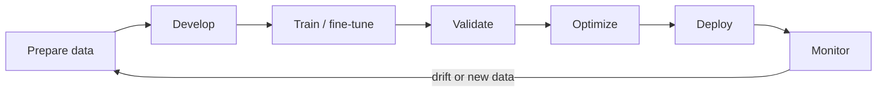

# NVIDIA 认证学习指南汇总

本文件汇总自 GitHub 上的开源 NVIDIA 备考仓库（均为公开的学习笔记、速查表、记忆卡与实操手册），按认证分章编排。

| 认证 | 指南篇数 | 其中中文原文 | 其中中译 | 未中译（代码密集实操） |
|---|---|---|---|---|
| NCP-AIN AI 网络 | 71 | 44 | 10 | 17 |
| NCP-AAI 智能体 AI | 49 | 13 | 19 | 17 |
| NCA-AIIO AI 基础设施与运营 | 94 | 34 | 60 | 0 |
| NCP-AIO AI 运维 | 90 | 32 | 46 | 12 |
| NCA-GENM 生成式 AI 多模态 | 86 | 34 | 40 | 12 |
| NCP-OUSD OpenUSD 开发 | 61 | 0 | 49 | 12 |
| NCA-GENL 生成式 AI 大语言模型 | 81 | 78 | 3 | 0 |
| NCP-AII AI 基础设施 | 38 | 32 | 6 | 0 |
| **合计** | **570** | **267** | **233** | **70** |

> 使用说明：正文中的技术标识符（属性名、API 名、命令、文件路径）保留英文原文；
> 中文仅作理解辅助，实际考试语言为英文。每篇指南均标注来源仓库与原始链接。

## NCA-AIIO · AI 基础设施与运营

### 考纲要点（12 篇）

#### 领域 1 — AI 基础知识（38%）

> 来源：`MBaranekTech/nvidia-nca-aiio-study-notes` · `domains/01-essential-ai-knowledge.md` · [原文链接](https://github.com/MBaranekTech/nvidia-nca-aiio-study-notes/blob/main/domains/01-essential-ai-knowledge.md) · 语言：英文原文 · 中译版

# 领域 1 — AI 基础知识（38%）

> **目标：** 解释 AI 生命周期，比较训练与推理，并把每个主要的 NVIDIA 软件组件放到正确的层级。

**大纲覆盖：** 软件栈 · 训练与推理 · AI/ML/DL · 应用场景 · NVIDIA 解决方案 · 开发生命周期 · CPU 与 GPU

## 1. AI、ML 与 DL

- **人工智能** 是让系统完成与人类智能相关任务的宏大目标。
- **机器学习** 是一种从数据中学习模式的 AI 方法，而不是仅依赖手工编写的规则。
- **深度学习** 是基于多层神经网络的 ML。它通常能从 GPU 并行中获益。

生成式 AI 会创造新内容；它是一种应用场景，而不是所有 AI 的同义词。常见工作负载包括计算机视觉、自然语言处理、推荐系统、语音、预测、机器人、数字孪生和药物研发。

## 2. 训练与推理

| 关注点 | 训练 | 推理 |
|---|---|---|
| 目标 | 学习模型参数 | 使用已训练好的模型 |
| 典型优先级 | 吞吐、规模、训练时长 | 延迟、吞吐、单请求成本 |
| 数据流 | 反复进行前向/反向传播 | 通常仅前向传播 |
| 内存 | 参数、激活值、梯度、优化器状态 | 参数加上运行时状态/缓存 |
| 扩展方式 | 通常多 GPU/多节点 | 从边缘设备到大型服务集群 |

这些只是倾向，而不是铁律。批量推理可能以最大化吞吐为目标；实时分布式训练同样可能对延迟敏感。

## 3. CPU 与 GPU

CPU 拥有数量不多但较为精密的核心，针对串行工作、分支处理、操作系统职责和通用场景的低延迟做了优化。GPU 拥有大量并行执行单元和高内存带宽，因此对 AI 所需的重复矩阵/张量运算非常高效。

一个有用的模型是**异构计算**：CPU 负责编排并处理控制密集型工作；GPU 加速高度并行的工作。Tensor Core 加速混合精度的矩阵运算。在精度仍可接受的前提下，降低精度可以提升速度和容量。

## 4. NVIDIA 软件栈

自硬件向上思考：

```text
Applications and workflows
NIM / Triton / application frameworks
TensorRT / RAPIDS / domain SDKs
cuDNN and accelerated libraries
CUDA platform and runtime
Driver + container runtime integration
GPU / DPU / network hardware
```



关键区别：

| 组件 | 主要作用 |
|---|---|
| CUDA | 并行计算平台、编程模型、运行时与工具 |
| cuDNN | 面向深度神经网络的 GPU 加速图元 |
| TensorRT | 优化并执行推理 |
| Triton Inference Server | 大规模提供来自多种框架的模型服务 |
| NIM | 带标准 API、经过打包且受支持的推理微服务 |
| RAPIDS | GPU 加速的数据科学库 |
| NCCL | 多 GPU/多节点集合通信 |
| AI Enterprise | 企业级软件套件、支持服务与经过验证的部署选项 |

## 5. 模型生命周期

简化后的生命周期是：收集/准备数据 → 开发模型 → 训练/微调 → 验证 → 优化 → 部署 → 监控 → 重新训练或下线。

MLOps 通过版本管理、流水线、模型注册表、部署自动化、可观测性、治理和漂移监控，让这一生命周期变得可重复。容器提升了可移植性，但宿主机仍需要兼容的驱动和容器运行时集成。

## 6. 方案选型线索

- **需要更快的推理？** 优化考虑 TensorRT；服务/打包考虑 Triton 或 NIM。
- **需要 GPU 间的集合通信？** 考虑 NCCL 和高速 scale-out 网络结构。
- **需要 GPU 数据科学？** 考虑 RAPIDS。
- **需要 GPU 遥测与诊断？** 考虑 DCGM。
- **需要 Kubernetes 上的 GPU 软件生命周期管理？** 考虑 GPU Operator。

## 自测

1. 为什么增加 GPU 并不会自动加速控制密集型的串行代码？
2. TensorRT 和 Triton 有何不同？
3. 哪种状态使训练通常比推理更占用内存？
4. 为什么“推理总是优先考虑延迟”是一个不安全的绝对化说法？

<p align="right"><a href="../README.md">↑ 返回指南</a> · <a href="02-ai-infrastructure.md">下一篇：AI 基础设施 →</a></p>

---

#### 领域 2 — AI 基础设施（40%）

> 来源：`MBaranekTech/nvidia-nca-aiio-study-notes` · `domains/02-ai-infrastructure.md` · [原文链接](https://github.com/MBaranekTech/nvidia-nca-aiio-study-notes/blob/main/domains/02-ai-infrastructure.md) · 语言：英文原文 · 中译版

# 领域 2 — AI 基础设施（40%）

<p align="center">
  
</p>

> **目标：** 将工作负载需求转化为计算、拓扑、网络、存储、设施与部署方面的选择。

**大纲覆盖：** 硬件选型 · 扩展 · 供电与制冷 · 云与本地部署 · 集群 · 设施 · 网络 · DPU

## 1. 从工作负载出发

基础设施选择要跟随工作负载：模型规模、精度、数据集、批大小、延迟目标、并发数、可靠性、数据局部性、合规要求和预算。瓶颈可能在计算、GPU 显存容量、显存带宽、互连、网络、存储、CPU 输入流水线、供电或制冷。

纵向扩展是在节点内增加能力；横向扩展是增加节点。当通信、同步、存储或不均衡主导了有效计算时，扩展效率就会下降。

## 2. GPU 拓扑

- **PCIe** 将设备连接到宿主机，并可支持 GPU 对等访问。
- **NVLink** 在受支持的系统中提供高带宽的 GPU 间互连。
- **NVSwitch** 在受支持的平台上构建高带宽的多 GPU 连接。
- **InfiniBand 或高速以太网** 提供 scale-out 的节点间网络结构。

拓扑很重要：标称的 GPU 数量几乎说明不了通信路径、局部性、超售比或端到端性能。

## 3. 听起来相似的数据路径

| 技术 | 端点 | 主要收益 |
|---|---|---|
| CUDA P2P | 受支持系统拓扑中的 GPU ↔ GPU | 避免通过宿主机内存中转 |
| GPUDirect RDMA | GPU 内存 ↔ 第三方 PCIe 设备（通常是 NIC） | 直接的网络/设备数据传输 |
| GPUDirect Storage | GPU 内存 ↔ 受支持的存储路径 | 数据 I/O 避免 CPU 回弹缓冲 |

选择技术之前，先确定两端的端点。

## 4. 网络设计

AI 集群通常按用途划分流量：计算、存储、带内管理和带外管理。设计方式各不相同；四张网络结构并非放之四海而皆准的定律。

重要概念包括带宽、延迟、抖动、丢包、拥塞、超售、拓扑、冗余和东西向流量。分布式训练对集合通信和尾延迟非常敏感。RDMA 允许以较低的 CPU 开销直接访问内存；RoCE 在以太网上承载 RDMA，需要精心设计网络结构，而 InfiniBand 则是专门构建的高性能网络结构。

## 5. 存储与数据流水线

仅有容量是不够的。需要考虑吞吐、IOPS、延迟、元数据速率、小文件行为、并行访问、缓存、局部性、持久性和检查点模式。如果 GPU 在等数据，那么更快的 GPU 也解决不了流水线瓶颈。

## 6. 设施：供电与制冷

规划要超出设备 TDP。还应包括 CPU、内存、网络、存储、供电转换、冗余、机架密度、增长余量和制冷开销。在稳态下，移除的热量等于消耗的功率。高密度部署可能需要液冷和设施改造。

实用的设施概念：

- **kW** 是瞬时功率；**kWh** 是随时间累计的能量。
- **PUE** = 设施总能耗 / IT 设备能耗；越接近 1 越好。
- 冗余供电与制冷可提升可用性，但会增加成本和容量要求。
- 铭牌最大值、设计负载和实测典型负载是不同的输入。

## 7. 本地部署与云

| 本地部署 | 云 |
|---|---|
| 更强的物理控制能力和数据局部性 | 更快的获取速度和弹性容量 |
| 前期资本支出和更长的采购周期 | 按用量计费和可用性约束 |
| 需要自行负责设施和生命周期 | 由供应商运营底层设施 |
| 在稳定高利用率下可能更经济 | 对波动性或临时性需求可能更经济 |

混合方案的决策涉及数据引力、网络出口、数据主权、技能储备、利用率、交付周期和运维模式——不只是按小时计算的算力价格。

## 8. DPU 心智模型

像 NVIDIA BlueField 这样的 DPU 使用专用计算单元和加速器处理基础设施服务。记住三个动词：**卸载**、**加速**和**隔离**网络、存储与安全任务。这可以释放宿主机的 CPU 周期，并把基础设施控制与租户工作负载分离开来。

## 自测

1. 为什么把 GPU 数量翻倍，带来的加速远小于 2 倍？
2. 哪条数据路径适合 GPU 到存储的流量？
3. 为什么机架功率并不等于各 GPU TDP 值之和？
4. 在什么情况下云的弹性优势会超过更高的稳态单位成本？

<p align="right"><a href="01-essential-ai-knowledge.md">← AI 基础知识</a> · <a href="../README.md">↑ 指南</a> · <a href="03-ai-operations.md">AI 运维 →</a></p>

---

#### 领域 3 — AI 运维（22%）

> 来源：`MBaranekTech/nvidia-nca-aiio-study-notes` · `domains/03-ai-operations.md` · [原文链接](https://github.com/MBaranekTech/nvidia-nca-aiio-study-notes/blob/main/domains/03-ai-operations.md) · 语言：英文原文 · 中译版

# 领域 3 — AI 运维（22%）

<p align="center">
  
</p>

> **目标：** 为加速基础设施选择合适的管理、监控、调度、故障排查和虚拟化方式。

**大纲覆盖：** 数据中心管理 · 监控 · 编排 · 作业调度 · GPU 指标 · 虚拟化

## 1. 观察整个系统

要监控设施、节点、网络结构、存储、GPU、调度器和应用。GPU 利用率偏低的症状可能源自存储、网络、CPU 预处理、批大小、同步、放置策略或应用本身。

GPU 信号包括利用率、显存使用量、显存带宽活动、温度、功耗、时钟频率、降频原因、ECC 错误、XID 事件、互连计数器以及进程/作业归属。要针对需要采取行动的状况设置告警；应结合趋势和工作负载上下文，而不是孤立地看某一个指标。

## 2. 工具边界

| 工具 | 主要职责 |
|---|---|
| `nvidia-smi` / NVML | 本地查询与管理接口 |
| DCGM | 面向集群的 GPU 遥测、健康、诊断、拓扑与作业统计 |
| DCGM Exporter | 将 DCGM 指标暴露给 Prometheus |
| Base Command Manager | 集群置备以及生命周期/管理工作流 |
| GPU Operator | 在 Kubernetes 中自动化 NVIDIA GPU 软件组件 |
| Kubernetes scheduler | 在资源和约束条件下放置 Pod |
| Slurm | 调度作业并分配 HPC/AI 集群资源 |

GPU Operator 负责安装和管理 GPU 使能组件。它不是 Horizontal Pod Autoscaler，也不会因为应用需求而添加集群节点。

## 3. 调度与编排

调度器把资源请求与可用资源匹配起来，执行策略并让工作排队。良好的运维需要准确的资源请求、拓扑感知、配额、优先级、隔离和计量审计。多节点作业可能需要 gang scheduling，以便所有必需的 worker 同时启动。

容器把应用程序及其依赖打包在一起。Kubernetes 编排容器化服务；Slurm 常用于批处理以及紧耦合的 HPC/AI 工作负载。二者可以共存，而且单靠任何一个标签都不保证高效的 GPU 利用率。

## 4. GPU 共享与虚拟化

| 方式 | 隔离性 | 典型用途 |
|---|---|---|
| Passthrough | 虚拟机独占物理 GPU | 最大化的直接访问 |
| vGPU | 由中间层代理的虚拟 GPU 配置文件 | 借助厂商技术栈整合虚拟机 |
| MIG | 受支持 GPU 上硬件分区的 GPU 资源 | 可预期的隔离切片 |
| Time-slicing | 按时间共享执行 | 更高并发，但隔离性弱 |

MIG 提供专用资源分区和故障隔离；时间分片不具备同等的内存隔离或故障隔离。能力和实例数量取决于具体的 GPU 与软件版本——请查阅当前的支持表。

## 5. 故障排查顺序

1. 界定影响、范围和近期变更。
2. 检查调度器/作业状态和应用日志。
3. 对比 GPU、CPU、内存、存储和网络的时间线。
4. 查看健康事件、温度、功耗、降频和错误。
5. 验证拓扑与放置假设。
6. 安全复现问题，隔离单一变量，并记录结果。

不要把 100% 利用率普遍视为好事，也不要把低利用率普遍视为坏事。目标是服务水平性能、可靠性和单位成本下的有效产出——而不是某一个仪表板数字。

## 自测

1. 哪些证据可以区分热降频与输入供给不足？
2. 为什么 GPU Operator 不能取代自动扩缩容器？
3. 什么情况下 MIG 比时间分片更合适？
4. 调度器要把多节点作业妥善放置，需要什么？

<p align="right"><a href="02-ai-infrastructure.md">← AI 基础设施</a> · <a href="../README.md">↑ 返回指南</a></p>

---

#### 参考来源与时效性

> 来源：`MBaranekTech/nvidia-nca-aiio-study-notes` · `resources/SOURCES.md` · [原文链接](https://github.com/MBaranekTech/nvidia-nca-aiio-study-notes/blob/main/resources/SOURCES.md) · 语言：英文原文 · 中译版

# 参考来源与时效性

技术性结论应优先依据官方文档。社区资源对学习策略有帮助，但不能作为最终依据。

## 考试权威来源

- [NCA-AIIO 认证页面与当前考试大纲](https://www.nvidia.com/en-us/learn/certification/ai-infrastructure-operations-associate/) — 核查于 2026-10-22
- [NVIDIA AI Infrastructure and Operations Fundamentals](https://www.nvidia.com/en-us/training/academy/course-detail/?id=course%3A16071291) — 核查于 2026-10-22

## 技术参考

- [CUDA 文档](https://docs.nvidia.com/cuda/)
- [TensorRT 文档](https://docs.nvidia.com/deeplearning/tensorrt/)
- [Triton Inference Server 文档](https://docs.nvidia.com/deeplearning/triton-inference-server/)
- [NVIDIA GPU Operator 文档](https://docs.nvidia.com/datacenter/cloud-native/gpu-operator/)
- [DCGM 文档](https://docs.nvidia.com/datacenter/dcgm/)
- [MIG 用户指南](https://docs.nvidia.com/datacenter/tesla/mig-user-guide/)
- [GPUDirect RDMA 文档](https://docs.nvidia.com/cuda/gpudirect-rdma/)
- [GPUDirect Storage 文档](https://docs.nvidia.com/gpudirect-storage/)
- [NCCL 文档](https://docs.nvidia.com/deeplearning/nccl/)
- [NVIDIA 网络文档](https://docs.nvidia.com/networking/)

## 灵感来源与学习策略

- [ziash/nvidia-nca-aiio-study-guide](https://github.com/ziash/nvidia-nca-aiio-study-guide) — 结构上的启发；未复制任何文字或课程截图
- [Eason Tech Talk: 16-hour plan and confusing topics](https://easontechtalk.com/nvidia-nca-aiio-exam/) — 实用的备考视角

## 更新本指南

当考试细节或技术事实发生变化时：

1. 使用官方来源更新相关笔记；
2. 如果考试细节有变，更新本文件及 README 中的核查日期；
3. 避免用脆弱的产品冷知识取代通用概念；
4. 在提交信息中记录重要变更。

---

#### NCA-AIIO 官方考试大纲（2026-09-29）

> 来源：`cterpening/certification-study-library` · `data/objective-snapshots/nca-aiio-official-objectives-2026-09-29.txt` · [原文链接](https://github.com/cterpening/certification-study-library/blob/main/data/objective-snapshots/nca-aiio-official-objectives-2026-09-29.txt) · 语言：英文原文 · 中译版

NVIDIA-Certified Associate  
AI Infrastructure and Operations  
(NCA-AIIO)

## 考试大纲

下表概述了认证考试所涵盖的主题领域，以及每个科目在考试中所占的比例。

| 主题领域 | 占考试比例 | 涵盖的主题 |
|---|---|---|
| Essential AI Knowledge（AI 基础知识） | 38% | 描述 AI 环境中使用的 NVIDIA 软件栈。<br>比较训练与推理在架构需求与考量上的异同。<br>区分 AI、机器学习与深度学习的概念。<br>解释促成近期 AI 快速改进与普及的因素。<br>解释关键的 AI 用例与行业。<br>解释各类 NVIDIA 解决方案的目的与用例。<br>描述与 AI 开发及部署生命周期相关的软件组件。<br>比较 GPU 与 CPU 架构。 |
| AI Infrastructure（AI 基础设施） | 40% | 确定特定 AI 训练任务用例的硬件要求。<br>针对不同用例横向扩展 GPU 基础设施。<br>识别数据中心内供电与散热要求相关的关键概念与高阶规格。<br>阐述本地部署（on-prem）与云基础设施相比的关键优势、挑战与考量因素。<br>识别加速基础设施集群的关键组件与考量事项。<br>识别设施（facility）要求。<br>确定 AI 工作负载的网络需求。<br>识别并说明数据中心网络协议与关键概念。<br>识别高速数据中心网络方案及其用例。<br>阐述 DPU 在数据中心中的目的与优势。 |
| AI Operations（AI 运维） | 22% | 描述 AI 数据中心管理与监控的核心要点。<br>描述 AI 集群编排与作业调度的核心要点。<br>阐述与 GPU 监控相关的关键度量指标与判据。<br>识别虚拟化加速基础设施时的关键考量事项。 |

---

#### NCA-AIIO 考试大纲

> 来源：`cterpening/certification-study-library` · `data/objective-snapshots/archive/nca-aiio-99feae0bb9bd6c7ade80eddfb848aaddde0582ee7a739302e65411babb367ed7.txt` · [原文链接](https://github.com/cterpening/certification-study-library/blob/main/data/objective-snapshots/archive/nca-aiio-99feae0bb9bd6c7ade80eddfb848aaddde0582ee7a739302e65411babb367ed7.txt) · 语言：英文原文 · 中译版

NVIDIA 认证助理
AI 基础设施与运维
(NCA-AIIO)
考试大纲
下表概述了认证考试所涵盖的主题领域，以及每个主题在考试中所占的比重。
主题领域
考试占比
涵盖的主题
AI 基础知识：
38%
描述 AI 环境中使用的 NVIDIA 软件栈。
比较并对比训练与推理在架构上的需求与考量因素。
辨析 AI、机器学习与深度学习这三个概念。
说明促成近期 AI 快速进步与普及的因素。
说明关键的 AI 用例与行业。
说明各类 NVIDIA 解决方案的目的与用例。
描述与 AI 开发及部署生命周期相关的软件组件。
比较并对比 GPU 与 CPU 架构。
AI 基础设施
40%
确定特定 AI 训练任务用例的硬件需求
针对不同用例扩展 GPU 基础设施
确定数据中心内与供电和散热要求相关的关键概念与高级规格
阐明本地部署与云基础设施相比的关键优势、挑战与考量因素
确定加速基础设施集群的关键组件与考量因素
确定设施要求
确定 AI 工作负载的网络需求
识别并说明数据中心网络协议与关键概念
识别高速数据中心网络方案及其用例
说明 DPU 在数据中心中的目的与优势
AI 运维
22%
描述 AI 数据中心管理与监控的基本要素。
描述 AI 集群编排与作业调度的基础要素。
阐明与 GPU 监控相关的关键度量指标与判定标准。
确定虚拟化加速基础设施时的关键考量因素。
练习题
通过样题熟悉主题以及你在认证考试中可能遇到的题型。
学习模式
作答每道题目后立即获得反馈，包括正确答案、解释以及延伸阅读的链接。
在学习模式下尝试练习题

---

#### NVIDIA 认证专员：AI 基础设施与运维 (NCA-AIIO) 学习指南

> 来源：`cterpening/certification-study-library` · `guides/NCA-AIIO-nvidia-ai-infrastructure-operations-associate.md` · [原文链接](https://github.com/cterpening/certification-study-library/blob/main/guides/NCA-AIIO-nvidia-ai-infrastructure-operations-associate.md) · 语言：英文原文 · 中译版

# NVIDIA 认证专员：AI 基础设施与运维 (NCA-AIIO) 学习指南


**目标分布表（2026 年 11 月 23 日）。** NVIDIA 公布了 22 个主题。Essential AI Knowledge（AI 基础知识）占八个主题（38%），AI Infrastructure（AI 基础设施）占十个主题（40%），AI Operations（AI 运维）占四个主题（22%）。基础设施部分措辞的变化并未改变原有的教学范围。归档版大纲中还包含较早的资源与实践类标签。修订版学习指南的完整来源验证仍在进行中。[来源与学习资源](../docs/research/2026-11-23-refresh-23.md#nca-aiio)

> **独立的 AI 辅助资源 —— 历史来源与目标已核对；人工复核待完成。** 全部 22 项公开目标、六页学习指南、交付细节及部分运维文档已于 2026 年 9 月 29 日完成审阅。本地工作簿通过了 34 项检查；其中八项基础设施实践仍处于提案状态。参见[深度审阅报告](../docs/research/2026-09-29-nca-aiio-deep-review.md)。参见[覆盖记录](../docs/SOURCE-VALIDATION.md#nca-aiio-coverage-record)。

**当前基线：** NCA-AIIO 是一门正在开设的英文、远程监考的专员级考试，共 50 题，限时一小时。认证页面标注价格为 125 美元；单独查看 DGX 学习路径卡片时显示为 135 美元。请以认证页面作为考试依据，并在购买前核对 Certiverse 结账总价。<br>
**即将发生的变化：** 2026 年 9 月 29 日查看的认证页面上没有任何改版或停考公告。<br>
**先决条件：** 认证页面列出的是基本的数据中心知识要求。所链接的学习指南建议具备相关学历和企业经验；但并未将其标注为强制报考条件。其培训课程明确为可选项。<br>
**有效期：** NVIDIA 表示该证书有效期为两年，可通过重新参加考试来续期。注册前请重新核对政策、价格和可选的交付方式。

**请核实最新信息 —— 考试政策：** NVIDIA 表示考试只公布通过/不通过，不给分数。其公开 FAQ 规定：重考需间隔 14 天；从首次购买考试起算的 12 个月内最多尝试五次；远程监考不设间隔期。注册前请检查具体的预约、身份核验与考场便利条件；本次审阅未执行任何预约操作，也未安装安全浏览器。[项目政策](https://www.nvidia.com/en-us/learn/certification/)

## 如何使用本指南


把基础设施当作一条以证据支撑的路径来学习：工作负载需求 → 计算与显存行为 → 服务器/GPU 拓扑 → 网络与存储的数据流动 → 机房容量 → 受支持的软件栈 → 调度器/编排器的资源分配 → 遥测与诊断 → 安全变更或升级上报。不要把它变成一道"背产品名称"的练习题。对于每一个选项，都要说明它解决了什么约束、用什么信号来验证，以及可能引入什么故障。

使用只读检查、模拟器、文档以及你有权操作的硬件。未经审批、没有维护计划和回滚方案时，绝不要在共享/生产设备上运行压力测试、重置、固件、网络结构或分区相关命令。

> **关于关联条目：** `Related item:` 提示框用于补充先决条件、架构或运维方面的背景信息。它有助于理解该主题，但并不表示 NVIDIA 在公开考试大纲中使用了这一表述。

## 考试大纲对照表


**当前考试大纲：** 官网与[官方学习指南 PDF](https://dam-cdn.nvd.orangelogic.com/AssetLink/x874j05hy3m3r2sor84kpvp70750m468.pdf)在八个知识主题、十个基础设施主题和四个运维主题上保持一致。该 PDF 带有 2026 年 1 月的版本标记；仅凭该标记并不能确定考试切换日期。被监测的目标与生命周期快照未发生变化。

| 主题领域 | 权重 | 需要产出的证据 |
|---|---:|---|
| Essential AI Knowledge | 38% | 从工作负载到技术栈的映射；AI/ML/DL 与 CPU/GPU 推理分析；训练与推理对比；NVIDIA 解决方案选型 |
| AI Infrastructure | 40% | 计算、显存、拓扑、网络、存储、供电/散热以及本地部署/云部署的决策记录 |
| AI Operations | 22% | 管理、调度/编排、GPU 健康遥测以及虚拟化/分区运维操作手册 |

## 1. AI 基础知识（Essential AI Knowledge）— 38%


### 1.1 AI、机器学习与深度学习


人工智能是执行智能行为相关任务的系统所要达成的宏大目标。机器学习从样本中学习模式，而不是把每一条规则都编码进去。深度学习使用分层的神经网络，并受益于并行的张量/矩阵运算。生成式 AI 生成新内容；它只是一个工作负载家族，并不是所有 AI 系统的同义词。

监督学习使用带标签的样本，无监督学习在没有目标标签的情况下发现结构，强化学习则通过动作/奖励的交互来学习。训练改变模型参数。验证支持模型选择与调优。测试用于估计模型在留出数据上的表现。推理是把训练好的模型应用到新输入上。要把这些阶段区分开来，因为它们的基础设施特征各不相同。

### 1.2 GPU 为何能加速 AI


CPU 的核心数量较少但较为精密，针对多样、延迟敏感的控制流做了优化。GPU 拥有大量执行单元，专为高吞吐的并行工作而设计。神经网络训练与推理包含大量矩阵/张量算术运算，可以拆分到多个 GPU 资源上并行执行。但这并不意味着每个工作负载都是 GPU 受限的：预处理、控制平面工作、序列化、网络和存储仍然可能受 CPU 或 I/O 限制。

要理解各部分的作用，而不是背诵晶体管级别的细节：

- CUDA 为通用 NVIDIA GPU 计算提供编程平台和软件接口。
- CUDA core 执行通用并行算术运算；Tensor Core 加速 AI 中大量使用的受支持矩阵运算。
- GPU 高带宽显存保存模型参数、激活值、优化器状态和工作数据。显存容量可能和原始算力同等重要。
- PCIe 将设备连接到主机；NVLink 和 NVSwitch 在受支持的拓扑中提供更高带宽的 GPU/CPU 或 GPU/GPU 通路。
- NCCL 提供感知拓扑的集合通信原语，例如用于多 GPU 工作的 all-reduce。
- 在受支持的系统上，GPUDirect 技术可以减少 GPU、网络或存储之间的数据路径拷贝以及 CPU 的参与。

`Related item:` **算术强度与瓶颈。** 快速加速器也可能苦于等待数据。在建议增加 GPU 之前，先问清楚限制资源到底是算力、设备显存、互连、网络、存储、CPU 预处理，还是功耗/散热余量。

### 1.3 训练与推理是两种不同的系统


训练通常强调持续吞吐、大显存容量、检查点持久性，以及跨多 GPU/多节点的高效集合通信。长时间运行的任务一旦失败，可能浪费大量时间和算力。推理通常强调请求延迟、并发能力、可用性、可预测的尾部表现以及每次有效响应的成本。批量推理可能类似以吞吐为导向的训练运维；交互式推理则不然。

先写一份需求说明表，包含模型/数据规模、精度、批量/并发、延迟或完成时间目标、可用性、隐私、数据驻留、检查点/恢复点、增长与预算。之后再选择硬件和拓扑。只有当工作本身可以并行、且通信与数据供给能让这些 GPU 保持高产时，增加 GPU 才有意义。

### 1.4 NVIDIA 软件与解决方案栈


按层次来思考：

1. **系统与固件：** DGX/HGX 或认证系统、CPU、GPU、DPU、显存、本地存储、NIC/HCA、BMC 以及网络结构组件。
2. **操作系统与驱动：** 受支持的 Linux/DGX OS 或云镜像、NVIDIA 驱动、在需要时配置的 Fabric Manager，以及与 CUDA 运行时的兼容性。
3. **加速库/框架：** CUDA 以及 cuDNN、NCCL 等工作负载库；优化过的 PyTorch/TensorFlow 及其他框架容器。
4. **打包与目录：** NVIDIA Container Toolkit 将容器连接到 GPU；NGC 分发受支持的容器、模型、Helm chart 和各类制品。
5. **优化与服务：** TensorRT 优化受支持的推理图；Triton Inference Server 以批处理、并发和指标的方式提供模型服务；NIM 将受支持的推理微服务打包。
6. **集群运维：** Kubernetes 与 GPU Operator 负责云原生的资源生命周期；Slurm 负责排队的批处理/HPC 调度；Base Command Manager 负责 AI/HPC 集群的部署与管理；DCGM 和 exporter 负责 GPU 遥测与健康状况。
7. **企业/平台层：** NVIDIA AI Enterprise 提供企业级支持的软件套件；DGX、BasePOD 和 SuperPOD 描述的是逐步更广的、经过验证的系统/平台形态。

不要声称某个具名产品对所有环境都是必需的。要依据所需的支持能力、规模、生命周期归属、工作负载形态和既有平台来选型。

`Related item:` **兼容性矩阵。** 驱动、CUDA 运行时、框架/容器、GPU 架构、operator 和编排版本共同构成一份契约。"最新"并不等于兼容的证据；要记录经过测试的版本，并查阅当前的支持矩阵。

### 1.5 使用场景与采用动因


AI 工作负载横跨计算机视觉、自然语言处理、推荐、预测、仿真、科学计算、机器人技术和生成式系统。近期的采用趋势反映了更大的数据集/模型、更好的算法、更强的加速器性能、成熟的框架、云端访问能力以及可直接部署的预训练模型。把每个使用场景映射到具体的结果与风险上，而不是只映射到一个模型：诊断辅助、安全控制器和营销助手对准确率、延迟、可用性和治理的要求各不相同。

## 2. AI 基础设施（AI Infrastructure）— 40%


### 2.1 从工作负载出发做容量估算


从工作本身出发，而不是从偏好的系统出发。估算模型加上运行时的显存占用、训练时的激活值/优化器状态或推理时的 key/value 缓存、批量/并发、数据速率、检查点体量和通信量。有意识地选择精度和并行方式。数据并行、张量并行、流水线并行和专家并行分发的是工作的不同部分，并带来不同的通信模式。

扩展有三个边界：

- **向上扩展（Scale up）：** 更快/更大的 GPU 和更强的节点内拓扑可以缩短协作距离，但存在上限。
- **向外扩展（Scale out）：** 更多节点可以增加容量，但需要低延迟、高带宽的网络结构、高效的集合通信以及运维上的一致性。
- **共享/分区：** MIG、vGPU、时间切片或调度器分配可以提升利用率，但隔离性、兼容性、性能可预测性和许可情况各不相同。

容量规划依据的是有效产出工作量，而不是已安装的加速器数量。要跟踪排队时间、任务完成情况、有效 token/样本数、利用率、显存余量、通信占比、失败次数以及能耗/成本。

### 2.2 节点与集群组件


一个加速节点组合了 CPU、系统内存、GPU、本地存储、供电/散热、管理控制器和网络适配器。GPU 局部性很重要：哪些 GPU 共享 NVLink/NVSwitch 通路、PCIe 交换机或 CPU NUMA 域，会改变通信性能。在集群层面，要在逻辑上区分：

- 用于分布式工作负载流量的计算网络结构；
- 用于数据集和检查点的存储/数据路径；
- 用于部署和恢复的管理/带内与带外路径；
- 用于用户访问和推理访问的客户端/服务网络。

物理设计还需要考虑机架、配电、散热、结构化布线、检修空间、消防、物理安防以及受支持的环境范围。机房容量属于架构的一部分，而不是安装后期才处理的事项。

`Related item:` **故障域。** 一个机架、ToR 交换机、供电回路、冷却回路或共享存储服务都可能同时拖垮许多节点。可用性评估必须建模相关故障、备件、更换时间以及降容运行。

### 2.3 供电与散热


实际部署要依据厂商的系统规格和经过认证的设计方案。在概念上要区分铭牌容量、预期功耗、瞬态峰值以及可用电路/散热的余量。供电效率与散热能力共同限制密度。风冷在某种机架密度下可能适用，而在另一种密度下则需要直接液冷或不同的机房设计。

要记录公用供电/馈电冗余、UPS/发电机预案、PDU 容量、电压/电流、机架密度、气流/液流分配、温度/泄漏监测以及应急流程。在没有工程评审的情况下，不要把一台服务器的热设计外推到整个机架。

### 2.4 网络与数据流动


Ethernet 是常见的数据中心通用网络，支持路由/交换方式的管理、存储和工作负载流量。InfiniBand 广泛用于低延迟、高吞吐的 HPC/AI 网络结构。RoCE 在配置好的 Ethernet 网络结构上承载 RDMA。RDMA 让受支持的端点以更少的 CPU/内核参与访问远端内存；GPUDirect RDMA 可以让网络路径更直接地连接到 GPU 显存。

要了解以下方面的作用：

- NIC 与 HCA 的区别及其受支持的网络结构/协议；
- 交换机、leaf/spine 拓扑、链路聚合与冗余路径；
- 带宽、延迟、抖动、超售以及拥塞/丢包行为；
- MTU 一致性、路由、寻址、DNS/NTP 以及管理面的可达性；
- 光模块/线缆/收发器以及端到端认证；
- 遥测计数器、错误、丢包、重传与链路健康状况。

在受支持的架构中，DPU 会卸载并加速网络、安全、存储等基础设施功能，有助于隔离或释放主机 CPU 的工作负载。它并不是 CPU 或交换机的通用替代品。

`Related item:` **集合通信。** 分布式训练可能需要频繁同步。由于拓扑、拥塞、rail 映射或单条链路降级等原因，看起来健康的网络仍可能与 all-reduce 模式不匹配。

### 2.5 存储与数据路径


AI 存储必须能在所需并发下提供数据集、写入检查点并保留制品。要考虑容量、聚合与单客户端吞吐、元数据性能、小文件与大文件的差异、缓存/本地 NVMe、并行/对象/文件访问、持久性、复制、备份与恢复。GPUDirect Storage 可以缩短受支持的 GPU/存储路径，但需要端到端的硬件/软件兼容性。

要保护数据来源与权限。高吞吐并不足以成为把敏感训练数据复制到无人管理的临时空间的理由。要测量 stage-in 时间、加速器饥饿时间、检查点耗时、恢复时间以及数据错误。

**实践深度 —— 检查点预算：** 在一个最初的规划示例中，8 个 worker 在 80 秒内各写入 40 GiB。聚合载荷目标为 320 GiB / 80 s = 4 GiB/s，而这还没算上协议、元数据、争用和持久性方面的开销。标称 4 GiB/s 的设备规格没有任何余量，也无法证明并发检查点或恢复能够成功。要测量整条路径并保留一次恢复结果。NVIDIA 的[2023 年 1 月存储文章](https://developer.nvidia.com/blog/tips-on-scaling-storage-for-ai-training-and-inferencing/)解释了为什么容量增长、吞吐和维护期可用性需要分开规划。它给出的一般性建议和示例并不构成当前硬件选型规模的保证。

### 2.6 本地部署、云与混合


本地基础设施可以提供数据驻留、控制力、可预测的预留容量和更深的拓扑选择，但需要资本投入、较长的机房建设周期、生命周期技能和备用容量。云可以加快接入、提供弹性和地域选择，但会引入服务配额、出口流量/数据引力、实例可得性、共同责任划分和持续成本等考量。托管/机房托管（colocation）与混合模式可以对这些取舍进行切分。

要结合工作负载的时长与波动性、数据位置、监管要求、延迟、预留/排队行为、人员能力、刷新周期、灾难恢复、支持和总成本来比较各选项。可移植性并不是自动具备的：镜像、身份、网络、存储、调度器、可观测性和数据传输行为都需要专门设计。

## 3. AI 运维（AI Operations）— 22%


### 3.1 把部署与管理当作一个生命周期


维护一份从机房/机架到系统、BMC、NIC/HCA、GPU UUID、固件、OS/内核、驱动、CUDA/容器运行时和编排标签的资产清单。使用受支持的、带版本管理的镜像并实施配置管控。在投产前完成老化（burn-in）与验收；保留序列号、拓扑、基线诊断结果和支持权益。

变更需要依赖检查、维护窗口、工作负载排空、备份/配置导出、分阶段发布、验证和回滚。固件、驱动和 operator 升级是相互关联的变更。软件包安装成功并不能证明 CUDA 应用、集合通信、监控和调度器仍然正常。

**请核实最新信息 —— 版本发布行为：** 所查看的 [GPU Operator 发布说明](https://docs.nvidia.com/datacenter/cloud-native/gpu-operator/latest/release-notes.html)列出 26.7.1。其中描述了一项等待驱动校验的 operand 启动修复，以及在后续重新配置 MIG 之前从驱动 595.91.07 升级到 615.71.09 时存在的一个已知 H100 问题。请把这视为需要仔细阅读具体升级路径和恢复流程的理由，而不是改动本机的建议。此前的 26.7.0 说明引入了 `GPUCluster`/DRA 路径，它无法与 `ClusterPolicy` 在同一个集群中共存，并且有各自的先决条件。不要把旧的安装配方照搬到这个路径上。

### 3.2 调度与编排


Slurm 跨节点和资源对排队任务进行调度，适合批处理/HPC 和训练类工作。Kubernetes 为容器化的服务和任务协调期望状态；NVIDIA GPU Operator 在受支持的集群中自动化 driver/toolkit/device-plugin/feature-discovery/MIG/DCGM 等组件。两者都可以支持多种工作负载类型；应基于平台契约来选择，而不是看口号。

资源请求必须反映 GPU 或 MIG 设备、CPU、内存、存储、网络/拓扑和时间。队列/分区、配额、优先级、抢占和预留要在公平性与业务优先级之间取得平衡。节点标签/污点或约束可以把任务放到兼容的 GPU/拓扑资源池上。要记录工作负载为何处于等待、被驱逐、被抢占或利用率不足的状态。

`Related item:` **组调度与拓扑感知。** 分布式任务可能需要所有 worker 同时到位，并受益于在高带宽局部性范围内的放置。分配到分散或不完整的资源上，可能浪费容量或导致超时。

### 3.3 监控 GPU 与系统


`nvidia-smi` 适用于本地识别和只读状态查看。DCGM 提供面向集群的观测、健康检查、诊断与集成能力；DCGM Exporter 把指标暴露给 Prometheus 等监控系统。Base Command Manager 或其他管理平台补充了集群批量部署与运维能力。具体命令和字段含义请查阅最新文档。

要观察多个层次：

- GPU 在位情况、驱动状态、利用率和显存分配；
- 温度、功耗、时钟频率以及降频（throttling）原因；
- ECC 及其他错误/事件计数器、Xid 事件和健康策略；
- PCIe/NVLink/网络结构流量与错误；
- CPU、RAM、磁盘、网络、文件系统以及 BMC/机房健康状况；
- 调度器队列、任务失败/重试以及有效吞吐；
- 适用时的推理延迟/吞吐/错误以及模型层面的质量。

高利用率不一定就是好事，低利用率也不一定就是坏事。要把遥测数据与工作负载阶段、基线、拓扑和服务结果关联起来分析。GPU 可能忙于执行低效的工作；延迟类服务也可能在刻意保留余量的情况下保持健康。

**实践深度 —— 遥测契约：** 在解释某个数值之前，先确认字段 ID、类型、单位、实体、时间戳和采集状态。DCGM 字段 203 以整数百分比报告 GPU 利用率；字段 1613 报告浮点比值。因此 80 和 0.8 描述的可能是同一次观测。显存字段 252 以 MiB 报告；1627 报告字节数。它们是契约不同的不同字段。做算术运算之前先检查带类型的空值/不支持值；字段不可用并不能证明没有活动。本地工作簿用明确的状态值建模了这条边界。[DCGM 字段定义](https://docs.nvidia.com/datacenter/dcgm/latest/reference/field-identifiers.html)。

[Exporter 参考文档](https://docs.nvidia.com/datacenter/dcgm/latest/reference/dcgm-exporter-metrics.html)区分了字段指标与 exporter 自有计数。`DCGM_FI_DEV_XID_ERRORS` 是一个表示错误码的 gauge，因此数值上升并不等于事故次数。窗口化的 Xid 采样计数与累计观测记录含义不同；采集节奏、初始化和重置都很重要。配置本身并不保证运行时的字段支持。要把 exporter/DCGM 版本一并记录下来，并在聚合前区分物理 GPU、MIG 实例和负载标签。

### 3.4 安全地诊断与升级上报


按证据顺序来：界定影响与受影响范围；检查近期变更与维护；查看调度器/服务状态；确认节点/GPU 可见性；比较健康、热/功耗和错误信号；检查网络/存储路径；只在授权且安全的前提下复现；必要时排空/隔离节点；然后再采集厂商支持包。

不要仅仅因为某条命令存在就去重置 GPU、重启驱动、更改 MIG 模式或运行高强度诊断。这些操作可能终止工作负载或影响节点。要记录时间戳、任务/节点/GPU ID、版本、日志、拓扑、命令、结果和恢复情况。

### 3.5 虚拟化与 GPU 共享

GPU 直通（passthrough）把一块物理 GPU 分配给某个 VM，性能强劲、工作负载可见性简单，但分配粒度较粗。在受支持的虚拟化/许可栈下，NVIDIA vGPU 在多个 VM 之间共享受支持的 GPU。MIG 将受支持的 GPU 切分为彼此隔离的 GPU 实例，每个实例拥有专属的计算与内存资源。时间切片（time slicing）提升并发能力，但不具备 MIG 的硬件分区特性。

选择时应综合考虑工作负载规模、隔离性、确定性、密度、平台、实时迁移/支持需求以及许可。要验证 GPU、驱动、hypervisor/容器平台以及工作负载都支持所选模式。只有当 profile 与实际的内存/算力需求相匹配、并管理好碎片时，切分才能提升利用率。

**实践深度 —— 分配不等于容量：** [时间切片文档](https://docs.nvidia.com/datacenter/cloud-native/gpu-operator/latest/gpu-sharing.html) 指出，副本（replica）并不提供 MIG 式的内存或故障隔离。申请多个副本并不意味着算力按比例增加。可选的 `failRequestsGreaterThanOne` 准入规则可以拒绝这类请求，但它并不会凭空产生算力配额。在文档描述的 device-plugin 时间切片配置下，DCGM Exporter 无法把指标关联到具体的容器。Operator 同样不会自动监控其时间切片 ConfigMap 的变更。请在获得授权的环境中验证文档给出的更新路径与更新结果。

[MIG 概念](https://docs.nvidia.com/datacenter/tesla/mig-user-guide/latest/concepts.html) 区分了 GPU 实例（GI）与其中的计算实例（CI）：同一 GI 内的 CI 共享该 GI 的内存与计算引擎。把同一份 GI 内存按每个 CI 各算一次，就等于凭空捏造容量。物理 GPU 总量、已分配的 GI 容量和逻辑副本数属于不同的核算层级。实际可用的 profile 以及合法的放置方式取决于 GPU 与驱动；下面给出的合成数字并不是受支持 profile 的规格说明。[部署注意事项](https://docs.nvidia.com/datacenter/tesla/mig-user-guide/latest/deployment-considerations.html) 还区分了不同 GPU 世代以及会造成中断的模式切换。实际部署时应使用当前的矩阵与完整流程。

## 已执行的本地遥测与容量工作簿


这个原创的、仅依赖标准库的 Python 示例会解析合成的 JSON，并检查归一化、过期/未知值、实体作用域以及重复容量。把它当作普通 Python 脚本运行即可。它不写入任何文件，也不调用任何 GPU、网络、集群或云服务。`None` 表示该示例无法给出可用的测量结果。真实的采集器必须先转换 DCGM 带类型的空值/错误值；它既不是 DCGM 绑定，也不是 Prometheus 解析器。

```python
import copy
import json
import math

# Original synthetic records, not a DCGM or Prometheus wire format.

# An upstream collector must first translate typed DCGM blank/error values.

CONTRACT = {
    203: ("gpu_utilization", "percent", 0.01, 100, {"GPU"}, int),
    1613: ("gpu_utilization", "ratio", 1, 1, {"GPU"}, float),
    252: ("memory_used", "MiB", 1048576, None, {"GPU", "GI", "CI"}, int),
    1627: ("memory_used", "bytes", 1, None, {"GPU", "GI", "CI"}, int),
}

def normalize(record, now=1000, max_age=30):
    if type(record["field_id"]) is not int:
        raise ValueError("field ID must be an integer")
    if record["field_id"] not in CONTRACT:
        raise ValueError("unknown field contract")
    name, unit, scale, ceiling, entities, kind = CONTRACT[record["field_id"]]
    if record["entity"] not in entities or not record["entity_id"]:
        raise ValueError("wrong entity scope or missing identity")
    if record["unit"] != unit:
        raise ValueError("unit does not match field ID")
    timestamp = record["timestamp"]
    if type(timestamp) is not int or timestamp > now:
        raise ValueError("invalid or future timestamp")
    status = record["status"]
    if status not in {"valid", "unsupported", "blank", "error"}:
        raise ValueError("unknown collection status")
    if status != "valid" or now - timestamp > max_age:
        return None
    value = record["value"]
    valid_type = type(value) is int if kind is int else type(value) in {int, float}
    if not valid_type or not math.isfinite(value) or value < 0:
        raise ValueError("invalid numeric value")
    if ceiling is not None and value > ceiling:
        raise ValueError("outside field range")
    return (name, record["entity"], record["entity_id"], value * scale)

def unique_capacity(rows):
    # Each row must represent one already identified physical GPU or one GI.
    # Caller keeps those two levels separate; never add a parent and its children.
    if len({row["level"] for row in rows}) > 1:
        raise ValueError("mixed accounting levels")
    capacities = {}
    for row in rows:
        level = row["level"]
        if level not in {"GPU", "GI"}:
            raise ValueError("unsupported accounting level")
        key = (row["gpu_uuid"], row.get("gi_id") if level == "GI" else None)
        memory = row["memory_mib"]
        if not key[0] or (level == "GI" and key[1] is None):
            raise ValueError("missing identity")
        if type(memory) is not int or memory <= 0:
            raise ValueError("invalid capacity")
        if key in capacities and capacities[key] != memory:
            raise ValueError("conflicting inventory for one entity")
        capacities[key] = memory
    return sum(capacities.values())

passed = 0

def check(condition):
    global passed
    assert condition
    passed += 1

def rejects(fn, value):
    try:
        fn(value)
    except ValueError:
        check(True)
    else:
        raise AssertionError("expected invalid fixture to be rejected")

raw = '''[
 {"field_id":203,"unit":"percent","entity":"GPU","entity_id":"GPU-A","timestamp":990,"status":"valid","value":80},
 {"field_id":1613,"unit":"ratio","entity":"GPU","entity_id":"GPU-A","timestamp":990,"status":"valid","value":0.8},
 {"field_id":252,"unit":"MiB","entity":"GI","entity_id":"GPU-A/GI-0","timestamp":990,"status":"valid","value":10},
 {"field_id":1627,"unit":"bytes","entity":"GI","entity_id":"GPU-A/GI-0","timestamp":990,"status":"valid","value":10485760}
]'''
samples = json.loads(raw)
check(normalize(samples[0]) == normalize(samples[1]))
check(normalize(samples[2]) == normalize(samples[3]))
base = samples[0]
check(normalize(dict(base, value=0))[-1] == 0)
check(normalize(dict(base, timestamp=970)) is not None)
check(normalize(dict(base, timestamp=969)) is None)
for status in ("unsupported", "blank", "error"):
    check(normalize(dict(base, status=status, value=9223372036854775794)) is None)
for changes in (
    {"unit": "ratio"}, {"field_id": 9999}, {"field_id": True},
    {"entity": "GI"}, {"entity_id": ""}, {"timestamp": 1001},
    {"timestamp": True}, {"status": "invented"}, {"value": True},
    {"value": -1}, {"value": 101}, {"value": 80.5},
):
    rejects(normalize, dict(base, **changes))
rejects(normalize, dict(samples[1], value=float("nan")))
rejects(normalize, dict(samples[1], value=float("inf")))
rejects(normalize, dict(samples[1], value=1.1))
check(normalize(dict(samples[1], value=1))[-1] == 1)

physical = [dict(level="GPU", gpu_uuid="GPU-A", memory_mib=65536,
                 replica=i) for i in range(8)]
check(unique_capacity(physical) == 65536)
check(sum(r["memory_mib"] for r in physical) == 524288)
instances = [dict(level="GI", gpu_uuid="GPU-A", gi_id=0,
                  ci_id=i, memory_mib=10240) for i in range(2)]
check(unique_capacity(instances) == 10240)
instances.append(dict(level="GI", gpu_uuid="GPU-A", gi_id=1,
                      ci_id=0, memory_mib=20480))
check(unique_capacity(instances) == 30720)
rejects(unique_capacity, physical + instances)
conflict = copy.deepcopy(physical)
conflict[1]["memory_mib"] = 131072
rejects(unique_capacity, conflict)
rejects(unique_capacity, [dict(instances[0], gi_id=None)])
rejects(unique_capacity, [dict(physical[0], memory_mib=True)])
rejects(unique_capacity, [dict(physical[0], level="CI")])
check(unique_capacity([]) == 0)

print(json.dumps(dict(normalized_utilization=normalize(samples[0])[-1],
                     normalized_memory_bytes=normalize(samples[2])[-1],
                     eight_replicas_physical_mib=unique_capacity(physical),
                     three_compute_instances_gi_mib=unique_capacity(instances),
                     checks=passed), sort_keys=True))
print(f"{passed} local telemetry and capacity checks passed")
```
验证结果是**34 项检查通过**：利用率归一化为 0.8，10 MiB 归一化为 10,485,760 字节。8 个合成副本仍然只代表一块 65,536 MiB 的物理 GPU。3 条 CI 记录跨越 2 个 GI，总计 30,720 MiB；重复出现的第一个 GI 只计一次。空清单只有在明确已知为空列表时才返回零，而不是在发现失败时返回零。该测试夹具信任实体标识与采集状态。它不探测硬件、不校验真实的 MIG profile、不实现完整的输入校验、不证明隔离性，也不确立应用性能。

## 综合场景


### 场景 1：分布式训练平台


团队需要支持大 checkpoint 的多节点训练。要把模型/数据/精度与恢复目标换算为每节点的内存、GPU 数量和拓扑；选择横向扩展的网络结构（fabric），并做兼顾 NCCL 的验证；确定并行存储与 checkpoint 窗口的规模；选用 Slurm 或其他获得授权的调度器；定义队列公平性、拓扑感知放置、DCGM/网络结构/存储遥测以及感知故障域的重启测试。证据包包含需求假设、拓扑/数据路径图、兼容性矩阵、集合通信基线、checkpoint/恢复结果以及回滚与升级处理路径。

### 场景 2：共享推理服务


多个团队都需要低延迟推理，但各服务单独占用整块 GPU 会造成资源闲置。要对照内存、隔离性和尾延迟需求，比较整卡分配、MIG、vGPU 与时间切片。基于受支持的 GPU Operator 组件设计 Kubernetes 方案，涵盖放置、配额与健康信号；验证批处理/并发行为以及故障恢复。如果延迟、错误率或租户隔离出现退化，就不能把密度提升称为成功。

### 场景 3：本地部署与云端扩展


需求增长快于现有设施的承载能力。要把机房的电力/制冷条件与采购交付周期，同云端配额、拓扑、存储/数据搬运以及持续成本进行对比。还应纳入安全/数据驻留、人员技能、支持与恢复等因素。有充分理由的混合方案可以把受管控的数据和稳定的训练容量保留在本地，同时用已批准的云容量应对突发负载——但前提是身份、镜像、可观测性、数据传输和成本管控都经过验证。

每个场景都是原创的建议性实践。针对训练场景，要包含 checkpoint 的计算过程和实际可用的恢复判据。针对共享推理，要说明为什么副本数量和缺失的按容器遥测无法确立租户隔离。针对扩展场景，在分配突发流量之前，先比较单点故障之后的可用容量与稳定需求。

## 实操证据实验室


以下八项活动均为**建议性内容**，学习时间为作者估算。只有上面那个独立的本地工作簿是真正执行过的。请使用公开文档、本地模拟器或获得授权的实验室硬件。要明确标注模拟得到的证据，并将其与实测的硬件结果区分开。

1. **工作负载到基础设施的映射（3–5 小时）：** 定义一个训练工作负载和一个推理工作负载。估算内存、算力、数据、延迟/吞吐、可用性与恢复要求；选定一种基础设施模式，并记录被否决的备选方案。
2. **拓扑与数据路径实验（3–5 小时）：** 为一个有文档记录的系统绘制 CPU/NUMA、PCIe、GPU/NVLink/NVSwitch、NIC/HCA 以及存储路径的拓扑图。标出可能的瓶颈，以及可用于验证每个瓶颈的计数器/工具。
3. **机房设施与容量练习（3–4 小时）：** 仅依据公开的系统规格，编制一份机架级的电力/制冷/布线/故障域检查清单。不要把这项练习当作可直接部署的电气/机电设计。
4. **网络/存储基准测试计划（4–6 小时）：** 为带宽、延迟、集合通信、存储吞吐/元数据以及 checkpoint 恢复定义安全的验收测试。明确基线、负载、成功判据、隔离性验证与回滚方案。
5. **只读 GPU 观测（3–5 小时）：** 在获得授权的 GPU 环境中，清点版本与拓扑，观测工作负载利用率、内存、温度、功耗和错误。把各类信号与工作负载阶段关联起来；不做任何有破坏性的更改。
6. **调度器/编排器推理（5–8 小时）：** 部署一个一次性的 Kubernetes GPU 实验环境，或对 Slurm 作业进行建模。演示资源申请、兼容性放置、队列/挂起诊断、故障与恢复。保存清单/配置、事件和经验总结。
7. **共享方案决策（3–5 小时）：** 为三个租户比较直通、vGPU、MIG 和时间切片。制定 profile、隔离性、碎片、许可/支持和重新配置方面的判据；可选地在获得授权的受支持硬件上查看 MIG 状态。
8. **运维证据包（5–8 小时）：** 针对一个场景，汇总资产清单、兼容性矩阵、仪表盘/告警、变更计划、节点排空/隔离流程、事件时间线、支持包检查清单以及变更后验证。

## 就绪度检查

1. 你能区分 AI、ML、深度学习、训练和推理吗？
   **答案：** AI 是宏观领域；ML 学习模式，深度学习使用多层神经网络模型。训练更新参数；推理应用这些参数。
2. 为什么 GPU 能加速张量密集型工作，又在什么时候会让它们空等？
   **答案：** 并行算术适合 GPU，但数据加载、CPU 工作、显存容量或通信都可能让 GPU 处于等待状态。
3. CPU、CUDA core、Tensor Core 和 GPU 显存有何不同？
   **答案：** CPU 处理多样化的控制类工作；CUDA core 执行并行算术，Tensor Core 加速受支持的矩阵运算，显存则存放工作集。
4. PCIe、NVLink、NVSwitch、NCCL 和 GPUDirect 各起什么作用？
   **答案：** PCIe 连接设备与主机；NVLink/NVSwitch 提供受支持的加速器互连路径；NCCL 实现集合通信；GPUDirect 缩短受支持的数据传输路径。
5. 训练和交互式推理的要求有何不同？
   **答案：** 训练优先考虑有效吞吐、同步和检查点；交互式推理还需要可预测的尾延迟和服务可用性。
6. 你能把一个工作负载映射到全部七层软件/基础设施层上吗？
   **答案：** 依次梳理硬件、操作系统/驱动、库/框架、打包、服务化、集群管理和企业级支持；为每一层指定负责人和兼容性检查。
7. CUDA、cuDNN、NGC、TensorRT、Triton 和 NIM 各自贡献什么？
   **答案：** CUDA 是编程平台，cuDNN 支持神经网络图元，NGC 分发制品，TensorRT 优化推理，Triton 提供模型服务，NIM 则打包推理服务。
8. DGX、HGX、BasePOD 或 SuperPOD 模式在什么情况下适用？
   **答案：** 当其规模、经过验证的拓扑和支持约定与需求匹配时，采用有文档记载的系统或平台模式；仅凭产品名称不构成设计。
9. 为什么兼容性矩阵比“用最新版”更有用？
   **答案：** 相互兼容且受支持的版本共同构成一个依赖集合。单独某个组件更新可能破坏该集合，或改变运维行为。
10. 蓝图预期的采用驱动因素和 AI 用例有哪些？
   **答案：** 数据、算法、加速计算和可部署的工具链推动采用扩大；把视觉、语言、推荐等工作负载与可衡量的业务需求对应起来。
11. 你能估算显存、通信、存储和恢复需求吗？
   **答案：** 要计入参数、激活值或缓存、并发度、数据馈送、集合通信流量、检查点体积和恢复目标；先说明假设再做容量估算。
12. scale-up、scale-out 和共享分别解决哪些不同的约束？
   **答案：** scale-up 提升单个节点的能力，scale-out 把负载分布到多个节点，共享则划分访问权限。它们的显存、通信或隔离上限各不相同。
13. 为什么 GPU 装机数量是一个较弱的容量指标？
   **答案：** 已安装的设备可能处于空闲、被碎片化、不健康或在等待 I/O。应当统计在所需故障条件下真正有效的吞吐和可用容量。
14. NUMA/PCIe/GPU/NIC 的局部性如何影响工作负载？
   **答案：** 跨越 NUMA 边界或更慢的互连边界会增加数据搬移和争用。要在目标工作负载下验证实际的 CPU/GPU/NIC 路径。
15. 集群中的哪些路径应当分离，哪些应当有意合并？
   **答案：** 识别计算、存储、服务和管理路径；任何合并都需要明确的容量、隔离和恢复证据。
16. 哪些相互关联的机架/网络结构/供电/存储故障值得关注？
   **答案：** 单个机架、交换机、配电、冷却回路或存储故障都可能影响大量节点；要对关联损失和恢复时间建模。
17. 铭牌功率、预期功耗、瞬时需求和可用功率有何不同？
   **答案：** 铭牌值是额定值，预期功耗取决于工作负载，瞬时需求持续时间很短，可用容量还要考虑工程限制和余量。
18. 制冷设计在什么时候会限制加速器密度？
   **答案：** 密度受散热能力、气流、环境限制和冗余制约。应采用经过认证的机房设计，而不是靠 GPU 数量估算。
19. Ethernet、InfiniBand、RoCE、RDMA 和 GPUDirect 之间是什么关系？
   **答案：** Ethernet 和 InfiniBand 提供网络结构；RoCE 在以太网上承载 RDMA；GPUDirect RDMA 连接受支持的网络与 GPU 显存路径。
20. 哪些带宽、延迟、丢包和拥塞信号值得关注？
   **答案：** 要结合应用各个阶段测量吞吐、延迟分布、错误、丢包和拥塞；链路指示灯正常说明不了什么。
21. DPU 能带来什么价值，又替代不了什么？
   **答案：** DPU 可以卸载受支持的网络、安全和存储功能。CPU、交换机和运维责任仍然各自有其角色。
22. 为什么集合通信性能会暴露隐藏的坏链路？
   **答案：** 同步的工作进程会暴露最慢的那条路径。在断定增加总带宽能解决问题之前，先检查拓扑和逐链路的证据。
23. 除容量之外，哪些存储特性更重要？
   **答案：** 除了存储容量，吞吐、元数据、并发检查点写入、延迟、持久性和恢复行为同样重要。
24. 如何保护暂存路径和临时（scratch）路径中受管控的数据？
   **答案：** 对暂存副本与源数据一视同仁地施加身份、权限、溯源、保留和清理要求；高速临时空间不是治理的例外。
25. 你能客观地比较本地部署、云、托管和混合模式吗？
   **答案：** 针对指定的工作负载，比较数据位置、机房交付周期、配额、数据传输、技能、支持、恢复和总成本。
26. 哪些清单/配置数据支撑可复现的运维？
   **答案：** 记录序列号和稳定的 GPU 标识、拓扑、版本、配置、基线测量结果和变更历史。
27. 为什么固件、驱动、CUDA 和 Operator 的变更是相互关联的？
   **答案：** 工作负载会跨越所有这些层；要把它们受支持的组合和恢复路径作为一次协调的变更来验证。
28. Slurm 调度与 Kubernetes 调谐有什么不同？
   **答案：** Slurm 分配排队的批处理作业；Kubernetes 调谐容器化的期望状态。两者都需要经过深思熟虑的资源与放置策略。
29. GPU Operator 如何简化集群生命周期，又带来哪些约束？
   **答案：** Operator 会自动化受支持的 GPU 组件，但会引入版本、权限、平台和升级方面的约束。请选用它受支持的安装路径。
30. 配额、优先级、抢占和预留如何影响公平性？
   **答案：** 配额限制用量，优先级排序工作，抢占会中断工作，预留则保留容量；要评估饥饿现象和业务影响。
31. 为什么分布式作业可能需要 gang/拓扑感知的放置？
   **答案：** 分布式作业可能要求工作进程同时就位并具备快速局部性；部分分配或分散分配会浪费资源或让作业停滞。
32. `nvidia-smi`、DCGM 和 DCGM Exporter 能告诉你什么？
   **答案：** 它们分别暴露本地状态、被纳管的 GPU 健康状况/字段，以及导出的指标；但字段支持情况、单位、标识和时间新鲜度仍需核实。
33. 哪些 GPU 信号需要结合工作负载和基线来解读？
   **答案：** 利用率、功耗、温度、显存和错误都需要工作负载阶段和基线作为上下文。不受支持或过期的读数不能当作健康状态下的零值。
34. 处理故障时，安全的取证顺序是什么？
   **答案：** 先确立影响范围、近期变更、放置情况、可观测性和关联证据，再升级到受控复现或带破坏性的恢复操作。
35. 哪些重置、诊断或分区操作会中断工作负载？
   **答案：** 重置、模式切换、驱动重启和压力诊断都会中断工作。请严格遵循已授权的操作流程和恢复计划。
36. 直通、vGPU、MIG 和时间分片有何不同？
   **答案：** 直通分配一块物理 GPU；vGPU 使用受支持的虚拟化栈；MIG 对资源进行分区；时间分片共享执行，但不提供同等的显存/故障隔离。
37. 分区配置文件如何造成容量碎片化？
   **答案：** 空闲容量可能被分散在不兼容的放置位置或配置文件之间。CI 共享父级 GI 的显存，而副本不会增加物理显存。
38. 你能为三个场景决策全部提供证据支撑吗？
   **答案：** 针对每个提出的场景，说明约束条件、被否决的备选方案、验证信号和恢复判据；设计层面的文字描述不算实测证据。
39. 你能在不进行未授权变更的情况下完成全部八个实验吗？
   **答案：** 只在不依赖硬件的情况下执行本地工作簿。其他活动需要经过授权的环境，在实际执行之前必须保持“拟议”标注。
40. 你是否重新核查过实时蓝图、考务政策和结账价格？
   **答案：** 使用当前的标准页面和项目政策；在结账时解决 USD125 与 USD135 标价不一致的问题。不要臆测及格分数。

### 评估要点


- **达标（Ready）：** 你能把工作负载、机房、计算、网络结构、存储、软件和运维决策串联起来，并指出验证和恢复证据。
- **需复习（Review）：** 你认得产品名称，却无法追溯瓶颈、兼容性依赖或安全的运维响应。
- **有差距（Gap）：** 你靠猜测做硬件容量估算，把利用率等同于结果，或者会在未获授权的情况下执行带破坏性的命令。请回到需求清单和实验环节。

## 复核检查 — 2026 年 10 月 29 日


NVIDIA 当前的页面仍然列出同样的 38/40/22 百分比蓝图、50 道题和 60 分钟考试。该页面现在还链接了带 Learning Mode 的样题，可提供即时反馈；这是备考材料，并非新的蓝图。NVIDIA 10 月发布的 DGX Spark 版本列出了 DGX OS 7.6.0、Linux 7.0 内核支持、cloud-init 置备、对 64 GB 和 128 GB 系统的支持，以及 10 月下旬发布的 DGX Spark Skills（用于设备故障排查、集群化、维护和问题上报升级）。这些发布说明仅适用于 Founders Edition，不得推广到合作伙伴系统或企业集群流程。[DGX Spark release notes](https://docs.nvidia.com/dgx/dgx-spark/release-notes.html)。

## 学习资源


这不是完整清单。请从官方考纲入手，针对已证实的能力缺口选择资源。公开元数据于 2026 年 9 月 29 日核查过；未访问课程内部内容和结账页面。除非明确标注为官方公布的时长，下述时间均为作者对选择性学习的估算。

| 资源 | 获取方式 | 预计耗时 |
|---|---|---|
| [认证与考纲](https://www.nvidia.com/en-us/learn/certification/ai-infrastructure-operations-associate/) | 公开；标准 22 个主题的考纲范围，以及 USD125 的考试标价 | 1–2 小时做映射梳理 |
| [官方学习指南 PDF](https://dam-cdn.nvd.orangelogic.com/AssetLink/x874j05hy3m3r2sor84kpvp70750m468.pdf) | 公开；共六页，包含可选的单元映射和阅读建议 | 1–2 小时做映射梳理 |
| [认证政策](https://www.nvidia.com/en-us/learn/certification/) | 公开；预约、诚信规范、补考与续期 | 30–45 分钟 |
| [AI 基础设施与运维基础](https://www.nvidia.com/en-us/training/academy/course-detail/?id=course:15139841) | 付费/需账号；公开的课程外壳缺少填充内容。标准页面和学习路径页面仍然列出该课程 | 公布 7 小时；另需自行安排 12–20 小时练习 |
| [PDF 中链接的 Academy 路径](https://academy.nvidia.com/en/course/ai-infrastructure-operations-fundamentals/?cm=64727) | 会重定向到通用培训页面；在该地址未确认有课程大纲或课时访问权限 | 该地址下的具体时长未经核实 |
| [DGX 平台与数据中心学习路径](https://www.nvidia.com/en-us/learn/learning-path/dgx-data-center/) | 公开索引；付费与非付费路径混合。基础课程卡片列出 USD50/7 小时；考试卡片仍列出 USD135，而标准价格为 USD125 | 1–2 小时做选择；具体课程各有不同 |
| [DGX 文档](https://docs.nvidia.com/dgx/) | 公开入口；包含 Mission Control、Base Command Manager、系统与平台参考 | 6–12 小时阅读选定平台内容 |
| [存储扩展文章](https://developer.nvidia.com/blog/tips-on-scaling-storage-for-ai-training-and-inferencing/) | 公开，2023 年 1 月 25 日；讲的是容量/性能/可用性规划，不是当前的容量估算规范 | 30–60 分钟，外加需求清单 |
| [DCGM 文档](https://docs.nvidia.com/datacenter/dcgm/latest/contents.html) | 监控与诊断的公开入口 | 2–4 小时入门了解 |
| [DCGM 字段标识符](https://docs.nvidia.com/datacenter/dcgm/latest/reference/field-identifiers.html) | 公开；用于查证确切的 ID、类型、单位和实体支持情况 | 2–3 小时选择性阅读与练习 |
| [DCGM Exporter 指标](https://docs.nvidia.com/datacenter/dcgm/latest/reference/dcgm-exporter-metrics.html) | 公开；指标配置、字段/计数差异以及标签边界 | 2–3 小时 |
| [GPU Operator 概览](https://docs.nvidia.com/datacenter/cloud-native/gpu-operator/latest/) | 公开；生命周期组件和平台链接 | 2–4 小时 |
| [GPU Operator 发布说明](https://docs.nvidia.com/datacenter/cloud-native/gpu-operator/latest/release-notes.html) | 公开；具体的组件和升级注意事项因版本而异 | 针对指定版本 1–2 小时 |
| [GPU 时间分片](https://docs.nvidia.com/datacenter/cloud-native/gpu-operator/latest/gpu-sharing.html) | 公开；副本、隔离、遥测和配置方面的限制 | 2–3 小时；集群部分可选 |
| [MIG 用户指南](https://docs.nvidia.com/datacenter/tesla/mig-user-guide/latest/) | 公开文档入口 | 30 分钟入门了解 |
| [MIG 概念](https://docs.nvidia.com/datacenter/tesla/mig-user-guide/latest/concepts.html) | 公开；GI/CI 边界与配置文件放置 | 1–2 小时 |
| [MIG 部署注意事项](https://docs.nvidia.com/datacenter/tesla/mig-user-guide/latest/deployment-considerations.html) | 公开；查阅当前 GPU/平台的前置条件和完整变更流程 | 1–2 小时选择性复习 |
| [第三方 NCA-AIIO 备考课程](https://www.udemy.com/course/nca-aiio-bootcamp/) | 付费；公开抓取被 HTTP403 拦截。此前提到的 2026 年 6 月/约 7 小时的说法和课程质量未重新核实 | 当前时长未经核实 |

请避免使用靠记忆复述的考题、题库泄题和“保过”题库。这些备考提示和场景均为原创教学材料。本次复核未访问付费题目、私有课程、账号或基础设施服务。

---

#### NCA-AIIO 考纲逐条要点

> 来源：`junze-xu/NVIDIA-AI-Certification-Notes` · `docs/nca-aiio/exam-objectives.md` · [原文链接](https://github.com/junze-xu/NVIDIA-AI-Certification-Notes/blob/main/docs/nca-aiio/exam-objectives.md) · 语言：中文原文

# NCA-AIIO 考纲逐条要点

> 来源：英伟达官方考试页面 · [AI Infrastructure and Operations Associate](https://www.nvidia.cn/training/certification/ai-infrastructure-operations-associate/)
>
> ⚠️ 版权归 NVIDIA 所有；本仓只整理覆盖度清单，不含 PDF 副本。

## 域 1 · AI 基础知识（考试权重 38%）

| # | 考点 | 状态 |
|---|---|---|
| 1.1 | 描述 AI 环境中使用的 NVIDIA 软件栈 | ⬜ |
| 1.2 | 比较并对比训练与推理架构的需求与注意事项 | ⬜ |
| 1.3 | 区分 AI、机器学习与深度学习的概念 | ⬜ |
| 1.4 | 解释 AI 快速发展与应用普及的成因 | ⬜ |
| 1.5 | 说明 AI 的主要应用场景与相关行业用例 | ⬜ |
| 1.6 | 说明各类 NVIDIA 解决方案的用途与应用场景 | ⬜ |
| 1.7 | 描述与 AI 开发和部署生命周期相关的软件组成部分 | ⬜ |
| 1.8 | 比较并对比 GPU 与 CPU 架构 | ⬜ |

## 域 2 · AI 基础架构（考试权重 40%）

| # | 考点 | 状态 |
|---|---|---|
| 2.1 | 识别特定 AI 训练任务场景的硬件需求 | ⬜ |
| 2.2 | GPU 基础架构在不同场景下的扩展 | ⬜ |
| 2.3 | 识别数据中心内供电和散热的关键概念及高层需求 | ⬜ |
| 2.4 | 对比本地部署 (On-Prem) 与云架构的主要优势、挑战以及要求的差异 | ⬜ |
| 2.5 | 识别加速基础架构集群的关键组件与需求 | ⬜ |
| 2.6 | 识别设施要求 | ⬜ |
| 2.7 | 确定 AI 工作负载的网络需求 | ⬜ |
| 2.8 | 识别并描述数据中心网络协议及关键概念 | ⬜ |
| 2.9 | 识别高速数据中心网络条件及其适用场景 | ⬜ |
| 2.10 | 解释 DPU 在数据中心中的用途与优势 | ⬜ |

## 域 3 · AI 运营（考试权重 22%）

| # | 考点 | 状态 |
|---|---|---|
| 3.1 | 描述 AI 数据中心管理与监控的基本要素 | ⬜ |
| 3.2 | 描述 AI 集群编排与作业调度的基本要素 | ⬜ |
| 3.3 | 阐述与 GPU 监控相关的关键指标和标准 | ⬜ |
| 3.4 | 识别虚拟化加速基础架构的关键注意事项 | ⬜ |

## 推荐阅读

- 📝 **实战备考笔记（7 大高频易混考点）** → [notes/01-exam-focus-guide](./notes/01-exam-focus-guide.md)
- 官方 Study Guide（中文版，Web PDF）：[直链](https://images.nvidia.cn/aem-dam/zh_cn/Solutions/training/certification/nvt-certification-exam-study-guide-aiio-web-cn.pdf)
- [NVIDIA 官方认证页](https://www.nvidia.cn/training/certification/ai-infrastructure-operations-associate/)

---

#### NCA-AIIO · AI 基础架构与运维

> 来源：`junze-xu/NVIDIA-AI-Certification-Notes` · `docs/nca-aiio/overview.md` · [原文链接](https://github.com/junze-xu/NVIDIA-AI-Certification-Notes/blob/main/docs/nca-aiio/overview.md) · 语言：中文原文

# NCA-AIIO · AI 基础架构与运维

> [英伟达官方认证页](https://www.nvidia.cn/training/certification/ai-infrastructure-operations-associate/)

## 考试基本信息

| 项目 | 详情 |
|---|---|
| 考试编号 | NCA-AIIO |
| 等级 | Associate（入门级） |
| 考试时长 | **60 分钟** |
| 题目数量 | **50 题**（每题平均 1.2 分钟） |
| 题型 | 单选题 / 多选题 |
| 考试语言 | 英语 |
| 考试费用 | **125 美元**（部分地区另计税费） |
| 考试形式 | 在线远程监考 |
| 证书有效期 | 2 年（可重考续证） |

## 面向人群

- 系统管理员、DevOps、网络工程师、IT 经理
- 数据中心技术人员、解决方案架构师
- Linux / 嵌入式 / 运维背景

## 高频易混考点（7 个）

> 详见 [notes/01-exam-focus-guide](./notes/01-exam-focus-guide.md)

1. **MIG 最多切 7 个**（非 8 个），A30 只有 4 个
2. **GPU Operator 管软件部署**，HPA 管扩缩容
3. **DCGM 看 GPU**，**BCM 看集群**
4. **DPU 三使命**：卸载 / 加速 / 隔离
5. **GDS↔存储 / RDMA↔网卡 / P2P↔GPU** — 看清传输端点
6. **H100: 1GbE 给 BMC，10GbE 带内起步**，SuperPOD 4 网
7. **训练重吞吐量，推理重时延**（设计侧重，非绝对规则）

## 考点权重

| 模块 | 权重 | 一句话抓总 |
|---|---|---|
| AI 基础知识 | 38% | NVIDIA 软件栈 + 训练推理负载差异 + GPU vs CPU |
| AI 基础架构 | 40% | DGX 拓扑 + 运维 + DPU 贯穿半张卷 |
| AI 运营 | 22% | DCGM + 排障 + 虚拟化加速 |

> 完整考纲逐条见 [exam-objectives.md](./exam-objectives.md)。

## 官方 Study Guide

[中文版 PDF](https://images.nvidia.cn/aem-dam/zh_cn/Solutions/training/certification/nvt-certification-exam-study-guide-aiio-web-cn.pdf)

---

#### NCA-AIIO 考纲逐条要点（来源：英伟达官方 Study Guide）

> 来源：`junze-xu/NVIDIA-AI-Certification-Notes` · `nca-aiio/exam-objectives.md` · [原文链接](https://github.com/junze-xu/NVIDIA-AI-Certification-Notes/blob/main/nca-aiio/exam-objectives.md) · 语言：中文原文

# NCA-AIIO 考纲逐条要点（来源：英伟达官方 Study Guide）

> 原文出处：NVIDIA NCA-AIIO Study Guide (中文版) · 6 页 · 2024.10 版本
> 每行对应官方 exam objectives 一个可考点；✅ = 已有对应 notes/ 覆盖

---

## 域 1 · AI 基础知识（考试权重 38%）

| # | 考点 | 覆盖 |
|---|---|---|
| 1.1 | 描述 AI 环境中使用的 NVIDIA 软件堆栈 | [notes/01-ai-基础架构.md](notes/01-ai-基础架构.md) 🟡 |
| 1.2 | 比较和对比训练和推理架构的要求和注意事项 | ⬜ |
| 1.3 | 区分 AI、机器学习和深度学习的概念 | [notes/01-ai-基础架构.md](notes/01-ai-基础架构.md) 🟡 |
| 1.4 | 解释促成近期 AI 快速改进和采用的因素 | ⬜ |
| 1.5 | 说明关键的 AI 用例和行业 | ⬜ |
| 1.6 | 说明各种 NVIDIA 解决方案的用途和用例 | ⬜ |
| 1.7 | 描述与 AI 开发和部署生命周期相关的软件组件 | ⬜ |
| 1.8 | 比较和对比 GPU 和 CPU 架构 | ⬜ |

**推荐培训**：AI 基础架构和运营基础（DLI S-NP-04）第 1、2、4、5、7、14 单元

**推荐阅读**：
- [NVIDIA TensorRT](https://developer.nvidia.com/tensorrt)
- [Deep Learning Training vs. Inference — Medium](https://medium.com/)
- [Understanding Machine Learning Inference — Run:ai](https://www.run.ai/)
- [Tips on Scaling Storage for AI — NVIDIA Blog](https://blogs.nvidia.com/)
- [What Is Machine Learning — IBM](https://www.ibm.com/)
- [Machine Learning: What It Is and Why It Matters — SAS](https://www.sas.com/)
- [What Are Large Language Models Used For? — NVIDIA Blog](https://blogs.nvidia.com/)
- [NVIDIA GPU Operator — NVIDIA Blog](https://blogs.nvidia.com/)
- [CPU vs GPU — Intel](https://www.intel.com/)

---

## 域 2 · AI 基础架构（考试权重 40%）

| # | 考点 | 覆盖 |
|---|---|---|
| 2.1 | 理解使用数据挖掘、数据可视化和类似技术从大型数据集中提取见解的过程 | ⬜ |
| 2.2 | 使用统计性能指标（损失函数 / 解释方差比例）比较模型 | ⬜ |
| 2.3 | 在高级团队成员的监督下进行数据分析 | ⬜ |
| 2.4 | 使用专用软件创建图形、图表或其他可视化效果，以传达数据分析结果 | ⬜ |
| 2.5 | 识别关系和趋势或任何可能影响研究结果的因素 | ⬜ |

**推荐培训**：DLI S-NP-04 第 4、7.1、10、7.4、8、11、12.4 单元

**推荐阅读**：
- [Offloading Workloads With BlueField DPU — NVIDIA Blog](https://blogs.nvidia.com/)
- [NVIDIA DGX SuperPOD Reference Architecture — NVIDIA Docs](https://docs.nvidia.com/)
- [Power Constraints and AI Workloads — LinkedIn](https://www.linkedin.com/)
- [Introduction to NVIDIA DGX H100 — NVIDIA Docs](https://docs.nvidia.com/)
- [InfiniBand Key Features — NVIDIA Academy Vimeo](https://vimeo.com/)
- [Modernizing GPU Network Data Transfer With NVSwitch — AMAX](https://www.amax.com/)
- [Accelerating IO in the Modern Data Center — NVIDIA Blog](https://blogs.nvidia.com/)

---

## 域 3 · AI 运营（考试权重 22%）

| # | 考点 | 覆盖 |
|---|---|---|
| 3.1 | 说明 AI 数据中心管理和监控要点 | ⬜ |
| 3.2 | 说明 AI 集群编排和作业调度要点 | ⬜ |
| 3.3 | 阐明与监控 GPU 相关的关键措施和标准 | ⬜ |
| 3.4 | 确定虚拟化加速基础设施的关键注意事项 | [notes/01-ai-基础架构.md](notes/01-ai-基础架构.md) 🟡 |

**推荐培训**：DLI S-NP-04 第 5、8、13、14 单元

**推荐阅读**：
- [Baseboard Management Controller — NVIDIA Docs](https://docs.nvidia.com/)
- [NVIDIA Base Command](https://www.nvidia.com/)
- [NVIDIA DCGM](https://developer.nvidia.com/dcgm)
- [Out-of-Band Management Networks — Dell Technologies](https://www.delltechnologies.com/)
- [Kubernetes Documentation](https://kubernetes.io/)
- [Job Scheduling in a Cloud Environment — Samsung SDS](https://www.samsungsds.com/)
- [What Is a Container? — Docker](https://www.docker.com/)
- [Slurm Workload Manager — SchedMD](https://slurm.schedmd.com/)
- [6 Reasons for Low GPU Utilization — Run:ai](https://www.run.ai/)
- [NVIDIA MIG](https://www.nvidia.com/)

---

## 考试适用人群摘要

> 面向刚开始接触 AI 运营和基础架构，但需要了解和阐述数据中心环境和本地环境中采用 AI 的不同组件和方面的 IT 专业人员。
> 考生需要了解企业中的 AI 和 ML、AI 运营的基本任务和要求、AI 部署所需的软件和硬件、NVIDIA 软件/硬件和网络。

---

## 相关工作职责要求

1. 了解 AI 工作负载和用例
2. 区分 AI 和机器学习概念
3. 描述专门针对 AI 的数据中心运营的关键概念
4. 基本了解 AI 环境的网络需求
5. 深入了解 GPU 和 DPU 及其与 CPU 架构的区别
6. 与专业管理员协作，支持或负责 AI 数据中心的运营
7. 了解集群编排和管理、作业调度和监控要点
8. 说明如何在 AI 工作负载中使用虚拟化环境
9. 了解 AI 部署所使用的 NVIDIA 软件和硬件

---

#### NCA-AIIO — 考试概览与蓝图

> 来源：`vikiev/NVIDIA-Cert-Prep` · `nca-aiio/00-exam-overview-blueprint.md` · [原文链接](https://github.com/vikiev/NVIDIA-Cert-Prep/blob/main/nca-aiio/00-exam-overview-blueprint.md) · 语言：英文原文 · 中译版

# NCA-AIIO — 考试概览与蓝图

**NVIDIA Certified Associate: AI Infrastructure and Operations**

| 项目 | 详情 |
|---|---|
| 题目数量 | 50 |
| 考试时长 | 60 分钟（每题约 72 秒 — 时间相当宽裕） |
| 费用 | 125 美元（Certiverse，线上监考） |
| 先决条件 | "对数据中心基础设施有基本了解" |
| 有效期 | 2 年 |

## 官方蓝图 → 笔记映射

| 领域 | 权重 | 笔记文件 |
|---|---|---|
| 1. 必备 AI 知识 | **38%** | `01-domain1-essential-ai-knowledge.md` |
| 2. AI 基础设施 | **40%** | `02-domain2-ai-infrastructure.md` |
| 3. AI 运维 | **22%** | `03-domain3-ai-operations.md` |

### 领域 1 要点（官方）
- 描述 AI 环境中使用的 NVIDIA 软件栈。
- 比较训练与推理在架构需求/考量上的差异。
- 区分 AI、机器学习与深度学习。
- 解释 AI 快速改进/普及背后的因素。
- 主要 AI 用例与行业。
- 各类 NVIDIA 解决方案的用途/适用场景。
- AI 生命周期（开发→部署）中的软件组件。
- GPU 与 CPU 架构对比。

### 领域 2 要点（官方）
- AI 训练用例的硬件需求；按用例扩展 GPU 基础设施。
- 供电/散热的核心概念与规格。
- 本地部署 vs 云端：优势/挑战。
- 加速集群的组成部分；机房要求。
- AI 工作负载的网络需求；数据中心网络协议/概念；
  高速网络选项与用例。
- DPU 的用途与收益。

### 领域 3 要点（官方）
- AI 数据中心管理与监控要点。
- 集群编排与作业调度要点。
- 监控 GPU 的指标/判据。
- 加速基础设施虚拟化（MIG/vGPU）。

## 备考计划（业余时间 1–2 周）

| 天数 | 任务 |
|---|---|
| 1–2 | DLI 课程 "AI Infrastructure & Operations Fundamentals" 第 1–7 单元 |
| 3 | 完成 DLI 课程（网络、运维、虚拟化单元） |
| 4 | 阅读笔记 01 + 研读软件栈速查表（`04-cheat-sheet-nvidia-stack.md`） |
| 5 | 阅读笔记 02；重点：NVLink/NVSwitch、IB vs 以太网、DPU/BlueField |
| 6 | 阅读笔记 03；重点：DCGM 指标、MIG vs vGPU、Slurm vs K8s |
| 7 | 练习题做 2 遍；复盘错题 |

## 题型提示

- 产品名称匹配是重点考查内容：要知道哪个产品做什么
  （速查表里有完整的交叉对照表）。
- 训练与推理的对比反复出现（数据量、延迟、
  批大小、硬件侧重点）。
- 预计会考简单的带宽/带宽量级推理：NVLink > PCIe > 以太网
  横向扩展层级。

---

#### 领域蓝图 —— 全部 22 个子领域

> 来源：`ziash/nvidia-nca-aiio-study-guide` · `00-exam-overview/domain-blueprint.md` · [原文链接](https://github.com/ziash/nvidia-nca-aiio-study-guide/blob/main/00-exam-overview/domain-blueprint.md) · 语言：英文原文 · 中译版

# 领域蓝图 —— 全部 22 个子领域

NCA-AIIO 官方考试涵盖三个领域，并划分为 22 个计分子领域。

## 领域 1 — AI 基础知识 (38%)

| 子领域 | 主题 |
|---|---|
| 1.1 | AI 环境中的 NVIDIA 软件栈 |
| 1.2 | 训练与推理的架构需求差异 |
| 1.3 | AI vs ML vs DL |
| 1.4 | 近期 AI 改进与普及背后的因素 |
| 1.5 | 主要 AI 用例与行业 |
| 1.6 | NVIDIA 解决方案：用途与用例 |
| 1.7 | AI 开发/部署生命周期中的软件组件 |
| 1.8 | GPU 与 CPU 架构对比 |

## 领域 2 — AI 基础设施 (40%)

| 子领域 | 主题 |
|---|---|
| 2.1 | 特定 AI 训练任务用例的硬件要求 |
| 2.2 | 扩展 GPU 基础设施 |
| 2.3 | 供电与散热要求 |
| 2.4 | 本地部署 vs 云端 |
| 2.5 | 加速基础设施的集群组件 |
| 2.6 | 机房设施要求 |
| 2.7 | AI 工作负载的网络要求 |
| 2.8 | 数据中心网络协议与关键概念 |
| 2.9 | 高速数据中心网络选项与用例 |
| 2.10 | DPU 的用途与收益 |

## 领域 3 — AI 运维 (22%)

| 子领域 | 主题 |
|---|---|
| 3.1 | AI 数据中心管理与监控要点 |
| 3.2 | 集群编排与作业调度 |
| 3.3 | GPU 监控的关键度量指标 |
| 3.4 | 加速基础设施的虚拟化 |

## 领域权重可视化

```
领域 1 — AI 基础知识              38%  ████████████████████░░░░░░░░░░
领域 2 — AI 基础设施              40%  ████████████████████████░░░░░░
领域 3 — AI 运维                  22%  █████████████░░░░░░░░░░░░░░░░░
```

共 50 道题 · 60 分钟 · 及格分数未公开

---

### 速查表（9 篇）

#### NVIDIA AI 生态核心组件速查

> 来源：`junze-xu/NVIDIA-AI-Certification-Notes` · `docs/nca-aiio/cheatsheets/chapter-01.md` · [原文链接](https://github.com/junze-xu/NVIDIA-AI-Certification-Notes/blob/main/docs/nca-aiio/cheatsheets/chapter-01.md) · 语言：中文原文

# NVIDIA AI 生态核心组件速查

## 软件栈层级关系

AI 软件栈呈三层金字塔结构，上层依赖下层：

```
  ┌─────────────────────────┐
  │   框架：PyTorch / TF    │
  ├─────────────────────────┤
  │  cuDNN    │  TensorRT   │
  │ (训练加速) │  (推理优化)  │
  ├─────────────────────────┤
  │          CUDA           │
  │     (并行计算基础)       │
  └─────────────────────────┘
```

- **CUDA**：所有 GPU 计算的地基，提供并行编程模型
- **cuDNN**：训练侧原语库，被框架隐式调用，开发者无需直接使用
- **TensorRT**：推理侧优化器，接收训练后模型 → 生成 .plan 引擎

:::tip 记忆口诀
**C**reate（CUDA 创建）、**D**evelop（cuDNN 开发/训练）、**D**eploy（TensorRT 部署）
:::

## NGC Catalog 能拿到什么

NGC 是 NVIDIA 的官方资源中心，提供四类工件：

| 类型 | 内容 | 典型用途 |
|------|------|----------|
| 容器 | PyTorch、TensorFlow、RAPIDS、Triton | 开箱即用的 GPU 环境 |
| 预训练模型 | .onnx / .pth / .plan 文件 | 迁移学习起点 |
| Helm Charts | K8s 部署模板 | 生产环境快速上线 |
| SDK 与资源 | Notebook、示例代码 | 学习与原型验证

:::caution 高频陷阱
**容器里不含模型！** 模型是独立的工件，需要单独下载并挂载到容器中。
:::

## RAPIDS 还是 PyTorch

两者都用 GPU，但解决不同问题：

| 维度 | RAPIDS | PyTorch / TensorFlow |
|------|--------|---------------------|
| 适用领域 | 数据科学（经典 ML） | 深度学习 |
| 对标 CPU 库 | pandas、scikit-learn、NetworkX、SciPy | 无（领域独特） |
| 代表模块 | cuDF、cuML、cuGraph、cuSignal | nn、optim、DataLoader |
| 典型场景 | ETL、特征工程、聚类分析 | 图像分类、NLP、生成式 AI |

:::note 一句话区分
问自己：是不是深度神经网络？是 → PyTorch/TF；否 → RAPIDS。
:::

## Triton Inference Server 核心能力

Triton 是 NVIDIA 推荐的推理服务平台，关键特性：

1. **多后端**：同时服务 TensorRT、ONNX、PyTorch、TensorFlow、Python 模型
2. **动态批处理**：服务端自动合并请求，无需客户端改动
3. **多模型共存**：同一端口并行运行多个模型及多个版本
4. **A/B 测试**：按版本切流量，方便模型迭代

**高频场景**：题目出现"多个模型、统一入口、在线切换版本" → 选 Triton。

## TensorRT 优化路径

训练好的模型进入 TensorRT 后经历四步优化：

| 步骤 | 做什么 | 效果 |
|------|--------|------|
| 层融合 | 将相邻算子（如 conv + BN + ReLU）合并为一个kernel | 减少内存搬运 |
| 精度校准 | FP32 → FP16 或 INT8 | 吞吐量翻倍或四倍 |
| Kernel 调优 | 为当前 GPU 架构挑选最快算子实现 | 榨干硬件性能 |
| 内存优化 | 动态分配张量显存 | 降低内存峰值 |

## 免费 NGC 与 AI Enterprise 差异

| 对比项 | 公共 NGC | NVIDIA AI Enterprise |
|--------|----------|---------------------|
| 成本 | 免费 | 按 GPU 订阅 |
| 安全补丁 | 社区节奏 | NVIDIA 承诺 30 天内 |
| 技术支持 | 社区论坛 | 企业级 SLA + 专家 |
| 平台认证 | 无 | VMware、Red Hat、K8s 认证 |
| 长期支持 | 否 | LTS 版本可用 |

:::tip
考试中出现"企业生产环境"、"合规认证"、"SLA 保证" → AI Enterprise。
:::

## 部署流水线全景

完整的 AI 应用上线路径：

```
NGC 容器 → 获取模型 → TensorRT 优化 → Triton 部署 → 客户端调用
（环境搭建） （预训练/自训练） （可选但推荐） （服务化）  （HTTP/gRPC）
```

记住：优化步骤**可选**但不跳过——生产环境强烈推荐。

---

#### AI/ML/DL 基础与 GPU 架构速查

> 来源：`junze-xu/NVIDIA-AI-Certification-Notes` · `docs/nca-aiio/cheatsheets/chapter-02.md` · [原文链接](https://github.com/junze-xu/NVIDIA-AI-Certification-Notes/blob/main/docs/nca-aiio/cheatsheets/chapter-02.md) · 语言：中文原文

# AI/ML/DL 基础与 GPU 架构速查

## 三大机器学习范式

| 范式 | 训练数据 | 信号来源 | 典型任务 |
|------|----------|----------|----------|
| 监督学习 | 标注好的 (X,Y) 对 | 预测与真值的误差 | 图像分类、房价预测 |
| 无监督学习 | 纯数据、无标签 | 数据内部结构（距离、密度） | 聚类、异常检测 |
| 强化学习 | 环境交互 + 奖励 | 累计奖励最大化 | 游戏 AI、机器人控制 |

:::caution 高频陷阱
题目描述"一堆没有标签的数据" → **无监督学习**，不是监督也不是强化。
:::

## 训练与推理的本质差异

训练与推理不是同一件事的两个阶段，它们在多个维度上有着根本区别：

| 维度 | 训练阶段 | 推理阶段 |
|------|----------|----------|
| 计算过程 | 前向传播 + 反向传播 | 仅前向传播 |
| 内存占用 | 高（激活值 + 梯度 + 优化器状态） | 低（仅激活值） |
| 时间跨度 | 数小时 ~ 数周 | 毫秒 ~ 秒 |
| 吞吐量 | 每秒 100-1000 个样本 | 每秒 1K-100K 个样本 |
| 常用精度 | FP32 或混合精度 | FP16 或 INT8 |
| 批大小 | 16-512 | 实时：1 / 批量：8-128 |

:::tip 速记
反向传播是训练耗时的罪魁祸首——推理比训练快 10-100 倍。
:::

## GPU 为什么比 CPU 适合 AI

CPU 有 8-64 个复杂核心，GPU 有数千个简单核心。AI 计算的核心操作是矩阵乘法，天然可并行：

| 组件 | A100 规格 | 作用 |
|------|-----------|------|
| CUDA Core | 6,912 个 | 通用并行计算 |
| Tensor Core | 432 个（第 3 代） | 矩阵运算专用，比 CUDA Core 快 10-20 倍 |
| 显存 | 40GB 或 80GB HBM2 | 决定模型和批大小上限 |
| 显存带宽 | 1,555 GB/s | 大模型训练的关键瓶颈 |
| FP16 算力 | 312 TFLOPS | 半精度训练，比 FP32 快一倍 |
| INT8 算力 | 624 TOPS | 推理加速，比 FP32 快四倍 |

## 三大超参数调优要点

| 超参数 | 常用范围 | 太高会怎样 | 太低会怎样 |
|--------|----------|------------|------------|
| 学习率 | 1e-4 ~ 1e-2 | 损失爆炸、无法收敛 | 收敛极慢、易陷局部最优 |
| 批大小 | 16 ~ 512 | 显存不足、泛化下降 | 训练慢、梯度噪声大 |
| 训练轮数 | 10 ~ 200 | 过拟合 | 欠拟合 |

**迭代次数计算**：100K 样本 ÷ 200 批大小 = 每轮 500 次迭代；50 轮总计 25,000 次权重更新。

## 分类评估指标速查

### 混淆矩阵四象限

```
              预测为正    预测为负
实际为正  │    TP    │    FN    │
实际为负  │    FP    │    TN    │
```

### 三类核心指标

| 指标 | 公式 | 回答什么问题 |
|------|------|-------------|
| 精度 (Precision) | TP / (TP + FP) | 预测为正的样本中，真正正确的比例 |
| 召回率 (Recall) | TP / (TP + FN) | 所有真实正例中，被模型捕获的比例 |
| F1 分数 | 2 × P × R / (P + R) | 精度与召回率的调和平均 |

### 场景与指标的对应

- **垃圾邮件过滤** → 高精度（别把正常邮件扔进垃圾箱）
- **癌症筛查** → 高召回率（宁可误诊也不能漏诊）
- **通用搜索引擎** → F1 平衡

:::caution
降低分类阈值 → 更多样本被判为正 → 召回率上升但精度下降。考试常考这个 trade-off。
:::

## 推理精度与速度权衡

| 数据类型 | 相对速度 | 精度损失 | 适用场景 |
|----------|----------|----------|----------|
| FP32 | 1× 基线 | 几乎为零 | 训练、医疗诊断等精度敏感场景 |
| FP16 | 约 2× | 不足 0.5% | 大多数推理场景 |
| INT8 | 约 4× | 1-2% | 延迟敏感的生产推理 |

:::tip
"30fps 实时 + 低于 20ms 延迟" → INT8；"医疗影像不能出错" → FP16 或 FP32。
:::

## 数据预处理关键步骤

| 步骤 | 做什么 | 为什么重要 |
|------|--------|-----------|
| 归一化 | 特征缩放到 [0,1] 或 [-1,1] | 避免大数值特征主导梯度 |
| 数据增强 | 翻转、裁剪、旋转图像 | 制造"伪数据"、缓解过拟合 |
| 训练/验证/测试划分 | 典型 70/15/15 或 80/10/10 | 测试集必须全程不可见 |

:::note 经典现象
训练准确率 95%、测试准确率 60% → 典型过拟合。原因：epoch 过多 / 数据不足 / 缺少正则化。
:::

---

#### GPU 服务器架构速查

> 来源：`junze-xu/NVIDIA-AI-Certification-Notes` · `docs/nca-aiio/cheatsheets/chapter-03.md` · [原文链接](https://github.com/junze-xu/NVIDIA-AI-Certification-Notes/blob/main/docs/nca-aiio/cheatsheets/chapter-03.md) · 语言：中文原文

# GPU 服务器架构速查

## PCIe 各代带宽对照

| 代际 | x16 单向带宽 | 适用场景 |
|------|-------------|----------|
| PCIe Gen3 | ~16 GB/s | 老旧服务器，GPU 间通信需求低 |
| PCIe Gen4 | ~32 GB/s | 当前主流，一般数据流工作负载 |
| PCIe Gen5 | ~64 GB/s | 最新服务器，但仍远不及 NVLink |

:::note
PCIe 每一代带宽翻倍，但即便是 Gen5 也只有 NVLink 的约 1/10。
:::

## NVLink 与平台规格

| 平台 | 单 GPU 互连带宽 | NVLink 通道数 |
|------|-----------------|---------------|
| A100 NVLink | 600 GB/s 双向 | 12 条 |
| H100 NVLink | 900 GB/s 双向 | 18 条 |

:::tip 记忆法
NVLink 相对 PCIe Gen4 快约 18-28 倍，是分布式训练不可或缺的互连技术。
:::

## DGX 系统 vs HGX 平台

| 系统 | GPU 数量 | NVSwitch 芯片数 | 二分带宽 | 单 GPU 带宽 |
|------|----------|----------------|----------|------------|
| DGX A100 | 8 × A100 | 6 | 4.8 TB/s | 600 GB/s |
| DGX H100 | 8 × H100 | 18 | 7.2 TB/s | 900 GB/s |

:::caution 关键区分
- **DGX** = NVIDIA 出厂的完整系统（交钥匙方案）
- **HGX** = 提供给 OEM 厂商的底板组件（需 OEM 集成整机）
- H100 的 NVSwitch 数量是 A100 的 3 倍
:::

## GPU 互连代码速查

`nvidia-smi topo -m` 输出中的互连代码含义：

| 代码 | 含义 | 带宽级别 |
|------|------|----------|
| NV#（如 NV12） | # 条 NVLink 通道 | 高速：600-900 GB/s |
| PHB | PCIe Host Bridge | 中速：~32 GB/s（经过 CPU） |
| SYS | 系统级连接 | 低速：多跳路径 |

:::tip
NV12 = 12 条通道 = A100 拓扑。数字越大直接通道越多。PHB 意味着 PCIe 瓶颈。
:::

## 场景与平台匹配

| 需求 | 推荐方案 | 原因 |
|------|----------|------|
| GPU 间带宽 >400 GB/s | HGX 或 DGX（带 NVLink） | PCIe 最高仅 ~64 GB/s |
| 8 卡分布式训练 | DGX 或 HGX 8-GPU | NVSwitch 提供全连接拓扑 |
| 多租户推理（隔离优先） | HGX 4-GPU 或独立 PCIe GPU | 不需要高带宽互连 |
| 4 卡训练预算敏感 | HGX 4-GPU 底板 | NVLink mesh，比 DGX 便宜 |
| 快速部署、无需集成 | DGX 系统 | 出厂验证 + 技术支持 |

## 常见陷阱汇编

1. **PCIe Gen5 不是 NVLink 的替代品**：Gen5 x16 ≈ 64 GB/s，A100 NVLink 600 GB/s → 差 9 倍以上
2. **单独一块 H100 不支持 NVLink**：必须搭配带 NVSwitch 的 HGX 底板
3. **DGX A100 二分带宽 = 4.8 TB/s**，不是 7.2 TB/s（后者是 H100）
4. **HGX ≠ DGX**：HGX 是组件，DGX 是整机
5. **nvidia-smi topo** 中 PHB 代表 PCIe 桥接（慢），NV## 代表 NVLink（快）

## 快速计算公式

- **PCIe 带宽**：Gen 数 × 2 GB/s/通道 × 16 通道（例：Gen4 = 4×2×16 ≈ 32 GB/s）
- **二分带宽**：GPU 数量 × 单 GPU 带宽（例：8 × 600 = 4.8 TB/s）
- **带宽比**：NVLink / PCIe Gen4 ≈ 600/32 ≈ 快 18-20 倍

---

#### AI 集群网络与存储速查

> 来源：`junze-xu/NVIDIA-AI-Certification-Notes` · `docs/nca-aiio/cheatsheets/chapter-04.md` · [原文链接](https://github.com/junze-xu/NVIDIA-AI-Certification-Notes/blob/main/docs/nca-aiio/cheatsheets/chapter-04.md) · 语言：中文原文

# AI 集群网络与存储速查

## 网络技术对比

| 网络类型 | 带宽 | 延迟 | 拥塞机制 | 网络内计算 | 每端口成本 |
|----------|------|------|----------|-----------|-----------|
| InfiniBand NDR | 400 Gb/s (50 GB/s) | 低于 700 ns | 基于信用（硬件） | SHARP | $3,000-4,000 |
| InfiniBand HDR | 200 Gb/s (25 GB/s) | 低于 1 μs | 基于信用（硬件） | SHARP | $2,000-3,000 |
| 400GbE RoCEv2 | 400 Gb/s | 2-5 μs | PFC | 不支持 | $800-1,200 |
| 100GbE RoCEv2 | 100 Gb/s | 3-8 μs | PFC | 不支持 | $400-600 |

:::tip 选网口诀
需要 低于 1 μs 延迟 → InfiniBand；需要兼容现有以太网设备 → RoCEv2。
:::

## GPUDirect RDMA 原理

GPUDirect RDMA 是 NVIDIA 的高性能数据传输技术：

- **零拷贝**：GPU 内存 ↔ 网络 ↔ GPU 内存，不经过系统内存
- **内核绕过**：用户空间程序直接向网卡提交 RDMA 指令
- **CPU 卸载**：CPU 不参与数据搬运
- **延迟**：2-5 μs，相比非 GPUDirect 降低一个数量级

:::caution
GPUDirect 必须运行在支持 RDMA 的网络上（InfiniBand 或 RoCE）。标准 TCP/IP 不支持。
:::

## BlueField DPU 技术规格

| 参数 | BlueField-3 |
|------|-------------|
| CPU | 16× Arm Cortex-A78 @ 3.0 GHz |
| 网络 | 400 Gb/s 或 2×200 Gb/s |
| 内存 | 16-32 GB DDR5 |
| 存储接口 | PCIe Gen5 NVMe |

DPU 的四大卸载能力：

1. **网络层**：RDMA 传输、VxLAN/GENEVE 隧道、IPsec 加密
2. **存储层**：NVMe-oF、NVMe/TCP、virtio-blk 虚拟块设备
3. **安全层**：线速加密、防火墙规则、DDoS 防护
4. **效果**：为网络/存储任务节省 30-40% CPU 利用率

:::note
DPU 卸载的是网络/存储协议处理，**不是** AI 计算任务。释放出来的 CPU/GPU 资源用于训练。
:::

## 检查点带宽计算

```
所需带宽（GB/s）= 模型大小（GB）/ 目标写入时间（秒）
```

**示例**：一个 350 GB 的模型需要在 2 分钟内完成检查点：

- 基础带宽：350 / 120 ≈ 2.92 GB/s
- 加上 20% 冗余：2.92 × 1.2 ≈ **3.5 GB/s 最低需求**

## 存储性能需求分层

| 操作类型 | 瓶颈维度 | 典型需求 |
|----------|----------|----------|
| 检查点写入 | 带宽（大块顺序写） | 3-20 GB/s |
| 训练数据加载 | 带宽（大块顺序读） | 10-50 GB/s |
| 元数据操作 | IOPS（文件创建、目录遍历） | 100K-500K IOPS |

## 并行文件系统选择

| 系统 | 典型带宽 | IOPS | 适用场景 |
|------|----------|------|----------|
| Lustre | 3-30 GB/s | 200K-1M | 通用场景，成熟稳定 |
| GPFS/Spectrum Scale | 5-40 GB/s | 500K-2M | 企业级高可靠场景 |
| WekaFS | 20-100 GB/s | 2M-10M | 超高性能，价格溢价 |
| NFS | 0.5-2 GB/s | 20K-50K | 小型集群（低于 16 节点） |

### Lustre 条带设置

```bash
# 为目录设置条带计数（新文件自动继承）
lfs setstripe -c 8 /lustre/checkpoints

# 查看当前条带配置
lfs getstripe /lustre/checkpoints
```

:::caution 高频陷阱
条带计数设成 1 是常见瓶颈——尽管总存储空间很大，却只有 1-2 个 OST 在工作。检查点建议设为 4-8。
:::

## 存储决策树

- **训练检查点** → Lustre/GPFS（带宽 >3 GB/s，并行写入）
- **小数据集（低于 1 TB）** → NFS 可用
- **中等规模（1-50 TB）** → Lustre/GPFS，调高条带
- **海量数据（>50 TB）** → 并行 FS 或从 S3 预缓存到本地 NVMe
- **归档备份** → S3 对象存储（成本低、持久性强）

:::note
S3 对象存储不适合做实时训练存储——高延迟 + 最终一致性。
:::

---

#### GPU 虚拟化、多租户与容量规划速查

> 来源：`junze-xu/NVIDIA-AI-Certification-Notes` · `docs/nca-aiio/cheatsheets/chapter-05.md` · [原文链接](https://github.com/junze-xu/NVIDIA-AI-Certification-Notes/blob/main/docs/nca-aiio/cheatsheets/chapter-05.md) · 语言：中文原文

# GPU 虚拟化、多租户与容量规划速查

## MIG 与 vGPU 技术对比

MIG（Multi-Instance GPU）和 vGPU 解决不同场景问题：

| 对比维度 | MIG | vGPU |
|----------|-----|------|
| 工作负载 | 容器 / 裸金属 | 虚拟机（ESXi、KVM 等） |
| 隔离方式 | 硬件分区（专用显存和算力） | 软件共享调度 |
| QoS 保障 | 是（独占资源） | 否（动态分配） |
| 单 GPU 最大实例 | 7 个（A100 / H100） | 最多 24 个（A30） |
| 实时迁移 | 不支持 | 支持（vMotion） |
| 适用场景 | 多租户训练、批量推理 | VDI、数据科学 VM、开发测试 |
| 支持的 GPU | A100、A30、H100 | A2、A10、A16、A30、A40 |

:::caution 考试口诀
题目提到"虚拟机"或"实时迁移" → **vGPU**（MIG 不支持 VM）。
:::

## MIG Profile 配置（A100 80GB）

| Profile 名称 | 算力占比 | 显存 | 单卡可创建数量 |
|-------------|---------|------|--------------|
| 7g.80gb | 100% | 80 GB | 1 |
| 3g.40gb | 3/7 | 40 GB | 2 |
| 2g.20gb | 2/7 | 20 GB | 3 |
| 1g.10gb | 1/7 | 10 GB | 7 |

创建命令示例：

```bash
# 创建 3 个 2g.20gb 实例
sudo nvidia-smi mig -cgi 9,9,9 -C
```

:::note
只有 1g profile 能创建最多 7 个实例，混合 profile 会减少总数。
:::

## GPU 功耗规格

| GPU 型号 | TDP | 典型用途 |
|---------|-----|---------|
| A100 | 350 W | 训练与 HPC |
| H100 | 700 W | 大模型训练 |
| A30 | 165 W | 多实例推理 |
| A10 | 150 W | 混合 AI + 图形 |
| L40 | 300 W | 训练 + 渲染 |

### 机架功率计算示例（8× H100 机架）

| 步骤 | 计算 |
|------|------|
| GPU 总功耗 | 8 × 700 W = 5.6 kW |
| 加系统开销（40-50%） | 5.6 × 1.5 ≈ 8-10 kW |
| 考虑 PSU 效率（80%） | 10 / 0.8 = **PDU 处 12.5 kW** |

## 散热容量计算

**核心换算**：`1 kW = 3,412 BTU/小时`（所有电能最终转化为热能）

**示例**：机架功耗 10 kW → 所需散热 = 10 × 3,412 = **34,120 BTU/小时**

### 散热方案选择阈值

| 机架功耗 | 推荐散热方式 |
|----------|-------------|
| 低于 15 kW | 传统风冷 |
| 15-25 kW | 热通道封闭 + 高效风冷 |
| >25 kW | 液冷（后门热交换器 / 直触芯片） |

### 风冷 vs 液冷

| 因素 | 风冷 | 液冷 |
|------|------|------|
| 最大机架密度 | ~15 kW | 50+ kW |
| PUE 效率 | 1.3-1.5 | 1.1-1.2 |
| 投资成本 | 较低 | 较高 |
| 运维复杂度 | 简单 | 复杂，存在漏液风险 |

## 容量规划公式

### 训练工作负载

```
训练时间 = 数据集大小 / (GPU 数量 × 单 GPU 吞吐量)
```

**示例**：500 TB 数据集、单 GPU 吞吐 2 TB/小时、目标 10 小时完成 →

所需 GPU = 500 / (10 × 2) = **25 块 GPU**

### 推理工作负载

```
所需 GPU = 目标 RPS / 单 GPU 当前 RPS
并发流数 = 目标 RPS / (1 / 单请求延迟)
```

**示例**：单 GPU 处理 1,000 req/s，目标 5,000 req/s → 需 5 块 GPU。

## 常见陷阱汇编

1. **MIG 不支持 VM**：题目中 VM + 硬件隔离需求 → vGPU
2. **散热计算用 PDU 输入功率**：不是仅算 GPU TDP，要加上系统开销与 PSU 损耗
3. **线性扩展假设**：考试默认为线性扩展，除非题目提及通信开销
4. **PSU 效率约 80%**：输入 PDU 功率 = 设备功耗 ÷ 0.8
5. **A30 vGPU 上限**：最多支持 24 个 vGPU 虚拟机
6. **BTU 换算固定用 3,412**：不要混淆为 1,000

---

#### Kubernetes 与 Slurm 编排速查

> 来源：`junze-xu/NVIDIA-AI-Certification-Notes` · `docs/nca-aiio/cheatsheets/chapter-06.md` · [原文链接](https://github.com/junze-xu/NVIDIA-AI-Certification-Notes/blob/main/docs/nca-aiio/cheatsheets/chapter-06.md) · 语言：中文原文

# Kubernetes 与 Slurm 编排速查

## 编排器应用场景

| 工作负载类型 | 首选编排器 | 原因 |
|-------------|-----------|------|
| 实时推理 API（长期运行） | Kubernetes | 自动扩缩容、负载均衡、滚动更新 |
| 批量模型训练 | Slurm | Gang 调度、MPI 集成、回填调度 |
| MLOps 流水线（容器化） | Kubernetes | CI/CD 原生集成、Helm 管理 |
| 多节点 HPC 仿真 | Slurm | InfiniBand 原生支持、紧耦合作业 |

:::tip 记忆口诀
**K8s = 长期运行、弹性推理**；**Slurm = 批量作业、刚性分配**。
:::

## Kubernetes GPU 资源配置

GPU 资源在 Pod 中以扩展资源请求：

```yaml
resources:
  requests:
    nvidia.com/gpu: 2  # requests 必须 = limits
  limits:
    nvidia.com/gpu: 2
```

关键约束：
- 资源名为 `nvidia.com/gpu`
- 仅支持整数值（不支持 GPU 分片）
- `requests` 必须等于 `limits`（不可超卖）
- 需要部署 NVIDIA GPU Device Plugin DaemonSet

## Pod 调度控制

**Node Selector**（简单场景）：

```yaml
nodeSelector:
  nvidia.com/gpu.product: NVIDIA-A100-SXM4-80GB
```

**Pod 反亲和性**（分散副本，避免同节点）：

```yaml
affinity:
  podAntiAffinity:
    requiredDuringSchedulingIgnoredDuringExecution:
    - topologyKey: kubernetes.io/hostname
      labelSelector:
        matchLabels:
          app: inference-service
```

:::note 拓扑域说明
- `kubernetes.io/hostname`：每个节点最多 1 个 Pod
- `topology.kubernetes.io/zone`：每个可用区最多 1 个 Pod
:::

## Slurm GPU 调度指令

### Gres 语法

```bash
# 4 个节点，每节点 2 块 GPU = 共 8 块
sbatch --nodes=4 --gres=gpu:2 train.sh

# 指定 GPU 类型
sbatch --gres=gpu:a100:4 train.sh

# 指定高显存型号
sbatch --gres=gpu:a100-80gb:2 train.sh
```

:::caution 高频陷阱
`--gres=gpu:4` = **每节点** 4 块；`--gpus=4` = **整个作业** 共 4 块。差异要分清。
:::

### Slurm 常用参数速查

| 参数 | 含义 | 示例 |
|------|------|------|
| `--nodes=N` | 节点数量 | `--nodes=4` |
| `--gres=gpu:N` | 每节点 GPU 数 | `--gres=gpu:2` |
| `--ntasks-per-node=N` | 每节点任务数 | `--ntasks-per-node=1` |
| `--cpus-per-task=N` | 每任务 CPU 数 | `--cpus-per-task=16` |
| `--mem=XG` | 每节点内存 | `--mem=256G` |
| `--time=HH:MM:SS` | 最大运行时间 | `--time=48:00:00` |

## Base Command 平台

### Base Command Manager（BCM）

- 面向 DGX 系统的本地集群管理方案
- 提供 Web 界面、LDAP/AD 集成、作业提交与监控
- 底层调度引擎为 Slurm

### Base Command Platform（BCP）

- 统一作业调度与数据管理平台
- 支持本地或云部署
- 可对接 Slurm（批量）或 Kubernetes（容器）
- 提供数据集版本管理、作业模板、多租户隔离

:::tip 考试定位
BCP 是**管理层**，不是调度器替代品。底层仍然依赖 Slurm 或 K8s 完成实际调度。
:::

## GPU Device Plugin 工作流程

```
① Device Plugin DaemonSet 发现节点上的 GPU
② 向 kubelet 注册 nvidia.com/gpu 扩展资源
③ Kubelet 向调度器广播 GPU 容量
④ 调度器根据请求将 Pod 分配到合适节点
⑤ Device Plugin 将具体 GPU ID 注入容器环境
```

## 常见陷阱汇编

1. **GPU 不可超卖**：K8s 中 `requests < limits` 对 GPU 无效
2. **gres vs gpus**：`--gres=gpu:4` = 每节点；`--gpus=4` = 总计
3. **反亲和性拓扑域**：优先用 `kubernetes.io/hostname` 做节点级分散
4. **BCP 不替代调度器**：它是上层管理层，需要 K8s/Slurm 支撑
5. **Node Selector 不保证资源**：没有反亲和性约束时，多 Pod 仍可能挤在同一节点

---

#### GPU 监控、故障排查与优化速查

> 来源：`junze-xu/NVIDIA-AI-Certification-Notes` · `docs/nca-aiio/cheatsheets/chapter-07.md` · [原文链接](https://github.com/junze-xu/NVIDIA-AI-Certification-Notes/blob/main/docs/nca-aiio/cheatsheets/chapter-07.md) · 语言：中文原文

# GPU 监控、故障排查与优化速查

## nvidia-smi 关键命令

| 命令 | 功能 | 考试要点 |
|------|------|----------|
| `nvidia-smi` | 基础状态概览 | 显存、温度、功耗、利用率 |
| `nvidia-smi --query-gpu=utilization.gpu,memory.used --format=csv` | 精确查询指标 | 注意指标名称拼写 |
| `nvidia-smi --loop=5` | 每 5 秒刷新 | `--loop=N`，N 为秒数 |
| `nvidia-smi -i 0` | 仅查看 GPU 0 | 用 `-i` 指定编号 |
| `nvidia-smi -r` | 重置 GPU | 用于卡死的 GPU，慎用 |

## 关键指标健康阈值

| 指标 | 正常范围 | 异常判断 | 考试频率 |
|------|----------|----------|----------|
| GPU 利用率 | 训练时 70-100% | 低于 50% 可能存在数据瓶颈 | 高频 |
| 显存占用 | 训练时 80-95% | >95% 有 OOM 风险 | 高频 |
| 温度 | 60-75 °C | >80 °C 触发降频 | 有 |
| 功耗 | 训练时接近 TDP | 持续满载需检查散热 | 有 |

## DCGM 企业监控架构

DCGM（Data Center GPU Manager）是 NVIDIA 企业级 GPU 监控方案：

```
Host Engine (nv-hostengine)
  └── 节点 Agent（每节点一个）
       └── GPU 组（逻辑集合）
            └── 健康策略 / 告警规则
```

### DCGM 关键命令

| 命令 | 作用 |
|------|------|
| `nv-hostengine` | 启动 DCGM 守护进程 |
| `dcgmi discovery -l` | 列出所有 GPU |
| `dcgmi group -c mygroup` | 创建 GPU 组 |
| `dcgmi health -g 1 -c` | 检查组健康状态 |
| `dcgmi profile --start --group 1` | 启动 Profiling |
| `dcgmi stats -g 1 -e` | 查看统计数据 |

:::tip
DCGM 支持 Prometheus 导出，适合多节点集群的集中监控。
:::

## 驱动 vs CUDA 兼容性

| CUDA 版本 | 最低驱动版本 | 发布时间 |
|-----------|-------------|----------|
| 12.4 | 530.30.02 | 2024 Q1 |
| 12.3 | 525.60.13 | 2023 Q4 |
| 12.2 | 525.60.13 | 2023 Q3 |
| 12.1 | 525.60.13 | 2023 Q2 |
| 12.0 | 525.60.13 | 2022 Q4 |
| 11.8 | 520.61.05 | 2022 Q3 |

:::caution
`nvidia-smi` 看到 GPU **不代表** CUDA 能工作。必须确认驱动版本 ≥ CUDA 所需的最低驱动。
:::

## 常见 GPU 问题排查

| 问题现象 | 根因 | 解决方案 |
|----------|------|----------|
| CUDA 显存不足 | 批大小过大或内存泄漏 | 减小批大小 / 梯度检查点 / 混合精度 |
| GPU 利用率低 | 数据加载跟不上 GPU | 增加 DataLoader workers 数 |
| 温度过高 + 降频 | 散热不足 | 检查风扇、环境温度、功率限制 |
| nvidia-smi 正常但 CUDA 失败 | 驱动版本与 CUDA 不匹配 | 升级驱动 |
| 某块 GPU 始终空闲 | 应用逻辑跳过该 GPU | 检查 CUDA_VISIBLE_DEVICES |

## 内存优化技术对比

| 技术 | 显存节省 | 额外开销 | 考试频率 |
|------|----------|----------|----------|
| 混合精度 (FP16) | ~50% | 极小（需 Loss Scaling） | 高频 |
| 梯度检查点 | 40-60% | 计算时间增加 20-30% | 高频 |
| 减小批大小 | 线性节省 | 训练变慢、收敛性变化 | 总是选项 |
| 梯度累积 | 0%（模拟更大 batch） | 每一步更多迭代 | 中等 |

:::tip 组合优化
FP16 + 梯度检查点 → 理论上批大小可增加到原来的 4 倍。
:::

## Profiling 工具选择

| 工具 | 适用场景 | 输出形式 |
|------|----------|----------|
| nvidia-smi | 快速查看终端指标 | 命令行 |
| DCGM | 多节点集群监控 | Prometheus |
| Nsight Systems | CPU-GPU 交互瓶颈分析 | 时间线 GUI |
| Nsight Compute | 单个 CUDA Kernel 级优化 | 详细 Kernel 指标 |
| TensorBoard Profiler | 训练循环中的算子级分析 | TF/PyTorch op 时间线 |

:::note 定位规则
**Nsight Systems 看全局**；**Nsight Compute 看细节**；**DCGM 看生产**。
:::

## 批大小估算公式

```
最大批大小 ≈ (GPU 显存 - 模型权重 - 开销) / 单样本激活值显存
```

- FP32 激活值：批大小 × 序列长度 × 隐藏维度 × 层数 × 4 字节
- FP16 激活值：批大小 × 序列长度 × 隐藏维度 × 层数 × 2 字节

## 快速诊断六步法

```
① GPU 是否被识别？ → nvidia-smi（无输出 = 驱动问题）
② CUDA 是否可用？ → 运行测试代码（失败 = 驱动/CUDA 不匹配）
③ 利用率偏低？ → 数据管道瓶颈，增加 workers
④ 显存过高？ → 减小 batch 或启用优化
⑤ 温度过高？ → 检查散热系统
⑥ 某 GPU 空闲？ → 应用逻辑或设备分配问题
```

---

#### 应试策略与高频考点速查

> 来源：`junze-xu/NVIDIA-AI-Certification-Notes` · `docs/nca-aiio/cheatsheets/chapter-08.md` · [原文链接](https://github.com/junze-xu/NVIDIA-AI-Certification-Notes/blob/main/docs/nca-aiio/cheatsheets/chapter-08.md) · 语言：中文原文

# 应试策略与高频考点速查

## 考试基本参数

| 指标 | 数值 | 策略要点 |
|------|------|----------|
| 总题数 | 50 | 预留 15 道余量给难题 |
| 时长 | 90 分钟 | 平均每题 1.8 分钟 |
| 及格线 | ~70%（35/50） | 允许错约 15 题，不必恐慌 |
| 题型 | 仅单选题 | 无多选题 |
| 交付方式 | 远程在线 | 提前测试考试环境 |

## 域权重与题目预估

| 考试域 | 权重 | 约多少题 | 复习优先级 |
|--------|------|----------|-----------|
| AI 基础设施 | 40% | ~20 | 最高（题量最多） |
| AI 基础 | 38% | ~19 | 高（量第二） |
| AI 平台 | 22% | ~11 | 中（不可跳过） |

## 时间管理检查点

| 完成题数 | 应耗时 | 状态判断 |
|----------|--------|----------|
| 10 | 18 分钟 | 正常节奏 |
| 25 | 45 分钟 | 正好过半 |
| 40 | 72 分钟 | 正常（剩 18 分钟复查） |
| 45 | 81 分钟 | 稍慢（仅做快速复查） |

## 四类题型应对方法

| 题型 | 占比 | 时间分配 | 解题策略 |
|------|------|----------|----------|
| 情境题 | 40% | 2-2.5 分钟 | 提取硬性需求 → 排除违规项 → 应用软性偏好 |
| 服务选择 | 30% | 1.5-2 分钟 | 排除错误类别 → 按场景匹配剩余选项 |
| 配置题 | 20% | 1-1.5 分钟 | 需要记住具体数值或语法，无步骤分 |
| 概念题 | 10% | 1 分钟 | 快速作答，不确定就先标记后跳 |

## 排除法三步走（情境题）

**第 1 步：提取硬性条件**
- 混合云还是纯本地？
- 延迟或吞吐量的硬性指标？
- 是否需要合规认证？
- 规模（GPU 节点数）有无要求？

**第 2 步：排除不满足的选项**
- 题目需要 64 块 GPU → 单节点方案的排除
- 需要高可用 → 无冗余的方案排除
- 训练 GPU 做推理场景 → 选错类别的排除

**第 3 步：应用软性偏好**
- 成本优化优先 → 功能相当时选更便宜的
- 复杂度最小化 → 能托管不自管
- 面向未来 → 选当前主流技术而非已弃用的

## 高频错误答案模式

| 模式 | 典型表现 | 本质问题 |
|------|----------|----------|
| 过度工程 | 无需多区域却加了多区域 | 增加成本无收益 |
| 不计成本 | 简单推理却选 H100 | 便宜方案可行时不应浪费 |
| 过时方案 | 新项目仍推荐 V100 | 已退出产品线的技术 |
| 唯新是从 | 只因 H100 最新就选 | 推理场景 L40S 可能更合适 |

## nvidia-smi 数据诊断

| 观察数据 | 问题方向 |
|----------|----------|
| GPU 15% + 显存 95% | 显存瓶颈（batch 过大或数据加载慢） |
| GPU 98% + 显存 30% | 计算瓶颈（模型复杂度高或需更强 GPU） |
| GPU 12% + 显存 15% | 利用率不足（调度问题，非 GPU 本身问题） |
| 温度 >85°C + 功率满载 | 热降频（散热不足） |
| 温度正常 + 功率低于 50% | 低利用率（轻载正常现象） |

## 容量规划公式

```
所需总容量 = 基础需求 × (1 + 冗余百分比)
所需单元数 = 所需总容量 / 单单元容量
```

**示例**：60,000 次请求/小时，开销 20%，单 GPU 处理 2,000 次请求/小时

- 总容量：60,000 × 1.2 = 72,000
- GPU 数量：72,000 / 2,000 = **36 块**

:::caution
不要先算基础值再加冗余最后取整——会累积误差。每一步完整计算。
:::

## 关键词解读

| 题干措辞 | 实际含义 | 注意点 |
|----------|----------|--------|
| "成本效益" | 满足所有需求后最小化成本 | 仍需满足所有硬性需求 |
| "高可用" | 冗余 + 故障转移 + 在线 SLA | ≠ 灾难恢复 |
| "可扩展" | 可线性增长（通常 GPU 数） | 可能需要多节点架构 |
| "最小化复杂度" | 功能相同时优先托管/简单方案 | 是平局打破者，非首要条件 |
| "预算不受限" | 不能按成本排除选项 | 不意味着一定要选最贵的 |

## 最后 10 分钟复查策略

1. **优先复查情境题和服务选择题**（分值高、有套路）
2. **用排除法**：排除 2 个明显错项，正确率从 25% 跃升到 50%
3. **策略性改答案**：有依据时改，凭直觉不改
4. **绝不空题**：错答不扣分，空答一定没分

## 核心记忆

- **情境题流程**：需求 → 排除 → 偏好
- **服务选择流程**：错误类别 → 错误层级 → 正解
- **故障排查**：分析题目数据，不要套练习中的模式
- **容量计算**：先乘冗余系数再除单元容量
- **绝不假设**：只基于题目明确给出的信息答题

---

#### NCA-AIIO 速查表 — NVIDIA 产品交叉对照（考前务必背熟）

> 来源：`vikiev/NVIDIA-Cert-Prep` · `nca-aiio/04-cheat-sheet-nvidia-stack.md` · [原文链接](https://github.com/vikiev/NVIDIA-Cert-Prep/blob/main/nca-aiio/04-cheat-sheet-nvidia-stack.md) · 语言：英文原文 · 中译版

# NCA-AIIO 速查表 — NVIDIA 产品交叉对照（考前务必背熟）

## 硬件

| 产品 | 是什么 | 考试抓手 |
|---|---|---|
| DGX | 交钥匙 AI 设备/超级计算机（DGX A100/H100/B200，Station/Spark） | "完整系统"类答案 |
| HGX | 面向 OEM 服务器的 8-GPU 基板 | "OEM 围绕它构建" |
| Grace | Arm 数据中心 CPU；GH200/GB200 超级芯片以一致性 NVLink 配对 CPU+GPU | CPU-GPU 协同 |
| BlueField-2/3 | DPU：NIC + Arm CPU + 加速器，运行 DOCA | 卸载网络/存储/安全 |
| ConnectX-7/8 | SmartNIC/HCA（RDMA NIC） | 纯 NIC 与 DPU 的区别 |
| Quantum-2/3 | InfiniBand 交换机（NDR 400G / XDR） | IB 网络结构 |
| Spectrum-4/X800 | 面向 AI 的以太网交换机（400G） | Spectrum-X 平台 |
| Spectrum-X | 以太网 AI 网络结构：Spectrum-4 + BlueField SuperNIC + 自适应路由 + 遥测 | "具备 IB 级性能的以太网" |

## 互连

| 技术 | 范围 | 速率等级 |
|---|---|---|
| NVLink | GPU↔GPU（节点内） | 每 GPU 单向聚合约 900+ GB/s |
| NVSwitch | 节点内的全网状 NVLink 网络结构 | 任意 GPU 之间线速互联 |
| PCIe Gen5 x16 | 主机↔GPU 的备选路径 | 双向约 64 GB/s |
| InfiniBand NDR | 节点间 RDMA | 每端口 400 Gb/s |
| Ethernet 400G RoCEv2 | 以太网上的节点间 RDMA | 每端口 400 Gb/s |

## 软件栈（自下而上）

驱动 → CUDA toolkit → CUDA-X 库 → 框架 → 应用。

| 层/名称 | 用途 |
|---|---|
| CUDA | 计算平台 + C/C++/Python 编程模型 |
| cuDNN | 深度学习图元 |
| cuBLAS | 线性代数 |
| NCCL | 多 GPU/多节点集合通信（all-reduce 等） |
| RAPIDS | GPU 版 pandas/scikit（cuDF/cuML） |
| TensorRT / TensorRT-LLM | 推理优化引擎 |
| Triton Inference Server | 多框架模型服务 |
| NIM | 打包好的推理微服务 |
| NeMo | LLM 训练/定制框架 |
| NVIDIA AI Enterprise | 含 vGPU+NIM+支持服务的授权软件栈 |
| NGC | 容器/模型目录 + CLI |
| GPUDirect RDMA / Storage | NIC/存储直接 DMA 到 GPU 显存 |
| Magnum IO | 智能 IO 子系统的总称 |

## 运维产品

| 产品 | 作用 |
|---|---|
| nvidia-smi | 本地 GPU 状态/配置 CLI |
| DCGM | 整个机群的 GPU 监控/诊断/策略 |
| NVSM | DGX 系统健康框架 |
| Base Command Manager (BCM) | 本地集群管理 + Slurm（原 CMU） |
| Base Command Platform | SaaS/DGX Cloud 工作负载管理 |
| Mission Control | ND 上较新的 AI 工厂运维服务（要认得这个名字） |
| GPU Operator / Network Operator | K8s 中驱动/RDMA 的自动化 |
| UFM | InfiniBand 网络结构管理/监控 |
| NetQ / What Just Happened (WJH) | 以太网网络结构监控 / 微秒级事件取证 |
| DOCA | DPU 软件框架（驱动 + SDK） |

## MIG 切片命名解析
`<g#>.<mem>` — 例如 **3g.40gb** = 使用 7 个计算切片中的 3 个，40 GB HBM。
最大隔离度 = 1g 切片（A100 上最多 7 个）。

## 值得记住的数字（近似值，考试够用）
- DGX H100 节点 ≈ 8×H100，约 10 kW，32 pFlops FP8 级
- H100 80GB 上的 HBM3 • 每 GPU NVLink ≈ 900 GB/s • PCIe5 x16 ≈ 64 GB/s
- 良好的 PUE ≈ ≤1.3 • 风冷实际上限为每机柜几十 kW → 更高则需液冷

---

### 记忆卡（12 篇）

#### NVIDIA AI 软件生态 — 知识卡片

> 来源：`junze-xu/NVIDIA-AI-Certification-Notes` · `docs/nca-aiio/flashcards/chapter-01.md` · [原文链接](https://github.com/junze-xu/NVIDIA-AI-Certification-Notes/blob/main/docs/nca-aiio/flashcards/chapter-01.md) · 语言：中文原文

# NVIDIA AI 软件生态 — 知识卡片

## 卡片 1

**Q：CUDA、cuDNN、TensorRT 三者的层次关系是什么？**

A：CUDA 是最底层的并行计算平台，cuDNN 构建在 CUDA 之上提供训练原语，TensorRT 构建在 CUDA 之上优化推理。可以简记为：
- **C**UDA = 基础设施层（地基）
- **c**uDNN = 训练加速层（盖楼）
- **T**ensorRT = 推理部署层（装修）

---

## 卡片 2

**Q：NGC Catalog 提供了哪几类工件？请列举至少 3 种。**

A：
1. **容器**：PyTorch、TensorFlow、RAPIDS、Triton 等框架容器
2. **预训练模型**：.pth、.onnx、.plan 等格式的模型文件
3. **Helm Charts**：Kubernetes 部署模板
4. **SDK 与资源**：代码示例、Notebook、文档

:::caution 高频陷阱
容器和模型是分开的！一个容器本身不包含模型，模型需要单独下载。
:::

---

## 卡片 3

**Q：RAPIDS 包含哪些核心库？它们对标哪些 CPU 库？**

A：
| GPU 库 | 对标 CPU 库 | 用途 |
|--------|-----------|------|
| cuDF | pandas | GPU DataFrame 操作 |
| cuML | scikit-learn | GPU 经典机器学习 |
| cuGraph | NetworkX | GPU 图分析 |
| cuSignal | SciPy.signal | 信号处理 |

---

## 卡片 4

**Q：RAPIDS 和 PyTorch/TensorFlow 的最大区别是什么？**

A：RAPIDS 面向**数据科学**（经典 ML），对标的是 pandas、scikit-learn 这类库；PyTorch/TensorFlow 面向**深度学习**。简言之：
- 不是什么深度神经网络 → cuML / cuDF
- 涉及深度神经网络 → PyTorch / TensorFlow

---

## 卡片 5

**Q：Triton Inference Server 支持哪些网络协议？**

A：HTTP/REST 和 gRPC。两种协议都支持动态批处理（dynamic batching），动态批处理是服务端特性，不依赖具体协议。

:::tip
考试出现"多模型共存、统一端点、在线版本切换" → 考虑 Triton。
:::

---

## 卡片 6

**Q：TensorRT 的优化包括哪些具体技术？请说出 3 种。**

A：
1. **层融合**：将相邻算子合并为一个 kernel（如 conv + BN + ReLU）
2. **精度校准**：FP32 → FP16 或 INT8
3. **Kernel 自动调优**：为当前 GPU 选择最快的算子实现

:::note
TensorRT 不训练模型，它只优化已经训练好的模型。
:::

---

## 卡片 7

**Q：NVIDIA AI Enterprise 相比免费 NGC 有哪些额外价值？**

A：
- 企业级 SLA 技术支持
- 低于 30 天安全补丁承诺
- 平台认证（VMware、Red Hat、Kubernetes）
- 长期支持 (LTS) 版本

---

## 卡片 8

**Q：NGC 中的 "Model Ensemble" 是什么？**

A：Ensemble 是多个模型按流水线顺序或并行执行的配置。例如：预处理模型 → 主模型 → 后处理模型，对外暴露为单一请求端点，在 `config.pbtxt` 中定义。

---

## 卡片 9

**Q：AI Enterprise 支持哪些虚拟化平台？**

A：VMware vSphere、Red Hat OpenShift、Kubernetes、Ubuntu/RHEL 裸机。"认证"意味着这些配置经过 NVIDIA 测试和验证，保证兼容性。

---

## 卡片 10

**Q：在公共 NGC 和私有 NGC 注册表之间如何选择？**

A：公共注册表免费开放、社区支持；私有注册表组织专用，存储自定义模型和容器，需要 NGC 账户 + 组织设置。公共容器不提供企业级 SLA。

---

#### AI/ML/DL 基础与 GPU 架构 — 知识卡片

> 来源：`junze-xu/NVIDIA-AI-Certification-Notes` · `docs/nca-aiio/flashcards/chapter-02.md` · [原文链接](https://github.com/junze-xu/NVIDIA-AI-Certification-Notes/blob/main/docs/nca-aiio/flashcards/chapter-02.md) · 语言：中文原文

# AI/ML/DL 基础与 GPU 架构 — 知识卡片

## 卡片 1

**Q：训练过程和推理过程在计算上的核心差异是什么？**

A：训练需要**反向传播**（计算梯度 + 更新权重），推理只做**前向传播**。反向传播使训练比推理慢 10-100 倍，且显存占用远高于推理。

---

## 卡片 2

**Q：在 GPU 内部，存储层级从最快的寄存器到最慢的全局内存依次是什么？**

A：寄存器（每线程）→ 共享内存（每 block，48-164 KB）→ L1 缓存 → L2 缓存（6-40 MB）→ 全局内存（16-80 GB）。

:::tip
共享内存比全局内存快约 100 倍 —— 对矩阵运算优化至关重要。
:::

---

## 卡片 3

**Q：精度（Precision）公式是什么？什么场景对精度要求最高？**

A：精度 = TP / (TP + FP)。回答"在所有预测为正的样本中，有多少是正确的？"

**高精度场景**：垃圾邮件过滤（不能误判重要邮件）、定向广告（不能浪费预算在错误受众）。

---

## 卡片 4

**Q：召回率（Recall）公式是什么？什么场景对召回率要求最高？**

A：召回率 = TP / (TP + FN)。回答"在所有真实正例中，模型捕获了多少？"

**高召回率场景**：癌症筛查（不能漏诊）、欺诈检测（必须抓住所有欺诈行为）。

---

## 卡片 5

**Q：NVIDIA A100 的 CUDA Core 和 Tensor Core 数量规格是多少？**

A：6,912 个 CUDA Core（通用并行计算）+ 432 个 Tensor Core（第 3 代，矩阵运算专用，比 CUDA Core 快 10-20 倍）。

---

## 卡片 6

**Q：批大小（Batch Size）对训练有什么影响？**

A：
- **更大 batch** → 消耗更多显存、训练更快（更多并行）、但泛化性变差
- **更小 batch** → 显存占用少、训练更慢、但泛化性更好
- 典型 16-512 范围

---

## 卡片 7

**Q：学习率过高和过低分别会导致什么问题？**

A：
- **过高**：损失爆炸或振荡，模型无法收敛
- **过低**：训练极慢，容易陷入局部最优
- 典型范围：0.0001 ~ 0.01

---

## 卡片 8

**Q：三种机器学习范式各自需要什么类型的训练数据？**

A：
- **监督学习**：标注数据（X→Y 对）
- **无监督学习**：未标注数据（结构发现）
- **强化学习**：环境交互信号 + 奖励

:::caution
考试中描述"没有标签的数据集" → 无监督学习。
:::

---

## 卡片 9

**Q：F1 分数是什么？什么场景优先使用？**

A：F1 = 2 × (精度 × 召回率) / (精度 + 召回率)，是两者的**调和平均**。对单项指标偏低的情况惩罚更重。

**F1 场景**：假阳性和假阴性代价相当时。

---

## 卡片 10

**Q：GPU 为什么比 CPU 更适合做矩阵乘法？**

A：GPU 拥有数千个简单核心（CPU 只有 8-64 个复杂核心），矩阵乘法天然可并行化。M×N 和 N×P 矩阵相乘需要 M×N×P 次运算，GPU 大规模并行执行。

:::note
CPU 时钟 3-4 GHz，GPU 1-2 GHz，但 GPU 靠核心数量取胜。
:::

---

## 卡片 11

**Q：Epoch、Batch、Iteration 之间的关系是什么？**

A：
- **Epoch**：完整遍历一次数据集
- **Batch**：一次处理的数据子集（如 256 样本）
- **Iteration**：一次权重更新（处理一个 Batch）

**示例**：10,000 样本、批大小 100 → 每 Epoch 100 次 Iteration。

---

## 卡片 12

**Q：INT8、FP16、FP32 在推理中的速度-精度权衡？**

A：
| 精度 | 相对速度 | 精度损失 |
|------|----------|----------|
| INT8 | 快 4 倍 | 1-2% |
| FP16 | 快 2 倍 | 不足 0.5% |
| FP32 | 基线 | 几乎为零 |

---

#### 服务器架构与 GPU 互连 — 知识卡片

> 来源：`junze-xu/NVIDIA-AI-Certification-Notes` · `docs/nca-aiio/flashcards/chapter-03.md` · [原文链接](https://github.com/junze-xu/NVIDIA-AI-Certification-Notes/blob/main/docs/nca-aiio/flashcards/chapter-03.md) · 语言：中文原文

# 服务器架构与 GPU 互连 — 知识卡片

## 卡片 1

**Q：PCIe Gen4 x16 的单向带宽大约是多少？**

A：约 32 GB/s 双向。各代翻倍关系：Gen3 ≈ 16 GB/s，Gen4 ≈ 32 GB/s，Gen5 ≈ 64 GB/s。即使 Gen5 也远不及 NVLink。

---

## 卡片 2

**Q：A100 和 H100 各自的 NVLink 带宽是多少？**

A：
- **A100**：600 GB/s 双向（12 条 NVLink 通道）
- **H100**：900 GB/s 双向（18 条 NVLink 通道）

---

## 卡片 3

**Q：DGX A100 的二分带宽是多少？使用了多少颗 NVSwitch 芯片？**

A：4.8 TB/s 的二分带宽（8 × A100 × 600 GB/s），使用 6 颗 NVSwitch 芯片。

---

## 卡片 4

**Q：DGX H100 的二分带宽是多少？使用了多少颗 NVSwitch 芯片？**

A：7.2 TB/s 的二分带宽（8 × H100 × 900 GB/s），使用 18 颗 NVSwitch 芯片（A100 的 3 倍）。

---

## 卡片 5

**Q：HGX 平台和独立 PCIe GPU 的使用场景有什么不同？**

A：
- **HGX**：GPU 间带宽需求 >200 GB/s，需要 NVLink 互连（如多卡训练）
- **独立 PCIe**：GPU 独立工作（推理、隔离训练），带宽限于 ~32-64 GB/s

---

## 卡片 6

**Q：`nvidia-smi topo -m` 输出中的 "NV12" 代码代表什么？**

A：NV12 表示两块 GPU 之间有 12 条 NVLink 直接连接（高速通路）。NV 后面的数字越大 = 通道越多 = 带宽越高。

---

## 卡片 7

**Q：`nvidia-smi topo -m` 输出中的 "PHB" 代码代表什么？**

A：PHB = PCIe Host Bridge，表示 GPU 之间通过 CPU/芯片组的 PCIe 总线通信（约 32 GB/s），是一条慢速路径。

---

## 卡片 8

**Q：DGX A100 系统中 GPU 和 NVSwitch 的数量分别是多少？**

A：8 × A100 GPU + 6 × NVSwitch 芯片。打造了完整的 NVLink 全互连拓扑，每 GPU 600 GB/s。

---

## 卡片 9

**Q：HGX 基板和 DGX 系统有什么核心区别？**

A：
- **HGX**：NVIDIA 提供给 OEM 厂商的组件级别底板（含 GPU + NVSwitch）
- **DGX**：NVIDIA 出厂的完整交钥匙系统

HGX 需要 OEM 集成整机，DGX 出厂即验证优化。

---

## 卡片 10

**Q：nvidia-smi topo 输出的互连代码中，NV##、PHB、SYS 的速度排序是什么？**

A：NV##（最快，直连 NVLink）> PHB（PCIe 桥接）> SYS（多跳系统连接，最慢）。

---

## 卡片 11

**Q：需要 GPU 间带宽 >400 GB/s 时，应该选择什么平台？**

A：必须选择带 NVSwitch 的 HGX 或 DGX 平台。PCIe Gen5 x16 仅 ~64 GB/s，无法满足。

---

## 卡片 12

**Q：nvidia-smi topo -m 命令的作用是什么？**

A：显示 GPU 互连拓扑矩阵。其中：
- `NV##` = NVLink 通道数（直连，快）
- `PHB` = PCIe Host Bridge（经 CPU/芯片组，慢）
- `SYS` = 多跳系统连接（最慢）

---

#### AI 集群网络与存储 — 知识卡片

> 来源：`junze-xu/NVIDIA-AI-Certification-Notes` · `docs/nca-aiio/flashcards/chapter-04.md` · [原文链接](https://github.com/junze-xu/NVIDIA-AI-Certification-Notes/blob/main/docs/nca-aiio/flashcards/chapter-04.md) · 语言：中文原文

# AI 集群网络与存储 — 知识卡片

## 卡片 1

**Q：InfiniBand NDR 的带宽和典型延迟是多少？**

A：400 Gb/s（50 GB/s），交换机间典型延迟低于 700 纳秒。是 HDR 带宽的两倍。

---

## 卡片 2

**Q：400GbE 上的 RoCEv2 与 InfiniBand NDR 的延迟差异是多少？**

A：
- RoCEv2：2-5 μs
- InfiniBand NDR：低于 1 μs（典型 700 ns）

RoCEv2 延迟高 3-5 倍，但多数 AI 工作负载可接受。

---

## 卡片 3

**Q：GPUDirect RDMA 消除了 GPU 间通信中的哪些开销？**

A：消除了三项开销：
1. CPU 参与（CPU 不再做数据搬运）
2. 系统内存拷贝（GPU 内存直通 GPU 内存）
3. 内核上下文切换（用户空间直接提交 RDMA 指令）

延迟从 20-30 μs 降至 2-5 μs。

---

## 卡片 4

**Q：BlueField-3 DPU 能卸载哪些类型的任务？**

A：
- **网络层**：RDMA 传输（RoCE、IB）、覆盖网络（VxLAN、GENEVE）
- **存储层**：NVMe-oF 协议
- **安全层**：IPsec 加密

效果：CPU 利用率降低 30-40%，但其**不做 ML 运算**。

---

## 卡片 5

**Q：Lustre 文件系统的条带计数（stripe count）参数控制什么？**

A：控制一个文件分布到多少个 OST（Object Storage Target）。默认是 1（单个 OST），检查点场景推荐 4-8。

```bash
lfs setstripe -c 8 /lustre/checkpoints
```

:::caution
低条带计数 = 即使底层总容量很大，也只有少数 OST 在工作，是常见瓶颈。
:::

---

## 卡片 6

**Q：InfiniBand 和 RoCEv2 在 AI 训练集群中各自适合什么场景？**

A：
- **InfiniBand**：需要低于 1 μs 延迟、>128 GPU 规模、纯 RDMA 工作负载、预算充足
- **RoCEv2**：2-5 μs 延迟可接受、混合工作负载（管理 + 训练）、已有以太网基础设施、成本敏感

---

## 卡片 7

**Q：检查点写入的带宽需求如何计算？**

A：
```
带宽（GB/s）= 模型大小（GB）/ 目标写入时间（秒）
```

示例：350 GB 模型要在 2 分钟（120 秒）内完成检查点 → 350 / 120 ≈ 2.92 GB/s。建议加 20% 冗余。

---

## 卡片 8

**Q：并行文件系统（Lustre、GPFS）和 NFS 各自适合什么训练场景？**

A：
- **并行文件系统**：带宽需求 >5 GB/s、节点 >32、频繁检查点、随机访问
- **NFS**：带宽低于 2 GB/s、节点小于 16、不频繁写入、简单数据集

---

## 卡片 9

**Q：InfiniBand 的 SHARP 技术有什么优势？**

A：SHARP（Scalable Hierarchical Aggregation and Reduction Protocol）让交换机内部执行 all-reduce 计算，将 all-reduce 延迟降低 5-10 倍。**仅 InfiniBand 可用，RoCEv2 不支持。**

---

## 卡片 10

**Q：S3 对象存储适合做实时训练存储吗？**

A：**不适合**。S3 的 GET 延迟 10-100 ms，最终一致性模型，无法支持检查点和实时数据加载。S3 适合：初始数据摄取、大数据集（>100 TB）归档、不频繁访问场景。

---

## 卡片 11

**Q：500 GB 模型检查点的 IOPS 需求和带宽需求分别是什么性质？**

A：
- **数据写入**：带宽受限（大块顺序写），关键指标是 GB/s
- **元数据操作**：IOPS 受限（文件创建、目录操作），需要 100K-500K IOPS

---

## 卡片 12

**Q：InfiniBand 自适应路由与静态路由对 AI 工作负载有什么影响？**

A：
- **自适应路由**：动态绕开拥塞路径，延迟一致性高
- **静态路由**：特定链路持续拥塞，延迟变化可达 10-20 倍

:::tip
低利用率 + 高延迟方差 → 静态路由配置错误。
:::

---

#### GPU 虚拟化、多租户与容量规划 — 知识卡片

> 来源：`junze-xu/NVIDIA-AI-Certification-Notes` · `docs/nca-aiio/flashcards/chapter-05.md` · [原文链接](https://github.com/junze-xu/NVIDIA-AI-Certification-Notes/blob/main/docs/nca-aiio/flashcards/chapter-05.md) · 语言：中文原文

# GPU 虚拟化、多租户与容量规划 — 知识卡片

## 卡片 1

**Q：MIG 单 GPU 最多支持多少个隔离实例？**

A：7 个实例（A100 / H100 上）。每个实例有专用显存和计算资源，用于多租户 AI 训练，不用于 VDI。

---

## 卡片 2

**Q：MIG 和 vGPU 的使用场景有何不同？**

A：
- **MIG**：容器 / 裸金属、需要硬件 QoS 隔离、多租户 AI 训练、固定资源分配
- **vGPU**：基于 VM 的工作负载、需要实时迁移（vMotion）、VDI、动态资源分配

:::caution
MIG 不支持 VM！题目出现"虚拟机" → 选 vGPU。
:::

---

## 卡片 3

**Q：NVIDIA A100 和 H100 的 TDP 分别是多少？**

A：
- A100：350 W（8 卡 = 2.8 kW）
- H100：700 W（8 卡 = 5.6 kW）

H100 的单卡功耗是 A100 的 2 倍。

---

## 卡片 4

**Q：kW 到 BTU/小时的换算系数是多少？**

A：1 kW = 3,412 BTU/小时。

示例：10 kW 机架需要 10 × 3,412 = 34,120 BTU/小时的散热能力。用于 HVAC 选型。

---

## 卡片 5

**Q：训练时间的容量规划公式是什么？**

A：
```
训练时间 = 数据集大小 / (GPU 数量 × 单 GPU 吞吐量)
```

变式（求 GPU 数）：`GPU 数量 = 数据集大小 / (目标时间 × 单 GPU 吞吐量)`

示例：500 TB 数据集、2 TB/h 每 GPU、目标 10 h → 500 / (10 × 2) = 25 块 GPU。

---

## 卡片 6

**Q：推理服务的 GPU 数量如何计算？**

A：
```
GPU 数量 = 目标 RPS / 单 GPU RPS
```

示例：1 GPU 处理 1,000 req/s，需要 5,000 req/s → 5 块 GPU。默认假设线性扩展。

并发流计算公式：`并发流 = 目标 RPS / (1 / 单请求延迟)`

---

## 卡片 7

**Q：风冷和液冷的决策标准是什么？**

A：
- **风冷**：低于 15 kW/机架、成本较低、维护简单
- **液冷**：>15 kW/机架、效率高 30-50%、高密度 GPU（8+ H100）必需

液冷不一定总是更好 —— 取决于实际机架密度。

---

## 卡片 8

**Q：高密度 AI 机架（>10 kW）为什么推荐热通道封闭？**

A：隔离设备排出的热空气与进气口，防止热空气回流，允许提高进气温度，从而提升散热效率。

---

## 卡片 9

**Q：为什么散热计算要用 PDU 输入功率而不是设备额定功耗？**

A：80% 效率的 PSU 自身会发热（200 W 损耗）。10 kW 负载 → 实际消耗 12.5 kW → 需按 12.5 kW 计算散热。

---

## 卡片 10

**Q：MIG、vGPU 和 PCIe GPU 最大实例数对比？**

A：
- MIG（A100/H100）：最多 7 个实例/GPU
- vGPU（A30）：最多 24 个 VM/GPU
- 独立 PCIe GPU：1 个工作负载/GPU

---

## 卡片 11

**Q：PSU 效率对散热计算的影响是什么？**

A：80% 效率意味着 20% 的能量变成热量（未送达组件）。10 kW 负载 = 12.5 kW 消耗，需按 12.5 kW 设计散热。

---

## 卡片 12

**Q：容量规划时"线性扩展"假设意味着什么？**

A：在没有明确说明通信开销的情况下，考试默认扩展是线性的（即 2 块 GPU 的速度是 1 块 GPU 的 2 倍）。

---

#### Kubernetes 与 Slurm 编排 — 知识卡片

> 来源：`junze-xu/NVIDIA-AI-Certification-Notes` · `docs/nca-aiio/flashcards/chapter-06.md` · [原文链接](https://github.com/junze-xu/NVIDIA-AI-Certification-Notes/blob/main/docs/nca-aiio/flashcards/chapter-06.md) · 语言：中文原文

# Kubernetes 与 Slurm 编排 — 知识卡片

## 卡片 1

**Q：Kubernetes 和 Slurm 分别适合什么类型的 AI 工作负载？**

A：
- **Kubernetes**：容器化推理服务、MLOps 流水线、需要自动扩展/负载均衡的微服务
- **Slurm**：HPC 批量训练作业、多节点 MPI 工作负载、有复杂调度策略的 GPU 集群

简记：**K8s = 服务**，**Slurm = 批量**。

---

## 卡片 2

**Q：Kubernetes Pod 中请求 4 块 GPU 的正确 YAML 语法是什么？**

A：
```yaml
resources:
  requests:
    nvidia.com/gpu: 4
  limits:
    nvidia.com/gpu: 4
```

:::caution
requests 必须等于 limits，GPU 不可超卖。资源名称是 `nvidia.com/gpu`（不是 `gpu`）。
:::

---

## 卡片 3

**Q：在 Slurm 中，跨 4 个节点每节点请求 2 块 A100 GPU 的指令是什么？**

A：
```bash
#SBATCH --nodes=4
#SBATCH --gres=gpu:a100:2
```

注意：`--gres=gpu:<类型>:<数量>` 是**每节点**的 GPU 数量。总 GPU = 节点数 × 每节点 GPU。

---

## 卡片 4

**Q：在 Kubernetes 中，使用 Pod 反亲和性跨节点分散副本时，topologyKey 应设为？**

A：`topologyKey: kubernetes.io/hostname`

- `hostname`：每个节点最多 1 个 Pod
- `zone/region`：每个可用区/区域最多 1 个 Pod

---

## 卡片 5

**Q：Slurm 中 `--gres=gpu:4` 和 `--gpus=4` 的区别是？**

A：
- `--gres=gpu:4`：**每节点** 4 块 GPU
- `--gpus=4`：**整个作业** 共 4 块 GPU

:::caution 高频考点
`--gres=gpu:4` = 每节点；`--gpus=4` = 总计。分清差异！
:::

---

## 卡片 6

**Q：Base Command Manager (BCM) 的主要用途是什么？**

A：本地 DGX 集群管理，功能包括：用户/组管理、AD/LDAP 集成、Web UI 作业提交、监控、资源策略。底层与 Slurm 配合工作。

---

## 卡片 7

**Q：Kubernetes GPU Device Plugin 做什么？**

A：作为 DaemonSet 运行在每个节点上：
1. 发现节点上的 GPU
2. 向 kubelet 注册 `nvidia.com/gpu` 扩展资源
3. 在 Pod 调度到该节点后，将具体 GPU ID 注入容器

:::note
没有 Device Plugin，Kubernetes 无法调度 GPU Pod。
:::

---

## 卡片 8

**Q：Kubernetes Pod 能否超分 GPU（设置 requests < limits）？**

A：**不能。** GPU 是扩展资源，不可超分。requests 必须等于 limits。设置 `limits > requests` 会导致验证错误或异常行为。

---

## 卡片 9

**Q：Base Command Platform (BCP) 和 Base Command Manager (BCM) 的区别？**

A：
- **BCP**：统一作业调度/监控平台（SaaS 或本地），支持 Slurm/K8s 后端、数据集管理
- **BCM**：DGX 系统本地集群管理

BCP 是超集，BCM 专注 DGX 场景。两者都是管理层，不替代底层调度器。

---

## 卡片 10

**Q：Kubernetes 中 nodeSelector 和 nodeAffinity 的区别？**

A：
- **nodeSelector**：简单的键值匹配（如 `gpu-type: a100`）
- **nodeAffinity**：支持复杂逻辑（OR/NOT）、`required` 和 `preferred` 两种策略

简单场景用 nodeSelector，需要 OR/NOT 逻辑时用 nodeAffinity。

---

## 卡片 11

**Q：Slurm 中 `--ntasks-per-node=1` 在深度学习场景下意味着什么？**

A：每个节点运行 1 个任务。深度学习训练通常是单任务多 GPU 模式（一个进程使用节点上的所有 GPU），所以通常设为 1。

---

## 卡片 12

**Q：在多节点训练场景下，Slurm 推荐使用哪种任务数设置？**

A：`--ntasks-per-node=1`（每个节点一个训练进程）。分布式训练框架（如 PyTorch DDP）在节点内部通过环境变量协调 GPU，不需要多个任务。

---

#### GPU 监控、故障排查与优化 — 知识卡片

> 来源：`junze-xu/NVIDIA-AI-Certification-Notes` · `docs/nca-aiio/flashcards/chapter-07.md` · [原文链接](https://github.com/junze-xu/NVIDIA-AI-Certification-Notes/blob/main/docs/nca-aiio/flashcards/chapter-07.md) · 语言：中文原文

# GPU 监控、故障排查与优化 — 知识卡片

## 卡片 1

**Q：nvidia-smi 命令每 5 秒刷新一次 GPU 利用率和温度，正确语法是？**

A：
```bash
nvidia-smi --loop=5
```

若要以 CSV 格式查询特定指标：
```bash
nvidia-smi --query-gpu=utilization.gpu,memory.used,temperature.gpu --format=csv --loop=5
```

指标名称拼写必须精确：`utilization.gpu`、`memory.used`。

---

## 卡片 2

**Q：DCGM 架构的四个核心组件是什么？**

A：
1. **Host Engine**（nv-hostengine）：中央守护进程
2. **Agent**：每节点轻量进程
3. **Group**：逻辑 GPU 集合
4. **Policy**：健康检查和告警规则

---

## 卡片 3

**Q：GPU 热降频通常从什么温度开始？正常工作温度范围是多少？**

A：
- **正常工作**：60-75°C
- **热降频起点**：80-85°C（GPU 降低时钟频率保护自己）
- **临界温度**：>90°C（可能关机）

---

## 卡片 4

**Q：CUDA 12.4 需要的最低驱动版本是多少？**

A：530.30.02 或更高。驱动版本必须 ≥ CUDA 版本的最低要求。

:::caution
升级 CUDA 后忘记更新驱动 → CUDA 不可用。nvidia-smi 正常不代表 CUDA 能工作！
:::

---

## 卡片 5

**Q：Nsight Systems 和 Nsight Compute 分别用于什么 profiling 场景？**

A：
- **Nsight Systems**：系统级时间线、CPU-GPU 交互、数据流水线瓶颈
- **Nsight Compute**：单个 CUDA kernel 优化、内存带宽、warp 效率

先用 Systems 找到慢的 kernel，再用 Compute 深入分析。

---

## 卡片 6

**Q：为什么 nvidia-smi 能显示 GPU，但训练代码报 "no CUDA-capable device"？**

A：驱动版本与 CUDA 版本不匹配。nvidia-smi 使用驱动层面的 API（正常工作），但 CUDA 运行时需要兼容的驱动版本。解决：升级驱动。

---

## 卡片 7

**Q：混合精度（FP16）训练相比 FP32 能节省多少显存？**

A：激活和梯度约减少 50%（16 位 vs 32 位）。模型权重通常保持 FP32 确保数值稳定。使用 AMP（自动混合精度）+ 损失缩放防止下溢。

---

## 卡片 8

**Q：DCGM 中为 ID 为 5 的 GPU 组启动 profiling 的命令是？**

A：
```bash
dcgmi profile --start --group 5
```

常见流程：`dcgmi group -c` 创建组 → `dcgmi group -a` 添加 GPU → `dcgmi profile --start` 启动。

---

## 卡片 9

**Q：GPU 利用率 45%、显存 30%，但训练速度慢。瓶颈在哪里？**

A：**数据流水线瓶颈** —— GPU 空闲等待 CPU 预处理数据。解决方案：增加 DataLoader 的 `num_workers`、启用预取（prefetch）、使用 GPU 加速预处理（NVIDIA DALI）。

:::tip
低 GPU 利用率 + 低显存 = GPU 等数据（CPU 瓶颈）。
:::

---

## 卡片 10

**Q：遇到 "CUDA out of memory" 错误时，有哪些常见解决方案？（列举 4 个）**

A：
1. 减小批大小（最直接）
2. 启用梯度检查点（省 40-60%）
3. 使用混合精度 FP16
4. 调用 `torch.cuda.empty_cache()` 释放碎片

:::note
清理缓存解决的是碎片问题，不增加总容量。
:::

---

## 卡片 11

**Q：nvidia-smi 查询中，GPU 利用率和显存占用的精确指标名是什么？**

A：
- GPU 利用率：`utilization.gpu`（百分比）
- 显存占用：`memory.used`（MB）

常见错误写法：`gpu.utilization`、`gpu_util`、`memory_used`。

---

## 卡片 12

**Q：梯度累积（Gradient Accumulation）的作用和限制是什么？**

A：在 N 次前向传播后再更新权重，模拟更大 batch。

- **作用**：在不增加显存的情况下模拟大 batch 训练
- **限制**：不减少单步显存占用 —— 如果当前 batch 已经 OOM，梯度累积帮不了
- **区别**：梯度检查点才是省显存的技术，梯度累积是"用时间换空间"的策略

---

#### 应试策略与高频考点 — 知识卡片

> 来源：`junze-xu/NVIDIA-AI-Certification-Notes` · `docs/nca-aiio/flashcards/chapter-08.md` · [原文链接](https://github.com/junze-xu/NVIDIA-AI-Certification-Notes/blob/main/docs/nca-aiio/flashcards/chapter-08.md) · 语言：中文原文

# 应试策略与高频考点 — 知识卡片

## 卡片 1

**Q：NCA-AIIO 考试的题数、时间限制和及格线是多少？**

A：
- 50 题，90 分钟（平均每题 1.8 分钟）
- 及格线约 70%（需答对 35 题，可错 15 题）
- 仅单选题，无多选题

---

## 卡片 2

**Q：NCA-AIIO 各考试域的权重分布是什么？**

A：
| 域 | 权重 | 约多少题 |
|----|------|----------|
| AI 基础设施 | 40% | ~20 题 |
| AI 基础 | 38% | ~19 题 |
| AI 平台 | 22% | ~11 题 |

前两个域占了总分的 78%，是复习重点。

---

## 卡片 3

**Q：完成 10 题时应该用掉多少时间？完成 25 题时呢？**

A：
- 完成 10 题 ≈ 18 分钟（正常节奏）
- 完成 25 题 ≈ 45 分钟（正好过半）
- 完成 40 题 ≈ 72 分钟（留 18 分钟复查）

---

## 卡片 4

**Q：情境题中最常见的三种错误答案模式是什么？**

A：
1. **过度工程**：增加不必要的功能和复杂度
2. **不计成本**：无理由选择最贵的方案
3. **过时技术**：使用已弃用的产品方案

:::tip 破解口诀
不确定时，选更简单、更便宜、更现代的方案。
:::

---

## 卡片 5

**Q：情境题排除法的正确步骤顺序是？**

A：
1. 提取题目中的所有硬性需求（规模、延迟、合规等）
2. 排除**任何**不满足需求的选项
3. 在剩余选项中应用软性偏好（成本、复杂度、性能）

---

## 卡片 6

**Q：nvidia-smi 显示"显存 95%、利用率 15%"表示什么问题？**

A：**显存瓶颈**。GPU 在等待数据加载，常见原因：批大小过大、数据加载管道效率低。

对比模式：
- 显存 95% + GPU 15% → 显存瓶颈
- 显存 30% + GPU 98% → 计算瓶颈
- 显存 15% + GPU 12% → 利用率不足

---

## 卡片 7

**Q：复查时应该优先处理哪些题型？**

A：优先复查**情境题**和**服务选择题**。这两类有技巧可用（排除法），复查能提分。概念题复查价值低。

---

## 卡片 8

**Q：成本敏感的推理场景下，什么 GPU 通常是错误答案？**

A：**H100**。它是为训练和高性能计算优化的，不是成本效益推理的选择。推理成本优化应看 L40S 或 A10。

---

## 卡片 9

**Q：带 25% 开销计算 60,000 req/h、单 GPU 处理 3,000 req/h 需要多少 GPU？**

A：
```
总容量 = 60,000 × 1.25 = 75,000 req/h
GPU 数 = 75,000 / 3,000 = 25 块
```

:::caution
先乘开销系数，再除 —— 不要分步取整。
:::

---

## 卡片 10

**Q：题目说"预算不是首要考量"意味着什么？**

A：
- ✅ 意味着：不要仅按价格排除选项
- ❌ 不意味着：一定要选最贵的方案

考试考的是**合适方案**，不是最大花费。

---

## 卡片 11

**Q：只剩 10 分钟、还有 6 道标记题，应该按域权重还是题型优先复查？**

A：按**题型**优先。情境题和服务选择题的排除法能快速拿分；而基础架构题和平台题每题分值相同。

---

## 卡片 12

**Q：NCA-AIIO 考试中，做容量规划题的正确计算顺序是什么？**

A：先算**含开销的总需求**，再除以**单单元容量**，最后**向上取整**。不要在中间步骤取整 —— 会累积误差。

---

#### NCA-AIIO Anki 记忆卡

> 来源：`mgonzalezo/nvidia-ai-infra-certs` · `nca-aiio/anki/NCA-AIIO-anki-deck.txt` · [原文链接](https://github.com/mgonzalezo/nvidia-ai-infra-certs/blob/main/nca-aiio/anki/NCA-AIIO-anki-deck.txt) · 语言：英文原文 · 中译版

AI、机器学习与深度学习之间有何区别？;<b>AI</b> 是最宏观的领域；<b>机器学习</b> 是使用数据驱动模型的子集；<b>深度学习</b> 是利用神经网络的 ML 子集。
InfiniBand 网络结构运行需要哪个软件组件？;<b>OpenSM</b>（开放子网管理器）。<br><br><i>背景：</i> 负责管理拓扑、交换机配置与路由。
与以太网相比，InfiniBand 的主要优势是什么？;<b>更低的延迟。</b><br><br><i>背景：</i> 微秒级延迟对 AI 集群至关重要。
深度学习工作流的哪个阶段最能从多节点架构中获益？;<b>训练。</b><br><br><i>背景：</i> 将庞大的计算/内存需求分布到各节点可以缩短耗时。
大语言模型 (LLM) 的基础架构概念是什么？;<b>Transformer 模型。</b><br><br><i>背景：</i> 使用自注意力机制（例如 BERT、GPT）。
NVIDIA NIM 的主要优势是什么？;<b>快速且简单的部署。</b><br><br><i>背景：</i> 将模型与依赖项及经过优化的运行时打包，可直接用于生产环境。
NVIDIA Merlin 主要面向哪类工作负载而设计？;<b>推荐系统。</b>
H100 GPU 最多支持多少个 MIG 实例？;<b>7</b> 个。
DGX H100 有多少个 1 Gb 以太网<i>带内</i>网络连接？;<b>0</b> 个。<br><br><i>背景：</i> 它使用高速 ConnectX-7 作为带内网络，1 Gb 端口用于带外管理 (BMC)。
在 DGX 系统上，用哪个命令检查 GPU 利用率？;<b>nvidia-smi</b>。
Slurm 在 AI 集群中有什么作用？;<b>协助进行作业调度与资源分配。</b>
NVIDIA GPUDirect RDMA 的主要收益是什么？;<b>支持 GPU 与网络之间的直接数据传输（绕过 CPU/操作系统）。</b>
关于 Kubernetes 编排，以下哪两项说法是正确的？;1. <b>高级调度能力。</b><br>2. <b>负载均衡。</b>
数据中心管理员应使用哪个工具进行企业级规模的 GPU 监控？;<b>NVIDIA DCGM</b>（Data Center GPU Manager）。
DCGM 的主要功能是什么？;<b>监控 GPU 健康状况、性能和功耗。</b>
对大规模深度学习训练而言，最关键的网络特性是什么？;<b>高吞吐与低延迟。</b>
在利用率不均衡的集群中，如何平衡工作负载？;<b>将 GPU Operator 与 Kubernetes 结合使用，以进行动态调度。</b>
为什么作业调度器在资源受限的集群中很重要？;<b>它能高效分配资源并优化执行。</b>
AI 集群标准的容器编排工具是什么？;<b>Kubernetes。</b>
在 AI 中使用容器的主要优势是什么？;<b>确保应用执行环境的一致性。</b>
DGX A100 中有多少块 Mellanox ConnectX-6 VPI 网卡？;<b>8</b> 块。
AI 集群中通常有多少个彼此独立的网络结构？;<b>4</b> 个。<br><br><i>背景：</i> 计算、存储、带内管理、带外管理。
哪个平台支持在 C++/Python 中进行并行编程并提供扩展机制？;<b>CUDA。</b>
哪个软件组件支持多 GPU 训练任务的分布式执行？;<b>CUDA</b>（通信由 NCCL 提供支持）。
为什么在实例规格相同的情况下，不同云服务商的性能仍会有差异？;<b>各家在优化实现和软件栈上存在差异。</b>
哪个工具可以发现整个集群中 GPU 利用率的不均衡？;<b>NVIDIA DCGM。</b>
如何主动发现 GPU 健康问题？;<b>配置 NVIDIA DCGM 的健康检查与告警。</b>
在高负载下如何解决欺诈检测（Fraud Detection）的延迟尖峰？;<b>实施模型并行。</b><br><br><i>背景：</i> 将模型拆分到多块 GPU 上以提升吞吐量。
如何定位推理性能下降的原因？;<b>使用 nvidia-smi 分析 GPU 显存占用。</b>
哪个行业通过预测性维护（Predictive Maintenance）从 AI 中获益？;<b>制造业。</b>
如何优化训练集群中的 GPU 利用率？;<b>使用 NVIDIA MIG 对 GPU 进行分区。</b>
哪种技术最适合多租户 GPU 虚拟化？;<b>NVIDIA vGPU 技术。</b>
哪个指标最适合识别未被充分利用的 GPU？;<b>GPU 核心利用率。</b><br><br><i>背景：</i> 衡量活跃处理时间与空闲时间的对比。
如何高效应对不可预测的需求尖峰？;<b>采用混合云模型。</b><br><br><i>背景：</i> 稳定负载放在本地部署，尖峰负载放到云上。
集群编排最高效的方案是什么？;<b>基于 Kubernetes 的动态分配。</b>
哪种网络特性可以降低节点间训练延迟？;<b>支持 RDMA 的 InfiniBand。</b>
在 DGX 上诊断 GPU 性能问题应查看哪个日志？;<b>NVIDIA GPU 利用率日志 (nvidia-smi)。</b>
分布式训练的关键网络因素是什么？;<b>部署支持 RDMA 的 InfiniBand。</b>
哪个指标可以发现多租户集群中的资源争用？;<b>跨作业的 GPU 利用率。</b>
训练架构与推理架构有何不同？;<b>训练</b> = 性能/吞吐量。<br><b>推理</b> = 低延迟。
推动 AI 普及的主要因素是哪两个？;1. <b>高性能 GPU。</b><br>2. <b>海量的数据。</b>
关于 GPU 与 CPU，下列哪种描述是准确的？;<b>GPU</b> = 并行任务（核心数量多）。<br><b>CPU</b> = 串行任务（核心能力强）。
NVIDIA GPU Operator 包含以下哪两个组件？;1. <b>GPU 驱动程序。</b><br>2. <b>DCGM。</b>
训练与推理的网络架构有何差异？;<b>训练</b> 需要高带宽。<br><b>推理</b> 需要低延迟。
"GPU 利用率"实际上衡量的是什么？;<b>GPU 主动处理数据的时间占比。</b>
哪种技术可以让 GPU 在无需 CPU 参与的情况下访问存储？;<b>GPUDirect Storage。</b>
哪种软件支持 GPU 虚拟化？;<b>NVIDIA vGPU。</b>
为什么要使用多节点训练？;<b>模型太大，单块 GPU 的显存装不下。</b>
哪项 RDMA 特性可以降低 CPU 利用率？;<b>网络适配器上的硬件卸载。</b>
哪个工具用于企业级规模的 AI 基础设施管理？;<b>NVIDIA Base Command Manager。</b>
本地部署（On-Prem）基础设施的一项关键优势是什么？;<b>数据安全与数据主权。</b>
带外管理（Out-of-Band Management）用于什么？;<b>脱离生产网络独立管理设备。</b>
高密度数据中心的三项主要约束是什么？;<b>电力、散热与物理空间。</b>
与本地部署 GPU 基础设施相比，云端的关键优势是什么？;<b>更低的入门成本门槛（运营支出 vs 资本支出）。</b>
哪种 GPU 核心可模拟真实光照效果？;<b>光线追踪核心（Ray Tracing Cores）。</b>
DPU 的用途是什么？;<b>卸载、加速并隔离基础设施工作负载（网络/安全/存储）。</b>
哪种方案最适合实时协作/渲染？;<b>搭载 RTX GPU 的 NVIDIA 认证服务器。</b>
DGX OS 基于哪个 Linux 发行版构建？;<b>Ubuntu（LTS）。</b>
哪种 GPU 最适合训练自动驾驶汽车网络？;<b>NVIDIA H100。</b>
理想的 PUE（电能利用效率）值是多少？;<b>1.2</b>（表明效率很高）。
InfiniBand 的三项关键特性是什么？;1. <b>低延迟。</b><br>2. <b>高带宽。</b><br>3. <b>CPU 卸载。</b>

---

#### 1.5 主要 AI 用例与行业

> 来源：`ziash/nvidia-nca-aiio-study-guide` · `01-essential-ai-knowledge/05-use-cases-industries.md` · [原文链接](https://github.com/ziash/nvidia-nca-aiio-study-guide/blob/main/01-essential-ai-knowledge/05-use-cases-industries.md) · 语言：英文原文 · 中译版

# 1.5 主要 AI 用例与行业

## 考试考查内容

哪些 AI 能力适用于哪些行业，以及由哪些 NVIDIA 产品/平台来支撑。

---

## 按 AI 能力划分的用例

### 生成式 AI
- **文本生成 / LLM：** 副驾驶助手、聊天机器人、摘要、代码生成、文档起草
- **图像合成：** 产品设计、营销、药物分子生成
- **视频生成：** 娱乐、自动驾驶车辆用的合成训练数据
- **NVIDIA 方案：** Blackwell B200/B300（训练）、H100/L40S（推理）；NeMo 框架

### 计算机视觉
- **目标检测 / 分类：** 制造质检、医学影像、自动驾驶车辆
- **视频分析：** 安防监控、零售客流、体育分析
- **NVIDIA 方案：** NVIDIA Metropolis（智慧城市/零售）、Holoscan（医疗）、L40S/L4 用于推理

### 自然语言处理 (NLP)
- **语义搜索：** 企业知识检索、法律文书审阅
- **翻译：** 实时多语言客户支持
- **情感分析：** 金融交易信号、品牌监测
- **NVIDIA 方案：** NeMo、TensorRT-LLM、H100/B200

### 推荐系统
- **协同过滤、深度学习排序：** 电商、流媒体、社交媒体
- **NVIDIA 方案：** NVIDIA Merlin（端到端推荐系统框架）、A100/H100 用于训练

### 自主系统
- **自动驾驶车辆：** 感知、路径规划、传感器融合
- **机器人：** 抓取放置、仓储自动化、手术机器人
- **NVIDIA 方案：** NVIDIA DRIVE 平台（汽车）、Isaac（机器人）、Orin SoC

### 高性能计算 (HPC) + AI
- **科学仿真：** 气候建模、分子动力学、计算流体力学
- **药物研发：** 蛋白质结构预测（AlphaFold 级模型）、虚拟筛选
- **NVIDIA 方案：** Grace CPU、Hopper H100、DGX SuperPOD

---

## 行业及其 AI 应用

| 行业 | 主要 AI 应用 | NVIDIA 平台 |
|---|---|---|
| **医疗健康与生命科学** | 医学影像诊断、药物研发、基因组学、手术机器人 | Clara（医学影像）、BioNeMo（药物研发） |
| **金融服务** | 欺诈检测、算法交易、风险建模、反洗钱 (AML) | RAPIDS（数据分析）、Morpheus（网络安全） |
| **制造业** | 预测性维护、视觉检测、数字孪生、机器人 | Metropolis、Isaac、Omniverse |
| **零售与电商** | 推荐引擎、需求预测、无收银员门店 | Merlin（推荐系统）、Metropolis（视觉） |
| **电信** | 网络优化、预测性维护、5G RAN 处理 | AI-RAN、面向电信的 BlueField DPU |
| **能源** | 地震分析、设备故障预测、智能电网优化 | HPC 集群、DGX 系统 |
| **媒体与娱乐** | AI 内容创作、超分辨率、渲染加速、VFX | L40S、Omniverse、DLSS |
| **政府与国防** | 情报分析、物流优化、自主系统 | NVIDIA-Certified Systems、边缘 AI |

---

## AI 工厂 vs AI 云

根据 NVIDIA 课程，AI 基础设施存在两种不同的部署模式：

**AI 工厂：**
- 专为单个或少数几个超大规模 AI 训练工作负载而构建
- 运行最大的 AI 模型（万亿参数级）
- 使用基于 NVLink 的纵向扩展网络结构 + InfiniBand 实现横向扩展
- 示例：NVIDIA DGX SuperPOD、超大规模云厂商内部的训练集群

**AI 云：**
- 面向超大规模、多租户的服务，承载多种多样的 AI 工作负载
- 以不同的模型规模和任务类型同时服务众多用户
- 使用基于 Ethernet 的网络（在云规模下更灵活/更具成本效益）
- 示例：AWS、Azure、GCP 的 GPU 实例

---

## 自测

1. 哪个 NVIDIA 平台专为端到端推荐系统开发而设计？
2. AI 工厂与 AI 云部署有什么区别？
3. 哪个 NVIDIA SDK 面向医学影像 AI？
4. 请说出两个金融行业特有的 AI 用例。
5. 哪个 NVIDIA 平台负责 5G RAN 处理与电信 AI 工作负载？

<details>
<summary>参考答案</summary>
1. NVIDIA Merlin<br>
2. AI 工厂：为单个或少数几个超大规模训练工作负载而专门构建；使用 NVLink + InfiniBand；旨在单个作业上获得最高吞吐。AI 云：多租户、工作负载多样、并发用户/模型众多；使用 Ethernet 网络；旨在兼顾灵活性与多作业的资源利用率。<br>
3. NVIDIA Clara<br>
4. 以下任意两项：欺诈检测、算法交易、风险建模、反洗钱 (AML)、信用评分、客户流失预测。<br>
5. NVIDIA AI-RAN；BlueField DPU 用于在 5G 部署中卸载 RAN 处理负载。
</details>

---

#### 闪卡 —— NCA-AIIO

> 来源：`ziash/nvidia-nca-aiio-study-guide` · `practice/flashcards.md` · [原文链接](https://github.com/ziash/nvidia-nca-aiio-study-guide/blob/main/practice/flashcards.md) · 语言：英文原文 · 中译版

# 闪卡 —— NCA-AIIO

按领域组织的问答对。用这些内容做间隔重复（每个答案下方为兼容 Anki 的格式）。

---

## Domain 1 —— 必备 AI 知识

**Q: AI、ML 和 DL 有什么区别？**  
A: AI 是最宽泛的概念（任何对人类智能的模拟）。ML 是能从数据中学习的 AI。DL 是使用多层神经网络的 ML。每个 DL 系统都是 ML，每个 ML 系统都是 AI，但反之不成立。

---

**Q: NCCL 是什么缩写，它有什么作用？**  
A: NVIDIA Collective Communications Library（NVIDIA 集合通信库）。为跨多 GPU、多节点的分布式训练提供 GPU 间的集合操作（all-reduce、all-gather、broadcast、reduce-scatter）。

---

**Q: 什么是 Transformer 架构，它为什么催生了现代 LLM？**  
A: Transformer 用自注意力并行处理所有 token（而 RNN 是顺序处理）。这带来：(1) 高效的 GPU 利用率，(2) 捕捉长程依赖，(3) 极强的可扩展性。每个主流 LLM（GPT、LLaMA、Gemini）都基于 Transformer。

---

**Q: 说出三个 NVIDIA 软件框架及其用途。**  
A: TensorRT（推理优化）、Triton Inference Server（生产级推理服务）、NeMo（LLM/ASR/TTS 训练与微调）。同样正确的还有：RAPIDS（GPU 数据科学）、DOCA（BlueField DPU 编程）、NCCL（分布式训练通信）。

---

**Q: VDI 和虚拟桌面工作负载推荐使用哪个 GPU 家族？**  
A: Ada Lovelace —— 具体是 NVIDIA L4（VDI/VPC）或 L40（虚拟工作站）。L4 的 TDP 仅 72W，适合标准服务器插槽。

---

**Q: Blackwell 在架构上与 Hopper 有何不同？**  
A: Blackwell（B200）新增：(1) 支持 FP4 的第 2 代 Transformer Engine，(2) 第 5 代 NVLink 达 1.8 TB/s（Hopper 为 900 GB/s），(3) 2080 亿晶体管（Hopper 为 800 亿），(4) 硬件解压引擎，(5) Secure AI enclave。显存类型同样是 HBM3e，但容量与带宽更大。

---

**Q: 什么是 RLHF，它属于 AI 生命周期中的哪个阶段？**  
A: 基于人类反馈的强化学习（Reinforcement Learning from Human Feedback）。它属于训练/微调阶段。人类评审对模型输出排序 → 用这些排序训练奖励模型 → 再用 RL 让 LLM 针对奖励模型进行微调。用于对齐（ChatGPT 的关键要素）。

---

## Domain 2 —— AI 基础设施

**Q: scale-up 与 scale-out GPU 基础设施有什么区别？**  
A: Scale-up：向单个节点添加 GPU（通过 NVLink/NVSwitch 连接，带宽极高，容错较弱）。Scale-out：向集群添加节点（通过 InfiniBand/Ethernet 连接，单链路带宽较低，容错健壮）。生产集群两者并用。

---

**Q: NVSwitch 在 DGX H100 中的作用是什么？**  
A: NVSwitch 在全部 8 块 GPU 之间构建了完全无阻塞的全互联 NVLink fabric。任意 GPU 都能同时以完整 NVLink 带宽与其他任意 GPU 通信 —— 这对集合操作（all-reduce）至关重要。DGX H100 使用 4× NVSwitch 芯片。

---

**Q: 什么是 PUE，什么数值代表世界一流的数据中心？**  
A: Power Usage Effectiveness = 设施总供电功率 / IT 设备供电功率。1.0 是理想值（理论值）。1.1–1.2 属于世界一流（超大规模水平）。数值越高，意味着在制冷/基础设施上的能源浪费越多。

---

**Q: AI Fabric（东西向）与控制/用户接入网络（南北向）有什么区别？**  
A: 东西向（AI Fabric）：训练期间的 GPU 间梯度交换；要求高带宽、低延迟、无阻塞拓扑、RDMA。南北向：用户接入、管理、互联网；耦合松散，TCP 即可接受，拓扑可以超售。

---

**Q: 什么是 RDMA，为什么 AI 网络要用它？**  
A: Remote Direct Memory Access（远程直接内存访问）。它让一台机器无需经过远端 CPU 或操作系统，就能直接读写另一台机器的内存。优势：零拷贝、绕过内核、延迟 < 1 µs、CPU 开销极低。是 AI 训练中 InfiniBand 和 RoCE 的关键。

---

**Q: RoCE 自适应路由和拥塞控制需要哪些硬件组件？**  
A: BlueField-3 DPU（每台服务器上）+ Spectrum-4 交换机。两者必须协同工作。Spectrum-4 负责自适应路由决策；BlueField-3 处理顺序交付和拥塞信号。

---

**Q: DPU（数据处理单元）的三大职能是什么？**  
A: (1) 卸载 —— 把基础设施任务（网络、存储、安全）从服务器 CPU 上卸载下来。(2) 加速 —— 用硬件加速器比 CPU 更快地执行这些任务。(3) 隔离 —— 把基础设施功能迁移到独立的安全域，即使主机操作系统被攻破，该安全域依然安全。

---

**Q: 什么是 GPUDirect RDMA？**  
A: 让网络适配器（NIC）直接读写 GPU 内存、绕过 CPU 内存的技术。它消除了分布式训练中的 GPU→CPU 内存拷贝，减少 PCI 事务、CPU 占用和端到端延迟。

---

**Q: 三种散热方式及其大致最大机架功率密度？**  
A: 风冷：约 30 kW/机架。直接液冷（DLC）：50–80 kW/机架。浸没式冷却：100+ kW/机架。

---

**Q: Quantum-X800（Q3400-RA）交换机的规格是什么？**  
A: 144 个端口 × 800 Gbps = 115.2 Tbps 总带宽。第 4 代 NVIDIA SHARP。支持自适应路由、拥塞控制。用于 AI Factory 的 InfiniBand fabric。

---

**Q: 哪一代 InfiniBand 每端口可提供 400 Gbps？**  
A: NDR（Next Data Rate）InfiniBand。XDR（Extra Data Rate，Quantum-X800）每端口可提供 800 Gbps。

---

**Q: NVIDIA GB300 NVL72 中有多少块 GPU 和多少颗 Grace CPU？**  
A: 72 块 Blackwell Ultra（B300）GPU + 36 颗 Grace CPU。全部由 NVLink 5 连接。总计：20 TB GPU 显存、14 TB CPU 内存、130 TB/s NVLink 带宽。

---

## Domain 3 —— AI 运维

**Q: DCGM 是什么缩写，它的主要能力有哪些？**  
A: Data Center GPU Manager。能力包括：(1) GPU 健康状况监控，(2) 主动诊断（压力测试），(3) 遥测数据采集（数百项指标），(4) 策略管理（功耗上限、时钟频率）。

---

**Q: Slurm 中申请 8 块 GPU 的 GRES 参数是什么？**  
A: `--gres=gpu:8`

---

**Q: MIG 与 vGPU 隔离有什么区别？**  
A: MIG：硬件分区 —— 每个实例拥有物理独占的 SM、HBM、L2 和带宽。具备真正的性能隔离与错误隔离。vGPU：软件时间片轮转 —— 各实例轮流共享硬件。属于软隔离；一个行为异常的虚拟机可能影响其他实例。

---

**Q: NVIDIA GPU Operator 在 Kubernetes 集群上会安装什么？**  
A: NVIDIA 驱动、CUDA runtime、DCGM、NVIDIA Device Plugin（把 GPU 暴露为 K8s 资源）、Node Feature Discovery、MIG Manager、NVIDIA Container Toolkit —— 即完整的 GPU 软件栈，作为一个整体统一管理。

---

**Q: 哪种 ECC 错误类型不可纠正、必须做页面退役？**  
A: 双比特错误（DBE）。单比特错误（SBE）由硬件纠正。DBE 表明硬件已经退化，需要采取措施。

---

**Q: 什么是 gang scheduling（成组调度），为什么 AI 训练需要它？**  
A: 在作业启动之前，一次性分配该作业所需的全部节点/GPU。之所以必需：如果只分配到作业所需 GPU 中的一部分，这些 GPU 会在等待其余部分期间空占显存 —— 浪费宝贵算力，还可能造成死锁。

---

**Q: 三种 GPU 虚拟化方式分别是什么，各在什么场景下使用？**  
A: (1) 直通（Passthrough）：整块 GPU 分配给一个虚拟机，性能最高，无法共享。(2) vGPU：多个虚拟机通过时间片共享 GPU，需要 NVIDIA AI Enterprise 授权，适合 VDI。(3) MIG：硬件分区实例，具备真正隔离，每块 GPU 最多可切 7 个实例（A100/H100），最适合带 QoS 的多租户推理。

---

**Q: GPU 散热问题在什么温度下应引起运维关注？**  
A: > 85°C 告警；> 90°C 严重。热降频（时钟频率下降）通常在 83–87°C 左右开始（取决于 GPU 型号），会在不知不觉中降低性能。

---

**Q: Redfish 与 IPMI 有什么区别？**  
A: 两者都是 BMC 管理协议。IPMI（v2.0）是 1998 年的遗留二进制协议。Redfish 是 DMTF 推出的现代 REST/JSON API（约 2015 年）。在现代服务器平台上，Redfish 正逐步取代 IPMI（Dell iDRAC9+、HPE iLO 5+）。

---

#### 练习与术语表

> 来源：`ziash/nvidia-nca-aiio-study-guide` · `practice/index.md` · [原文链接](https://github.com/ziash/nvidia-nca-aiio-study-guide/blob/main/practice/index.md) · 语言：英文原文 · 中译版

# 练习与术语表

在考试之前检验你的知识。所有题目均为原创 —— 没有题库泄露。

| 文件 | 内容 |
|---|---|
| [术语表](glossary/) | 考试各域中的所有缩写与术语 |
| [闪卡](flashcards/) | 按子域划分的问答对 —— 非常适合间隔重复 |
| [自测](self-quiz/) | 完整的原创练习题及答案 |

---

### 易混考点（8 篇）

#### NCA-AIIO 备考：7 个高频易混考点

> 来源：`junze-xu/NVIDIA-AI-Certification-Notes` · `docs/nca-aiio/notes/01-exam-focus-guide.md` · [原文链接](https://github.com/junze-xu/NVIDIA-AI-Certification-Notes/blob/main/docs/nca-aiio/notes/01-exam-focus-guide.md) · 语言：中文原文

# NCA-AIIO 备考：7 个高频易混考点

> 来源整合自 [Eason Cao 的实战备考经验](https://easontechtalk.com/zh-CN/nvidia-nca-aiio-exam/)（已获作者授权思路整合）。
>
> ⚠️ 本文整合自第三方备考经验，仅覆盖易混考点，**不能替代完整考试大纲**。
> 时间分配仍以官方 38%／40%／22% 领域占比为准。

---

---

## 考试基本信息（补充）

| 项目 | 内容 |
|---|---|
| 考试时长 | 60 分钟 |
| 题目数量 | **50 题**（平均每题只有 1.2 分钟） |
| 考试费用 | 125 美元（部分地区另计税费） |
| 考试语言 | 英语 |
| 考试形式 | 在线远程监考 |
| 有效期 | 两年（可通过重考取证） |

---

## 速记口诀

| 一句话 | 详情 |
|---|---|
| MIG 最多切 **7** 个（ flagship 卡） | A30 最多 4 个 |
| GPU Operator 管**软件**，HPA 管**扩缩** | 职责单一 |
| DCGM 看**GPU**，BCM 看**集群** | 监控粒度不同 |
| DPU 三使命：**卸载/加速/隔离** | offload / accelerate / isolate |
| GDS↔存储，RDMA↔网卡，P2P↔GPU | 看清传输**端点** |
| H100：1GbE 给 BMC，10GbE 带内起步 | 4 套 SuperPOD 网络 |
| 训练看**吞吐量**，推理看**时延** | 设计侧重点 |

---

## 7 大易混考点详解

### 1. MIG 最多可切 7 个（不是 8 个）

| GPU 型号 | 最大 MIG 实例数 |
|---|---|
| A100、H100、H200、B200、GB200 | **7 个** |
| A30 | 4 个 |
| RTX PRO Blackwell | 2 或 4 个（因型号而异） |

- 超出上限的工作负载可能改用 **time-slicing**（时间分片）或其他软件共享机制
- time-slicing **没有**显存或故障隔离（MIG 有）
- 👉 考试会考"A100/H100 切 8 个对不对？"→ **错，最多 7 个**

### 2. GPU Operator vs HPA / Cluster Autoscaler

| 工具 | 职责 |
|---|---|
| **GPU Operator** | 部署 + 管理 NVIDIA 软件组件：驱动、Container Toolkit、Device Plugin、DCGM Exporter |
| **HPA** | 根据负载自动扩缩**应用副本** |
| **Cluster Autoscaler** | 根据调度需求扩缩**集群节点** |

> ⚠️ GPU Operator **不会** 自动扩缩副本或节点！

### 3. DCGM vs Base Command Manager (BCM)

| 工具 | 层级 | 职责 |
|---|---|---|
| **DCGM** | 节点级 | GPU 遥测、诊断、健康检查、拓扑、作业统计（温度/功耗/XID） |
| **BCM** | 集群级 | 部署、工作负载管理、基础设施监控 |

**速记**：题目强调"集群部署"→ BCM；强调"GPU 健康/遥测"→ DCGM

### 4. DPU 三大使命：Offload / Accelerate / Isolate

以 BlueField 为例：

| 使命 | 解释 |
|---|---|
| **Offload**（卸载） | 从主机 CPU 接管基础设施服务（网络、存储、安全） |
| **Accelerate**（加速） | 用专用硬件引擎处理这些服务（比通用 CPU 快） |
| **Isolate**（隔离） | 将基础设施控制平面与应用工作负载物理隔离 |

> BlueField = 把 CPU 不擅长的活拿过来、干得更快、还互不干扰

### 5. GDS vs GPUDirect RDMA vs CUDA P2P

| 技术 | 数据路径 | 避免的中转 |
|---|---|---|
| **GPUDirect Storage (GDS)** | GPU ↔ 本地/远程**存储** | CPU 系统内存中转 |
| **GPUDirect RDMA** | GPU ↔ **第三方 PCIe 设备**（通常=网卡） | 数据存到主机内存 |
| **CUDA P2P** | GPU ↔ **GPU**（同系统内） | 主机内存中转 |

**解题关键**：先找"两端"是什么
- 网络数据进显存 → **GPUDirect RDMA**
- 文件/块 I/O GPU 直读 → **GDS**
- 同一系统内 GPU 显存互访 → **CUDA P2P**

### 6. DGX H100 端口与 SuperPOD 网络

| 接口类型 | 速率 | 用途 |
|---|---|---|
| BMC 管理口 | **1 GbE** RJ45 | 带外管理（IPMI） |
| 带内系统管理 | **10 GbE** 起步 | 系统管理流量 |

DGX H100 SuperPOD 参考架构：**4 套独立网络**

| 网络 | 用途 |
|---|---|
| 计算网络 | GPU 间数据交换 |
| 存储网络 | 存储访问 |
| 带内管理网络 | 系统管理 |
| 带外管理网络 | BMC/IPMI |

> ⚠️ 这是参考设计，不是所有 AI 集群的统一规则

### 7. 训练 vs 推理设计侧重

| 维度 | 训练 | 推理 |
|---|---|---|
| **侧重** | 吞吐量（throughput） | 时延（latency） |
| 批次大小 | 大 batch | 小 batch |
| 网络要求 | InfiniBand 等高带宽低延迟 | 不一定需要 IB |
| 精度 | FP32/FP16/BF16 | INT8/FP8 等低精度 |
| 优化工具 | PyTorch, Megatron | TensorRT, Triton |

> ⚠️ 这是常见侧重，**不是绝对规则**。现实中存在大批次推理、低精度训练。

---

## 备考方法论（三阶段）

| 阶段 | 时间 | 内容 |
|---|---|---|
| 1. 官方课程打基础 | ~8h | Coursera / Academy 同名课程 |
| 2. 模拟题诊断 | ~4h | ExamPro NCA-AIIO + 复盘错题 |
| 3. 整理笔记 | ~4h | AI 生成模拟题 + 精简笔记 |

**高 ROI 方法**：用 Gemini/LLM 根据笔记生成练习题，多次命中遗漏知识点。

## 推荐资源

| 资源 | 链接 |
|---|---|
| 官方认证页 | [NVIDIA 官网](https://www.nvidia.cn/training/certification/ai-infrastructure-operations-associate/) |
| Study Guide (PDF) | [Web PDF](https://images.nvidia.cn/aem-dam/zh_cn/Solutions/training/certification/nvt-certification-exam-study-guide-aiio-web-cn.pdf) |
| Coursera 课程 | [AI Infrastructure and Operations Fundamentals](https://www.coursera.org/) |
| NVIDIA Academy | [AIIO Fundamentals](https://www.nvidia.cn/training/certification/) |
| ExamPro | [NCA-AIIO](https://exampro.co/) |

---

> 📜 版权声明：本文备考经验整合自 Eason Cao（FANNG / AWS SA Pro / CKA）。
> 原始技术内容 © NVIDIA Corporation。本页面仅做思路整理与转述，未复制原文段落。

---

> 📌 **完整速查表 + 知识卡片 + 模拟卷**：关注公众号「JunzeXuInfra」回复「NCA-AIIO」领取 PDF 全家桶。

---

#### 域 1 · AI 基础架构（权重 40%）学习笔记（进行中）

> 来源：`junze-xu/NVIDIA-AI-Certification-Notes` · `nca-aiio/notes/01-ai-基础架构.md` · [原文链接](https://github.com/junze-xu/NVIDIA-AI-Certification-Notes/blob/main/nca-aiio/notes/01-ai-基础架构.md) · 语言：中文原文

# 域 1 · AI 基础架构（权重 40%）学习笔记（进行中）
> 来源：S-NP-04 单元 7「数据中心架构概览」沉淀（2026-10），待与官方 Study Guide 逐条对齐。

## 互连三层（先背分工，考试最爱混）
| 层 | 技术 | 解决什么 |
|---|---|---|
| 卡↔卡 | NVLink | 单节点内 GPU 点对点高带宽（Blackwell 五世代 NVLink → 576 卡互连域） |
| 全互连 | NVSwitch | 多 GPU 无阻塞交换 |
| 节点↔节点 | InfiniBand + ConnectX | 跨节点网络（ConnectX-7 = 400Gb/s） |

## DGX Hopper 关键数字（背表）
8 GPU ｜ 10× ConnectX-7（峰值约 1 TB/s）｜ 2× Xeon 8480C 共 112 核 ｜ 2TB 内存 ｜ 30TB NVMe ｜ 32 PFLOPS ｜ 8U

## 超级芯片配对（对应用场景记忆）
- Grace Hopper：推荐系统 / 图数据库
- Grace Blackwell：1 CPU + 2 GPU、900GB/s → 万亿参数 LLM
- Grace CPU：纯 CPU 密度场景

## 单卡虚拟化边界
- MIG：每卡最多 7 个完全隔离实例（独立 HBM/缓存/核心），仅 Blackwell/Hopper 支持
- vGPU：多 VM 共享一卡；vPC/vApps=知识员工，RTX vWS=设计师

## DPU
三使命：卸载 / 加速 / 隔离；BlueField-3 = 400Gb/s（Eth 或 NDR IB）；DOCA 是 DPU 的开放 SDK（不是 CUDA）

## 芯片代际数字
Blackwell：2080 亿晶体管、二代 Transformer 引擎；Hopper：800 亿；Ada：四代 Tensor Core、能效约 2×

**Exam note**: 问「节点间通信」选 IB/ConnectX，问「节点内 GPU 通信」选 NVLink——层级别错。
**Common mistake**: 把 MIG 当 vGPU（MIG=硬件切分实例，vGPU=虚拟化共享）。

---

#### NVIDIA NCA-AIIO 学习指南

> 来源：`ziash/nvidia-nca-aiio-study-guide` · `index.md` · [原文链接](https://github.com/ziash/nvidia-nca-aiio-study-guide/blob/main/index.md) · 语言：英文原文 · 中译版

# NVIDIA NCA-AIIO 学习指南
{: .fs-9 }

完整的备考资料，助你通过 **NVIDIA Certified Associate: AI Infrastructure and Operations (NCA-AIIO)** 认证 —— 学习笔记、官方课程截图、架构图，以及来自真实企业 AI 部署的实战经验。
{: .fs-6 .fw-300 }

[从考试概览开始](00-exam-overview/){: .btn .btn-primary .fs-5 .mb-4 .mb-md-0 .mr-2 }
[跳转到领域 1](01-essential-ai-knowledge/){: .btn .fs-5 .mb-4 .mb-md-0 }

---

## NCA-AIIO 是什么？

**NVIDIA Certified Associate: AI Infrastructure and Operations** 考试用于验证你是否能够在企业级规模上部署、管理和优化 GPU 加速的 AI 基础设施。该考试由厂商颁发、采用在线监考，并被各类超大规模云服务商、系统集成商以及建设 AI 数据中心的企业 IT 团队广泛认可。

| | |
|---|---|
| **题目数量** | 50 |
| **考试时长** | 60 分钟 |
| **费用** | 125 美元 |
| **有效期** | 2 年 |
| **形式** | 在线监考（Pearson VUE） |

---

## 三个考试领域

```
38% ████████████████░░░░░░░░░░  领域 1 — AI 基础知识
40% ████████████████████░░░░░░  领域 2 — AI 基础设施
22% ███████████░░░░░░░░░░░░░░░  领域 3 — AI 运维
```

### [领域 1 — AI 基础知识 (38%)](01-essential-ai-knowledge/)
NVIDIA 软件栈 · 训练 vs 推理 · AI/ML/DL 基础 · 普及驱动力 · 用例场景 · GPU vs CPU · AI 生命周期

### [领域 2 — AI 基础设施 (40%)](02-ai-infrastructure/)
硬件要求 · GPU 横向扩展 (NVLink/NVSwitch) · 供电与散热 · 本地部署 vs 云端 · 集群组件 · 网络（InfiniBand/RoCE/以太网） · DPU 与 BlueField · 存储

### [领域 3 — AI 运维 (22%)](03-ai-operations/)
数据中心管理 · 编排 (Kubernetes/Slurm) · GPU 监控 (DCGM) · 虚拟化 (MIG/vGPU)

---

## 如何使用本指南

1. **先看[考试概览](00-exam-overview/)** —— 了解各领域权重与备考策略。
2. **按领域 1 → 2 → 3 依次学习** —— 每个章节都包含笔记、图示和自测题。
3. **配合领域 2 一起使用 [NVIDIA 产品组合参考](nvidia-portfolio/)** —— 它是硬件类题目的产品交叉索引。
4. **用[练习与术语表](practice/)检验自己** —— 考前用记忆卡和原创测验题自测。
5. **阅读[现场笔记](field-notes/)** —— 了解考试主题背后的真实场景。

---

## 快速参考 —— 推荐的 NVIDIA 培训

自学课程：**"AI Infrastructure and Operations Fundamentals"**（在 NVIDIA DLI 上约需 7 小时）

与考试领域对应的关键单元：

| 单元 | 主题 | 对应领域 |
|---|---|---|
| 1 | AI Transformation Across Industries | 1.5 |
| 2 | Introduction to Artificial Intelligence | 1.3, 1.4 |
| 4 | Accelerating AI With GPUs | 1.8, 2.1 |
| 5 | AI Software Ecosystems | 1.1, 1.7 |
| 7.1 | Data Center Platform | 2.5 |
| 7.4 | Data Center Transformation with DPUs | 2.10 |
| 8 | Networking for AI | 2.7–2.9 |
| 10–11 | Energy-Efficient Computing | 2.3, 2.6 |
| 12.4 | AI in the Cloud | 2.4 |
| 13 | AI Data Center Management & Monitoring | 3.1, 3.3 |
| 14 | Orchestration, MLOps, and Job Scheduling | 3.2, 3.4 |

---

*CC BY 4.0 · 与 NVIDIA Corporation 无隶属关系 · 不含考试泄题内容*

---

#### 2.8 数据中心网络协议与核心概念

> 来源：`ziash/nvidia-nca-aiio-study-guide` · `02-ai-infrastructure/08-networking-protocols.md` · [原文链接](https://github.com/ziash/nvidia-nca-aiio-study-guide/blob/main/02-ai-infrastructure/08-networking-protocols.md) · 语言：英文原文 · 中译版

# 2.8 数据中心网络协议与核心概念

## 考试考点

InfiniBand 与 Ethernet 的对比、RDMA 的工作机理、GPUDirect RDMA，以及为什么 CPU 卸载对 AI 网络至关重要。

---

## InfiniBand


**InfiniBand（IB）** 只有一个目标：成为性能最高的数据中心互连。

关键事实：
- 高吞吐、**低延迟**（低于 1 微秒）、低处理开销
- 从第一天起就原生支持 RDMA —— 不像 RoCE 那样是后加上去的
- 由 **InfiniBand Trade Association（IBTA）** 维护
- 连接了 TOP500 超算榜单中超过 50% 的系统
- 在 AI Factory 中用于 E-W 网络结构

### InfiniBand 速率世代

| 世代 | 单链路速率 | 说明 |
|---|---|---|
| SDR | 10 Gbps | 早期 |
| DDR | 20 Gbps | 早期 |
| QDR | 40 Gbps | 早期 |
| FDR | 56 Gbps | 早期 |
| EDR | 100 Gbps | 仍有部署 |
| HDR | 200 Gbps | 常见于 H100 集群 |
| NDR | 400 Gbps | H100/B200 的当前标准 |
| **XDR（QM9700）** | **800 Gbps** | NVIDIA Quantum-X800；当前世代 |

### InfiniBand 拓扑


胖树（Fat-tree）拓扑：计算节点位于叶层，Spine 交换机位于顶层。在无阻塞胖树中，聚合上联带宽等于聚合下行带宽 —— 没有超额订阅。任意节点之间都可以同时以满线速通信。

---

## RDMA —— 远程直接内存访问

### 概念：DMA 与 RDMA 的区别


**DMA（Direct Memory Access，直接内存访问）：** 设备无需 CPU 介入即可直接访问主机内存。GPU 本身就已经在使用 DMA 在其自身内存与其它位置之间传输数据。

**RDMA：** 把 DMA 扩展到网络之上。一台机器可以读取或写入**远端**机器的 GPU/CPU 内存 —— 远端机器的 CPU 与操作系统被完全旁路。

### RDMA 的工作方式


不使用 RDMA（传统 TCP）：
```
Application → OS Kernel → TCP stack → NIC → Network → NIC → TCP stack → OS Kernel → Application
(multiple copies; CPU involved every step; high latency; high CPU utilization)
```

使用 RDMA：
```
Application (user space) → RDMA NIC (HCA) → Network → RDMA NIC → Application
(zero copy; CPU offloaded; sub-microsecond latency)
```

RDMA 的优势：
- **高效数据传输** —— 旁路操作系统，实现尽可能快的数据搬运
- **CPU 卸载** —— 带硬件加速的 InfiniBand HCA 负责处理 RDMA；CPU 得以专用于应用工作
- **低功耗/低制冷量** —— 网络所需的 CPU 计算更少 = 功耗更低
- **高效计算** —— 降低对电力、制冷与空间的要求
- **支持：** 消息传递、socket、存储协议（NVMe-oF）

---

## GPUDirect RDMA


标准 RDMA 发送 GPU 数据时需要绕道 CPU 内存：
```
GPU Memory → CPU Memory (copy) → NIC → Network
```

**GPUDirect RDMA** 让 NIC 能够直接从 GPU 内存读取、直接向 GPU 内存写入 —— CPU 拷贝环节被消除：
```
GPU Memory → NIC → Network → NIC → GPU Memory
```

优势：
- **省去完整的拷贝操作** —— 消除 GPU→CPU→NIC 的拷贝
- **减少 PCI 事务** —— 更少的 PCIe 穿越
- **降低 CPU 占用** —— 数据搬运过程中 CPU 不参与
- **改善端到端延迟** —— 对训练中的梯度 all-reduce 至关重要

正是这一组合让大规模分布式 AI 训练变得切实可行：InfiniBand + GPUDirect RDMA + NVLink。

---

## 面向 AI 工作负载的以太网

### 标准以太网在 AI 场景下的局限


Ethernet 是通用的网络标准 —— 但它最初是针对 TCP 流量、超额订阅拓扑与统计复用而设计的。对于 AI：
- **TCP 开销过大** —— 内核介入会增加延迟并占用 CPU
- **标准以太网是有损的** —— 拥塞时丢包；TCP 重传会造成延迟尖峰
- **ECMP 负载均衡** —— 标准的基于哈希的 ECMP 会造成流冲突（"哈希极化"）

### RoCE —— 基于融合以太网的 RDMA

**RoCE（RDMA over Converged Ethernet）** 把 RDMA 语义带入以太网基础设施：
- 使用标准以太网物理层（端口、线缆、收发器）
- 在以太网帧之上运行 InfiniBand 传输层
- 需要**无损以太网**（PFC —— Priority Flow Control）以避免丢包
- 用于以成本/灵活性为优先的 AI Cloud 部署

### RoCE 的两种类型
| | RoCEv1 | RoCEv2 |
|---|---|---|
| 层级 | 仅二层 | 三层（可 IP 路由） |
| 范围 | 同一子网 | 可跨子网路由 |
| 现状用途 | 早期 | 标准 |

---

## 协议对比

| | InfiniBand | RoCE | TCP/Ethernet |
|---|---|---|---|
| 延迟 | < 1 µs | 1–3 µs | 10–100 µs |
| CPU 开销 | 极低（卸载到 HCA） | 极低 | 高 |
| 丢包处理 | 设计上无损 | 需要 PFC（无损配置） | 有损可接受（TCP 重传） |
| 部署场景 | AI Factory、HPC | AI Cloud、混合环境 | 传统 IT |
| NVIDIA 产品 | Quantum-X800 | Spectrum-X | Spectrum |

---

## 自测题

1. RDMA 是什么的缩写？与标准 TCP 相比它解决了什么问题？
2. DMA 与 RDMA 有什么区别？
3. 哪一代 InfiniBand 提供每链路 400 Gbps？
4. GPUDirect RDMA 从数据传输路径中消除了什么？
5. RoCE 需要什么网络配置才能避免丢包？

<details>
<summary>答案</summary>
1. Remote Direct Memory Access（远程直接内存访问）。标准 TCP 要求操作系统内核参与每一次网络操作，消耗 CPU 周期并增加延迟。RDMA 允许一台机器在不涉及远端 CPU 或操作系统的情况下直接读写另一台机器的内存 —— 消除内核开销并实现亚微秒级延迟。<br>
2. DMA：设备无需 CPU 介入即可访问本机内存。RDMA：网络中的设备无需远端 CPU 或操作系统介入即可访问远端机器的内存 —— 它把 DMA 语义扩展到了网络链路之上。<br>
3. NDR（Next Data Rate）InfiniBand —— 每端口 400 Gbps。XDR（Quantum-X800）提供每端口 800 Gbps。<br>
4. GPUDirect RDMA 消除了数据路径中的 CPU 内存拷贝：GPU Memory → NIC → Network（去掉 GPU→CPU→NIC 的绕行）。这既节省了拷贝操作，又减少了 PCI 事务，并让 CPU 不再参与数据传输路径。<br>
5. 无损以太网 —— 具体来说是 PFC（Priority Flow Control），它通过按优先级生成暂停帧来防止拥塞时的丢包。没有无损以太网，RoCE 数据包会被丢弃，RDMA 性能将彻底崩塌。
</details>

---

#### 如何为第一座 AI 集群定规模

> 来源：`ziash/nvidia-nca-aiio-study-guide` · `field-notes/01-sizing-a-first-cluster.md` · [原文链接](https://github.com/ziash/nvidia-nca-aiio-study-guide/blob/main/field-notes/01-sizing-a-first-cluster.md) · 语言：英文原文 · 中译版

# 如何为第一座 AI 集群定规模

*现场笔记 —— 源自部署企业级 GPU 集群的实际经验，已做脱敏处理，不含任何专有数据。*

---

## 没人问对的那个问题

有人说"我们需要一个用于 AI 的 GPU 集群"时，第一个问题几乎总是问错了。"需要多少块 GPU？"完全取决于你跑的是什么、你什么时候需要它，以及你是否真正验证过瓶颈在算力，而不是数据、软件或人。

在打开电子表格之前：

1. **你要跑什么？** —— 从零训练？微调？推理？还是在不同时段三样都要做？
2. **你要训练的最大模型是多大？** —— 这决定了你所需的最小 GPU 显存占用
3. **你的出结果时间要求是什么？** —— 2 周的实验窗口和 6 小时的截止时间，算完全是两回事
4. **你有训练数据吗？** —— 没有数据管道的 GPU 集群就是一台昂贵的电暖器

---

## 以显存为先的规模规划

GPU **显存**需求是硬约束。装不进 VRAM 的模型，你没法压缩它。

### LLM 训练的粗略公式
```
GPU memory needed (bytes) = model parameters × bytes per parameter × overhead factor

FP16/BF16 training:  parameters × 2 bytes × ~4 (weights + gradients + optimizer states)
Example: 7B model    7,000,000,000 × 2 × 4 = 56 GB
Example: 70B model   70,000,000,000 × 2 × 4 = 560 GB
```

要训练 70B 模型，你至少需要合计 560 GB 的 GPU 显存 → 最少 7× H100 80GB（这还只是模型状态，不含激活值）。

### 推理显存（更简单）
```
Inference memory = parameters × bytes per parameter × quantization factor

FP16:    parameters × 2 bytes
INT8:    parameters × 1 byte
FP4:     parameters × 0.5 bytes

Example: 70B in FP16 = 140 GB → needs 2× H100 80GB minimum
Example: 70B in INT8 = 70 GB → fits on 1× H100 80GB
```

---

## 算力规模规划：一种代理方法

在不做性能剖析的情况下，用利用率目标来估算：

1. 以 GPU 小时估算每周的算力需求（与 ML 团队沟通）
2. 加上 30% 的冗余，用于迭代、调试和失败的任务
3. 除以每周 168 小时，得到稳态所需的 GPU 数量
4. 再加 20% 的余量以应对突发

示例：
- ML 团队说"我们每周跑 5 个实验，每个约 8 GPU 小时"
- 5 × 8 = 40 GPU 小时 × 1.3 冗余 = 52 GPU 小时/周
- 52 / 168 = 0.31 块 GPU 稳态
- 最低可行方案：1 块 GPU 加上排队机制
- 面向团队的实用配置：4–8 块 GPU（这样实验不必排队好几天）

---

## 网络与存储 —— 被遗忘的瓶颈

两个经典错误：

**错误 1：省钱的网络**  
在多节点训练集群里使用 10GbE。在 10 Gbps 下，7B 模型的一次梯度 all-reduce 每步要花几秒。而用 400 Gbps InfiniBand，只需几毫秒。对大模型而言，训练时间几乎与网络带宽呈线性关系。

**原则：** 多节点训练，每块 GPU 至少分配 1× 100 Gbps NIC。严肃的集群，每块 GPU 至少 400 Gbps InfiniBand。

**错误 2：用 NFS 存放训练数据**  
把训练数据集挂在 NFS 上，然后困惑于为什么 GPU 利用率只有 40%。NFS 撑不住数百个并发数据 worker 的随机读吞吐。请使用并行文件系统（WEKA、Lustre），或者至少使用以固态存储为后端的高 IOPS NFS 设备。

**原则：** 标准图像分类场景，每 8 块 GPU 至少配置 10 GB/s 的聚合存储吞吐。对于使用大规模 token 化数据集的 LLM 训练，请先做性能剖析。

---

## 在你定任何规格之前该问设施团队的问题

"每个机架的最大供电能力和制冷能力是多少？你们的升级时间表是什么？"

如果答案是"每机架 10 kW，没有液冷计划"，那你就只能上 L40S 级别的服务器或更低。DGX H100 需要约 30 kW 制冷能力的机架。GB300 NVL72 需要约 120 kW。为机房选错硬件，代价高昂。

---

## 来自首批集群项目的经验

- **先买一个节点，验证整个技术栈，然后再下单其余部分。** 交付周期长，退货极少。一台能暴露你的存储、网络或软件栈集成问题的 DGX，比一个只部署了一半的 20 节点集群更有价值。

- **从第一天就规划好你的 OOB 网络。** 你需要远程给节点断电重启、给它做镜像、诊断硬件故障。事后补装 BMC 网络非常痛苦。

- **尽早并经常做 checkpoint。** 不做 checkpoint 的训练任务，意味着一次电压波动或硬件故障就会损失数天的工作量。请基于可接受的恢复时间，而不是图方便，来设定 checkpoint 间隔。

- **你的第一个瓶颈会让你意想不到。** 它几乎从来不是规格表上写的那一项。加更多 GPU 之前先做性能剖析。

---

#### 现场笔记

> 来源：`ziash/nvidia-nca-aiio-study-guide` · `field-notes/index.md` · [原文链接](https://github.com/ziash/nvidia-nca-aiio-study-guide/blob/main/field-notes/index.md) · 语言：英文原文 · 中译版

# 现场笔记

来自企业级 AI 基础设施部署的实战经验 —— 已脱敏处理，不含任何客户/厂商机密数据，也不含受 NDA 约束的数字。以第一人称书写，标注日期，带主观观点。

**免责声明：** 这里的一切内容都是基于通用工程经验的原创写作。不包含任何专有信息、客户名称或厂商特定的合同条款。

## 主题

| 文件 | 内容 |
|---|---|
| [为第一座集群定规模](01-sizing-a-first-cluster/) | 如何针对某个使用场景估算 GPU 数量、存储和网络 |
| [经验教训](lessons-learned/) | 简短经验教训的滚动记录，每条一个要点 |

---

#### 经验教训

> 来源：`ziash/nvidia-nca-aiio-study-guide` · `field-notes/lessons-learned.md` · [原文链接](https://github.com/ziash/nvidia-nca-aiio-study-guide/blob/main/field-notes/lessons-learned.md) · 语言：英文原文 · 中译版

# 经验教训

*滚动记录 —— 每个要点一条经验，标注日期。已脱敏处理，不含任何客户或厂商机密信息。*

---

## 2026

**2026 年 5 月 —— InfiniBand 布线比预想更重要**  
一个采用 NDR 400G InfiniBand 并搭配廉价无源铜缆 DAC 的集群，在布线长度超过 5 米的场景下，all-reduce 吞吐量比预期低了 40%。换成有源光缆（AOC）后，吞吐量立刻恢复。在 200G 及以上速率下使用 InfiniBand，一定要用厂商认证的线缆 —— 无源铜缆有严格的传输距离限制，而数据表往往低估了这一点。

**2026 年 5 月 —— GPU 利用率 99% 不等于训练高效**  
有个训练任务通过 `nvidia-smi` 显示 99% 的 GPU 利用率，但 MFU（Model FLOP Utilization）只有约 18%。根本原因：大量小规模 CUDA kernel 启动，启动开销很高，而不是持续的 Tensor Core 计算。GPU 利用率衡量的是"是否有什么在执行"，而不是"Tensor Core 是否在跑"。要用 DCGM 的 `DCGM_FI_PROF_TENSOR_ACTIVE` 指标来衡量实际的 Tensor Core 利用率。

**2026 年 5 月 —— 在验证之前，默认 RDMA 不可用**  
部署完一个 RoCE 集群后，梯度 all-reduce 比预期慢。原因是以太网 fabric 上没有配置 PFC（Priority Flow Control），NCCL 只好回退到 TCP。RoCE 要求无损以太网 —— PFC 必须端到端启用，包括 ToR 交换机和上联端口。缺少 PFC 时，丢包会毁掉 RDMA 会话的性能。跑工作负载之前先用 `perftest` 或 `ib_write_bw` 做测试。

**2026 年 5 月 —— 固件版本不匹配是隐形的杀手**  
ConnectX 网卡固件、GPU 驱动、CUDA 和 NCCL 之间存在复杂的相互依赖。跑一套版本不匹配的组合会引发微妙的训练不稳定 —— loss 出现尖峰，看起来像是超参数问题。务必锁定完整的软件栈（驱动 + CUDA + NCCL + 框架）并在投产前测试这组组合。用 NGC 容器来管理这件事。

**2026 年 5 月 —— 存储分层很快就能收回成本**  
采用两级存储布局（面向活跃训练数据集的快速 NVMe 支撑并行文件系统 + 面向归档的廉价 S3 兼容对象存储），让我们在数据集规模一个季度内增长 3 倍时躲过了一场存储容量危机。热层很贵 —— 别拿它存冷数据。分层策略要从第一天就设计好，而不是等到空间快用完时才动手。

---

*有新的条目就随时添加。每条控制在 2–4 句话。所有内容都要标日期。*

---

#### NVIDIA 产品组合参考

> 来源：`ziash/nvidia-nca-aiio-study-guide` · `nvidia-portfolio/index.md` · [原文链接](https://github.com/ziash/nvidia-nca-aiio-study-guide/blob/main/nvidia-portfolio/index.md) · 语言：英文原文 · 中译版

# NVIDIA 产品组合参考

考试中提到的所有 NVIDIA 硬件与软件产品的横向参考。请配合 Domain 1 和 Domain 2 的笔记一起使用 —— 这就是考试题目所取材的产品目录。

## 各章节

| 文件 | 内容 |
|---|---|
| [GPU](gpus/) | Blackwell (B200/B300)、Hopper (H100/H200)、Ada Lovelace (L40S)、Grace CPU |
| [Superchip](superchips/) | GH200、GB200、GB300 —— CPU+GPU 组合封装 |
| [DGX 系统](dgx-systems/) | DGX H100/B200/B300、GB300 NVL72、RTX PRO Server |
| [网络硬件](networking/) | ConnectX、BlueField、Quantum-X800、Spectrum-X、Photonics 交换机 |
| [软件栈](software/) | CUDA、NGC、AI Enterprise、Triton、TensorRT、NeMo、DOCA、Base Command |

---

### 笔记（34 篇）

#### 速查表

> 来源：`MBaranekTech/nvidia-nca-aiio-study-notes` · `CRAM-SHEET.md` · [原文链接](https://github.com/MBaranekTech/nvidia-nca-aiio-study-notes/blob/main/CRAM-SHEET.md) · 语言：英文原文 · 中译版

# 速查表

## 高价值区分点

- **训练：** 学习权重；前向 + 反向传播；通常以吞吐为导向。
- **推理：** 使用已学得的权重；通常以延迟/成本为导向。
- **CUDA：** 平台/运行时。**cuDNN：** 神经网络图元。**TensorRT：** 推理优化/运行时。**Triton：** 模型服务器。**NIM：** 打包的推理微服务。
- **DCGM：** GPU 健康/遥测。**Base Command Manager：** 集群管理。**GPU Operator：** Kubernetes 上的 GPU 软件生命周期管理。
- **NVLink/NVSwitch：** 单机扩展（scale-up）的 GPU 连接。**InfiniBand/以太网：** 跨机扩展（scale-out）的网络连接。
- **P2P：** GPU ↔ GPU。**GPUDirect RDMA：** GPU ↔ NIC/PCIe 设备。**GDS：** GPU ↔ 存储。
- **MIG：** 在受支持的 GPU 上进行硬件分区与隔离。**Time-slicing（时间分片）：** 按时间共享，但不提供同等的内存/故障隔离。
- **DPU：** 卸载、加速、隔离基础设施服务。
- **kW：** 功率。**kWh：** 能量。**PUE：** 设施总能耗 / IT 能耗。

## 场景线索

| 如果题目强调…… | 首先应评估的概念 |
|---|---|
| GPU 健康、XID、ECC、温度 | DCGM |
| Kubernetes 驱动/device-plugin 生命周期 | GPU Operator |
| 优化后的推理执行 | TensorRT |
| 通过 API 提供模型服务 | Triton 或 NIM；查看打包/支持方面的线索 |
| 跨 GPU 的集合通信操作 | NCCL + 拓扑/网络结构 |
| 存储到 GPU 的直连数据路径 | GPUDirect Storage |
| 网络设备直接访问 GPU 内存 | GPUDirect RDMA |
| 在一块受支持的 GPU 上做租户隔离 | MIG 或 vGPU，取决于部署模式 |
| 网络/安全消耗 CPU 周期 | DPU |
| 输入阶段 GPU 经常空闲 | 数据/CPU/存储/网络流水线 |

## 应试方法

50 题 60 分钟，平均每题 72 秒。先判断题目所属领域和确切约束条件。排除那些解决的是相邻问题的选项。把没把握的题标记下来，继续往下做，并用剩余时间检查“总是”“只有”“每一个”这类绝对化表述。

---

#### 术语表

> 来源：`MBaranekTech/nvidia-nca-aiio-study-notes` · `GLOSSARY.md` · [原文链接](https://github.com/MBaranekTech/nvidia-nca-aiio-study-notes/blob/main/GLOSSARY.md) · 语言：英文原文 · 中译版

# 术语表

- **BMC：** 基板管理控制器（Baseboard management controller），用于服务器的带外管理。
- **Collective：** 跨进程/GPU 的通信操作，例如 all-reduce。
- **CUDA：** NVIDIA 并行计算平台与编程模型。
- **DCGM：** Data Center GPU Manager，用于遥测、诊断和健康管理。
- **DPU：** 数据处理单元（Data processing unit），用于加速并隔离基础设施服务。
- **ECC：** 纠错码内存；可检测并纠正某些内存错误。
- **GPU Operator：** 面向 NVIDIA GPU 软件栈的 Kubernetes operator。
- **HPC：** 高性能计算。
- **InfiniBand：** 支持 RDMA 的高吞吐、低延迟数据中心互连。
- **MIG：** Multi-Instance GPU；在受支持的 GPU 上进行硬件分区。
- **MLOps：** 用于模型开发、部署与运维可重复开展的实践和工具。
- **NCCL：** NVIDIA 集合通信库。
- **NVLink：** 面向受支持的 NVIDIA 设备的高带宽互连。
- **NVML：** NVIDIA 管理库，用于监控和管理 GPU 设备。
- **NVSwitch：** 交换结构，在受支持的系统中实现高带宽 GPU 连接。
- **PUE：** 电源使用效率：设施总能耗除以 IT 能耗。
- **RDMA：** 远程直接内存访问，CPU 参与度低。
- **RoCE：** 在融合以太网上承载的 RDMA。
- **Slurm：** 常见于 HPC/AI 集群的工作负载管理器与调度器。
- **Tensor Core：** 针对矩阵/张量运算优化的 GPU 执行单元。
- **TDP：** 热设计功耗；它是一项设计输入参数，而不是完整的设施功率估算。
- **vGPU：** NVIDIA 虚拟 GPU 技术，用于在虚拟机之间共享 GPU 资源。

---

#### 练习答案与解析

> 来源：`MBaranekTech/nvidia-nca-aiio-study-notes` · `practice/answers.md` · [原文链接](https://github.com/MBaranekTech/nvidia-nca-aiio-study-notes/blob/main/practice/answers.md) · 语言：英文原文 · 中译版

# 练习答案与解析

1. **B.** CPU 输入流水线正在“饿死”GPU；增加加速器并不会消除瓶颈。
2. **A.** TensorRT 负责优化并运行推理。DCGM 监控 GPU；Slurm 调度作业；BlueField 是 DPU 平台。
3. **B.** GPU Operator 管理这些 Kubernetes GPU 使能组件。自动扩缩容器解决的是另一类扩展问题。
4. **B.** GPUDirect Storage 面向存储到 GPU 的数据搬移，同时避免 CPU 回弹缓冲。
5. **B.** 扩展会引入开销并暴露瓶颈；有效的并行工作很少随设备数量完美增长。
6. **B.** 温度本身只是上下文；明确的热降频原因才能把高温与性能受限联系起来。
7. **B.** DPU 会卸载、加速并隔离网络、存储与安全服务。
8. **C.** MIG 在受支持的产品上提供硬件分区。时间分片交错访问，但不提供同等的隔离。
9. **A.** DCGM 提供 GPU 遥测、健康、诊断、拓扑和作业统计。
10. **A.** 同步的 worker 都在等待集合通信，因此网络结构延迟和拖尾节点都很关键。
11. **B.** PUE 是设施总能耗除以 IT 设备能耗。
12. **A.** 两端是第三方 PCIe 设备（NIC）和 GPU 内存：GPUDirect RDMA。
13. **B.** 容器提升了可移植性，但并不包含内核驱动；仍然需要宿主机/运行时兼容的集成。
14. **B.** 云可以缩短采购周期并匹配临时性需求。其他说法并非云固有的优势。
15. **B.** 单一利用率指标不是目标所在；结果、可靠性、效率和工作负载上下文才是。

## 分数解读

- **13–15：** 基础扎实；逐题查清每一个错题，并核实当前的产品细节。
- **10–12：** 良好的开端；回顾相关领域，稍后重新测试。
- **0–9：** 在下一次限时作答之前，先学完所有领域笔记和官方基础课程。

这份小测验并不能预测考试结果，也无法覆盖大纲中的每一项目标。

**继续：** [复习速查表 →](../CRAM-SHEET.md) · [返回指南 →](../README.md)

---

#### 原创练习题

> 来源：`MBaranekTech/nvidia-nca-aiio-study-notes` · `practice/questions.md` · [原文链接](https://github.com/MBaranekTech/nvidia-nca-aiio-study-notes/blob/main/practice/questions.md) · 语言：英文原文 · 中译版

# 原创练习题

请选择最佳答案。这些是独立编写的学习题，不是回忆来的考试内容。

> **建议用时：** 18 分钟。除了作答之外，也请记录你的自信程度；猜对了同样能指出需要复习的主题。

1. 某训练作业的 GPU 利用率只有 20%，而 CPU 核心在准备图像时已满载。应该首先处理什么？
   - A. 增加更多 GPU
   - B. 优化或并行化输入流水线
   - C. 启用 MIG
   - D. 降低网络 MTU

2. 哪个组件主要用于优化神经网络推理图和内核？
   - A. TensorRT
   - B. DCGM
   - C. Slurm
   - D. BlueField

3. 某个 Kubernetes 团队需要自动部署驱动、device plugin、Container Toolkit 和 DCGM Exporter。最合适的是？
   - A. Triton
   - B. GPU Operator
   - C. Horizontal Pod Autoscaler
   - D. NCCL

4. 某个受支持的应用需要在存储与 GPU 内存之间建立直连数据路径。哪项技术最相关？
   - A. CUDA P2P
   - B. GPUDirect Storage
   - C. MIG
   - D. NVML

5. 为什么 8 块 GPU 可能达不到单块 GPU 的 8 倍性能？
   - A. GPU 无法并行执行
   - B. 通信、同步、I/O 和串行工作都会增加开销
   - C. CPU 会禁用 GPU 内存
   - D. 分布式作业只使用推理

6. 哪个指标最能直接反映与散热相关的 GPU 约束？
   - A. 模型参数量
   - B. 热降频原因加上温度升高
   - C. 存储容量
   - D. 调度器队列长度

7. DPU 的主要价值主张是什么？
   - A. 取代所有 GPU 用于模型训练
   - B. 卸载并隔离基础设施服务
   - C. 增加数据集标注量
   - D. 编译 CUDA 内核

8. 哪项陈述最能比较 MIG 与时间分片？
   - A. 两者都保证完全相同的硬件隔离
   - B. 时间分片的内存隔离更强
   - C. MIG 对受支持的硬件资源做分区；时间分片按时间共享执行
   - D. MIG 是一种存储协议

9. 某个团队需要 GPU 健康检查、诊断和集群遥测。哪个工具最接近？
   - A. DCGM
   - B. TensorRT
   - C. cuDNN
   - D. NIM

10. 哪种工作负载特征最常会放大对 scale-out 网络延迟的敏感度？
    - A. 紧同步的分布式训练
    - B. 单纯 CPU 的单个脚本
    - C. 离线归档存储
    - D. BMC 固件清单

11. PUE 为 1.2 描述的是什么？
    - A. GPU 利用率为 120%
    - B. 设施总能耗是 IT 设备能耗的 1.2 倍
    - C. 每个机架使用 1.2 kW
    - D. 制冷不消耗能量

12. 某 NIC 必须在受支持的 PCIe 拓扑上与 GPU 内存直接交换数据。哪项能力适用？
    - A. GPUDirect RDMA
    - B. GPUDirect Storage
    - C. 仅 CUDA P2P
    - D. vGPU

13. 关于容器，哪项陈述最准确？
    - A. 它们消除了宿主机驱动兼容性问题
    - B. 它们打包应用程序，但 GPU 访问仍取决于兼容的宿主机集成
    - C. 它们会自动扩展集群节点
    - D. 它们取代工作负载调度器

14. 对于短期的实验性项目，哪个因素最有力地支持使用云？
    - A. 需要拥有物理机架
    - B. 快速置备和弹性容量
    - C. 保证数据传输成本为零
    - D. 不需要治理

15. 最好的运维目标是什么？
    - A. 不管工作负载如何，都让每块 GPU 保持 100% 利用率
    - B. 借助带上下文的指标来优化服务目标、可靠性和单位成本下的有效产出
    - C. 对每一个指标采样都告警
    - D. 不采集应用指标

---

**做完了？** [查看解析 →](answers.md)

---

#### NCA-AIIO 官方考试大纲

> 来源：`cterpening/certification-study-library` · `data/objective-snapshots/nca-aiio-official-objectives.txt` · [原文链接](https://github.com/cterpening/certification-study-library/blob/main/data/objective-snapshots/nca-aiio-official-objectives.txt) · 语言：英文原文 · 中译版

NVIDIA-Certified Associate  
AI Infrastructure and Operations  
(NCA-AIIO)

## NCA-AIIO 考试备考主题与推荐阅读

### Essential AI Knowledge（AI 基础知识） — 38%

- 描述 AI 环境中使用的 NVIDIA 软件栈。
- 比较训练与推理在架构需求与考量上的异同。
- 区分 AI、机器学习与深度学习的概念。
- 解释促成近期 AI 快速改进与普及的因素。
- 解释关键的 AI 用例与行业。
- 解释各类 NVIDIA 解决方案的目的与用例。
- 描述与 AI 开发及部署生命周期相关的软件组件。
- 比较 GPU 与 CPU 架构。

### AI Infrastructure（AI 基础设施） — 40%

- 确定特定 AI 训练任务用例的硬件要求。
- 针对不同用例横向扩展 GPU 基础设施。
- 识别数据中心内供电与散热要求相关的关键概念与高阶规格。
- 阐述本地部署（on-prem）与云基础设施相比的关键优势、挑战与考量因素。
- 识别加速基础设施集群的关键组件与考量事项。
- 识别设施（facility）要求。
- 确定 AI 工作负载的网络需求。
- 识别并说明数据中心网络协议与关键概念。
- 识别高速数据中心网络方案及其用例。
- 阐述 DPU 在数据中心中的目的与优势。

### AI Operations（AI 运维） — 22%

- 描述 AI 数据中心管理与监控的核心要点。
- 描述 AI 集群编排与作业调度的核心要点。
- 阐述与 GPU 监控相关的关键度量指标与判据。
- 识别虚拟化加速基础设施时的关键考量事项。

---

#### NCA-AIIO 推荐培训课程

> 来源：`junze-xu/NVIDIA-AI-Certification-Notes` · `docs/nca-aiio/dli-courses.md` · [原文链接](https://github.com/junze-xu/NVIDIA-AI-Certification-Notes/blob/main/docs/nca-aiio/dli-courses.md) · 语言：中文原文

# NCA-AIIO 推荐培训课程

> 来源：[英伟达官方认证页](https://www.nvidia.cn/training/certification/ai-infrastructure-operations-associate/) · 培训部分。以下课程来自 NVIDIA DLI，具体定价与开课时间以官网为准。

## 推荐培训

| 课程编号 | 课程名称 | 形式 | 时长 | 语言 | 参考费用 |
|---|---|---|---|---|---|
| S-NP-04 | AI 基础架构和运营基础 | 在线自主培训 | — | 中文 | 见官网 |

## 报名与购买

- [购买考试券（NVIDIA 官方）](https://www.nvidia.cn/training/certification/#book-cn-exam)
- [NVIDIA DLI 中文官网](https://www.nvidia.cn/training/)

> 注：NVIDIA 培训与考试由 NVIDIA DLI 团队运营，具体费用、课时、优惠请以其官网实时信息为准。

---

#### NCA-AIIO 练习题（原创 — 非真题泄露）

> 来源：`vikiev/NVIDIA-Cert-Prep` · `nca-aiio/05-practice-questions.md` · [原文链接](https://github.com/vikiev/NVIDIA-Cert-Prep/blob/main/nca-aiio/05-practice-questions.md) · 语言：英文原文 · 中译版

# NCA-AIIO 练习题（原创 — 非真题泄露）

先作答，再对照底部的答案与解析。

1. 关于训练与推理，下列哪项说法是正确的？
   a) 两者都需要完全相同的网络结构
   b) 训练以批为单位消耗大规模数据集；推理更强调实时响应
   c) 推理总是比训练需要更多 GPU
   d) 训练只运行量化模型

2. 数据科学家需要 GPU 加速的 pandas 式分析。应使用哪个库？
   a) cuDNN  b) RAPIDS cuDF  c) Triton  d) NCCL

3. 在软件栈中，紧接在 NVIDIA 驱动之上的是什么？
   a) PyTorch  b) CUDA toolkit/runtime  c) Kubernetes  d) NGC 目录

4. 哪个功能能把一块物理 GPU 切分为多个带独立显存的隔离实例？
   a) vGPU  b) MIG  c) NVSwitch  d) 时间切片

5. BlueField DPU 的主要用途是什么？
   a) 更快地渲染图形
   b) 把网络/存储/安全从主机 CPU 上卸载
   c) 取代服务器 CPU
   d) 给主机增加 HBM

6. 分布式训练中，跨节点的梯度 all-reduce 使用哪个库？
   a) NCCL  b) cuBLAS  c) TensorRT  d) DALI

7. 哪个平台被设计为带自适应路由和按流遥测的以太网 AI 网络结构？
   a) Quantum-2  b) Spectrum-X  c) NVLink  d) GPUDirect

8. 训练作业中 GPU 显存占用很高但 SM 利用率约为 0%。最可能的原因是什么？
   a) 热降频  b) 数据管道供给不足，GPU 饿着（输入瓶颈）
   c) ECC 错误  d) MIG 配置错误

9. 哪个工具提供与 Grafana 集成的全机群 GPU 监控/诊断？
   a) nvidia-smi  b) DCGM  c) nvcc  d) NeMo

10. InfiniBand 网络结构的配置/路由决策由谁做出？
    a) BGP  b) Subnet Manager  c) STP  d) DHCP

11. 哪个产品是包含 8 块 GPU 的 OEM 基板？
    a) DGX  b) HGX  c) Grace  d) OVX

12. 节点内使用 NVSwitch 的关键优势是什么？
    a) 连接存储阵列
    b) 节点内任意 GPU 到任意 GPU 的全带宽
    c) 取代 PCIe 承载 NIC
    d) 加密节点间流量

13. 某公司需要按服务器提供隔离的多租户基础设施（防火墙/零信任卸载）。最合适的是？
    a) Spectrum-4  b) BlueField DPU  c) MIG  d) Triton

14. 哪个授权/产品把带支持服务的推理微服务与企业级 SLA 打包在一起？
    a) NGC 免费版  b) NVIDIA AI Enterprise  c) Omniverse  d) CUDA-X 免费库

15. 超出风冷实际能力的机柜功率密度需要什么？
    a) 更高的 PUE  b) 液冷/直接接触式冷却  c) 更多 UPS  d) 220V 插座

16. BCM 集群中与 Slurm 配套使用的容器集成插件是：
    a) Pyxis  b) Kubelet  c) 仅 Enroot  d) Helm

17. 日志中的 "XID" 条目与什么有关？
    a) 网络丢包  b) GPU 错误事件  c) 存储延迟  d) 许可证过期

18. 单个 DGX 节点内部 GPU↔GPU 数据的最快路径是什么？
    a) 以太网 RoCEv2  b) InfiniBand NDR  c) NVLink/NVSwitch  d) PCIe Gen5

19. 关于 MIG 切片 `2g.20gb`，哪种说法正确？（A100 级）
    a) 总共 2 GB 显存
    b) 两个计算切片并分配 20 GB
    c) 运行在两块 GPU 上
    d) 两个 vGPU 配置文件

20. 本地部署 vs 云端：支持本地部署 DGX 集群的最有力理由是什么？
    a) 初始部署更快
    b) 数据引力/合规性 + 稳态利用率的经济性
    c) 没有散热要求
    d) 零 CapEx

## 答案与解析

1-b（考试中的经典配对）。2-b。3-b。4-b（vGPU = 虚拟机共享，而非硅片切分）。
5-b。6-a。7-b（Quantum = IB）。8-b — 经典的瓶颈类问题；利用率低 =
GPU 在等数据。
9-b。10-b（LID/RID，而非 IP/BGP）。11-b。12-b。
13-b（DPU = 基础设施隔离；MIG = GPU 租户隔离）。14-b。
15-b。16-a（Enroot 是运行时；Pyxis 把它集成进 Slurm）。
17-b。18-c。19-b。20-b。

评分指南：20 分中答对 18 分以上 → 报名考试；低于 14 分 → 重读笔记 02+03。

---

#### 1.1 AI 环境中的 NVIDIA 软件栈

> 来源：`ziash/nvidia-nca-aiio-study-guide` · `01-essential-ai-knowledge/01-nvidia-software-stack.md` · [原文链接](https://github.com/ziash/nvidia-nca-aiio-study-guide/blob/main/01-essential-ai-knowledge/01-nvidia-software-stack.md) · 语言：英文原文 · 中译版

# 1.1 AI 环境中的 NVIDIA 软件栈

## 考试考查内容

NVIDIA 软件生态中各主要层级的名称、用途及其相互关系 —— 从裸金属驱动一直到应用框架。

---

## 软件栈总览

```
┌─────────────────────────────────────────────────────────────┐
│              AI Applications & Services                      │
│   (LLM inference, recommendation, computer vision, etc.)    │
├──────────────┬──────────────┬──────────────┬────────────────┤
│   TensorRT   │     NeMo     │    RAPIDS    │   Triton IS    │
│  (inference  │  (LLM/ASR/  │  (data sci)  │  (inference    │
│   optim.)    │   TTS fw.)   │              │   serving)     │
├──────────────┴──────────────┴──────────────┴────────────────┤
│              NVIDIA AI Enterprise (software suite)           │
├──────────────────────────────────────────────────────────────┤
│                    NGC (Container Registry)                   │
├──────────────────────────────────────────────────────────────┤
│           CUDA / cuDNN / cuBLAS / NCCL / cuSPARSE           │
│                   (compute primitives)                        │
├──────────────────────────────────────────────────────────────┤
│              GPU Driver + CUDA Runtime                        │
├──────────────────────────────────────────────────────────────┤
│                   GPU Hardware                                │
└──────────────────────────────────────────────────────────────┘
```

---

## 逐层解析

### CUDA —— 基础

**CUDA**（Compute Unified Device Architecture，统一计算设备架构）是 NVIDIA 的并行计算平台和编程模型。它通过对 C/C++/Python 的扩展，将 GPU 上数千个核心开放给通用程序使用。

- 2007 年推出；如今已是 GPU 计算的事实标准
- 所有 NVIDIA AI 框架（PyTorch、TensorFlow、JAX）底层都在 CUDA 上执行
- CUDA 工具包包含：编译器（nvcc）、运行时库、调试器、性能分析器（Nsight）

**构建在 CUDA 之上的关键库：**

| 库 | 用途 |
|---|---|
| **cuDNN** | 深度神经网络优化图元（卷积、池化、归一化） |
| **cuBLAS** | GPU 加速的 BLAS（矩阵/向量运算） |
| **NCCL** | 面向多 GPU/多节点的集合通信（all-reduce、broadcast）—— 分布式训练的关键 |
| **cuSPARSE** | 稀疏矩阵运算 |
| **RAPIDS** | GPU 加速的数据科学（见下文） |

---

### NGC —— NVIDIA GPU Cloud

**NGC** 是 NVIDIA 面向 GPU 优化容器、预训练模型和 SDK 的目录。

- 包含 PyTorch、TensorFlow、JAX、TensorRT、NeMo 等 —— 全部预先配置并完成性能调优
- 容器有版本号，并针对特定的 GPU 驱动 + CUDA 组合做过测试
- 可在本地部署使用（拉取到自己的服务器），也可直接在主流云 GPU 实例上使用
- **免费访问** —— NGC 是一个目录，而不是云服务

**对企业 AI 的意义：** 无需手动安装并管理 20 个相互依赖的库，你只需拉取一个 NGC 容器，其中所有内容都已预先配置好。这是 NVIDIA 认证 AI 部署的标准起点。

---

### NVIDIA AI Enterprise

**NVIDIA AI Enterprise** 是全栈、企业级的软件套件，可运行在 NVIDIA 认证的硬件上（裸金属、VMware vSphere、Red Hat OpenShift 等）。

- 包含：NVIDIA Triton Inference Server、TensorRT、NeMo、RAPIDS、CUDA-X 库
- 附带 NVIDIA 提供的**企业级支持 SLA**（对生产部署至关重要）
- 按 GPU 授权 —— 年度订阅制
- 支持在虚拟机（vGPU）上运行 AI，并具备与裸金属相同的性能保障

---

### TensorRT —— 推理优化

**TensorRT** 是 NVIDIA 用于高性能深度学习推理的 SDK。

- 接收训练好的模型（ONNX、TensorFlow、PyTorch），针对目标 GPU 进行优化
- 优化手段：层融合、精度校准（FP32 → FP16 → INT8 → FP4）、内核自动调优、内存布局优化
- 相比直接运行原始框架，延迟降低 2–10 倍，吞吐更高
- **TensorRT-LLM**：专为大语言模型推理扩展（分页 KV cache、in-flight batching、continuous batching）

---

### Triton Inference Server

**NVIDIA Triton Inference Server**（开源）提供标准化的 HTTP/gRPC 推理服务框架。

- 支持任意模型格式：TensorRT、ONNX、PyTorch TorchScript、TensorFlow SavedModel、Python 自定义后端
- 动态批处理：自动将并发请求合批，以最大化 GPU 利用率
- 并发模型执行：在一块 GPU 上同时运行多个模型
- 模型管理：运行时加载/卸载模型，无需重启服务器
- 与 Kubernetes 集成以实现横向扩展

---

### NeMo —— 对话式 AI 框架

**NVIDIA NeMo** 是一个开源框架，用于构建、训练和微调大语言模型、自动语音识别（ASR）以及文本转语音（TTS）模型。

- 基于 PyTorch Lightning 构建；通过 Megatron-LM 进行分布式训练
- 支持 LLM 微调（SFT、RLHF、PEFT/LoRA）
- NGC 上提供预训练模型合集
- NeMo Guardrails：为生产环境中的 LLM 应用增加安全性/话题控制

---

### RAPIDS —— GPU 加速的数据科学

**RAPIDS** 是一套开源库，用于将数据科学流水线完全加速到 GPU 上运行：

| 库 | 对应物 | 用途 |
|---|---|---|
| cuDF | pandas | GPU 上的 DataFrame 运算 |
| cuML | scikit-learn | GPU 上的 ML 算法 |
| cuGraph | NetworkX | GPU 上的图分析 |
| cuSpatial | GeoPandas | 地理空间分析 |

RAPIDS 可与 PyTorch 和 TensorFlow 集成 —— GPU 加速的预处理结果可直接送入 GPU 训练，无需 CPU↔GPU 往返传输。

---

## 软件栈关系（考试速记）

```
Need to run inference fast?         → TensorRT
Need to serve inference at scale?   → Triton Inference Server
Need to train/fine-tune an LLM?     → NeMo (+ NCCL for multi-GPU)
Need GPU-accelerated data prep?     → RAPIDS
Need enterprise support + vGPU?     → NVIDIA AI Enterprise
Need optimized containers/models?   → NGC
All of the above built on:          → CUDA
```

---

## 自测

1. NCCL 的全称是什么？为什么它对分布式训练至关重要？
2. TensorRT 在部署前会对训练好的模型做什么？
3. NGC 与 NVIDIA AI Enterprise 有什么区别？
4. 哪个 NVIDIA 框架用于训练大语言模型和对话式 AI？
5. 某组织希望在具备企业级支持的 VMware 虚拟机上运行 AI 模型。哪个 NVIDIA 产品可以满足需求？

<details>
<summary>参考答案</summary>
1. NVIDIA Collective Communications Library。它在多节点的多 GPU 之间提供 all-reduce、broadcast 等集合运算 —— 对分布式训练中的梯度同步至关重要。<br>
2. TensorRT 针对特定 GPU 优化模型：融合层、校准精度（FP32→INT8）、自动调优内核。优化结果是延迟显著降低的 TensorRT Engine。<br>
3. NGC 是免费提供的 GPU 优化容器与模型目录。NVIDIA AI Enterprise 是付费软件套件，包含企业级 SLA 支持，除 NGC 内容外还提供 vGPU 支持与生产级工具。<br>
4. NeMo（NVIDIA NeMo）<br>
5. NVIDIA AI Enterprise —— 它已在 VMware vSphere（配合 vGPU）上获得认证，并提供企业级支持。
</details>

---

#### 1.2 训练与推理的架构需求

> 来源：`ziash/nvidia-nca-aiio-study-guide` · `01-essential-ai-knowledge/02-training-vs-inference.md` · [原文链接](https://github.com/ziash/nvidia-nca-aiio-study-guide/blob/main/01-essential-ai-knowledge/02-training-vs-inference.md) · 语言：英文原文 · 中译版

# 1.2 训练与推理的架构需求

## 考试考查内容

训练与推理工作负载在算力、显存和延迟方面的不同特征 —— 以及各自对应的 NVIDIA 硬件与软件目标。

---

## AI 部署的两个阶段

```
┌──────────────────────────────────────────────────────────────┐
│  TRAINING                          INFERENCE                  │
│                                                               │
│  Objective: Find model weights     Objective: Use weights to  │
│  that minimize loss function       answer a query fast        │
│                                                               │
│  Runs: Once (or iteratively)       Runs: Millions of times    │
│  Duration: Hours to weeks          Duration: Milliseconds     │
│  Users: Data scientists            Users: End-users/apps      │
└──────────────────────────────────────────────────────────────┘
```

---

## 训练需求

### 计算特征
- **海量 FLOPS** —— 每次前向 + 反向传播需要数十亿到数万亿次乘加运算
- **FP16/BF16 训练** —— 现代训练大多采用 BF16（动态范围优于 FP16），并使用 Tensor Core 加速
- **梯度计算** —— 反向传播需要存储所有中间激活值；对显存非常饥渴

### 显存需求
- **大模型显存** —— GPT-4 级模型合计需要数十 TB 的 GPU 显存
- **高显存带宽** —— 权重加载与梯度累加会压满 HBM 带宽
- **分布式训练需要 NVLink + InfiniBand** —— 模型并行、数据并行和流水线并行会横跨多块 GPU

### 并行策略

| 策略 | 分布式对象 | 适用场景 |
|---|---|---|
| **数据并行** | 小批量数据分发到各 GPU | 模型可放入单块 GPU；扩展吞吐 |
| **模型/张量并行** | 模型层/张量分布到各 GPU | 模型超出单块 GPU 容量 |
| **流水线并行** | 各层划分为流水线阶段 | 很深的模型，配合微批处理流水线 |
| **序列并行** | 长上下文注意力 | 超长序列 |

NCCL 负责跨 GPU/节点的 all-reduce 操作，用于同步梯度。

### 训练的最佳硬件
- **H100 SXM5 / B200 SXM** —— 高 HBM 带宽，第 4/5 代 NVLink，最高密度算力
- **DGX H100 / DGX B200** —— 8 块 GPU 通过 NVSwitch 全互联；适合大模型训练
- **InfiniBand (HDR/NDR/800G)** —— 大规模多节点训练必需；RoCE 是替代方案

---

## 推理需求

### 计算特征
- **低延迟** —— 面向用户的应用要求 100ms 以内的响应时间
- **高吞吐** —— 同时服务大量并发用户
- **INT8 / FP8 / FP4 量化** —— 降低精度可在保持精度的同时，使吞吐相比 FP16 提升一倍或四倍

### 显存需求
- **KV cache** —— Transformer 推理会按每个 token、每层存储 key-value 张量；随上下文长度增长
- **模型能放入显存** —— 推理通常运行在单块 GPU 或小型 GPU 集群上
- **小批量场景下显存带宽比 FLOPS 更重要**（受显存带宽限制）

### 推理优化技术

| 技术 | 说明 |
|---|---|
| **量化** | FP32 → FP16 → INT8 → FP8 → FP4；减小权重体积并提升吞吐 |
| **层融合** | 将多个操作合并为一次内核启动（TensorRT） |
| **持续批处理（continuous batching）** | 在同一次前向传播中处理来自多个请求的 token，随到随处理 |
| **分页 KV cache** | 参照操作系统虚拟内存，将 KV cache 存放在非连续页中（TensorRT-LLM） |
| **投机解码** | 草稿模型生成候选结果；目标模型并行验证 |

### 推理的最佳硬件
- **H100 / B200** —— 面向需要最高吞吐的大语言模型推理
- **L40S** —— 兼顾推理与图形；中型模型下性价比高
- **L4** —— 面向小型模型的边缘/云推理；能效极高（72W TDP）
- **TensorRT** —— 部署到任何 NVIDIA GPU 前都应使用它优化模型

---

## 并排对比

| 维度 | 训练 | 推理 |
|---|---|---|
| 主要指标 | 吞吐（样本/秒、训练 token/秒） | 延迟（TTFT、生成 token/秒） |
| 精度 | FP32、BF16、FP16 | INT8、FP8、FP4、FP16 |
| 批量大小 | 大（提升 GPU 利用率） | 小到大（动态批处理） |
| 显存需求 | 很高（激活值 + 梯度 + 权重） | 中等（仅权重 + KV cache） |
| 通信 | 跨多块 GPU 的 all-reduce（NCCL） | 跨少量 GPU 的张量并行 |
| 关键 NVIDIA 工具 | NeMo、Megatron-LM、NCCL | TensorRT、Triton、TensorRT-LLM |
| 首选互连 | InfiniBand / NVLink | NVLink（节点内）、Ethernet（横向扩展） |

---

## 关键术语

- **TTFT (Time to First Token，首 token 时间)：** 从请求到返回第一个 token 的延迟 —— 对交互式应用至关重要
- **Tokens/sec：** 生成类工作负载的吞吐指标
- **MFU (Model FLOP Utilization，模型 FLOPS 利用率)：** 实际使用的理论峰值 FLOPS 占比；优秀的训练通常可达 40–60% MFU
- **批量大小：** 并行处理的样本数；越大 GPU 利用率越高，但延迟也越高

---

## 自测

1. 为什么训练需要存储所有中间激活值？
2. 为推理将模型从 FP16 量化为 INT8 的目的是什么？
3. 在分布式训练中，哪个 NCCL 操作用于跨 GPU 同步梯度？
4. 模型并行与数据并行有什么区别？
5. 哪款 NVIDIA GPU 专为单卡推理 + 专业可视化而设计？

<details>
<summary>参考答案</summary>
1. 反向传播会从输出端逐层回推到输入端来计算梯度。每一层都需要自己的输入激活值（前向传播时计算得到）才能计算梯度。因此必须保存所有激活值，直到反向传播完成。<br>
2. INT8 使用 8 位整数而非 16 位浮点数，在支持 INT8 的 Tensor Core 上可节省一半显存并将吞吐翻倍，代价只是极小的精度损失（校准量化可将该损失降到最低）。<br>
3. All-reduce —— 每块 GPU 起初持有本地梯度；all-reduce 之后，每块 GPU 都持有所有梯度之和，从而实现同步的权重更新。<br>
4. 数据并行：每块 GPU 都持有完整模型副本，但处理不同的数据批次；最后对梯度取平均。模型并行：模型本身被拆分到多块 GPU，各 GPU 持有不同的层或张量切片。<br>
5. L40S（Ada Lovelace）—— 单卡即可处理 AI 推理 + 渲染/可视化。
</details>

---

#### 1.3 AI 与机器学习与深度学习

> 来源：`ziash/nvidia-nca-aiio-study-guide` · `01-essential-ai-knowledge/03-ai-ml-dl.md` · [原文链接](https://github.com/ziash/nvidia-nca-aiio-study-guide/blob/main/01-essential-ai-knowledge/03-ai-ml-dl.md) · 语言：英文原文 · 中译版

# 1.3 AI 与机器学习与深度学习

## 考试考查内容

AI、ML 与 DL 之间层层嵌套的定义 —— 以及知道哪些技术（神经网络、Transformer、CNN）属于哪个类别。

---

## 三个层层嵌套的领域

```
┌─────────────────────────────────────────────────────────┐
│  Artificial Intelligence (AI)                            │
│  Any technique enabling machines to mimic human         │
│  intelligence: reasoning, planning, perception, NLP     │
│                                                         │
│  ┌───────────────────────────────────────────────────┐  │
│  │  Machine Learning (ML)                             │  │
│  │  Systems that learn from data without being        │  │
│  │  explicitly programmed for each task               │  │
│  │                                                    │  │
│  │  ┌──────────────────────────────────────────────┐ │  │
│  │  │  Deep Learning (DL)                           │ │  │
│  │  │  ML using neural networks with many layers   │ │  │
│  │  │  (depth) — learns hierarchical features       │ │  │
│  │  │  directly from raw data                       │ │  │
│  │  └──────────────────────────────────────────────┘ │  │
│  └───────────────────────────────────────────────────┘  │
└─────────────────────────────────────────────────────────┘
```

---

## 定义

### 人工智能 (AI)
最宽泛的类别 —— 任何执行通常需要人类智能的任务的计算机系统。

- **示例：** 基于规则的专家系统、国际象棋引擎、语音识别、图像分类、语言翻译
- **不要求学习** —— 硬编码的决策树也属于 AI
- **不要求神经网络**

### 机器学习 (ML)
AI 的一个子集：系统从样本（数据）中学习，而不是遵循人类编写的显式规则。

**三种学习范式：**

| 范式 | 工作方式 | 示例 |
|---|---|---|
| **监督学习** | 从带标注的（输入，输出）样本对中学习 | 图像分类、回归、欺诈检测 |
| **无监督学习** | 在无标注数据中发现结构 | 聚类、异常检测、降维 |
| **强化学习** | 智能体通过环境给出的奖励/惩罚来学习 | 游戏对弈、机器人控制、推荐系统调优 |

**非深度 ML 算法示例：** 决策树、随机森林、梯度提升（XGBoost）、SVM、k-means、PCA

### 深度学习 (DL)
ML 的一个子集，使用**多层级的人工神经网络** —— 这里的"深度"指输入与输出之间的层数。层数越多，模型学到的特征越抽象。

**为什么深度学习主导了现代 AI：**
- 能从原始数据中自动学习特征（无需手工特征工程）
- 随数据和算力增长而扩展，这是浅层 ML 做不到的
- 得益于 GPU（GPU 并行让训练变得可行）和大型数据集

---

## 关键的深度学习架构

| 架构 | 全称 | 主要用途 |
|---|---|---|
| **CNN** | 卷积神经网络 | 图像识别、视频、空间数据 |
| **RNN/LSTM** | 循环神经网络 / 长短期记忆网络 | 序列数据（较早的方法，现已大多被取代） |
| **Transformer** | — | 语言模型、视觉、多模态（当前主流范式） |
| **GAN** | 生成对抗网络 | 图像合成、数据增强 |
| **Diffusion Model** | 扩散模型 | 图像/视频生成（Stable Diffusion、DALL-E） |

### Transformer 架构
当今几乎所有大语言模型（GPT、LLaMA、Gemini）以及许多视觉模型（ViT）的基础。关键创新：**注意力机制** —— 让序列中每个 token 都能关注其他所有 token，从而捕捉长程依赖关系。

**为什么 Transformer 需要 GPU：** 注意力机制是关于序列长度 n 的 O(n²) 矩阵运算。对于 128K token 的上下文窗口，这会产生巨量的矩阵乘法，而这类运算恰好非常适合 GPU Tensor Core。

---

## 总结表

| | AI | ML | DL |
|---|---|---|---|
| 需要从数据中学习 | 否 | 是 | 是 |
| 需要神经网络 | 否 | 否 | 是 |
| 需要 GPU | 否 | 有时需要 | 需要（大规模时） |
| 特征工程 | 手工 | 手工/自动 | 自动 |
| 示例 | 专家系统 | 随机森林 | GPT-4、ResNet |

---

## 自测

1. 使用 if/else 逻辑的基于规则的聊天机器人，属于 AI、ML 还是 DL？
2. 深度学习的"深"体现在哪里？
3. 目前主导大语言模型的是哪种神经网络架构？
4. 强化学习属于哪一种机器学习？
5. 为什么深度学习直到 2012 年前后才变得实用？

<details>
<summary>参考答案</summary>
1. 只属于 AI —— 它遵循显式规则，并未从数据中学习。<br>
2. 输入与输出之间的层数（深度）。层数越多，越能学到数据的抽象表示。<br>
3. Transformer 架构（采用自注意力机制）。<br>
4. 它本身就是一种独立范式 —— 有别于监督学习和无监督学习。智能体通过环境给出的奖励信号进行试错学习。<br>
5. 两个因素同时成熟：(1) GPU 变得可编程以支持通用计算（CUDA，2007 年），使训练变得可行；(2) 大规模带标注数据集开始出现（ImageNet，2009 年）。AlexNet（2012 年）彻底验证了这一组合。
</details>

---

#### 1.4 近年 AI 进步与普及背后的推动因素

> 来源：`ziash/nvidia-nca-aiio-study-guide` · `01-essential-ai-knowledge/04-ai-adoption-drivers.md` · [原文链接](https://github.com/ziash/nvidia-nca-aiio-study-guide/blob/main/01-essential-ai-knowledge/04-ai-adoption-drivers.md) · 语言：英文原文 · 中译版

# 1.4 近年 AI 进步与普及背后的推动因素

## 考试考查内容

为什么 AI 在过去十年里进步如此显著 —— 数据、算力与算法进步的交汇，共同造就了现代深度学习。

---

## 现代 AI 进步的三大支柱

```
         Data          ×        Compute        ×      Algorithms
  (labeled datasets,      (GPU parallelism,         (Transformers,
   internet scale,         Tensor Cores,            attention, RLHF,
   synthetic data)         cloud AI infra)            scaling laws)
         │                      │                         │
         └──────────────────────┴─────────────────────────┘
                                │
                     Modern AI capabilities
                 (LLMs, image generation, AlphaFold,
                  autonomous driving, drug discovery)
```

---

## 1. 数据 —— 燃料

### 规模
- 2010 年之前：AI 研究使用数千到数百万条标注样本
- 如今：LLM 在数万亿 token 的互联网文本上训练；视觉模型使用数十亿张图像
- ImageNet（2009 年）：120 万张标注图像，促成了深度学习的突破

### 数据类型
- **带标注数据**（监督学习）：需要人工标注 —— 成本高昂，但对高精度分类器必不可少
- **无标注/自监督数据**（语言模型、BERT、GPT）：文本本身就是自监督的 —— "预测下一个词"不需要人工标签
- **合成数据**：AI 生成的数据用于训练（仿真、扩散模型生成训练图像）

### 数据速度
来自 IoT、日志、摄像头和用户交互的实时数据，意味着模型可以持续改进，并带来在线学习的机会。

---

## 2. 算力 —— 引擎

### GPU 并行
最重要的推动因素。深度学习本质上是大规模矩阵乘法 —— 对于典型的深度学习工作负载，GPU 执行这些运算比 CPU 快 100–1000 倍。

### Tensor Core 的演进
NVIDIA 每一代产品的有效训练吞吐大约翻倍：

| 年份 | GPU | Tensor Core 峰值 TFLOPS (FP16) |
|---|---|---|
| 2017 | V100 | 125 |
| 2020 | A100 | 312 |
| 2022 | H100 | 989 |
| 2024 | B200 | ~2,250 |

### 扩展定律 (Chinchilla / GPT)
已被实证验证：模型性能可预测地随算力与数据集规模扩展。这为研究者提供了路线图 —— "更多算力 + 更多数据 = 更好的模型" —— 也让大规模 GPU 投入变得合理。

### 云端 AI 基础设施
AWS、Azure、GCP 和 Oracle Cloud 让 GPU 集群无需前期资本投入即可使用，降低了组织试验大型 AI 模型的门槛。

---

## 3. 算法 —— 架构

### Transformer（2017 年 —— "Attention Is All You Need"）
在 Transformer 之前，RNN 逐 token 处理序列 —— 速度慢且难以应对长程依赖。Transformer 的自注意力机制可同时处理所有 token，并捕捉任意距离上的依赖关系。这带来：
- 训练时的并行化（更高的 GPU 利用率）
- 模型可扩展至万亿级参数
- GPT、BERT、LLaMA、Gemini、Claude，以及每一个现代 LLM

### 迁移学习与微调
先在大规模数据上预训练 → 再针对具体任务低成本微调。这让大模型在经济上变得可行：一次训练即可产出支撑数百个下游应用的基础模型。

### RLHF（基于人类反馈的强化学习）
用于使 LLM 与人类偏好对齐的技术（ChatGPT 取得突破的关键要素）。它让模型能够遵循指令、乐于助人，并避免有害输出。

### PEFT / LoRA（参数高效微调）
只微调一小部分参数（适配器），大幅降低微调的算力与存储成本。让没有大规模 GPU 集群的组织也能定制 LLM。

---

## 4. 生态成熟度

| 因素 | 影响 |
|---|---|
| **开源框架**（PyTorch、TensorFlow、JAX） | 降低开发门槛；形成庞大的社区 |
| **HuggingFace / 模型中心** | 预训练模型可免费获取；缩短价值实现周期 |
| **MLOps 工具**（MLflow、Kubeflow、W&B） | 让模型生命周期管理走向工业化 |
| **云 API**（OpenAI、Anthropic、Google） | 无需基础设施专业知识即可获得 AI 能力 |
| **NVIDIA NGC** | 提供开箱即用、经过认证、可直接部署的容器与模型 |

---

## 自测

1. 扩展定律认为决定模型质量的是哪两项资源？
2. 2017 年的哪项架构创新开启了现代 LLM 时代？
3. 自监督学习对大语言模型为何重要？
4. 什么是 RLHF，它解决了什么问题？
5. 请说出两项让企业更容易获得 GPU 算力的因素。

<details>
<summary>参考答案</summary>
1. 算力（FLOPS）和数据（token/参数量）—— Chinchilla 扩展定律给出了二者之间的最优比例。<br>
2. Transformer 架构（自注意力机制）—— 能够并行处理所有 token，并高效捕捉长程依赖。<br>
3. 语言建模（预测下一个 token）属于自监督 —— 不需要昂贵的人工标注。互联网提供了几乎无限的未标注文本，使得在万亿 token 规模的语料上训练成为可能。<br>
4. 基于人类反馈的强化学习。它先用人类排序数据训练奖励模型，再通过强化学习让 LLM 针对该奖励模型进行优化，从而将预训练 LLM 的输出与人类偏好对齐。<br>
5. 以下任意两项：云端 GPU 租用（AWS/Azure/GCP）、NVIDIA NGC 容器、每 FLOP 的 GPU 成本下降、通过 HuggingFace 获取预训练模型。
</details>

---

#### 1.6 NVIDIA 解决方案：定位与用例

> 来源：`ziash/nvidia-nca-aiio-study-guide` · `01-essential-ai-knowledge/06-nvidia-solutions.md` · [原文链接](https://github.com/ziash/nvidia-nca-aiio-study-guide/blob/main/01-essential-ai-knowledge/06-nvidia-solutions.md) · 语言：英文原文 · 中译版

# 1.6 NVIDIA 解决方案：定位与用例

## 考试考查内容

针对给定工作负载，哪款 GPU/系统/软件最合适。考试经常给出具体场景，询问应由哪个 NVIDIA 产品系列来解决。

---

## GPU 产品系列及其适用工作负载


### Blackwell / Blackwell Ultra (B200, B300)


- **主要用途：** 生成式 AI、AI 推理、LLM 训练、LLM 推理、生物/AI 药物研发
- **架构亮点：**
  - 2080 亿个晶体管
  - 第 2 代 Transformer Engine（FP4/FP8/FP16/BF16）
  - 第 5 代 NVLink（每块 GPU 双向 1.8 TB/s）
  - HBM3e 高带宽显存
  - 安全 AI 飞地（Secure AI enclave）
  - 硬件解压引擎

**核心信息：** B200/B300 是"新工业革命的引擎" —— 这是 NVIDIA 对最庞大的生成式 AI 训练与推理任务的定位。

---

### Hopper (H100, H200)


- **主要用途：** 大语言模型、数据分析、对话式 AI、图像创作、自然语言处理、自动驾驶车辆
- **关键规格（H100 SXM5）：**
  - 80 GB HBM3（H100）/ 141 GB HBM3e（H200）
  - 3.35 TB/s 显存带宽（H100）/ 4.8 TB/s（H200）
  - 支持 FP8 的第 4 代 Tensor Core
  - 第 4 代 NVLink（900 GB/s）
  - Transformer Engine（按层自动切换 FP8/FP16）
  - 支持机密计算（Confidential Computing）

---

### Ada Lovelace (L40S, L40, L4)


- **主要用途：** 在一块 GPU 上兼顾生成式 AI 推理与图形；AI 视频、高端可视化、主流数据中心计算、VDI/VPC
- **关键规格（L40S）：**
  - 48 GB GDDR6（不是 HBM —— 带宽更低，但对推理 + 计算已经足够）
  - 第 4 代 Tensor Core、第 5 代 RT Core
  - 高级视频加速（AV1 编解码）
  - 数据中心的可扩展性、安全性与能效

**与 Hopper 的差异：** L40S 是"全能"卡 —— 单块 GPU 即可同时处理 AI 推理与渲染工作负载。H100 纯粹面向计算。

---

### Grace CPU


- **主要用途：** HPC、云计算、超大规模数据中心
- **架构：**
  - 基于 Arm（72 个 Arm Neoverse V2 核心）
  - NVIDIA 自有的内存子系统
  - 高度可扩展且能效高
  - 支持大容量内存与高带宽（LPDDR5X）
- **定位：** Grace Superchip（GH200、GB200）的构建模块；通过 NVLink-C2C 实现紧密的 CPU↔GPU 集成

---

### 数据中心 GPU 用例矩阵


该矩阵展示了 NVIDIA 针对各类工作负载推荐的 GPU：

| 工作负载 | 推荐 GPU |
|---|---|
| 深度学习训练与数据分析 | B200、GH200、H100、L40S |
| 深度学习推理 | B200、GH200、H100、L40S、L40、L4 |
| HPC 与科学计算与 AI | B200、GH200、H100、L40S |
| Omniverse / 渲染农场 | L40S |
| 虚拟工作站 | L40 |
| 虚拟桌面 (VDI) | L4 |
| AI 视频 | L40S、L4 |
| 边缘侧加速 | L4 |

---

## RTX PRO Server


- **产品：** NVIDIA RTX PRO 6000 Blackwell Server Edition GPU
- **定位：** 面向 AI *与* 可视化计算的旗舰级 Blackwell 数据中心平台
- **关键规格：**
  - 24,064 个 CUDA 并行处理核心
  - 752 个第 5 代 Tensor Core
  - 188 个第 4 代 RT Core

面向那些在数据中心环境中同时需要 AI 加速与照片级真实感渲染的工作负载（例如工程仿真、数字孪生）。

---

## 自测

1. 哪个 GPU 系列被描述为生成式 AI 领域的"新工业革命的引擎"？
2. 某企业需要单块 GPU 同时承担 LLM 推理和专业可视化，应该选哪个系列？
3. 与 Hopper 的 Transformer Engine 相比，Blackwell 架构新增了什么独特特性？
4. 哪款 NVIDIA GPU 推荐用于 VDI（虚拟桌面基础架构）？
5. B200 GPU 包含多少个晶体管？

<details>
<summary>参考答案</summary>
1. Blackwell / Blackwell Ultra（B200、B300）<br>
2. Ada Lovelace（L40S）<br>
3. 支持 FP4 的第 2 代 Transformer Engine（Hopper 为第 1 代，支持 FP8）<br>
4. L4（用于 VDI）；虚拟工作站则用 L40<br>
5. 2080 亿个晶体管
</details>

---

#### 1.7 AI 开发与部署生命周期中的软件组件

> 来源：`ziash/nvidia-nca-aiio-study-guide` · `01-essential-ai-knowledge/07-ai-lifecycle.md` · [原文链接](https://github.com/ziash/nvidia-nca-aiio-study-guide/blob/main/01-essential-ai-knowledge/07-ai-lifecycle.md) · 语言：英文原文 · 中译版

# 1.7 AI 开发与部署生命周期中的软件组件

## 考试考查内容

AI/ML 生命周期的各个阶段、每个阶段由哪些工具承担，以及 NVIDIA 支持生产级 ML 工作流（MLOps）的具体产品。

---

## AI 生命周期

```
┌─────────────┐    ┌─────────────┐    ┌─────────────┐    ┌─────────────┐
│  1. Data    │───▶│  2. Model   │───▶│  3. Model   │───▶│  4. Deploy  │
│  Collection │    │  Training   │    │  Validation │    │  & Serve    │
│  & Prep     │    │             │    │             │    │             │
└─────────────┘    └─────────────┘    └─────────────┘    └─────────────┘
       │                  │                  │                  │
       ▼                  ▼                  ▼                  ▼
  Data pipelines     NeMo, PyTorch     Experiment         TensorRT +
  RAPIDS (GPU         Megatron-LM       tracking           Triton
  data prep)          NCCL (dist.)      MLflow             Kubernetes
                       DGX cluster      W&B                Base Command
                                                                │
                                                                ▼
                                                    ┌──────────────────┐
                                                    │  5. Monitor &    │
                                                    │  Iterate         │
                                                    │  DCGM, Grafana   │
                                                    │  model drift,    │
                                                    │  retraining      │
                                                    └──────────────────┘
```

---

## 阶段 1：数据收集与准备

### 关键活动
- 从多个来源摄取数据（数据库、对象存储、实时流）
- 清洗、去重、归一化、数据增强
- 标注（用于监督学习）—— 人工或 AI 辅助
- 特征工程（传统 ML）或分词（LLM）

### NVIDIA 工具
- **RAPIDS**（cuDF、cuML）：GPU 加速的数据处理 —— 在 GPU 上运行 pandas/scikit-learn 工作流
- **DALI (Data Loading Library，数据加载库)**：GPU 加速的数据增强流水线，消除视觉训练中的 CPU 瓶颈

### 存储要求
- 训练数据集可能达到 PB（拍字节）级规模
- 需要并行/分布式文件系统（Lustre、GPFS、WEKA）来提供高吞吐读取
- 热存储（NVMe/SSD）存放活跃的训练数据集；对象存储（S3 兼容）用于冷归档

---

## 阶段 2：模型训练

### 关键活动
- 超参数选择（学习率、批量大小、架构选择）
- 跨多块 GPU/节点的分布式训练
- 检查点（定期保存模型状态，以便从故障中恢复）
- 实验跟踪

### NVIDIA 工具
- **NeMo**：训练和微调 LLM、ASR、TTS
- **Megatron-LM**：NVIDIA 大规模 Transformer 训练的核心
- **NCCL**：多 GPU 训练的集合通信
- **NVIDIA Base Command Platform**：训练期间管理 DGX 集群、作业调度与监控

### 基础设施
- 配备 NVSwitch 的 DGX 系统（8 块 GPU，全互联 900GB/s）
- 用于多节点的 InfiniBand 网络结构（NDR 400G 或 800G/端口）
- 使用 Slurm 或 Kubernetes 进行作业调度

---

## 阶段 3：模型验证与实验

### 关键活动
- 在留出测试集上评估模型准确率
- 比较各次运行（实验跟踪）
- 超参数调优（手动或自动 —— 网格搜索、贝叶斯优化）
- 模型可解释性 / 解释性分析

### 常用工具
- **MLflow**：开源的实验跟踪、模型注册与制品管理
- **Weights & Biases (W&B)**：实验跟踪、可视化、超参数扫描
- **NVIDIA Triton** 模型分析器：对模型进行性能剖析，找出最优批量大小

---

## 阶段 4：部署与服务化

### 关键活动
- 针对目标硬件进行模型优化
- 搭建推理服务基础设施
- A/B 测试、金丝雀发布
- SLA 定义（p99 延迟、吞吐目标）

### NVIDIA 工具
- **TensorRT**：针对生产 GPU 优化模型；FP16/INT8/FP8/FP4 量化
- **TensorRT-LLM**：专为 LLM 推理（分页 KV cache、持续批处理）
- **Triton Inference Server**：生产环境服务；动态批处理、多模型、多后端
- **NVIDIA Fleet Command**：管理边缘/分支机构位置的推理部署

### 部署目标
- **云端：** 配备 GPU 节点的 Kubernetes Pod；基于队列深度通过 KEDA/HPA 自动扩缩
- **本地：** DGX 或 NVIDIA-Certified 服务器；Triton + Kubernetes，或裸金属部署
- **边缘：** NVIDIA Jetson（嵌入式 AI）；Orin 模块；使用 Fleet Command 进行管理

---

## 阶段 5：监控与迭代

### 关键活动
- 跟踪生产环境中的模型准确率（检测数据漂移、概念漂移）
- 监控基础设施健康状况（GPU 利用率、温度、显存）
- 在模型性能下降时触发重新训练
- 对新模型版本进行 A/B 测试

### NVIDIA 工具
- **DCGM** (Data Center GPU Manager，数据中心 GPU 管理器)：GPU 健康状况、利用率、错误跟踪
- **Prometheus + Grafana**：时序指标与仪表板（DCGM Exporter 将 DCGM 接入 Prometheus）
- **NVIDIA AI Enterprise**：包含监控集成与生命周期管理

---

## MLOps 流水线总结

```
Data Prep → Training → Validation → Registry → Deploy → Monitor → (retrain)
RAPIDS      NeMo       MLflow       NGC         TensorRT   DCGM
DALI        Megatron   W&B          Triton      Triton     Grafana
            NCCL                    Base Cmd    Kubernetes  MLflow
```

---

## 自测

1. 分布式训练中，哪个 NVIDIA 库负责 GPU 之间的通信？
2. 在部署阶段，TensorRT 的作用是什么？
3. 哪个 NVIDIA 工具管理 DGX 集群的作业以及训练期间的监控？
4. 高吞吐的训练数据访问需要哪种类型的存储？
5. 什么是模型漂移，为什么它会触发重新训练？

<details>
<summary>参考答案</summary>
1. NCCL（NVIDIA Collective Communications Library）<br>
2. TensorRT 针对特定 NVIDIA GPU 优化训练好的模型 —— 融合层、校准精度、自动调优内核，以在推理时最大化吞吐、最小化延迟。<br>
3. NVIDIA Base Command Platform<br>
4. 并行/分布式文件系统（Lustre、GPFS、WEKA、WekaFS）搭配 NVMe 支撑的存储 —— 它们提供训练期间"喂饱"GPU 所需的高 IOPS 与高带宽。<br>
5. 模型漂移：真实世界输入数据的分布偏离了训练时的分布，导致准确率随时间下降。当准确率跌破可接受阈值时，就需要在最新数据上重新训练模型。
</details>

---

#### 1.8 GPU 与 CPU 架构

> 来源：`ziash/nvidia-nca-aiio-study-guide` · `01-essential-ai-knowledge/08-cpu-vs-gpu.md` · [原文链接](https://github.com/ziash/nvidia-nca-aiio-study-guide/blob/main/01-essential-ai-knowledge/08-cpu-vs-gpu.md) · 语言：英文原文 · 中译版

# 1.8 GPU 与 CPU 架构

## 考试考点

串行处理与并行处理的关键区别、GPU 为何主导 AI 工作负载，以及 NVIDIA 的各架构家族（Blackwell、Hopper、Ada Lovelace、Grace）如何对应特定的工作负载类型。

---

## CPU 与 GPU：核心差异


| | CPU | GPU |
|---|---|---|
| 优化方向 | **串行任务** | **并行任务** |
| 核心设计 | 少量强大的核心（4–128） | 数千个较简单的核心 |
| 指令模型 | 复杂指令集 | 简单、重复的指令 |
| 内存模型 | 大容量缓存层次，低延迟 | 高带宽，用大量线程隐藏延迟 |
| 典型用途 | 操作系统、数据库、业务逻辑 | 矩阵运算、卷积、渲染 |

**这对 AI 意味着什么：** 神经网络的训练与推理以矩阵乘法（GEMM 运算）为主。大型 transformer 的一次前向传播会同时执行数十亿次乘加运算 —— 这正是 GPU 大规模并行架构所擅长的。CPU 会把这些运算串行化，导致训练慢到无法接受。

---

## 不同工作负载对应不同架构


NVIDIA 维持着四种不同的处理器架构，各自面向不同的细分市场：

| 架构 | 产品 | 主要工作负载 |
|---|---|---|
| **Blackwell / Blackwell Ultra** | B200、B300 | 生成式 AI、AI 推理、LLM 训练与推理 —— *AI 工厂的引擎* |
| **Hopper** | H100、H200 | 数据分析、对话式 AI、语言处理 —— *全球 AI 基础设施的引擎* |
| **Ada Lovelace** | L40S、L40、L4 | 游戏、AI 加速图形、光线追踪、高端渲染 |
| **Grace** | Grace CPU | Superchip 组成模块、能效比、HPC 云 |

**考试陷阱：** Ada Lovelace（L40S）经常作为数据中心场景中*推理 + 图形兼顾*的 GPU 被考查 —— 它既能处理生成式 AI 推理，又能处理专业可视化，因此适合 VDI 和 AI 视频等工作负载，而 H100 这类纯 HPC GPU 并非为此设计。

---

## 需要掌握的关键 GPU 架构特性

### Tensor Core
内置于 NVIDIA GPU SM（Streaming Multiprocessor，流多处理器）中的专用矩阵运算加速器。每一代都会提升吞吐并新增精度格式：

| 代次 | GPU | 支持的精度 |
|---|---|---|
| 第 1 代 | Volta（V100） | FP16 |
| 第 2 代 | Turing（T4） | FP16、INT8、INT4 |
| 第 3 代 | Ampere（A100） | FP16、BF16、TF32、INT8、FP64 |
| 第 4 代 | Hopper（H100）、Ada（L40S） | 新增 FP8 |
| 第 5 代 | Blackwell（B200） | 新增 FP4、第 2 代 Transformer Engine |

### CUDA Core
通用着色器处理器。每个 SM 包含大量 CUDA Core 以及少量 Tensor Core。CUDA Core 负责非矩阵类工作负载（内存操作、激活函数等）。

### High Bandwidth Memory（HBM，高带宽内存）
直接安装在 GPU 封装上的堆叠式 DRAM。它提供的内存带宽远高于 GDDR：

- H100 SXM：**3.35 TB/s** 带宽（HBM3）
- B200：**8 TB/s** 带宽（HBM3e）—— 翻了一倍以上

对于 LLM 推理，内存带宽往往是瓶颈（每个 token 都要加载模型权重），因此 HBM 带宽是一项关键指标。

### NVLink（芯片间互连）
高速直连的 GPU 互连。既用于系统内部（GPU↔GPU），也用于 Superchip（CPU↔GPU）。每一代都会提升带宽：

- NVLink 3（Ampere）：600 GB/s 双向
- NVLink 4（Hopper）：900 GB/s 双向
- NVLink 5（Blackwell）：1.8 TB/s 双向

---

## 自测题

1. CPU 针对 \_\_\_ 任务做了优化；GPU 针对 \_\_\_ 任务做了优化。
2. 哪一种 NVIDIA GPU 架构被称为“全球 AI 基础设施的引擎”？
3. 在 NVIDIA 数据中心 GPU 中，哪种内存提供的带宽最高？
4. 工程师需要一块既能处理 LLM 推理、又能做专业图形渲染的 GPU（数据中心场景）。哪一系列符合？
5. Tensor Core 与 CUDA Core 各自的用途是什么？

<details>
<summary>答案</summary>
1. 串行；并行<br>
2. Hopper（H100）<br>
3. HBM（High Bandwidth Memory）<br>
4. Ada Lovelace（L40S）<br>
5. Tensor Core 专用于矩阵乘加（GEMM）—— 深度学习的核心运算。CUDA Core 负责通用并行计算任务。
</details>

---

#### 第 1 域 —— AI 必备基础知识（38%）

> 来源：`ziash/nvidia-nca-aiio-study-guide` · `01-essential-ai-knowledge/index.md` · [原文链接](https://github.com/ziash/nvidia-nca-aiio-study-guide/blob/main/01-essential-ai-knowledge/index.md) · 语言：英文原文 · 中译版

# 第 1 域 —— AI 必备基础知识（38%）

这是考试中权重最高的领域。涵盖 NVIDIA 软件生态、AI/ML/DL 基础、GPU 与 CPU 架构，以及端到端的 AI 开发生命周期。

## 各子领域

| # | 主题 | 文件 |
|---|---|---|
| 1.1 | AI 环境中的 NVIDIA 软件栈 | [nvidia-software-stack](01-nvidia-software-stack/) |
| 1.2 | 训练与推理各自的架构需求 | [training-vs-inference](02-training-vs-inference/) |
| 1.3 | AI vs ML vs DL | [ai-ml-dl](03-ai-ml-dl/) |
| 1.4 | 近期 AI 进步与普及背后的推动因素 | [ai-adoption-drivers](04-ai-adoption-drivers/) |
| 1.5 | 主要 AI 用例与行业 | [use-cases-industries](05-use-cases-industries/) |
| 1.6 | NVIDIA 解决方案：用途与用例 | [nvidia-solutions](06-nvidia-solutions/) |
| 1.7 | AI 开发/部署生命周期中的软件组件 | [ai-lifecycle](07-ai-lifecycle/) |
| 1.8 | GPU 与 CPU 架构 | [cpu-vs-gpu](08-cpu-vs-gpu/) |

**学习提示：** 1.6 和 1.8 配有 NVIDIA 官方课程截图 —— 请仔细复习这些幻灯片，因为考试会考查具体的产品名称与能力。

---

#### 2.1 特定 AI 训练任务用例的硬件要求

> 来源：`ziash/nvidia-nca-aiio-study-guide` · `02-ai-infrastructure/01-hardware-requirements.md` · [原文链接](https://github.com/ziash/nvidia-nca-aiio-study-guide/blob/main/02-ai-infrastructure/01-hardware-requirements.md) · 语言：英文原文 · 中译版

# 2.1 特定 AI 训练任务用例的硬件要求

## 考试考点

把 AI 工作负载类型对应到正确的 NVIDIA GPU/系统，理解为什么不同工作负载的硬件需求不同（内存、带宽、FLOPS、外形规格）。

---

## 按工作负载选择 GPU


NVIDIA 官方的工作负载与 GPU 对应关系：

| 工作负载 | 推荐 GPU | 原因 |
|---|---|---|
| **深度学习训练与数据分析** | B200、GH200、H100、L40S | 最高的 FLOPS + HBM 带宽，适合梯度计算 |
| **深度学习推理** | B200、GH200、H100、L40S、L40、L4 | 覆盖范围广；按模型规模和延迟需求选择 |
| **HPC、科学计算与 AI** | B200、GH200、H100、L40S | FP64 计算能力（H100）、大容量内存 |
| **Omniverse / 渲染农场** | L40S | RT Core + GPU 渲染；无需 HBM |
| **虚拟工作站** | L40 | 专业图形 + AI |
| **虚拟桌面（VDI）** | L4 | 低功耗；支持 vGPU；72W TDP |
| **AI 视频** | L40S、L4 | 硬件视频编解码引擎 |
| **边缘侧加速** | L4 | 低功耗；可装入标准 PCIe 插槽 |

---

## 决定 GPU 选型的硬件维度

### 1. GPU 内存（VRAM）
模型必须能装进 GPU 内存 —— 如果装不下，就要么采用跨多 GPU 的模型并行，要么换用内存更大的 GPU。

| GPU | 内存 | 类型 |
|---|---|---|
| H100 SXM5 | 80 GB | HBM3 |
| H200 SXM5 | 141 GB | HBM3e |
| B200 SXM | 192 GB | HBM3e |
| L40S | 48 GB | GDDR6 |
| L4 | 24 GB | GDDR6 |

**LLM 推理的经验法则：** 一个 FP16 的 70B 参数模型需要约 140 GB GPU 内存（2 字节 × 70B）。需要 2× H100 SXM（每个 80GB）或 1× B200（192GB）。

### 2. 内存带宽
对推理（小 batch size 时受内存带宽约束）和训练（在计算步之间加载权重/激活值）都至关重要。

| GPU | 内存带宽 |
|---|---|
| H100 SXM5 | 3.35 TB/s |
| H200 SXM5 | 4.8 TB/s |
| B200 | ~8 TB/s |
| L40S | 864 GB/s |

### 3. 计算 FLOPS（Tensor Core 吞吐）
对大批量训练至关重要。FLOPS 越高，每秒处理的样本越多。

| GPU | 峰值（BF16 Tensor Core） |
|---|---|
| A100 80GB | 312 TFLOPS |
| H100 SXM5 | 989 TFLOPS |
| B200 | ~2,250 TFLOPS |

### 4. 互连（用于多 GPU）
当模型或数据装不下一块 GPU 时，GPU 之间就必须通信。此时带宽往往是瓶颈。

- **NVLink（节点内）：** 900 GB/s（NVLink 4，Hopper）→ 1.8 TB/s（NVLink 5，Blackwell）
- **NVSwitch（系统内）：** 在 DGX 中为 8 块 GPU 提供全互联 NVLink
- **InfiniBand（跨节点）：** 每条链路 200/400/800 Gbps；多节点训练必备

### 5. 外形规格
- **SXM：** 高性能插槽；液冷；用于 DGX 系统；功耗上限最高（每块 GPU 700W–1000W）
- **PCIe：** 标准服务器卡；风冷或液冷；最大 TDP 较低；服务器兼容性更广
- **OAM（OCP Accelerator Module）：** 用于自定义的 hyperscaler 平台

---

## 容量规划示例：LLM 预训练集群

假设你要用 Hopper H100 预训练一个 70B 参数的 LLM：

| 需求 | 明细 |
|---|---|
| 每块 GPU 的模型内存 | 70B × 2 字节（BF16）= 140 GB → 仅权重就至少需要 2× H100 80GB |
| 优化器状态 | 混合精度下约为模型内存的 4 倍 → 合计约 560 GB |
| 训练集群 | 至少 8-GPU 的 DGX H100 节点；通常 64–512 个节点 |
| 网络 | 节点之间使用 NDR InfiniBand 400Gbps 每链路 |
| 存储 | 高吞吐并行文件系统（WEKA/Lustre）为训练数据供数 |

---

## 自测题

1. 虚拟桌面基础架构（VDI）推荐使用哪款 GPU？
2. 一个 FP16 的 141 GB 模型必须装进单块 GPU 做推理，哪款 GPU 装得下？
3. 为什么在低 batch size 的推理中，内存带宽比 FLOPS 更重要？
4. SXM 与 PCIe 外形规格有什么区别？
5. 大规模多节点 LLM 训练必须具备哪两种互连？

<details>
<summary>答案</summary>
1. NVIDIA L4 —— 24 GB GDDR6、72W TDP、支持 vGPU，专为 VDI 工作负载优化。<br>
2. H200 SXM5（141 GB HBM3e）—— 刚好装下该模型。<br>
3. 在低 batch size 下，GPU 大部分时间都在从内存加载模型权重（受内存约束）。只有在大 batch size、计算真正持续进行时，FLOPS 才会成为瓶颈。对于 LLM 的 token 生成（batch=1），带宽直接限制了每秒生成的 token 数。<br>
4. SXM 是用于 DGX 系统的高带宽插槽，支持最高 TDP（700–1000W）和完整的 NVLink 带宽。PCIe 使用标准服务器插槽，最大 TDP 较低，兼容任意服务器 —— 更灵活但峰值性能更低。<br>
5. NVLink/NVSwitch（每个节点内部，用于 GPU 间全互联通信）和 InfiniBand（跨节点，用于全集群范围的梯度 all-reduce）。
</details>

---

#### 2.2 扩展 GPU 基础设施

> 来源：`ziash/nvidia-nca-aiio-study-guide` · `02-ai-infrastructure/02-gpu-scaling.md` · [原文链接](https://github.com/ziash/nvidia-nca-aiio-study-guide/blob/main/02-ai-infrastructure/02-gpu-scaling.md) · 语言：英文原文 · 中译版

# 2.2 扩展 GPU 基础设施

## 考试考点

Scale-up 与 scale-out 策略、NVLink、NVSwitch，以及 NVIDIA 的多 GPU 互连技术如何实现线性的性能扩展。

---

## Scale-Up 与 Scale-Out


| | Scale-Up（多 GPU） | Scale-Out（多节点） |
|---|---|---|
| **定义** | 在单台服务器中增加 GPU | 在集群中增加服务器 |
| **互连** | NVLink / NVSwitch（服务器内部） | InfiniBand / Ethernet（服务器之间） |
| **通信** | 极高带宽（900 GB/s – 1.8 TB/s） | 较低带宽（400 – 800 Gbps） |
| **延迟** | 亚微秒级 | 微秒级 |
| **负载均衡** | 节点内 GPU 之间 | 节点之间 |
| **容错** | **弱** —— 单台服务器故障即丢失全部 GPU | **健壮** —— 单节点故障只影响集群的一部分 |
| **适用场景** | 能装进单个节点的模型；对延迟敏感 | 单节点装不下的模型；追求最大规模 |

**考试提示：** 两者并不互斥 —— 生产级 AI 集群两者并用：在每个 DGX 节点内部做 scale-up，通过 InfiniBand 在节点之间做 scale-out。

---

## 多 GPU 系统：PCIe 瓶颈


早期多 GPU 系统使用 PCIe 交换机连接 GPU。问题在于：
- PCIe Gen4 x16 提供的双向带宽约 64 GB/s
- 神经网络层之间需要在 GPU 上交换大量激活张量
- PCIe 带宽成为瓶颈 —— GPU 花在等数据上的时间超过了计算时间
- 多 GPU 系统的实现**必须**具备高带宽的 GPU 间通信

这正是 NVIDIA 开发 NVLink 的原因 —— 消除 GPU 间通信的 PCIe 互连瓶颈。

---

## NVLink：GPU 间通信


**NVLink** 是 NVIDIA 专有的高速 GPU 互连技术。在 GPU 间传输中它取代了 PCIe。

- **NVLink-C2C（芯片到芯片）：** 芯片间直连，用于 Superchip 内部（Grace↔GPU）
- **NVLink 4（Hopper）：** 每块 GPU 总双向带宽 900 GB/s
- **NVLink 5（Blackwell）：** 每块 GPU 总双向带宽 1.8 TB/s
- **一致性内存：** 应用看到的是 GPU 与 CPU 统一的地址空间（在 Superchip 配置中）
- **接近线性的性能扩展：** 由于带宽不是瓶颈，通过 NVLink 连接的 GPU 增加后，性能几乎呈线性提升

### NVLink 各代次

| 代次 | GPU | 每块 GPU 总带宽 | 关键特性 |
|---|---|---|---|
| NVLink 2 | V100 | 300 GB/s | 首个主流 NVLink |
| NVLink 3 | A100 | 600 GB/s | SXM4 封装 |
| NVLink 4 | H100 | 900 GB/s | GH200 上采用 C2C |
| NVLink 5 | B200 | 1.8 TB/s | GB300 NVL72 中的第 5 代 |

---

## NVSwitch：GPU 全互联通信


**NVSwitch** 是一颗专用交换芯片，可在系统内所有 GPU 之间构建完全无阻塞的全互联 NVLink 网络结构。

- 没有 NVSwitch：GPU 通过数量有限的 NVLink 端口点对点连接 —— 并非所有 GPU 对都能同时通信
- **有了 NVSwitch：** 任意两块 GPU 都能同时以全带宽通信 —— 真正的全互联
- **DGX H100 包含 4× NVSwitch 芯片**，用于构建 8-GPU 全互联结构
- 每块 GPU 用自己的 NVLink 端口连接 NVSwitch，由其在 GPU 之间转发流量

### 全互联对 AI 为何重要
AI/HPC 工作负载需要集合通信操作：all-reduce（梯度同步）、all-gather（参数分发）、reduce-scatter。这些操作要求每块 GPU 同时与其他所有 GPU 交换数据。NVSwitch 让这些操作以完整 NVLink 带宽进行 —— 没有拥塞，没有瓶颈。

```
              NVSwitch (x4 in DGX H100)
                  /  |  |  |  \
    GPU0 --- GPU1 --- GPU2 --- GPU3
     |               |               |
    GPU4 --- GPU5 --- GPU6 --- GPU7
    
    Each GPU: full NVLink bandwidth to ALL other GPUs simultaneously
```

---

## DGX H100：实践中的 Scale-Up


DGX H100 是 NVIDIA 的参考级 AI 训练系统。关键规格：
- **8× H100 SXM5 80GB** Tensor Core GPU
- **4× NVSwitch** 提供 900 GB/s 的 GPU 全互连
- **2 TB** 系统内存
- **30 TB** NVMe SSD（本地高速模型检查点存储）
- **8× ConnectX-7 400Gbps InfiniBand** NIC（向其他 DGX 节点做 scale-out）
- **2× Intel Xeon Platinum 8480C** CPU
- AI 性能：**每秒 32 quadrillion 次运算**

物理设计：10U 机架式服务器，配有专用前面板、风扇模块、NVLink 交换机、电源和 ConnectX-7 网络模块。

---

## 自测题

1. scale-up 与 scale-out 之间的主要权衡是什么？
2. 在 NVLink 之前，PCIe 为何会成为多 GPU 系统的瓶颈？
3. 每块 H100 GPU 的 NVLink 总带宽是多少？
4. NVSwitch 解决了简单 NVLink 点对点连接无法解决的什么问题？
5. DGX H100 内含多少颗 NVSwitch 芯片？

<details>
<summary>答案</summary>
1. Scale-up：带宽极高（NVLink）、亚微秒级延迟，但受服务器尺寸限制且容错弱。Scale-out：容错健壮、规模近乎无限，但节点间带宽较低、延迟较高。<br>
2. PCIe 带宽（每插槽约 64 GB/s）远低于神经网络运算在 GPU 之间所需的数据交换速率。GPU 停顿等待数据，无法高效并行计算。<br>
3. 900 GB/s 双向（NVLink 4，Hopper）—— Blackwell（NVLink 5）将其提升到 1.8 TB/s。<br>
4. NVSwitch 让任意两块 GPU 能同时以全带宽通信。没有它时，一块 GPU 只能通过 NVLink 与直接相连的对等 GPU 通信。NVSwitch 构成一个无阻塞交叉开关，使 DGX 中全部 8 块 GPU 能同时与其他所有 GPU 交换数据而互不争用。<br>
5. 4× NVSwitch 芯片。
</details>

---

#### 2.3 供电与散热要求

> 来源：`ziash/nvidia-nca-aiio-study-guide` · `02-ai-infrastructure/03-power-and-cooling.md` · [原文链接](https://github.com/ziash/nvidia-nca-aiio-study-guide/blob/main/02-ai-infrastructure/03-power-and-cooling.md) · 语言：英文原文 · 中译版

# 2.3 供电与散热要求

## 考试考点

GPU 热设计功耗（TDP）、机架功率密度等级、散热方式的取舍，以及作为数据中心效率指标的 PUE。

---

## 各产品的 GPU 功耗（TDP）

| GPU | 外形规格 | TDP |
|---|---|---|
| NVIDIA L4 | PCIe | 72 W |
| NVIDIA L40S | PCIe | 350 W |
| NVIDIA H100 | PCIe | 350 W |
| NVIDIA H100 | SXM5 | 700 W |
| NVIDIA B200 | SXM | ~1,000 W |
| NVIDIA GB300 NVL72（整机架） | 机架 | 整机架约 120 kW |

**关键要点：** 一台 DGX H100（8× H100 SXM5，每块 700W）仅 GPU 就消耗约 10.2 kW —— 还不含 CPU、内存、存储和网络。DGX H100 整机架总功耗约 10.2 kW。而 GB300 NVL72 整机架系统功耗约 120 kW。

这正是 AI 数据中心需要专门定制供电基础设施的原因 —— 传统企业机架的功率为 3–10 kW；而 AI 机架为 30–120+ kW。

---

## 机架功率密度的演进

```
Traditional enterprise IT:    3–10 kW / rack
AI-ready data center:        20–40 kW / rack
Modern GPU cluster:          40–80 kW / rack
DGX B200/GB300 dense:       80–120+ kW / rack
```

**实际影响：** 多数既有数据中心若不做供电与散热升级，物理上无法承载现代 GPU 集群。托管（Colocation）服务商越来越多地提供“AI-ready”机房，配备直接液冷（DLC）和 40–80 kW/机架的供电回路。

---

## 散热方式

### 风冷
- 使用 CRAC/CRAH 机组把冷空气送入服务器前进风口，并将热空气从后部排出
- 热通道/冷通道封闭可提升效率
- **实际极限：** 约 30 kW/机架，超过后热密度将难以管控
- 在标准机架部署中仍用于 L40S 级（350W PCIe）服务器

### 直接液冷（DLC）
- 水或冷却液直接流经安装在 GPU 芯片和 CPU 上的冷板
- 在热量进入机房空气之前就把热量从芯片带走
- 支持 50–80 kW/机架的功率密度
- DGX H100 SXM 配置及更高配置必备
- 后门式换热器：在机架后部做液冷，在热排风进入机房之前进行冷却

### 浸没式冷却
- 服务器浸没在介电液（矿物油或合成液）中
- 单相：液体保持液态，通过换热器带走热量
- 两相：液体沸腾，蒸汽在冷却器上凝结；效率极高
- 支持 100+ kW/机架，几乎无噪声
- 前期成本更高；需要专用设施
- 用于超密度的 GB300/B200 部署

### 对比

| 方式 | 最大密度 | 成本 | 改造难度 |
|---|---|---|---|
| 风冷（热/冷通道） | ~30 kW/机架 | 低 | 高（标准 CRAC 即可） |
| 直接液冷 | 50–80 kW/机架 | 中 | 中（需要铺管路） |
| 后门式 HX | ~40 kW/机架 | 中 | 中 |
| 浸没式 | 100+ kW/机架 | 高 | 低（需要专用设施） |

---

## PUE —— Power Usage Effectiveness（电能使用效率）

**PUE** 用于衡量数据中心使用能源的效率：

```
PUE = Total Facility Power / IT Equipment Power

Where:
  Total Facility Power = power consumed by ALL equipment (IT + cooling + lighting + UPS losses)
  IT Equipment Power = power consumed by servers, storage, networking only
```

| PUE | 评级 |
|---|---|
| 1.0 | 完美（理论值）—— 100% 的电力都用于 IT |
| 1.1–1.2 | 优秀 —— 超大规模数据中心（Google、Meta） |
| 1.3–1.4 | 良好 —— 专门建造的托管数据中心 |
| 1.5–1.7 | 一般 —— 较老的企业数据中心 |
| 2.0+ | 较差 —— 效率低下的老旧设施 |

**AI 数据中心采用直接液冷时目标为 PUE < 1.2**。风冷设施通常只能达到 1.3–1.5。

**考试陷阱：** PUE 越低效率越高。PUE 为 1.0 是完美值；数值越高意味着越多能量浪费在散热开销上。

---

## 供电基础设施要求

### 供电方式
- **三相电**是机架级 AI 部署的标准配置（在大电流下比单相更高效）
- **UPS（不间断电源）：** 在市电切换期间提供短时电池备份；通常可支撑 10–15 分钟，以便优雅关机
- **PDU（配电单元）：** 智能 PDU 可实现每路插口的功率监控与远程切换
- **冗余：** 关键任务训练集群采用 N+1 或 2N 供电路径

### 功率容量规划
```
Total AI rack power = GPU TDP × number of GPUs
                    + CPU TDP × number of CPUs  
                    + Storage (NVMe: ~10W per drive)
                    + Networking (ConnectX-7: ~20W per NIC)
                    + Memory, fans, board overhead

Rule of thumb: multiply calculated IT load × 1.25 for cooling overhead at PUE 1.25
```

---

## 自测题

1. SXM5 外形规格下 H100 的 TDP 是多少？
2. PUE 的全称是什么？哪个数值代表效率极高的数据中心？
3. 超过 40 kW 的机架必须采用哪种散热方式？
4. 为什么多数传统企业数据中心不做升级就无法承载 GPU 集群？
5. 某数据中心的 PUE 为 1.6，若 IT 设备消耗 1 MW，设施总用电量是多少？

<details>
<summary>答案</summary>
1. 700W TDP（H100 SXM5）。<br>
2. Power Usage Effectiveness。PUE = 1.1–1.2 表示效率优秀（超大规模级别）。越低越好；1.0 是理论完美值。<br>
3. 直接液冷（DLC）—— 要么是芯片直触冷板，要么是后门式换热器。超过约 30 kW/机架后风冷就变得不切实际。<br>
4. 传统数据中心按 3–10 kW/机架设计，采用标准风冷。而 GPU 机架需要 30–120+ kW/机架，这既超出了供电回路容量（PDU/断路器额定值），也超出了标准 CRAC 机组的制冷能力。<br>
5. 1.6 × 1 MW = 1.6 MW 的设施总功率（其中 0.6 MW 用于散热、照明和 UPS 损耗）。
</details>

---

#### 2.5 加速基础设施的集群组件

> 来源：`ziash/nvidia-nca-aiio-study-guide` · `02-ai-infrastructure/05-cluster-components.md` · [原文链接](https://github.com/ziash/nvidia-nca-aiio-study-guide/blob/main/02-ai-infrastructure/05-cluster-components.md) · 语言：英文原文 · 中译版

# 2.5 加速基础设施的集群组件

## 考试考点

AI 集群的主要硬件组件 —— 计算节点（DGX 系统）、存储层次、网络，以及它们之间的连接方式。

---

## AI 集群架构总览

```
┌─────────────────────────────────────────────────────────────────┐
│                     AI CLUSTER                                   │
│                                                                  │
│  ┌──────────┐  ┌──────────┐  ┌──────────┐  ┌──────────┐        │
│  │ DGX Node │  │ DGX Node │  │ DGX Node │  │ DGX Node │  ...   │
│  │ 8× GPU   │  │ 8× GPU   │  │ 8× GPU   │  │ 8× GPU   │        │
│  └────┬─────┘  └────┬─────┘  └────┬─────┘  └────┬─────┘        │
│       │              │              │              │              │
│  ─────┴──────────────┴──────────────┴──────────────┴──────       │
│               InfiniBand / Ethernet AI Fabric (E-W)               │
│  ──────────────────────────────────────────────────────────       │
│                                                                   │
│  ┌──────────────────────────────────────────────────────────┐    │
│  │             Parallel Storage (WEKA / Lustre / GPFS)      │    │
│  └──────────────────────────────────────────────────────────┘    │
│                                                                   │
│  ─────────────────────────────────────────────────────────────   │
│               Management / Control Network (N-S)                  │
│  ─────────────────────────────────────────────────────────────   │
│                                                                   │
│  ┌──────────────┐  ┌──────────────┐  ┌─────────────────────┐    │
│  │ BMC/OOB Mgmt │  │ Job Scheduler│  │ Object / Cold Store  │    │
│  │   Network    │  │ (Slurm/K8s)  │  │ (S3-compatible)      │    │
│  └──────────────┘  └──────────────┘  └─────────────────────┘    │
└─────────────────────────────────────────────────────────────────┘
```

---

## 计算节点：DGX 系统

DGX 系列是 NVIDIA 专门打造的 AI 训练系统家族。


| 系统 | GPU | GPU 内存 | 主要用途 |
|---|---|---|---|
| DGX H100 | 8× H100 SXM5 80GB | 640 GB | LLM 训练、数据分析 |
| DGX B200 | 8× B200 SXM | 1.4 TB+ | 下一代生成式 AI |
| DGX B300 | 8× B300 SXM | ~1.6 TB | Blackwell Ultra，最高 AI 吞吐 |
| GB300 NVL72 | 72× Blackwell Ultra + 36× Grace | ~13 TB | 机架级最大规模的 AI 推理 |

### DGX H100 内部结构


- 8× H100 SXM5 Tensor Core GPU
- 4× NVSwitch（GPU 之间 900 GB/s 全互联）
- 2 TB 系统内存
- 30 TB NVMe 存储（用于检查点、本地数据集）
- 8× ConnectX-7 400 Gbps InfiniBand NIC
- 2× Intel Xeon Platinum 8480C CPU
- 物理形态：10U 机架单元

### GB300 NVL72：机架级 AI


NVIDIA 最先进的 AI 系统 —— 整个机架作为单一计算单元：
- **72 块 NVIDIA Blackwell Ultra GPU**（B300）
- **36 个 NVIDIA Grace CPU**
- **第 5 代 NVLink** 覆盖整个机架
- NVLink 带宽：总计 **130 TB/s**
- GPU 内存：总计 **20 TB**（带宽 576 TB/s）
- CPU 内存：**14 TB** LPDDR5X

---

## 存储组件

### 如何选择存储


为 AI 集群选择存储时，需要考虑：
- 数据如何写入？又如何读取？
- 访问频率如何？
- 存储能否以足够快的速度提供数据？
- 谁需要访问它？
- 系统故障时应当如何处理？
- 数据何时应当归档清理？

### 存储层次


| 层级 | 类型 | 特征 |
|---|---|---|
| **本地 NVMe** | 节点内 SSD | 最高 IOPS/带宽；仅本节点独享；用于检查点、临时数据 |
| **网络文件系统（NFS）** | 通过 NAS/网络共享 | 简单；带宽中等；适合小型数据集、代码、配置 |
| **并行/分布式文件系统** | Lustre、GPFS、WEKA | 可扩展至数千客户端同时访问；对训练数据提供高吞吐 |
| **对象存储** | S3 兼容 | 每 TB 成本最低；容量无上限；IOPS 较低；适合数据集归档、模型制品 |
| **其他** | HCI、磁带归档 | 特殊用途 |

### 网络文件系统


NFS（Network File System）：
- 最常见的共享存储协议
- 由 Sun Microsystems 于 1984 年开发
- 文件以块方式存储；在每个客户端看来文件系统都是本地的
- 性能可靠；接口简单
- 支持企业级特性：快照、数据复制、性能剖析
- 主要厂商：**Dell EMC**、**NetApp**、**Pure Storage**

**对训练工作负载：** 应优先使用并行文件系统（Lustre、GPFS、WEKA）—— 当数百块 GPU 同时读取训练批次时，NFS 会成为瓶颈。

---

## 网络组件

AI 集群中存在两种彼此独立的网络：

| 网络 | 方向 | 用途 | 技术 |
|---|---|---|---|
| **AI 网络结构（E-W）** | 东西向 | 训练期间 GPU 之间的梯度交换 | InfiniBand NDR/HDR 或 RoCE |
| **管理/用户网络（N-S）** | 南北向 | 用户访问集群、控制平面、互联网 | Ethernet（10/25/100G） |

完整细节参见 [2.7 网络要求](../07-networking-requirements/) 和 [2.9 高速网络选项](../09-high-speed-network-options/)。

---

## CPU 节点（主机服务器）

每个计算节点都需要一个 CPU 主机来：
- 运行操作系统和系统软件
- 管理 I/O、PCIe 总线、NVMe 存储
- 运行放不进 GPU 的前/后处理
- 承载作业调度器守护进程（Slurm agent、Kubernetes kubelet）

NVIDIA 可选方案：
- **Intel Xeon**（DGX H100 使用双路 Xeon Platinum 8480C）
- **AMD EPYC**（Dell、HPE 等厂商的 NVIDIA-Certified Servers）
- **NVIDIA Grace**（基于 ARM；用于 Superchip 配置）

---

## 自测题

1. DGX H100 内含多少颗 NVSwitch 芯片？它们提供了什么？
2. 在 500 节点的集群上进行训练并同时读取数据，需要哪种存储类型？
3. AI 集群中 E-W 流量与 N-S 流量有什么区别？
4. GB300 NVL72 包含多少块 GPU？
5. NFS 幻灯片中提到的三家存储厂商是哪三家？

<details>
<summary>答案</summary>
1. 4× NVSwitch 芯片。它们提供完全无阻塞的全互联 NVLink 网络结构，使任意 GPU 都能同时以完整的 900 GB/s 带宽与其他任意 GPU 通信。<br>
2. 并行/分布式文件系统（Lustre、GPFS、WEKA）—— 可扩展到数千个并发客户端并提供高聚合吞吐。NFS 会成为瓶颈。<br>
3. E-W（东西向）：同一集群内服务器之间的流量 —— 训练期间 GPU 之间的梯度通信。要求极高带宽（InfiniBand/RoCE）。N-S（南北向）：用户/互联网与集群之间的流量 —— 管理、作业提交、结果获取。使用标准 Ethernet。<br>
4. 72 块 Blackwell Ultra GPU（另有 36 个 Grace CPU）。<br>
5. Dell EMC、NetApp、Pure Storage。
</details>

---

#### 2.6 AI 数据中心的设施要求

> 来源：`ziash/nvidia-nca-aiio-study-guide` · `02-ai-infrastructure/06-facility-requirements.md` · [原文链接](https://github.com/ziash/nvidia-nca-aiio-study-guide/blob/main/02-ai-infrastructure/06-facility-requirements.md) · 语言：英文原文 · 中译版

# 2.6 AI 数据中心的设施要求

## 考试考点

承载 GPU 高密度 AI 工作负载所需的物理基础设施要求 —— 电力、制冷、空间、连接性与安全。

---

## 为什么 AI 会改变设施要求

传统企业数据中心的标准是每机架 3–10 kW 并采用风冷。现代 AI 机架的功耗达 30–120+ kW —— 这不只是"同一种东西的更多"，而是需要一种根本不同的设施设计。

```
Traditional enterprise rack:  3–10 kW      → standard air cooling, standard PDU
AI-optimized rack (H100):    ~30 kW         → high-density air or rear-door DLC
AI rack (B200/DGX):          60–80 kW       → direct liquid cooling (mandatory)
GB300 NVL72 rack:            ~120 kW        → purpose-built liquid infrastructure
```

---

## 供配电基础设施

### 供电
- 高密度机架普遍采用**三相供电**（对大电流负载更高效）
- **每机架回路：** 30 kW 机架需要 30A @ 208V 三相回路；密度更高的机架需要更大容量
- **变压器就近部署：** 降压变压器应靠近机柜排布，以尽量减小电压降

### UPS（不间断电源）
- 在市电中断或发电机切换期间提供电池后备供电
- AI 训练作业可能持续数分钟到数小时 —— UPS 不能替代发电机，它的作用是衔接这一切换间隙
- 典型 UPS 后备时间：满载 10–15 分钟
- 类型：GPU 集群优选双变换在线式 UPS（干净电源，零切换时间）

### 冗余等级（Uptime Institute）
| 等级 | 冗余 | 预期可用性 |
|---|---|---|
| Tier I | 无（N） | 99.671% |
| Tier II | N+1 | 99.741% |
| Tier III | N+1，可并行维护 | 99.982% |
| Tier IV | 2N，完全容错 | 99.995% |

AI 训练集群通常以 **Tier III** 为目标 —— 可在不中断业务的情况下进行维护。完整的 Tier IV 会显著增加成本，如果训练作业能够做检查点并恢复，这笔成本往往并不划算。

### 发电机
- 柴油或天然气发电机提供超出 UPS 后备时间的持续供电
- 切换时间：手动（> 30s）或自动转换开关（ATS，< 10s）
- 发电机容量：必须覆盖全部 IT 负载以及制冷设备

---

## 制冷基础设施

*(完整细节参见 [2.3 电力与制冷](03-power-and-cooling/))*

### 机房级制冷组件
- **CRAC（机房专用空调）：** 传统架空地板机组；基于空气；实际可支撑约 30 kW/机架
- **CRAH（机房空气处理机组）：** 与建筑冷冻水系统配合使用；比自带冷源的 CRAC 更高效
- **冷冻水系统：** 冷水机组、冷却塔、水泵；大型数据中心制冷的中枢
- **直接液冷基础设施：** CDU（Coolant Distribution Units，冷却液分配单元）、歧管、机房冷冻水供回水

### 热/冷通道封闭
- 将冷侧进风与热侧排风分隔开
- 冷通道封闭：用门/顶板把冷通道围起来；热空气自由排出回到机房
- 热通道封闭：把热通道围起来；冷空气充满整个机房

---

## 空间与物理布局

### 架空地板
- 传统做法：架空地板提供送风静压箱，便于送风分配与线缆管理
- 在采用顶部走线与行级制冷（列内冷却器）时并不需要架空地板
- AI 集群常采用顶部线缆管理，并配合地漏（用于液冷泄漏处理）

### 楼板承重能力
- 标准数据中心楼板：100–150 kg/m²（约 300–450 lbs/ft²）
- 带液冷的 GPU 机架可能超过这一数值：DGX H100 重约 350 kg
- **在现有设施中安装 AI 机架之前必须进行结构评估**

### 机架单元（U）规划
- 1U = 1.75 英寸；标准机架为 42U
- DGX H100 = 10U
- GB300 NVL72 = 整机架（专门构建）
- 为 ToR 交换机、配线面板和线缆管理预留空间

---

## 连接性

### 外部网络连接
- 来自不同供应商的**多条物理路由分离的光纤路径** —— 楼宇层面不存在单点故障
- 在 Meet-Me Room（MMR）中与运营商和互联网交换中心做**交叉连接（cross-connect）**
- 带宽：100G、400G 上行链路，适用于外部数据传输量大的集群

### 内部网络走线
- InfiniBand 需要低损耗光纤，或 3m 以内的铜缆（DAC），更长距离则使用有源光缆（AOC）
- 胖树（Fat-tree）拓扑可能需要从计算节点到 Spine 交换机的结构化布线 —— 在机架安装之前就规划好线缆路径

---

## 物理安全

| 层级 | 措施 |
|---|---|
| **周界** | 围栏、车辆阻挡设施、安保人员 |
| **楼宇门禁** | 生物识别或刷卡门禁、气闸/互锁门（mantrap/airlock） |
| **数据中心楼层** | 独立的刷卡区域；摄像头覆盖（CCTV）；访客登记 |
| **机架级** | 可上锁的机架门；面向多租户的笼式隔离 |
| **带外管理（OOB）** | 与生产网络物理隔离的专用 IPMI/BMC 网络 |

---

## 部署 AI 机架前的检查清单

- [ ] 确认机架供电回路容量（按需 30–120 kW 每机架）
- [ ] 核实楼板承重等级能够支撑 GPU 机架重量
- [ ] 确定制冷方式（风冷 / 后门 DLC / 直接 DLC / 浸没式）
- [ ] 确认冷冻水供应可用（若采用 DLC）
- [ ] 为 InfiniBand 高密度连接规划线缆管理
- [ ] 确认冗余供电路径（UPS + 发电机）
- [ ] 评估外部带宽是否满足训练数据摄取与模型上传需求
- [ ] 核实物理安全措施满足合规要求

---

## 自测题

1. AI 训练集群最常对标哪个设施等级（Uptime Tier）？
2. 为什么楼板承重能力对 GPU 机架部署很重要？
3. 热通道/冷通道封闭的目的是什么？
4. 市电中断与发电机启动之间的间隙由谁来衔接？
5. 对于 40 kW 以上的机架，通常需要哪种制冷方式？

<details>
<summary>答案</summary>
1. Tier III —— 可并行维护，可用性 99.982%。它在提供冗余的同时避免了 Tier IV 的全部成本，而且训练作业在需要时可以做检查点/恢复。<br>
2. GPU 机架（例如约 350 kg 的 DGX H100）可能超过标准数据中心楼板的结构承重等级（通常为 100–150 kg/m²）。超出该值会带来结构损坏风险。因此必须进行荷载评估，并可能需要进行结构加固。<br>
3. 热/冷通道封闭可以防止冷侧送风在冷却服务器之前与热侧排风混合。没有封闭时冷热气流混合，会降低制冷效果，并迫使你过度配置制冷容量。<br>
4. UPS（不间断电源）—— 在发电机启动并稳定运行期间提供 10–15 分钟的电池后备供电。<br>
5. 直接液冷（DLC）—— 在 GPU/CPU 上加装冷板，由机房冷冻水供给。在 30–50 kW 区间也会使用后门换热器。
</details>

---

#### 2.7 AI 工作负载的网络要求

> 来源：`ziash/nvidia-nca-aiio-study-guide` · `02-ai-infrastructure/07-networking-requirements.md` · [原文链接](https://github.com/ziash/nvidia-nca-aiio-study-guide/blob/main/02-ai-infrastructure/07-networking-requirements.md) · 语言：英文原文 · 中译版

# 2.7 AI 工作负载的网络要求

## 考试考点

AI 工作负载的网络需求与传统应用有何根本不同、AI Fabric（网络结构）与控制/用户接入网络的区别，以及 AI Factory 与 AI Cloud 之间的差别。

---

## AI 工作负载的网络要求


AI 网络需求的五个关键维度：

| 维度 | 传统应用 | AI 工作负载 |
|---|---|---|
| **网络拓扑** | 树型、星型 | 胖树（Fat-tree）、无阻塞 |
| **带宽** | 1–25 Gbps/服务器 | 400–800 Gbps/GPU |
| **延迟** | 毫秒级可接受 | 需要微秒级 |
| **协议** | TCP/IP（带重传） | RDMA（零拷贝、CPU 卸载） |
| **管理** | SNMP、标准监控 | AI 感知的遥测 |

---

## 网络至关重要：让 GPU 保持忙碌


核心问题：**GPU 只有在拿到数据时才能计算。** 在一个分布式训练作业中：

- 每次前向传播都需要从存储读取训练批量数据
- 每次反向传播都需要通过网络与所有其它 GPU 交换梯度
- 如果网络因等待数据而停滞，GPU 就会空转 —— 每 GPU 每小时 2–4 美元的算力就这样被浪费

网络的职责是让 GPU 的数据供给管线始终充满。这意味着：
- **高带宽：** 每个 GPU 数百 Gbps，用于供给训练数据并搬运梯度
- **低延迟：** 梯度 all-reduce 操作必须在下一步训练开始之前完成
- **低抖动：** 延迟波动会让部分 GPU 提前结束并等待 —— 形成浪费周期的 "GPU bubble"

---

## AI 数据中心中的两张网络

### AI Fabric（东西向）—— 纵向扩展网络


| 属性 | AI Fabric（E-W） | 控制/用户网络（N-S） |
|---|---|---|
| 流量模式 | 紧耦合的 GPU 间通信 | 松耦合的应用流量 |
| 协议 | RDMA（高带宽、低 CPU 开销） | TCP（标准、CPU 开销较高） |
| 带宽 | 高带宽、高利用率 | 低带宽流量、统计复用 |
| 延迟 | 低抖动容忍度（微秒级） | 高抖动容忍度（毫秒级可接受） |
| 拓扑 | 无阻塞（胖树、蜻蜓拓扑） | 可接受超额订阅拓扑 |
| 流量类型 | 突发性、可预测、集合通信操作 | 异构、统计复用 |

衡量 AI 优化网络的关键指标是 **一个 AI 训练作业从开始到完成所需的时长** —— 不是单个数据包的延迟或吞吐量，而是端到端的作业完成时间。

---

## AI Factory 与 AI Cloud


NVIDIA 按工作负载特征将 AI 数据中心部署分为两类：

### AI Factory
- **用途：** 单个或少数几个超大规模 AI 训练工作负载
- **模型：** 极大规模 AI 模型（万亿参数级）
- **网络：** NVLink 用于纵向扩展 + InfiniBand 用于横向扩展
- **拓扑：** 无阻塞胖树 InfiniBand
- **示例：** NVIDIA DGX SuperPOD、超大规模云厂商的内部训练集群

### AI Cloud
- **用途：** 超大规模多租户服务
- **工作负载：** 多个并发、多样化工作负载；大量较小作业
- **网络：** Ethernet（更灵活，规模化后每端口成本更低）
- **拓扑：** ECMP Ethernet，并使用 RDMA over Converged Ethernet（RoCE）
- **示例：** AWS、Azure、GCP 的 GPU 云

**考试提示：** AI Factory = NVLink + InfiniBand；AI Cloud = Ethernet + RoCE

---

## RDMA：协议基石

RDMA（Remote Direct Memory Access，远程直接内存访问）是支撑 AI 网络性能的协议。它允许 GPU/CPU 在**完全不涉及远端机器操作系统与 CPU** 的情况下读取或写入远端机器的内存。

优势：
- **零拷贝：** 数据直接在 GPU↔网络之间流动，无需经过 CPU 暂存缓冲区
- **CPU 卸载：** 消除操作系统内核开销（内核旁路）
- **低延迟：** 往返延迟低于 2 微秒
- **高带宽：** 高效跑满 400–800 Gbps 链路

RDMA 可运行在：
- **InfiniBand**（原生支持 —— RDMA 是 IB 的核心能力）
- **RoCE**（RDMA over Converged Ethernet）—— 把 RDMA 的优势带到标准以太网硬件上运行

完整的 RDMA 细节参见 [2.8 网络协议](08-networking-protocols/)。

---

## 每 GPU 的带宽需求

随着 GPU 性能提升，所需的网络带宽也随之提高：

| GPU 世代 | 算力（TFLOPS BF16） | 所需网络带宽 |
|---|---|---|
| A100（2020） | 312 | 200 Gbps |
| H100（2022） | 989 | 400 Gbps |
| B200（2024） | ~2,250 | 800 Gbps |

网络必须与算力成比例扩展 —— 否则更快的 GPU 只是更久地等待数据，训练速度并不会真正提升。

---

## 自测题

1. AI 集群中的 E-W（东西向）流量代表什么？
2. 为什么在 AI 训练网络中，低抖动比平均延迟更重要？
3. 就工作负载而言，AI Factory 与 AI Cloud 的根本区别是什么？
4. RDMA 是什么的缩写，它解决了什么 CPU 开销问题？
5. 哪张网络（N-S 还是 E-W）采用无阻塞拓扑，为什么？

<details>
<summary>答案</summary>
1. 分布式训练期间的 GPU 间梯度交换流量 —— 数据在同一集群内的服务器之间横向流动。这是 AI 训练网络结构中占主导地位的流量类型。<br>
2. 在分布式训练的 all-reduce 中，所有 GPU 必须同步。如果某个 GPU 出现高抖动（延迟尖峰），其余所有 GPU 都要等它 —— 形成一段空转计算的 "GPU bubble"。平均延迟会掩盖最坏情况下的尖峰；真正摧毁效率的正是最坏情况（抖动）。<br>
3. AI Factory：单个或少数几个面向最大模型的超大规模训练作业；专用、无阻塞的 InfiniBand 网络结构。AI Cloud：来自众多租户的多个并发多样化作业；成本优化的 Ethernet + RoCE。<br>
4. Remote Direct Memory Access（远程直接内存访问）。它允许一台机器在不涉及远端 CPU 或操作系统的情况下直接读写另一台机器的内存 —— 从而消除内核拷贝开销，显著降低 CPU 占用与延迟。<br>
5. E-W（AI Fabric）采用无阻塞拓扑。在无阻塞胖树中，任意两个 GPU 之间都可以同时以满线速通信 —— 没有超额订阅，也不存在拥塞。这对于所有 GPU 同时交换数据的集合通信操作至关重要。
</details>

---

#### 2.9 高速数据中心网络方案与使用场景

> 来源：`ziash/nvidia-nca-aiio-study-guide` · `02-ai-infrastructure/09-high-speed-network-options.md` · [原文链接](https://github.com/ziash/nvidia-nca-aiio-study-guide/blob/main/02-ai-infrastructure/09-high-speed-network-options.md) · 语言：英文原文 · 中译版

# 2.9 高速数据中心网络方案与使用场景

## 考试考点

NVIDIA 网络产品组合 —— Quantum-X800 InfiniBand、Spectrum-X Ethernet、Photonics 交换机 —— 它们的规格，以及何时该选哪一个。

---

## NVIDIA 网络产品组合概览


NVIDIA 的网络产品组合覆盖 AI 集群中的所有网络分段：

| 分段 | 技术 | NVIDIA 产品 |
|---|---|---|
| **纵向扩展（节点内）** | NVLink + NVSwitch | NVLink Switch、NVSwitch |
| **横向扩展 E-W（节点间）** | InfiniBand | Quantum-X800、ConnectX-8 SuperNIC |
| **横向扩展 E-W（以太网方案）** | Ethernet + RoCE | Spectrum-X、BlueField-3 DPU |
| **N-S / 用户接入 / 存储管理** | Ethernet | Spectrum、BlueField-3 |

---

## 方案一：NVIDIA Quantum-X800 InfiniBand


**Quantum-X800（QM9700）** 是 NVIDIA 面向 AI Factory 的最新一代 InfiniBand 交换机平台。

### Quantum-X800 Q3400-RA 交换机
- **144 个端口**，每端口 800 Gb/s 连接能力
- **第 4 代 NVIDIA SHARP**（Scalable Hierarchical Aggregation and Reduction Protocol）—— 在*网络内*执行集合通信操作（all-reduce），减少 GPU 与主机之间的通信
- 自适应路由、拥塞控制
- 高级电源管理
- 交换机总带宽：**144 × 800 Gbps = 115.2 Tbps**

### ConnectX-8 SuperNIC（端点适配器）
- 每块 NIC **800 Gb/s** 端到端连接能力
- 同时支持 InfiniBand 与 Ethernet
- PCIe Gen6（最多 48 lanes）—— 可用的最高 CPU↔NIC 带宽
- 网内计算卸载

### 何时使用 Quantum-X800（InfiniBand）
- 运行最大规模训练作业的 AI Factory
- 要求最低延迟与每 GPU 最高带宽的场景
- 需要无阻塞胖树拓扑的场景
- SHARP 网内计算可缩短梯度 all-reduce 时间

---

## 方案二：NVIDIA Spectrum-X Ethernet


**Spectrum-X** 是全球首个专为 AI 打造的以太网平台。它把标准以太网连接能力与 RDMA 级性能结合起来。

### 组件

| 组件 | 说明 |
|---|---|
| **Spectrum-X Ethernet 交换机** | 具备 AI 优化路由与拥塞控制的专用以太网交换机 |
| **Spectrum-X Ethernet SuperNIC** | 带 RDMA 与 AI 卸载的 ConnectX-7/8 SmartNIC |

### Spectrum-X 软件栈
- Cumulus、NetQ、NVIDIA Air、RCP、CloudAI
- SAI/SPSDK、DOCA

### 关键能力
- **规模化下近乎完美的有效带宽** —— 专门设计为在大量并发流下仍保持接近线速的吞吐，消除标准以太网在 AI 工作负载下出现的带宽衰减
- **极低延迟** —— 在集群内 AI 流量上可与 InfiniBand 竞争
- **面向 NCCL 优化的 RoCE 扩展** —— 自适应路由、拥塞控制（见下文）
- 与 NVIDIA BlueField-3 DPU **紧密集成**，实现网内处理
- 在整个 NVIDIA 软件栈（CUDA、NCCL、AI Enterprise、DOCA）中**经过验证**

### 何时使用 Spectrum-X（Ethernet）
- AI Cloud 部署（多租户、多样化工作负载）
- 为运维简便而统一采用 Ethernet 的环境
- 当 InfiniBand 交换机的成本/管理开销难以承受时
- 需要企业级 AI 网络的 RoCE 工作负载

---

## 面向 AI 的以太网增强

### RoCE 自适应路由


**问题：** 标准 ECMP（Equal-Cost Multi-Path）路由通过哈希把流分配到路径上。大流量可能碰撞在同一路径上，而其它路径闲置 —— 导致一条路径拥塞、其它路径上的带宽被浪费。

**RoCE 自适应路由：**
- 在数据包（或 flowlet）粒度上做细粒度负载均衡
- 根据当前拥塞状态，把 RDMA 数据动态重新路由到可用路径上
- 使用 **Spectrum-4 交换机**监控各端口利用率并做出实时路由决策
- 在所有可用路径上实现**最优负载均衡**
- **提升网络利用率**并降低拥塞

### RoCE 拥塞控制


**问题：** 在 RoCE 所要求的无损以太网中，拥塞通过 PFC 暂停帧扩散 —— 一个端口拥塞就会暂停其上游流量，引发跨整个网络结构的队头阻塞（head-of-line blocking）。

**RoCE 拥塞控制：**
- 在源端限制*引发*拥塞的流的注入速率
- 降低交换机缓冲区占用 → 降低延迟
- 提升突发承受能力
- 机制：ECN（Explicit Congestion Notification）标记拥塞数据包；接收方通知发送方减速（DCQCN 算法）

### 组合要求


NVIDIA 完整的 RoCE 增强技术栈需要两个组件协同工作：
- **BlueField-3 DPU**（每台服务器上）—— 处理顺序交付与拥塞信号
- **Spectrum-4 交换机** —— 执行自适应路由并发送拥塞通知

> "NVIDIA 的 RoCE 自适应路由与拥塞控制以太网增强功能，需要 Spectrum-4 交换机与 BlueField-3 DPU 协同工作。"

---

## 方案三：NVIDIA Photonics 交换机


对于要求最高的横向扩展 AI 集群，NVIDIA 提供共封装光学（CPO）交换平台。

### 产品

| 产品 | 带宽 | 端口 | 制冷方式 |
|---|---|---|---|
| **Quantum-X Photonics**（Quantum 3450-LD） | **115 Tb/s** | 144 个 800G 端口（576 × 200G） | 液冷 |
| **Spectrum-X Photonics**（Spectrum SN6810） | **102.4 Tb/s** | 128 个 800G 端口（512 × 200G） | 液冷 |
| **Spectrum-X Photonics**（Spectrum SN6800） | **409.6 Tb/s** | 512 个 800G 端口（2048 × 200G） | 液冷 |

### 什么是共封装光学？
传统交换机使用可插拔收发器（QSFP、OSFP）—— 光模块是外置的。在 CPO 交换机中，光器件被直接集成到交换机 ASIC 的封装内。这消除了 ASIC 与收发器之间的电信号路径，大幅降低功耗，并支持更高的端口密度。

### 使用场景
把 AI Factory 扩展到**数百万颗 GPU** —— 光子平台专为需要超高密度与每比特带宽最低功耗的超大规模 AI 工厂建设而设计。

---

## 如何选择合适的网络方案

| 场景 | 推荐方案 | 原因 |
|---|---|---|
| 最大规模 LLM 训练，追求最高吞吐 | **Quantum-X800 IB** | 最低延迟、SHARP 网内计算、无阻塞 |
| 多租户 AI 云，偏好 Ethernet | **Spectrum-X** | Ethernet 运维、RoCE 自适应路由/拥塞控制 |
| 超大规模 AI 工厂（数百万颗 GPU） | **Photonics 交换机** | 超高密度、CPO 能效 |
| 同时需要 IB 与 Ethernet | ConnectX-8 SuperNIC | 一块适配器同时支持两种协议 |

---

## 自测题

1. Quantum-X800（Q3400-RA）交换机有多少个端口？速率是多少？
2. SHARP 是什么的缩写？它在网络中做什么？
3. RoCE 自适应路由与拥塞控制要正常工作，需要哪两个 NVIDIA 硬件组件？
4. 什么是共封装光学（CPO）？它为什么能支持更高的端口密度？
5. 什么情况下应选择 Spectrum-X 而不是 Quantum-X800？

<details>
<summary>答案</summary>
1. 144 个端口，每端口 800 Gb/s。<br>
2. Scalable Hierarchical Aggregation and Reduction Protocol（可扩展分层聚合与归约协议）。SHARP 直接在网络交换机内部执行集合通信操作（如用于梯度同步的 all-reduce）—— 从而减少 GPU 之间需要收发的数据量。<br>
3. BlueField-3 DPU（每台服务器上）+ Spectrum-4 交换机。两者必须同时存在并协同工作。<br>
4. 共封装光学把光器件直接集成进交换机 ASIC 的封装，消除了 ASIC 与外部收发器之间的电路径。这降低了功耗，消除了电接口的带宽瓶颈，从而实现更高的交换机聚合带宽。<br>
5. 适用情形：为多租户环境统一采用 Ethernet；偏好单一网络类型（Ethernet）带来的运维简便；AI Cloud 部署场景；缺乏 InfiniBand 运维经验时。Spectrum-X 用熟悉的 Ethernet 工具链为 RoCE 工作负载提供接近 InfiniBand 的性能。
</details>

---

#### 2.10 DPU —— 数据处理单元的作用与收益

> 来源：`ziash/nvidia-nca-aiio-study-guide` · `02-ai-infrastructure/10-dpu.md` · [原文链接](https://github.com/ziash/nvidia-nca-aiio-study-guide/blob/main/02-ai-infrastructure/10-dpu.md) · 语言：英文原文 · 中译版

# 2.10 DPU —— 数据处理单元的作用与收益

## 考试考点

DPU 是什么、它的三大核心功能（卸载、加速、隔离）、BlueField-3 的规格、DOCA SDK，以及 NVIDIA-Certified Systems。

---

## NVIDIA DPU 驱动的数据中心变革


DPU 通过三项基础功能，让从云到数据中心再到边缘的**基础设施既安全又加速**：

### 1. 卸载（Offload）
> *把基础设施任务从服务器 CPU 上接管过来，让更多 CPU 算力可以用于运行应用。*

基础设施软件（网络、存储、安全）传统上运行在服务器 CPU 上，占用本可用于承载实际工作负载（ML 训练、推理、数据库查询）的核心。DPU 把这些功能卸载到 DPU 芯片上专用的 Arm 核心 + 加速器上执行。

### 2. 加速（Accelerate）
> *借助 DPU 芯片中的硬件加速，让基础设施功能运行得比 CPU 更快。*

DPU 芯片包含专用加速器，用于：
- 数据包处理（100–400 Gbps 线速）
- 加密（TLS/IPsec 卸载）
- 存储（NVMe-oF、压缩、去重）
- 正则表达式（安全模式匹配）

一块 CPU 只能处理约 10–40 Gbps 的加密流量。而一块 BlueField-3 DPU 借助硬件加密加速可处理 **400 Gbps**。

### 3. 隔离（Isolate）
> *把关键的数据平面与控制平面功能迁移到 DPU 上独立的域中，既让服务器 CPU 摆脱这些工作，也在 CPU 或其软件被攻破时保护这些功能。*

安全隔离：如果服务器操作系统被攻破（勒索软件、权限提升），DPU 会继续执行网络策略、加密与访问控制 —— 因为 DPU 运行在独立且被隔离的操作系统上，被攻破的主机无法触达。

---

## DPU 架构：芯片上的软件定义数据中心基础设施


### 传统服务器（不含 DPU）
```
CPU handles:
  ├── Application workload
  ├── VMs / Containers
  ├── Infrastructure Management
  ├── Software-Defined Security
  ├── Software-Defined Storage
  ├── Software-Defined Networking
  └── NIC (basic forwarding only)
```

### 采用 NVIDIA DPU 的服务器
```
CPU handles:              DPU handles:
  ├── Application           ├── Infrastructure Management
  ├── VMs/Containers        ├── Software-Defined Security
                            ├── Software-Defined Storage
                            ├── Software-Defined Networking
                            └── Acceleration Engine
```

**结果：** CPU 从基础设施开销中被解放出来 —— 它的全部核心都可用于实际工作负载。GPU 服务器受益尤为明显，因为 CPU 可以专注于数据预处理、检查点保存与编排，而不必处理网络/存储协议栈。

---

## NVIDIA BlueField-3 DPU


BlueField-3 是 NVIDIA 当前一代的 DPU，被描述为"400Gbps 基础设施计算平台"。

### 关键规格

| 特性 | 规格 |
|---|---|
| **网络** | **400GbE** 网络 |
| **可编程引擎** | 16× Arm A78 核心，64 位核心，用于基础设施服务 |
| **加速流水线** | 加密、正则、压缩、存储 |
| **零信任安全** | 平台安全、安全启动 |
| **可组合存储** | NVMe-oF，通过 PCIe 与 TCP 实现存储解耦 |

### BlueField-3 使用场景


| 领域 | 使用场景 |
|---|---|
| **云计算** | 裸金属置备、VM/容器隔离、私有/公有/混合云 |
| **网络安全** | 分布式安全、NGFW、微隔离 —— 在 NIC 处强制执行，独立于主机 |
| **HPC 与 AI** | 科学计算、加速 DLRM |
| **电信与边缘** | O-RAN、5G 边缘计算 |
| **数据存储** | HCI、Elastic Block Storage、Instance Storage（NVMe-oF 卸载） |
| **媒体流** | Visual High Quality、8K 视频、CDN |

---

## NVIDIA DOCA —— BlueField SDK


**DOCA**（Data Center Infrastructure on a Chip Architecture）是面向 BlueField DPU 编程的综合软件框架。

### DOCA 提供什么
- **统一软件框架**，覆盖所有 BlueField DPU 世代
- 覆盖以下领域的库：编排、安全、网络、存储、管理、遥测
- **加速库**，对外暴露 DPU 硬件加速器
- 跨世代软件兼容 —— 为 BlueField-2 编写的代码可在 BlueField-3 上运行

### DOCA 合作伙伴生态
DOCA 与主流平台厂商集成：

| 类别 | 合作伙伴 |
|---|---|
| 平台基础设施 | Canonical、Nutanix、Red Hat、VMware |
| 存储 | DDN、NetApp、VAST、WEKA |
| 网络安全 | Check Point、Cisco、Fortinet、Palo Alto、Aria (Arista) |
| 边缘 | CloudFlare、Juniper、StackPath |

---

## NVIDIA-Certified Systems


**NVIDIA-Certified Systems** 验证了规模化部署 NVIDIA GPU 与 DPU 硬件的最佳基线配置。

### 系统设计选项
- NVIDIA 服务器 GPU
- NVIDIA SmartNIC 与 DPU（BlueField）
- 主流合作伙伴服务器（Dell、HPE、Lenovo、Supermicro 等）
- NVIDIA 工作站 GPU
- 主流合作伙伴的笔记本电脑与台式机

### 认证验证什么

| 支柱 | 特性 |
|---|---|
| **性能** | AI 与数据科学加速、高速网络与 GPU 互连、快速视频编解码、高吞吐渲染 |
| **安全** | 网络加密卸载、密钥管理与安全启动 |
| **规模化** | 加速数据传输、Multi-Instance GPU (MIG) 支持 |

### 为什么重要
NVIDIA-Certified Systems *"简化了规模化加速计算的部署"* —— 企业获得的是经过验证、预先测试过的配置，而不是在采购之后才发现兼容性问题。

---

## DPU vs CPU vs GPU：各自负责什么

```
┌─────────────────────────────────────────────────────────────┐
│  GPU — AI/ML compute, rendering, HPC                        │
│  CPU — Application logic, orchestration, preprocessing      │
│  DPU — Network, storage, security (offloaded from CPU)      │
└─────────────────────────────────────────────────────────────┘

Together: The three-chip architecture that powers modern AI servers
```

DPU 有时被称为与 CPU、GPU 并列的计算**第三支柱** —— 三者分别针对不同类型的工作负载做了专门优化。

---

## 自测题

1. DPU 的三大核心功能是什么？
2. DPU 的隔离功能如何提升安全性？
3. DOCA 是什么？它为 DPU 开发者解决了什么问题？
4. 哪一代 BlueField 提供 400GbE 连接能力？
5. 什么是 NVIDIA-Certified System？它为什么重要？

<details>
<summary>答案</summary>
1. 卸载（把基础设施任务从 CPU 上卸载出去）、加速（借助硬件芯片比 CPU 更快地运行基础设施功能）、隔离（把数据平面/控制平面迁移到 DPU 的独立域以保障安全）。<br>
2. DPU 在 Arm 核心上运行自己的操作系统，这些核心在物理和逻辑上都与主机的 CPU 和操作系统相互分离。即使主机操作系统被攻破，攻击者也无法触及 DPU 的安全执行机制 —— 网络策略、加密与防火墙规则会继续独立运行。<br>
3. DOCA 是面向所有 BlueField DPU 世代编程的综合软件 SDK。它在各硬件世代之间提供统一 API，因此为某一 BlueField 世代编写的基础设施软件无需重写即可兼容后续世代。<br>
4. BlueField-3 —— 400GbE 网络。<br>
5. NVIDIA-Certified System 是经 NVIDIA 验证、具备最佳基线 GPU/DPU 配置的服务器（来自 Dell、HPE、Lenovo 等厂商）。认证会测试性能、安全性与可扩展性 —— 为企业提供有保证兼容的平台，而不是去应对未经测试的组合带来的集成问题。
</details>

---

#### 领域 2 —— AI 基础设施（40%）

> 来源：`ziash/nvidia-nca-aiio-study-guide` · `02-ai-infrastructure/index.md` · [原文链接](https://github.com/ziash/nvidia-nca-aiio-study-guide/blob/main/02-ai-infrastructure/index.md) · 语言：英文原文 · 中译版

# 领域 2 —— AI 基础设施（40%）

权重最高的领域 —— 覆盖你在 AI 数据中心所需的一切：选型、构建、连接与存储。包含大量 NVIDIA 官方课程截图。

## 子领域

| # | 主题 | 文件 |
|---|---|---|
| 2.1 | 特定 AI 训练用例的硬件要求 | [hardware-requirements](01-hardware-requirements/) |
| 2.2 | 扩展 GPU 基础设施 | [gpu-scaling](02-gpu-scaling/) |
| 2.3 | 电力与制冷要求 | [power-and-cooling](03-power-and-cooling/) |
| 2.4 | 本地部署 vs 云 | [onprem-vs-cloud](04-onprem-vs-cloud/) |
| 2.5 | 加速基础设施的集群组件 | [cluster-components](05-cluster-components/) |
| 2.6 | 设施要求 | [facility-requirements](06-facility-requirements/) |
| 2.7 | AI 工作负载的网络要求 | [networking-requirements](07-networking-requirements/) |
| 2.8 | 数据中心网络协议与核心概念 | [networking-protocols](08-networking-protocols/) |
| 2.9 | 高速数据中心网络方案与使用场景 | [high-speed-network-options](09-high-speed-network-options/) |
| 2.10 | DPU 的作用与收益 | [dpu](10-dpu/) |

**学习提示：** 2.7–2.10 的截图最多，涉及的产品名称也最具体。要牢记 AI Fabric（E-W）与控制/用户接入网络（N-S）的区别；也要知道是哪款硬件（BlueField-3 + Spectrum-4）支撑了 RoCE 自适应路由与拥塞控制。

---

#### 3.1 AI 数据中心管理与监控基础

> 来源：`ziash/nvidia-nca-aiio-study-guide` · `03-ai-operations/01-datacenter-management.md` · [原文链接](https://github.com/ziash/nvidia-nca-aiio-study-guide/blob/main/03-ai-operations/01-datacenter-management.md) · 语言：英文原文 · 中译版

# 3.1 AI 数据中心管理与监控基础

## 考试考查内容

带外管理、BMC/IPMI、NVIDIA Base Command Platform，以及日常管理大规模 AI 基础设施所使用的工具。

---

## 两个管理平面

```
┌────────────────────────────────────────────────────────────────┐
│  In-Band Management                                             │
│  • Uses production network (same cables as workload traffic)    │
│  • Requires the server OS to be running                         │
│  • Tools: SSH, SNMP, Kubernetes API, Slurm CLI                  │
│                                                                  │
│  Out-of-Band (OOB) Management                                   │
│  • Separate dedicated management network                        │
│  • Works regardless of server OS state                          │
│  • Can power cycle, image, diagnose before OS loads             │
│  • Tools: BMC, IPMI, Redfish, iDRAC (Dell), iLO (HPE)          │
└────────────────────────────────────────────────────────────────┘
```

---

## BMC — 基板管理控制器

**BMC** 是每台服务器主板上的一块专用微控制器，提供带外管理能力。

### BMC 能做什么
- **电源控制：** 开/关机、硬复位、正常关机 —— 即使操作系统已挂起
- **串口控制台访问（SOL）：** 远程查看服务器启动信息和操作系统控制台
- **硬件传感器监控：** CPU/内存/风扇/电源传感器读数
- **远程固件更新：** 无需接触物理设备即可完成 BIOS/UEFI 更新
- **硬件事件日志：** SEL（System Event Log）记录硬件错误
- **远程挂载介质：** 通过网络从 ISO 镜像启动

### BMC 协议
| 协议 | 用途 |
|---|---|
| **IPMI（Intelligent Platform Management Interface）** | 用于 BMC 通信的行业标准协议；v2.0 已被广泛支持 |
| **Redfish** | 取代 IPMI 的现代 REST API；基于 JSON；属于 DMTF 标准的一部分 |
| **iDRAC** | Dell 的 BMC 实现（iDRAC9 支持 Redfish） |
| **iLO** | HPE 的 BMC 实现 |

### 带外网络设计
- 每台服务器配备一个专用的 1GbE 管理端口（与生产网络使用不同的物理 NIC）
- 连接到独立的管理交换机（通过 VLAN 隔离或物理隔离）
- 仅可从管理 VLAN 访问 —— 不可从生产网络路由访问
- 即使在内核 panic、BIOS POST 或物理维护期间也能提供访问

---

## NVIDIA Base Command Platform

**NVIDIA Base Command Platform** 是面向基于 DGX 的集群的 AI 基础设施管理软件。

### 它提供什么
- **集群管理：** 大规模置备、配置和监控 DGX 系统
- **作业调度：** 面向 AI 训练作业的集成式工作负载调度器
- **软件生命周期：** 在整个集群中部署和更新操作系统、驱动、CUDA、NGC 容器
- **监控：** GPU 利用率、健康状态、告警、容量规划仪表板
- **多集群支持：** 在单一视图中管理多个 DGX 集群

### 与 NGC 的关系
Base Command Platform 负责编排运行 NGC 容器的作业。你定义一个指向 NGC 容器和数据集的训练作业；Base Command 负责调度、资源分配和监控。

### 谁在使用
拥有 DGX H100/B200 集群的企业客户。它是 NVIDIA 针对全天候运行 AI 工作负载的数百台 DGX 系统之运维复杂性给出的答案。

---

## 数据中心管理工具

### DCIM — 数据中心基础设施管理

DCIM 平台（例如 Sunbird、Nlyte、Vertiv）提供：
- 资产清单（物理机架位置、连接关系）
- 按机架/服务器进行电力监控
- 散热/热管理
- 容量规划
- 变更管理

对于 AI 数据中心而言，DCIM 与 GPU 级遥测（通过 DCGM）的集成构建了从物理功耗到单 GPU 计算利用率的完整技术栈。

### 监控技术栈

```
GPU Hardware Metrics
       │
       ▼
DCGM (Data Center GPU Manager)
       │
       ▼
DCGM Exporter (Prometheus format)
       │
       ▼
Prometheus (time-series collection)
       │
       ▼
Grafana (dashboards & alerting)
```

有关完整的 DCGM 细节，请参阅 [3.3 GPU 监控](03-gpu-monitoring/)。

---

## 管理网络拓扑

```
                ┌─────────────────┐
                │  Management     │
                │  Workstation    │
                └────────┬────────┘
                         │
                ┌────────┴────────┐
                │   OOB Switch    │  ← 1GbE dedicated
                │  (mgmt-only)    │
                └────────┬────────┘
              ┌──────────┴───────────┐
    ┌─────────┴──┐            ┌──────┴──────┐
    │  BMC (DGX1) │  ...      │  BMC (DGX N) │
    └─────────────┘            └─────────────┘
    (powered, always            (powered, always
     accessible)                 accessible)
```

即使在 BIOS POST、操作系统崩溃或网卡故障期间 —— BMC 仍可通过专用带外网络访问。

---

## 自测题

1. 带内管理与带外管理有什么区别？
2. 通过 BMC 能做、而 SSH 登录操作系统做不到的事情有哪些？
3. 哪种现代协议正在取代 IPMI 用于 BMC 通信？
4. 哪个 NVIDIA 平台负责管理 DGX 集群，包括作业调度和软件生命周期？
5. 为什么必须使用专用的带外网络，而不是使用生产网络访问 BMC？

<details>
<summary>答案</summary>
1. 带内管理使用生产网络，并要求服务器操作系统处于运行状态。带外管理使用独立的专用网络（连接到 BMC），无论操作系统处于何种状态都能工作 —— 即使服务器已关机、崩溃或停留在 BIOS 中。<br>
2. 使用 BMC 你可以：即使操作系统已挂起也能对服务器进行断电重启/复位；在操作系统加载之前于启动阶段访问串口控制台；独立于操作系统读取硬件传感器（温度、风扇、电源）；远程更新固件；通过网络挂载虚拟介质以重装操作系统。<br>
3. Redfish —— 一种由 DMTF 定义的、基于现代 REST/JSON 的 API，取代了较早的二进制 IPMI 协议。<br>
4. NVIDIA Base Command Platform。<br>
5. 如果生产网络同时承载工作负载流量与管理流量，一次网络故障或配置错误就可能彻底切断管理访问。专用带外网络可确保无论生产网络状态如何，管理访问始终可用。
</details>

---

#### 3.2 集群编排与作业调度

> 来源：`ziash/nvidia-nca-aiio-study-guide` · `03-ai-operations/02-orchestration-scheduling.md` · [原文链接](https://github.com/ziash/nvidia-nca-aiio-study-guide/blob/main/03-ai-operations/02-orchestration-scheduling.md) · 语言：英文原文 · 中译版

# 3.2 集群编排与作业调度

## 考试考查内容

面向 AI 工作负载的 Kubernetes 与 Slurm 对比、NVIDIA GPU Operator、Run:ai，以及在生产集群中如何申请和分配 GPU 资源。

---

## AI 调度为何与众不同

传统计算调度器分配的是 CPU 核心。AI 调度器必须：
- 为作业分配**整块 GPU**（或 MIG 分区）
- 实施 **GPU 感知的成组调度（gang scheduling）** —— 一个训练作业需要其全部 GPU 同时启动，否则一个都不启动（部分分配会浪费 GPU 并导致死锁）
- 处理**异构资源** —— GPU 类型、显存、NVLink 拓扑、InfiniBand 局部性
- 支持**抢占** —— 终止低优先级作业以释放 GPU 给高优先级作业
- 跨团队/项目跟踪 **GPU 利用率与配额**

---

## Slurm — HPC 作业调度器

**Slurm**（Simple Linux Utility for Resource Management）是主流的 HPC 作业调度器，广泛用于 AI 训练集群。

### 架构

```
┌─────────────────┐     ┌─────────────────────────────────┐
│  Submit host     │────▶│           Slurm Controller       │
│  (sbatch, srun)  │     │  (slurmctld — tracks jobs,       │
└─────────────────┘     │   nodes, resource state)          │
                         └──────────────┬──────────────────┘
                                        │
                    ┌───────────────────┼───────────────────┐
                    │                   │                   │
              ┌─────┴────┐       ┌──────┴───┐       ┌──────┴────┐
              │  Node 1   │       │  Node 2   │       │  Node N   │
              │ (slurmd)  │       │ (slurmd)  │       │ (slurmd)  │
              └─────┬────┘       └──────┬───┘       └──────┬────┘
                    │                   │                   │
                GPU, CPU, RAM      GPU, CPU, RAM       GPU, CPU, RAM
```

### Slurm 关键概念

| 概念 | 说明 |
|---|---|
| **Partition（分区）** | 具有特定策略（优先级、时限、GPU 类型）的节点队列 |
| **Job（作业）** | 带有资源需求提交的工作单元 |
| **sbatch** | 提交批处理脚本（非交互式） |
| **srun** | 以交互方式或作业步骤的方式运行并行应用 |
| **GRES（Generic Resource）** | Slurm 跟踪 GPU 的方式：`--gres=gpu:8` 申请 8 块 GPU |
| **成组调度（Gang scheduling）** | 作业的所有节点同时分配 |

### 为什么在 AI 中使用 Slurm
- 成熟，在 HPC 环境中经过长期实战检验
- 出色的多节点作业支持
- 与 InfiniBand 拓扑感知调度集成（将作业分配到同一 IB 交换机上以获得最低延迟）
- 多数运行 AI 工作负载的传统 HPC 中心都采用它，与传统仿真并存

---

## Kubernetes — 容器编排

**Kubernetes (K8s)** 是容器化工作负载的主流平台，越来越多地用于 AI 推理，甚至用于训练。

### Kubernetes 中的 GPU 支持

如果缺乏 GPU 感知能力，Kubernetes 就无法调度 GPU 工作负载。需要三个层次：

**1. NVIDIA GPU Operator**
自动化部署在 Kubernetes 上运行 GPU 工作负载所需的一切：
- NVIDIA 驱动（内核模块）
- CUDA 运行时
- DCGM（监控）
- Node Feature Discovery（为节点打上 GPU 能力标签）
- Device Plugin（将 GPU 暴露为可调度的 Kubernetes 资源）
- MIG manager（配置 MIG 分区）
- Validator（检查整套技术栈是否工作正常）

GPU Operator 是一个 Kubernetes Operator，将上述所有组件作为一个整体进行管理 —— 一条 `helm install` 即可在每个节点上安装并管理整套 GPU 技术栈。

**2. NVIDIA Device Plugin**
将 NVIDIA GPU 暴露为 Kubernetes 资源：
```yaml
resources:
  requests:
    nvidia.com/gpu: "8"  # Request 8 GPUs
  limits:
    nvidia.com/gpu: "8"
```

**3. 容器运行时**
NVIDIA Container Toolkit (nvidia-docker2) 允许容器访问 GPU 硬件。每个节点都必须安装。

### Kubernetes 上的 AI 工作负载类型

| 工作负载 | Kubernetes 机制 |
|---|---|
| **批量训练** | Job 或 MPIJob（Kubeflow MPI Operator） |
| **分布式训练** | PyTorchJob、TFJob（Kubeflow Training Operator） |
| **推理服务** | Deployment + HPA（基于 GPU 利用率的自动扩缩容） |
| **Jupyter notebook** | 带 GPU 请求的 StatefulSet |

---

## Slurm 与 Kubernetes 对比

| 维度 | Slurm | Kubernetes |
|---|---|---|
| 主要用途 | HPC 批处理作业、大规模训练 | 容器化应用、推理、混合工作负载 |
| 调度模型 | 带优先级的作业队列 | 声明式 Pod 调度 |
| GPU 支持 | 原生 GRES 插件 | 通过 NVIDIA GPU Operator + Device Plugin |
| 多节点 MPI 作业 | 优秀（原生支持） | 良好（MPI Operator 插件） |
| 推理服务 | 并非为此设计 | 优秀 |
| 容器支持 | 支持（配合 enroot/pyxis） | 原生支持 |
| 实时扩缩容 | 手动 | 自动（HPA、KEDA） |
| 典型环境 | 科研 HPC、学术机构、企业 AI | 云原生企业、推理平台 |

**多数大型 AI 集群同时运行两者：** 用 Slurm 运行大型训练作业（研究人员对其非常熟悉）；用 Kubernetes 运行推理服务与 MLOps 流水线。

---

## Run:ai — 基于 Kubernetes 的 GPU 调度

**Run:ai** 是一个商业化的 Kubernetes 原生 GPU 调度平台，在标准 Kubernetes 之上增加了面向 AI 的能力：

- **GPU 切分（GPU fractions）：** 在多个作业之间共享一块 GPU（不是完整 MIG —— 属于软件层面的时间切片）
- **动态 GPU 分配：** 按需为作业分配 GPU；空闲时收回
- **保证配额 + 公平共享：** 团队获得有保障的 GPU 配额；空闲配额与他人共享
- **带检查点的抢占：** 抢占低优先级作业；若作业已保存检查点，则从最后一个检查点恢复
- **GPU 利用率分析：** 按项目、按用户的利用率报告

Run:ai 位于 Kubernetes 之上 —— 它增加了一个调度器，替代默认的 Kubernetes 调度器来调度 GPU 工作负载。

---

## Docker — 容器化

**Docker** 提供：
- **镜像打包：** 将应用 + 依赖库 + CUDA + 框架打包为可移植镜像
- **运行时隔离：** GPU 工作负载在容器中运行，不干扰宿主操作系统或其他容器
- **NGC 集成：** NVIDIA NGC 镜像是 Docker 镜像；`docker pull nvcr.io/nvidia/pytorch:24.01-py3`

NVIDIA Container Toolkit（`nvidia-ctk`）通过容器运行时使 Docker 容器能够访问 GPU 硬件。

---

## 自测题

1. NVIDIA GPU Operator 在 Kubernetes 集群上安装什么？
2. Slurm 如何为作业申请 GPU？
3. 什么是成组调度，它为什么对 AI 训练至关重要？
4. Run:ai 在标准 K8s 之上增加了哪些标准 K8s 所不具备的能力？
5. 大规模多节点分布式训练与推理服务各自通常更偏好哪个调度器？

<details>
<summary>答案</summary>
1. GPU Operator 会自动部署：NVIDIA 驱动、CUDA 运行时、DCGM（监控）、NVIDIA Device Plugin（将 GPU 暴露给 K8s 调度器）、Node Feature Discovery、MIG manager 以及 NVIDIA Container Toolkit —— 即每个节点上的整套 GPU 软件技术栈。<br>
2. 通过 GRES（Generic Resource Scheduling）标志：`--gres=gpu:8` 申请 8 块 GPU。SBATCH 脚本或 srun 命令中包含该标志。<br>
3. 成组调度会在作业启动之前同时分配分布式作业所需的全部节点/GPU。如果没有它，作业可能只拿到所需 8 个节点中的 7 个，并让这些 GPU 空闲等待第 8 个 —— 从而造成 GPU 浪费并可能引发死锁。<br>
4. GPU 切分（单块 GPU 的软件时间切片）、动态配额分配、团队之间的保证配额加公平共享调度，以及带检查点感知恢复的抢占 —— 这些能力超出了默认 Kubernetes 调度器为 GPU 工作负载所提供的能力。<br>
5. 大规模多节点分布式训练用 Slurm（HPC 出身、MPI 支持出色、拓扑感知放置）；推理服务用 Kubernetes（声明式部署、自动扩缩容、服务网格集成、滚动更新）。
</details>

---

#### 3.3 GPU 监控关键指标

> 来源：`ziash/nvidia-nca-aiio-study-guide` · `03-ai-operations/03-gpu-monitoring.md` · [原文链接](https://github.com/ziash/nvidia-nca-aiio-study-guide/blob/main/03-ai-operations/03-gpu-monitoring.md) · 语言：英文原文 · 中译版

# 3.3 GPU 监控关键指标

## 考试考查内容

DCGM 的作用、运维人员关注的关键 GPU 指标，以及监控技术栈（DCGM → Prometheus → Grafana）是如何搭建起来的。

---

## DCGM — 数据中心 GPU 管理器

**DCGM（NVIDIA Data Center GPU Manager）** 是数据中心环境中监控和管理 GPU 健康状态的主要工具。

### DCGM 提供什么
- **健康监控：** 持续检查 GPU 健康状态并报告错误
- **诊断：** 运行主动诊断（内存测试、计算压力测试）以验证 GPU
- **遥测采集：** 实时采集每块 GPU 的数百项指标
- **作业统计：** 按作业统计 GPU 利用率、显存、功耗（与 Slurm/Kubernetes 集成时）
- **策略管理：** 设置 GPU 运行模式、功耗上限、时钟设置
- **NVML 绑定：** 基于 NVIDIA Management Library (NVML) 构建；`nvidia-smi` 使用的也是同一个库

### DCGM 部署

```
┌─────────────────────────────────────────────────────────┐
│  Each GPU node                                           │
│                                                          │
│  ┌──────────────┐    ┌───────────────────────────────┐  │
│  │  GPU Driver  │◄───│         DCGM daemon           │  │
│  │  (NVML)      │    │  (datacenter-gpu-manager.service)│ │
│  └──────────────┘    └───────────────┬───────────────┘  │
│                                      │ metrics           │
│                               ┌──────┴──────┐            │
│                               │ DCGM Exporter│            │
│                               │ (Prometheus  │            │
│                               │  format)     │            │
│                               └──────┬──────┘            │
└──────────────────────────────────────┼──────────────────┘
                                       │ scrape
                                  ┌────┴────┐
                                  │Prometheus│
                                  └────┬────┘
                                       │
                                  ┌────┴────┐
                                  │ Grafana  │
                                  └─────────┘
```

### DCGM Exporter
- 在 Kubernetes GPU 节点上以 sidecar 容器或 daemonset 方式运行
- 将 DCGM 指标转换为 **Prometheus 暴露格式**
- Prometheus 抓取 exporter 端点；Grafana 负责可视化

---

## 需要监控的关键 GPU 指标

### 利用率指标

| 指标 | 测量内容 | 健康值 |
|---|---|---|
| **GPU 利用率 (%)** | GPU 上有任意内核执行的时间百分比（SM 处于活跃状态） | 训练期间 > 80% |
| **SM 活跃率 (%)** | 正在执行 warp 的 SM 百分比 —— 比 GPU 利用率粒度更细 | 计算密集型场景 > 80% |
| **SM 占用率** | 活跃 warp 数与最大可能 warp 数之比 | 取决于工作负载 |
| **显存利用率 (%)** | GPU VRAM 的已使用比例 | < 95%（预留余量） |
| **Tensor 活跃率 (%)** | Tensor Core 执行的时间占比 | 对 AI 工作负载至关重要 |

**为什么 GPU 利用率 < 80% 是个问题：**
- CPU 成为数据预处理的瓶颈（DALI 可提供帮助）
- 网络成为梯度交换的瓶颈（带宽/延迟问题）
- 存储成为数据加载的瓶颈（需要更快的并行文件系统）
- 作业受内存限制（过多的小规模操作）

### 显存与带宽指标

| 指标 | 说明 |
|---|---|
| **GPU 显存使用量 (MB)** | VRAM 的绝对占用量 |
| **显存带宽利用率 (%)** | HBM 读写带宽相对于峰值的比例 |
| **NVLink 带宽 (GB/s)** | 每个 NVLink 端口上的吞吐量（Tx 与 Rx） |
| **PCIe 带宽** | CPU 与 GPU 之间通过 PCIe 的数据传输 |

### 功耗与温度指标

| 指标 | 说明 | 告警阈值 |
|---|---|---|
| **功耗 (W)** | 当前的 GPU 功耗 | 接近 TDP（例如 H100 SXM 为 700W） |
| **GPU 温度 (°C)** | 芯片温度 | > 85°C 为警告；> 90°C 为严重 |
| **显存温度 (°C)** | HBM 温度 | 通常随芯片温度变化 |
| **风扇转速 (RPM)** | 主动风扇转速（PCIe 卡） | 风扇转速升高 = 温度升高 |

**温度降频（thermal throttling）：** 当温度超过阈值（85–90°C）时，GPU 会自动降低时钟频率。这会在不知不觉中降低训练性能 —— 因此温度监控对于及早发现散热问题至关重要。

### 错误指标

| 指标 | 说明 |
|---|---|
| **ECC 单比特错误 (SBE)** | 已纠正的内存错误 —— 错误率偏高意味着可能存在硬件故障 |
| **ECC 双比特错误 (DBE)** | 不可纠正的内存错误 —— 需要页面退役（page retirement）；应升级为更换硬件 |
| **XID 错误** | GPU 驱动级错误码；XID 79 = GPU 掉出总线；XID 48 = ECC DBE |
| **NVLink 错误** | NVLink 通道上的错误 —— 可能指示线缆或连接器问题 |

---

## NVLink 带宽监控

对于多 GPU 节点，NVLink 带宽是分布式训练期间的关键指标：

```
During all-reduce (gradient sync):
  Expected: each GPU transmitting 900 GB/s (full NVLink 4 bandwidth)
  Actual < 80% of peak → investigation needed:
    - Job using tensor parallelism correctly?
    - NVLink health errors?
    - Gradient compression applied?
```

---

## 常见监控场景

### 场景 1：训练作业慢于预期
按顺序检查：
1. GPU 利用率 —— 是否 < 70%？ → CPU/数据流水线瓶颈
2. NVLink 带宽 —— 是否低于预期？ → 通信瓶颈
3. SM 活跃率 —— 利用率高但依然很慢？ → 受显存带宽限制的工作负载
4. GPU 温度 —— 是否因降频而降低了时钟频率？

### 场景 2：意外的 GPU 错误
1. 在 DCGM 或 `nvidia-smi -q` 中检查 XID 错误以获取错误码
2. 运行 DCGM 诊断：`dcgmi diag -r 3`（级别 3 = 长时间 GPU 压力测试）
3. 检查 ECC 双比特错误 → 页面退役或更换 GPU
4. 审查 NVLink 错误计数器

### 场景 3：功耗/散热告警
1. 所有 GPU 的单卡功耗都接近 TDP → 可能已达到数据中心的功率上限
2. 温度 > 85°C → 检查冷却系统；确认气流；检查 DLC 流量
3. DCGM 中的降频事件 → 临时降低时钟频率 → 性能下降

---

## 关键 DCGM 字段 ID（考试参考）

| DCGM 字段 | 指标名称 |
|---|---|
| DCGM_FI_DEV_GPU_UTIL | GPU 利用率 (%) |
| DCGM_FI_DEV_MEM_COPY_UTIL | 显存复制引擎利用率 |
| DCGM_FI_DEV_FB_USED | 帧缓冲（GPU 显存）已使用量 |
| DCGM_FI_DEV_GPU_TEMP | GPU 温度 |
| DCGM_FI_DEV_POWER_USAGE | 功耗 (W) |
| DCGM_FI_DEV_NVLINK_BANDWIDTH_TOTAL | NVLink 总带宽 |
| DCGM_FI_DEV_ECC_SBE_VOL_TOTAL | 单比特 ECC 错误（易失） |
| DCGM_FI_DEV_ECC_DBE_VOL_TOTAL | 双比特 ECC 错误（易失） |

---

## 自测题

1. DCGM 的全称是什么？它的四项主要能力是什么？
2. DCGM Exporter 在 Kubernetes 监控技术栈中扮演什么角色？
3. GPU 利用率 (%) 实际测量的是什么？
4. ECC 双比特错误的意义是什么？
5. GPU 温度达到多少时运维人员应当排查散热问题？

<details>
<summary>答案</summary>
1. 数据中心 GPU 管理器（Data Center GPU Manager）。能力：健康监控、主动诊断、遥测采集以及策略管理（时钟/功耗上限配置）。<br>
2. DCGM Exporter 将 DCGM 指标转换为 Prometheus 暴露格式，并通过 HTTP 端点对外提供。Prometheus 在每个节点上抓取该端点；Grafana 查询 Prometheus 以创建仪表板和告警。<br>
3. GPU 利用率 (%) 衡量的是在采样周期内至少有某个内核在 GPU 上执行的时间百分比（SM 处于活跃状态）。它**不**衡量 SM 被利用得有多充分 —— 一个内核仅在 128 个 SM 中的 1 个上运行时，GPU 利用率仍显示为 100%。SM 活跃率 (%) 提供了更细的粒度。<br>
4. ECC 双比特错误 (DBE) 是不可纠正的内存错误。GPU 硬件无法修复它们（与单比特错误不同）。受影响的内存页必须退役，而持续出现的 DBE 错误则表明存在硬件故障，需要更换 GPU。<br>
5. > 85°C 为警告级别；> 90°C 为严重 —— 需立即排查。温度降频大约在 83–87°C 开始（取决于 GPU），并会通过降低 GPU 时钟在不知不觉中降低性能。
</details>

---

#### 3.4 加速基础设施虚拟化

> 来源：`ziash/nvidia-nca-aiio-study-guide` · `03-ai-operations/04-virtualization.md` · [原文链接](https://github.com/ziash/nvidia-nca-aiio-study-guide/blob/main/03-ai-operations/04-virtualization.md) · 语言：英文原文 · 中译版

# 3.4 加速基础设施虚拟化

## 考试考查内容

三种 GPU 虚拟化方式（MIG、vGPU、直通）、它们的使用场景与权衡取舍，以及各支持哪些 NVIDIA 产品。

---

## 为什么要虚拟化 GPU？

一块物理 GPU 价格昂贵（1 万–3 万美元）。不做虚拟化的话：
- 每个用户/工作负载独占一块 GPU —— 大多数用户无法充分利用一块 GPU
- 共享基础设施上的工作负载之间没有隔离
- 没有服务质量 (QoS) 保证

GPU 虚拟化能够实现：
- **多租户：** 多个用户/VM/容器共享一块 GPU
- **隔离：** 工作负载之间互不干扰
- **QoS：** 为每个工作负载保障资源分配
- **更高的利用率：** 原本被单个大作业闲置的 GPU 可以由多个小作业填满

---

## 三种虚拟化方式

```
┌────────────────────────────────────────────────────────────────┐
│  Physical GPU (e.g., H100 80GB)                                 │
│                                                                  │
│  Method 1: GPU Passthrough                                      │
│  ┌──────────────────────────────────────────────────────────┐   │
│  │          VM gets the ENTIRE GPU — no sharing             │   │
│  └──────────────────────────────────────────────────────────┘   │
│                                                                  │
│  Method 2: vGPU (NVIDIA Virtual GPU)                            │
│  ┌────────────┐ ┌────────────┐ ┌────────────┐ ┌────────────┐   │
│  │  VM 1      │ │  VM 2      │ │  VM 3      │ │  VM 4      │   │
│  │ vGPU 20GB  │ │ vGPU 20GB  │ │ vGPU 20GB  │ │ vGPU 20GB  │   │
│  └────────────┘ └────────────┘ └────────────┘ └────────────┘   │
│  (time-sliced, shared GPU — software-based partitioning)        │
│                                                                  │
│  Method 3: MIG (Multi-Instance GPU)                             │
│  ┌──────────┐ ┌──────────┐ ┌──────────┐ ┌──────────┐          │
│  │  MIG 1   │ │  MIG 2   │ │  MIG 3   │ │  MIG 4   │  ...     │
│  │ 20GB HBM │ │ 20GB HBM │ │ 10GB HBM │ │ 10GB HBM │          │
│  │ SM slice │ │ SM slice │ │ SM slice │ │ SM slice │          │
│  └──────────┘ └──────────┘ └──────────┘ └──────────┘          │
│  (hardware-partitioned — fully isolated, no interference)       │
└────────────────────────────────────────────────────────────────┘
```

---

## 方式 1：GPU 直通（GPU Passthrough）

### 是什么
Hypervisor（VMware ESXi、KVM、Hyper-V）通过 PCIe 直通（也称 SR-IOV VF 直通或 VFIO）将整块物理 GPU 分配给单个 VM。

### 特征
- 该 VM 对整块 GPU 拥有**独占、专用**的访问权
- 在 VM 内部与裸金属 GPU 访问表现完全一致
- **不支持共享** —— 一块 GPU 对应一个 VM
- 性能最高 —— 没有虚拟化开销
- GPU 必须从主机移除并分配给 VM

### 使用场景
- 工作负载需要整块 GPU 和最高性能时
- 在专用 VM 上运行单个高优先级训练作业
- 不支持 MIG 或 vGPU 的遗留应用

### 局限
- 不支持共享 → 如果工作负载无法充分利用 GPU，利用率会很差
- 不支持 VM 实时迁移（GPU 状态无法迁移）
- 每块物理 GPU 只能对应一个 VM

---

## 方式 2：vGPU — NVIDIA Virtual GPU

### 是什么
NVIDIA vGPU 是一种基于软件的 GPU 虚拟化技术，让多个 VM 共享一块物理 GPU。GPU 通过时间切片被共享 —— 每个 VM 获得有保障的 GPU 计算时间片。

### 工作原理
- **NVIDIA Virtual GPU Manager**（vGPU Manager）作为插件运行在 hypervisor 中
- 物理 GPU 以多个虚拟 GPU 实例的形式暴露给 VM
- 每个 VM 安装 vGPU 客户机驱动
- GPU 资源通过时间复用共享（不像 MIG 那样做空间分区）

### vGPU 配置文件（以 A100 80GB 为例）
| 配置文件 | 显存 | 使用场景 |
|---|---|---|
| A100-80C | 80 GB | 独占整块 GPU 进行计算（1 个 VM） |
| A100-40C | 40 GB | 2 个 VM 共享一块 GPU |
| A100-20C | 20 GB | 4 个 VM 共享一块 GPU |
| A100-10C | 10 GB | 8 个 VM 共享一块 GPU |

### vGPU 版本
| 版本 | 工作负载 |
|---|---|
| **vCS（Virtual Compute Server）** | AI/ML 推理、HPC、数据科学 |
| **vWS（Virtual Workstation）** | 专业图形、设计 |
| **vPC（Virtual PC）** | VDI、Windows 桌面 |

### 使用场景
- VDI（Virtual Desktop Infrastructure）—— 多个用户共享 GPU 以获得图形加速的虚拟桌面
- 多租户 AI 推理 —— 许多用户共享推理算力
- 无需为每位用户配备专用硬件的企业级 AI

### 局限
- 时间切片：VM 轮流使用 —— 多个 VM 争抢时可能出现延迟尖峰
- 显存隔离是软隔离（显存被分区，但错误隔离不像 MIG 那样由硬件强制）
- 需要 NVIDIA AI Enterprise 许可证

---

## 方式 3：MIG — Multi-Instance GPU

### 是什么
**MIG（Multi-Instance GPU）** 是一种硬件级 GPU 分区技术，随 Ampere（A100）架构一同推出。GPU 被划分为最多 **7 个硬件隔离的 GPU 实例**，每个实例拥有自己的：
- 专用 SM 切片
- 专用 HBM 显存分区
- 专用 L2 缓存切片
- 专用显存带宽
- 专用 PCIe 带宽

### 为什么硬件隔离很重要
在 vGPU 时间切片模式下，某个 VM 上失控的进程会导致所有 VM 出现延迟尖峰（共享硬件状态、上下文切换）。在 MIG 中，每个实例拥有物理上独立的资源 —— **一个实例无法影响另一个实例的性能或显存**。

### 支持的 GPU
- **A100**（SXM4 和 PCIe）：最多 7 个 MIG 实例
- **H100**（SXM5 和 PCIe）：最多 7 个 MIG 实例
- **A30**：最多 4 个 MIG 实例
- **H200**：最多 7 个 MIG 实例

### MIG 实例配置文件（以 A100 80GB 为例）

| 实例配置文件 | SM 数 | GPU 显存 | 每块 GPU 的数量 |
|---|---|---|---|
| 1g.10gb | 1/7 | 10 GB | 7 |
| 2g.20gb | 2/7 | 20 GB | 3 |
| 3g.40gb | 3/7 | 40 GB | 2 |
| 4g.40gb | 4/7 | 40 GB | 1 |
| 7g.80gb | 7/7 | 80 GB | 1（MIG 模式下的完整 GPU） |

### MIG 与 Kubernetes
借助 **NVIDIA GPU Operator** 和 **MIG Manager**：
```yaml
resources:
  requests:
    nvidia.com/mig-3g.40gb: "1"  # Request one 3g.40gb MIG instance
```

每个 Pod 都会获得一个有保障、互相隔离的 40 GB 分区。

### 使用场景
- 对 QoS 和隔离有严格要求的多租户 AI 推理
- 同时运行多个小模型并保障吞吐量
- 多名数据科学家共享生产 GPU 集群的开发环境
- 单块 GPU 可同时服务多个实验的研究集群

---

## 对比矩阵

| 维度 | 直通 | vGPU | MIG |
|---|---|---|---|
| 隔离类型 | 整块 GPU，硬件 | 时间切片，软件 | 硬件分区 |
| 租户数量 | 每块 GPU 1 个 | 每块 GPU 最多 8–16 个 | 每块 GPU 最多 7 个（A100/H100） |
| 性能隔离 | 不适用（专用） | 软隔离（时间共享） | **硬隔离（硬件）** |
| 显存隔离 | 完整 | 分区（软） | **分区（硬）** |
| VM 实时迁移 | 不支持 | 支持（有一定限制） | 不支持 |
| 支持硬件 | 任意 NVIDIA GPU | NVIDIA AI Enterprise GPU | A100、H100、A30、H200 |
| 是否需要许可证 | 不需要 | NVIDIA AI Enterprise | 不需要（内置于受支持的 GPU 中） |
| 最适用场景 | 极致性能、单租户 | VDI、软多租户 | 生产级多租户、QoS |

---

## 决策指南

```
Is GPU isolation/QoS critical (regulated, SLA-bound)?
    YES → Use MIG (if GPU supports it) or passthrough (1 tenant)
    
Does GPU support MIG (A100/H100)?
    YES → Use MIG for multi-tenancy with hardware isolation
    NO  → Use vGPU for soft multi-tenancy
    
Do you need full GPU performance for one workload?
    YES → Passthrough (or 7g.80gb MIG profile)
    
VDI / multiple Windows desktop users?
    → vGPU (vPC or vWS profile)
```

---

## 自测题

1. A100 或 H100 GPU 上最多有多少个 MIG 实例？
2. MIG 隔离与 vGPU 隔离的关键区别是什么？
3. 哪种虚拟化方式不需要特殊的 NVIDIA 许可证？
4. 一个由 4 名用户组成的数据科学团队需要共享一块 H100，每人需要保障 20 GB 显存。应该用哪种方式？
5. 哪种 GPU 形式（直通、vGPU、MIG）支持 VM 实时迁移？

<details>
<summary>答案</summary>
1. 最多 7 个 MIG 实例（在 A100/H100 80GB 上使用 1g.10gb 配置文件）。<br>
2. MIG 使用硬件分区 —— 每个实例拥有物理上专用的 SM、HBM 显存、L2 缓存和带宽。一个实例确实不会影响另一个实例。vGPU 使用软件时间切片 —— 各实例轮流共享硬件状态；一个行为异常的实例可能导致其他实例出现延迟尖峰。<br>
3. GPU 直通（以及 MIG）—— 两者使用的驱动都随 NVIDIA 标准软件一起提供。vGPU 需要 NVIDIA AI Enterprise 许可证。<br>
4. MIG —— 在 H100 上配置 4× 2g.20gb 实例。每位用户获得一个有保障、硬件隔离的 20 GB 分区，用户之间互不干扰。<br>
5. vGPU（在受支持的 hypervisor 上配合 NVIDIA Virtual GPU Manager）支持 VM 实时迁移，但有一定限制。直通和 MIG 不支持实时迁移，因为 GPU 状态绑定在特定的物理位置。
</details>

---

#### 领域 3 — AI 运维（22%）

> 来源：`ziash/nvidia-nca-aiio-study-guide` · `03-ai-operations/index.md` · [原文链接](https://github.com/ziash/nvidia-nca-aiio-study-guide/blob/main/03-ai-operations/index.md) · 语言：英文原文 · 中译版

# 领域 3 — AI 运维（22%）

涵盖 AI 数据中心的 day-2 运维：在硬件上线运行之后，如何管理、调度、监控和虚拟化 GPU 资源。

## 子领域

| # | 主题 | 文件 |
|---|---|---|
| 3.1 | AI 数据中心管理与监控基础 | [datacenter-management](01-datacenter-management/) |
| 3.2 | 集群编排与作业调度 | [orchestration-scheduling](02-orchestration-scheduling/) |
| 3.3 | GPU 监控关键指标 | [gpu-monitoring](03-gpu-monitoring/) |
| 3.4 | 加速基础设施虚拟化 | [virtualization](04-virtualization/) |

**学习提示：** 要掌握 DCGM（遥测/诊断）、Base Command（DGX 集群管理）以及 Slurm/Kubernetes（作业调度）之间的区别。掌握 A100/H100 上的三种 MIG GPU 实例配置文件，以及何时使用 MIG、vGPU 或直通。

---

#### NVIDIA DGX 系统

> 来源：`ziash/nvidia-nca-aiio-study-guide` · `nvidia-portfolio/dgx-systems.md` · [原文链接](https://github.com/ziash/nvidia-nca-aiio-study-guide/blob/main/nvidia-portfolio/dgx-systems.md) · 语言：英文原文 · 中译版

# NVIDIA DGX 系统

专为 AI 训练打造的系统 —— "AI 基础设施的黄金标准。"

---

## DGX 系统产品线


| 系统 | GPU | 核心定位 |
|---|---|---|
| DGX H100/H200 | 8× H100/H200 SXM | 针对 AI 及所有基于 transformer 的工作负载优化 |
| DGX B200 | 8× B200 SXM | 采用 NVIDIA Blackwell 构建；从训练到推理以及所有其他基于 transformer 的工作负载 |
| DGX B300 | 8× B300 SXM | 最新的 Blackwell Ultra；单节点 AI 吞吐量最高 |
| DGX GB200 | 多个 GB200 | 领导级训练；基础模型训练 |
| DGX GB300 NVL72 | 72× B300 + 36× Grace | NVIDIA 最先进的 Superchip AI 服务器机架 |

---

## DGX H100 —— 黄金标准


> "世界上首台具备数据中心级算力的 AI 系统。"

| 组件 | 规格 |
|---|---|
| GPU | 8× NVIDIA H100 SXM5 80GB Tensor Core GPU |
| GPU 互连 | 4× NVSwitch（全互联，每 GPU 900 GB/s） |
| 系统内存 | 2 TB |
| 存储 | 30 TB NVMe SSD |
| 网络 | 8× ConnectX-7 400 Gbps InfiniBand NIC |
| CPU | 2× Intel Xeon Platinum 8480C |
| AI 性能 | 每秒 32 quadrillion 次运算 |

### DGX H100 物理设计


- **形态规格：** 10U 机架单元
- 组件：前面板（电源、I/O）、风扇模块、NVLink 交换机、8× H100 GPU、NVMe 硬盘、电源、4× ConnectX-7 网络模块、主板托盘

---

## GB300 NVL72 —— 机架级 AI


> "为 AI 推理时代而生。"

GB300 NVL72 不是一台单独的服务器 —— 它把整个机架当作一个计算单元：

| 组件 | 规格 |
|---|---|
| GPU | 72× NVIDIA Blackwell Ultra (B300) |
| CPU | 36× NVIDIA Grace CPU |
| NVLink 代际 | 第 5 代 |
| NVLink 带宽 | 合计 **130 TB/s** |
| GPU 显存 | 合计 **20 TB**，带宽 576 TB/s |
| CPU 内存 | **14 TB** LPDDR5X |

**核心概念：** 全部 72 块 GPU 通过第 5 代 NVLink 互联 —— 它们在机架尺度上构成一个统一的计算 fabric。机架内的节点之间不存在 InfiniBand"跳数"；一切由 NVLink 相连。

---

## RTX PRO Server


> "面向 AI 与可视化计算的最强大 Blackwell 数据中心平台"

NVIDIA RTX PRO 6000 Blackwell Server Edition GPU：

| 规格 | 数值 |
|---|---|
| CUDA 并行处理核心 | 24,064 |
| Tensor Core | 752（第 5 代） |
| RT Core | 188（第 4 代） |
| 架构 | Blackwell |
| 目标场景 | 数据中心中的 AI 工作负载 + 专业可视化 |

RTX PRO Server 面向的是这样一类组织：它们需要在同一套服务器基础设施上同时承载高性能 AI 推理**和**照片级真实感渲染、仿真或数字孪生工作负载。

---

## DGX 与 NVIDIA-Certified 服务器对比

| | DGX 系统 | NVIDIA-Certified 服务器 |
|---|---|---|
| 制造方 | NVIDIA | 第三方 OEM（Dell、HPE、Lenovo 等） |
| 配置 | 固定，由 NVIDIA 设计 | 可变，经 NVIDIA 认证 |
| 支持 | NVIDIA 支持（可选） | OEM 支持 |
| 使用场景 | 极致性能；NVIDIA 参考设计 | 灵活部署，沿用既有厂商关系 |
| GPU 选项 | NVIDIA SXM（性能最高） | 依 OEM 而定，可选 PCIe 或 SXM |

---

#### NVIDIA 网络硬件

> 来源：`ziash/nvidia-nca-aiio-study-guide` · `nvidia-portfolio/networking.md` · [原文链接](https://github.com/ziash/nvidia-nca-aiio-study-guide/blob/main/nvidia-portfolio/networking.md) · 语言：英文原文 · 中译版

# NVIDIA 网络硬件

完整的协议与使用场景背景参见 [Domain 2.8](../02-ai-infrastructure/08-networking-protocols/) 和 [Domain 2.9](../02-ai-infrastructure/09-high-speed-network-options/)。

---

## 产品组合总览


| 产品家族 | 技术 | 在集群中的角色 |
|---|---|---|
| ConnectX / SuperNIC | InfiniBand + Ethernet | 服务器侧 NIC（终端适配器） |
| BlueField-3 | DPU（SmartNIC） | 基础设施卸载、安全、存储 |
| Quantum-X800 | InfiniBand 交换机 | 东西向 AI fabric（横向扩展） |
| Spectrum-X | Ethernet 交换机 | 东西向 AI fabric（Ethernet 方案） |
| Spectrum | 标准 Ethernet | 南北向管理/用户网络 |
| Photonics 交换机 | CPO IB/Eth | 超高密度横向扩展 |

---

## ConnectX —— 服务器适配器（SuperNIC）

| 产品 | 带宽 | 关键特性 |
|---|---|---|
| ConnectX-7 | 400 Gbps | InfiniBand + Ethernet 双模；PCIe Gen5 |
| ConnectX-8 | **800 Gbps** | PCIe Gen6，48 lanes；InfiniBand + Ethernet；AI 计算卸载 |

ConnectX-8 是 Blackwell 时代服务器的标准 NIC —— 800 Gbps 正好匹配 B200 GPU 的网络需求。

---

## BlueField-3 DPU


| 规格 | BlueField-3 |
|---|---|
| 网络 | 400 GbE |
| Arm 核心 | 16× Arm A78 核心 |
| 加速器 | 加密、正则、压缩、NVMe-oF |
| SDK | DOCA |
| 安全 | Zero-Trust、安全启动 |
| 存储 | 可组合 NVMe-oF |

BlueField-3 既是高性能 NIC（400 GbE），也是运行基础设施工作负载的可编程 DPU。当需要 RoCE 自适应路由 + 拥塞控制时，BlueField-3 必须与 Spectrum-4 交换机搭配使用。

---

## Quantum-X800 InfiniBand


### Quantum-X800 Q3400-RA 交换机
| 规格 | 数值 |
|---|---|
| 端口 | 144 × 800 Gbps |
| 总带宽 | 115.2 Tbps |
| SHARP 代际 | 第 4 代 |
| 特性 | 自适应路由、拥塞控制、电源管理 |

### 使用场景
AI Factory —— 极致性能、最低延迟、SHARP 网络内计算

---

## Spectrum-X Ethernet


| 特性 | 说明 |
|---|---|
| 协议 | Ethernet（标准物理层） |
| RDMA | RoCEv2，搭载 NVIDIA 增强特性 |
| 路由 | 自适应路由（需要 Spectrum-4 + BlueField-3） |
| 拥塞控制 | 通过 BlueField-3 DPU 实现 DCQCN |
| 软件 | Cumulus、NetQ、Air、RCP、DOCA |

**核心主张：** "全球首个面向 AI 的 Ethernet 平台" —— 在标准 Ethernet 基础设施上提供接近 InfiniBand 的 RDMA 性能。

---

## Photonics 交换机


面向超大规模 AI Factory 的共封装光学（CPO）：

| 产品 | 带宽 | 端口 | 散热 |
|---|---|---|---|
| Quantum-X Photonics (3450-LD) | 115 Tb/s | 144 × 800G (576 × 200G) | 液冷 |
| Spectrum SN6810 | 102.4 Tb/s | 128 × 800G (512 × 200G) | 液冷 |
| Spectrum SN6800 | **409.6 Tb/s** | 512 × 800G (2048 × 200G) | vLiquid |

---

## 快速选型指南

| 场景 | 选择 |
|---|---|
| AI Factory，追求最大吞吐量 | Quantum-X800 IB + ConnectX-8 |
| AI Cloud，走标准化 Ethernet | Spectrum-X + BlueField-3 |
| 基础设施安全卸载 | BlueField-3 DPU |
| 超大规模的百万 GPU | Photonics 交换机 |
| 管理/用户接入网络 | Spectrum（标准 Ethernet） |

---

#### NVIDIA Superchip

> 来源：`ziash/nvidia-nca-aiio-study-guide` · `nvidia-portfolio/superchips.md` · [原文链接](https://github.com/ziash/nvidia-nca-aiio-study-guide/blob/main/nvidia-portfolio/superchips.md) · 语言：英文原文 · 中译版

# NVIDIA Superchip

Superchip 通过 **NVLink-C2C** 将 Grace CPU 与一块或多块 GPU die 组合在一起 —— 这是一种芯片间互连，可提供一致（coherent）、高带宽的 CPU↔GPU 内存访问，远远超出 PCIe 的能力。

---

## NVLink-C2C：成就 Superchip 的关键

标准服务器：CPU 与 GPU 通过 PCIe 通信（约 64 GB/s）。这会造成内存拷贝瓶颈 —— 数据在 CPU 内存与 GPU 内存之间移动缓慢。

借助 NVLink-C2C 的 Superchip：
- CPU 与 GPU 共享**一致的内存地址空间** —— 软件看到的是同一个统一的内存池
- 应用可以从 CPU 访问 GPU 内存，反之亦然，无需显式的拷贝操作
- 带宽：NVLink-C2C 提供 900 GB/s（GH200）到 1.8 TB/s（GB300）—— 比 PCIe 快 10–25 倍

---

## GH200 Grace Hopper Superchip


**组合：** Grace CPU + 通过 NVLink-C2C 连接的 H100 GPU

| 特性 | 数值 |
|---|---|
| GPU | NVIDIA H100 SXM（80 GB HBM3 或 96 GB HBM3e） |
| CPU | NVIDIA Grace（72 核 Arm） |
| GPU 显存 | 96 GB HBM3e |
| CPU 内存 | 624 GB LPDDR5X |
| NVLink-C2C 带宽 | 900 GB/s 双向 |
| 主要用途 | AI 训练、HPC、需要大统一内存的科学计算 |

**主要工作负载：** 将大规模内存访问模式与 GPU 计算相结合的科学 AI 应用 —— 计算流体力学、分子动力学、基因组学、大上下文窗口的 LLM 微调。

---

## GB200 Grace Blackwell Superchip


**组合：** Grace CPU + 通过 NVLink-C2C 连接的**两块** Blackwell B200 GPU

| 特性 | 数值 |
|---|---|
| GPU | 2× NVIDIA Blackwell B200 |
| CPU | NVIDIA Grace（72 核 Arm） |
| GPU 显存 | 约 384 GB HBM3e（2× B200） |
| CPU 内存 | LPDDR5X |
| NVLink-C2C | 第 2 代 |
| 关键能力 | 应用可一致地访问跨两块 GPU 与 CPU 的统一内存 |

**主要工作负载：** 规模化生成式 AI、科学多任务仿真、面向 3D 数据的能效型 transformer 模型。

---

## Grace Superchip


**组合：** 通过 NVLink-C2C 连接的两颗 Grace CPU die（纯 CPU Superchip）

| 特性 | 数值 |
|---|---|
| CPU | 2× Grace（2× 72 = 144 个 Arm 核心） |
| 互连 | NVLink Chip-2-Chip (C2C)，900 GB/s 双向 |
| 内存 | LPDDR5X（大带宽） |
| TDP | 面向能效比优化的 HPC 设计 |
| 形态规格 | 旗舰级 x86-64 工作站或服务器平台替代方案 |

**主要用途：**
- 面向处理海量数据的数据中心的高性能 CPU
- 能效计算 —— 面向云与超大规模场景设计
- 科学计算与数据分析（不配 GPU）
- 作为 GB200/GB300 Superchip 系统中的 CPU 构建模块

---

## Superchip 对比

| | GH200 | GB200 | Grace Superchip |
|---|---|---|---|
| CPU | 1× Grace | 1× Grace | 2× Grace |
| GPU | 1× H100 | 2× B200 | 无 |
| GPU 显存 | 96 GB | 约 384 GB | — |
| CPU 内存 | 624 GB LPDDR5X | LPDDR5X | LPDDR5X |
| NVLink-C2C 代际 | 第 1 代 | 第 2 代 | 第 1 代 |
| 关键差异点 | 面向 AI/HPC 的大统一内存 | 最强的 Blackwell AI 算力 | 纯 CPU、能效比 HPC |

---

#### 术语表 —— NCA-AIIO 缩写与术语

> 来源：`ziash/nvidia-nca-aiio-study-guide` · `practice/glossary.md` · [原文链接](https://github.com/ziash/nvidia-nca-aiio-study-guide/blob/main/practice/glossary.md) · 语言：英文原文 · 中译版

# 术语表 —— NCA-AIIO 缩写与术语

来自三个考试域的所有缩写与关键术语，按字母顺序排列。

---

## A

**AI (Artificial Intelligence)** —— 让机器执行通常需要人类智能才能完成的任务的任何技术。涵盖 ML 与 DL 的总称。

**AI Enterprise (NVIDIA AI Enterprise)** —— NVIDIA 的全栈、企业级 AI 软件套件。包含 TensorRT、Triton、NeMo、RAPIDS。附带企业级支持 SLA。vGPU 部署必需。

**AI Factory** —— 为单个或少数几个超大规模训练工作负载专门构建的 AI 数据中心。使用 NVLink + InfiniBand。与 AI Cloud 形成对比。

**AI Cloud** —— 多租户超大规模 AI 基础设施，同时服务多种多样的并发工作负载。使用 Ethernet + RoCE。示例：AWS、Azure、GCP GPU 云。

**ATS (Automatic Transfer Switch)** —— 在市电中断时自动将供电从市电切换到发电机的电气开关。切换时间 < 10 秒。

**AOC (Active Optical Cable)** —— 两端均带有有源（供电）收发器的光纤线缆。用于长度超过 3 米的 InfiniBand 链路。

---

## B

**BF16 (Brain Float 16)** —— 16 位浮点格式，含 8 位指数位和 7 位尾数位。因动态范围更宽，训练时优于 FP16。自 Ampere 架构起由 Tensor Core 原生支持。

**BlueField (BlueField-3)** —— NVIDIA 的 DPU 产品线。BlueField-3 提供 400 GbE 网络 + Arm 核心 + 硬件加速器。通过 DOCA 编程。

**BMC (Baseboard Management Controller)** —— 服务器主板上的专用微控制器，提供带外管理。可在脱离主机 OS 的情况下实现电源控制、控制台访问与硬件监控。

---

## C

**CapEx (Capital Expenditure)** —— 购买硬件/基础设施的前期成本。本地部署属于 CapEx 密集型。

**C2C (Chip-to-Chip)** —— 一种 NVLink 变体，用于在单个 Superchip 内直接互连 CPU 与 GPU 裸片（例如 GH200 中的 Grace+H100）。提供一致性内存访问。

**CRAC (Computer Room Air Conditioning)** —— 数据中心用的整体式制冷机组。实际极限约为每机架 30 kW。

**CRAH (Computer Room Air Handler)** —— 与楼宇冷冻水系统相连的空气处理机组。面向大型部署时比 CRAC 更高效。

**CUDA (Compute Unified Device Architecture)** —— NVIDIA 的并行计算平台与编程模型。所有 NVIDIA AI 软件的基础。

**cuDNN** —— NVIDIA 的 GPU 加速深度学习图元库。PyTorch、TensorFlow、JAX 在底层使用它。

---

## D

**DAC (Direct Attach Copper)** —— 用于短距 InfiniBand 或以太网连接的被动式铜缆（最长约 3 米）。

**DCGM (Data Center GPU Manager)** —— NVIDIA 的 GPU 监控与诊断框架。提供健康监控、遥测、主动诊断和策略管理。

**DCIM (Data Center Infrastructure Management)** —— 用于管理数据中心物理资产的软件：电力、制冷、空间与连接性。

**DCN (Data Center Networking)** —— 数据中心内部网络基础设施的统称。

**DL (Deep Learning)** —— ML 的子集，使用含大量层的神经网络。现代 AI 的基础（transformer、CNN、扩散模型）。

**DLC (Direct Liquid Cooling)** —— 冷却液直接流至 GPU/CPU 冷板上的冷却方式。机架功率超过 40 kW 时必须采用。

**DMA (Direct Memory Access)** —— 设备无需 CPU 参与即可直接访问主机内存。

**DOCA (Data Center Infrastructure on a Chip Architecture)** —— NVIDIA 用于编程 BlueField DPU 的 SDK。为各代 BlueField 提供统一 API。

**DPU (Data Processing Unit)** —— 计算的第三根支柱（与 CPU、GPU 并列）。卸载、加速并隔离基础设施任务（网络、存储、安全）。NVIDIA 的对应产品：BlueField。

---

## E

**E-W (East-West)** —— 同一集群内部服务器之间的流量。在 AI 中：GPU 之间的梯度交换。要求高带宽与低延迟。

**ECC (Error Correction Code)** —— 内存保护技术。单比特错误（SBE）可纠正；双比特错误（DBE）无法纠正，需要进行页面退役（page retirement）。

**ECN (Explicit Congestion Notification)** —— 一种网络机制，交换机对拥塞数据包打标记，接收方据此向发送方发出降速信号（用于 RoCE 拥塞控制中的 DCQCN）。

---

## F

**FP4 / FP8 / FP16 / FP32** —— 浮点精度格式。精度越低 → 显存占用越小 + 吞吐越高。FP4 在 Blackwell 中引入。

**Fat-tree** —— 上行聚合带宽等于下行带宽的网络拓扑。非阻塞：任意节点都可以同时以全线路速率与其他任意节点通信。

**FDR InfiniBand** —— 56 Gbps 的 InfiniBand 代际。属于旧代技术。

---

## G

**GRES (Generic Resource Scheduling)** —— Slurm 中用于跟踪和分配包括 GPU 在内的非 CPU 资源的机制。

**GPU (Graphics Processing Unit)** —— 面向矩阵/张量运算优化的超大规模并行处理器。AI 工作负载的主要计算引擎。

**GPU Operator (NVIDIA GPU Operator)** —— Kubernetes operator，自动完成整套 NVIDIA GPU 软件栈（驱动、CUDA、DCGM、device plugin、MIG manager）的安装。

**GPUDirect RDMA** —— 让网络适配器直接读写 GPU 内存、绕过 CPU 内存的技术。消除了分布式训练中 GPU→CPU→NIC 的拷贝。

---

## H

**HBM (High Bandwidth Memory)** —— 安装在 GPU 封装上的堆叠式 DRAM。提供极高带宽（3–8 TB/s）。用于数据中心 GPU（H100、B200）。

**HDR InfiniBand** —— 200 Gbps 的 InfiniBand 代际。H100 集群曾采用的主流标准。

**HPC (High-Performance Computing)** —— 面向科学仿真与研究的计算。通常与 AI 工作负载共享 GPU 集群并行运行。

---

## I

**IB (InfiniBand)** —— 高吞吐、低延迟的网络技术，原生支持 RDMA。是 HPC 与 AI Factory 横向扩展网络的事实标准。

**IBTA (InfiniBand Trade Association)** —— 维护 InfiniBand 规范的组织。

**iDRAC (Integrated Dell Remote Access Controller)** —— Dell 的 BMC 实现。为 Dell 服务器提供带外管理。

**iLO (Integrated Lights-Out)** —— HPE 的 BMC 实现。

**IPMI (Intelligent Platform Management Interface)** —— 与 BMC 通信的行业标准协议。2.0 版本被广泛支持，正在被 Redfish 取代。

---

## J

**JBOD (Just a Bunch of Disks)** —— 不使用 RAID 的存储机箱。用于提供裸容量。

---

## K

**K8s (Kubernetes)** —— 容器编排平台。用于 AI 推理服务，并越来越多地用于训练。GPU 支持通过 NVIDIA GPU Operator 提供。

**KV cache (Key-Value cache)** —— 在 transformer 推理中，为每一层和每个 token 存储先前计算出的 key 与 value 张量。在长上下文长度下极为占用内存。

---

## L

**LoRA (Low-Rank Adaptation)** —— 参数高效微调技术。只训练一小组适配器权重，其余大部分模型参数保持冻结，大幅降低微调的算力成本。

---

## M

**MFU (Model FLOP Utilization)** —— 实际计算运算量与 GPU 理论峰值 FLOPS 之比。健康的训练任务通常可达到 40–60% 的 MFU。

**MIG (Multi-Instance GPU)** —— 硬件级 GPU 分区技术（Ampere/Hopper）。将一块 GPU 划分为最多 7 个完全隔离的实例，每个实例独享 SM、HBM、L2 与带宽。

**ML (Machine Learning)** —— AI 的子集，系统无需显式编程即可从数据中学习。

**MLOps** —— 将 DevOps 原则应用于机器学习——自动化 ML 模型的训练、验证、部署与监控全生命周期。

**MMR (Meet-Me Room)** —— 数据中心内运营商光纤与楼宇网络相接的物理位置。

---

## N

**N-S (North-South)** —— 数据中心与用户/互联网之间的流量。在 AI 中：管理流量、用户访问、结果获取。采用标准 Ethernet。

**NCCL (NVIDIA Collective Communications Library)** —— 用于多 GPU 与多节点集合通信操作（all-reduce、all-gather、broadcast）的库。分布式训练的关键组件。

**NDR InfiniBand** —— 400 Gbps 的 InfiniBand 代际。H100/B200 集群的当前标准。

**NGC (NVIDIA GPU Cloud)** —— NVIDIA 的 GPU 优化容器、预训练模型与 SDK 目录。可免费访问。

**NVLink** —— NVIDIA 的高速 GPU 互连。NVLink 4 (Hopper)：900 GB/s；NVLink 5 (Blackwell)：1.8 TB/s。

**NVMe (Non-Volatile Memory Express)** —— 基于 PCIe 的 SSD 协议。相比 SATA/SAS 具有极高 IOPS 与带宽。

**NVMe-oF (NVMe over Fabrics)** —— 将 NVMe 协议扩展到网络结构之上（RDMA/TCP）。BlueField-3 DPU 可卸载 NVMe-oF 处理。

**NVSwitch** —— NVIDIA 的交换芯片，在单机系统内构建完全非阻塞的全互联 NVLink fabric（例如 DGX H100 使用 4× NVSwitch 实现 8 GPU 全互联）。

---

## O

**OAM (OCP Accelerator Module)** —— 超大规模云平台用于承载 GPU 的服务器形态。

**OOB (Out-of-Band)** —— 走独立专用网络的管理流量，与生产流量相互隔离。

**OpEx (Operating Expenditure)** —— 持续性成本（电力、维护、许可、云订阅）。云部署属于 OpEx 密集型。

---

## P

**PCIe (Peripheral Component Interconnect Express)** —— 将 GPU、NIC 和 NVMe 硬盘连接到服务器的标准接口。PCIe Gen5：128 GB/s x16；PCIe Gen6：256 GB/s。

**PDU (Power Distribution Unit)** —— 机架级配电设备。智能 PDU 可监控每个插口的功耗。

**PEFT (Parameter-Efficient Fine-Tuning)** —— 通过只训练少量参数来微调大模型的一类技术。包含 LoRA、prefix tuning、adapters。

**PFC (Priority Flow Control)** —— 以太网机制，按优先级发送 pause 帧以防止丢包。无损以太网（RoCE）必需。

**PUE (Power Usage Effectiveness)** —— 数据中心效率指标：总设施功耗 / IT 设备功耗。数值越低越好。超大规模数据中心的目标为 1.1–1.2。

---

## R

**RDMA (Remote Direct Memory Access)** —— 网络传输机制，允许一台机器在不涉及远端 CPU 或 OS 的情况下直接读写另一台机器的内存。零拷贝、内核旁路。

**Redfish** —— 现代基于 REST/JSON 的服务器管理（BMC）API 标准。取代 IPMI。

**RLHF (Reinforcement Learning from Human Feedback)** —— 使用基于人类排序训练的奖励模型，将 LLM 与人类偏好对齐的技术。

**RoCE (RDMA over Converged Ethernet)** —— 将 RDMA 语义承载在 Ethernet 之上。要求无损以太网（PFC）。两个版本：RoCEv1（仅 L2）和 RoCEv2（可经 IP 路由）。

---

## S

**SEL (System Event Log)** —— BMC 中的硬件事件日志（错误、电源事件、温度告警）。

**SM (Streaming Multiprocessor)** —— NVIDIA GPU 中的基本计算单元。每个 SM 包含 CUDA core、Tensor Core 和缓存。数千个 SM 并行工作。

**SHARP (Scalable Hierarchical Aggregation and Reduction Protocol)** —— NVIDIA 的 InfiniBand 特性，在网络交换机内部执行集合操作（all-reduce），从而减少 GPU 数据流量。

**Slurm** —— 开源 HPC 作业调度器。在 AI 训练集群中占据主导地位。管理作业排队、资源分配以及多节点作业的 gang scheduling。

**SXM** —— DGX 系统中使用的高性能 GPU 插槽形态。支持完整 NVLink 带宽与最高 TDP。与 PCIe 不兼容。

---

## T

**TDP (Thermal Design Power)** —— 组件在持续工作负载下产生的最大热量。数据中心制冷与供电电路必须能够承受 TDP 加上系统开销。

**Tensor Core** —— NVIDIA GPU SM 内专用的矩阵乘累加（GEMM）单元。AI 工作负载的核心加速器。每代产品都会增加新的精度格式（Blackwell 中加入 FP4）。

**TensorRT** —— NVIDIA 用于深度学习推理优化的 SDK。图层融合、精度校准（FP32→INT8）、kernel 自动调优。

**TensorRT-LLM** —— NVIDIA 的 LLM 推理库。提供分页 KV cache、continuous batching、in-flight batching。

**Triton (NVIDIA Triton Inference Server)** —— 开源推理服务框架。支持 TensorRT、ONNX、PyTorch、TensorFlow 后端。提供 HTTP/gRPC API 与动态批处理。

**TTFT (Time to First Token)** —— 从收到请求到生成首个 token 的推理延迟。交互式 LLM 应用的关键指标。

---

## U

**UPS (Uninterruptible Power Supply)** —— 电池备供电电源，在市电故障、发电机启动期间提供过渡电力。

---

## V

**vGPU (Virtual GPU)** —— NVIDIA 通过时间分片让一块 GPU 被多个 VM 共享的技术。需要 NVIDIA AI Enterprise 许可证。支持 vCS、vWS、vPC 配置文件。

**VRAM (Video RAM)** —— GPU 内存（也称帧缓冲或 GPU 内存）。在数据中心 GPU 中为 HBM 类型。必须能容纳训练/推理所需的模型权重。

---

## X

**XDR InfiniBand** —— 800 Gbps 的 InfiniBand 代际。用于 NVIDIA Quantum-X800 交换机。

**XID Error** —— NVIDIA GPU 驱动错误码。XID 79 = GPU 掉线（硬件故障）。XID 48 = 双比特 ECC 错误。

---

#### 自测 —— 原创练习题

> 来源：`ziash/nvidia-nca-aiio-study-guide` · `practice/self-quiz.md` · [原文链接](https://github.com/ziash/nvidia-nca-aiio-study-guide/blob/main/practice/self-quiz.md) · 语言：英文原文 · 中译版

# 自测 —— 原创练习题

50 道原创的考试风格题目。没有题库泄露。答案在文末。

**说明：** 设置 60 分钟计时器。作答前请完整阅读每一道题。部分题目为多选题（题目中已标注）。

---

## 域 1 —— AI 必备知识

**1.** 哪个 NVIDIA 框架专为训练、微调和部署大语言模型、自动语音识别（ASR）以及文本转语音（TTS）模型而设计？

- A) TensorRT  
- B) RAPIDS  
- C) NeMo  
- D) Triton Inference Server

---

**2.** 一位数据科学家希望在 NVIDIA GPU 集群上加速数据预处理，需要 pandas 和 scikit-learn 的 GPU 加速等价物。哪个 NVIDIA 产品可以满足这一需求？

- A) NCCL  
- B) RAPIDS  
- C) TensorRT  
- D) DOCA

---

**3.** 哪一项陈述正确描述了 AI、ML 与深度学习之间的关系？

- A) ML 是 DL 的子集；DL 是 AI 的子集  
- B) AI 是 ML 的子集；ML 是 DL 的子集  
- C) DL 是 ML 的子集；ML 是 AI 的子集  
- D) 三者是彼此独立、平行并列的领域

---

**4.** 扩展定律（Chinchilla）表明，决定训练所得语言模型质量的主要是哪两项资源？

- A) 层数与注意力头数量  
- B) 算力（FLOPS）与数据集规模（token）  
- C) GPU 显存与互连带宽  
- D) 批大小与学习率

---

**5.** 某组织需要在单台 GPU 服务器上同时运行 LLM 推理与专业级可视化（光线追踪、渲染）。哪个 GPU 系列最符合这一需求？

- A) Hopper (H100)  
- B) Ada Lovelace (L40S)  
- C) Blackwell (B200)  
- D) Grace CPU

---

**6.** TensorRT 在 AI 部署流程中的主要用途是什么？

- A) 训练大语言模型  
- B) 为分布式训练提供集合通信  
- C) 针对 NVIDIA GPU 推理优化已训练好的模型  
- D) 在生产环境中监控 GPU 健康状况

---

**7.** 关于 NVIDIA NGC，下列哪项陈述是正确的？

- A) NGC 是用于运行 AI 训练作业的付费云服务  
- B) NGC 是一个免费的目录，提供 GPU 优化容器和预训练模型  
- C) NGC 是 NVIDIA 的 BMC 管理平台  
- D) NGC 需要 NVIDIA AI Enterprise 许可证

---

**8.** 在 transformer 模型训练过程中，哪项操作占用的 GPU 内存最多？

- A) 以 FP32 存储模型权重  
- B) 存储用于反向传播的全部中间激活值  
- C) 从存储设备加载训练数据  
- D) 梯度裁剪

---

**9.** 在 NVIDIA 数据中心 GPU 用例矩阵中，虚拟桌面基础设施（VDI）工作负载推荐使用哪款 GPU？

- A) H100  
- B) B200  
- C) L40S  
- D) L4

---

**10.** NVIDIA B200 GPU 引入了哪一种 Hopper 时代尚不存在的全新精度格式？

- A) INT8  
- B) FP8  
- C) BF16  
- D) FP4

---

## 域 2 —— AI 基础设施

**11.** 一个 70B 参数模型将以 FP16 精度提供服务。容纳模型权重所需的最低 GPU 显存是多少？

- A) 35 GB  
- B) 70 GB  
- C) 140 GB  
- D) 280 GB

---

**12.** 与横向扩展（scale-out，多节点）相比，纵向扩展（scale-up，单节点内多 GPU）的关键优势是什么？

- A) 更高的容错能力  
- B) 无限的横向可扩展性  
- C) 显著更高的 GPU 间带宽和更低的延迟（NVLink）  
- D) 更低的单 GPU 成本

---

**13.** DGX H100 包含多少颗 NVSwitch 芯片？

- A) 2  
- B) 4  
- C) 8  
- D) 16

---

**14.** PUE 为 1.15 说明了什么？

- A) 15% 的 IT 功率被浪费在制冷上  
- B) 总功率中有 15% 用于 IT 设备  
- C) 总设施功耗比 IT 设备功耗高 15%  
- D) 该设施的效率比平均水平低 15%

---

**15.** 对于功率密度超过 40–50 kW 的机架，必须采用哪种冷却方式？

- A) 配合 CRAC 机组的热通道/冷通道封闭  
- B) 直接液冷（DLC）  
- C) 后门风机墙  
- D) 仅使用浸没式冷却

---

**16.** 在 AI 集群中，E-W（东西向）流量与 N-S（南北向）流量的根本区别是什么？

- A) E-W 是加密的；N-S 是明文的  
- B) E-W 是需要 RDMA 的 GPU 间训练流量；N-S 是使用标准 TCP 的用户/管理流量  
- C) E-W 使用 Ethernet；N-S 使用 InfiniBand  
- D) E-W 的延迟高于 N-S

---

**17.** NVIDIA 指出，衡量 AI 优化网络的关键指标是：

- A) 峰值带宽利用率  
- B) 第 99 百分位的数据包延迟  
- C) 一个 AI 训练作业从开始到完成所耗费的时间  
- D) 以 Gbps 计的总吞吐

---

**18.** RDMA 的 "kernel bypass"（内核旁路）特性提供了什么？

- A) 允许 OS 内核跳过内存校验以加快传输  
- B) 使数据传输无需 OS 内核参与，从而降低延迟并减少 CPU 占用  
- C) 绕过加密以降低开销  
- D) 允许 GPU 跳过 PCIe 而使用 NVLink 进行网络传输

---

**19.** 要实现 RoCE 的自适应路由与拥塞控制，哪些 NVIDIA 产品必须协同工作？

- A) ConnectX-8 SuperNIC + Quantum-X800 交换机  
- B) BlueField-3 DPU + Spectrum-4 交换机  
- C) H100 GPU + ConnectX-7 NIC  
- D) DOCA + NCCL

---

**20.** InfiniBand NDR 每个端口提供什么数据速率？

- A) 200 Gbps  
- B) 400 Gbps  
- C) 800 Gbps  
- D) 1,600 Gbps

---

**21.** 在 Quantum-X800 InfiniBand 平台中，NVIDIA SHARP 的作用是什么？

- A) 自适应路由，以避开拥塞的交换机端口  
- B) 为加密通信提供硬件安全加速  
- C) 在交换机 fabric 内部执行集合操作（例如 all-reduce）  
- D) 压缩数据包以提升有效带宽

---

**22.** 在拥有数百个并发数据 worker 的大型 GPU 集群上，用于活跃训练数据集的存储类型，哪一种最合适？

- A) 本地 NVMe（每节点）  
- B) 基于 1GbE 的 NFS  
- C) 并行分布式文件系统（Lustre、WEKA）  
- D) 对象存储（兼容 S3）

---

**23.** DPU 的 "Isolate"（隔离）功能通过以下哪种方式保护基础设施：

- A) 加密 GPU 与 CPU 之间传输的所有数据  
- B) 将基础设施控制平面/数据平面迁移至独立的 DPU 域，即使主机 OS 被攻陷也能独立运行  
- C) 为每个租户创建相互隔离的 VLAN 段  
- D) 将 GPU 显存划分为相互隔离的区域

---

**24.** GB300 NVL72 包含多少颗 Blackwell Ultra GPU 和多少颗 Grace CPU？

- A) 8 颗 GPU，4 颗 CPU  
- B) 36 颗 GPU，72 颗 CPU  
- C) 72 颗 GPU，36 颗 CPU  
- D) 128 颗 GPU，64 颗 CPU

---

**25.** 在 NVIDIA Photonics 交换机中，"共封装光学"（co-packaged optics, CPO）实现了什么？

- A) 将光收发器运行在独立的交换机机箱中  
- B) 将光学器件直接集成到交换机 ASIC 封装内，从而降低功耗并实现更高的端口密度  
- C) 通过光纤而非 PCIe 连接 CPU 与 GPU  
- D) 使用光子量子计算来做交换决策

---

**26.** AI Factory 使用 NVLink 实现纵向扩展，那么跨节点的横向扩展使用哪项技术？

- A) 标准 Ethernet  
- B) InfiniBand  
- C) RoCE  
- D) PCIe Gen6

---

**27.** NVIDIA BlueField-3 提供多少网络带宽？

- A) 100 GbE  
- B) 200 GbE  
- C) 400 GbE  
- D) 800 GbE

---

**28.** 为 AI 训练工作负载选择 GPU 时，哪两个因素起决定作用？*（选两项）*

- A) GPU 显存（模型必须能装下）  
- B) 可用的 PCIe 通道数  
- C) 显存带宽  
- D) GPU 高度（1U 与 2U）

---

**29.** GPUDirect RDMA 的主要收益是什么？

- A) 通过光纤连接不同数据中心中的 GPU  
- B) 消除数据传递路径中 GPU→CPU 的内存拷贝，省去拷贝操作并减少 PCIe 事务  
- C) 提供加密的 GPU 间通信  
- D) 使 GPU 能够不经过 NIC 直接访问 InfiniBand 交换机

---

**30.** BMC 提供的是哪种类型的数据中心管理能力？

- A) 通过生产网络进行的带内管理  
- B) 独立于服务器 OS 状态的带外管理  
- C) 通过 SNMP 进行的应用级监控  
- D) 容器编排

---

## 域 3 —— AI 运维

**31.** DCGM 是什么的缩写？

- A) Data Compute GPU Metrics  
- B) Data Center GPU Manager  
- C) Distributed CUDA GPU Monitor  
- D) Device Configuration and GPU Management

---

**32.** 在 Kubernetes 集群中，NVIDIA Device Plugin 提供了什么？

- A) 为主机内核提供物理 GPU 驱动  
- B) 将 NVIDIA GPU 暴露为可调度的 Kubernetes 资源（nvidia.com/gpu）  
- C) 监控 GPU 利用率并发送告警  
- D) 自动配置 MIG 分区

---

**33.** 什么是 gang scheduling（成组调度），为什么分布式 AI 训练需要它？

- A) 按优先级顺序调度作业，以最大化 GPU 利用率  
- B) 在作业启动前一次性分配其所有节点，从而避免部分分配导致的死锁  
- C) 将相似的作业归组以进行批处理  
- D) 在单个节点内并行调度 GPU 操作

---

**34.** 哪个 NVIDIA 工具可以在 Kubernetes 节点上自动部署整套 GPU 软件栈？

- A) DCGM  
- B) Triton Inference Server  
- C) NVIDIA GPU Operator  
- D) NVIDIA Base Command Platform

---

**35.** 单块 H100 80GB GPU 最多可划分为多少个 MIG 实例？

- A) 4  
- B) 7  
- C) 8  
- D) 16

---

**36.** 哪种虚拟化方式能在 GPU 租户之间提供最强的隔离性？

- A) GPU 直通（passthrough）  
- B) NVIDIA vGPU  
- C) MIG (Multi-Instance GPU)  
- D) 不使用虚拟化的 Docker 容器

---

**37.** 某训练作业的 GPU 利用率为 95%，但模型 FLOP 利用率（MFU）只有 20%。最可能的根本原因是什么？

- A) 网络瓶颈导致梯度交换延迟  
- B) 大量小型 CUDA kernel 启动带来高开销，而非持续的 Tensor Core 计算  
- C) GPU 显存不足  
- D) 热降频

---

**38.** GPU 集群的监控栈通常按什么顺序流转？

- A) Grafana → Prometheus → DCGM Exporter → DCGM  
- B) DCGM → DCGM Exporter → Prometheus → Grafana  
- C) DCGM → Grafana → Prometheus → Alerts  
- D) Prometheus → DCGM → Grafana → DCGM Exporter

---

**39.** 哪种 ECC 错误类型需要立即排查，并可能需要退役 GPU 页面？

- A) 单比特错误（SBE）—— 可纠正  
- B) 双比特错误（DBE）—— 不可纠正  
- C) 三比特错误（TBE）  
- D) 奇偶校验错误

---

**40.** NVIDIA 专门打造用于管理 DGX 集群（含作业调度、软件生命周期管理与监控）的平台是哪一个？

- A) NVIDIA Fleet Command  
- B) NVIDIA Base Command Platform  
- C) Kubernetes with GPU Operator  
- D) Slurm with DCGM

---

**41.** 在研究/HPC 环境中，管理大型多节点分布式训练作业最合适的调度器是哪一个？

- A) Kubernetes (vanilla)  
- B) Slurm  
- C) Docker Swarm  
- D) Apache Mesos

---

**42.** NVIDIA vGPU 需要哪种软件许可？

- A) 无需许可证 —— vGPU 随 GPU 硬件一并提供  
- B) NVIDIA AI Enterprise  
- C) NVIDIA DGX software  
- D) CUDA Enterprise License

---

**43.** GPU 温度达到多少通常会开始热降频？

- A) 60°C  
- B) 75°C  
- C) 83–87°C  
- D) 100°C

---

**44.** 为训练作业申请 4 块 GPU，Slurm 使用哪个参数？

- A) `--gpus=4`  
- B) `--gres=gpu:4`  
- C) `--resource=gpu:4`  
- D) `--accelerator=4`

---

**45.** Run:ai 在 GPU 集群中的主要用途是什么？

- A) 取代 DCGM 进行 GPU 健康监控  
- B) Kubernetes 原生的 GPU 调度，并具备 AI 专属特性：配额、份额、抢占  
- C) 通过 REST API 提供推理服务  
- D) 管理 InfiniBand 交换机配置

---

## 综合 / 集成类题目

**46.** 某组织正在为 20 位数据科学家部署一个多租户 GPU 集群。他们需要每位科学家都拥有有保障且相互隔离的 GPU 资源分配，用户之间互不干扰性能。该集群使用 H100 GPU。哪种虚拟化方式最佳？

- A) GPU 直通（20 块 GPU 对应 20 位科学家）  
- B) 采用时间分片的 vGPU  
- C) 采用 2g.20gb 配置文件的 MIG（每块 GPU 3 个实例，20 位用户约需 7 块 GPU 并配合排队）  
- D) 不使用虚拟化的 Docker 容器

---

**47.** 某训练集群 GPU 利用率高达 99%，但团队抱怨训练缓慢且梯度 all-reduce 耗时过长。该集群使用 100 Gbps Ethernet。基础设施团队应当排查什么？

- A) 增加 GPU 显存  
- B) 升级到 InfiniBand 或更高带宽的 Ethernet（400+ Gbps）  
- C) 增加 CPU 核心数  
- D) 扩容本地 NVMe 存储

---

**48.** 关于 NVIDIA-Certified Systems，下列哪项陈述是正确的？

- A) 只能从 NVIDIA 直接采购  
- B) 它们验证了来自合作伙伴 OEM 的、兼顾性能、安全与扩展性的最佳基准配置  
- C) 运行它们需要 NVIDIA AI Enterprise 许可证  
- D) 仅有 PCIe 形态可供选择

---

**49.** 某公司需要构建处理受监管医疗数据的 AI 集群，团队希望在 LLM 训练中获得最高的 GPU 性能。哪种部署模式最合适？

- A) 公有云（AWS/Azure/GCP）  
- B) 本地部署，使用 DGX 系统与 InfiniBand  
- C) 混合模式：训练在云上，数据存放在本地  
- D) 使用 Jetson 模块的边缘部署

---

**50.** NVIDIA Spectrum-X 被描述为"全球首个面向 AI 的以太网平台"。究竟是哪种技术组合，使标准 Ethernet 能够达到接近 InfiniBand 的 RDMA 性能？

- A) PCIe Gen6 + 800 Gbps Ethernet  
- B) RoCEv2 + 经 NCCL 优化的自适应路由 + 拥塞控制，需要 BlueField-3 DPU + Spectrum-4 交换机  
- C) 基于 100 Gbps Ethernet 并带硬件卸载的 TCP  
- D) 将 InfiniBand 协议封装在 Ethernet 帧中

---

## 答案

| 题号 | 答案 | 题号 | 答案 | 题号 | 答案 | 题号 | 答案 | 题号 | 答案 |
|---|---|---|---|---|---|---|---|---|---|
| 1 | C | 11 | C | 21 | C | 31 | B | 41 | B |
| 2 | B | 12 | C | 22 | C | 32 | B | 42 | B |
| 3 | C | 13 | B | 23 | B | 33 | B | 43 | C |
| 4 | B | 14 | C | 24 | C | 34 | C | 44 | B |
| 5 | B | 15 | B | 25 | B | 35 | B | 45 | B |
| 6 | C | 16 | B | 26 | B | 36 | C | 46 | C |
| 7 | B | 17 | C | 27 | C | 37 | B | 47 | B |
| 8 | B | 18 | B | 28 | A,C | 38 | B | 48 | B |
| 9 | D | 19 | B | 29 | B | 39 | B | 49 | B |
| 10 | D | 20 | B | 30 | B | 40 | B | 50 | B |

---

## 分数解读

| 分数 | 备考状态 |
|---|---|
| 45–50 | 已达考试水平 —— 安排考试吧 |
| 40–44 | 接近就绪 —— 复习薄弱域 |
| 35–39 | 基础良好 —— 再学习 1 周 |
| < 35 | 重点攻克域 2（网络 + DPU），然后重考 |

---

### 学习指南（10 篇）

#### 学习计划

> 来源：`MBaranekTech/nvidia-nca-aiio-study-notes` · `STUDY-PLAN.md` · [原文链接](https://github.com/MBaranekTech/nvidia-nca-aiio-study-notes/blob/main/STUDY-PLAN.md) · 语言：英文原文 · 中译版

# 学习计划

> 选择一条路线，守护好专注的学习时段，并且用来解释错误的时间至少要与做测验的时间一样多。

## 选择你的路线

| 你已经在运维基础设施 | 你正在打基础 |
|---|---|
| 使用 **16 小时快速通道** | 使用 **四周基础通道** |
| 先做一次限时诊断 | 不限时开始，并建立术语表 |
| 聚焦不熟悉的产品边界 | 凭记忆画出每一张架构图 |

## 快速通道：16 小时

如果你已经理解服务器、Linux 和基础网络，就用这条路线。

| 课时 | 重点 | 时长 | 产出 |
|---|---|---:|---|
| 1 | 诊断 + 考试大纲 | 1 小时 | 薄弱主题清单 |
| 2 | AI/ML/DL、训练与推理 | 2 小时 | 不看笔记讲清每一个 |
| 3 | GPU 架构 + 软件栈 | 3 小时 | 重建软件栈图 |
| 4 | 计算、内存、存储、设施 | 3 小时 | 在场景中识别瓶颈 |
| 5 | 网络、扩展、DPU | 3.5 小时 | 比较所有数据路径 |
| 6 | 监控、编排、虚拟化 | 2.5 小时 | 工具选型矩阵 |
| 7 | 限时练习 + 错误复盘 | 1 小时 | 最终薄弱主题清单 |

## 基础通道：四周

- **第 1 周：** 官方基础课程；领域 1 笔记；术语表闪卡。
- **第 2 周：** 领域 2 的计算、设施、存储；画出 GPU 节点与机架草图。
- **第 3 周：** 领域 2 的网络部分与领域 3 的运维；动手完成实验。
- **第 4 周：** 混合练习、错误日志、间隔复习，以及一次由授权机构提供的 50 题限时模拟测试。

## 错误日志循环

每一次答错，都要记录：

1. 被考查的概念；
2. 你的选择为什么看起来合理；
3. 能够识别出正确选项的线索；
4. 可以印证它的官方来源；
5. 一个答案会随之改变的新场景。

这能把死记硬背转化为辨别能力——而这正是大多数场景题所需要的能力。

## 准备度检查

当你能够做到以下几点时，说明你已经接近准备好了：

- 在全新、来源正当的练习材料上，得分稳定高于你设定的安全阈值；
- 能说清每个干扰项为什么是错的，而不只是某个答案为什么对；
- 做完 50 题后还剩下检查时间；
- 凭记忆复现速查表中的对比表格；
- 识别出某句陈述是常见的设计倾向，而非绝对的规则。

---

**下一步：** [参加诊断测验 →](practice/questions.md)

---

#### NCA-AIIO 参考资料与官方直链

> 来源：`junze-xu/NVIDIA-AI-Certification-Notes` · `docs/nca-aiio/references.md` · [原文链接](https://github.com/junze-xu/NVIDIA-AI-Certification-Notes/blob/main/docs/nca-aiio/references.md) · 语言：中文原文

# NCA-AIIO 参考资料与官方直链

## 官方文件

| 资源 | 链接 |
|---|---|
| 考试报名页 | [NVIDIA 官方报名](https://www.nvidia.cn/training/certification/#book-cn-exam) |
| Study Guide（中文版，Web PDF） | [直链](https://images.nvidia.cn/aem-dam/zh_cn/Solutions/training/certification/nvt-certification-exam-study-guide-aiio-web-cn.pdf) |
| DLI 课程 | [S-NP-04 AI 基础架构和运营基础](https://learn.nvidia.com/courses/course-detail?course_id=course-v1:DLI+S-NP-04+V1-ZH) |

## 延伸参考

- [NVIDIA AI Enterprise](https://www.nvidia.cn/data-center/products/ai-enterprise/)
- [NVIDIA DGX 系统](https://www.nvidia.cn/data-center/dgx-systems/)
- [NVIDIA DCGM](https://developer.nvidia.com/dcgm)
- [NVIDIA DPU](https://www.nvidia.cn/networking/products/data-processing-unit/)
- [NVIDIA DOCA](https://developer.nvidia.com/networking/doca)

> ⚠️ 版权归 NVIDIA 所有；本仓只引用直链，不收录 PDF 副本。

---

#### NCA-AIIO · DLI 免费课程清单

> 来源：`junze-xu/NVIDIA-AI-Certification-Notes` · `nca-aiio/dli-courses.md` · [原文链接](https://github.com/junze-xu/NVIDIA-AI-Certification-Notes/blob/main/nca-aiio/dli-courses.md) · 语言：中文原文

# NCA-AIIO · DLI 免费课程清单

> NVIDIA Deep Learning Institute (DLI) 是英伟达自家官方部门，课程、实验环境、NCA 认证大纲全部英伟达自研，是最权威、无中间商的备考材料。
> 登录 https://learn.nvidia.com 后可免费学习（视频 + 云端实验）。

---

## 本门核心课程（1 门）

| 课程名称 | course_id | 类型 | 链接 |
|---|---|---|---|
| AI 基础架构与运维基础 | `course-v1:DLI+S-NP-04+V1-ZH` | 自主学习 | [打开课程](https://learn.nvidia.com/courses/course-detail?course_id=course-v1:DLI+S-NP-04+V1-ZH) |

---

## 课程与考点对应关系

| 课程模块 | 对应考试模块 | 权重 |
|---|---|---|
| 模块 1–2：GPU vs CPU、DGX、NVLink、InfiniBand | AI 基础架构 | 40% |
| 模块 3：AI 基础知识（CUDA / cuDNN / DCGM） | AI 基础知识 | 38% |
| 模块 4：运维监控（Slurm、故障排查、扩缩容） | AI 运维、监控与优化 | 22% |

---

## 其他推荐官方免费资源

- **DCGM 监控文档**：https://docs.nvidia.com/datacenter/dcgm/
- **Slurm 官方文档**：https://slurm.schedmd.com/documentation.html
- **CUDA 入门**：https://developer.nvidia.com/cuda-education

---

#### NCA-AIIO 考试介绍与培训指引（来源：英伟达官方科目解读）

> 来源：`junze-xu/NVIDIA-AI-Certification-Notes` · `nca-aiio/overview.md` · [原文链接](https://github.com/junze-xu/NVIDIA-AI-Certification-Notes/blob/main/nca-aiio/overview.md) · 语言：中文原文

# NCA-AIIO 考试介绍与培训指引（来源：英伟达官方科目解读）

> 原文出处：NVIDIA 官方《科目解读》第 3 页 · 2026 年整理

## 考试定位

NVIDIA-Certified Associate: AI Infrastructure and Operations (NCA-AIIO) 认证，用于验证**AI 计算与基础设施和运营相关的基本技能**。是最贴近 Linux / 嵌入式 / 运维背景的一门，也是本仓库的切入点考试。

## 考试参数

| 项目 | 数值 |
|---|---|
| 考试时长 | 60 分钟 |
| 考试费用 | 960 元 |
| 题目数量 | 50 道选择题（其他三门为 50–60 道） |

## 面向人群

- 业务主管
- 数据中心技术人员
- 交付和专业服务工程师
- 开发者运营 (DevOps) 工程师
- IT 经理
- 网络工程师
- 销售代表
- 系统管理员
- 解决方案架构师
- 系统架构师

## 推荐资源

NVIDIA 官方为 NCA-AIIO 仅指定唯一资源：**考前学习指南（Study Guide）**。

> 官方 Study Guide 直链：[中文 web 版 PDF](https://images.nvidia.cn/aem-dam/zh_cn/Solutions/training/certification/nvt-certification-exam-study-guide-aiio-web-cn.pdf)（版权归 NVIDIA，本仓只挂直链不存副本）。

## 考点权重（详见 [README.md](README.md)）

| 模块 | 权重 | 一句话定位 |
|---|---|---|
| AI 基础架构 | 40% | 硬件全局图：DGX 拓扑贯穿半张卷 |
| AI 基础知识 | 38% | 概念分层：负载差异 + 软件栈各层职责 |
| AI 运维、监控与优化 | 22% | DCGM + 排障 + 扩容，运维背景白送分域 |

---

#### NCA-AIIO 参考资料与官方直链

> 来源：`junze-xu/NVIDIA-AI-Certification-Notes` · `nca-aiio/references.md` · [原文链接](https://github.com/junze-xu/NVIDIA-AI-Certification-Notes/blob/main/nca-aiio/references.md) · 语言：中文原文

# NCA-AIIO 参考资料与官方直链

> 本页汇总英伟达官方考试资源的直接链接。版权归 NVIDIA Corporation 所有，本仓不收录文件副本。

## 官方 Study Guide（直链，不入仓）

| 资源 | 链接 |
|---|---|
| Study Guide（中文版，Web PDF） | [nvt-certification-exam-study-guide-aiio-web-cn.pdf](https://images.nvidia.cn/aem-dam/zh_cn/Solutions/training/certification/nvt-certification-exam-study-guide-aiio-web-cn.pdf) |

> ⚠️ 此 PDF 为 NVIDIA 官方文件，本仓只引用直链接不存副本。

---

## 官方 DLI 课程直链

| 课程编号 | 课程名称 | 直链 |
|---|---|---|
| S-NP-04 | AI 基础架构和运营基础 | [NVIDIA DLI](https://www.nvidia.cn/training/) |

---

## 推荐阅读材料

### 域 1 · AI 基础知识（38%）

| 材料 | 链接 |
|---|---|
| NVIDIA TensorRT | [developer.nvidia.com/tensorrt](https://developer.nvidia.com/tensorrt) |
| Deep Learning Training vs. Inference — AI TutorMaster | [Medium](https://medium.com/) |
| Understanding Machine Learning Inference | [Run:ai](https://www.run.ai/) |
| Tips on Scaling Storage for AI Training and Inferencing | [NVIDIA Technical Blog](https://blogs.nvidia.com/) |
| What Is Machine Learning (ML)? | [IBM](https://www.ibm.com/) |
| Machine Learning: What It Is and Why It Matters | [SAS](https://www.sas.com/) |
| What Are Large Language Models Used For? | [NVIDIA Blog](https://blogs.nvidia.com/) |
| NVIDIA GPU Operator: Simplifying GPU Management in K8s | [NVIDIA Blog](https://blogs.nvidia.com/) |
| CPU vs. GPU: What's the Difference? | [Intel](https://www.intel.com/) |

### 域 2 · AI 基础架构（40%）

| 材料 | 链接 |
|---|---|
| Offloading Workloads With BlueField DPU | [NVIDIA Blog](https://blogs.nvidia.com/) |
| NVIDIA DGX SuperPOD Reference Architecture | [NVIDIA Docs](https://docs.nvidia.com/) |
| Power Constraints and AI Workloads | [LinkedIn/NetZero News](https://www.linkedin.com/) |
| Introduction to NVIDIA DGX H100 System | [NVIDIA Docs](https://docs.nvidia.com/) |
| InfiniBand Key Features | [NVIDIA Academy Vimeo](https://vimeo.com/) |
| Modernizing GPU Network Data Transfer With NVSwitch | [AMAX](https://www.amax.com/) |
| Accelerating IO in the Modern Data Center | [NVIDIA Blog](https://blogs.nvidia.com/) |

### 域 3 · AI 运营（22%）

| 材料 | 链接 |
|---|---|
| Baseboard Management Controller | [NVIDIA Docs](https://docs.nvidia.com/) |
| NVIDIA Base Command | [NVIDIA](https://www.nvidia.com/) |
| NVIDIA DCGM | [Developer](https://developer.nvidia.com/dcgm) |
| Kubernetes Documentation | [kubernetes.io](https://kubernetes.io/) |
| What Is a Container? | [Docker](https://www.docker.com/) |
| Slurm Workload Manager | [SchedMD](https://slurm.schedmd.com/) |
| NVIDIA Multi-Instance GPU (MIG) | [NVIDIA](https://www.nvidia.com/) |

---

## 联系与反馈

- 官方考试咨询邮箱：[邮箱已隐去]
- NVIDIA 认证总览：[ nvidia.cn/training/certification](https://www.nvidia.cn/training/certification/)

---

#### NCA-AIIO 学习指南

> 来源：`mgonzalezo/nvidia-ai-infra-certs` · `nca-aiio/NCA-AIIO-STUDY-GUIDE.md` · [原文链接](https://github.com/mgonzalezo/nvidia-ai-infra-certs/blob/main/nca-aiio/NCA-AIIO-STUDY-GUIDE.md) · 语言：英文原文 · 中译版

# NCA-AIIO 学习指南

**NVIDIA 认证助理：AI 基础设施与运维 (NCA-AIIO)** 考试的完整学习指南。

---

## 考试概览

| 项目 | 内容 |
|--------|-------|
| **题目数量** | 50 |
| **考试时长** | 60 分钟 |
| **及格分数** | 未公开 |
| **费用** | 125 美元 |
| **形式** | 在线，远程监考 |
| **有效期** | 颁发之日起 2 年 |
| **先修条件** | 对数据中心基础设施具备基本理解 |
| **题型** | 单选题（单选）、多选题、情景题 |

---

## 领域 1：AI、机器学习与深度学习基础

### 关键区别

| 概念 | 定义 |
|---------|-----------|
| **人工智能** | 涵盖任何模拟人类智能的系统的广义领域 |
| **机器学习** | AI 的子集：无需显式编程即可从数据中学习模式的系统 |
| **深度学习** | ML 的子集：使用多层神经网络学习分层表示 |

### 训练与推理

| 方面 | 训练 | 推理 |
|--------|----------|-----------|
| 目标 | 从数据中学习模型参数 | 基于训练好的模型生成预测 |
| 计算特性 | 高吞吐，大批量 | 低延迟，实时响应 |
| 时长 | 数小时到数周 | 每次请求毫秒级 |
| GPU 需求 | 多 GPU、多节点 | 单 GPU 或 MIG 分区 |
| 网络需求 | 高带宽（梯度同步） | 低延迟 |
| 扩展方式 | 多节点架构（模型超出单 GPU 容量） | 通过水平扩展提升吞吐 |

### 框架

- **TensorFlow**：Google 的生产级 ML 框架
- **PyTorch**：Meta 的框架，在研究领域占主导地位
- **JAX**：Google 的数值计算库，在研究领域日益流行
- **TensorRT**：NVIDIA 推理优化器（不是训练框架）
- **RAPIDS**：NVIDIA GPU 加速数据科学套件（pandas/scikit-learn 的替代方案）
- **NVIDIA NeMo**：用于构建和训练大语言模型的框架
- **NVIDIA NIMs**：预打包模型及其依赖项，可快速、简便地部署
- **NVIDIA Merlin**：推荐系统框架

### 关键架构

- **Transformer 模型**：大语言模型 (LLM) 的基础，使用自注意力机制（BERT、GPT）

---

## 领域 2：GPU 架构

### GPU 与 CPU

| 特性 | GPU | CPU |
|---------|-----|-----|
| 核心 | 数千个（简单、并行） | 少量（复杂、串行） |
| 最适合 | 并行计算（矩阵运算、训练） | 串行任务、复杂逻辑 |
| 内存 | HBM（高带宽内存） | DDR |
| 吞吐 | 高 | 较低（针对并行任务） |

### GPU 核心类型

| 核心类型 | 用途 |
|-----------|---------|
| **CUDA Cores**（CUDA 核心） | 通用并行计算 |
| **Tensor Cores**（Tensor 核心） | 用于 AI 训练/推理的矩阵乘加（在此场景下远快于 CUDA 核心） |
| **RT Cores**（RT 核心） | 光线追踪（逼真的光照模拟） |

### GPU 代际

| 架构 | 代际 | 关键特性 |
|-------------|-----------|-------------|
| Ampere | A100 | MIG（最多 7 个实例）、NVLink 3.0、第 3 代 Tensor Cores |
| Hopper | H100 | Transformer Engine、NVLink 4.0、第 4 代 Tensor Cores |
| Blackwell | B100/B200/GB200 | NVLink 5.0、第 5 代 Tensor Cores、NVLink Switch |

### 内存层次结构

- **HBM**（高带宽内存）：封装在芯片上的 GPU 内存，带宽最高
- **VRAM**：显存，GPU 可寻址内存的总量
- **L2 缓存**：片上缓存，由所有 SM 共享
- **Shared Memory**：每个 SM 独享，由程序员管理

### 多 GPU 通信

| 技术 | 范围 | 带宽 |
|-----------|-------|-----------|
| **NVLink** | 节点内 GPU 到 GPU | 600--1800 GB/s（取决于代际） |
| **NVSwitch** | 节点内 GPU 全互联 | 全二分带宽 |
| **PCIe** | GPU 到 CPU，GPU 到 GPU 的备用方案 | 32--64 GB/s |
| **InfiniBand** | 节点到节点 | 200--400 Gbps（HDR/NDR） |

---

## 领域 3：NVIDIA 软件栈

### 核心组件

| 组件 | 用途 |
|-----------|---------|
| **NVIDIA 驱动** | GPU 内核驱动，使 GPU 硬件与操作系统对接 |
| **CUDA Toolkit** | 面向 GPU 计算的并行编程平台（C++/Python 扩展） |
| **NVIDIA AI Enterprise** | 包含许可、支持与认证容器在内的企业级软件套件 |
| **Container Toolkit** | 让容器能够访问 GPU（Docker、Podman、containerd、CRI-O） |
| **DCGM** | Data Center GPU Manager：监控 GPU 健康状况、性能与功耗 |
| **CUDA** | 让 C++/Python 具备并行编程能力的平台 |

### GPU Operator（Kubernetes）

在 Kubernetes 上自动部署所有 NVIDIA 组件：
- GPU 驱动（容器化）
- Container Toolkit
- Device Plugin（将 GPU 暴露为 Kubernetes 资源）
- DCGM（监控）

其中包含两个关键组件：**GPU Drivers** 和 **DCGM**。

### DGX OS

基于 **Ubuntu LTS** 构建。

---

## 领域 4：基础设施与运维

### 数据中心约束

高密度 GPU 数据中心的三大主要约束：

1. **供电** -- GPU 服务器功率消耗巨大（每节点 10--20 kW）
2. **散热** -- 散热至关重要；需要冷热通道封闭
3. **物理空间** -- 机架密度、线缆管理

### PUE（电能使用效率）

- PUE = 设施总功耗 / IT 设备功耗
- 理想值：**1.2**（表明效率很高）
- PUE 为 1.0 表示完美（全部电能都用于 IT 设备，实践中无法实现）

### 网络架构

| 技术 | 用例 | 关键特性 |
|-----------|----------|-------------|
| **InfiniBand** | AI 集群计算网络结构 | 低延迟（微秒级）、高带宽、RDMA |
| **Ethernet** | 通用网络、管理 | 普及度高、成本更低 |

InfiniBand 的三项关键特性：**低延迟、高带宽、CPU 卸载**。

### AI 集群中的网络结构

通常包含 **4 种不同的网络结构**：
1. 计算（InfiniBand/RoCE）-- GPU 到 GPU 流量
2. 存储 -- 对并行文件系统的数据访问
3. 带内管理 -- 操作系统层面的管理流量
4. 带外管理 -- BMC/IPMI，独立于操作系统

### RDMA 与 GPUDirect

| 技术 | 用途 |
|-----------|---------|
| **RDMA** | 节点之间的直接内存访问，绕过 CPU/操作系统 |
| **GPUDirect RDMA** | GPU 与网络之间的直接数据传输（绕过 CPU/操作系统） |
| **GPUDirect Storage** | GPU 与存储之间的直接数据传输（绕过 CPU） |

RDMA 的关键优势：网络适配器上的硬件卸载可降低 CPU 利用率。

### DGX 硬件

| 事实 | DGX A100 | DGX H100 |
|------|----------|----------|
| ConnectX-6 VPI 网卡 | 8 | -- |
| ConnectX-7 网卡 | -- | 8 |
| 1 GbE 带内端口 | 0 | 0 |
| 1 GbE 带外 (BMC) 端口 | 1 | 1 |

**重要**：DGX 系统的 1 GbE 带内网络连接数为 **0**。1 GbE 端口仅用于带外 (BMC) 管理。

### 带外管理

独立于生产网络管理设备。即使主机操作系统无响应，仍可访问。

### 本地部署与云

| 因素 | 本地部署 | 云 |
|--------|------------|-------|
| 成本模型 | CapEx（前期投资） | OpEx（按需付费） |
| 关键优势 | 数据安全与数据主权 | 进入门槛更低 |
| 扩展能力 | 容量固定 | 弹性可扩展 |
| 需求峰值 | 受硬件限制 | 采用 **Hybrid Cloud** 模型 |

即使实例规格相同，不同云服务商之间的性能也可能因服务商特有的优化以及软件栈差异而有所不同。

---

## 领域 5：虚拟化与多租户

### GPU 虚拟化技术

| 技术 | 用途 |
|-----------|---------|
| **NVIDIA vGPU** | 面向多租户虚拟化的虚拟 GPU 技术 |
| **MIG** (Multi-Instance GPU) | 硬件级切分为相互隔离的实例（H100 上最多 7 个） |
| **GPU Passthrough**（GPU 直通） | 将整块物理 GPU 专用于单个虚拟机 |

**最适合多租户 GPU 虚拟化**：NVIDIA vGPU 技术。

### MIG（Multi-Instance GPU）

- H100 上的最大实例数：**7**
- 每个实例拥有独立的计算单元、内存和缓存
- 硬件级隔离（而非软件级隔离）
- 用例：多租户推理、开发环境

### 容器编排

- **Kubernetes**：AI 集群的标准容器编排平台
- 关键特性：高级调度能力、负载均衡
- Kubernetes 中的 GPU 工作负载：使用 GPU Operator 配合动态调度
- **容器**确保应用运行环境的一致性

---

## 领域 6：集群管理与调度

### 作业调度

| 调度器 | 适用场景 |
|-----------|---------|
| **Slurm** | 传统 HPC 作业调度器，辅助资源分配 |
| **Kubernetes** | 带 GPU 调度的容器编排平台 |
| **Run:AI** | GPU 工作负载管理平台 |

在资源受限的集群中，作业调度器很重要，因为它能**高效分配资源并优化执行**。

### 监控

| 工具 | 用途 |
|------|---------|
| **DCGM** | 企业级规模的 GPU 监控（健康状况、性能、功耗） |
| **nvidia-smi** | 单块 GPU 的状态与利用率 |
| **GPU Operator** | 基于 Kubernetes 的动态 GPU 调度 |

- GPU 利用率：**GPU 正在积极处理数据的时间百分比**
- 识别未被充分利用的 GPU：查看 **GPU Core Utilization** 指标
- 识别多租户集群中的资源争用：查看 **GPU Utilization Across Jobs** 指标
- 优化 GPU 利用率：使用 **NVIDIA MIG** 对 GPU 进行切分
- 平衡不均衡的工作负载利用率：使用 **GPU Operator with Kubernetes** 进行动态调度

### Base Command Manager

NVIDIA 用于企业级规模 AI 基础设施管理的工具。

---

## 领域 7：行业用例

| 行业 | AI 应用 |
|----------|---------------|
| 医疗健康 | 医学影像、药物研发 |
| 金融服务 | 欺诈检测、算法交易 |
| 自动驾驶汽车 | 感知、规划、仿真 |
| 制造业 | 预测性维护 |
| NLP | 聊天机器人、翻译 |
| 计算机视觉 | 目标检测、图像分割 |

### 基础设施映射

| 用例 | 推荐 GPU |
|----------|----------------|
| 训练自动驾驶汽车网络 | NVIDIA H100 |
| 实时协作/渲染 | 搭载 RTX GPU 的 NVIDIA Certified Server |
| 存在延迟峰值的推理（欺诈检测） | 实施模型并行 |

### DPU（数据处理单元）

**目的**：将基础设施工作负载（网络/安全/存储）从主机 CPU 上卸载、加速并隔离。

---

## 需要牢记的关键区别

| 问题模式 | 答案 |
|-----------------|--------|
| 在 DGX 上用什么检查 GPU 利用率？ | `nvidia-smi` |
| 什么是企业级规模的 GPU 监控？ | NVIDIA DCGM |
| 用什么识别 GPU 利用率不均衡？ | NVIDIA DCGM |
| 用什么实现多 GPU 训练分布式化？ | CUDA（由 NCCL 支持） |
| 用什么实现容器内的 GPU 访问？ | NVIDIA Container Toolkit |
| 用什么在不经过 CPU 的情况下访问存储？ | GPUDirect Storage |
| 分布式训练的关键网络因素是什么？ | 带 RDMA 的 InfiniBand |
| AI 的标准容器编排平台是什么？ | Kubernetes |
| 训练与推理的架构差异？ | 训练 = 吞吐；推理 = 低延迟 |
| 网络架构：训练与推理？ | 训练 = 高带宽；推理 = 低延迟 |
| 是什么推动了 AI 的普及？ | 高性能 GPU + 海量数据 |

---

## 学习资源

| 资源 | URL |
|----------|-----|
| 官方 Coursera 课程 | https://www.coursera.org/learn/ai-infrastructure-operations-fundamentals |
| 认证门户 | https://www.nvidia.com/en-us/learn/certification/ai-infrastructure-operations-associate/ |
| CUDA Toolkit 文档 | https://docs.nvidia.com/cuda/ |
| Container Toolkit 文档 | https://docs.nvidia.com/datacenter/cloud-native/container-toolkit/ |
| AI Enterprise 文档 | https://docs.nvidia.com/ai-enterprise/ |
| DC Lab Sim（动手实践） | https://www.dclabsim.com/ |
| Anki 记忆卡片组 | [`anki/NCA-AIIO-prep.apkg`](anki/NCA-AIIO-prep.apkg) |

---

#### 考试指南与备考策略

> 来源：`ziash/nvidia-nca-aiio-study-guide` · `00-exam-overview/exam-guide.md` · [原文链接](https://github.com/ziash/nvidia-nca-aiio-study-guide/blob/main/00-exam-overview/exam-guide.md) · 语言：英文原文 · 中译版

# 考试指南与备考策略

## 考试基本信息

| 项目 | 详情 |
|---|---|
| 全称 | NVIDIA Certified Associate: AI Infrastructure and Operations |
| 简称 | NCA-AIIO |
| 考试提供方 | Pearson VUE（在线监考） |
| 题目 | 50 道单项选择/多选题 |
| 时长 | 60 分钟 |
| 费用 | 125 美元 |
| 有效期 | 自通过之日起 2 年 |
| 重考政策 | 首次未通过需等待 14 天；第二次未通过需等待 60 天 |

## 推荐先修内容（NVIDIA 官方）

完成 NVIDIA DLI 上的免费自学课程 **"AI Infrastructure and Operations Fundamentals"**（约 7 小时）。重点单元：

- 单元 1 — AI Transformation Across Industries
- 单元 2 — Introduction to Artificial Intelligence
- 单元 4 — Accelerating AI With GPUs
- 单元 5 — AI Software Ecosystems
- 单元 7.1 — Data Center Platform
- 单元 7.4 — Data Center Transformation with DPUs
- 单元 8 — Networking for AI
- 单元 10–11 — Energy-Efficient Computing
- 单元 12.4 — AI in the Cloud
- 单元 13 — AI Data Center Management and Monitoring
- 单元 14 — Orchestration, MLOps, and Job Scheduling

## 建议阅读（来自官方学习指南）

NVIDIA TensorRT · NVIDIA GPU Operator · DCGM · Base Command · MIG · BlueField DPU offload · DGX SuperPOD reference architecture · DGX H100 system intro · InfiniBand key features · NVSwitch · Network IO · Kubernetes · Slurm · Docker · Out-of-Band management · Run:ai · IBM/SAS ML · Intel CPU vs GPU

## 备考策略

### 按领域权重分配

由于领域 2（AI 基础设施）占考试的 40%，应优先投入。建议大致分配：
- 领域 2 约 3 次学习（尤其是网络 2.7–2.9 和 DPU 2.10）
- 领域 1 约 2 次学习（NVIDIA 产品组合是高频考点）
- 领域 3 约 1 次学习

### 高收益主题

根据官方学习指南的重点提示，以下主题出现的概率明显更高：

1. **NVLink vs NVSwitch** —— 了解各自的作用，以及哪些系统使用它们
2. **InfiniBand vs RoCE** —— 用例场景、速率档位（HDR/NDR/800G）、RDMA
3. **MIG vs vGPU vs 直通（passthrough）** —— 各自适用的场景
4. **DPU 的三大功能** —— 卸载、加速、隔离
5. **AI Fabric vs N-S 网络** —— E-W 高带宽 vs N-S 管理/用户接入
6. **DCGM 指标** —— SM 利用率、显存带宽、NVLink 吞吐量、温度
7. **GPU 架构家族** —— Blackwell、Hopper、Ada Lovelace、Grace CPU —— 哪种 GPU 对应哪种工作负载

### 考试当天小贴士

- 选择前先读完所有选项 —— 许多题目有两个看似合理的答案
- "NVIDIA 专属"类题目几乎总是要选 NVIDIA 品牌的答案，而不是通用答案
- 时间紧张（每题 72 秒）—— 遇到难题先标记跳过，不要卡住
- 熟练记忆缩写：RDMA、RoCE、DPU、MIG、NCCL、DCGM、NGC、TRT、NVL

---

#### 2.4 本地部署 vs 云端 AI 基础设施

> 来源：`ziash/nvidia-nca-aiio-study-guide` · `02-ai-infrastructure/04-onprem-vs-cloud.md` · [原文链接](https://github.com/ziash/nvidia-nca-aiio-study-guide/blob/main/02-ai-infrastructure/04-onprem-vs-cloud.md) · 语言：英文原文 · 中译版

# 2.4 本地部署 vs 云端 AI 基础设施

## 考试考点

在本地部署与云端运行 AI 基础设施之间的取舍，以及何时适合采用混合云或多云方案。

---

## 决策框架

```
Key questions:
  1. Do you have data sovereignty / compliance requirements?
  2. Is your workload steady-state or bursty/unpredictable?
  3. What is your CapEx vs OpEx preference?
  4. Do you need custom networking (InfiniBand) for large training?
  5. What is your team's operational maturity?
```

---

## 本地部署（On-Premises）

### 优势

| 因素 | 明细 |
|---|---|
| **数据主权** | 数据绝不离开你的机房；对医疗（HIPAA）、金融（SOX）、政府以及欧盟（GDPR）至关重要 |
| **延迟** | 到数据源为亚毫秒级；对连接本地系统的实时推理至关重要 |
| **规模化成本** | 在持续的大规模 GPU 利用率（>70%）下，从 3–5 年的周期看 CapEx 通常优于 OpEx |
| **可定制性** | 可自由选择 GPU 代次、网络结构（InfiniBand）、散热方式；不受共享租户限制 |
| **网络性能** | 集群内部 InfiniBand 达 400/800 Gbps —— 多数公有云并不具备 |
| **性能可预测** | 没有 noisy neighbor（抢邻居）效应；独享硬件 |

### 劣势

| 因素 | 明细 |
|---|---|
| **前期成本高** | DGX H100 每套约 $400K+；完整集群达数千万美元 |
| **交付周期长** | GPU 供应受限；大规模采购周期 6–18 个月 |
| **运维负担重** | 需要专业团队：网络工程师、系统管理员、散热/供电运维 |
| **容量不灵活** | 超配造成浪费；欠配会阻塞项目 |
| **机房要求** | 液冷、供电升级、物理安防 |

---

## 云端（Cloud）

### 优势

| 因素 | 明细 |
|---|---|
| **无需 CapEx** | 按用量付费；OpEx 模式；即时使用最新 GPU |
| **弹性** | 几分钟内从 0 扩展到数千块 GPU |
| **启动快** | 几分钟内开通一台 8-GPU 的 H100 实例 |
| **托管服务** | 云端托管的 Kubernetes、数据库、MLOps 流水线 |
| **地理分布** | 多区域部署，实现全球低延迟推理 |
| **最新硬件** | 云服务商能快速引入新一代 GPU |

### 劣势

| 因素 | 明细 |
|---|---|
| **规模化成本** | 持续大规模使用 GPU 非常昂贵；竞价实例可以缓解，但会增加复杂度 |
| **数据传输成本** | 将大型训练数据集传入/传回云端既昂贵又缓慢 |
| **InfiniBand 有限** | 多数云 GPU 集群使用 Ethernet；对于超大规模训练，本地 InfiniBand 更快 |
| **数据隐私** | 受监管行业的云端数据处理可能受限 |
| **性能波动** | 共享基础设施；可能出现 noisy neighbor 效应 |
| **厂商锁定** | 云原生工具会形成对特定厂商的依赖 |

---

## 混合方案

最常见的企业架构：

```
                    ┌──────────────────────────────┐
                    │         Cloud                 │
                    │  - Burst training capacity    │
                    │  - Dev/test environments       │
                    │  - Global inference endpoints  │
                    └──────────────┬───────────────┘
                                   │  VPN / Direct Connect
                    ┌──────────────┴───────────────┐
                    │        On-Premises            │
                    │  - Production training cluster │
                    │  - Sensitive data processing   │
                    │  - Edge inference (DGX/Jetson) │
                    │  - Core model registry         │
                    └──────────────────────────────┘
```

**常见模式：**
- 在本地用受监管/专有数据做训练
- 需求高峰时突发扩容到云端
- 把推理部署在云端以覆盖全球

---

## 各类部署对应的 NVIDIA 解决方案

| 环境 | NVIDIA 产品 |
|---|---|
| 本地训练 | DGX 系统 + InfiniBand + Base Command Platform |
| 本地推理 | NVIDIA-Certified Servers + Triton + TensorRT |
| 云端训练 | DGX Cloud（与主流云服务商合作） |
| 云端推理 | 云 GPU 实例上的 NGC 容器 + Triton |
| 混合管理 | NVIDIA Fleet Command（边缘 + 云端管理） |
| 边缘部署 | NVIDIA Jetson / Orin 模块 |

---

## 对比总结

| 维度 | 本地部署 | 云端 |
|---|---|---|
| 成本模型 | CapEx（前期投入高） | OpEx（按使用付费） |
| 延迟 | 非常低 | 低到中等 |
| 数据控制 | 完全自主 | 共享 / 依合同约定 |
| 扩展灵活性 | 低 | 非常高 |
| 运维开销 | 高 | 低（托管服务） |
| 最新 GPU 获取 | 需走采购流程后获得 | 即时 |
| 最适合 | 持续、大规模、受监管 | 突发、试验性、全球 |

---

## 自测题

1. 说出两个相比云端更适合选择本地部署的场景。
2. 对 AI 工作负载而言，云端最主要的成本优势是什么？
3. 为什么本地部署的大型训练集群可能优于等价的云端方案？
4. 哪个 NVIDIA 平台用于管理边缘 + 云端的混合 GPU 部署？
5. 云端 AI 算力中的 "noisy neighbor"（抢邻居）问题是什么？

<details>
<summary>答案</summary>
1. 任意两个：数据主权/合规要求；持续高 GPU 利用率且 CapEx 优于 OpEx；需要定制 InfiniBand 网络结构；连接本地系统的延迟敏感型实时推理。<br>
2. 无需前期 CapEx —— 只为实际使用的 GPU 时间付费；可弹性伸缩到零（没有闲置成本），也能在无需采购等待的情况下突发扩展到数千块 GPU。<br>
3. 本地 InfiniBand 网络结构（NDR 400G/800G）的带宽远高于、延迟远低于云 GPU 集群的网络（通常是 Ethernet）。在训练需要高强度节点间梯度通信的大模型时，InfiniBand 的性能优势能直接缩短训练时间。<br>
4. NVIDIA Fleet Command。<br>
5. 共享物理基础设施意味着，即使 GPU 实例是独占的，其他租户的工作负载仍可能争抢 CPU、内存、网络或存储资源。这会造成性能波动 —— 在云端利用率高峰期，你的训练任务会跑得更慢。
</details>

---

#### NVIDIA GPU 产品家族

> 来源：`ziash/nvidia-nca-aiio-study-guide` · `nvidia-portfolio/gpus.md` · [原文链接](https://github.com/ziash/nvidia-nca-aiio-study-guide/blob/main/nvidia-portfolio/gpus.md) · 语言：英文原文 · 中译版

# NVIDIA GPU 产品家族

数据中心 GPU 产品的横向对照表。工作负载映射参见 [Domain 1.6](../01-essential-ai-knowledge/06-nvidia-solutions/)。

---

## 架构总览


---

## Blackwell / Blackwell Ultra —— B200、B300

### B200 / B300 简介


### B200 / B300 规格


| 规格 | 数值 |
|---|---|
| 架构 | Blackwell / Blackwell Ultra |
| 晶体管 | 2080 亿 |
| Transformer Engine | 第 2 代（FP4/FP8/BF16/FP16） |
| NVLink | 第 5 代（双向 1.8 TB/s） |
| 显存 | HBM3e |
| B200 TDP | 约 1,000 W（SXM 形态） |
| 关键特性 | 第 2 代 Transformer Engine、Secure AI、Decompression Engine |

**主要工作负载：** 生成式 AI（LLM 训练 + 推理）、AI 推理、生物/药物发现

---

## Hopper —— H100、H200


| | H100 SXM5 | H100 PCIe | H200 SXM5 |
|---|---|---|---|
| 显存 | 80 GB HBM3 | 80 GB HBM2e | 141 GB HBM3e |
| 显存带宽 | 3.35 TB/s | 2.0 TB/s | 4.8 TB/s |
| 峰值算力 (BF16) | 989 TFLOPS | 756 TFLOPS | 989 TFLOPS |
| NVLink | 第 4 代，900 GB/s | 第 4 代 | 第 4 代 |
| TDP | 700 W | 350 W | 700 W |

**主要工作负载：** LLM、数据分析、对话式 AI、NLP、自动驾驶车辆

---

## Ada Lovelace —— L40S、L40、L4

### L40S（数据中心）


| 规格 | L40S | L40 | L4 |
|---|---|---|---|
| 显存 | 48 GB GDDR6 | 48 GB GDDR6 | 24 GB GDDR6 |
| 显存带宽 | 864 GB/s | 864 GB/s | 300 GB/s |
| Tensor Core 代数 | 第 4 代 | 第 4 代 | 第 4 代 |
| RT Core 代数 | 第 3 代 | 第 3 代 | 第 3 代 |
| TDP | 350 W | 300 W | 72 W |
| 视频编解码 | AV1 编/解码 | H.264/H.265 | AV1 编/解码 |

**L40S 使用场景：** 生成式 AI 推理 + 图形，主流通用数据中心计算，AI 视频  
**L4 使用场景：** VDI、边缘推理、低功耗 AI 视频

---

## Grace CPU


| 规格 | 数值 |
|---|---|
| ISA | Arm Neoverse V2（72 核） |
| 内存 | LPDDR5X（专有子系统设计） |
| 接口 | NVLink-C2C（在 Superchip 配置中直连 GPU） |
| TDP | 约 500 W（在 GB200 Superchip 配置中） |

**主要用途：** HPC、超大规模云、Grace Superchip 的构建模块

---

## RTX PRO Server


| 规格 | RTX PRO 6000 Blackwell Server |
|---|---|
| CUDA 核心 | 24,064 |
| Tensor Core | 752（第 5 代） |
| RT Core | 188（第 4 代） |
| 架构 | Blackwell |
| 用途 | 数据中心中的 AI + 专业可视化 |

---

#### NVIDIA 软件栈参考

> 来源：`ziash/nvidia-nca-aiio-study-guide` · `nvidia-portfolio/software.md` · [原文链接](https://github.com/ziash/nvidia-nca-aiio-study-guide/blob/main/nvidia-portfolio/software.md) · 语言：英文原文 · 中译版

# NVIDIA 软件栈参考

完整说明参见 [Domain 1.1](../01-essential-ai-knowledge/01-nvidia-software-stack/)。本页是速查索引。

---

## 栈的各层

```
Application Layer
  NeMo · RAPIDS · Triton IS · TensorRT-LLM · Merlin · Clara · Morpheus

Middleware / Frameworks
  PyTorch · TensorFlow · JAX (on NGC) · NeMo · RAPIDS

Inference Optimization
  TensorRT · TensorRT-LLM

Serving
  Triton Inference Server

Distributed Communication
  NCCL (GPU↔GPU collective ops)

Compute Primitives
  cuDNN · cuBLAS · cuSPARSE · DALI · cuDF

Platform
  CUDA · CUDA Runtime · CUDA Toolkit
  
GPU Management
  DCGM · nvidia-smi · NVML

Infrastructure / DPU
  DOCA SDK (BlueField programming)
  
Enterprise Platform
  NVIDIA AI Enterprise · NGC (container/model registry)
  Base Command Platform · Fleet Command
```

---

## 速查表

| 产品 | 类别 | 用途 |
|---|---|---|
| **CUDA** | 基础 | GPU 计算编程模型；所有 NVIDIA AI 都运行在 CUDA 之上 |
| **cuDNN** | 库 | 优化的深度学习图元（卷积、池化、归一化） |
| **cuBLAS** | 库 | GPU 加速的 BLAS（矩阵运算） |
| **NCCL** | 库 | 多 GPU 集合通信（all-reduce、broadcast） |
| **DALI** | 库 | 面向训练的 GPU 加速数据增强流水线 |
| **RAPIDS** | 框架 | GPU 加速的数据科学（cuDF、cuML、cuGraph） |
| **TensorRT** | 优化器 | 推理模型优化；FP16/INT8/FP8/FP4 |
| **TensorRT-LLM** | 优化器 | 带分页 KV cache、连续批处理的 LLM 推理 |
| **Triton IS** | 服务器 | 生产级推理服务；HTTP/gRPC；动态批处理 |
| **NeMo** | 框架 | LLM/ASR/TTS 训练与微调 |
| **Merlin** | 框架 | 端到端推荐系统（cuDF + HugeCTR + Triton） |
| **Clara** | 平台 | 医学影像 AI |
| **BioNeMo** | 平台 | 药物研发 / 蛋白质结构 |
| **Morpheus** | 平台 | 网络安全 AI（实时网络分析） |
| **NGC** | 仓库 | GPU 优化的容器镜像与预训练模型 |
| **NVIDIA AI Enterprise** | 套件 | 带企业级 SLA 的全栈软件；支持 vGPU |
| **Base Command** | 管理 | DGX 集群管理、作业调度、软件生命周期 |
| **Fleet Command** | 管理 | 边缘 + 云端 AI 部署管理 |
| **DCGM** | 监控 | GPU 健康状况、遥测、诊断 |
| **DOCA** | DPU SDK | BlueField DPU 编程框架 |
| **NVLink / NVSwitch** | 互连 | GPU 间高带宽 fabric（硬件） |
| **GPU Operator** | Kubernetes | 在 K8s 上自动化部署 GPU 软件栈 |
| **MIG Manager** | Kubernetes | 在 K8s 中配置 MIG 分区 |

---

## NGC 容器标签（考试需要了解）

NVIDIA NGC 容器的标签格式为：  
`nvcr.io/nvidia/<framework>:<version>-py3`

示例：
```
nvcr.io/nvidia/pytorch:24.01-py3
nvcr.io/nvidia/tensorflow:24.01-tf2-py3
nvcr.io/nvidia/tritonserver:24.01-py3
```

标签格式包含 NVIDIA 每月发布版本（YY.MM）+ 框架版本 + Python 版本。这些镜像都针对容器 README 中列出的特定 CUDA + 驱动组合做过测试。

---

### 实操（9 篇）

#### 实验：NVIDIA AI 软件生态

> 来源：`junze-xu/NVIDIA-AI-Certification-Notes` · `docs/nca-aiio/labs/chapter-01.md` · [原文链接](https://github.com/junze-xu/NVIDIA-AI-Certification-Notes/blob/main/docs/nca-aiio/labs/chapter-01.md) · 语言：中文原文

# 实验：NVIDIA AI 软件生态

:::note 预计用时
15 分钟
:::

## 实验目标

- 熟悉 NGC Catalog 的业务资源类型与定位
- 理解 CUDA / cuDNN / TensorRT 的三层软件栈关系
- 区分 RAPIDS 和 PyTorch/TensorFlow 的适用场景

## 练习 1：NGC Catalog 资源探索

:::tip 操作步骤
1. 访问 [ngc.nvidia.com](https://ngc.nvidia.com)
2. 浏览 **Containers** 目录，找到 PyTorch 和 TensorFlow 容器
3. 对比两者的标签信息（CUDA 版本、框架版本）
4. 在 **Models** 中搜索 TensorRT 优化后的模型（.plan 格式）
5. 记录三类工件（容器、模型、Helm Charts）在 NGC 中的组织方式
:::

**思考题**：

- 容器和模型是分别存放的还是打包在一起的？为什么这样设计？
- 考试容器和企业加固容器有什么区别？

## 练习 2：软件栈层次认知

绘制一张软件栈层次图，从上到下依次标注：

```
应用层：推理服务 / 训练框架
─────────────────────────
服务层：Triton ──── 框架：PyTorch / TF
─────────────────────────
加速层：TensorRT（推理）─── cuDNN（训练）
─────────────────────────
基础层：CUDA（并行计算平台）
─────────────────────────
硬件层：NVIDIA GPU
```

## 练习 3：场景与工具匹配

将以下场景与合适的 NVIDIA 技术连线：

| 场景 | 工具 |
|------|------|
| 实时推荐系统需要同时服务多个模型 | ? |
| pandas 数据处理流水线加速 | ? |
| 已训练 ResNet 模型需部署到低延迟 API | ? |
| 大规模日志数据的异常检测 | ? |
| 自定义 CUDA 算子开发 | ? |

<details>
<summary>查看参考答案</summary>

| 场景 | 工具 |
|------|------|
| 多模型统一服务 | Triton Inference Server |
| pandas 加速 | RAPIDS cuDF |
| 模型低延迟部署 | TensorRT |
| 日志异常检测 | RAPIDS cuML |
| 自定义算子开发 | CUDA |

</details>

## 关键要点

:::info 本章记忆锚点
CUDA 是平台层（地基），cuDNN 加速训练（盖楼），TensorRT 优化推理（装修）。NGC 提供容器和模型，但容器里不含模型。
:::

---

#### 实验：AI/ML/DL 基础与 GPU 架构

> 来源：`junze-xu/NVIDIA-AI-Certification-Notes` · `docs/nca-aiio/labs/chapter-02.md` · [原文链接](https://github.com/junze-xu/NVIDIA-AI-Certification-Notes/blob/main/docs/nca-aiio/labs/chapter-02.md) · 语言：中文原文

# 实验：AI/ML/DL 基础与 GPU 架构

:::note 预计用时
12 分钟
:::

## 实验目标

- 掌握训练与推理在各维度的差异
- 能熟练计算精度、召回率、F1 分数
- 理解 GPU 相对 CPU 的并行优势

## 练习 1：训练 vs 推理对比分析

从下列维度比较训练过程和推理过程，填写对比表：

| 维度 | 训练 | 推理 |
|------|------|------|
| 计算过程 | | |
| 内存占用 | | |
| 时间跨度 | | |
| 常用精度 | | |
| 批大小 | | |

<details>
<summary>查看参考答案</summary>

| 维度 | 训练 | 推理 |
|------|------|------|
| 计算过程 | 前向 + 反向传播 | 仅前向传播 |
| 内存占用 | 高（激活 + 梯度 + 优化器状态） | 低（仅激活） |
| 时间跨度 | 数小时 ~ 数周 | 毫秒 ~ 秒 |
| 常用精度 | FP32 或混合精度 | FP16 或 INT8 |
| 批大小 | 16-512 | 实时：1 / 批量：8-128 |

</details>

## 练习 2：混淆矩阵指标计算

给定以下混淆矩阵：

```
              预测为正    预测为负
实际为正  │    85     │    15     │
实际为负  │    10     │    90     │
```

计算下列指标：

- **精度（Precision）** = TP / (TP + FP) = 85 / (85 + 10) = ?
- **召回率（Recall）** = TP / (TP + FN) = 85 / (85 + 15) = ?
- **F1 分数** = 2 × (P × R) / (P + R) = ?
- **准确率（Accuracy）** = (TP + TN) / 总数 = (85 + 90) / 200 = ?

<details>
<summary>查看参考答案</summary>

- 精度 = 85 / 95 ≈ **89.5%**
- 召回率 = 85 / 100 = **85.0%**
- F1 ≈ 2 × (0.895 × 0.85) / (0.895 + 0.85) ≈ **87.2%**
- 准确率 = 175 / 200 = **87.5%**

</details>

## 练习 3：GPU vs CPU 算力对比

假设：
- CPU：16 核心，3.5 GHz，每核心每周期 4 次浮点运算
- GPU：6912 CUDA Core（A100），1.41 GHz，每核心每周期 2 次浮点运算

**CPU 理论峰值**（单精度）= 16 × 3.5 × 4 = **224 GFLOPS**

**GPU 理论峰值**（仅 CUDA Core）= 6912 × 1.41 × 2 ≈ **19.5 TFLOPS**

**性能比**：19,500 / 224 ≈ **87 倍**

:::tip
即使只算 CUDA Core，GPU 也是 CPU 的近 90 倍。加上 Tensor Core 后可达数百倍。
:::

## 练习 4：推理精度匹配

为下列场景选择合适的推理精度，并说明原因：

| 场景 | 选择精度 | 原因 |
|------|----------|------|
| 实时语音转文字 | | |
| 医学影像辅助诊断 | | |
| 自动驾驶实时感知 | | |
| 离线批量推荐排序 | | |

<details>
<summary>查看参考答案</summary>

| 场景 | 选择精度 | 原因 |
|------|----------|------|
| 实时语音转文字 | FP16 | 延迟敏感但允许极小精度损失 |
| 医学影像诊断 | FP16 或 FP32 | 精度攸关，不允许出错 |
| 自动驾驶感知 | INT8 / FP16 | 实时性优先，在精度可接受范围内加速 |
| 离线批量推荐 | INT8 | 非实时，可以接受更大精度损失换取吞吐量 |

</details>

## 关键要点

:::info 本章记忆锚点
训练通过大 batch 和高带宽最大化吞吐量；推理通过优化模型最小化延迟。GPU 靠核心数量取胜而非时钟频率。
:::

---

#### 实验：服务器架构与 GPU 互连

> 来源：`junze-xu/NVIDIA-AI-Certification-Notes` · `docs/nca-aiio/labs/chapter-03.md` · [原文链接](https://github.com/junze-xu/NVIDIA-AI-Certification-Notes/blob/main/docs/nca-aiio/labs/chapter-03.md) · 语言：中文原文

# 实验：服务器架构与 GPU 互连

:::note 预计用时
18 分钟
:::

## 实验目标

- 理解 NVLink 与 PCIe 的带宽差异及其适用场景
- 看懂 nvidia-smi topo 输出
- 能根据带宽需求选择合适的互连方案

## 练习 1：带宽计算与换算

完成以下带宽对比表：

| 互连技术 | 单 GPU 带宽 | 相对 PCIe Gen4 的倍数 |
|----------|------------|----------------------|
| PCIe Gen3 x16 | ? | ? |
| PCIe Gen4 x16 | ? | ? |
| PCIe Gen5 x16 | ? | ? |
| A100 NVLink | ? | ? |
| H100 NVLink | ? | ? |

<details>
<summary>查看参考答案</summary>

| 互连技术 | 单 GPU 带宽 | 相对 PCIe Gen4 的倍数 |
|----------|------------|----------------------|
| PCIe Gen3 x16 | ~16 GB/s | 0.5× |
| PCIe Gen4 x16 | ~32 GB/s | 1×（基线） |
| PCIe Gen5 x16 | ~64 GB/s | 2× |
| A100 NVLink | 600 GB/s | ~18-20× |
| H100 NVLink | 900 GB/s | ~28× |

</details>

## 练习 2：拓扑输出解读

以下是 `nvidia-smi topo -m` 的简化输出：

```
    GPU0  GPU1  GPU2  GPU3  CPU Affinity
GPU0  X     NV12  NV12  PHB   0-31
GPU1  NV12  X     PHB   NV12  0-31
GPU2  NV12  PHB   X     NV12  32-63
GPU3  PHB   NV12  NV12  X     32-63
```

请回答：

1. GPU0 和 GPU1 之间的通信走什么路径？带宽大约是多少？
2. GPU0 和 GPU3 之间的通信走什么路径？带宽大约是多少？
3. 这个系统可能是 DGX 还是独立 PCIe 服务器？

<details>
<summary>查看参考答案</summary>

1. GPU0-GPU1：NV12（12 条 NVLink），约 600 GB/s —— A100 系统
2. GPU0-GPU3：PHB（PCIe Host Bridge），约 32 GB/s —— 经过 CPU 的慢速路径
3. 部分 NVLink 直连 + 部分 PCIe → 这更像 HGX 4-GPU 底板（非全连接 NVSwitch 拓扑）

</details>

## 练习 3：系统选型决策

为以下场景选择合适的平台（DGX A100、DGX H100、HGX 8-GPU、HGX 4-GPU、独立 PCIe GPU）：

| 场景 | 平台选择 | 原因 |
|------|----------|------|
| 8 卡 LLM 训练，需要全连接拓扑 | | |
| 单卡推理 + 成本敏感 | | |
| 4 卡中等规模训练 | | |
| 交钥匙方案，无需 OEM 集成 | | |

<details>
<summary>查看参考答案</summary>

| 场景 | 平台选择 | 原因 |
|------|----------|------|
| 8 卡 LLM 全连接训练 | DGX H100 或 HGX 8-GPU | NVSwitch 全连接，900 GB/s |
| 单卡推理成本敏感 | 独立 PCIe GPU | 不需要高速互连 |
| 4 卡中等训练 | HGX 4-GPU | NVLink mesh，比 DGX 便宜 |
| 无需 OEM 集成 | DGX 系统 | 出厂验证、交钥匙 |

</details>

## 练习 4：NVSwitch 芯片数量对比

DGX A100 和 DGX H100 都使用 8 块 GPU，但 NVSwitch 数量不同：

| 系统 | GPU 数量 | NVSwitch 芯片 | 二分带宽 | 单 GPU 带宽 |
|------|----------|--------------|----------|------------|
| DGX A100 | 8 × A100 | ? | ? | ? |
| DGX H100 | 8 × H100 | ? | ? | ? |

<details>
<summary>查看参考答案</summary>

| 系统 | GPU 数量 | NVSwitch 芯片 | 二分带宽 | 单 GPU 带宽 |
|------|----------|--------------|----------|------------|
| DGX A100 | 8 × A100 | 6 | 4.8 TB/s | 600 GB/s |
| DGX H100 | 8 × H100 | 18 | 7.2 TB/s | 900 GB/s |

</details>

:::note
H100 的 NVSwitch 数量是 A100 的 3 倍（18 vs 6），所以能提供更高的单 GPU 和总带宽。
:::

## 关键要点

:::info 本章记忆锚点
NVLink 连接 GPU 对、NVSwitch 创建全连接网络拓扑、PCIe 是性能瓶颈。DGX 使用 NVSwitch 实现最大训练带宽。
:::

---

#### 实验：AI 集群网络与存储

> 来源：`junze-xu/NVIDIA-AI-Certification-Notes` · `docs/nca-aiio/labs/chapter-04.md` · [原文链接](https://github.com/junze-xu/NVIDIA-AI-Certification-Notes/blob/main/docs/nca-aiio/labs/chapter-04.md) · 语言：中文原文

# 实验：AI 集群网络与存储

:::note 预计用时
15 分钟
:::

## 实验目标

- 能根据延迟和带宽需求选择网络技术（InfiniBand vs RoCE）
- 理解 DPU 的卸载能力
- 能计算检查点写入的带宽需求

## 练习 1：网络决策矩阵

为 64-GPU 训练集群选择网络技术，对比 InfiniBand NDR 400G 和以太网 400GbE：

| 对比维度 | InfiniBand NDR 400G | 400GbE RoCEv2 |
|----------|---------------------|---------------|
| 单端口带宽 | | |
| 典型延迟 | | |
| 每端口成本 | | |
| 网络内计算（SHARP） | | |
| 64 GPU 总端口成本 | | |

<details>
<summary>查看参考答案</summary>

| 对比维度 | InfiniBand NDR 400G | 400GbE RoCEv2 |
|----------|---------------------|---------------|
| 单端口带宽 | 400 Gb/s (50 GB/s) | 400 Gb/s (50 GB/s) |
| 典型延迟 | 低于 700 ns | 2-5 μs |
| 每端口成本 | $3,000-4,000 | $800-1,200 |
| SHARP 支持 | ✅ | ❌ |
| 64 GPU 总端口成本 | ~$200-250K | ~$50-75K |

</details>

:::tip
InfiniBand 延迟低 3-5 倍且支持 SHARP，但成本高 3-4 倍。
:::

## 练习 2：DPU 规格分析

查看 BlueField-3 DPU 规格表，回答：

| 规格项 | 参数 |
|--------|------|
| CPU 核心 | |
| 网络带宽 | |
| 内存 | |
| 存储接口 | |

DPU 能卸载的任务类型（列举 4 种）：

1. ?
2. ?
3. ?
4. ?

:::note
DPU 卸载网络/存储协议处理，**不做 ML 运算**。释放 CPU/GPU 用于训练。
:::

## 练习 3：检查点带宽计算

场景：一个 700B 参数的模型（FP16 约 1.4 TB），需要在 5 分钟内完成检查点写入。

**计算步骤**：

1. 基础带宽需求 = 1,400 GB / 300 s = ?
2. 加 20% 冗余 = ? × 1.2 = ?
3. 应选择哪种存储系统？

<details>
<summary>查看参考答案</summary>

1. 基础带宽 = 1,400 / 300 ≈ **4.67 GB/s**
2. 加冗余 = 4.67 × 1.2 ≈ **5.6 GB/s**
3. 应选择 **Lustre 或 GPFS**（带宽 5-40 GB/s），NFS 不够

</details>

## 练习 4：Lustre 条带配置

```bash
# 为检查点目录设置条带计数为 8
lfs setstripe -c 8 /lustre/checkpoints

# 查看当前条带配置
lfs getstripe /lustre/checkpoints
```

:::caution
如果条带计数设为 1，即使底层有 60 个 OST，也只有 1 个 OST 在工作 → 性能瓶颈。
:::

## 练习 5：存储选型决策

为以下场景选择合适的存储系统：

| 场景 | 存储选择 | 原因 |
|------|----------|------|
| 100 节点训练集群，频繁检查点 | | |
| 8 节点开发测试环境 | | |
| 训练完成后模型归档 | | |
| 超大规模训练（>1000 节点） | | |

<details>
<summary>查看参考答案</summary>

| 场景 | 存储选择 | 原因 |
|------|----------|------|
| 100 节点频繁检查点 | Lustre / GPFS | 高带宽并行写入 |
| 8 节点开发测试 | NFS | 简单、够用 |
| 模型归档 | S3 对象存储 | 成本低、持久 |
| >1000 节点超大规模 | WekaFS / GPFS | 超高带宽需求 |

</details>

## 关键要点

:::info 本章记忆锚点
大型训练集群（>64 GPU、低延迟）选 InfiniBand；推理和小集群（成本效益）选以太网。RDMA（IB 或 RoCE）通过 GPUDirect 实现更快的 GPU 通信。
:::

---

#### 实验：GPU 虚拟化、多租户与容量规划

> 来源：`junze-xu/NVIDIA-AI-Certification-Notes` · `docs/nca-aiio/labs/chapter-05.md` · [原文链接](https://github.com/junze-xu/NVIDIA-AI-Certification-Notes/blob/main/docs/nca-aiio/labs/chapter-05.md) · 语言：中文原文

# 实验：GPU 虚拟化、多租户与容量规划

:::note 预计用时
20 分钟
:::

## 实验目标

- 能计算给定工作负载下的 GPU 需求数量
- 理解 MIG 分区和 vGPU 的使用场景差异
- 能进行机架级电力和散热计算

## 练习 1：训练容量规划

**场景**：需要训练一个 50M 参数的模型，数据集 10 TB，要求 1 周内完成。单 GPU 吞吐量为 0.5 TB/小时。

**计算步骤**：

1. 需要的 GPU 数量 = 数据集 / (目标时间 × 单 GPU 吞吐) = ?
2. 如果每节点 8 块 GPU，需要多少节点？

<details>
<summary>查看参考答案</summary>

1. GPU 数量 = 10 TB / (168 h × 0.5 TB/h) ≈ 0.12 → 1 块 GPU 即可
2. 仅需 1 个节点（8 GPU 中的 1 块）

实际中考虑并行效率，可能会用 2-4 块 GPU 加速训练。

</details>

## 练习 2：推理容量规划

**场景**：推理服务目标 10,000 req/s，单 GPU 处理 2,000 req/s，开销 25%。

**计算**：
1. 含开销的总需求 = 10,000 × 1.25 = ?
2. GPU 数量 = 12,500 / 2,000 = ? → 向上取整

<details>
<summary>查看参考答案</summary>

1. 总需求 = 10,000 × 1.25 = 12,500 req/s
2. GPU 数量 = 12,500 / 2,000 = 6.25 → **7 块 GPU**

</details>

## 练习 3：MIG 配置

在 A100 80GB 上配置 MIG 实例：

```bash
# 创建 7 个 1g.10gb 实例
sudo nvidia-smi mig -cgi 19,19,19,19,19,19,19 -C

# 创建 3 个 2g.20gb 实例
sudo nvidia-smi mig -cgi 9,9,9 -C
```

:::caution
混合 profile 时，总数受显存和算力限制。1g.10gb 最多 7 个，但与其他 profile 混合时会减少。
:::

## 练习 4：机架电力与散热计算

**场景**：10 个机架，每机架 2 台 DGX H100（每机 8 × H100，每 H100 700W）。

请计算：

| 步骤 | 计算 |
|------|------|
| 单机 GPU 功耗 | |
| 单机总功耗（加 40% 系统开销） | |
| 单机 PDU 输入（PSU 效率 80%） | |
| 单机散热需求（BTU/h） | |
| 10 机架总散热 | |

<details>
<summary>查看参考答案</summary>

| 步骤 | 计算 |
|------|------|
| 单机 GPU 功耗 | 8 × 700W = 5.6 kW |
| 单机总功耗 | 5.6 × 1.4 = 7.84 kW |
| PDU 输入 | 7.84 / 0.8 = 9.8 kW |
| 单机散热 | 9.8 × 3,412 ≈ 33,438 BTU/h |
| 10 机架总散热 | ~334,380 BTU/h |

</details>

## 练习 5：散热方案选择

根据上题的单机 9.8 kW，选择合适的散热方案：

- **低于 15 kW/机架** → 风冷足够
- **15-25 kW/机架** → 热通道封闭 + 高效风冷
- **>25 kW/机架** → 液冷

:::tip
9.8 kW < 15 kW → 热通道封闭 + 风冷即可。但如果数据总机架密度接近上限，考虑液冷预留。
:::

## 关键要点

:::info 本章记忆锚点
MIG 用于多租户容器/裸机的 QoS 隔离，vGPU 用于 VM 工作负载。电力计算：GPU 功耗 + 系统开销，然后除以 PSU 效率得到输入功率。
:::

---

#### 实验：Kubernetes 与 Slurm 编排

> 来源：`junze-xu/NVIDIA-AI-Certification-Notes` · `docs/nca-aiio/labs/chapter-06.md` · [原文链接](https://github.com/junze-xu/NVIDIA-AI-Certification-Notes/blob/main/docs/nca-aiio/labs/chapter-06.md) · 语言：中文原文

# 实验：Kubernetes 与 Slurm 编排

:::note 预计用时
18 分钟
:::

## 实验目标

- 能编写请求 GPU 的 Kubernetes Deployment YAML
- 能编写使用 GPU 的 Slurm 批处理脚本
- 理解 K8s 和 Slurm 的编排差异

## 练习 1：Kubernetes GPU Deployment

编写一个请求 2 块 GPU 的推理服务 Deployment：

```yaml
apiVersion: apps/v1
kind: Deployment
metadata:
  name: inference-service
spec:
  replicas: 3
  selector:
    matchLabels:
      app: inference
  template:
    metadata:
      labels:
        app: inference
    spec:
      containers:
      - name: inference
        image: nvcr.io/nvidia/pytorch:24.01-py3
        resources:
          requests:
            nvidia.com/gpu: 2
          limits:
            nvidia.com/gpu: 2
      # 补充：加入节点分散
      affinity:
        podAntiAffinity:
          requiredDuringSchedulingIgnoredDuringExecution:
          - topologyKey: kubernetes.io/hostname
            labelSelector:
              matchLabels:
                app: inference
```

:::tip Key points
- `nvidia.com/gpu: 2`：请求 2 块 GPU
- `requests = limits`：GPU 不可超卖
- `podAntiAffinity`：确保副本分布在不同节点
:::

## 练习 2：Slurm 批处理脚本

编写一个请求 4 节点 × 每节点 8 块 A100 的分布式训练脚本：

```bash
#!/bin/bash
#SBATCH --job-name=distributed-training
#SBATCH --nodes=4
#SBATCH --gres=gpu:a100:8
#SBATCH --ntasks-per-node=1
#SBATCH --cpus-per-task=64
#SBATCH --mem=512G
#SBATCH --time=48:00:00

# 启动分布式训练
python -m torch.distributed.launch \
    --nproc_per_node=8 \
    --nnodes=4 \
    train.py
```

:::note
总 GPU 数 = 4 节点 × 8 GPU/节点 = 32 块 A100。`--ntasks-per-node=1` 因为每个节点只需一个训练进程管理所有 GPU。
:::

## 练习 3：编排器选型对比

为以下场景选择编排器（Kubernetes 或 Slurm），并简要说明原因：

| 场景 | 选择 | 原因 |
|------|------|------|
| 实时在线推理服务 | | |
| 24 小时批量训练作业 | | |
| MLOps CI/CD 流水线 | | |
| 多节点 HPC 仿真 | | |
| 需要自动扩缩容的服务 | | |

<details>
<summary>查看参考答案</summary>

| 场景 | 选择 | 原因 |
|------|------|------|
| 实时在线推理 | Kubernetes | 自动扩缩容、负载均衡 |
| 24h 批量训练 | Slurm | Gang 调度、回填、资源预留 |
| MLOps CI/CD | Kubernetes | Helm/容器原生集成 |
| HPC 仿真 | Slurm | InfiniBand 原生、紧耦合 |
| 自动扩缩容 | Kubernetes | HPA 支持 |

</details>

## 练习 4：Base Command Platform 架构

浏览 Base Command Manager 的 UI 截图或文档，回答：

- BCP 管理的资源对象有哪些？（GPU 节点、作业队列、用户配额...）
- BCP 作为管理层，底层依赖什么调度器？

<details>
<summary>查看参考答案</summary>

- 资源对象：GPU 节点池、作业队列、用户/组配额、数据集、环境模板
- 底层调度器：Slurm（批量）或 Kubernetes（容器）

</details>

## 关键要点

:::info 本章记忆锚点
Slurm 用于批量训练作业（排队、检查点、多日运行），Kubernetes 用于推理服务（扩展、负载均衡、短生命周期）——Base Command 提供统一管理层。
:::

---

#### 实验：GPU 监控、故障排查与优化

> 来源：`junze-xu/NVIDIA-AI-Certification-Notes` · `docs/nca-aiio/labs/chapter-07.md` · [原文链接](https://github.com/junze-xu/NVIDIA-AI-Certification-Notes/blob/main/docs/nca-aiio/labs/chapter-07.md) · 语言：中文原文

# 实验：GPU 监控、故障排查与优化

:::note 预计用时
16 分钟
:::

## 实验目标

- 能使用 nvidia-smi 命令诊断常见 GPU 问题
- 理解 DCGM 在生产监控中的作用
- 能分析低利用率和 OOM 问题

## 练习 1：nvidia-smi 输出诊断

以下是三种 nvidia-smi 输出，请诊断问题并提出修复方案：

### 场景 A
```
GPU 0: temperature 87°C, clocks 1200MHz (max 1410MHz), utilization 65%
```

**诊断**：?
**修复**：?

### 场景 B
```
GPU 0: memory 100% (79.5/80 GB), process killed OOM
```

**诊断**：?
**修复**：?

### 场景 C
```
GPU 0: utilization 15%, memory 25%, temperature 45°C
```

**诊断**：?
**修复**：?

<details>
<summary>查看参考答案</summary>

**场景 A**：热降频。温度 >80°C，GPU 降频保护。
- 修复：检查风扇、环境温度、功率限制

**场景 B**：显存耗尽导致 OOM。
- 修复：减小批大小、梯度检查点、FP16 混合精度

**场景 C**：GPU 利用率低 + 显存低 → 数据流水线瓶颈。
- 修复：增加 DataLoader workers、使用 GPU 加速预处理

</details>

## 练习 2：nvidia-smi 查询命令

编写以下查询命令：

1. 每 10 秒导出 GPU 显存使用量，格式为 CSV：
```bash
nvidia-smi --query-gpu=memory.used --format=csv --loop=10
```

2. 查看 GPU 0 的温度和利用率：
```bash
nvidia-smi -i 0 --query-gpu=temperature.gpu,utilization.gpu --format=csv
```

3. 查看所有 GPU 的功率和时钟：
```bash
nvidia-smi --query-gpu=power.draw,clocks.current.sm --format=csv
```

## 练习 3：DCGM 告警配置

DCGM 配置示例：

```bash
# 启动 DCGM 守护进程
nv-hostengine

# 创建 GPU 组
dcgmi group -c gpu_group

# 添加 GPU 到组
dcgmi group -g 1 -a 0,1,2,3

# 配置温度告警（>85°C）
dcgmi policy -g 1 --set 2,2

# 检查健康状态
dcgmi health -g 1 -c
```

:::tip
DCGM 支持 Prometheus 导出，适合集成到 Grafana 做可视化监控。
:::

## 练习 4：内存优化决策树

为以下场景选择合适的内存优化技术：

| 场景 | 推荐方案 | 节省量 |
|------|----------|--------|
| batch=64 时 OOM，模型较小 | ? | ~50% |
| 大模型训练，需要更大 batch | ? | 40-60% |
| 显存略大于需求，可接受稍慢 | ? | 0% |
| 碎片导致的间歇性 OOM | ? | 不增加容量 |

<details>
<summary>查看参考答案</summary>

| 场景 | 推荐方案 | 节省量 |
|------|----------|--------|
| batch=64 OOM，小模型 | FP16 混合精度 | 激活值减少 ~50% |
| 大模型训练需大 batch | 梯度检查点 | 激活值减少 40-60% |
| 显存略大于需求 | 梯度累积（模拟大 batch） | 0%（不省显存） |
| 间歇性 OOM（碎片） | torch.cuda.empty_cache() | 解决碎片 |

</details>

## 关键要点

:::info 本章记忆锚点
nvidia-smi 用于临时查询（内存、温度、利用率），DCGM 用于生产监控/告警。低 GPU 利用率通常意味着数据流水线瓶颈（CPU），而非 GPU 问题。
:::

---

#### 实验：全真模拟与应试策略

> 来源：`junze-xu/NVIDIA-AI-Certification-Notes` · `docs/nca-aiio/labs/chapter-08.md` · [原文链接](https://github.com/junze-xu/NVIDIA-AI-Certification-Notes/blob/main/docs/nca-aiio/labs/chapter-08.md) · 语言：中文原文

# 实验：全真模拟与应试策略

:::note 预计用时
120 分钟
:::

## 实验目标

- 体验完整的 50 题 / 90 分钟考试节奏
- 识别自己的薄弱环节
- 练习标记与复查策略

## 练习 1：第一次模拟考试

:::caution 重要提醒
- 严格限时 **90 分钟**
- 覆盖三个域的加权分布：
  - 基础 AI：~19 题（38%）
  - 基础设施：~20 题（40%）
  - 平台运维：~11 题（22%）
- 不会的题先标记，最后复查
- 完成全部 50 题后，用剩余时间处理标记题
:::

### 时间分配建议

| 阶段 | 时间 | 题数 | 策略 |
|------|------|------|------|
| 快速作答 | 0-60 分钟 | 1-40 | 跳过难题，先稳拿简单分 |
| 标记复查 | 60-80 分钟 | 41-50 + 标记 | 用排除法处理标记题 |
| 最终检查 | 80-90 分钟 | 确认无遗漏 | 绝不空题 |

## 练习 2：答案解析与薄弱域识别

模拟考试完成后，按以下步骤分析：

1. **统计各域正确率**
   ```
   基础 AI：    X / 19 = ?%
   基础设施：   X / 20 = ?%
   平台运维：   X / 11 = ?%
   ```

2. **识别错误模式**
   - 情境题错误多 → 练习排除法和需求提取
   - 服务选择错误多 → 强化产品与场景匹配
   - 配置题错误多 → 记忆具体数值和语法
   - 概念题错误多 → 加强基础知识复习

3. **记录高频陷阱**
   - 哪些"错误答案模式"坑了你？（过度工程、不计成本、过时技术）

## 练习 3：第二次模拟考试

:::tip 提分策略
根据第一次模拟的结果，第二次模拟时：
- 重点练习错误率最高的域
- 情境题严格使用排除法（需求 → 排除 → 偏好）
- 容量规划题先乘开销系数再除
- 复查时只用策略性改答案，不凭直觉改
:::

## 应试技巧总结

### 排除法三步走

```
① 提取所有硬性需求（规模？延迟？合规？成本？）
② 排除任何不满足条件的选项
③ 剩余选项应用软性偏好（成本 > 复杂度 > 性能）
```

### 时间管理口诀

- **1.8 分钟/题**为基础节奏
- 难题立即标记，不在单题上恋战
- 完成全部 50 题前不回头
- 最后 10 分钟只复查标记题

### 关键词解读

| 题干措辞 | 实际含义 |
|----------|----------|
| "成本效益" | 满足需求后最小化成本 |
| "高可用" | 冗余 + 故障转移 + 在线 SLA |
| "可扩展" | 可线性增长（通常 GPU 数） |
| "最小化复杂度" | 功能相同时优先托管方案 |

## 关键要点

:::info 本章记忆锚点
90 分钟 ÷ 50 题 = 每题 1.8 分钟。立即标记难题，即使猜测也要答完所有题，仅在完成全部 50 题后还有剩余时间时才复查标记的题目。
:::

---

#### AWS GPU 部署指南：NVIDIA GPU 加速虚拟主机搭建

> 来源：`mgonzalezo/nvidia-ai-infra-certs` · `nca-aiio/hands-on/AWS-GPU-Deployment-Guide.md` · [原文链接](https://github.com/mgonzalezo/nvidia-ai-infra-certs/blob/main/nca-aiio/hands-on/AWS-GPU-Deployment-Guide.md) · 语言：英文原文 · 中译版

# AWS GPU 部署指南：NVIDIA GPU 加速虚拟主机搭建

## 概述

本实操指南将带你一步步在 Amazon Web Services (AWS) 上部署一台配备 NVIDIA 驱动、Docker 和 NVIDIA Container Toolkit 的 GPU 加速虚拟主机。本实验对于理解 NCA-AIIO 认证所涵盖的 GPU 基础设施部署与运维至关重要。

**你将完成：**
- 启动一台 EC2 GPU 实例
- 通过 SSH 连接到实例并验证 GPU/驱动的安装情况
- 安装 Docker 和 NVIDIA Container Toolkit
- 运行容器化的 GPU 测试以确认 GPU 可访问

**预计耗时：** 25-35 分钟

---

## 前置条件（5-10 分钟）

### 必需项

1. 具备启动 EC2 实例权限的 **AWS 账户**
2. 在你的 AWS 账户中配置好 **密钥对（PEM）** 以及默认 VPC/子网
3. 具备基本的 **终端/SSH 访问** 知识

### GPU 实例类型与使用场景

在启动之前，先了解哪种实例类型适合你的工作负载：

| 实例系列 | GPU 型号 | 使用场景 | 备注 |
|----------------|-----------|----------|-------|
| **g6** | NVIDIA L4 | 推理/视频 | 非常适合推理和视频处理 |
| **g5** | NVIDIA A10G | 图形/推理 | 兼顾图形与 AI 推理 |
| **p4d** | NVIDIA A100 | 训练 | 高性能训练工作负载 |
| **p5** | NVIDIA H100/H200 | 前沿训练 | 最先进的大模型训练 |

**参考：**
- [AWS GPU Instance Types](https://aws.amazon.com/ec2/instance-types/#Accelerated_Computing)
- [NVIDIA Developer: AWS](https://developer.nvidia.com/aws)

### 服务配额说明

如果这是你第一次使用 GPU 实例，在启动 p4/p5/g6 实例之前可能需要先申请 **提升服务配额**。AWS 支持团队可以根据请求提高配额。

---

## A 部分：启动 EC2 GPU 实例（8-12 分钟）

### 第 1 步：选择区域

1. 登录 [AWS 控制台](https://console.aws.amazon.com/)
2. 导航到 **EC2** 服务
3. 选择你的目标实例系列可用的 AWS 区域
   - 示例：**us-east-1**（N. Virginia）

### 第 2 步：选择 AMI（Amazon Machine Image）

1. 在 EC2 中，点击 **Launch instance**
2. 导航到 **Application and OS Images (Amazon Machine Image)**
3. 搜索以下任意一个：

**推荐给初学者：**
- **"Deep Learning Base GPU AMI (Amazon Linux 2/2023)"** 或
- **"Deep Learning AMI GPU PyTorch"**

这些 AMI 包含：
- 预装的 NVIDIA 驱动
- CUDA toolkit
- 由 AWS 维护，兼容性有保障

**备选方案：** 使用原版 Ubuntu AMI 并手动安装驱动（参见后文「可选」章节）

**最佳实践：** 优先使用 Deep Learning AMI，以便首次运行更加顺畅。后续你随时可以改用普通 Ubuntu 并手动安装驱动，用于学习目的。

### 第 3 步：选择实例类型

选择一个与你的工作负载和预算相匹配的实例：

**用于轻量级 GPU 工作和测试：**
- **g6.xlarge**（L4 GPU）

**用于图形/推理兼顾的场景：**
- **p4d.24xlarge**（A100 GPU）

**用于重型训练：**
- **p5.48xlarge**（H100 GPU）

有关详细的定价对比，请参阅 [AWS Vantage Instances](https://instances.vantage.sh/)。

### 第 4 步：配置密钥对与网络

1. **密钥对：** 选择你已有的密钥对（或创建一个新的）
2. **网络设置：**
   - 使用默认 VPC/子网
   - 创建一个 **安全组**，允许：
     - 从你的 IP 地址访问 **SSH（TCP 端口 22）**

**安全组规则示例：**
```
Type: SSH
Protocol: TCP
Port: 22
Source: My IP (automatically detects your IP)
```

### 第 5 步：配置存储

将存储设置为 **50-200 GB gp3 EBS** 卷

**为什么选择这个容量？**
- 容器需要空间
- 数据集需要存储空间
- CUDA 库和框架会占用大量磁盘空间

### 第 6 步：启动

1. 检查你的配置
2. 点击 **Launch instance**
3. 等待实例状态显示为 **Running**
4. 记下 **Public IPv4 address** 或 **Public DNS**

**预期结果：**

```
Instance ID: i-0abc123def456789
Instance state: Running
Public IPv4 address: 54.123.45.67
Instance type: g6.xlarge
```

---

## B 部分：连接并验证 GPU（3-5 分钟）

### 第 1 步：SSH 连接到实例

打开终端，通过 SSH 进行连接：

**对于 Amazon Linux 2/2023 AMI：**
```bash
ssh -i /path/to/your-key.pem ec2-user@EC2_PUBLIC_IP
```

**对于基于 Ubuntu 的 AMI：**
```bash
ssh -i /path/to/your-key.pem ubuntu@EC2_PUBLIC_IP
```

请替换：
- `/path/to/your-key.pem` 替换为你的实际密钥文件路径
- `EC2_PUBLIC_IP` 替换为你的实例的公网 IP 地址

**示例：**
```bash
ssh -i ~/.ssh/my-gpu-key.pem [邮箱已隐去]
```

**预期输出：**
```
The authenticity of host '54.123.45.67 (54.123.45.67)' can't be established.
ECDSA key fingerprint is SHA256:abcd1234efgh5678...
Are you sure you want to continue connecting (yes/no)? yes

       __|  __|_  )
       _|  (     /   Amazon Linux 2023
      ___|\___|___|

[ec2-user@ip-172-31-12-34 ~]$
```

### 第 2 步：检查 GPU 与驱动

运行 NVIDIA System Management Interface 命令：

```bash
nvidia-smi
```

**预期输出（以 g6.xlarge / L4 GPU 为例）：**

```
+-----------------------------------------------------------------------------------------+
| NVIDIA-SMI 535.129.03             Driver Version: 535.129.03   CUDA Version: 12.2      |
|-----------------------------------------+----------------------+----------------------+
| GPU  Name                 Persistence-M | Bus-Id        Disp.A | Volatile Uncorr. ECC |
| Fan  Temp   Perf          Pwr:Usage/Cap |         Memory-Usage | GPU-Util  Compute M. |
|                                         |                      |               MIG M. |
|=========================================+======================+======================|
|   0  NVIDIA L4                      Off | 00000000:00:1E.0 Off |                    0 |
| N/A   32C    P8              14W / 72W  |      0MiB / 23034MiB |      0%      Default |
|                                         |                      |                  N/A |
+-----------------------------------------+----------------------+----------------------+

+-----------------------------------------------------------------------------------------+
| Processes:                                                                              |
|  GPU   GI   CI        PID   Type   Process name                              GPU Memory |
|        ID   ID                                                               Usage      |
|=========================================================================================|
|  No running processes found                                                             |
+-----------------------------------------------------------------------------------------+
```

**需要验证的内容：**
- **GPU 名称**：根据实例类型，应显示 NVIDIA L4、A10G、A100 或 H100
- **驱动版本**：确认已安装 NVIDIA 驱动（例如 535.129.03）
- **CUDA 版本**：显示所支持的 CUDA 版本（例如 12.2）

如果你使用的是 **Deep Learning Base GPU AMI**，驱动已如上所示预先安装好。

**故障排查：**
- 如果出现 `nvidia-smi: command not found`，说明驱动并未安装。请参见下文的「可选：手动安装驱动/CUDA」章节。

---

## C 部分：安装 Docker 与 NVIDIA Container Toolkit（8-12 分钟）

### 为什么需要 Docker + NVIDIA Container Toolkit？

- **Docker**：将 AI/ML 应用容器化，便于移植
- **NVIDIA Container Toolkit**：让容器内部能够访问 GPU

如果你的 AMI 已经包含 Docker，可以直接跳到「添加 NVIDIA Container Toolkit」章节。

### 安装 Docker

#### 对于 Amazon Linux 2023 / Amazon Linux 2：

```bash
sudo yum update -y
sudo yum install -y docker
sudo systemctl enable --now docker
sudo usermod -aG docker $USER
newgrp docker
```

**预期输出：**
```
Complete!
Installing : docker-20.10.x
...
Created symlink /etc/systemd/system/multi-user.target.wants/docker.service
```

#### 对于 Ubuntu：

```bash
sudo apt-get update
sudo apt-get install -y docker.io
sudo usermod -aG docker $USER
newgrp docker
```

**预期输出：**
```
Reading package lists... Done
Building dependency tree... Done
docker.io is already the newest version (24.0.5-0ubuntu1~22.04.1).
```

**验证 Docker 安装：**
```bash
docker --version
```

**预期输出：**
```
Docker version 24.0.7, build 24.0.7-0ubuntu2~22.04.1
```

### 添加 NVIDIA Container Toolkit

NVIDIA Container Toolkit 允许 Docker 容器访问 NVIDIA GPU。

#### 第 1 步：添加软件源和密钥（Ubuntu/Debian）

```bash
# Add NVIDIA's repository and GPG key
curl -fsSL https://nvidia.github.io/libnvidia-container/gpgkey | \
  sudo gpg --dearmor -o /usr/share/keyrings/nvidia-container-toolkit-keyring.gpg

curl -s -L https://nvidia.github.io/libnvidia-container/stable/deb/nvidia-container-toolkit.list | \
  sed 's#deb https://#deb [signed-by=/usr/share/keyrings/nvidia-container-toolkit-keyring.gpg] https://#g' | \
  sudo tee /etc/apt/sources.list.d/nvidia-container-toolkit.list
```

**预期输出：**
```
deb [signed-by=/usr/share/keyrings/nvidia-container-toolkit-keyring.gpg] https://nvidia.github.io/libnvidia-container/stable/deb/$(ARCH) /
```

#### 第 2 步：安装 NVIDIA Container Toolkit

```bash
sudo apt-get update
sudo apt-get install -y nvidia-container-toolkit
```

**预期输出：**
```
Reading package lists... Done
Building dependency tree... Done
Reading state information... Done
The following NEW packages will be installed:
  nvidia-container-toolkit nvidia-container-toolkit-base
0 upgraded, 2 newly installed, 0 to remove and 12 not upgraded.
Need to get 12.5 MB of archives.
After this operation, 49.2 MB of additional disk space will be used.
...
Setting up nvidia-container-toolkit (1.14.3-1) ...
```

#### 第 3 步：配置 Docker 使用 NVIDIA Runtime

```bash
sudo nvidia-ctk runtime configure --runtime=docker
sudo systemctl restart docker
```

**预期输出：**
```
INFO[0000] Loading config from /etc/docker/daemon.json
INFO[0000] Config file does not exist; using empty config
INFO[0000] Wrote updated config to /etc/docker/daemon.json
INFO[0000] It is recommended that docker daemon be restarted.
```

**验证 NVIDIA runtime 已配置：**
```bash
cat /etc/docker/daemon.json
```

**预期输出：**
```json
{
    "runtimes": {
        "nvidia": {
            "args": [],
            "path": "nvidia-container-runtime"
        }
    }
}
```

**参考：**
- [NVIDIA Container Toolkit Documentation](https://docs.nvidia.com/datacenter/cloud-native/container-toolkit/install-guide.html)

---

## D 部分：容器内的 GPU 快速测试（2-4 分钟）

### 运行 CUDA 容器并检查 GPU 访问

现在测试 Docker 容器能否访问 GPU：

```bash
docker run --rm --gpus all nvidia/cuda:12.5.0-runtime-ubuntu22.04 nvidia-smi
```

**命令拆解：**
- `docker run`：运行一个容器
- `--rm`：容器退出后自动删除
- `--gpus all`：授权访问所有 GPU
- `nvidia/cuda:12.5.0-runtime-ubuntu22.04`：NVIDIA 官方 CUDA 镜像
- `nvidia-smi`：在容器内运行的命令

**预期输出：**

```
Unable to find image 'nvidia/cuda:12.5.0-runtime-ubuntu22.04' locally
12.5.0-runtime-ubuntu22.04: Pulling from nvidia/cuda
aece8493d397: Pull complete
9ad3b22ad103: Pull complete
...
Status: Downloaded newer image for nvidia/cuda:12.5.0-runtime-ubuntu22.04

+-----------------------------------------------------------------------------------------+
| NVIDIA-SMI 535.129.03             Driver Version: 535.129.03   CUDA Version: 12.2      |
|-----------------------------------------+----------------------+----------------------+
| GPU  Name                 Persistence-M | Bus-Id        Disp.A | Volatile Uncorr. ECC |
| Fan  Temp   Perf          Pwr:Usage/Cap |         Memory-Usage | GPU-Util  Compute M. |
|                                         |                      |               MIG M. |
|=========================================+======================+======================|
|   0  NVIDIA L4                      Off | 00000000:00:1E.0 Off |                    0 |
| N/A   33C    P8              14W / 72W  |      0MiB / 23034MiB |      0%      Default |
|                                         |                      |                  N/A |
+-----------------------------------------+----------------------+----------------------+

+-----------------------------------------------------------------------------------------+
| Processes:                                                                              |
|  GPU   GI   CI        PID   Type   Process name                              GPU Memory |
|        ID   ID                                                               Usage      |
|=========================================================================================|
|  No running processes found                                                             |
+-----------------------------------------------------------------------------------------+
```

**这验证了什么：**
- Docker 可以成功访问 GPU
- NVIDIA Container Toolkit 工作正常
- 你的容器化工作负载将具备 GPU 访问能力

**备选方案：** 如果你更喜欢 NGC（NVIDIA GPU Cloud）镜像：
```bash
# First, log in with NGC API key if using private images
docker run --rm --gpus all nvcr.io/nvidia/cuda:12.5.0-base-ubuntu22.04 nvidia-smi
```

---

## 可选：手动安装驱动/CUDA（如果你没有使用 DLAMI）

如果你启动的是原版 Ubuntu 或 Amazon Linux 2023 镜像，并需要手动安装驱动/CUDA，请遵循 NVIDIA 官方安装指南。

### 安装步骤

1. **访问 NVIDIA 的 Linux CUDA 安装指南：**
   - [NVIDIA CUDA Installation Guide](https://docs.nvidia.com/cuda/cuda-installation-guide-linux/)

2. **让驱动版本与你所需的 CUDA/toolkit 版本相匹配**

3. **安装驱动：**
   - 下载并安装相应的驱动包
   - 安装完成后重启实例

4. **验证安装：**
   ```bash
   nvidia-smi
   ```

**注意：** 建议初学者使用 Deep Learning AMI，因为驱动已预先配置并经过测试。

---

## 故障排查

### 问题：`nvidia-smi: command not found`

**原因：** NVIDIA 驱动未安装，或路径未设置

**解决方案：**
1. 通过 DLAMI 或按照 [NVIDIA 的 Linux 安装指南](https://docs.nvidia.com/cuda/cuda-installation-guide-linux/) 手动安装驱动
2. 安装完成后重启实例
3. 使用 `nvidia-smi` 进行验证

**参考：**
- [AWS DLAMI Documentation](https://docs.aws.amazon.com/dlami/)
- [NVIDIA Driver Installation](https://docs.nvidia.com/datacenter/tesla/tesla-installation-notes/)

### 问题：容器看不到 GPU

**原因：** NVIDIA Container Toolkit 未安装，或 Docker 未完成配置

**解决方案：**
1. 验证 NVIDIA Container Toolkit 是否已安装：
   ```bash
   nvidia-ctk --version
   ```
2. 检查 Docker 守护进程配置：
   ```bash
   cat /etc/docker/daemon.json
   ```
   其中应包含 nvidia runtime 配置
3. 重启 Docker：
   ```bash
   sudo systemctl restart docker
   ```

**参考：** [NVIDIA Container Toolkit Documentation](https://docs.nvidia.com/datacenter/cloud-native/container-toolkit/)

### 问题：工作负载与实例类型不匹配

**问题描述：** 用 g6（L4）做训练，或用 p5（H100）做推理

**解决方案：**
- **推理/视频**：使用 **g6**（L4）
- **图形/推理**：使用 **p4d**（A100）
- **重型训练**：使用 **p5/p5e**（H100/H200）

**参考：** [AWS Instance Types Comparison](https://aws.amazon.com/ec2/instance-types/#Accelerated_Computing)

### 问题：SSH 连接被拒绝

**原因：** 安全组不允许从你的 IP 发起 SSH 访问

**解决方案：**
1. 前往 EC2 控制台 → 安全组
2. 找到与你的实例关联的安全组
3. 编辑入站规则
4. 添加规则：Type=SSH, Protocol=TCP, Port=22, Source=My IP

---

## 清理资源（重要）

完成本实验后，**请清理资源以避免产生费用：**

### 方案 1：停止实例（保留实例，停止计算费用）

```bash
# From AWS Console:
# EC2 → Instances → Select instance → Instance state → Stop
```

**注意：** 实例停止后仍会收取 EBS 存储费用。

### 方案 2：终止实例（删除一切，停止所有费用）

```bash
# From AWS Console:
# EC2 → Instances → Select instance → Instance state → Terminate
```

**警告：** 终止操作不可逆。除非你创建过 AMI 快照，否则实例上的所有数据都会丢失。

### 验证清理结果

1. 前往 EC2 仪表板
2. 检查：
   - **实例**：应显示 "Terminated" 或 "Stopped"
   - **卷**：应已删除（如果实例已终止）
   - **弹性 IP**：释放任何未使用的 Elastic IP（未绑定时同样收费）

---

## 你已完成的内容

现在你已经具备以下实操经验：

- 在 AWS 上启动 GPU 实例
- 使用 `nvidia-smi` 验证 NVIDIA 驱动的安装情况
- 安装并配置 Docker 以支持 GPU 工作负载
- 部署 NVIDIA Container Toolkit
- 运行容器化的 GPU 应用
- 了解面向不同工作负载的 GPU 实例类型

### 后续步骤

**在此基础上继续深入：**

1. **部署 AI 框架：**
   - 拉取 PyTorch 或 TensorFlow 的 GPU 容器
   - 运行训练或推理工作负载
   - 试用 Triton Inference Server

2. **探索进阶主题：**
   - 使用 NCCL 搭建多 GPU 配置
   - GPU 监控与指标（Prometheus + NVIDIA DCGM）
   - Kubernetes 与 GPU 调度
   - A100/H100 上的 NVIDIA MIG（Multi-Instance GPU）

3. **成本优化：**
   - 对训练工作负载使用 Spot Instances（最多节省 90%）
   - 为推理实现自动扩缩容
   - 对可预测的工作负载使用 Reserved Instances

**相关的 NCA-AIIO 主题：**
- GPU 虚拟化（vGPU、MIG）
- 容器编排（Kubernetes）
- AI 基础设施监控
- 工作负载调度与资源分配

---

## 附加资源

### AWS 文档
- [AWS EC2 GPU Instances](https://aws.amazon.com/ec2/instance-types/#Accelerated_Computing)
- [AWS Deep Learning AMIs](https://docs.aws.amazon.com/dlami/)
- [AWS GPU Instance Pricing](https://aws.amazon.com/ec2/pricing/on-demand/)

### NVIDIA 文档
- [NVIDIA Driver Installation Guide](https://docs.nvidia.com/datacenter/tesla/tesla-installation-notes/)
- [NVIDIA Container Toolkit](https://docs.nvidia.com/datacenter/cloud-native/container-toolkit/)
- [NVIDIA CUDA Toolkit](https://developer.nvidia.com/cuda-toolkit)
- [NVIDIA NGC Catalog](https://catalog.ngc.nvidia.com/)

### 社区资源
- [NVIDIA Developer Forums](https://forums.developer.nvidia.com/)
- [AWS re:Post](https://repost.aws/)
- [Stack Overflow: CUDA tag](https://stackoverflow.com/questions/tagged/cuda)

---

**实验版本：** 1.0（2026 年 2 月）
**基于：** NCA-AIIO 实操实验材料

---

## NCA-GENL · 生成式 AI 大语言模型

### 考纲要点（7 篇）

#### NCA-GENL 官方考试大纲（2026-09-02）

> 来源：`cterpening/certification-study-library` · `data/objective-snapshots/nca-genl-2026-09-02-official-objectives.txt` · [原文链接](https://github.com/cterpening/certification-study-library/blob/main/data/objective-snapshots/nca-genl-2026-09-02-official-objectives.txt) · 语言：英文原文 · 中译版

NVIDIA-Certified Associate  
Generative AI LLMs  
(NCA-GENL)

## 考试大纲

请查阅下表。该表按主题及其权重组织，用以说明每个科目在考试中所占的比例。这些主题与 NVIDIA Training 的课程和工作坊一一对应，可用于备考。

### Recommended Training（推荐培训）

#### Content Breakdown（内容分布）

| 内容分布 | 占考试比例 |
|---|---|
| Core Machine Learning and AI Knowledge（核心机器学习与 AI 知识） | 30% |
| Software Development（软件开发） | 24% |
| Experimentation（实验） | 22% |
| Data Analysis and Visualization（数据分析与可视化） | 14% |
| Trustworthy AI（可信 AI） | 10% |

#### 推荐课程

| Recommended Training（课程） | Type of course（课程类型） | Duration（时长） | Cost（费用） |
|---|---|---|---|
| **You can take one of these courses（您可以选修以下课程之一）：** | | | |
| Getting Started With Deep Learning | Self-paced | 8 hours | $90 |
| Fundamentals of Deep Learning | Workshop | 8 hours | $500 |
| See Details（查看详情） | | | |
| **You can take one of these courses（您可以选修以下课程之一）：** | | | |
| Accelerating End-to-End Data Science Workflows | Self-paced | 8 hours | $90 |
| Fundamentals of Accelerated Data Science | Workshop | 8 hours | $500 |
| See Details（查看详情） | | | |
| **You can take one of these courses（您可以选修以下课程之一）：** | | | |
| Introduction to Transformer-Based Natural Language Processing | Self-paced | 6 hours | $30 |
| Building Transformer-Based Natural Language Processing Applications | Workshop | 8 hours | $500 |
| See Details（查看详情） | | | |
| **You can take one of these courses（您可以选修以下课程之一）：** | | | |
| Building LLM Applications with Prompt Engineering | Self-paced | 8 hours | $90 |
| Building LLM Applications with Prompt Engineering | Workshop | 8 hours | $500 |
| See Details（查看详情） | | | |
| **You can take one of these courses（您可以选修以下课程之一）：** | | | |
| Rapid Application Development With Large Language Models (LLMs) | Self-paced | 8 hours | $90 |
| Rapid Application Development With Large Language Models (LLMs) | Workshop | 8 hours | $500 |
| See Details（查看详情） | | | |

### Review These Additional Materials（复习这些补充材料）

- Getting Started With Large Language Models for Enterprise Solutions（博客，20 分钟）
- The Fast Path to Developing With LLMs（点播视频，50 分钟）
- Running Your Own LLM（点播视频，40 分钟）
- What Is Retrieval-Augmented Generation, aka RAG?（博客，15 分钟）
- Trustworthy AI（网页）

---

#### NVIDIA 认证专家（NVIDIA-Certified Associate）：生成式 AI LLM（NCA-GENL）学习指南

> 来源：`cterpening/certification-study-library` · `guides/NCA-GENL-nvidia-generative-ai-llms-associate.md` · [原文链接](https://github.com/cterpening/certification-study-library/blob/main/guides/NCA-GENL-nvidia-generative-ai-llms-associate.md) · 语言：英文原文 · 中译版

# NVIDIA 认证专家（NVIDIA-Certified Associate）：生成式 AI LLM（NCA-GENL）学习指南


> **独立 AI 辅助资源 —— 已核对来源与目标；人工复核待完成。** 已于 2026 年 9 月 29 日核查最新的加权考试大纲、交付约定、链接以及考试诚信边界。本次评审将 33 条公开的详细主题要点逐一对应，并执行了 23 项本地 NumPy 校验；独立人工复核以及 GPU/LLM 基础设施相关实践仍在进行中。参见[覆盖记录](../docs/SOURCE-VALIDATION.md#nca-genl-coverage-record)。

**当前基线 —— 采用当前考试大纲：** NCA-GENL 仍是一项在售的专家级考试。当前详情面板列出：考试语言为英语、50–60 道单项选择题、时长一小时、费用 125 美元。该页面现列出五个加权领域下的 33 条详细主题要点；此前开头部分“50 道题”的表述不一致问题已不复存在。页面改版未提供单独的生效日期。<br>
**即将到来的变更：** 截至 2026 年 9 月 29 日，所核查的页面上没有修订或停考公告。<br>
**先修条件：** NVIDIA 列出的是对生成式 AI 与 LLM 的基础理解，而非必须具备的前置证书。<br>
**有效期：** NVIDIA 表示该证书有效期为两年，可通过重新参加考试进行续期。购买前请重新核对政策与价格。

**请核对最新信息：** [项目 FAQ 与政策](https://www.nvidia.com/en-us/learn/certification/)说明：只公布通过/未通过结果而不报告分数；重考需间隔 14 天；自首次购买起 12 个月内最多尝试五次。远程考试不允许中途休息。取消/改期通常需至少提前 24 小时操作，且改期后的考试须在付款后两个月内进行。付款前请核实你自己的实际预约与无障碍安排；本次评审未进行任何预约、账户创建或安全浏览器安装。

当前的备考页面推荐公开的[深度学习基础（Fundamentals of Deep Learning）材料](https://github.com/NVDLI/fundamentals-of-deep-learning)以及 Rapid Application Development with LLMs 课程。当相关公开入口仅返回空白模板或维护提示时，此处不将以往的课程价格与运行时长作为当前事实复述。

## 如何使用本指南


学习一条完整贯通的生命周期：定义一个已获授权的使用场景与成功标准 → 检查/准备受治理的数据 → 选择模型/适配方式/检索方案与提示词 → 实现一个小规模应用 → 对照带版本管理的基线进行评估 → 在资源/延迟/安全控制下部署 → 监控质量、安全性、漂移与成本。使用合成数据或已授权数据。绝不要把机密内容上传到未经批准的模型，不要复制私有题库，也不要把流畅的输出当作事实成立的证据。

> **关于“相关条目”：** `Related item:` 提示框用于补充先修条件、架构或运维方面的背景信息。它对主题起补充作用，但并不表示 NVIDIA 在公开考试大纲中使用了这一表述。

## 考试大纲映射


| 主题领域 | 权重 | 需要产出的证据 |
|---|---:|---|
| 核心机器学习与 AI 知识 | 30% | 问题/模型/数据映射；训练与推理的区分以及 transformer/token/embedding 推理；适配与 RAG 的选型 |
| 软件开发 | 24% | 小规模且经过测试的 Python LLM 应用、明确的 API/数据契约、安全集成、带版本的部署与遥测 |
| 实验 | 22% | 假设、基线、受控变体、数据切分/指标、可复现的运行记录以及基于错误的决策 |
| 数据分析 | 14% | 数据质量/画像证据、恰当的转换/特征、诚实的图表/切片以及已沟通的局限 |
| 可信 AI | 10% | 风险/影响记录、隐私/安全/安全性/偏差/透明度控制、评估、责任归属与应对措施 |

---

## 1. 核心机器学习与 AI 知识 —— 30%


AI 是宏观领域；机器学习从数据中学习模式；深度学习使用多层神经网络。监督学习使用带标注的目标，无监督学习在没有标注的情况下寻找结构，强化学习则通过交互从奖励中学习。模型利用学到的参数把输入映射到输出。训练过程计算预测、损失与梯度，再由优化器更新参数；验证集用于指导模型/超参数的选择；留出的测试集用于估计最终的泛化能力。推理则是把冻结或已部署的模型应用到新输入上。

神经网络把加权变换与非线性激活结合起来。深度与表示学习能够支撑复杂特征，但也会带来数据、算力、优化和可解释性方面的挑战。需要理解参数与超参数的区别、epoch 与 batch/step 的区别、欠拟合与过拟合的区别，以及正则化/数据增强/早停。GPU 的并行能力可以加速矩阵/张量密集型的训练与推理；只有当工作负载、数据搬运、批处理方式和内存使用方式与硬件相匹配时，加速才真正有效。

语言模型用于估计 token 序列。分词（tokenization）把文本映射到 token ID；嵌入（embedding）把 token 或其他对象表示为向量。Transformer 使用注意力机制建立位置之间的关联，并结合前馈层、归一化、残差连接和位置信息。编码器风格的模型侧重表示/理解；解码器风格的自回归模型用于生成下一个 token；编码器—解码器模型用于转换序列。上下文窗口、词表、参数量、精度以及解码设置都会影响能力、延迟、内存、一致性与成本。

基础模型/预训练模型从大规模数据中学习广泛模式。提示工程（prompting）在不改变权重的前提下对行为进行条件约束。零样本（zero-shot）只给出指令；单样本/少样本（one/few-shot）会补充示例；结构化提示则会明确角色、任务、数据边界、输出模式与约束条件。Temperature/top-p 等解码设置在确定性的集中程度与多样性之间做取舍。不要暴露隐藏的思维链（chain-of-thought），也不要依赖缺乏支撑的推理能力宣称；应评估答案本身及其相关证据。

需要在提示/上下文工程、检索增强生成（RAG）和微调之间做选择。RAG 在推理阶段检索受治理的外部证据并提供给模型，从而在检索有效的前提下提升信息的时效性与可溯源性。微调使用精心筛选的示例改变模型行为/权重；参数高效方法只改变规模较小的适配器参数集合。预训练/领域适配的资源消耗要高得多。对齐方法以及人工/偏好反馈旨在让行为更有帮助、更安全，但并不保证事实性或无害性。

要按职责来理解 NVIDIA 的生态体系，而不是死记产品名称：GPU 与 CUDA 加速计算；RAPIDS 加速数据科学；NeMo 提供生成式 AI 的开发/定制/护栏能力；NIM 打包受支持的推理微服务；TensorRT/TensorRT-LLM 优化推理；Triton 提供模型服务；NGC 分发经过策展的容器/模型/资源。产品 API 与打包形式会变化，因此要核对当前文档，并区分开发、训练、优化、服务与治理各层。

**相关条目：** 嵌入支持相似性搜索，但它是有损的模型输出，并非语义层面的真理。向量数据库负责为向量/元数据建立索引；RAG 仍然需要受治理的数据摄取、分块、过滤、重排序、引用生成以及端到端评估。

---

### 学习模型、适配模型与检索证据


**实践深度：** 拟合得到的参数来自数据；超参数则控制拟合过程或模型族。最小二乘模型无需神经网络反向传播也能学出系数。下面基于 CPU 的工作簿展示了一次真实的拟合、留出集预测与指标计算，但它并不训练 LLM。

NVIDIA 的[提示工程与 P-tuning 入门文章](https://developer.nvidia.com/blog/an-introduction-to-large-language-models-prompt-engineering-and-p-tuning/)区分了普通提示示例与学习得到的虚拟提示 token。少样本示例在不更新模型权重的前提下对请求进行条件约束。参数高效调优训练的是一个适配组件；全量微调则会改变更大范围的参数集合。该文章发布于 2023 年 4 月：其中关于早期访问服务和耗时的示例属于历史信息，并非当前的购买建议或性能承诺。应当评估答案及其支撑证据，而不是假定一段书面解释就揭示了忠实的内部推理过程。

[NVIDIA 的 RAG 解析文章](https://blogs.nvidia.com/blog/what-is-retrieval-augmented-generation/)把检索描述为外部上下文的来源。嵌入模型、索引、重排序器和生成器各自承担不同角色。新文档在摄取/索引更新成功之前无法被检索到，而检索到最新内容本身并不能证明权限、正确性或引用支持。应把厂商演示中的加速效果视为特定工作负载下的证据，而不是针对你所用硬件的性能预测。

当前主题清单明确包含阅读研究文献的要求。在比较一篇论文或模型卡时，应记录任务、数据/切分、基线、指标、算力、失败案例以及可复现性限制。不要把在某个基准上测得的改进未经该服务验证就移植到不相关的服务上。

## 2. 软件开发 —— 24%


从一份书面契约开始：用户与所需决策、允许使用的数据、模型/供应商、延迟/成本目标、安全边界、输出模式、证据/引用、失败时的行为以及负责人。构建最小可用的流水线：校验输入 → 检索或构建上下文 → 调用模型 → 校验输出 → 应用人工/工具策略 → 记录安全的元数据/结果。将配置与代码分离，并锁定兼容的模型、提示词、库、容器与 API 版本。

Python 很常见，因为 NumPy/pandas 或其 GPU 等价物负责处理数据，PyTorch 及相关框架负责处理张量/模型，而 Transformers 风格的库则提供分词器/模型/流水线。理解数组/张量、形状/dtype/设备、批处理、dataset/dataloader、模型评估模式以及无梯度推理。框架的便利并不能消除内存、序列化、依赖或不可信模型代码带来的风险。

提示词是应用资产，需要进行版本管理。使用清晰的分隔符、可信的 system/developer 指令、类型化输入以及受约束/结构化的输出。把模型输出视为不可信：按模式（schema）进行校验，对每一个下游动作做授权检查，针对其接收端做转义/参数化，限制时间/大小/重试次数，并对有实质影响的效果要求人工审批。提示注入是一个信任边界问题；仅仅告诉模型“忽略攻击”并不构成充分防护。

对于 RAG，应解析并规范化已批准的文档，保留来源/负责人/版本/ACL 元数据，按语义和检索需求进行分块，做嵌入/建索引，按权限进行过滤，执行检索/重排序并组织引用。检索的召回率/精确率/相关性应与基于证据的生成分开评估。删除操作与权限变更必须贯穿数据源、索引、缓存、上下文和日志。

部署方式可以是本地部署、托管 API、NIM/容器、Triton 或其他服务系统。以可复现的方式打包；依据质量要求和 SLO 选择 GPU/精度/量化/批大小/并发度；暴露健康检查与就绪检查；保护身份/网络/密钥；实施限流与预算控制；记录 trace/request/model/prompt 版本信息且不包含敏感内容。适用时采用金丝雀/影子/A-B 模式，并保留回滚能力。

测试内容包括针对预处理/模式/策略的确定性单元测试、模拟 API 故障、检索测试、模型评估集、对抗性/安全检查、负载/延迟/资源测试以及端到端的用户结果验证。CI 流程不应泄露数据或密钥。应监控输入/输出分布、拒答/事实依据/任务质量、延迟/错误、token 与 GPU 使用情况以及安全事件。

**相关条目：** 编排框架可以简化链路和智能体，但每一层抽象仍然隐含数据、身份、重试、状态、工具、可观测性和版本契约。在投入生产使用之前，要清楚框架隐藏了哪些细节。

---

### 当前服务文档改变了版本假设


**请核对最新信息 / 实践深度：** 当前的 [NIM LLM 与 VLM 概览](https://docs.nvidia.com/nim/large-language-models/latest/about-nim-llm/overview.html)描述的是 2.x 架构，每个镜像配备一个推理引擎，即 vLLM 或 SGLang。请确认你所部署的模型镜像对应的引擎及受支持特性。不要假定所有 NIM 都是较早的多后端架构，也不要认为 NIM 与 Triton 只是同一事物的不同名称。[Triton 快速入门](https://docs.nvidia.com/deeplearning/triton-inference-server/user-guide/docs/getting_started/quickstart.html)则带你走完模型仓库、服务器/模型就绪状态以及一次推理请求的全过程。Triton 提供 CPU 执行路径，但仅因为服务器在没有 GPU 访问的情况下启动成功，并不会让一个要求 GPU 的模型配置加载成功。

[NIM 各类版本说明](https://docs.nvidia.com/nim/large-language-models/latest/about-nim-llm/nim-offerings.html)区分了快速获取模型与 NIM Certified 分支验证及支持。免费容器并不自动等同于企业级支持权益。应当将版本类型、镜像标签、模型/配置文件、GPU、驱动、API 行为、许可与运维支持作为一个整体来核验。

所核查的 [2.0.13 发行说明](https://docs.nvidia.com/nim/large-language-models/latest/about-nim-llm/release-notes.html)给出了一个具体的回归案例：某个有文档记载的模型现在会拒绝超过四个 stop 字符串，而此前版本可以接受。这说明需要为请求契约编写带版本的测试；它并非适用于所有服务器或模型的普遍限制。发行说明还区分了容器包更新与宿主机驱动修复。本次评审未运行任何 NIM/Triton 镜像、模型或 API。

## 3. 实验 —— 22%


在改动系统之前，先写出可证伪的假设和主要成功指标。保留一个简单的基线——规则、更小的模型、当前提示词或不做检索的情形。明确数据集总体范围、采样方式、标签/评分标准、训练/验证/测试切分、各切片以及不可接受的性能退化。避免训练—测试污染，以及来自重复样本、时间/未来信息、在全部数据上拟合的预处理，或提示/训练中出现基准答案所导致的数据泄露。

数据预处理包括校验、去重、缺失值/异常值处理、在适用场景下做归一化/标准化、分词/截断/填充、类别平衡以及隐私/许可审查。特征工程要编码有用的信号而不泄露目标变量。对语言类应用而言，示例、分块方式、元数据、嵌入模型和提示上下文同样属于实验变量。

当因果理解很重要时，一次只改动一个受控因素。记录代码/数据/模型/提示词/配置的版本、随机种子、硬件/软件环境、参数/超参数、运行 ID、时间、指标定义、结果与产出物。固定随机种子有助于提升可重复性，但 GPU 内核、分布式执行和外部 API 仍可能存在非确定性；应记录多次重复运行之间的不确定性。

选择与任务相匹配的指标。分类任务使用精确率、召回率、F1、ROC/PR 以及结合类别/基准率背景的混淆矩阵。回归任务使用 MAE/RMSE 和误差分布。生成任务可使用精确匹配/语义/任务专属指标，再加上事实依据、事实性、相关性、完整性、风格、拒答以及人工评分标准。单靠困惑度或词面重合度并不能证明用户价值。RAG 需要检索与生成两方面的度量；生产环境还需纳入延迟、吞吐、错误和成本。

利用错误分析按输入、用户、语言、来源、长度、风险或阶段对失败进行归类。适当时用置信区间/显著性检验或实际效应量来比较各变体；不要仅凭一个挑选出来的微小平均值就推广某个方案。A/B 测试需要伦理审批、分流分配和护栏措施。要记录负面结果与停止条件。选择满足质量、安全、运维和成本约束的最简变体。

**相关条目：** 离线基准测试用于在固定样本上估计行为；在线实验用于测量真实交互；生产监控用于在发布后发现变化。它们回答的是不同的问题，应当共同构成一条完整的证据链。

---

### 评估必须保持数据与决策边界完好


所选取的 [scikit-learn 常见陷阱指南](https://scikit-learn.org/stable/common_pitfalls.html)区分了“拟合一个转换”与“应用这个转换”。应当从训练数据上估计预处理参数，再把同一个转换应用到留出数据上。对依赖于数据的预处理，必须在交叉验证的每个训练折内部进行拟合。当出现重复的人员/文档或未来信息可能渗入估计时，应按实体或时间进行切分。Scikit-learn 在此仅作为参考使用，此处并未安装或执行。

在评估之前先选定指标和分母。[指标参考](https://scikit-learn.org/stable/modules/model_evaluation.html)区分了平均绝对误差与均方误差；平方会让大误差获得更大权重并改变单位。对检索而言，精确率衡量返回内容中有多少是相关的，召回率衡量相关内容被返回了多少。针对已授权的、当前版本的源数据来定义相关性。这两个指标都无法衡量生成的答案是否正确地使用了证据。

在原始工作簿中，模型对四行训练数据实现了精确拟合，但两行留出数据中有一行的误差为 12。平均误差有参考价值，却无法解释这一失败。该两行样本在设计上有意过小，不足以支撑泛化结论、公平性评估或部署决策。应为调优保留独立的验证流程，并为评估保留一份未被触碰的最终测试集；该示例是固定其模型，而不是依据测试结果挑选新模型。

## 4. 数据分析 —— 14%


从数据来源、许可/授权同意、负责人、预期用途、总体范围和敏感度入手。对结构/类型、计数、缺失情况、重复项、标签一致性、取值范围/分布、类别不平衡、语言/长度、时间覆盖度和数据泄露进行画像分析。要区分结构化表格、半结构化事件/文档与非结构化的文本/图像/音频；每一类都需要不同的校验与预处理方式。

使用 dataframe 操作来可复现地完成过滤、连接、聚合和转换。CPU 版 pandas 可能足以处理中等规模数据；cuDF/RAPIDS 和分布式工具可以加速兼容的更大规模操作，但格式转换/数据传输以及不受支持的操作都可能抵消这些收益。要测量端到端效果，而不是某一个内核。保留稳定的 ID 和血缘关系，以便在追踪错误时能回溯到数据源，同时不暴露个人数据。

可视化应当回答某个具体问题。分布情况用直方图/密度图，离散程度与异常值用箱线图/小提琴图，类别比较用条形图，时间序列用折线图，关系用散点图，模型行为用混淆矩阵图/校准图/误差图。坐标轴起点要如实设置，标明单位/样本量/不确定性，避免误导性的双坐标轴和 3-D 装饰，并且要检查各切片，而不只是看总体均值。嵌入的降维图属于探索性分析，对方法和参数十分敏感；二维图上位置接近并不能证明语义上属于同一组。

要说明数据排除了什么、施加了哪种转换，以及该图表支持了什么决策。仪表盘的数据新鲜度和查询定义也是证据的一部分。绝不要把敏感的逐行示例放进截图或公开的实验跟踪工具中。

**相关条目：** 数据质量是指针对某个特定用途的适用性，而非普遍的“干净”。针对某一地区、语言或时间段具有代表性的数据集，在别处可能极不具代表性。

---

### 数据形状与数据血缘会影响结果


[NumPy 快速入门](https://numpy.org/doc/stable/user/quickstart.html)介绍了轴、shape、dtype 以及数组操作。要明确写出特征顺序与单位。一个以文档为行、以特征为列的矩阵，在处理查询时必须沿用相同的列含义。形状兼容仍可能编码了错误的含义。归一化零向量需要明确的结果；该工作簿返回“无匹配”，而不是除以零。

制作图表时，要写明总体范围、样本量、单位、排除项和不确定性。折线图适合有序的时间序列；直方图用于描述分布；混淆矩阵用于描述类别错误。只展示一个看起来有利的均值，或者在不同变体之间改变 y 轴刻度，都可能掩盖运维层面的性能退化。当可用的观测值很少时，用表格比用图表更清楚。

## 5. 可信 AI —— 10%

NVIDIA 公开的原则强调隐私、安全性/安全防护、透明度/问责以及不歧视。将这些原则转化为具体要求、明确的负责人、风险分级、评估、发布门禁、监控和响应。在模型卡/系统卡中记录预期用途、禁止/超出范围的用途、训练/评估数据、模型/版本、局限性以及人工监督机制。

隐私控制包括目的限定、最小化、同意/合法性依据、保留/删除、访问控制、加密以及防止记忆/推断。安全威胁建模需要覆盖数据投毒、供应链/模型代码、模型窃取、提示注入、敏感信息披露、不安全的输出处理、拒绝服务/钱包耗尽以及过度的工具授权。应落实最小权限、来源溯源、沙箱隔离、输出校验、动作审批、速率/预算限制和日志记录。

安全评估考察有害内容以及特定领域中的物理/财务/法律后果。护栏（guardrails）可以对输入/输出和工具进行过滤或引导，但也可能失效或过度拒绝；应测试绕过方式及其运营影响。基于依据的锚定/引用（grounding/citations）可降低部分幻觉风险，但被引用的文本本身可能有误或被误用。对于高影响的决策，应采用校准后的不确定性表达、弃答/升级机制以及由具备资质的人员进行的复核。

公平性分析需要与领域利益相关方共同界定受影响的群体，以及合适的成果/机会/错误指标。仅靠数据集平衡并不能确保公平；应比较各数据切片以及交叉群体上的表现与危害，调查代理变量（proxy）并记录权衡取舍。透明度应说明系统用途、AI 的参与程度、相关证据和局限，同时不得泄露机密或助长滥用。在影响达到一定程度时，应提供反馈/申诉渠道。

监控漂移、质量、滥用、安全事件、投诉以及不平等的结果。建立停止/回滚、通知、事件调查和补救机制。合规性取决于具体用途和司法辖区；应咨询具备资质的治理/法务/隐私团队。

**相关条目：** 模型在技术上可能准确，却仍可能不安全、不公平、存在安全风险，或不适合用于相应的业务决策。可信性是端到端的系统属性，而不是单个模型的评分。

---

### 框架指引与产品声明需要各自独立的证据支撑


[NIST AI RMF 门户](https://www.nist.gov/itl/ai-risk-management-framework)介绍了一个自愿性框架及其生成式 AI 配置文件。它同时指出 AI RMF 1.0 正在修订，并提到一份 2026 年 4 月的关键基础设施概念说明（concept note）。概念说明或修订工作并不等于一份新近最终定稿的替代基线。应与具备资质的利益相关方共同确定适用的义务要求，而不是把某个框架或产品标签当作合规证书。

将 NVIDIA 的[可信 AI 原则](https://www.nvidia.com/en-us/ai-trust-center/trustworthy-ai/)转化为证据：针对隐私的数据权限与删除测试；针对安全性/安全防护的未授权动作与滥用测试；针对透明度的可理解的用途与局限性说明；以及针对不歧视的任务特定成果/错误分析。空结果可能是正确且已获授权的响应。不要把禁止访问的文档暴露给模型，然后指望用一句指令来修补这次泄露。

## 综合场景


以下原创的推理案例不是考试题目。

1. **受治理的支持助手。** 在检索之前定义角色、来源所有者和当前版本。在选出排名靠前的结果之前先过滤资格条件，引用所选版本并提供弃答路径。分别评估检索与生成，然后测试权限变更、来源删除和回滚。未授权的首位命中结果并不是披露它的理由。
2. **存在重复客户的分类器。** 按预期的部署边界进行切分，仅在训练折上拟合预处理，并与简单基线进行比较。检查少数群体切片和高代价错误，而不是仅凭准确率就判定通过。记录预期用途、不确定的结果以及人工复核的职责。
3. **摘要器升级。** 冻结任务/评分标准，在有充分依据的评估集上比较质量、隐私、延迟和成本。重新检查候选服务版本的请求契约和受支持的配置文件。供应商宣称的吞吐量不能替代你自己的测量；应保留回滚方案和明确的否决标准。

## 已执行的本地 NumPy 工作簿


**实践深度 —— 使用合成数据的真实 CPU 计算。** 该代码在 Python 3.13.14 和已安装的 NumPy 2.5.2 下运行：**23 项检查全部通过**。它使用了真实的[最小二乘拟合](https://numpy.org/doc/stable/reference/generated/numpy.linalg.lstsq.html)和[向量范数](https://numpy.org/doc/stable/reference/generated/numpy.linalg.norm.html)，随后基于可信的权限/版本固定数据执行词法余弦检索。它不执行文件写入、网络调用、安装、账户操作、GPU 推理或模型下载。

回归数据是无量纲的教学数值，而不是实测的延迟、成本或客户指标。它在训练集上的精确拟合并不能预测留出集上的质量。固定词表的计数向量并不是学习得到的语义嵌入，也不存在任何文本生成器或 LLM。检索部分只是组件层面的演示，而不是完整的 RAG 实现或经过认证的授权服务。操作者/角色/租户/清单（manifest）的固定数据必须被信任；在这个极小的示例中，除显式版本之外，文档 ID 在全局范围内是唯一的。真实系统需要权威身份、带作用域的 ID、摄取/删除的传播、缓存失效以及并发控制。

将代码复制到具备上述 NumPy 依赖的环境中。在扩展该示例之前，先解释成功结果以及刻意演示出来的失败。

```python
# Original synthetic CPU computation. Requires NumPy 2.5.2; no model download.

import json
import numpy as np

checks = []

def check(name, condition):
    if not condition:
        raise AssertionError(name)
    checks.append(name)

# Fit preprocessing and two linear coefficients on training data only.

train_x = np.array([1., 2., 3., 4.])
train_y = np.array([4., 6., 8., 10.])
test_x = np.array([7., 8.])
test_y = np.array([16., 30.])
center, scale = train_x.mean(), train_x.std()

def design(x):
    return np.column_stack((np.ones(len(x)), (x - center) / scale))

coefficients, residuals, rank, singular_values = np.linalg.lstsq(
    design(train_x), train_y, rcond=None)
predictions = design(test_x) @ coefficients
errors = predictions - test_y
baseline = np.full_like(test_y, train_y.mean())
check("training-only center", center == 2.5)
check("test-inclusive center would differ", np.concatenate((train_x, test_x)).mean() != center)
check("full-rank two-parameter fit", rank == 2)
check("training fit", np.allclose(design(train_x) @ coefficients, train_y))
check("held-out predictions", np.allclose(predictions, [16, 18]))
check("held-out MAE six", np.isclose(np.abs(errors).mean(), 6))
check("held-out MSE seventy-two", np.isclose(np.square(errors).mean(), 72))
check("better than fixed training-mean baseline",
      np.square(errors).mean() < np.square(baseline - test_y).mean())
check("one held-out slice still has large error", np.isclose(abs(errors[1]), 12))
# An empty solver residual array can reflect matrix dimensions, not perfect fit.

_, under_residuals, _, _ = np.linalg.lstsq(np.array([[1., 2.]]), np.array([3.]), rcond=None)
check("underdetermined residual output is empty", under_residuals.size == 0)

# A fixed vocabulary is a lexical representation, not a learned embedding model.

vocabulary = ("refund", "policy", "days", "delivery", "invoice")
documents = [
    dict(id="private", version=1, tenant="A", roles={"finance"}, text="refund policy days"),
    dict(id="policy", version=1, tenant="A", roles={"support"}, text="refund policy days"),
    dict(id="policy", version=2, tenant="A", roles={"support"}, text="refund policy days invoice"),
    dict(id="other-tenant", version=1, tenant="B", roles={"support"}, text="refund policy days"),
    dict(id="shipping", version=1, tenant="A", roles={"support"}, text="delivery days"),
]
current = {"private": 1, "policy": 2, "other-tenant": 1, "shipping": 1}

def vector(text):
    tokens = text.casefold().split()
    return np.array([tokens.count(term) for term in vocabulary], dtype=float)

def cosine(query, document):
    denominator = np.linalg.norm(query) * np.linalg.norm(document)
    return float(query @ document / denominator) if denominator else 0.0

def retrieve(query, *, tenant, role, manifest, k=1):
    # tenant/role/manifest are trusted fixtures, not values authenticated here.
    if type(k) is not int or k < 1:
        raise ValueError("k must be a positive integer")
    eligible = [d for d in documents
                if d["tenant"] == tenant and role in d["roles"]
                and manifest.get(d["id"]) == d["version"]]
    q = vector(query)
    ranked = [(cosine(q, vector(d["text"])), d) for d in eligible]
    ranked.sort(key=lambda pair: (-pair[0], pair[1]["id"]))
    return [(d["id"], d["version"]) for score, d in ranked[:k] if score > 0]

context = dict(tenant="A", role="support", manifest=current)
result = retrieve("refund policy days", **context)
check("authorized current version retrieved", result == [("policy", 2)])
check("unknown vocabulary yields abstention", retrieve("unicorn", **context) == [])
check("unknown tenant denied", retrieve("refund", **(context | {"tenant": "C"})) == [])
check("unknown role denied", retrieve("refund", **(context | {"role": "visitor"})) == [])
check("current-manifest removal takes effect",
      retrieve("refund", **(context | {"manifest": {"shipping": 1}})) == [])
check("query magnitude does not change cosine ranking",
      retrieve("refund policy days refund policy days", **context) == result)
check("zero vector is explicitly handled", cosine(vector("?"), vector("refund")) == 0)
unsafe = max(documents, key=lambda d: cosine(vector("refund policy days"), vector(d["text"])))
check("unfiltered top result exposes a forbidden record", unsafe["id"] == "private")
check("post-filtering only the top hit loses an eligible result",
      "support" not in unsafe["roles"] and bool(result))
try:
    retrieve("refund", **context, k=True)
except ValueError:
    check("boolean k rejected", True)
else:
    raise AssertionError("boolean k accepted")

# Retrieval evaluation uses relevant authorized current (id, version) pairs.

relevant = {("policy", 2)}
returned = set(retrieve("refund days", **context, k=2))
precision = len(returned & relevant) / len(returned)
recall = len(returned & relevant) / len(relevant)
check("retrieval precision one-half", precision == 0.5)
check("retrieval recall one", recall == 1.0)
check("stale citation is not current evidence", ("policy", 1) not in relevant)
metrics = dict(numpy=np.__version__, test_mae=float(np.abs(errors).mean()),
               test_mse=float(np.square(errors).mean()),
               held_out_predictions=predictions.round(6).tolist(),
               retrieval_precision=precision, retrieval_recall=recall)
print(json.dumps(dict(metrics=metrics, checks=checks)))
print(f"{len(checks)} local NumPy checks passed")
```

预期的最后一行输出：`23 local NumPy checks passed`。

| 观察项 | 实际结果 | 含义与局限 |
|---|---|---|
| 留出集预测 | 对目标值 16 和 30，预测为 16 和 18 | 尽管在训练集上完全拟合，仍有一行测试数据失败。两行数据不足以证明泛化能力。 |
| MAE / MSE | 6 / 72 | 不同的损失函数和量纲；两者都不能取代误差分析。 |
| 未过滤时的首位文档 | 一条被禁止访问的财务记录 | 相似度并不等同于权限。 |
| 排序前的资格过滤 | 当前的 support 策略版本 2 | 可信的固定数据规则会拒绝旧版本、其他租户以及不被允许的角色。 |
| 返回两个结果时的精确率/召回率 | 0.5 / 1.0 | 唯一相关的文档被找到了，同时还返回了一个无关但符合资格的文档。未计算基于答案依据的评分。 |

`lstsq` 返回的残差数组为空，可能源于秩或矩阵维度；它本身并不能证明预测误差为零。同样，成功检索到某个来源也不能证明生成的主张得到了该来源的支持。

## 实践证据实验


以下八项活动仍属于建议性质。请使用获得授权的一次性（可丢弃）环境以及合成数据或已获得适当许可的数据。保留版本信息、预期/实际结果、失败情况、清理过程和局限性。

| 活动 | 需要产出的证据 | 需要排查的失败场景 |
|---|---|---|
| 1. 传统 ML 基线 | 用仅在训练集上拟合的变换训练一个小型模型；比较验证/测试损失与简单基线。 | 引入重复实体或未来信息，并说明为什么此时切分已无法回答部署问题。 |
| 2. Transformer 检视 | 记录分词器/模型版本、token ID、长度、截断、张量形状和任务适配度。 | 测试过长、空和多语言输入；解释截断行为与模型局限，且不臆测其内部推理过程。 |
| 3. 提示契约 | 对指令、示例、输入/输出模式、允许的工具和评估评分标准进行版本管理。 | 测试含糊请求、注入、拒答和非法输出；并验证这些约束确实在模型之外强制执行。 |
| 4. 受治理的检索 | 梳理已获授权的来源、ID/版本、权限、分块、嵌入和引用关系。 | 撤销访问权限或删除某个来源，然后检查索引、检索、上下文和缓存；把检索指标与答案指标分开衡量。 |
| 5. 受控实验 | 明确假设、基线、采样、指标、随机种子/配置和验收标准。 | 纳入一个负面结果、一个有害切片和一次资源消耗回退；不要在最终测试集上调参。 |
| 6. 数据分析 | 剖析数据来源、缺失、重复、不平衡和时间覆盖情况；产出有依据的图表或表格。 | 改变聚合方式或坐标轴刻度，并解释为什么表面上的结论会随之改变。 |
| 7. 服务与升级 | 核实镜像/模型/配置文件/硬件/API 的精确兼容性、健康状态、负载和回滚。 | 在已批准的环境中触发非法请求、模型加载失败或 OOM；区分服务器就绪与有用的推理。 |
| 8. 信任证据 | 撰写系统卡、风险记录、数据/权限图谱和运营升级计划。 | 与合适的利益相关方共同评估隐私/安全/偏见/安全性的失败场景；记录不确定性和停止标准。 |

## 准备度检查


以下原创的带解答提示用于备考；它们并不等同于考试，也不保证通过。

### 机器学习与 AI 基础


1. **AI、ML、深度学习和生成式 AI 之间是什么关系？** AI 是宏观领域；ML 从数据中学习；深度学习使用多层模型；生成式系统生成内容。它们的作用范围彼此交叉，但这并不意味着每个 AI 系统都是 LLM。
2. **训练与推理有什么区别？** 训练利用数据和目标函数改变被学习的参数。推理把选定的模型应用到新输入上；部署仍需要经过验证的数据和运营层面的控制措施。
3. **参数与超参数有什么区别？** 系数或权重是学习得到的参数。模型族、正则化和学习率是人为选定的设置；应通过合适的验证流程对它们进行调优。
4. **为什么 GPU 带来的收益会有差异？** 并行计算、显存、批处理和数据搬运必须与工作负载相匹配。应在实际配置上比较完整的任务耗时和质量。
5. **Token、嵌入和注意力分别是什么？** Token 把输入编码为离散单元；嵌入把单元/条目表示为向量；注意力组合依赖上下文的信息。向量相似并不足以证明内容为真。
6. **该用提示、检索还是微调？** 提示用于任务条件化，检索用于获取外部证据，微调用于有充分依据的行为/领域适配需求。分别评估各自的数据权利、成本、质量和运营负担。
7. **少样本提示会训练权重吗？** 普通的上下文示例不会更新权重。学习得到的虚拟提示/适配器需要经过训练流程，并且要有自己的版本和评估证据。
8. **应如何评估一项研究结论？** 检查任务、数据集/切分、基线、指标、算力和不确定性；在可行的情况下复现相关结果，并说明哪些结论无法迁移到你的使用场景。

### 软件开发


9. **应用契约应包含哪些内容？** 输入/输出模式、用户/任务、允许的数据/动作、模型与提示版本、延迟/成本限制、失败行为以及可问责的负责人。
10. **为什么 dtype、形状和特征顺序很重要？** 它们决定了数值的表示方式与解释方式。维度正确无法弥补列顺序错乱或嵌入空间不兼容的问题。
11. **合法的 JSON 就是安全的模型输出吗？** 不是。必须校验语义和授权，然后针对目标做参数化或编码处理。限制措施和审批要求应在模型之外施加。
12. **检索权限应在哪个环节生效？** 使用可信的身份和来源规则，在排序和构建上下文之前确定资格。对少量的 top-k 结果做事后过滤，可能会丢失有价值的合规证据。
13. **NIM 和 Triton 有什么区别？** 它们是打包方式和部署契约各不相同的推理服务产品。当前的 NIM LLM/VLM 2.x 架构以及 Triton 的仓库/后端行为，必须按确切版本来核查。
14. **用什么证明推理服务系统已经就绪？** 服务器与模型的就绪状态、一次有效且有代表性的推理、受保护的访问以及达到要求的性能/质量。仅有一个正在运行的容器是不够的。
15. **升级应验证哪些内容？** 镜像/模型/配置文件/硬件与驱动器的兼容性、API 行为、质量/安全性、可观测性和回滚。特定版本的发布说明会指出需要测试的场景。
16. **免费提供是否包含企业级支持？** 并非自动包含。请核实所提供的产品、分支、许可证和订阅要求；当前的 NIM 与 NIM Certified 的支持条件并不相同。

### 实验


17. **什么样的假设才有用？** 它应当是与任务、总体、基线、指标以及可接受的回退限度相绑定且可被证伪的预期。在查看结果之前就要确定评估方法。
18. **预处理应在哪里拟合？** 只能在训练分区上拟合，包括在每个交叉验证折内部。其学到的变换要应用到验证/测试数据上，而不要在那里重新拟合。
19. **随机按行切分在什么时候会产生误导？** 重复出现的人员/文档、时间依赖性或未来特征都会造成信息泄漏。切分方式应与预期的部署总体和时间边界相匹配。
20. **完美的训练分数能证明泛化能力吗？** 不能。本地模型在训练集上完全拟合，但在留出集上有一个目标值偏差达 12。应评估有代表性的未见数据和失败切片。
21. **MAE 与 MSE 有什么区别？** MAE 以目标单位计算平均绝对误差；MSE 计算平方误差的平均值，会更强调较大的偏差。应依据后果来选择，而不是看哪个数值看起来更好。
22. **检索精确率与召回率有什么区别？** 精确率是"返回内容中相关内容的数量除以返回内容的总数量"；召回率是"返回内容中相关内容的数量除以既定资格/版本范围内全部相关内容的数量"。
23. **设置随机种子能让每次运行完全一致吗？** 它有助于可复现性，但硬件内核、分布式执行和远程服务仍可能存在差异。应记录版本/配置，并在相关时测量重复运行之间的波动。
24. **人工反馈需要哪些条件？** 需要知情同意和恰当的数据处理、合格且清晰的指示/评分标准、有代表性的评分者以及对分歧的分析。人工标注是带有局限性的证据，并非绝对可靠的真理。

### 数据分析


25. **数据剖析应从哪里开始？** 从来源、权利/同意、用途、总体和敏感性入手，随后再检查类型、缺失、重复、取值范围、标签、不平衡以及时间覆盖。
26. **干净的数据也可能不适用？** 是的。它可能排除了实际部署中的用户或场景条件，编码了有偏的标签，或缺少必要的授权许可。
27. **特征变换需要保留什么？** 保留含义、单位、列顺序、标识符和数据血缘，并界定可复现的"拟合/应用"边界。不要把留出集信息带入学习到的预处理中。
28. **GPU 数据处理在什么时候有帮助？** 当受支持的操作和问题规模足以抵消传输与转换成本时。要衡量整条流水线，包括回退到不受支持操作的部分。
29. **应该选择哪种图表？** 取决于问题本身：分布、时间趋势、类别对比还是关系。要标明样本量、单位、排除项和不确定性。
30. **平均值会掩盖有害的切片吗？** 会。应按相关群体/条件拆分误差并检查绝对影响；良好的汇总指标可能与严重失败同时存在。
31. **二维嵌入图能确立语义分组吗？** 不能。投影方法和参数会改变显示结果。应把它当作探索性手段，并单独验证预期关系。
32. **分析师应沟通什么？** 说明测量了什么、做了哪些变换、总体的局限、不确定性以及所支持的决策。避免在报告或追踪记录中暴露敏感数据行。

### 可信 AI

33. **隐私与安全有何区别？** 隐私关注数据的适当使用与个人利益；安全关注防范未经授权的访问或中断。一个安全的系统仍可能以不当方式处理数据。
34. **安全性与事实准确性有何不同？** 事实上准确的答案仍可能促成伤害或超出许可的使用范围。除正确性之外，还要评估后果、上下文与人工监督。
35. **引用能否证明内容有据可依？** 只有当所引用的授权来源确实支持该论断，且针对当前任务仍然有效时才可以。检索成功与答案受到支持的程度需要分别评估。
36. **护栏能否保证防护？** 不能。需要测试绕过手段、过度拒绝与集成失败；应独立执行数据/操作权限控制，并维持事件响应机制。
37. **应如何评估偏见？** 与利益相关方共同界定受影响的群体、任务特定的危害以及合适的度量指标；检查各数据切片与代理变量，并记录权衡取舍。仅凭类别计数均衡并不足够。
38. **系统卡应包含哪些内容？** 用途、用户、数据/模型版本、评估范围、已知局限、责任负责人、禁止用途，以及运行监控与升级机制。
39. **采用框架就等于合规吗？** 不等于。NIST AI RMF 是自愿性指南；适用的法律/合同义务以及实际控制证据需要单独评估。
40. **系统何时应当弃答或停止？** 当证据、权限、质量或安全要求未得到满足时。在投入生产之前定义阈值、人工升级、回滚与复审触发条件。

就绪意味着能够解释一项决策、实现相关组件、评估其失败情形，并说明证据未能证明的内容。

## 更新检查 — 2026 年 10 月 29 日


当前的 NCA-GENL 页面继续界定考试约定与公开的备考主题；本次更新未发现修订后的目标权重或考试版本。作为当前模型开发的背景信息，NVIDIA 10 月 15 日的技术博客介绍了 Nemotron 3.5 Super VL 这一多模态开放模型，并说明了使用 NeMo 进行定制的方法。当前的 NeMo Framework 文档涵盖自定义语言、多模态、视觉与语音模型的工作流。可将它们作为比较模态、提示词、适配、评估与部署选型的可选示例；博客中的性能结论由厂商自行报告，这两个来源都未增加考试要求。[Nemotron 3.5 Super VL 公告](https://developer.nvidia.com/blog/nvidia-nemotron-3-5-super-vl-powers-specialized-agents-with-multimodal-reasoning/) · [NeMo Framework 文档](https://docs.nvidia.com/nemo-framework/)

## 学习资源


以下并非完整清单。先从当前的主题列表和一条教学路径入手，再有针对性地选择练习。公开可获取性已于 2026 年 9 月 29 日核查。规划耗时为原创建议；链接可达并不能证明其课程元数据或付费内容可以访问。

| 资源 | 获取方式 | 预计耗时 |
|---|---|---|
| [NCA-GENL certification and preparation topics](https://www.nvidia.com/en-us/learn/certification/generative-ai-llm-associate/)：权威来源的五个权重与 33 条详细条目。 | 公开 | 3–5 小时（映射/复习的估算）。 |
| [Fundamentals of Deep Learning public materials](https://github.com/NVDLI/fundamentals-of-deep-learning)：列出的六个模块，涵盖神经网络、CNN、数据增强、迁移学习以及高级架构/NLP。 | 公开仓库；算力/依赖需另行准备 | 所查阅的 README 未给出固定时长；请按模块估算时间。已审阅 README，未运行 notebook。 |
| [Rapid Application Development with LLMs](https://learn.nvidia.com/courses/course-detail?course_id=course-v1:DLI+S-FX-26+V1)：当前备考页面仍列出该课程。 | 课程端点返回空的元数据模板；课程访问权限未经验证 | 此前的 8 小时/时长/价格未复核；请通过当前目录确认。 |
| [Getting Started with Deep Learning](https://learn.nvidia.com/courses/course-detail?course_id=course-v1:DLI+S-FX-01+V1)：此前的推荐内容。 | 公开课程模板为空 | 此前的 8 小时未复核；当前蓝图改为链接开放材料。 |
| [Accelerating End-to-End Data Science](https://learn.nvidia.com/courses/course-detail?course_id=course-v1:DLI+S-DS-01+V2)：此前的补充学习路径。 | 公开课程模板为空 | 此前的 8 小时未复核。 |
| [Introduction to Transformer-Based NLP](https://courses.nvidia.com/courses/course-v1:DLI+S-FX-08+V1/)：较早的端点。 | 显示维护/迁移通知 | 此前的 6 小时未复核；未查阅当前课程内部内容。 |
| [Building LLM Applications with Prompt Engineering](https://learn.nvidia.com/courses/course-detail?course_id=course-v1:DLI+S-FX-12+V2)：此前的补充学习路径。 | 公开课程模板为空 | 此前的 8 小时未复核。 |
| [NumPy quickstart](https://numpy.org/doc/stable/user/quickstart.html) 与本地工作簿：数组、拟合与检索相关组件。 | 公开；执行需安装 NumPy 依赖 | 2–4 小时（选读与工作簿的估算）；不涉及 LLM/GPU 执行。 |
| [scikit-learn pitfalls](https://scikit-learn.org/stable/common_pitfalls.html) 与 [metrics](https://scikit-learn.org/stable/modules/model_evaluation.html)：评估参考资料。 | 公开文档 | 2–4 小时（选读的估算）；本次评审未运行该库。 |
| [NVIDIA Trustworthy AI](https://www.nvidia.com/en-us/ai-trust-center/trustworthy-ai/) 与 [NIST AI RMF](https://www.nist.gov/itl/ai-risk-management-framework)：原则与风险背景。 | 公开 | 2–4 小时（选读/情景推演的估算）；不构成完整的合规评估。 |
| [Udemy NCA-GENL specialization](https://www.udemy.com/course/nca-genl-nvidia-certified-generative-ai-llms-specialization/)：HTTP 403。 | 付费目录访问被拦截 | 此前 2026 年 3 月/1 小时 48 分的元数据未经验证；未对当前内容或质量做出评估。 |

使用能够解释决策与失败情形的原创练习。避免依赖记忆的题目、试题集和保过题库；完成一门课程或一个很小的本地示例，并不能证明已具备考试或生产环境就绪能力。

---

#### NCA-GENL 考纲逐条要点

> 来源：`junze-xu/NVIDIA-AI-Certification-Notes` · `docs/nca-genl/exam-objectives.md` · [原文链接](https://github.com/junze-xu/NVIDIA-AI-Certification-Notes/blob/main/docs/nca-genl/exam-objectives.md) · 语言：中文原文

# NCA-GENL 考纲逐条要点

> 来源：英伟达官方考试页面 · [Generative AI LLMs Associate](https://www.nvidia.cn/training/certification/generative-ai-llm-associate/)
>
> ⚠️ 版权归 NVIDIA 所有；本仓只整理覆盖度清单，不含 PDF 副本。

## 域 1 · 核心机器学习和 AI 知识（考试权重 30%）

| # | 考点 | 状态 |
|---|---|---|
| 1.1 | 理解机器学习基础原理（监督/非监督/强化学习） | ⬜ |
| 1.2 | 区分深度学习与传统机器学习方法 | ⬜ |
| 1.3 | 描述神经网络基本结构与训练流程 | ⬜ |

## 域 2 · 软件开发（考试权重 24%）

| # | 考点 | 状态 |
|---|---|---|
| 2.1 | 使用 Python 开发 AI 应用 | ⬜ |
| 2.2 | 集成 NVIDIA SDK/API 到应用工作流 | ⬜ |
| 2.3 | 实现 RAG 流水线（检索增强生成） | ⬜ |

## 域 3 · 实验（考试权重 22%）

| # | 考点 | 状态 |
|---|---|---|
| 3.1 | 设计并执行 AI 模型实验 | ⬜ |
| 3.2 | 使用 NVIDIA工具进行模型评估与比较 | ⬜ |

## 域 4 · 数据分析和可视化（考试权重 14%）

| # | 考点 | 状态 |
|---|---|---|
| 4.1 | 执行探索性数据分析 (EDA) | ⬜ |
| 4.2 | 可视化模型结果与数据分布 | ⬜ |

## 域 5 · 可信 AI（考试权重 10%）

| # | 考点 | 状态 |
|---|---|---|
| 5.1 | 描述可信赖 AI 的道德原则 | ⬜ |
| 5.2 | 描述数据隐私与数据同意之间的平衡 | ⬜ |

## 推荐阅读

- 官方 Study Guide（中文版，Web PDF）：[直链](https://images.nvidia.cn/aem-dam/zh_cn/Solutions/training/certification/nvt-certification-exam-study-guide-genl-web-zhcn.pdf)
- [NVIDIA 官方认证页](https://www.nvidia.cn/training/certification/generative-ai-llm-associate/)

---

#### NCA-GENL · Generative AI LLMs Associate

> 来源：`junze-xu/NVIDIA-AI-Certification-Notes` · `docs/nca-genl/overview.md` · [原文链接](https://github.com/junze-xu/NVIDIA-AI-Certification-Notes/blob/main/docs/nca-genl/overview.md) · 语言：中文原文

# NCA-GENL · Generative AI LLMs Associate

> [英伟达官方认证页](https://www.nvidia.cn/training/certification/generative-ai-llm-associate/)

## 考试基本信息

| 项目 | 详情 |
|---|---|
| 考试编号 | NCA-GENL |
| 等级 | Associate（初级） |
| 考试时长 | 约 1 小时 |
| 题型 | 单选题 / 多选题 |
| 语言 | 中文 |
| 考试费用 | 见官网 |
| 证书有效期 | 2 年 |

## 面向人群

- 生成式 AI 应用开发者、数据科学家
- 希望转向 LLM / RAG 工程的软件工程师

## 考点权重

| 模块 | 权重 | 一句话抓总 |
|---|---|---|
| 机器学习和人工智能核心知识 | 30% | 监督/非监督/强化学习 + 深度学习基础 |
| 软件开发 | 24% | Python + NVIDIA SDK 集成 + RAG |
| 实验 | 22% | 模型训练与评估实验设计 |
| 数据分析和可视化 | 14% | EDA + 结果可视化 |
| 可信 AI | 10% | 道德原则 + 数据隐私 |

> 完整考纲逐条见 [exam-objectives.md](./exam-objectives.md)。

## 官方 Study Guide

[中文版 Web PDF](https://images.nvidia.cn/aem-dam/zh_cn/Solutions/training/certification/nvt-certification-exam-study-guide-genl-web-zhcn.pdf)

---

#### NCP-GENL Generative AI LLMs Professional 考纲逐条要点

> 来源：`junze-xu/NVIDIA-AI-Certification-Notes` · `docs/ncp-genl/exam-objectives.md` · [原文链接](https://github.com/junze-xu/NVIDIA-AI-Certification-Notes/blob/main/docs/ncp-genl/exam-objectives.md) · 语言：中文原文

# NCP-GENL Generative AI LLMs Professional 考纲逐条要点

> 来源：英伟达官方考试页面 · [Generative AI LLMs Professional](https://www.nvidia.cn/training/certification/generative-ai-llm-professional/)
>
> ⚠️ 版权归 NVIDIA 所有；本仓只整理覆盖度清单，不含 PDF 副本。

## 域 1 · LLM 架构（考试权重 6%）

| # | 考点 | 状态 |
|---|---|---|
| 1.1 | 理解和应用 LLM 基础架构和机制 | ⬜ |

## 域 2 · 提示工程（考试权重 13%）

| # | 考点 | 状态 |
|---|---|---|
| 2.1 | 通过提示工程、思维链 (CoT)、领域适应、Zero/One/Few-shot 学习以及输出控制，使 LLM 适应新领域 | ⬜ |

## 域 3 · 数据准备（考试权重 9%）

| # | 考点 | 状态 |
|---|---|---|
| 3.1 | 通过清理/管护/分析/组织数据集、Token 化和词表管理，为预训练、微调或推理准备数据 | ⬜ |

## 域 4 · 模型优化（考试权重 17%）

| # | 考点 | 状态 |
|---|---|---|
| 4.1 | 在生产环境中部署 LLM：构建容器化推理工作流、配置模型服务和编排 | ⬜ |
| 4.2 | 实施实时监控、优化部署以缩短延迟并提升吞吐量 | ⬜ |
| 4.3 | 管理模型更新 | ⬜ |

## 域 5 · 微调（考试权重 13%）

| # | 考点 | 状态 |
|---|---|---|
| 5.1 | 创建概念性数据映射文档、自定义导入器、导出和脚本 | ⬜ |

## 域 6 · 评估（考试权重 7%）

| # | 考点 | 状态 |
|---|---|---|
| 6.1 | 通过定量和定性指标、框架设计、基准测试、错误分析和可扩展评估，评估 LLM | ⬜ |

## 域 7 · GPU 加速和优化（考试权重 14%）

| # | 考点 | 状态 |
|---|---|---|
| 7.1 | 在 GPU 硬件上扩展和优化 LLM 训练/推理 | ⬜ |
| 7.2 | 涉及多 GPU/分布式设置、并行技术、故障排查、内存和批处理优化、性能分析 | ⬜ |

## 域 8 · 模型部署（考试权重 9%）

| # | 考点 | 状态 |
|---|---|---|
| 8.1 | 通过容器化工作流、可扩展编排、高效批处理/模型服务以及实时监控，在生产环境部署 LLM | ⬜ |

## 域 9 · 生产监控与可靠性（考试权重 7%）

| # | 考点 | 状态 |
|---|---|---|
| 9.1 | 建立监控仪表板和可靠性指标，跟踪日志和异常，进行根因分析 | ⬜ |
| 9.2 | 实施自动化微调、重新训练和版本管理 | ⬜ |

## 推荐阅读

- [NVIDIA 官方认证页](https://www.nvidia.cn/training/certification/generative-ai-llm-professional/)
- [NVIDIA NeMo](https://developer.nvidia.com/nemo)
- [NVIDIA Triton](https://developer.nvidia.com/triton-inference-server)
- [NVIDIA NIM](https://developer.nvidia.com/nim)

---

#### NCP-GENL · Generative AI LLMs Professional

> 来源：`junze-xu/NVIDIA-AI-Certification-Notes` · `docs/ncp-genl/overview.md` · [原文链接](https://github.com/junze-xu/NVIDIA-AI-Certification-Notes/blob/main/docs/ncp-genl/overview.md) · 语言：中文原文

# NCP-GENL · Generative AI LLMs Professional

> [英伟达官方认证页](https://www.nvidia.cn/training/certification/generative-ai-llm-professional/)

## 考试基本信息

| 项目 | 详情 |
|---|---|
| 考试编号 | NCP-GENL |
| 等级 | Professional（专业级） |
| 考试时长 | 约 1 小时 |
| 题型 | 单选题 / 多选题 |
| 语言 | 中文 |
| 考试费用 | 见官网 |
| 证书有效期 | 见官网 |

## 面向人群

- LLM 应用工程师、AI 平台开发者、NLP 工程师

## 考点权重

| 模块 | 权重 | 一句话抓总 |
|---|---|---|
| LLM 架构 | 6% | Transformer + 核心机制 |
| 提示工程 | 13% | CoT/少样本/领域适应 |
| 数据准备 | 9% | Tokenization + 词表 |
| 模型优化 | 17% | 容器化推理 + Triton |
| 微调 | 13% | LoRA/QLoRA/PEFT |
| 评估 | 7% | 定量/定性指标 |
| GPU 加速和优化 | 14% | 多 GPU/并行/内存优化 |
| 模型部署 | 9% | 批处理/服务/实时监控 |
| 生产监控与可靠性 | 7% | 监控仪表板/版本管理 |

> 完整考纲逐条见 [exam-objectives.md](./exam-objectives.md)。

---

#### NCA-GENL 考纲逐条要点（来源：英伟达官方 Study Guide）

> 来源：`junze-xu/NVIDIA-AI-Certification-Notes` · `nca-genl/exam-objectives.md` · [原文链接](https://github.com/junze-xu/NVIDIA-AI-Certification-Notes/blob/main/nca-genl/exam-objectives.md) · 语言：中文原文

# NCA-GENL 考纲逐条要点（来源：英伟达官方 Study Guide）

> 原文出处：NVIDIA NCA-GENL Study Guide (中文版) · 8 页 · 2024.06 版本

---

## 域 1 · 核心机器学习和 AI 知识（考试权重 30%）

| # | 考点 | 覆盖 |
|---|---|---|
| 1.1 | 在高级团队成员的监督下协助部署和评估模型的可扩展性、性能和可靠性 | ⬜ |
| 1.2 | 了解使用数据挖掘和可视化技术从大型数据集提取见解的过程 | ⬜ |
| 1.3 | 构建 LLM 用例（RAG、聊天机器人、摘要器） | ⬜ |
| 1.4 | 为 RAG 策划和嵌入内容数据集 | ⬜ |
| 1.5 | 熟悉机器学习基础（特征工程、模型比较、交叉验证） | ⬜ |
| 1.6 | 熟悉 Python NLP 包功能（spaCy、NumPy、矢量数据库） | ⬜ |
| 1.7 | 阅读研究论文以确定新兴 LLM 趋势和技术 | ⬜ |
| 1.8 | 选择并使用模型创建文本嵌入 | ⬜ |
| 1.9 | 使用提示工程原理创建提示以实现所需结果 | ⬜ |
| 1.10 | 使用 Python 包实现传统机器学习分析 | ⬜ |

**推荐课程**：深度学习新手入门（S-FX-01）· Transformer NLP 入门（S-FX-08）· 加速数据科学工作流（S-DS-01）· 提示工程 LLM 应用（S-FX-12）· LLM 应用开发（S-FX-26）

**推荐阅读**：
- [Attention Is All You Need](https://arxiv.org/abs/1706.03762)
- [End-to-End AI — NVIDIA Blog](https://blogs.nvidia.com/)
- [Generative AI — What Is It?](https://www.nvidia.com/)
- [Activation Function — Wikipedia](https://en.wikipedia.org/)
- [Autoregressive Model — Wikipedia](https://en.wikipedia.org/)
- [What Are Foundation Models? — NVIDIA Blog](https://blogs.nvidia.com/)
- [LoRA: Low-Rank Adaptation](https://arxiv.org/abs/2106.09685)
- [Demystifying Diffusion Models — NVIDIA Blog](https://blogs.nvidia.com/)

---

## 域 2 · 数据分析（考试权重 14%）

| # | 考点 | 覆盖 |
|---|---|---|
| 2.1 | 了解使用数据挖掘和可视化技术从数据集提取见解 | ⬜ |
| 2.2 | 使用统计性能指标（损失函数 / 解释方差比例）比较模型 | ⬜ |
| 2.3 | 在高级团队成员指导下进行数据分析 | ⬜ |
| 2.4 | 使用专门软件创建图形/图表传达数据分析结果 | ⬜ |
| 2.5 | 识别关系、趋势和研究影响因素 | ⬜ |

**推荐阅读**：[RAPIDS](https://rapids.ai/) · [cuML 文档](https://docs.rapids.ai/) · [GPU Accelerated Data Science](https://www.nvidia.com/)

---

## 域 3 · 实验（考试权重 22%）

| # | 考点 | 覆盖 |
|---|---|---|
| 3.1 | 了解数据挖掘和可视化提取见解的过程 | ⬜ |
| 3.2 | 使用统计性能指标比较模型 | ⬜ |
| 3.3 | 在指导下进行数据分析 | ⬜ |
| 3.4 | 使用软件可视化传达分析结果 | ⬜ |
| 3.5 | 识别关系、趋势和研究影响因素 | ⬜ |

**推荐阅读**：
- [A/B Testing in ML](https://en.wikipedia.org/)
- [Inference Optimization](https://developer.nvidia.com/)
- [Zero-Shot Testing](https://arxiv.org/)
- [Hallucinations in LLMs](https://arxiv.org/)
- [Evaluating RAG Applications](https://arxiv.org/)
- [Cross-Validation in ML](https://scikit-learn.org/)

---

## 域 4 · 软件开发（考试权重 24%）

| # | 考点 | 覆盖 |
|---|---|---|
| 4.1 | 协助部署和评估模型可扩展性、性能、可靠性 | ⬜ |
| 4.2 | 构建 LLM 用例（RAG、聊天机器人、摘要器） | ⬜ |
| 4.3 | 熟悉 Python NLP 包功能 | ⬜ |
| 4.4 | 确定满足用户需求所需的系统数据/硬件/软件组件 | ⬜ |
| 4.5 | 监控数据收集、实验和其他软件流程的运行 | ⬜ |
| 4.6 | 使用 Python 包实现传统机器学习分析 | ⬜ |
| 4.7 | 在指导下编写软件组件或脚本 | ⬜ |

**推荐阅读**：
- [TensorRT — Get Started](https://developer.nvidia.com/)
- [Best Practices — NVIDIA NeMo](https://developer.nvidia.com/)
- [Mastering LLM Customization — NVIDIA Blog](https://blogs.nvidia.com/)
- [NCCL: Multi-GPU Communications](https://developer.nvidia.com/)
- [BERT: Pretraining of Bidirectional Transformers](https://arxiv.org/abs/1810.04805)

---

## 域 5 · 值得信赖的 AI（考试权重 10%）

| # | 考点 | 覆盖 |
|---|---|---|
| 5.1 | 描述可信赖 AI 的道德原则 | ⬜ |
| 5.2 | 描述数据隐私与数据同意重要性之间的平衡 | ⬜ |
| 5.3 | 描述如何使用 NVIDIA 和其他技术提高 AI 可信度 | ⬜ |
| 5.4 | 描述如何最大限度减少 AI 系统中的偏见 | ⬜ |

**推荐阅读**：
- [Trustworthy AI for A Better World — NVIDIA](https://www.nvidia.com/)
- [What Is Trustworthy AI? — NVIDIA Blog](https://blogs.nvidia.com/)
- [What Is RAG? — NVIDIA Blog](https://blogs.nvidia.com/)

---

## 推荐具备的知识和经验

1. 会用 Python、C 和 AI 框架（PyTorch、TensorFlow 等）
2. 深刻理解神经网络和深度学习模型
3. 理工科背景（计算机科学、软件工程、AI 等）

## 岗位关键职责

1. 与 AI 开发团队协作设计、编码、测试、调试和记录编程应用
2. 执行系统分析以确保软件和系统符合规格
3. 将新的 AI 语言模型集成到现有系统
4. 协助评估和解决应用和系统性能问题
5. 保持了解新的 AI 模型与语言模型发展
6. 参与制作技术文档和手册
7. 在指导下进行软件编程和文档开发
8. 执行提示工程
9. 协助模型选择过程
10. 定义、策划、标记和注释 LLM 数据集
11. 执行实验（A/B 测试、提示评估、模型评估、POC）

---

### 速查表（22 篇）

#### ML 与神经网络基础 — 速查表

> 来源：`junze-xu/NVIDIA-AI-Certification-Notes` · `docs/nca-genl/cheatsheets/chapter-01.md` · [原文链接](https://github.com/junze-xu/NVIDIA-AI-Certification-Notes/blob/main/docs/nca-genl/cheatsheets/chapter-01.md) · 语言：中文原文

# ML 与神经网络基础 — 速查表

## 学习范式

| 范式 | 数据类型 | 目标 | 典型用例 |
|------|----------|------|----------|
| 监督 | 有标签（输入 + 输出） | 从输入预测输出 | 垃圾邮件检测、图像分类 |
| 无监督 | 无标签（仅输入） | 发现隐藏模式 | 客户分群、异常检测 |
| 强化 | 智能体 + 环境 + 奖励 | 学习最优动作 | 机器人、游戏 AI |

**考试陷阱：** "无标签" → 无监督。"智能体获得奖励" → 强化。

---

## 过拟合 vs 欠拟合

| 状态 | 训练损失 | 验证损失 | 原因 | 解决方案 |
|------|----------|----------|------|----------|
| 过拟合 | 很低 | 高 | 模型记忆训练数据 | L1/L2、dropout、更多数据 |
| 欠拟合 | 高 | 高 | 模型太简单 | 增加容量、加特征 |
| 良好拟合 | 低 | 同样低 | 平衡 | 无需行动 |

**考试场景：** 训练准确率 95% 但验证 72% → 过拟合。

---

## 正则化技术

| 技术 | 工作方式 | 效果 | 何时使用 |
|------|----------|------|----------|
| L1（Lasso） | 加入 Σ\|权重\| | 稀疏权重（许多 → 0） | 特征选择 |
| L2（Ridge） | 加入 Σ(权重²) | 小权重 | 通用防过拟合（最常见） |
| Dropout | 训练时随机停用神经元 | 强制冗余 | 深度神经网络 |

**推理时的 Dropout：** 关闭（rate = 0）。所有神经元激活。考试会考。

---

## 激活函数

| 函数 | 公式 | 范围 | 用例 |
|------|------|------|------|
| ReLU | max(0, x) | [0, ∞) | 隐藏层 |
| Sigmoid | 1/(1+e⁻ˣ) | (0, 1) | 二分类输出 |
| Tanh | (eˣ - e⁻ˣ)/(eˣ + e⁻ˣ) | (-1, 1) | 隐藏层 |
| Softmax | eˣⁱ / Σeˣʲ | (0, 1)，和为 1 | 多分类输出 |

---

## 损失函数

| 损失 | 用例 | 输出类型 |
|------|------|----------|
| 交叉熵 | 分类 | 概率 |
| 均方误差（MSE） | 回归 | 连续值 |
| 平均绝对误差（MAE） | 回归（对异常值稳健） | 连续值 |

**考试陷阱：** 分类用 MSE 或回归用交叉熵都是错的。

---

## 嵌入

| 模型 | 嵌入维度 | 用例 |
|------|----------|------|
| BERT-base | 768 | 通用 NLP |
| BERT-large | 1024 | 更高准确率 NLP |
| Sentence Transformers | 384-768 | 语义搜索 |
| GPT-3 | 12288 | 大规模语言生成 |

**考试要点：** 高余弦相似度 = 词在相似上下文中使用。

---

## 梯度下降

- 太高学习率 → 训练不稳定、损失震荡
- 太低学习率 → 训练很慢
- 典型范围：0.001 - 0.01
- **Adam 优化器最常用（自适应学习率）**

---

#### Transformer 架构与 LLM — 速查表

> 来源：`junze-xu/NVIDIA-AI-Certification-Notes` · `docs/nca-genl/cheatsheets/chapter-02.md` · [原文链接](https://github.com/junze-xu/NVIDIA-AI-Certification-Notes/blob/main/docs/nca-genl/cheatsheets/chapter-02.md) · 语言：中文原文

# Transformer 架构与 LLM — 速查表

## 核心架构组件

| 组件 | 用途 | 考试陷阱 |
|------|------|----------|
| 自注意力 | 计算序列中 token 对之间的关系 | 不除以 sqrt(d_k) 缩放，softmax 会饱和 |
| 多头注意力 | 不同学习模式的并行注意力 | 每个头维度 = embedding_dim ÷ num_heads |
| 位置编码 | 注入序列顺序信息 | 没有它是置换不变的 |
| 前馈网络 | 对每个 token 独立施加非线性 | 通常比嵌入维度大 4× |

## 注意力数学

```
Attention(Q, K, V) = softmax(QK^T / sqrt(d_k)) × V
```

- **Q（query）**：token 在寻找什么
- **K（key）**：token 提供的内容
- **V（value）**：要检索的实际内容
- **d_k**：key 维度（必须缩放防饱和）

**多头示例：** 12 头，embedding_dim=768 → 每个头 64 维。

---

## 架构模式

| 架构 | 组件 | 用例 | 预训练目标 |
|------|------|------|-----------|
| Encoder-only | 仅编码器 | 分类、NER、句子任务 | 掩码语言建模 |
| Decoder-only | 仅解码器 | 文本生成 | 下一 token 预测 |
| Encoder-Decoder | 编码 + 解码 | 翻译、摘要 | seq2seq |

**考试规则：**
- 分类/嵌入 → Encoder-only（BERT）
- 文本生成 → Decoder-only（GPT、Llama）
- 翻译/摘要 → Encoder-Decoder（T5）

---

#### 提示工程 — 速查表

> 来源：`junze-xu/NVIDIA-AI-Certification-Notes` · `docs/nca-genl/cheatsheets/chapter-03.md` · [原文链接](https://github.com/junze-xu/NVIDIA-AI-Certification-Notes/blob/main/docs/nca-genl/cheatsheets/chapter-03.md) · 语言：中文原文

# 提示工程 — 速查表

## 提示策略

| 策略 | 何时使用 | 示例短语 | 准确率影响 |
|------|----------|----------|-----------|
| **Zero-shot** | 任务直接，模型可能已知 | "Classify this review" | 适合常见任务 |
| **Few-shot** | 任务细微，需特定格式 | 在任务前加 1-5 个示例 | +10-30% 准确率 |
| **思维链（CoT）** | 复杂推理、数学、分析 | "Let's think step by step" | 推理 +20-40% |

---

## 温度与采样参数

| 参数 | 范围 | 效果 | 用例 |
|------|------|------|------|
| **Temperature** | 0 | 确定性（相同输入→相同输出） | 客服、数据提取 |
| | 0.3-0.4 | 多数一致，轻微变化 | 代码生成、事实问答 |
| | 0.7-0.9 | 创意但连贯 | 内容写作、头脑风暴 |
| | 1.0+ | 高度随机 | 仅实验 |
| **Top-p** | 0.1 | 非常聚焦（前 10% 概率） | 需技术准确性 |
| | 0.9 | 平衡多样性 | 通用 |
| | 1.0 | 考虑所有 token | 最大创意 |
| **Max_tokens** | 50-100 | 短响应 | 摘要 |
| | 500-1000 | 中等内容 | 段落 |
| | 2000+ | 长篇 | 文章 |

---

## 提示类型

| 类型 | 用途 | 优先级 |
|------|------|--------|
| 系统提示 | 设定角色、行为、约束 | 较低（用户可覆盖） |
| 用户提示 | 任务/指令 | 高 |

---

## 最佳实践

- 用分隔符/标签区分上下文与指令
- 复杂任务拆分为子任务
- 避免双重否定
- 期望输出 JSON 时指定键和类型
- "You are a..." 比祈使句更有效

---

#### 对齐、安全与负责任 AI — 速查表

> 来源：`junze-xu/NVIDIA-AI-Certification-Notes` · `docs/nca-genl/cheatsheets/chapter-04.md` · [原文链接](https://github.com/junze-xu/NVIDIA-AI-Certification-Notes/blob/main/docs/nca-genl/cheatsheets/chapter-04.md) · 语言：中文原文

# 对齐、安全与负责任 AI — 速查表

## RLHF 训练流水线（重点考察）

| 阶段 | 发生什么 | 输出 |
|------|----------|------|
| 1. 监督微调（SFT） | 在遵循指令的示例上训练基础模型 | 指令微调模型 |
| 2. 奖励模型训练 | 在人类偏好比较（A vs B）上训练分类器 | 奖励模型 |
| 3. RL 优化 | 用 PPO 借助奖励模型反馈优化策略 | 对齐模型 |

**考试陷阱：** 奖励模型必须在 RL 阶段之前训练。顺序很重要。

---

## 幻觉（重点考察）

**定义：** 模型生成看似合理但事实上不正确/不可验证的信息。

**原因：**
- 模型在下一 token 预测上训练，而非真实验证
- 置信度得分反映 token 概率，而非事实准确性
- 知识截止：训练后的事件无信息
- 模式补全：用看似合理的编造填补空白

**缓解技术：**

| 技术 | 工作方式 | 有效性 |
|------|----------|--------|
| **RAG（接地）** | 检索已验证文档，指示引用来源 | **最佳** — 架构级约束 |
| 引用验证 | 后处理验证引用存在于数据库 | 高 |
| 降低温度 | 减少随机性（0.0-0.3） | 中等 — 减少但不消除 |
| 提示指令 | 告诉模型说"我不知道" | 低 |

**考试陷阱：** Temperature 0.0 使输出确定但并不能防止幻觉。

---

## 负责任 AI 原则

- 公平性：避免偏见
- 可解释性：决策可追溯
- 隐私：数据保护
- 安全性：防止有害输出

---

#### 数据预处理与特征工程 — 速查表

> 来源：`junze-xu/NVIDIA-AI-Certification-Notes` · `docs/nca-genl/cheatsheets/chapter-05.md` · [原文链接](https://github.com/junze-xu/NVIDIA-AI-Certification-Notes/blob/main/docs/nca-genl/cheatsheets/chapter-05.md) · 语言：中文原文

# 数据预处理与特征工程 — 速查表

## 文本清理优先顺序

1. 移除 HTML/XML 标签
2. 移除 URL
3. 处理 emoji（移除或转为文本）
4. 小写化（除非大小写重要）
5. Unicode 归一化 → **ML 用 NFKC，保真用 NFC**
6. 移除多余空白

**不要应用：** 词干化/词形归并（transformer 自学形态）。

---

## Unicode 归一化形式

| 形式 | 用例 | 效果 |
|------|------|------|
| **NFC** | 正式文档，保真 | 组合字符 |
| **NFD** | 语言学分析 | 分离基字符 + 变音 |
| **NFKC** | **NLP/ML（推荐）** | 兼容性 + 组合 |
| **NFKD** | 极少使用 | 兼容性 + 分解 |

---

## 分词对比

| 类型 | 词汇量 | 序列长度 | [UNK] 率 | 最适合 |
|------|--------|----------|----------|--------|
| Word-level | 50K-100K+ | 最短（1x） | 高 | 简单任务 |
| **BPE/WordPiece** | 32K-50K | 中等（1.5-2x） | **零** | **多数 LLM** |
| Character-level | 256-500 | 最长（10-20x） | 零 | 嘈杂文本 |

**考试选择：** 未知领域选 BPE（无 [UNK]，长度合理）。

---

## 注意力掩码与填充

**规则：** 1 = 真实 token（关注），0 = padding（忽略）

---

## 内存扩展（Transformer）

| 序列长度 | 注意力内存 | 总内存 |
|----------|-----------|--------|
| 512 tokens | 1x | 1x |
| 1024 tokens | 4x | ~2x |
| 2048 tokens | 16x | ~4-8x |

**公式：** 注意力 = O(n²)，长度翻倍 = 4× 内存。

---

#### 实验与评估 — 速查表

> 来源：`junze-xu/NVIDIA-AI-Certification-Notes` · `docs/nca-genl/cheatsheets/chapter-06.md` · [原文链接](https://github.com/junze-xu/NVIDIA-AI-Certification-Notes/blob/main/docs/nca-genl/cheatsheets/chapter-06.md) · 语言：中文原文

# 实验与评估 — 速查表

## 评估指标对比

| 指标 | 用例 | 范围 | 方向 | 关键焦点 |
|------|------|------|------|----------|
| **困惑度** | 语言建模 | 1 到 ∞ | 越低越好 | 下一 token 预测质量 |
| **BLEU** | 翻译/生成 | 0.0 - 1.0 | 越高越好 | n-gram 精确率 |
| **ROUGE-1** | 摘要 | 0.0 - 1.0 | 越高越好 | unigram 召回率 |
| **ROUGE-2** | 摘要 | 0.0 - 1.0 | 越高越好 | bigram 召回率 |
| **ROUGE-L** | 摘要 | 0.0 - 1.0 | 越高越好 | 最长公共子序列 |
| **人工评估** | 开放式任务 | 1-5 或 1-7 | 越高越好 | 流畅度、连贯性 |

**考试规则：**
- 翻译 → BLEU（精确率）
- 摘要 → ROUGE（召回率）
- 语言模型质量 → 困惑度（越低越好）

---

## 困惑度快速参考

```
困惑度 = exp(交叉熵损失)
困惑度越低 = 模型对数据越"不惊讶" = 越好
```

---

## 数据增强质量排序

1. **回译**（最佳多样性，保持含义）
2. **上下文替换**（BERT MLM，替换最多 15% token）
3. **同义词替换**（WordNet，10-15% 替换率）
4. **随机删除**（最差，仅用于鲁棒性测试）

---

#### LLM 集成与部署 — 速查表

> 来源：`junze-xu/NVIDIA-AI-Certification-Notes` · `docs/nca-genl/cheatsheets/chapter-07.md` · [原文链接](https://github.com/junze-xu/NVIDIA-AI-Certification-Notes/blob/main/docs/nca-genl/cheatsheets/chapter-07.md) · 语言：中文原文

# LLM 集成与部署 — 速查表

## RAG（检索增强生成）

**架构：** 查询 → 嵌入 → 向量搜索 → 检索 Top-K 块 → 注入提示 → LLM 生成

| 用途 | 何时使用 |
|------|----------|
| RAG | 私有/领域数据、减少幻觉、引用来源 |
| 微调 | 永久改变风格/格式/领域 |
| 提示工程 | 少量示例、无需数据存储 |

---

## 向量数据库与搜索

| 数据库 | 类型 | 最适合 |
|--------|------|--------|
| FAISS | 库（本地） | 原型、低于 1000 万向量 |
| Pinecone | 托管服务 | 生产 |
| Weaviate | 自托管/托管 | GraphQL 查询、混合搜索 |
| Milvus | 自托管 | 大规模、本地部署 |

---

## 决策矩阵：微调 vs 提示工程 vs RAG

| 标准 | 提示工程 | RAG | 微调 |
|------|----------|-----|------|
| 所需数据 | 0-10 示例 | 知识库 | 超过 1000 标注示例 |
| 部署时间 | 数小时-数天 | 数天-数周 | 数周-数月 |
| 成本 | 低 | 中 | 高 |
| 质量上限 | 60-80% | 70-85% | 85-95% |
| 考试提示 | 低于 500 示例的默认选择 | 适合事实/检索任务 | 任务模式必须学习时使用 |

---

#### NVIDIA 软件栈 — 速查表

> 来源：`junze-xu/NVIDIA-AI-Certification-Notes` · `docs/nca-genl/cheatsheets/chapter-08.md` · [原文链接](https://github.com/junze-xu/NVIDIA-AI-Certification-Notes/blob/main/docs/nca-genl/cheatsheets/chapter-08.md) · 语言：中文原文

# NVIDIA 软件栈 — 速查表

## 框架对比

| 工具 | 用途 | 关键特性 | 何时使用 |
|------|------|----------|----------|
| **NVIDIA NeMo** | 训练/微调 LLM | 数据预处理、模型训练、RLHF | 从头构建自定义模型 |
| **NVIDIA NIM** | 部署优化 LLM | 预构建容器、自动批处理 | 快速生产部署 |
| **TensorRT-LLM** | 优化推理 | 量化（INT4/8、FP8）、内核融合 | 最大性能 |
| **Triton Inference Server** | 服务多模型 | 动态批处理、并发执行 | 多模型部署 |

**考试规则：**
- 训练框架 → NeMo
- 部署微服务 → NIM
- 语音（ASR/TTS）→ Riva
- 大规模 RAG → NeMo Retriever

---

## NeMo 模块化流水线

1. 数据预处理：分词、数据清理、格式转换
2. 模型训练：分布式训练、检查点、混合精度
3. 提示学习：P-tuning、prompt tuning、适配器
4. RLHF：奖励建模、PPO 训练、安全对齐

---

## NIM 关键优势

- 预构建容器，最少配置
- 自动批处理、GPU 内存优化
- 快速生产部署

---

#### 真实世界 LLM 应用架构 — 速查表

> 来源：`junze-xu/NVIDIA-AI-Certification-Notes` · `docs/nca-genl/cheatsheets/chapter-09.md` · [原文链接](https://github.com/junze-xu/NVIDIA-AI-Certification-Notes/blob/main/docs/nca-genl/cheatsheets/chapter-09.md) · 语言：中文原文

# 真实世界 LLM 应用架构 — 速查表

## 模型大小权衡（单块 A100 GPU）

| 模型大小 | 内存 | 延迟（P50） | 吞吐 | 用例 |
|----------|------|-------------|------|------|
| 1.3B（蒸馏） | 3GB | 20ms | 5,000 tok/sec | 分类、抽取 |
| 7B | 14GB | 50ms | 2,000 tok/sec | 通用任务、低延迟 |
| 13B | 26GB | 100ms | 1,000 tok/sec | 复杂推理 |
| 70B | 140GB | 更高 | 更低 | 最高质量 |

---

## 批处理策略

| 策略 | 适用 | 效果 |
|------|------|------|
| 动态批处理 | 在线请求 | 提高吞吐 |
| 连续批处理 | 不定长请求 | 最大化 GPU 利用率 |
| 静态批处理 | 离线任务 | 固定 batch 处理 |

---

## 评估指标复习

| 指标 | 用例 | 方向 |
|------|------|------|
| BLEU | 翻译 | 越高越好 |
| ROUGE | 摘要 | 越高越好 |
| 困惑度 | 语言模型 | 越低越好 |
| 准确率 | 分类 | 越高越好 |

---

#### 考试策略模拟 — 速查表

> 来源：`junze-xu/NVIDIA-AI-Certification-Notes` · `docs/nca-genl/cheatsheets/chapter-10.md` · [原文链接](https://github.com/junze-xu/NVIDIA-AI-Certification-Notes/blob/main/docs/nca-genl/cheatsheets/chapter-10.md) · 语言：中文原文

# 考试策略模拟 — 速查表

## 考试格式

| 参数 | 值 |
|------|-----|
| 题数 | 50-51 道多选题 |
| 时长 | 60 分钟 |
| 及格分 | 约 70%（约答对 36 题） |
| 每题时间 | 平均 1.2 分钟（目标 1 分钟） |

---

## 时间管理策略

1. **第一遍（40 分钟）：** 立即回答所有会的题
2. **标记难题：** 超过 90 秒标记并跳过
3. **第二遍（15 分钟）：** 处理被标记的题
4. **最终复查（5 分钟）：** 检查标记题

---

## 常见考试陷阱

| 陷阱 | 如何避免 |
|------|----------|
| Decoder-only vs encoder-decoder | 生成用 Decoder，翻译用 encoder-decoder |
| RLHF vs 监督微调 | RLHF = 3 步流程带奖励模型 |
| Temperature vs top-p | Temperature 标准多样性；top-p 替代采样 |
| NeMo vs NIM | NeMo = 训练框架；NIM = 部署微服务 |
| BLEU vs ROUGE | BLEU = 翻译（精确率）；ROUGE = 摘要（召回率） |
| ASR vs TTS | ASR = 语音→文本；TTS = 文本→语音 |

---

## 领域权重回顾

| 领域 | 权重 |
|------|------|
| 生成式 AI 基础 | 20-25% |
| NVIDIA AI 平台 | 20-25% |
| 模型训练 | 20-25% |
| 推理与部署 | 15-20% |
| 评估 | 10-15% |

---

## 心理准备

- 注意 NOT、BEST、MOST、LEAST
- 相信你的准备
- 别反复纠结：第一直觉通常正确
- 保持冷静：60 分钟足够

---

#### Transformer 内部机制 — 速查表

> 来源：`junze-xu/NVIDIA-AI-Certification-Notes` · `docs/ncp-genl/cheatsheets/chapter-01.md` · [原文链接](https://github.com/junze-xu/NVIDIA-AI-Certification-Notes/blob/main/docs/ncp-genl/cheatsheets/chapter-01.md) · 语言：中文原文

# Transformer 内部机制 — 速查表

## 注意力机制对比

| 变体 | KV 头数量 | KV 缓存相对大小 | 质量 |
|------|-----------|----------------|------|
| MHA | = 查询头数 | 最大（基准） | 最高 |
| GQA | 分组共享 | 缩减（1/group_size） | 接近 MHA |
| MQA | 1（全部共享） | 最小 | 有适度损失 |

## GQA 缩减计算

- 公式：KV 头数 = 查询头数 ÷ 组大小
- 示例：32 查询头 + 组大小 4 = 8 KV 头 → KV 缓存为 MHA 的 1/4

## FlashAttention 核心原理

| 要素 | 说明 |
|------|------|
| 机制 | IO 感知精确算法，分块保留在 SRAM |
| 避免 | 在 HBM 中实例化完整 N×N 注意力矩阵 |
| 结果 | 内存带宽优化（非近似），从 memory-bound 转向 compute-bound |
| 数学上 | **精确**——不是近似 |

## 位置编码对比

| 方法 | 外推能力 | 说明 |
|------|----------|------|
| 可学习绝对嵌入 | 差 | 固定长度表格，无法表示更长位置 |
| 正弦绝对编码 | 差 | 未训练长度性能显著下降 |
| ALiBi | 好 | 线性偏置直接加到注意力分数，无需重训练即可外推 |
| RoPE + 高 theta | 好 | 增大基频让旋转更慢，支持更长上下文 |

## 编码器-解码器 vs 仅解码器

| 维度 | 编码器-解码器 | 仅解码器 |
|------|--------------|----------|
| 注意力类型 | 双向自注意力 + 交叉注意力 | 统一因果注意力 |
| 适用任务 | 翻译、摘要（seq2seq） | 开放式生成、通用 LLM |

---

#### 缩放定律、分词与上下文窗口 — 速查表

> 来源：`junze-xu/NVIDIA-AI-Certification-Notes` · `docs/ncp-genl/cheatsheets/chapter-02.md` · [原文链接](https://github.com/junze-xu/NVIDIA-AI-Certification-Notes/blob/main/docs/ncp-genl/cheatsheets/chapter-02.md) · 语言：中文原文

# 缩放定律、分词与上下文窗口 — 速查表

## Chinchilla 计算最优

| 规则 | 说明 |
|------|------|
| 参数-Token 比 | 约 20:1（每参数约 20 个训练 token） |
| 示例 | 70B 参数 → 约 1.4 万亿 token |
| 均衡扩展 | 参数与 token 数应大致同步扩展 |

## RoPE 上下文扩展方法

| 方法 | 是否需要微调 | 原理 |
|------|-------------|------|
| 位置插值（PI） | 是（需要） | 将位置插值到训练长度内 |
| NTK-aware 缩放 | 否（免训练） | 非均匀调整旋转频率 |
| 增大 theta（基频） | 否/少 | 让旋转更慢（10000 → 500000），支持更长距离 |

## 分词器对比

| 维度 | BPE | SentencePiece |
|------|-----|---------------|
| 预分词 | 通常按空白符预切分 | 直接处理原始字节流 |
| 空白符处理 | 切分前驱步骤 | 视为普通符号 |
| 多语言友好 | 差（对 CJK 失效） | 好（无需空白符边界） |

## 词表大小影响

| 效果 | 大词表 | 小词表 |
|------|--------|--------|
| 嵌入表 | 更大 | 更小 |
| 序列长度 | 更短（更多常见词=单 token） | 更长 |
| 稀有 token | 仍可能出现 | 更频繁 |

## MoE vs 稠密模型

| 维度 | MoE | 稠密 |
|------|-----|------|
| 总参数量 | 可非常大 | 受算力预算限制 |
| 每 token 激活 | 仅 top-k 专家 | 全部参数 |
| 适用场景 | 大容量 + 低算力预算 | 简单直接 |

---

#### 高级提示词 — 速查表

> 来源：`junze-xu/NVIDIA-AI-Certification-Notes` · `docs/ncp-genl/cheatsheets/chapter-03.md` · [原文链接](https://github.com/junze-xu/NVIDIA-AI-Certification-Notes/blob/main/docs/ncp-genl/cheatsheets/chapter-03.md) · 语言：中文原文

# 高级提示词 — 速查表

## 提示模式对比

| 模式 | 特点 | 适用场景 |
|------|------|----------|
| 零样本 | 仅指令，无示例 | 简单任务 |
| 少样本 | 多个输入/输出示例 | 格式引导 |
| CoT（思维链） | 展示分步推理 | 多步推理、数学 |
| ReAct | Thought-Action-Observation 循环 | 需要外部工具/信息 |
| 自洽性 | CoT + 多次采样投票 | 推理准确率优先 |

## 自洽性关键配置

| 要素 | 要求 |
|------|------|
| 温度 | > 0（通常 ~0.7） |
| 采样次数 | 5-10 次独立路径 |
| 决策方式 | 多数投票选出最终答案 |
| 成本 | 约为单次推理的 5-10 倍 |

## ReAct 循环结构

```
Thought → Action（工具调用）→ Observation → Thought → ... → Final Answer
```

## 受限解码

| 能力 | 说明 |
|------|------|
| 机制 | 在 token 级别屏蔽无效 token |
| 适用 | JSON schema、枚举值、正则约束 |
| 优势 | 100% 语法保证（vs 提示/CoT 无保证） |

## 各模式成本/收益快速判断

| 场景 | 推荐 | 不推荐 |
|------|------|--------|
| 严格 JSON 输出 | 受限解码 | CoT（增加冗余文本） |
| 多步推理 + 准确率优先 | CoT + 自洽性 | 零样本 |
| 实时信息查询 | ReAct | 自洽性（无工具调用） |
| 简单分类 | 单次提示 | CoT + 自洽性（开销浪费） |

---

#### RAG 与适配策略 — 速查表

> 来源：`junze-xu/NVIDIA-AI-Certification-Notes` · `docs/ncp-genl/cheatsheets/chapter-04.md` · [原文链接](https://github.com/junze-xu/NVIDIA-AI-Certification-Notes/blob/main/docs/ncp-genl/cheatsheets/chapter-04.md) · 语言：中文原文

# RAG 与适配策略 — 速查表

## 三策略决策框架

| 策略 | 适用场景 | 不适用 |
|------|----------|--------|
| 提示词工程 | 通用能力、静态 FAQ（少量） | 私有/动态知识 |
| RAG | 动态/每日更新知识、低训练预算 | 行为/风格一致性 |
| 微调（SFT） | 严格风格/语气、稳定任务、格式遵循 | 知识频繁变化 |

## RAG 流水线组件

| 组件 | 顺序 | 功能 |
|------|------|------|
| 分块/切分器 | 1 | 将长文档切成可检索单元 |
| 嵌入模型 | 2 | 将分块转为向量 |
| 向量存储 | 3 | 索引和检索相似向量 |
| 检索器 | 4 | 初始 top-k 相似度搜索 |
| 重排序器 | 5 | 对初始结果重新打分精炼 |
| 生成 LLM | 6 | 用检索到的上下文生成答案 |

## RAG vs 微调成本/延迟权衡

| 维度 | RAG | 微调 |
|------|-----|------|
| 前期成本 | 低 | 高（GPU 训练） |
| 运行时延迟 | 增加（检索步骤） | 低（直接推理） |
| 知识更新 | 重新索引文档 | 重新训练 |
| 每查询基础设施 | 有（检索+向量库） | 无 |

## 混合策略示例

| 需求 | 最佳方案 |
|------|----------|
| 领域术语检索 | 微调嵌入模型 + RAG |
| 严格品牌语气 | SFT 微调 |
| 每日更新 + 最新知识 | RAG |
| 20 条静态 FAQ | 直接放入系统提示 |

---

#### 数据集整理与清洗 — 速查表

> 来源：`junze-xu/NVIDIA-AI-Certification-Notes` · `docs/ncp-genl/cheatsheets/chapter-05.md` · [原文链接](https://github.com/junze-xu/NVIDIA-AI-Certification-Notes/blob/main/docs/ncp-genl/cheatsheets/chapter-05.md) · 语言：中文原文

# 数据集整理与清洗 — 速查表

## 去重方法

| 方法 | 捕获类型 | 实现 |
|------|----------|------|
| 精确去重 | 字节级相同（或归一化后相同） | SHA-256 哈希 |
| 近重复/模糊去重 | 高度重叠但不完全相同 | MinHash + LSH |

## MinHash LSH 调参

| 参数变化 | 效果 |
|----------|------|
| band 数↑ / 每 band 行数↓ | 召回率↑ 精确率↓ |
| band 数↓ / 每 band 行数↑ | 召回率↓ 精确率↑ |

## 质量过滤双管齐下

| 方法 | 示例 |
|------|------|
| 分类器打分 | fastText 分类器丢弃最低分文档 |
| 启发式规则 | 符号-词比例过高、重复 n-gram 过多 |

## 数据治理要求

| 要求 | 说明 |
|------|------|
| 许可核实 | 确认商业使用许可、署名、禁止演绎 |
| PII 处理 | 删除或脱敏个人可识别信息 |

## 灾难性 Forgotten

| 原因 | 缓解 |
|------|------|
| 微调数据混合严重偏离预训练分布 | 保持领域比例平衡 |
| 示例 | 预训练 15% 代码 → 微调几乎无代码 → 代码能力退化 |

## 指令微调数据一致性

| 操作 | 必要性 |
|------|--------|
| 统一模板 | system/user/assistant 角色、分隔符 |
| 删除离群样本 | 避免冲突的提示/响应结构 |

---

#### 定制化策略 — 速查表

> 来源：`junze-xu/NVIDIA-AI-Certification-Notes` · `docs/ncp-genl/cheatsheets/chapter-06.md` · [原文链接](https://github.com/junze-xu/NVIDIA-AI-Certification-Notes/blob/main/docs/ncp-genl/cheatsheets/chapter-06.md) · 语言：中文原文

# 定制化策略 — 速查表

## PEFT 方法对比

| 方法 | 可训练参数 | 基座权重 | 内存节省机制 |
|------|-----------|----------|-------------|
| LoRA | 低秩矩阵 | 冻结 | 仅训练适配器 |
| QLoRA | 低秩矩阵 | 4-bit 量化冻结 | NF4 量化 + 双重量化 |
| P-tuning | 虚拟 token 嵌入 | 冻结 | 仅训练前缀 token |
| 适配器 | 瓶颈前馈层 | 冻结 | 仅训练小型层 |

## LoRA/QLoRA 内存对比

| 参数规模 | FP16 内存 | QLoRA 大约 |
|----------|-----------|-----------|
| 70B | ~140GB | ~35GB（4-bit） |

## RLHF vs DPO

| 维度 | RLHF | DPO |
|------|------|-----|
| 奖励模型 | 需要单独训练 | 不需要 |
| 优化算法 | PPO（强化学习） | 闭式损失 |
| 稳定性 | 较不稳定 | 更简单、更稳定 |
| 适用场景 | 偏好对齐 | 偏好对齐 |

## NeMo 组件对照

| 组件 | 用途 |
|------|------|
| NeMo Curator | 数据整理、过滤、去重 |
| NeMo Aligner | 偏好对齐（RLHF/DPO） |
| NeMo Guardrails | 运行时安全护栏 |
| Framework Launcher | 通用训练编排（SFT/PEFT） |

## NeMo PEFT 配置

| 配置键 | 作用 |
|--------|------|
| model.peft.peft_scheme | 选择 lora/ptuning/adapter/ia3 |
| trainer.precision | 数值精度（bf16/fp16/32） |
| model.optim.name | 优化器选择 |

---

#### 分布式训练：数据、张量、流水线与序列并行 — 速查表

> 来源：`junze-xu/NVIDIA-AI-Certification-Notes` · `docs/ncp-genl/cheatsheets/chapter-07.md` · [原文链接](https://github.com/junze-xu/NVIDIA-AI-Certification-Notes/blob/main/docs/ncp-genl/cheatsheets/chapter-07.md) · 语言：中文原文

# 分布式训练：数据、张量、流水线与序列并行 — 速查表

## 四大并行策略对比

| 策略 | 切分对象 | 通信模式 | 适用场景 |
|------|----------|----------|----------|
| 数据并行 (DDP) | 数据批次 | all-reduce 梯度 | 模型能放入单 GPU |
| 张量并行 (TP) | 权重矩阵（单层内） | all-reduce 激活 | 单层过大，节点内 NVLink |
| 流水线并行 (PP) | 层（stage 间） | P2P send/recv 激活 | 多层模型，跨 GPU 分配 |
| 序列并行 (SP) | 序列维度（非张量部分） | all-reduce | 长上下文训练（64K+ token） |

## 关键选择规则

| 场景 | 首选策略 | 原因 |
|------|----------|------|
| 单层权重 + 微批=1 也装不下 | 张量并行 | 把权重矩阵切分到多 GPU |
| 模型能放下但想加速训练 | 数据并行 | 每 GPU 复制完整模型，分数据 |
| 节点内 8 GPU 训练大模型 | TP + PP 组合 | TP 节内高带宽，PP 跨节点 |
| 长序列 64K+ 激活内存瓶颈 | 序列并行 + TP | 切分非张量维度的激活 |

## 通信带宽需求

| 策略 | 最低要求 | 最优 |
|------|----------|------|
| 张量并行 | NVLink（节点内 900GB/s） | 不可跨节点 |
| 流水线并行 | InfiniBand / RoCE | 跨节点可接受 |
| 数据并行 | all-reduce（带宽/N） | NVLink + IB |

:::info 本章记忆锚点
张量并行切权重（节点内 NVLink）；流水线并行切层（可跨节点）；数据并行切数据（最简单）。单层装不下 → TP；模型能放下 → DDP。
:::

:::caution 高频陷阱
梯度检查点减少的是**激活内存**而非参数内存；数据并行**无法解决单层过大**问题（每 GPU 仍是完整模型）。
:::

---

#### 推理加速：TensorRT-LLM、量化与投机解码 — 速查表

> 来源：`junze-xu/NVIDIA-AI-Certification-Notes` · `docs/ncp-genl/cheatsheets/chapter-08.md` · [原文链接](https://github.com/junze-xu/NVIDIA-AI-Certification-Notes/blob/main/docs/ncp-genl/cheatsheets/chapter-08.md) · 语言：中文原文

# 推理加速：TensorRT-LLM、量化与投机解码 — 速查表

## 量化方法对比

| 方法 | 精度 | 校准需求 | 特点 |
|------|------|----------|------|
| AWQ（激活感知权重量化） | INT4 | 校准数据集 | 保护显著权重通道，接近 FP16 精度 |
| GPTQ | INT4/INT8 | 校准数据集 | 逐层权重重建，Hessian 误差最小化 |
| FP8（H100/B200 原生） | FP8 | 无需/可选 | 硬件原生支持，精度损失最小 |
| INT8 训练后量化 | INT8 | 无校准 | 朴素方法，离群值上精度显著下降 |

## 关键选择规则

| 场景 | 最佳选择 | 原因 |
|------|----------|------|
| 70B 模型，内存受限，最小进度损失 | INT4 AWQ | 内存减至 ~1/4，精度接近 FP16 |
| H100/B200 GPU 部署 | FP8 | 硬件原生，最高吞吐 |
| 快速部署，无需重新训练 | 训练后量化（PTQ） | 无需训练循环，校准即可 |
| 内存极度受限（如单 GPU 70B） | GPTQ INT4 | 最小内存占用 |

## 投机解码（Speculative Decoding）

| 要素 | 说明 |
|------|------|
| 机制 | 小模型（draft）快速生成候选 token → 大模型并行验证 |
| 加速原理 | 单步内验证多个 token，利用验证比生成快 |
| 条件 | 小模型与大模型同分布前缀 |
| 加速比 | 通常 2–3×（取决于 draft 模型质量） |

## TensorRT-LLM 核心

| 特性 | 说明 |
|------|------|
| 本质 | NVIDIA 的 LLM 推理优化引擎 |
| 量化 | 支持 INT4/INT8/FP8 |
| KV Cache | PagedAttention 式管理 |
| 并行 | 张量并行 + 流水线并行 |
| NIM 底层 | NIM = TensorRT-LLM + Triton + 容器化 |

:::info 本章记忆锚点
AWQ = 激活感知保护显著权重；GPTQ = Hessian 逐层重建；投机解码 = 小模型猜 + 大模型验；TensorRT-LLM 是 NIM 的核心引擎。
:::

:::caution 高频陷阱
减少批大小解决不了**每权重内存**问题（模型本身太大）；FP8 需要 H100/B200+ 硬件原生支持；朴素 INT8 无校准在离群值上精度损失严重。
:::

---

#### LLM 服务化：NVIDIA NIM、Triton Inference Server 与模型仓库 — 速查表

> 来源：`junze-xu/NVIDIA-AI-Certification-Notes` · `docs/ncp-genl/cheatsheets/chapter-09.md` · [原文链接](https://github.com/junze-xu/NVIDIA-AI-Certification-Notes/blob/main/docs/ncp-genl/cheatsheets/chapter-09.md) · 语言：中文原文

# LLM 服务化：NVIDIA NIM、Triton Inference Server 与模型仓库 — 速查表

## NIM vs Triton 选型

| 维度 | NVIDIA NIM | Triton Inference Server |
|------|------------|------------------------|
| 定位 | 预优化的 LLM 推理微服务 | 通用模型服务平台 |
| 部署速度 | 最快（分钟级，预构建） | 需配置（小时-天级） |
| API | OpenAI 兼容，标准化 | 自定义/多协议 |
| 支持模型 | 预定义模型目录 | 任意模型（PyTorch/ONNX/TensorRT） |
| 复杂流水线 | 不支持 ensemble | 支持 ensemble 多模型链 |
| 批处理 | 内置 continuous batching | 需配置 |
| 典型场景 | 快速上线标准 LLM | 多后端、ensemble、生产平台 |

## NGC 目录

| 内容 | 说明 |
|------|------|
| 模型 | 预训练 + 优化模型检查点 |
| 容器 | NIM、RAPIDS、DeepStream 等 |
| Helm Charts | Kubernetes 部署配置 |
| 角色 | AI 工作流组件的一站式注册中心 |

## NIM 核心特性

| 特性 | 说明 |
|------|------|
| 底层引擎 | TensorRT-LLM |
| 服务层 | Triton Inference Server |
| API | OpenAI 兼容（/v1/chat/completions） |
| 优化 | 量化、KV Cache、continuous batching |
| 部署 | 容器化，一行命令启动 |

:::info 本章记忆锚点
NIM = 优化好的 LLM 开箱即用（标准化）；Triton = 自定义/多后端/ensemble（灵活性）。快速上线选 NIM；复杂流水线选 Triton ensemble。
:::

:::caution 高频陷阱
NIM 不支持任意 ensemble 流水线（那是 Triton 的领域）；自定义 Triton 后端需要大量工程但不适用快速单模型部署；Flask 封装缺少生产级批处理和扩展。
:::

---

#### 自动扩缩容、发布上线与 LLM MLOps 生命周期监控 — 速查表

> 来源：`junze-xu/NVIDIA-AI-Certification-Notes` · `docs/ncp-genl/cheatsheets/chapter-10.md` · [原文链接](https://github.com/junze-xu/NVIDIA-AI-Certification-Notes/blob/main/docs/ncp-genl/cheatsheets/chapter-10.md) · 语言：中文原文

# 自动扩缩容、发布上线与 LLM MLOps 生命周期监控 — 速查表

## 扩缩容信号

| 信号 | 适用场景 | 局限性 |
|------|----------|--------|
| GPU 利用率 | 稳态计算密集型任务 | LLM 推理中可能误导（利用率中等但队列积压） |
| 队列深度 + 延迟 SLO | **LLM 推理首选** | 需要良好的监控基础设施 |
| 请求速率 | 突发流量检测 | 不反映单请求处理成本 |
| 生成长度 | 自适应批处理预测 | 需历史数据训练 |

:::warning LLM 服务扩容黄金规则
队列深度加延迟 SLO 违约是面向用户体验的**先行指标**。GPU 利用率在 LLM 推理中是**滞后/误导性信号**（可变生成长度导致利用率中等但请求排队）。
:::

## 发布策略对比

| 策略 | 机制 | 适用场景 |
|------|------|----------|
| 金丝雀发布 | 5% 流量导新版本，渐进扩大 | 标准无状态模型更新 |
| 蓝绿部署 | 两套环境并行，瞬时切换 | 需快速回滚的关键服务 |
| 影子流量 | 新版本处理副本流量，不影响用户 | 验证新模型行为 |
| A/B 测试 | 同时运行两个版本对比指标 | 模型效果对比评估 |

## 向后不兼容变更处理

| 变更类型 | 正确做法 |
|----------|----------|
| 分词器改动（缓存不兼容） | 蓝绿部署，切换需清空旧缓存提示 |
| 模型架构变化 | 金丝雀 + 完整回滚计划 |
| prompt/schema 变更 | 验证所有下游消费者 |

## MLOps 监控指标

| 层级 | 关键指标 | 告警阈值依据 |
|------|----------|-------------|
| 基础设施 | GPU 显存、温度、功耗 | 硬件规格 |
| 服务 | p50/p99 延迟、吞吐、队列深度 | SLO 定义 |
| 业务 | 用户满意度、token 成本 | 业务目标 |

:::info 本章记忆锚点
LLM 扩容看队列+延迟（非 GPU 利用率）；标准更新用金丝雀；不兼容变更用蓝绿部署。
:::

:::caution 高频陷阱
GPU 利用率在 LLM 推理中是误导性扩容信号；分词器改动若不向后兼容必须蓝绿部署而非金丝雀。
:::

---

#### 生产监控与可靠性 — 速查表

> 来源：`junze-xu/NVIDIA-AI-Certification-Notes` · `docs/ncp-genl/cheatsheets/chapter-11.md` · [原文链接](https://github.com/junze-xu/NVIDIA-AI-Certification-Notes/blob/main/docs/ncp-genl/cheatsheets/chapter-11.md) · 语言：中文原文

# 生产监控与可靠性 — 速查表

## 监控仪表板设计

| 层级 | 关键指标 | 数据源 |
|------|----------|--------|
| 硬件基础设施 | GPU 显存利用率、温度、功耗、NVLink 带宽 | DCGM + Prometheus |
| 模型服务 | p50/p99 延迟、token/s、队列深度、错误率 | Triton metrics / NIM telemetry |
| 数据质量 | 输入分布漂移、异常 token 占比 | 自定义 metric exporter |
| 业务运营 | 用户满意度、每百万 token 成本 | 应用埋点 + 计费日志 |

## 异常检测与告警

| 异常类型 | 检测方法 | 响应 |
|----------|----------|------|
| 分布漂移（输入） | KL 散度 / PSI 统计量 | 触发自动重训管道 |
| 输出质量下降 | 自动 rouge/bleu 监控 + 用户反馈回路 | 降级到旧模型版本 |
| 服务降级 | p99 延迟超 SLO 阈值 | 自动扩容 + 告警值班 |
| 硬件故障 | DCGM ECC 错误 + XID 事件 | 自动从服务池隔离节点 |

## 根因分析（RCA）流程

| 步骤 | 操作 |
|------|------|
| 1. 确认告警 | 区分真警 vs 误警（阈值合理性） |
| 2. 关联变更 | 检查最近的模型版本/配置变更 |
| 3. 分层排查 | 硬件 → 网络 → 模型服务 → 应用 |
| 4. 数据取证 | 拉取 trace/log/metric 分布对比 |
| 5. 修复 + 复发预防 | 修复根因 + 增加自动化检测 |

## 自动化微调与重训触发

| 触发条件 | 管道动作 |
|----------|----------|
| 新标注数据累计到阈值 | 启动 LoRA 增量微调 |
| 输入分布漂移超过 PSI > 0.2 | 全量数据 + 微调启动 |
| 定期（周/月） | 数据质量审核 + 可选重训 |

## 版本管理与回滚

| 工具 | 用途 |
|------|------|
| MLflow / Weights & Biases | 实验跟踪 + 指标对比 |
| DVC（Data Version Control） | 数据集版本化 |
| NGC Registry / Harbor | 模型镜像版本管理 |
| Kubernetes Rollout | Deployment 版本历史 + 一键回滚 |

:::info 记忆锚点
监控层级=硬件→服务→数据→业务；异常检测=漂移+质量+硬件；RCA=确认→关联变更→分层排查；重训触发=新数据+漂移+周期；MLflow=DVC+版本回滚。
:::

---

#### 考试策略与全真模拟 — 速查表

> 来源：`junze-xu/NVIDIA-AI-Certification-Notes` · `docs/ncp-genl/cheatsheets/chapter-12.md` · [原文链接](https://github.com/junze-xu/NVIDIA-AI-Certification-Notes/blob/main/docs/ncp-genl/cheatsheets/chapter-12.md) · 语言：中文原文

# 考试策略与全真模拟 — 速查表

## 域权重与备考优先级

| 域 | 权重 | 备考优先级 |
|----|------|-----------|
| 4 · 模型优化 | 17% | ★★★★★ |
| 7 · GPU 加速和优化 | 14% | ★★★★★ |
| 2 · 提示工程 | 13% | ★★★★ |
| 5 · 微调 | 13% | ★★★★ |
| 3 · 数据准备 | 9% | ★★★ |
| 8 · 模型部署 | 9% | ★★★ |
| 6 · 评估 | 7% | ★★★ |
| 9 · 生产监控与可靠性 | 7% | ★★★ |
| 1 · LLM 架构 | 6% | ★★ |

## 考试节奏

| 部分 | 时间 | 策略 |
|------|------|------|
| ~55 道选择题 | 120 分钟 | 每题约 2.2 分钟；超过 3 分钟标记跳过 |
| 无动手实验 | — | 全部是选择题（可能含拖拽/连线） |

## 高频陷阱速查

| 陷阱 | 正确理解 |
|------|----------|
| GPU 利用率 = 扩容信号 | LLM 推理中应是队列深度 + 延迟 SLO |
| 分词器改动可热更新 | 不向后兼容时必须蓝绿部署 |
| 所有场景都适合 RAG | 单文档大模型足够时 RAG 反增成本 |
| LoRA 对所有层有效 | LoRA 通常作用于 attention 层 |

## 跨域综合场景推理

| 场景 | 关键推理 |
|------|----------|
| 推理延迟高但 GPU 利用率低 | → 瓶颈在 CPU post-processing 或 IO；非 GPU 不足 |
| 微调后效果反而下降 | → 过拟合小数据集；需回退+增加正则 |
| 部署新模型后错误率上升 | → 输入分布不一致；需 shadow traffic 验证 |
| 多 GPU 训练速度未线性扩展 | → 通信瓶颈；检查 NCCL/IB 配置 |

:::info 记忆锚点
域权重排序：模型优化(17%)>GPU加速(14%)>提示(13%)=微调(13%)>数据=部署(9%)>评估=监控(7%)>架构(6%)；扩容看队列非利用率；分词器不兼容需蓝绿。
:::

---

### 记忆卡（20 篇）

#### ML 与神经网络基础 — 知识卡片

> 来源：`junze-xu/NVIDIA-AI-Certification-Notes` · `docs/nca-genl/flashcards/chapter-01.md` · [原文链接](https://github.com/junze-xu/NVIDIA-AI-Certification-Notes/blob/main/docs/nca-genl/flashcards/chapter-01.md) · 语言：中文原文

# ML 与神经网络基础 — 知识卡片

## 卡片 1

**Q：如何快速判断题目描述的是无监督学习？**

A：关键词"无标签数据"或"发现隐藏模式" → 无监督学习。"智能体获得奖励" → 强化学习。

---

## 卡片 2

**Q：过拟合和欠拟合的核心区别是什么？**

A：
- 过拟合：训练损失**很低**但验证损失**很高**（模型记忆了训练数据）
- 欠拟合：训练和验证损失**都高**（模型太简单）

---

## 卡片 3

**Q：为什么推理时要关闭 Dropout？**

A：推理时使用所有神经元获得完整模型容量。训练时 Dropout 用于防过拟合，推理时 rate = 0。考试常考。

---

## 卡片 4

**Q：分类问题的损失函数为什么不能用 MSE？**

A：分类任务的输出是概率分布，应用交叉熵损失。回归任务输出连续值，才用 MSE。交叉使用是考试陷阱。

---

## 卡片 5

**Q：L1 和 L2 正则化的区别？**

A：
- L1（Lasso）：产生稀疏权重（许多 → 0），用于特征选择
- L2（Ridge）：产生小权重（极少为 0），通用防过拟合最常见

---

#### Transformer 架构与 LLM — 知识卡片

> 来源：`junze-xu/NVIDIA-AI-Certification-Notes` · `docs/nca-genl/flashcards/chapter-02.md` · [原文链接](https://github.com/junze-xu/NVIDIA-AI-Certification-Notes/blob/main/docs/nca-genl/flashcards/chapter-02.md) · 语言：中文原文

# Transformer 架构与 LLM — 知识卡片

## 卡片 1

**Q：注意力计算中为什么要除以 sqrt(d_k)？**

A：防止点积过大导致 softmax 饱和。不缩放上层的梯度会消失。

---

## 卡片 2

**Q：多头注意力的维度如何计算？**

A：每个头维度 = embedding_dim ÷ num_heads。例：12 头 × 64 维 = 768 维嵌入。

---

## 卡片 3

**Q：Encoder-only、Decoder-only、Encoder-Decoder 各自适合什么任务？**

A：
- Encoder-only（BERT）：分类、NER、句子任务
- Decoder-only（GPT）：文本生成
- Encoder-Decoder（T5）：翻译、摘要

---

## 卡片 4

**Q：为什么需要位置编码？**

A：没有它，自注意力是置换不变的（顺序无关）。位置编码注入 token 的序列位置信息。

---

## 卡片 5

**Q：注意力计算的三个矩阵 Q、K、V 分别代表什么？**

A：
- Q（query）：token 在寻找什么
- K（key）：token 提供的内容
- V（value）：要检索的实际内容

---

#### 提示工程 — 知识卡片

> 来源：`junze-xu/NVIDIA-AI-Certification-Notes` · `docs/nca-genl/flashcards/chapter-03.md` · [原文链接](https://github.com/junze-xu/NVIDIA-AI-Certification-Notes/blob/main/docs/nca-genl/flashcards/chapter-03.md) · 语言：中文原文

# 提示工程 — 知识卡片

## 卡片 1

**Q：Few-shot 提示的示例数量范围？**

A：1-5 个示例。加入示例可提高 10-30% 准确率。

---

## 卡片 2

**Q：思维链（CoT）提示的正确触发短语？**

A："Let's think step by step" — 推理准确率提升 20-40%。

---

## 卡片 3

**Q：Temperature = 0 的效果是什么？**

A：确定性输出（相同输入 → 相同输出）。不会防止幻觉，但输出稳定。

---

## 卡片 4

**Q：Top-p = 0.1 意味着什么？**

A：仅考虑前 10% 概率的 token — 非常聚焦。适合需技术准确性的任务。

---

## 卡片 5

**Q：复杂任务的最佳分解策略是什么？**

A：拆分为子任务，分别给出指令。比单一复杂提示效果好得多。

---

#### 对齐、安全与负责任 AI — 知识卡片

> 来源：`junze-xu/NVIDIA-AI-Certification-Notes` · `docs/nca-genl/flashcards/chapter-04.md` · [原文链接](https://github.com/junze-xu/NVIDIA-AI-Certification-Notes/blob/main/docs/nca-genl/flashcards/chapter-04.md) · 语言：中文原文

# 对齐、安全与负责任 AI — 知识卡片

## 卡片 1

**Q：RLHF 流水线的三个阶段按顺序是什么？**

A：1. 监督微调（SFT）→ 2. 奖励模型训练 → 3. RL 优化（PPO）。顺序不可颠倒。

---

## 卡片 2

**Q：幻觉的根本原因是什么？**

A：模型在下一 token 预测上训练，而非真实验证。置信度得分反映 token 概率，而非事实准确性。

---

## 卡片 3

**Q：为什么 Temperature 0.0 不能防止幻觉？**

A：Temperature 0.0 仅使输出确定（选择概率最高的 token），但模型仍会"自信地"生成事实错误。

---

## 卡片 4

**Q：缓解幻觉最有效的技术是什么？**

A：**RAG（检索增强生成）** — 架构级约束，检索已验证文档并指示引用来源。

---

## 卡片 5

**Q：奖励模型的训练数据是什么？**

A：人类偏好比较（A vs B）。分类器学习预测人类偏好的回复。

---

#### 数据预处理与特征工程 — 知识卡片

> 来源：`junze-xu/NVIDIA-AI-Certification-Notes` · `docs/nca-genl/flashcards/chapter-05.md` · [原文链接](https://github.com/junze-xu/NVIDIA-AI-Certification-Notes/blob/main/docs/nca-genl/flashcards/chapter-05.md) · 语言：中文原文

# 数据预处理与特征工程 — 知识卡片

## 卡片 1

**Q：NLP/ML 任务推荐使用哪种 Unicode 归一化？**

A：**NFKC** — 兼容性归一化 + 组合，减少词汇量。人类文本用 NFC。

---

## 卡片 2

**Q：BPE/WordPiece 分词的主要优势是什么？**

A：零 [UNK] 率 + 合理的序列长度。多数 LLM 的首选分词方案。

---

## 卡片 3

**Q：Transformer 注意力内存的扩展规律？**

A：O(n²) — 序列长度翻倍 = 4× 内存。2048 tokens 需要约 4-8× 512 tokens 的内存。

---

## 卡片 4

**Q：注意力掩码中 1 和 0 分别代表什么？**

A：1 = 真实 token（关注），0 = padding（忽略）。

---

#### LLM 集成与部署 — 知识卡片

> 来源：`junze-xu/NVIDIA-AI-Certification-Notes` · `docs/nca-genl/flashcards/chapter-07.md` · [原文链接](https://github.com/junze-xu/NVIDIA-AI-Certification-Notes/blob/main/docs/nca-genl/flashcards/chapter-07.md) · 语言：中文原文

# LLM 集成与部署 — 知识卡片

## 卡片 1

**Q：RAG 架构的正确流程？**

A：查询 → 嵌入 → 向量搜索 → 检索 Top-K 块 → 注入提示 → LLM 生成。

---

## 卡片 2

**Q：低于 500 个训练示例时，默认选择什么方案？**

A：**提示工程 / RAG** — 微调需要超过 1000 标注示例才能有效。

---

## 卡片 3

**Q：FAISS 和 Milvus 的区别是什么？**

A：
- FAISS：本地库，适合原型（低于 1000 万向量）
- Milvus：自托管，适合大规模生产

---

## 卡片 4

**Q：什么时候应该选择微调而不是 RAG？**

A：需要永久改变风格/格式/领域，且有超过 1000 标注示例时。动态知识/新鲜度需求选 RAG。

---

#### NVIDIA 软件栈 — 知识卡片

> 来源：`junze-xu/NVIDIA-AI-Certification-Notes` · `docs/nca-genl/flashcards/chapter-08.md` · [原文链接](https://github.com/junze-xu/NVIDIA-AI-Certification-Notes/blob/main/docs/nca-genl/flashcards/chapter-08.md) · 语言：中文原文

# NVIDIA 软件栈 — 知识卡片

## 卡片 1

**Q：NeMo 和 NIM 的核心区别？**

A：
- NeMo：训练/微调框架（LLM 开发）
- NIM：部署微服务（LLM 生产部署）

---

## 卡片 2

**Q：TensorRT-LLM 的主要优化手段？**

A：量化（INT4/INT8/FP8）、内核融合、多 GPU 并行。用于自定义优化流水线和最大性能。

---

## 卡片 3

**Q：Triton Inference Server 适合什么场景？**

A：多模型部署、生产监控。支持动态批处理、并发执行、版本控制、健康检查。

---

## 卡片 4

**Q：NVIDIA Riva 用于什么任务？**

A：语音 AI — ASR（语音→文本）和 TTS（文本→语音）。

---

#### 考试策略 — 知识卡片

> 来源：`junze-xu/NVIDIA-AI-Certification-Notes` · `docs/nca-genl/flashcards/chapter-10.md` · [原文链接](https://github.com/junze-xu/NVIDIA-AI-Certification-Notes/blob/main/docs/nca-genl/flashcards/chapter-10.md) · 语言：中文原文

# 考试策略 — 知识卡片

## 卡片 1

**Q：NCA-GENL 考试的通过标准约是多少？**

A：约 70%（50-51 题中答对约 36 题）。60 分钟完成。

---

## 卡片 2

**Q：超过多少秒未解应标记跳过？**

A：90 秒。标记并跳过，最后用 5 分钟缓冲时间处理标记题。

---

## 卡片 3

**Q：RLHF 和 SFT 的关键区别？**

A：RLHF = 3 步流程（SFT + 奖励模型 + PPO）；SFT = 直接示例学习。

---

## 卡片 4

**Q：翻译任务和摘要任务分别用什么评估指标？**

A：翻译 → BLEU（精确率）；摘要 → ROUGE（召回率）。

---

#### Transformer 内部机制 — 知识卡片

> 来源：`junze-xu/NVIDIA-AI-Certification-Notes` · `docs/ncp-genl/flashcards/chapter-01.md` · [原文链接](https://github.com/junze-xu/NVIDIA-AI-Certification-Notes/blob/main/docs/ncp-genl/flashcards/chapter-01.md) · 语言：中文原文

# Transformer 内部机制 — 知识卡片

## 卡片 1

**Q：GQA 与 MHA 的核心区别是什么？对 KV 缓存有什么影响？**

A：GQA 让多个查询头共享一个 KV 头（如组大小 4 → 32 查询头配 8 KV 头），KV 缓存为 MHA 的 1/4。考试提示：当题干要求"长上下文、内存受限"时选 GQA。

---

## 卡片 2

**Q：MQA 与 GQA 的区别？何时选 MQA 而非 GQA？**

A：MQA 让所有查询头共享单个 KV 头（最小 KV 缓存），代价是有适度质量损失。当需要"绝对最小 KV 缓存且可容忍质量下降"时选 MQA。考试提示：题干出现"最高吞吐推理+可接受质量损失"选 MQA。

---

## 卡片 3

**Q：FlashAttention 的数学本质是什么？为什么它比标准注意力更快？**

A：FlashAttention 是 IO 感知的分块精确算法——数学上**精确**（非近似），把 Q/K/V 块保留在 SRAM 中处理，避免在 HBM 中实例化 N×N 矩阵。考试提示：关键词"避免 HBM 中完整矩阵"= FlashAttention。

---

## 卡片 4

**Q：位置编码外推能力最好的方法是哪种？**

A：ALiBi（线性偏置直接加到注意力分数）和 RoPE + 高 theta。可学习绝对嵌入和正弦绝对编码外推能力差。考试提示：题干要求"不做微调、超出训练长度的稳定性能"→ ALiBi。

---

## 卡片 5

**Q：编码器-解码器 vs 仅解码器的关键区别？各自适用场景？**

A：编码器-解码器：双向自注意力+交叉注意力，适合翻译/摘要（seq2seq）。仅解码器：统一因果注意力，适合开放式生成/通用 LLM。考试提示：现代通用 LLM 几乎都是仅解码器。

---

#### 缩放定律、分词与上下文窗口机制 — 知识卡片

> 来源：`junze-xu/NVIDIA-AI-Certification-Notes` · `docs/ncp-genl/flashcards/chapter-02.md` · [原文链接](https://github.com/junze-xu/NVIDIA-AI-Certification-Notes/blob/main/docs/ncp-genl/flashcards/chapter-02.md) · 语言：中文原文

# 缩放定律、分词与上下文窗口机制 — 知识卡片

## 卡片 1

**Q：Chinchilla 计算的 token-参数比是多少？70B 模型需要多少训练 token？**

A：约 20 token/参数。70B × 20 ≈ 1400 亿 token。考试提示：记住"每参数约 20 个 token"。

---

## 卡片 2

**Q：SentencePiece 与经典 BPE 的关键结构差异是什么？**

A：经典 BPE 先按空白符预切分再合并字节对；SentencePiece 把输入视为原始字符/字节流，空白符当普通符号处理。考试提示：CJK 语言（无空白符边界）→ 选 SentencePiece。

---

## 卡片 3

**Q：免训练扩展 RoPE 上下文长度的最佳方法是哪种？**

A：NTK-aware RoPE 缩放（非均匀调整旋转频率）。位置插值(PI)需要微调才能恢复质量，违反免训练约束。考试提示：题干强调"不做额外微调"→ NTK-aware。

---

## 卡片 4

**Q：增大 RoPE theta（如 10000→500000）对上下文扩展的原理是？**

A：增大 theta 减慢旋转频率 → 相位回绕前可表示更长的相对距离 → 支持更长上下文。考试提示：Llama 3/Code Llama 使用此技术。

---

## 卡片 5

**Q：MoE 架构的核心优势是什么？**

A：总参数量大（高容量）但每个 token 只激活 top-k 专家 → 每 token 算力接近小稠密模型。考试提示："总参数大但每 token FLOPs 低"= MoE。

---

#### 高级提示词：思维链、ReAct 与受限解码 — 知识卡片

> 来源：`junze-xu/NVIDIA-AI-Certification-Notes` · `docs/ncp-genl/flashcards/chapter-03.md` · [原文链接](https://github.com/junze-xu/NVIDIA-AI-Certification-Notes/blob/main/docs/ncp-genl/flashcards/chapter-03.md) · 语言：中文原文

# 高级提示词：思维链、ReAct 与受限解码 — 知识卡片

## 卡片 1

**Q：受限解码的核心机制是什么？适用什么场景？**

A：在生成时**屏蔽无效 token**，保证输出针对 schema 的语法有效性。适用：JSON schema 强制、枚举值约束（如 APPROVED/REJECTED/PENDING）。考试提示：题干要求"零容忍格式错误"+ "严格 schema"→ 受限解码。

---

## 卡片 2

**Q：ReAct 模式的步骤序列是什么？适用什么场景？**

A：Thought → Action（工具调用）→ Observation → 重复直到 Final Answer。适用：需要外部实时信息的场景（如查询股价后推理）。考试提示：题干有"通过 API 实时查询"+ "基于结果推理下一步"→ ReAct。

---

## 卡片 3

**Q：自洽性（self-consistency）的工作原理和前提条件？**

A：温度>0 下采样多条不同 CoT 路径 → 多数投票选最终答案。前提：需要 temperature>0 产生多样性。考试提示：CoT+自洽性= 成本换准确率，延迟/成本不受限时最佳。

---

## 卡片 4

**Q：零样本、单样本、少样本提示的定义分别是什么？**

A：零样本=仅指令无示例；单样本=恰好 1 个示例；少样本=多个示例。考试提示：区分 one-shot 和 few-shot 的确切定义。

---

## 卡片 5

**Q：何时不应使用 CoT+自洽性？**

A：简单二分类任务——成本增至三倍但准确率提升有限。应把 CoT+自洽性留给需要多步推理的任务。考试提示：不要一刀切地应用高级提示技术。

---

#### RAG 作为适配手段：提示词 vs RAG vs 微调的决策框架 — 知识卡片

> 来源：`junze-xu/NVIDIA-AI-Certification-Notes` · `docs/ncp-genl/flashcards/chapter-04.md` · [原文链接](https://github.com/junze-xu/NVIDIA-AI-Certification-Notes/blob/main/docs/ncp-genl/flashcards/chapter-04.md) · 语言：中文原文

# RAG 作为适配手段：提示词 vs RAG vs 微调的决策框架 — 知识卡片

## 卡片 1

**Q：RAG、微调、提示词三种适配策略的核心权衡是什么？**

A：RAG：训练成本≈0 但运行时检索延迟+基础设施成本；微调：前期训练成本高但每次查询延迟低/开销低；提示词：零成本但受限于上下文窗口和知识时效性。考试提示：每日更新+有限算力 → RAG（知识时效性与模型解耦）。

---

## 卡片 2

**Q：小规模静态 FAQ（20 条）最简单的适配方法是什么？**

A：直接放进系统提示/上下文窗口，无需 RAG 或微调。考试提示：20 条静态内容 = 直接塞提示；只有大规模/动态知识才需要 RAG。

---

## 卡片 3

**Q：RAG 中重排序器的作用是什么？运行在哪个阶段？**

A：在检索器返回初始 top-k 后、生成器之前，用更精确方法（如交叉编码器）重新打分和精炼结果。考试提示：重排序器在**检索之后、生成之前**运行。

---

## 卡片 4

**Q：过大的分块对 RAG 检索质量有什么负面影响？**

A：多个主题混入单个向量 → 稀释相关性信号 → 检索精确度下降 + 可能超出上下文窗口。考试提示：分块过大 ≠ 好，通常 300-500 token/块是合理范围。

---

## 卡片 5

**Q：需要严格品牌口吻+低延迟的生产环境应选什么适配策略？**

A：在品牌语气示例上**微调**——把行为模式直接固化进权重，不增加运行时检索延迟。考试提示：一致的风格/行为 → 微调；外部知识注入 → RAG。

---

#### 数据集整理、清洗与指令微调数据设计 — 知识卡片

> 来源：`junze-xu/NVIDIA-AI-Certification-Notes` · `docs/ncp-genl/flashcards/chapter-05.md` · [原文链接](https://github.com/junze-xu/NVIDIA-AI-Certification-Notes/blob/main/docs/ncp-genl/flashcards/chapter-05.md) · 语言：中文原文

# 数据集整理、清洗与指令微调数据设计 — 知识卡片

## 卡片 1

**Q：MinHash + LSH 做近似去重的原理是什么？**

A：MinHash 近似 shingle 集合间的 Jaccard 相似度，LSH 把相似签名分同一桶 → 只比较同桶候选对，避免 O(n²) 全量比较。考试提示：大规模语料 85% 相似度去重 → MinHash+LSH。

---

## 卡片 2

**Q：增加 LSH band 数（每个 band 行数减少）对去重结果有什么影响？**

A：召回率上升（更多对被标记为候选）、精确率下降（误报增多）。考试提示：band 更多、每 band 行数更少 → 降低碰撞阈值 → 召回↑ 精确↓。

---

## 卡片 3

**Q：指令微调前对格式不一致的训练数据必须做什么？**

A：归一化到单一一致的提示模板（system/user/assistant 角色、分隔符），删除或标准化离群样本。考试提示：格式不一致会教模型互相冲突的结构 → 必须统一。

---

## 卡片 4

**Q：微调数据混合与预训练分布严重偏离的后果是什么？**

A：灾难性forgeting——模型参数偏离先前学到的能力（如几乎不加代码 → 编码能力下降）。考试提示：微调数据混合失衡 → 灾难性遗忘非均匀领域能力。

---

## 卡片 5

**Q：精确去重与近重复去重的本质区别是什么？**

A：精确去重匹配字节级相同（或归一化后相同）的内容；近重复去重用相似度估计捕获大幅重叠但不完全相同的文档。考试提示：近重复去重的删除集合**包含**精确重复的超集。

---

#### 定制化策略：LoRA/QLoRA、RLHF vs DPO 与 NVIDIA NeMo — 知识卡片

> 来源：`junze-xu/NVIDIA-AI-Certification-Notes` · `docs/ncp-genl/flashcards/chapter-06.md` · [原文链接](https://github.com/junze-xu/NVIDIA-AI-Certification-Notes/blob/main/docs/ncp-genl/flashcards/chapter-06.md) · 语言：中文原文

# 定制化策略：LoRA/QLoRA、RLHF vs DPO 与 NVIDIA NeMo — 知识卡片

## 卡片 1

**Q：QLoRA 如何将 70B 模型放进单张 80GB GPU？**

A：把冻结基座权重量化为 4-bit NF4（70B 从 ~140GB 降至 ~35GB），只训练小型 LoRA 适配器。考试提示：单 GPU 大模型微调 → QLoRA。

---

## 卡片 2

**Q：DPO 与 RLHF 的核心概念区别是什么？**

A：RLHF 训练单独奖励模型 + PPO RL 循环；DPO 用闭式损失直接在偏好对上优化策略，无需奖励模型或 RL 循环。考试提示：更简单+更稳定 → DPO；需要显式奖励解释性 → RLHF。

---

## 卡片 3

**Q：NeMo Aligner 与 NeMo Curator 的区别是什么？**

A：NeMo Aligner = 偏好对齐（奖励模型 + PPO + DPO）；NeMo Curator = 数据整理（过滤+去重）。考试提示：Aligner 对齐；Curator 整理——功能完全不同。

---

## 卡片 4

**Q：P-tuning 与 LoRA 的机制区别是什么？**

A：P-tuning：在输入前附加可训练虚拟 token 嵌入，基座模型完全冻结；LoRA：向现有权重层注入可训练低秩矩阵。考试提示：虚拟 token → P-tuning；低秩矩阵注入 → LoRA。

---

## 卡片 5

**Q：无标注 50GB 法律文档想让模型先内化风格，应先做什么？**

A：在语料上做**继续预训练**（领域自适应预训练），适配词汇和风格，后续再做任务微调。考试提示：无标注领域文本 → 继续预训练；有标注指令对 → LoRA/DPO。

---

#### 分布式训练：数据、张量、流水线与序列并行 — 知识卡片

> 来源：`junze-xu/NVIDIA-AI-Certification-Notes` · `docs/ncp-genl/flashcards/chapter-07.md` · [原文链接](https://github.com/junze-xu/NVIDIA-AI-Certification-Notes/blob/main/docs/ncp-genl/flashcards/chapter-07.md) · 语言：中文原文

# 分布式训练：数据、张量、流水线与序列并行 — 知识卡片

## 卡片 1

**Q：单层权重过大装不下时应选哪种并行策略？为什么？**

A：张量并行——把权重矩阵切分到多 GPU，直接解决单层过大。数据并行每 GPU 复制完整模型无效；流水线并行每 GPU 仍需容纳完整一层。考试提示：单层装不下 → 张量并行（需节点内 NVLink）。

---

## 卡片 2

**Q：长序列 64K token 训练时激活内存瓶颈的专属解决方案是什么？**

A：序列并行——与张量并行结合，切分非张量维度的序列部分，专门解决长序列激活内存主导问题。考试提示：长上下文训练 + 激活内存瓶颈 → 序列并行。

---

## 卡片 3

**Q：张量并行为何不能跨节点？**

A：张量并行需要极高的通信带宽和极低延迟（每次前向/反向都需 all-reduce），只有节点内 NVLink（900GB/s）能满足。跨节点 IB 带宽不够。考试提示：TP 限于节点内；PP/DDP 可跨节点。

---

## 卡片 4

**Q：微批大小=1 仍装不下前馈层时，梯度检查点有帮助吗？**

A：无——梯度检查点减少的是**激活内存**（前向中间结果），不减少参数内存。超大单层属于参数内存问题。考试提示：区分"参数内存"vs"激活内存"的优化手段。

---

## 卡片 5

**Q：64 GPU 集群训练大模型，节点内 8 GPU + NVLink，应如何组合并行策略？**

A：节点内用张量并行（8 路 TP），节点间用数据并行或流水线并行。典型方案：TP(8) + PP(跨节点) + DDP。考试提示：节点内高带宽 → TP；跨节点 → PP/DDP。

---

#### 推理加速：TensorRT-LLM、量化与投机解码 — 知识卡片

> 来源：`junze-xu/NVIDIA-AI-Certification-Notes` · `docs/ncp-genl/flashcards/chapter-08.md` · [原文链接](https://github.com/junze-xu/NVIDIA-AI-Certification-Notes/blob/main/docs/ncp-genl/flashcards/chapter-08.md) · 语言：中文原文

# 推理加速：TensorRT-LLM、量化与投机解码 — 知识卡片

## 卡片 1

**Q：内存受限场景下部署 70B 模型，最优量化方法是？**

A：INT4 AWQ——通过激活统计量保护显著权重通道，在 INT4 内存下接近 FP16 精度。考试提示：INT4 AWQ = 内存受限大模型推理首选。

---

## 卡片 2

**Q：GPTQ 与 AWQ 的区别是什么？**

A：GPTQ 使用逐层权重重建 + Hessian 误差最小化（二阶信息）；AWQ 通过激活分布保护显著权重通道。两者都是 INT4 量化但校准机制不同。考试提示：Hessian/逐层重建 → GPTQ。

---

## 卡片 3

**Q：投机解码的加速原理是什么？**

A：小模型（draft）快速生成候选 token → 大模型并行验证（逐步验证比逐步生成快）→ 单步产出多个 token。加速比通常 2–3×。考试提示：投机解码 = 小猜大验。

---

## 卡片 4

**Q：H100/H200 GPU 上最佳的推理精度/吞吐权衡是什么？**

A：FP8 推理——H100/B200 硬件原生支持 FP8，精度损失最小且吞吐极高。考试提示：新一代 GPU（H100+）推理 → FP8 最优。

---

## 卡片 5

**Q：TensorRT-LLM 与 NIM 的关系是什么？**

A：NIM 微服务底层使用 TensorRT-LLM 做推理优化 + Triton Inference Server 做服务层 + 容器化封装。NIM = TensorRT-LLM + Triton + 容器。考试提示：NIM 是"打包好的" TensorRT-LLM。

---

#### LLM 服务化：NVIDIA NIM、Triton Inference Server 与模型仓库 — 知识卡片

> 来源：`junze-xu/NVIDIA-AI-Certification-Notes` · `docs/ncp-genl/flashcards/chapter-09.md` · [原文链接](https://github.com/junze-xu/NVIDIA-AI-Certification-Notes/blob/main/docs/ncp-genl/flashcards/chapter-09.md) · 语言：中文原文

# LLM 服务化：NVIDIA NIM、Triton Inference Server 与模型仓库 — 知识卡片

## 卡片 1

**Q：两天内部署 Llama 3 70B 暴露 OpenAI API，应选什么方案？**

A：从 NVIDIA NIM（NGC 目录）部署——预打包+GPU 优化+标准化 OpenAI 兼容 API，几分钟即可部署。考试提示：快速标准化部署 → NIM。

---

## 卡片 2

**Q：需要 ensemble 流水线（预处理 Python + TensorRT LLM + 重排序）时应选什么方案？**

A：自定义 Triton Inference Server 部署——NIM 不支持任意 ensemble，Triton 原生支持多后端 ensemble 链。考试提示：复杂/自定义流水线 → Triton。

---

## 卡片 3

**Q：NIM 不支持的功能是什么？此时应选什么？**

A：NIM 不支持任意 ensemble 流水线和多后端链。需选 Triton Inference Server（自定义部署）。考试提示：需要 ensemble → Triton；快速单模型 → NIM。

---

## 卡片 4

**Q：NGC 目录提供哪些类型的资源？**

A：预训练/优化模型检查点、容器（NIM/RAPIDS 等）、Helm Charts、AI 工作流组件。考试提示：NVIDIA 的模型+容器一站式注册中心。

---

## 卡片 5

**Q：PyTorch、ONNX、TensorRT 三后端模型 + ensemble 共享 GPU 基础选什么？**

A：NVIDIA Triton Inference Server——原生支持多后端 + ensemble 调度。考试提示：多后端/多框架 → Triton 独有优势。

---

#### 自动扩缩容、发布上线与 LLM MLOps 生命周期监控 — 知识卡片

> 来源：`junze-xu/NVIDIA-AI-Certification-Notes` · `docs/ncp-genl/flashcards/chapter-10.md` · [原文链接](https://github.com/junze-xu/NVIDIA-AI-Certification-Notes/blob/main/docs/ncp-genl/flashcards/chapter-10.md) · 语言：中文原文

# 自动扩缩容、发布上线与 LLM MLOps 生命周期监控 — 知识卡片

## 卡片 1

**Q：LLM 推理场景中仅看 GPU 利用率做扩容决策为什么是误导性的？**

A：可变生成长度导致利用率看似正常但请求在排队。队列深度+延迟 SLO 违约才是用户体验劣化的先行指标。考试提示：LLM 扩容 → 队列深度 + 延迟 SLO，**而非 GPU 利用率**。

---

## 卡片 2

**Q：分词器改动导致向后不兼容时，应使用哪种发布策略？**

A：蓝绿部署——两套环境并行，瞬时切换+可瞬时回滚（而非渐进金丝雀）。考试提示：不兼容变更 → 蓝绿；无状态渐进 → 金丝雀。

---

## 卡片 3

**Q：金丝雀发布的标准操作是什么？**

A：新版本先接 5% 流量 → 观察指标 → 渐进扩大至 100%。考试提示：金丝雀 = 渐进流量切换；蓝绿 = 瞬时两环境切换。

---

## 卡片 4

**Q：LLM 服务化的 MLOps 关键监控指标有哪些？**

A：p50/p99 延迟、吞吐（tokens/sec）、队列深度、GPU 显存利用率、每 token 成本。考试提示：服务级别指标面向用户体验+成本。

---

## 卡片 5

**Q：收到人类偏好对齐需求但要求最简单稳定的训练流水线应选什么？**

A：DPO（直接偏好优化）——比 RLHF 更简单、更稳定，无需单独奖励模型。考试提示：偏好数据+简单稳定 → DPO。

---

#### 第 11 章：生产监控与可靠性 — 知识卡片

> 来源：`junze-xu/NVIDIA-AI-Certification-Notes` · `docs/ncp-genl/flashcards/chapter-11.md` · [原文链接](https://github.com/junze-xu/NVIDIA-AI-Certification-Notes/blob/main/docs/ncp-genl/flashcards/chapter-11.md) · 语言：中文原文

# 第 11 章：生产监控与可靠性 — 知识卡片

## 卡片 1

**Q：LLM 生产监控的四层架构？**

A：1. 硬件基础设施（GPU 显存/温度/功耗/DCGM）→ 2. 模型服务（p50/p99 延迟、token/s、队列深度）→ 3. 数据质量（输入分布漂移、异常 token 占比）→ 4. 业务运营（用户满意度、token 成本）。考试：四层缺一不可。

---

## 卡片 2

**Q：分布漂移如何检测和响应？**

A：计算输入数据的 KL 散度或 PSI（Population Stability Index）→ 超过阈值（PSI > 0.2）触发自动重训管道。考试：PSI > 0.2 = 显著漂移阈值。

---

## 卡片 3

**Q：根因分析（RCA）的标准流程？**

A：1. 确认告警（真警/误警）→ 2. 关联变更（最近部署/配置）→ 3. 分层排查（硬件→网络→服务→应用）→ 4. 取证（trace/log/metric）→ 5. 修复 + 复发预防。考试：第一件事是确认不是误警。

---

## 卡片 4

**Q：版本管理工具链各负责什么？**

A：MLflow = 实验跟踪+指标；DVC = 数据集版本；NGC/Harbor = 模型镜像仓库；K8s Rollout = 部署版本回滚。考试：分工明确，互不替代。

---

#### 第 12 章：考试策略与模拟 — 知识卡片

> 来源：`junze-xu/NVIDIA-AI-Certification-Notes` · `docs/ncp-genl/flashcards/chapter-12.md` · [原文链接](https://github.com/junze-xu/NVIDIA-AI-Certification-Notes/blob/main/docs/ncp-genl/flashcards/chapter-12.md) · 语言：中文原文

# 第 12 章：考试策略与模拟 — 知识卡片

## 卡片 1

**Q：NCP-GENL 哪些域权重最高？**

A：模型优化 17%（最高）→ GPU 加速 14% → 提示工程 13% = 微调 13% → 数据准备 9% = 模型部署 9% → 评估 7% = 生产监控 7% → LLM 架构 6%（最低）。考试：重点复习前三（合计 44%）。

---

## 卡片 2

**Q：考试题型和时间分配？**

A：约 55 道选择题，120 分钟，无动手实验。每题约 2.2 分钟；超过 3 分钟标记跳过。考试：全部是选择题，节奏紧张。

---

## 卡片 3

**Q：四个高频考试陷阱？**

A：1. GPU 利用率 ≠ LLM 扩容信号（队列深度+延迟SLO才是）；2. 分词器不兼容时需蓝绿部署；3. RAG 非万能（单文档大模型足够时 RAG 反增成本）；4. LoRA 通常只作用于 attention 层。

---

## 卡片 4

**Q：推理延迟高但 GPU 利用率低，瓶颈在哪？**

A：CPU post-processing 或 IO 瓶颈，而非 GPU 不足。排查方向：CPU 利用率、网络带宽、存储 IOPS。考试：GPU 利用率低 + 延迟高 = 非 GPU 瓶颈。

---

### 易混考点（2 篇）

#### NCA-GENL 备考：LLM 基础 7 个高频易混考点

> 来源：`junze-xu/NVIDIA-AI-Certification-Notes` · `docs/nca-genl/notes/01-exam-focus-guide.md` · [原文链接](https://github.com/junze-xu/NVIDIA-AI-Certification-Notes/blob/main/docs/nca-genl/notes/01-exam-focus-guide.md) · 语言：中文原文

# NCA-GENL 备考：LLM 基础 7 个高频易混考点

> ⚠️ 本文基于官方考纲整理，仅覆盖高频易混考点，**不能替代完整考试大纲**。

## 考点 1：过拟合 vs 欠拟合 —— 损失值对比

| 状态 | 训练损失 | 验证损失 | 诊断 | 解决方案 |
|---|---|---|---|---|
| **过拟合** | 很低（0.02） | 高（0.18） | 模型记忆训练数据 | L1/L2 正则化、Dropout、更多数据 |
| **欠拟合** | 高（0.65） | 高（0.68） | 模型太简单 | 增加容量、加特征、训练更久 |
| **良好拟合** | 低（0.12） | 同样低（0.15） | 平衡 | 无需行动 |

**考试情境**：训练准确率 95% + 验证 72% = 过拟合（差距 23 个百分点）。

## 考点 2：Dropout 在推理时关闭

- **训练时**：随机停用神经元（rate = 0.2~0.5）
- **推理时**：Dropout **关闭**（rate = 0），所有神经元激活

**考试必考**：推理时不用 Dropout，这是为了防止预测的随机性。

## 考点 3：损失函数配对 —— 不能乱用

| 场景 | 正确损失 | 错误搭配 |
|---|---|---|
| 分类（情感分析、图像分类） | **交叉熵** | ❌ MSE |
| 回归（房价预测、温度） | **MSE 或 MAE** | ❌ 交叉熵 |

**考试陷阱**：题目问"分类用什么损失"，正确答案是交叉熵，不是 MSE。

## 考点 4：激活函数速查

| 函数 | 适用范围 | 用途 |
|---|---|---|
| **ReLU** | [0, +∞) | 隐藏层默认（快速、减少梯度消失） |
| **Sigmoid** | (0, 1) | 二分类输出（概率解释） |
| **Softmax** | (0,1)，和为 1 | 多分类输出（概率分布） |
| **GELU** | 平滑变体 | Transformer（BERT/GPT 默认） |

**考试规则**：隐藏层用 ReLU，二分类输出用 Sigmoid，多分类输出用 Softmax。

## 考点 5：嵌入（Embedding）的余弦相似度

- 嵌入间**余弦相似度 > 0.85** = 语义高度相似
- 支持迁移学习：预训练嵌入 → 下游任务
- 「king」-「man」+「woman」≈「queen」

**考试要点**：高余弦相似度 = 词在相似上下文中使用。

## 考点 6：学习率症状

| 学习率 | 现象 | 典型范围 |
|---|---|---|
| 过高 | 损失爆炸、震荡、发散 | — |
| 适中 | 稳定收敛 | 0.0001 ~ 0.01 |
| 过低 | 训练极慢、陷入局部最优 | — |

**考试要点**：Adam 优化器最常用（自适应学习率）。

## 考点 7：数据集划分黄金法则

| 集合 | 用途 | 大小 |
|---|---|---|
| **训练集** | 学习权重 | 60-80% |
| **验证集** | 调优超参数、检测过拟合 | 10-20% |
| **测试集** | **仅最终评估**，训练期间绝不触碰 | 10-20% |

**考试规则**：测试集提前使用 → 结果作废。

---

## 速记总表

| 一句话考点 | 答案 |
|---|---|
| 训练 95%、验证 72%？ | **过拟合** |
| 推理时 Dropout？ | **关闭** |
| 分类用什么损失？ | **交叉熵** |
| 多分类输出层激活？ | **Softmax** |
| 余弦相似度 > 0.85？ | **语义高度相似** |
| Adam 是什么？ | **自适应学习率优化器** |
| 测试集能提前用吗？ | **绝对不能** |

---

> 📌 **完整速查表 + 知识卡片 + 模拟卷**：关注公众号「JunzeXuInfra」回复「NCA-GENL」领取 PDF 全家桶。

---

#### NCP-GENL 备考：高级 LLM 机制 7 个高频易混考点

> 来源：`junze-xu/NVIDIA-AI-Certification-Notes` · `docs/ncp-genl/notes/01-exam-focus-guide.md` · [原文链接](https://github.com/junze-xu/NVIDIA-AI-Certification-Notes/blob/main/docs/ncp-genl/notes/01-exam-focus-guide.md) · 语言：中文原文

# NCP-GENL 备考：高级 LLM 机制 7 个高频易混考点

> ⚠️ 本文基于官方考纲整理，仅覆盖高频易混考点，**不能替代完整考试大纲**。

## 考点 1：KV 缓存三变体

| 变体 | KV 头数 | KV 缓存大小 | 代表使用者 |
|---|---|---|---|
| **MHA** | = 查询头数 | 最大 | 原始 Transformer |
| **GQA** | 分组（子集） | 中等（MHA 的 1/4–1/8） | Llama 2/3、Mistral |
| **MQA** | 1（全体共享） | 最小 | PaLM、Falcon |

**KV 缓存公式**：缓存大小 ∝ num_layers × num_kv_heads × head_dim × 2(K 和 V) × bytes/param

**考试要点**：GQA 的 KV 头数 = num_query_heads / group_size

## 考点 2：FlashAttention —— 精确算法，非近似

| 特性 | 说明 |
|---|---|
| **精确性** | 精确算法，**不是近似** |
| 切块技术 | Q/K/V 切成 SRAM 大小的块 + 在线 softmax |
| 内存 | **O(N)** vs 标准 O(N²) |
| FLOPs | 仍为 O(N²)（未减少计算） |
| 解决什么 | **内存带宽瓶颈**，非算力瓶颈 |

**考试陷阱**：FlashAttention 是精确的，不要误以为是低精度/近似算法。

## 考点 3：混合专家（MoE）稀疏激活

| 概念 | 事实 |
|---|---|
| **路由** | 门控网络给专家打分；每个 token 激活 top-k（通常 1 或 2） |
| **稀疏激活** | 总参数随专家数扩展；**活跃 FLOPs 随 k 扩展，而非随专家总数** |
| 示例 | Mixtral 8x7B：8 专家 top-2，约 13B 激活 / 约 47B 总参数 |

**考试要点**：MoE 的"稀疏"指的是**激活**稀疏，不是注意力稀疏。机制完全不同！

## 考点 4：位置编码外推性

| 类型 | 外推性 | 代表模型 |
|---|---|---|
| 绝对（正弦/可学习） | ❌ 差 | 原始 Transformer、GPT-2 |
| RoPE | ⚠️ 需缩放（NTK/YaRN） | Llama、GPT-NeoX |
| ALiBi | ✅ 原生 | BLOOM、MPT |

**考试陷阱**：RoPE 单独使用**不能**良好外推，需要额外缩放。ALiBi 是唯一原生支持的。

## 考点 5：编码器-解码器 vs 仅解码器

| 方面 | 编码器-解码器 | 仅解码器 |
|---|---|---|
| 注意力 | 双向编码器 + 因果解码器 + 交叉注意力 | 仅因果自注意力 |
| 最适合 | 翻译、摘要（seq2seq） | 开放式生成、通用 LLM |
| 示例 | T5、BART | GPT、Llama、Mistral |

## 考点 6：GELU 是 Transformer 默认激活

| 函数 | 常见用途 |
|---|---|
| **GELU** | Transformer FFN 层（BERT、GPT 默认） |
| ReLU | 经典深度网络 |
| Softmax | 注意力分数、输出分布 |

**考试要点**：不要用 ReLU 回答 Transformer 激活函数——现代 Transformer 默认 GELU。

## 考点 7：架构决策矩阵

```
需要翻译/摘要？ → 编码器-解码器
需要开放式生成？ → 仅解码器
需要分类/嵌入？ → 仅编码器
需要省 KV 缓存？ → GQA 或 MQA
需要外推长度？ → ALiBi（或 RoPE + 缩放）
```

---

## 速记总表

| 一句话考点 | 答案 |
|---|---|
| FlashAttention 近似吗？ | **不是**，精确算法 |
| FlashAttention 解决什么？ | 内存**带宽**瓶颈 |
| MoE 稀疏什么？ | 激活稀疏（非注意力稀疏） |
| GQA KV 头怎么算？ | query_heads / group_size |
| RoPE 能外推吗？ | 需缩放，单独不行 |
| ALiBi 能外推吗？ | **原生可以** |
| Transformer FFN 用什么激活？ | **GELU** |

---

> 📌 **完整速查表 + 知识卡片 + 模拟卷**：关注公众号「JunzeXuInfra」回复「NCP-GENL」领取 PDF 全家桶。

---

### 笔记（2 篇）

#### NCA-GENL 官方考试大纲

> 来源：`cterpening/certification-study-library` · `data/objective-snapshots/nca-genl-official-objectives.txt` · [原文链接](https://github.com/cterpening/certification-study-library/blob/main/data/objective-snapshots/nca-genl-official-objectives.txt) · 语言：英文原文 · 中译版

NVIDIA-Certified Associate
NVIDIA 生成式 AI 大语言模型认证考试
(NCA-GENL)
NCA-GENL 考试备考主题与推荐阅读
以下信息旨在帮助你准备本场考试。
下面列出了所涵盖的主题、每个主题的权重、推荐培训以及补充阅读材料。
核心机器学习与 AI 知识
数据分析
实验
软件开发
可信 AI
核心机器学习与 AI 知识
理解相关算法、约定与技术，使计算机能够从数据中学习，并基于数据进行预测或决策。
考试主题：
在高级团队成员的指导下，协助部署并评估模型的可扩展性、性能与可靠性。
了解使用数据挖掘、数据可视化及类似技术从大型数据集中提取洞察的过程。
构建 LLM 用例，例如检索增强生成 (RAG)、聊天机器人与摘要器。
为 RAG 精选并嵌入内容数据集。
熟悉机器学习的基本原理（例如特征工程、模型比较、交叉验证）。
熟悉 Python 自然语言处理包（spaCy、NumPy、向量数据库等）的能力。
阅读研究论文（文章、会议论文等），以识别新兴的 LLM 趋势与技术。
选择并使用模型来创建文本嵌入。
使用提示工程原则编写提示词，以达到期望结果。
使用 Python 包（spaCy、NumPy、Keras 等）实现特定的传统机器学习分析。
30%
考试权重
推荐培训与建议阅读：
推荐培训
《深度学习基础》— 开源课程材料
《使用大语言模型 (LLM) 进行快速应用开发》
建议阅读
《提示工程指南》
《大语言模型导论：提示工程与 P-Tuning》
《Attention Is All You Need》
《面向 NVIDIA 架构 PC 的端到端 AI：使用 ONNX 转换 AI 模型》
《生成式 AI —— 它是什么，如何工作？》
《什么是基础模型？》— NVIDIA 博客
《LoRA：大语言模型的低秩自适应》
《生成式 AI 研究聚焦：深入解析基于扩散的模型》
scikit-learn 用户指南
《什么是 Milvus》
《什么是检索增强生成（又称 RAG）？》— NVIDIA 博客
Hugging Face LLM 课程 —— 数据集
数据分析
检查、清洗、转换数据并对其进行建模，以发现有用的信息、支撑结论并辅助决策。
考试主题：
了解使用数据挖掘、数据可视化及类似技术从大型数据集中提取洞察的过程。
使用统计性能指标（例如损失函数或被解释方差比例）比较模型。
在高级团队成员的指导下开展数据分析。
使用专业软件创建图表、图形或其他可视化内容，以呈现数据分析的结果。
识别关系与趋势，或任何可能影响研究结果的因素。
14%
考试权重
推荐培训与建议阅读：
推荐培训
《深度学习基础》— 开源课程材料
《使用大语言模型 (LLM) 进行快速应用开发》
建议阅读
cuML 文档
《开始使用 GPU 加速数据科学》
Matplotlib 教程
《Python 数据科学手册》（免费）
RAPIDS cuDF 用户指南
scikit-learn —— 指标与评分
实验
执行、评估并解读实验，包括 AI 模型评估，以及在标注或基于人类反馈的强化学习 (RLHF) 中使用人类被试。
考试主题：
在高级团队成员的指导下，协助进行模型训练与训练优化。
协助为预训练、微调和 RLHF 准备（例如抓取、分词）大型数据集。
协助设计并执行 LLM 应用的硬件或软件测试。
协助评估当前或新兴技术，需考虑成本、可移植性、兼容性或易用性等因素。
了解并/或参与来自人类被试的数据收集（例如 RLHF）。
评估并改进现有模型 / 基准测试。
执行实验以评估模型与流水线。
22%
考试权重
推荐培训与建议阅读：
推荐培训
《深度学习基础》— 开源课程材料
《使用大语言模型 (LLM) 进行快速应用开发》
建议阅读
Hugging Face LLM 课程 —— 微调 LLM
《掌握 LLM 技术：推理优化》
《语音与语言处理》— Jurafsky & Martin（免费）
Hugging Face LLM 课程 —— 分词器
Weights & Biases 快速入门
《基于人类反馈的强化学习 (RLHF) 图解》
LM Evaluation Harness
软件开发
创建、维护并测试软件。
考试主题：
在高级团队成员的指导下，协助部署并评估模型的可扩展性、性能与可靠性。
构建 LLM 用例，例如 RAG、聊天机器人与摘要器。
熟悉 Python 自然语言处理包（spaCy、NumPy、向量数据库等）的能力。
确定满足用户需求所需的系统数据、硬件或软件组件。
监控数据收集、实验及其他软件流程的运行状况。
使用 Python 包（spaCy、NumPy、Keras 等）实现特定的传统机器学习分析。
在高级团队成员的指导下编写软件组件或脚本。
24%
考试权重
推荐培训与建议阅读：
推荐培训
《深度学习基础》— 开源课程材料
《使用大语言模型 (LLM) 进行快速应用开发》
建议阅读
NVIDIA 生成式 AI 示例
TensorRT —— 入门
最佳实践 —— NVIDIA NeMo
《掌握 LLM 技术：定制化》
《大数据？用数据集来拯救！》— HuggingFace NLP 课程
《BERT：深度双向 Transformer 的预训练》
NVIDIA Triton Inference Server 快速入门
spaCy 文档
scikit-learn 用户指南
可信 AI
创建并评估合乎伦理、注重节能且可靠的人工智能系统，使其能够解释并整合各种形式的数据，确保其设计和应用方式是透明、公平且可验证的。
考试主题：
描述可信 AI 的伦理原则。
描述数据隐私与数据知情同意重要性之间的平衡。
描述如何使用 NVIDIA 及其他技术来提升 AI 的可信度。
描述如何将 AI 系统中的偏差降至最低。
10%
考试权重
推荐培训与建议阅读：
推荐培训
《使用大语言模型 (LLM) 进行快速应用开发》
建议阅读
《为更美好的世界打造可信 AI》— NVIDIA
《什么是可信 AI？》— NVIDIA 博客
NIST 人工智能风险管理框架
Google 负责任 AI 实践

---

#### NCP-GENL 推荐培训课程

> 来源：`junze-xu/NVIDIA-AI-Certification-Notes` · `docs/ncp-genl/dli-courses.md` · [原文链接](https://github.com/junze-xu/NVIDIA-AI-Certification-Notes/blob/main/docs/ncp-genl/dli-courses.md) · 语言：中文原文

# NCP-GENL 推荐培训课程

> 来源：[英伟达官方认证页](https://www.nvidia.cn/training/certification/generative-ai-llm-professional/) · NVIDIA DLI 培训。

| 课程编号 | 课程名称 | 形式 | 时长 | 语言 | 参考费用 |
|---|---|---|---|---|---|
| — | 生成式 AI / LLM 专业级课程 | 讲师指导培训班 | 8 学时 | 中文 | 见官网 |

## 报名与购买

- [购买考试券（NVIDIA 官方）](https://www.nvidia.cn/training/certification/#book-cn-exam)
- [NVIDIA DLI 中文官网](https://www.nvidia.cn/training/)

---

### 学习指南（7 篇）

#### NCA-GENL 推荐培训课程

> 来源：`junze-xu/NVIDIA-AI-Certification-Notes` · `docs/nca-genl/dli-courses.md` · [原文链接](https://github.com/junze-xu/NVIDIA-AI-Certification-Notes/blob/main/docs/nca-genl/dli-courses.md) · 语言：中文原文

# NCA-GENL 推荐培训课程

> 来源：[英伟达官方认证页](https://www.nvidia.cn/training/certification/generative-ai-llm-associate/) · NVIDIA DLI 培训。以下课程来自 DLI 中文官网（费用/时长实时更新）。

## 推荐培训

| 课程名称 | 形式 | 时长 | 语言 | 参考费用 |
|---|---|---|---|---|
| 您可任选一门：深度学习新手入门 | 在线自主培训 | 8 学时 | 中文 | 90 美元 |
| 深度学习基础——理论与实践入门 | 讲师指导的培训班 | 8 学时 | 中文 | 3500 元 |
| 加速端到端的数据科学工作流 | 在线自主培训 | 6 学时 | 中文 | 90 美元 |
| 您可任选一门：基于 Transformer 的自然语言处理入门 | 在线自主培训 | 6 学时 | 中文 | 30 美元 |
| 构建基于 Transformer 的自然语言处理应用 | 讲师指导的培训班 | 8 学时 | 中文 | 3500 元 |
| 您可任选一门：开发基于提示工程的大语言模型 (LLM) 应用 | 在线自主培训 | 8 学时 | 中文 | 90 美元 |
| 利用提示工程构建大语言模型 (LLM) 应用 | 讲师指导的培训班 | 8 学时 | 中文 | 3500 元 |
| 您可任选一门：快速搭建大语言模型 (LLM) 应用 | 在线自主培训 | 8 学时 | 中文 | 90 美元 |
| 构建基于大语言模型 (LLM) 的应用 | 讲师指导的培训班 | 8 学时 | 中文 | 3500 元 |

## 报名与购买

- [购买考试券（NVIDIA 官方）](https://www.nvidia.cn/training/certification/#book-cn-exam)
- [NVIDIA DLI 中文官网](https://www.nvidia.cn/training/)
- [点此查看课程表](https://www.nvidia.cn/training/)
- [点此购买](https://learn.nvidia.com/)

> 注：NVIDIA 培训由 DLI 团队运营，具体费用、课时请以其官网实时信息为准。

---

#### NCA-GENL 参考资料与官方直链

> 来源：`junze-xu/NVIDIA-AI-Certification-Notes` · `docs/nca-genl/references.md` · [原文链接](https://github.com/junze-xu/NVIDIA-AI-Certification-Notes/blob/main/docs/nca-genl/references.md) · 语言：中文原文

# NCA-GENL 参考资料与官方直链

## 官方文件

| 资源 | 链接 |
|---|---|
| 考试报名页 | [NVIDIA 官方报名](https://www.nvidia.cn/training/certification/#book-cn-exam) |
| Study Guide（中文版，Web PDF） | [直链](https://images.nvidia.cn/aem-dam/zh_cn/Solutions/training/certification/nvt-certification-exam-study-guide-genl-web-zhcn.pdf) |
| NVIDIA DLI 中文官网 | [链接](https://www.nvidia.cn/training/) |

## 延伸参考

- [NVIDIA NeMo](https://developer.nvidia.com/nemo)
- [NVIDIA Triton Inference Server](https://developer.nvidia.com/triton-inference-server)
- [NVIDIA TensorRT-LLM](https://developer.nvidia.com/tensorrt)
- [Hugging Face](https://huggingface.co/)
- [LangChain](https://www.langchain.com/)

> ⚠️ 版权归 NVIDIA 所有；本仓只引用直链，不收录 PDF 副本。

---

#### NCP-GENL 参考资料与官方直链

> 来源：`junze-xu/NVIDIA-AI-Certification-Notes` · `docs/ncp-genl/references.md` · [原文链接](https://github.com/junze-xu/NVIDIA-AI-Certification-Notes/blob/main/docs/ncp-genl/references.md) · 语言：中文原文

# NCP-GENL 参考资料与官方直链

| 资源 | 链接 |
|---|---|
| 考试报名页 | [NVIDIA 官方报名](https://www.nvidia.cn/training/certification/#book-cn-exam) |
| 官方认证页 | [Generative AI LLMs Professional](https://www.nvidia.cn/training/certification/generative-ai-llm-professional/) |
| NVIDIA NeMo | [链接](https://developer.nvidia.com/nemo) |
| NVIDIA Triton | [链接](https://developer.nvidia.com/triton-inference-server) |
| NVIDIA NIM | [链接](https://developer.nvidia.com/nim) |

> ⚠️ 版权归 NVIDIA 所有；本仓只引用直链，不收录 PDF 副本。

---

#### NCA-GENL · DLI 免费课程清单

> 来源：`junze-xu/NVIDIA-AI-Certification-Notes` · `nca-genl/dli-courses.md` · [原文链接](https://github.com/junze-xu/NVIDIA-AI-Certification-Notes/blob/main/nca-genl/dli-courses.md) · 语言：中文原文

# NCA-GENL · DLI 免费课程清单

> NVIDIA Deep Learning Institute (DLI)，登录 https://learn.nvidia.com 后免费学习。

---

## 本门核心课程（5 门）

| # | 课程名称 | course_id | 类型 | 链接 |
|---|---|---|---|---|
| 1 | 深度学习新手入门 | `course-v1:DLI+S-FX-01+V1-ZH` | 自主学习 | [打开课程](https://learn.nvidia.com/courses/course-detail?course_id=course-v1:DLI+S-FX-01+V1-ZH) |
| 2 | 加速端到端的数据科学工作流 | `course-v1:DLI+S-DS-01+V2-ZH` | 自主学习 | [打开课程](https://learn.nvidia.com/courses/course-detail?course_id=course-v1:DLI+S-DS-01+V2-ZH) |
| 3 | 基于 Transformer 的自然语言处理入门 | `course-v1:DLI+S-FX-08+V1-ZH` | 自主学习 | [打开课程](https://learn.nvidia.com/courses/course-detail?course_id=course-v1:DLI+S-FX-08+V1-ZH) |
| 4 | 开发基于提示工程的大语言模型（LLM）应用 | `course-v1:DLI+S-FX-12+V2-ZH` | 自主学习 | [打开课程](https://learn.nvidia.com/courses/course-detail?course_id=course-v1:DLI+S-FX-12+V2-ZH) |
| 5 | 快速搭建大语言模型（LLM）应用 | `course-v1:DLI+S-FX-26+V1-ZH` | 自主学习 | [打开课程](https://learn.nvidia.com/courses/course-detail?course_id=course-v1:DLI+S-FX-26+V1-ZH) |

---

## 课程与考点对应关系

| 课程模块 | 对应考试模块 | 权重 |
|---|---|---|
| S-FX-01 深度学习基础 + 神经网络 | 核心机器学习和 AI 知识 | 30% |
| S-FX-08 Transformer / NLP 入门 | 核心机器学习和 AI 知识（注意力 / Transformer） | 30% |
| S-FX-12 LLM 提示工程 + S-FX-26 LLM 应用搭建 | 软件开发（RAG / API / Triton / NeMo） | 24% |
| S-DS-01 数据科学工作流 | 实验（数据集 / 评估指标） | 22% |
| S-FX-01 可信 AI 模块 | 可信 AI（偏见 / 隐私 / 伦理） | 10% |

---

## 其他推荐官方免费资源

- **NeMo 官方文档**：https://docs.nvidia.com/nemo/
- **Triton 推理服务器文档**：https://docs.nvidia.com/deeplearning/triton-inference-server/
- **TensorRT 文档**：https://developer.nvidia.com/tensorrt
- **Hugging Face 文档**（答题时的延伸参考）：https://huggingface.co/docs

---

#### NCA-GENL 考试介绍与培训指引（来源：英伟达官方科目解读）

> 来源：`junze-xu/NVIDIA-AI-Certification-Notes` · `nca-genl/overview.md` · [原文链接](https://github.com/junze-xu/NVIDIA-AI-Certification-Notes/blob/main/nca-genl/overview.md) · 语言：中文原文

# NCA-GENL 考试介绍与培训指引（来源：英伟达官方科目解读）

> 原文出处：NVIDIA 官方《科目解读》第 1 页 · 2026 年整理

## 考试定位

NVIDIA-Certified Associate: Generative AI LLMs (NCA-GENL) 认证，用于验证结合 NVIDIA 解决方案的**生成式 AI 和大语言模型 (LLM) 开发、集成和维护 AI 应用程序**的基本技能。

## 考试参数

| 项目 | 数值 |
|---|---|
| 考试时长 | 60 分钟 |
| 考试费用 | 960 元 |
| 题目数量 | 50–60 道选择题 |

## 面向人群

本考试不要求有工作经验，适合以下角色参加：

- 软件开发者
- 软件工程师
- 解决方案架构师
- 机器学习工程师
- 数据科学家
- AI 策略师
- 生成式 AI 专家

## 官方推荐培训与课程

| 序号 | 课程名称 | 类型 |
|---|---|---|
| 1 | 深度学习基础——理论与实践入门 | DLI 自主 |
| 2 | 加速数据科学基础 | DLI 自主 |
| 3 | 构建基于 Transformer 的自然语言处理应用 | DLI 自主 |
| 4 | 利用提示工程构建大语言模型（LLM）应用 | DLI 自主 |
| 5 | 构建基于大语言模型 (LLM) 的应用 | DLI 自主 |
| 6 | 考前学习指南 | NVIDIA 官方 |

> ⚠️ 推荐课程详见 [dli-courses.md](dli-courses.md) 的精确匹配。考前学习指南由 NVIDIA 官方提供（随报名邮件发送或在学员账户内下载）。

## 考点权重（详见 [README.md](README.md)）

本考试覆盖五大模块，核心 ML 知识占 30%、软件开发 24%、实验 22%、数据分析 14%、可信 AI 10%。完整拆解与逐条覆盖度对照见根目录 README。

---

#### NCA-GENL 参考资料与官方直链

> 来源：`junze-xu/NVIDIA-AI-Certification-Notes` · `nca-genl/references.md` · [原文链接](https://github.com/junze-xu/NVIDIA-AI-Certification-Notes/blob/main/nca-genl/references.md) · 语言：中文原文

# NCA-GENL 参考资料与官方直链

> 本页汇总英伟达官方考试资源的直接链接。

## 官方 Study Guide（直链，不入仓）

| 资源 | 链接 |
|---|---|
| Study Guide（中文版，Web PDF） | [nvt-certification-exam-study-guide-genl-web-zhcn.pdf](https://images.nvidia.cn/aem-dam/zh_cn/Solutions/training/certification/nvt-certification-exam-study-guide-genl-web-zhcn.pdf) |

---

## 推荐阅读材料

### 核心 ML 知识（30%）

| 材料 | 链接 |
|---|---|
| Attention Is All You Need | [arXiv:1706.03762](https://arxiv.org/abs/1706.03762) |
| End-to-End AI for NVIDIA-Based PCs — ONNX | [NVIDIA Blog](https://blogs.nvidia.com/) |
| Generative AI — What Is It? | [NVIDIA](https://www.nvidia.com/) |
| LoRA: Low-Rank Adaptation | [arXiv:2106.09685](https://arxiv.org/abs/2106.09685) |
| Demystifying Diffusion Models | [NVIDIA Blog](https://blogs.nvidia.com/) |
| What Are Foundation Models? | [NVIDIA Blog](https://blogs.nvidia.com/) |

### 数据分析（14%）

| 材料 | 链接 |
|---|---|
| RAPIDS | [rapids.ai](https://rapids.ai/) |
| GPU Accelerated Data Science With RAPIDS | [NVIDIA](https://www.nvidia.com/) |

### 实验（22%）

| 材料 | 链接 |
|---|---|
| Hallucinations in LLMs | [arXiv](https://arxiv.org/) |
| Evaluating RAG Applications | [arXiv](https://arxiv.org/) |
| Cross-Validation in ML | [scikit-learn](https://scikit-learn.org/) |

### 软件开发（24%）

| 材料 | 链接 |
|---|---|
| TensorRT | [NVIDIA Developer](https://developer.nvidia.com/) |
| NVIDIA NeMo Best Practices | [NVIDIA Developer](https://developer.nvidia.com/) |
| Mastering LLM Customization | [NVIDIA Blog](https://blogs.nvidia.com/) |
| NCCL: Multi-GPU Communications | [NVIDIA Developer](https://developer.nvidia.com/) |
| BERT: Pretraining of Bidirectional Transformers | [arXiv:1810.04805](https://arxiv.org/abs/1810.04805) |

### 可信 AI（10%）

| 材料 | 链接 |
|---|---|
| Trustworthy AI for A Better World | [NVIDIA](https://www.nvidia.com/) |
| What Is Trustworthy AI? | [NVIDIA Blog](https://blogs.nvidia.com/) |
| What Is RAG? | [NVIDIA Blog](https://blogs.nvidia.com/) |

---

#### NCP-GENL 考试介绍（来源：英伟达官方科目解读 P12）

> 来源：`junze-xu/NVIDIA-AI-Certification-Notes` · `ncp-genl/overview.md` · [原文链接](https://github.com/junze-xu/NVIDIA-AI-Certification-Notes/blob/main/ncp-genl/overview.md) · 语言：中文原文

# NCP-GENL 考试介绍（来源：英伟达官方科目解读 P12）

> 原文出处：NVIDIA 官方《科目解读》第 12 页 · 2026 年整理

## 考试定位

NVIDIA-Certified Professional: Generative AI LLMs (NCP-GENL) 认证，用于验证使用先进的分布式训练技术和优化策略，设计、训练和微调前沿的大语言模型 (LLM)，交付高性能的 AI 解决方案的中级技能。

## 考试参数

| 项目 | 数值 |
|---|---|
| 考试时长 | 120 分钟 |
| 考试费用 | 1580 元 |
| 题目数量 | 60–70 道选择题 |

## 面向人群

- 软件开发者
- 软件工程师
- 解决方案架构师
- 机器学习工程师
- 数据科学家
- AI 策略师
- 生成式 AI 专家

## 推荐培训与课程

| 序号 | 课程名称 |
|---|---|
| 1 | 构建大语言模型 RAG 智能体 |
| 2 | 为大语言模型添加新知识 |
| 3 | 模型并行 —— 构建和部署大型神经网络 |
| 4 | 在生产环境大规模部署 RAG 工作流 |
| 5 | 使用 Nsight 分析工具优化 CUDA 机器学习代码 |
| 6 | 考前学习指南 » |

---

### 实操（21 篇）

#### 实验：ML 与神经网络基础

> 来源：`junze-xu/NVIDIA-AI-Certification-Notes` · `docs/nca-genl/labs/chapter-01.md` · [原文链接](https://github.com/junze-xu/NVIDIA-AI-Certification-Notes/blob/main/docs/nca-genl/labs/chapter-01.md) · 语言：中文原文

# 实验：ML 与神经网络基础

:::note 预计用时
20 分钟
:::

## 实验目标

- 能诊断过拟合和欠拟合
- 掌握 L1/L2 正则化和 Dropout 的实现
- 理解不同激活函数的效果

## 练习 1：过拟合诊断

```python
import torch
import torch.nn as nn

# 训练损失很低但验证损失很高 → 过拟合
train_loss = 0.02
val_loss = 0.18

if train_loss < 0.05 and val_loss > 0.15:
    print("诊断：过拟合")
    print("解决方案：L2 正则化、Dropout、增加训练数据")
```

## 练习 2：Dropout 实现

```python
model = nn.Sequential(
    nn.Linear(768, 256),
    nn.ReLU(),
    nn.Dropout(0.3),  # 训练时 30% 神经元停用
    nn.Linear(256, 10)
)

model.eval()  # 推理时 Dropout 自动关闭
```

:::tip
`model.eval()` 关闭 Dropout 和 BatchNorm 的训练行为。
:::

## 练习 3：激活函数对比

| 激活函数 | 用途 | 特点 |
|----------|------|------|
| ReLU | 隐藏层 | 减少梯度消失 |
| Sigmoid | 二分类输出 | 输出概率 |
| Softmax | 多分类输出 | 概率分布 |

## 关键要点

:::info 本章记忆锚点
过拟合：训练损失很低但验证损失高。推理时 Dropout 关闭。分类用交叉熵，回归用 MSE。
:::

---

#### 实验：Transformer 架构

> 来源：`junze-xu/NVIDIA-AI-Certification-Notes` · `docs/nca-genl/labs/chapter-02.md` · [原文链接](https://github.com/junze-xu/NVIDIA-AI-Certification-Notes/blob/main/docs/nca-genl/labs/chapter-02.md) · 语言：中文原文

# 实验：Transformer 架构

:::note 预计用时
18 分钟
:::

## 实验目标

- 理解 QKV 矩阵的计算
- 掌握多头注意力的维度计算
- 能区分三种架构模式

## 练习 1：注意力计算

```python
import torch
import torch.nn.functional as F

d_k = 64
Q = torch.randn(1, 10, d_k)  # batch, seq_len, d_k
K = torch.randn(1, 10, d_k)
V = torch.randn(1, 10, d_k)

# 注意力 = softmax(QK^T / sqrt(d_k)) × V
scores = torch.matmul(Q, K.transpose(-2, -1)) / (d_k ** 0.5)
attention = F.softmax(scores, dim=-1)
output = torch.matmul(attention, V)
```

:::caution
不除以 sqrt(d_k) → 点积过大 → softmax 饱和 → 梯度消失。
:::

## 练习 2：多头注意力维度

```python
embedding_dim = 768
num_heads = 12
head_dim = embedding_dim // num_heads  # 64
print(f"每个头 {head_dim} 维 × {num_heads} 头 = {embedding_dim}")
```

## 练习 3：架构模式匹配

| 任务 | 正确架构 |
|------|----------|
| 文本分类 | Encoder-only（BERT） |
| 文本生成 | Decoder-only（GPT） |
| 翻译 | Encoder-Decoder（T5） |

## 关键要点

:::info 本章记忆锚点
注意力必须缩放。Encoder-only 做分类，Decoder-only 做生成，Encoder-Decoder 做翻译/摘要。
:::

---

#### 实验：提示工程

> 来源：`junze-xu/NVIDIA-AI-Certification-Notes` · `docs/nca-genl/labs/chapter-03.md` · [原文链接](https://github.com/junze-xu/NVIDIA-AI-Certification-Notes/blob/main/docs/nca-genl/labs/chapter-03.md) · 语言：中文原文

# 实验：提示工程

:::note 预计用时
15 分钟
:::

## 实验目标

- 掌握不同提示策略的使用场景
- 理解温度参数对输出的影响
- 能设计有效的提示

## 练习 1：Few-shot 提示

```python
prompt = """将以下评论分类为积极/消极。

评论：这家餐厅太棒了！ → 积极
评论：服务很糟糕。 → 消极
评论：食物还可以，但等待时间太长。 →"""
```

## 练习 2：思维链提示

```python
cot_prompt = "一个水池有 3 个进水管。第一个 6 小时注满，第二个 8 小时注满，第三个 12 小时注满。如果三个管道同时打开，几小时注满？ Let's think step by step。"
```

:::tip
"Let's think step by step" 提升推理准确率 20-40%。
:::

## 练习 3：温度对比

```python
# Temperature = 0：确定性输出
# Temperature = 0.3-0.4：事实问答
# Temperature = 0.7-0.9：创意写作
# Temperature = 1.0+：高度随机（仅实验）
```

## 关键要点

:::info 本章记忆锚点
Few-shot 用 1-5 个示例。CoT 用 "step by step"。温度越高越创意，温度越低越确定。
:::

---

#### 实验：对齐与安全

> 来源：`junze-xu/NVIDIA-AI-Certification-Notes` · `docs/nca-genl/labs/chapter-04.md` · [原文链接](https://github.com/junze-xu/NVIDIA-AI-Certification-Notes/blob/main/docs/nca-genl/labs/chapter-04.md) · 语言：中文原文

# 实验：对齐与安全

:::note 预计用时
15 分钟
:::

## 实验目标

- 掌握 RLHF 的三阶段流程
- 能识别和缓解幻觉
- 理解 RAG 的架构优势

## 练习 1：RLHF 流程排序

```python
# 正确的 RLHF 顺序：
stages = [
    "1. SFT：在指令示例上微调基础模型",
    "2. 奖励模型：在人类偏好比较上训练",
    "3. PPO：借助奖励模型反馈优化"
]
# 考试陷阱：奖励模型必须在 RL 阶段之前训练！
```

## 练习 2：幻觉检测

```python
response = "莎士比亚于 1605 年写了《哈姆雷特》"
# 事实核查：《哈姆雷特》约 1599-1601 写成
# → 幻觉！模型生成了看似合理但错误的信息
```

## 练习 3：RAG 缓解幻觉

```python
# RAG 接地示例
query = "什么是 CUDA？"
retrieved_docs = ["CUDA 是 NVIDIA 的并行计算平台..."]
prompt = f"根据以下文档回答：{retrieved_docs}\n问题：{query}"
```

:::tip
RAG 是最有效的幻觉缓解技术 — 架构级约束。
:::

## 关键要点

:::info 本章记忆锚点
RLHF 顺序不可颠倒。Temperature 0.0 不能防幻觉。RAG 是最佳幻觉缓解。
:::

---

#### 实验：数据预处理

> 来源：`junze-xu/NVIDIA-AI-Certification-Notes` · `docs/nca-genl/labs/chapter-05.md` · [原文链接](https://github.com/junze-xu/NVIDIA-AI-Certification-Notes/blob/main/docs/nca-genl/labs/chapter-05.md) · 语言：中文原文

# 实验：数据预处理

:::note 预计用时
15 分钟
:::

## 实验目标

- 掌握 NFKC Unicode 归一化
- 理解 BPE 分词的优势
- 能正确实现填充和注意力掩码

## 练习 1：Unicode 归一化

```python
import unicodedata

text = "ＡＢＣ１２３"  # 全角字符
normalized = unicodedata.normalize('NFKC', text)
print(normalized)  # "ABC123" — 转为半角
```

:::note
ML 用 NFKC 减少词汇量，NFC 用于正式文档。
:::

## 练习 2：分词对比

```python
from transformers import AutoTokenizer

tokenizer = AutoTokenizer.from_pretrained("bert-base-uncased")
tokens = tokenizer.encode("Hello world")
# BPE 分词无 [UNK] — 稀有词拆分为子词
```

## 练习 3：填充与注意力掩码

```python
# padding: 短序列填充到 batch 内最大长度
# attention_mask: 1 = 真实 token, 0 = padding
inputs = tokenizer(["Hello", "Hi world"], padding=True, return_tensors="pt")
# input_ids:      [[101, 7592, 102, 0], [101, 7632, 2088, 102]]
# attention_mask: [[1, 1, 1, 0], [1, 1, 1, 1]]
```

## 关键要点

:::info 本章记忆锚点
ML 用 NFKC。BPE 无 [UNK]。attention_mask 1 = 真实，0 = padding。
:::

---

#### 实验：实验与评估

> 来源：`junze-xu/NVIDIA-AI-Certification-Notes` · `docs/nca-genl/labs/chapter-06.md` · [原文链接](https://github.com/junze-xu/NVIDIA-AI-Certification-Notes/blob/main/docs/nca-genl/labs/chapter-06.md) · 语言：中文原文

# 实验：实验与评估

:::note 预计用时
15 分钟
:::

## 实验目标

- 能根据任务选择正确的评估指标
- 掌握 BLEU 和 ROUGE 的区别
- 理解困惑度的含义

## 练习 1：指标选择

| 任务 | 正确指标 |
|------|----------|
| 机器翻译 | BLEU（精确率） |
| 文本摘要 | ROUGE（召回率） |
| 语言模型质量 | 困惑度（越低越好） |

## 练习 2：BLEU 计算

```python
from nltk.translate.bleu_score import sentence_bleu

reference = [['this', 'is', 'a', 'test']]
candidate = ['this', 'is', 'a', 'test']
score = sentence_bleu(reference, candidate)
print(f"BLEU: {score:.4f}")  # 完全匹配 = 1.0
```

## 练习 3：困惑度

```python
import math
cross_entropy_loss = 2.303
perplexity = math.exp(cross_entropy_loss)
print(f"困惑度: {perplexity:.2f}")  # 越低越好
```

:::tip
困惑度 = exp(交叉熵损失)。越低越好 — 模型对数据越不惊讶。
:::

## 关键要点

:::info 本章记忆锚点
翻译用 BLEU，摘要用 ROUGE，困惑度越低越好。不同任务需要不同指标。
:::

---

#### 实验：LLM 集成与部署

> 来源：`junze-xu/NVIDIA-AI-Certification-Notes` · `docs/nca-genl/labs/chapter-07.md` · [原文链接](https://github.com/junze-xu/NVIDIA-AI-Certification-Notes/blob/main/docs/nca-genl/labs/chapter-07.md) · 语言：中文原文

# 实验：LLM 集成与部署

:::note 预计用时
20 分钟
:::

## 实验目标

- 能构建完整的 RAG 流水线
- 掌握 FAISS 向量搜索
- 理解微调 vs RAG vs 提示工程的取舍

## 练习 1：构建 RAG 流水线

```python
from sentence_transformers import SentenceTransformer
import faiss
import numpy as np

# 嵌入模型
encoder = SentenceTransformer('all-MiniLM-L6-v2')

# 知识库
documents = ["CUDA 是 NVIDIA 的并行计算平台", "cuDF 是 GPU 加速的 DataFrame"]
doc_embeddings = encoder.encode(documents)

# 构建 FAISS 索引
index = faiss.IndexFlatL2(doc_embeddings.shape[1])
index.add(doc_embeddings.astype('float32'))

# 查询
query = "什么是 CUDA？"
query_embedding = encoder.encode([query]).astype('float32')
D, I = index.search(query_embedding, k=2)
print(f"最相似文档: {[documents[i] for i in I[0]]}")
```

## 练习 2：决策矩阵

| 场景 | 正确方案 |
|------|----------|
| 低于 500 示例 | 提示工程/RAG |
| 动态知识/新鲜度 | RAG |
| 永久改变风格 | 微调 |

## 关键要点

:::info 本章记忆锚点
RAG 架构：查询→嵌入→搜索→检索→注入→生成。FAISS 用于原型。低于 500 示例选提示工程/RAG。
:::

---

#### 实验：NVIDIA 软件栈

> 来源：`junze-xu/NVIDIA-AI-Certification-Notes` · `docs/nca-genl/labs/chapter-08.md` · [原文链接](https://github.com/junze-xu/NVIDIA-AI-Certification-Notes/blob/main/docs/nca-genl/labs/chapter-08.md) · 语言：中文原文

# 实验：NVIDIA 软件栈

:::note 预计用时
12 分钟
:::

## 实验目标

- 掌握 NeMo 训练流水线
- 理解 NIM 部署流程
- 能区分各工具的适用场景

## 练习 1：工具匹配

| 场景 | 正确工具 |
|------|----------|
| 训练 LLM | NeMo |
| 部署 LLM 微服务 | NIM |
| 多模型部署 | Triton |
| 语音 ASR/TTS | Riva |
| 大规模 RAG | NeMo Retriever |

## 练习 2：NIM 部署

```bash
# NIM 预构建容器快速部署
docker run --gpus all -e NGC_API_KEY nvcr.io/nim/meta/llama3-8b-instruct:1.0.0
```

:::tip
NIM = 最少配置的快速生产部署。NeMo = 从头训练自定义模型。
:::

## 关键要点

:::info 本章记忆锚点
训练用 NeMo，部署用 NIM，多模型用 Triton。NeMo ≠ NIM（训练 vs 部署）。
:::

---

#### 实验：真实世界 LLM 应用

> 来源：`junze-xu/NVIDIA-AI-Certification-Notes` · `docs/nca-genl/labs/chapter-09.md` · [原文链接](https://github.com/junze-xu/NVIDIA-AI-Certification-Notes/blob/main/docs/nca-genl/labs/chapter-09.md) · 语言：中文原文

# 实验：真实世界 LLM 应用

:::note 预计用时
12 分钟
:::

## 实验目标

- 能根据用例选择合适大小的模型
- 理解批处理策略的取舍
- 掌握延迟 vs 吞吐 vs 质量的权衡

## 练习 1：模型选择决策

| 用例 | 推荐模型大小 | 原因 |
|------|-------------|------|
| 文本分类/抽取 | 1.3B（蒸馏） | 低延迟、低成本 |
| 通用任务 | 7B | 平衡 |
| 复杂推理 | 13B+ | 高质量 |

## 练习 2：批处理策略

```python
# 动态批处理 — 在线请求组合
# 连续批处理 — 不定长请求最大 GPU 利用率
# 静态批处理 — 离线固定 batch
```

:::caution
模型越大 → 延迟更高、吞吐更低、质量更高。根据 SLA 权衡。
:::

## 关键要点

:::info 本章记忆锚点
分类用小模型（1.3B），通用用 7B，推理用 13B+。动态批处理提高在线吞吐。
:::

---

#### 实验：全真模拟与策略

> 来源：`junze-xu/NVIDIA-AI-Certification-Notes` · `docs/nca-genl/labs/chapter-10.md` · [原文链接](https://github.com/junze-xu/NVIDIA-AI-Certification-Notes/blob/main/docs/nca-genl/labs/chapter-10.md) · 语言：中文原文

# 实验：全真模拟与策略

:::note 预计用时
60 分钟
:::

## 实验目标

- 体验完整的 60 分钟考试节奏
- 练习关键词驱动的答题策略
- 识别知识盲点

## 练习 1：关键词解码

匹配关键词和优先考虑因素：

| 关键词 | 优先考虑 |
|--------|----------|
| BEST | 综合最优 |
| FASTEST | 速度优先 |
| MOST memory-efficient | 内存优先 |
| MOST scalable | 可扩展性 |

## 练习 2：排除法练习

**以下哪种情况应该选择微调？**

A. 有 50 个标注示例，需要快速部署
B. 有 5000 个标注示例，需要永久改变模型行为
C. 需要动态知识更新
D. 预算有限

<details>
<summary>答案</summary>

**B** — 微调需要超过 1000 示例。A 选提示工程，C 选 RAG，D 选提示工程。

</details>

## 练习 3：术语配对

| 任务 | 正确工具/指标 |
|------|--------------|
| 训练自定义 LLM | NeMo |
| 翻译评估 | BLEU |
| 摘要评估 | ROUGE |
| 部署微服务 | NIM |

## 关键要点

:::info 本章记忆锚点
先读关键词，再排除错误工具-规模匹配。时间分配：90 秒标记阈值，最后 5 分钟处理标记题。相信你的准备！
:::

---

#### 实验：注意力机制变体选型

> 来源：`junze-xu/NVIDIA-AI-Certification-Notes` · `docs/ncp-genl/labs/chapter-01.md` · [原文链接](https://github.com/junze-xu/NVIDIA-AI-Certification-Notes/blob/main/docs/ncp-genl/labs/chapter-01.md) · 语言：中文原文

# 实验：注意力机制变体选型

:::note 预计用时 20 分钟 :::

## 实验目标
- 选择正确的注意力变体（GQA/MQA/MHA）
- 理解 FlashAttention 的数学精确性
- 区分外推能力不同的位置编码

## 练习 1：注意力变体选择
| 场景 | 最佳选择 | 理由 |
|------|----------|------|
| 70B 实时聊天，内存受限 | GQA | KV 缓存缩减 4-8 倍，保质量 |
| 最高吞吐推理，可容忍质量损失 | MQA | 单 KV 头，缓存最小 |
| 小规模高质量编码器 | MHA | 全 KV 头 |

## 练习 2：KV 缓存计算
32 查询头 + 组大小 4 的 GQA → KV 头数 = 32/4 = 8 → 缓存为 MHA 的 1/4

## 练习 3：位置编码外推
| 编码方式 | 可外推？ |
|----------|----------|
| 可学习绝对嵌入 | 否 |
| ALiBi | 是 |
| RoPE + 高 theta | 是 |

:::info 记忆锚点
GQA=分组共享；FlashAttention=精确IO感知；ALiBi=最佳外推
:::

---

#### 实验：分词与上下文扩展

> 来源：`junze-xu/NVIDIA-AI-Certification-Notes` · `docs/ncp-genl/labs/chapter-02.md` · [原文链接](https://github.com/junze-xu/NVIDIA-AI-Certification-Notes/blob/main/docs/ncp-genl/labs/chapter-02.md) · 语言：中文原文

# 实验：分词与上下文扩展

:::note 预计用时 15 分钟 :::

## 练习 1：Chinchilla 计算
70B 模型：每参数 20 token → 70B x 20 = 1400 亿 token 为计算最优点

## 练习 2：分词方法选择
| 语言类型 | 最佳分词 | 原因 |
|----------|----------|------|
| 英文（有空白符） | BPE / SentencePiece 均可 | 两者适用 |
| 中文/日文/韩文 | SentencePiece | 无需按空白符预切分 |

## 练习 3：RoPE 扩展
| 技术 | 需要微调？ | 原理 |
|------|-----------|------|
| NTK-aware 缩放 | 否 | 非均匀调频率 |
| 位置插值 (PI) | 是 | 插值位置索引 |
| theta = 500000 | 否 | 减慢旋转 |

:::info 记忆锚点
Chinchilla 20:1；CJK→SentencePiece；免训练→NTK-aware
:::

---

#### 实验：高级提示与解码

> 来源：`junze-xu/NVIDIA-AI-Certification-Notes` · `docs/ncp-genl/labs/chapter-03.md` · [原文链接](https://github.com/junze-xu/NVIDIA-AI-Certification-Notes/blob/main/docs/ncp-genl/labs/chapter-03.md) · 语言：中文原文

# 实验：高级提示与解码

:::note 预计用时 20 分钟 :::

## 练习 1：受限解码场景
需要输出严格 JSON/枚举值 → 受限解码（token 级屏蔽无效输出）

## 练习 2：ReAct 序列
正确步骤：Thought → Action → Observation → 重复 → Final Answer

## 练习 3：自洽性配置
温度 > 0（如 0.7）+ 多次采样（5-10 次）+ 多数投票

## 练习 4：零样本 vs 少样本
零样本=仅指令无示例；少样本=多个输入/输出示例

:::info 记忆锚点
受限解码=格式保证；ReAct=交错推理+工具；自洽=温度>0+投票
:::

---

#### 实验：适配策略决策

> 来源：`junze-xu/NVIDIA-AI-Certification-Notes` · `docs/ncp-genl/labs/chapter-04.md` · [原文链接](https://github.com/junze-xu/NVIDIA-AI-Certification-Notes/blob/main/docs/ncp-genl/labs/chapter-04.md) · 语言：中文原文

# 实验：适配策略决策

:::note 预计用时 20 分钟 :::

## 练习 1：策略选择
| 场景 | 最佳策略 | 原因 |
|------|----------|------|
| 每日更新内部文档 | RAG | 知识时效性与模型解耦 |
| 严格品牌口吻+低延迟 | 微调 | 行为模式固化进权重 |
| 20 条静态 FAQ | 直接放提示 | 无需基础设施 |
| 超出上下文的大语料 | RAG | 分块检索 |

## 练习 2：RAG 组件
分块器 → 嵌入模型 → 向量存储 → 检索器 → 重排序器 → 生成器

## 练习 3：分块过大后果
主题混杂 → 稀释相关性信号 → 检索精确度下降 + 可能超出上下文

:::info 记忆锚点
动态知识→RAG；风格固化→微调；小静态→直接提示
:::

---

#### 实验：数据集整理

> 来源：`junze-xu/NVIDIA-AI-Certification-Notes` · `docs/ncp-genl/labs/chapter-05.md` · [原文链接](https://github.com/junze-xu/NVIDIA-AI-Certification-Notes/blob/main/docs/ncp-genl/labs/chapter-05.md) · 语言：中文原文

# 实验：数据集整理

:::note 预计用时 15 分钟 :::

## 练习 1：去重方法
| 场景 | 方法 | 原理 |
|------|------|------|
| 大规模近似去重(85%相似) | MinHash + LSH | 近似 Jaccard，同桶比较 |
| 精确去重 | SHA-256 哈希 | 字节级相同 |

## 练习 2：LSH band 数增加效果
band 更多 + 每 band 行数更少 → 召回率上升、精确率下降

## 练习 3：灾难性遗忘
微调数据混合中代码几乎为 0 → 预训练学到的编码能力退化

:::info 记忆锚点
MinHash+LSH=近似去重；格式统一=微调前提；分布失衡=灾难性遗忘
:::

---

#### 实验：定制化策略

> 来源：`junze-xu/NVIDIA-AI-Certification-Notes` · `docs/ncp-genl/labs/chapter-06.md` · [原文链接](https://github.com/junze-xu/NVIDIA-AI-Certification-Notes/blob/main/docs/ncp-genl/labs/chapter-06.md) · 语言：中文原文

# 实验：定制化策略

:::note 预计用时 20 分钟 :::

## 练习 1：内存计算
QLoRA 70B：4-bit NF4 量化基座 ~35GB + LoRA 适配器 → 单张 80GB GPU 可运行

## 练习 2：DPO vs RLHF
| 维度 | DPO | RLHF |
|------|-----|------|
| 需要奖励模型 | 否 | 是 |
| 训练稳定性 | 高 | 较低 |
| 复杂度 | 简单 | 复杂 |

## 练习 3：组件分工
NeMo Curator=数据整理；NeMo Aligner=偏好对齐（DPO/PPO）

## 练习 4：领域自适应步骤
无标注法律文本 → 继续预训练（领域自适应）→ 指令微调 → DPO 对齐

:::info 记忆锚点
QLoRA=4-bit基座+LoRA；DPO=免奖励模型；Curator整理，Aligner对齐
:::

---

#### 实验：分布式训练并行策略

> 来源：`junze-xu/NVIDIA-AI-Certification-Notes` · `docs/ncp-genl/labs/chapter-07.md` · [原文链接](https://github.com/junze-xu/NVIDIA-AI-Certification-Notes/blob/main/docs/ncp-genl/labs/chapter-07.md) · 语言：中文原文

# 实验：分布式训练并行策略

:::note 预计用时 20 分钟 :::

## 练习 1：选择策略
| 场景 | 首选 | 原因 |
|------|------|------|
| 单层过大装不下 | 张量并行 | 切权重矩阵 |
| 模型能放下要加速 | 数据并行 | 复制模型分数据 |
| 节点内 8 GPU | TP | NVLink 高带宽 |
| 长序列 64K+ | 序列并行 | 切激活序列维度 |

## 练习 2：张量并行限制
不能跨节点——需要节点内 NVLink 900GB/s 带宽

## 练习 3：组合方案
64 GPU 4 节点：TP(8, 节点内) + PP(跨节点) + DDP

:::info 记忆锚点
大单层→TP；能放下→DDP；节点内→TP；长序列→SP
:::

---

#### 实验：推理加速量化

> 来源：`junze-xu/NVIDIA-AI-Certification-Notes` · `docs/ncp-genl/labs/chapter-08.md` · [原文链接](https://github.com/junze-xu/NVIDIA-AI-Certification-Notes/blob/main/docs/ncp-genl/labs/chapter-08.md) · 语言：中文原文

# 实验：推理加速量化

:::note 预计用时 15 分钟 :::

## 练习 1：量化方法选择
| 场景 | 最佳方法 | 原因 |
|------|----------|------|
| 内存受限 70B | AWQ INT4 | 接近 FP16 精度，内存 1/4 |
| H100 GPU | FP8 | 硬件原生，最高吞吐 |
| 精度敏感 | FP16/FP8 | 避免量化损失 |

## 练习 2：投机解码原理
小模型 draft 猜多个 token → 大模型并行验证 → 单步多 token → 2-3x 加速

:::info 记忆锚点
AWQ=激活感知保护；FP8=H100原生；投机=小猜大验
:::

---

#### 实验：LLM 服务化选型

> 来源：`junze-xu/NVIDIA-AI-Certification-Notes` · `docs/ncp-genl/labs/chapter-09.md` · [原文链接](https://github.com/junze-xu/NVIDIA-AI-Certification-Notes/blob/main/docs/ncp-genl/labs/chapter-09.md) · 语言：中文原文

# 实验：LLM 服务化选型

:::note 预计用时 15 分钟 :::

## 练习 1：选型决策
| 场景 | 最佳选择 | 原因 |
|------|----------|------|
| 两天内部署 70B OpenAI API | NIM | 预打包分钟级 |
| 多后端 ensemble 流水线 | Triton | NIM 不支持 ensemble |

## 练习 2：NIM 架构
NIM = TensorRT-LLM（引擎）+ Triton（服务层）+ 容器化

:::info 记忆锚点
快速标准→NIM；灵活/ensemble→Triton；NIM底层=TensorRT-LLM
:::

---

#### 实验：生产监控与可靠性

> 来源：`junze-xu/NVIDIA-AI-Certification-Notes` · `docs/ncp-genl/labs/chapter-11.md` · [原文链接](https://github.com/junze-xu/NVIDIA-AI-Certification-Notes/blob/main/docs/ncp-genl/labs/chapter-11.md) · 语言：中文原文

# 实验：生产监控与可靠性

:::note 预计用时 25 分钟 :::

## 实验目标

- 搭建 LLM 监控仪表板
- 实现漂移检测 + 告警
- 完成一次完整的根因分析

## 练习 1：监控仪表板搭建

```bash
# 1. 部署 DCGM Exporter
helm install dcgm-exporter nvidia/dcgm-exporter -n monitoring

# 2. 部署 Prometheus + Grafana
helm install prometheus prometheus-community/kube-prometheus-stack -n monitoring

# 3. 导入 LLM 监控模板 (Grafana Dashboard ID: 1860 + 自定义 LLM 面板)
# 面板包含：GPU 显存、p99 延迟、token/s、队列深度
```

## 练习 2：漂移检测验证

```python
from scipy import stats
import numpy as np

# 1. 计算 PSI
def calc_psi(expected, actual, bins=10):
    breakpoints = np.linspace(0, 1, bins + 1)
    expected_pct = np.histogram(expected, bins=breakpoints)[0] / len(expected)
    actual_pct = np.histogram(actual, bins=breakpoints)[0] / len(actual)
    psi = np.sum((actual_pct - expected_pct) * np.log(actual_pct / expected_pct))
    return psi

# 2. PSI > 0.2 触发告警
psi = calc_psi(baseline_data, current_data)
print(f"PSI = {psi:.3f}")  # > 0.2 → 触发重训管道
```

## 练习 3：根因分析模拟

**场景：部署新模型后 p99 延迟从 200ms 飙升至 800ms**

| 排查步骤 | 操作 | 发现 |
|----------|------|------|
| 1. 确认告警 | Grafana 面板确认 p99 飙升 | 确认真警 |
| 2. 关联变更 | 检查最近 K8s Rollout | 2 小时前部署新模型 |
| 3. 分层排查 | DCGM 看 GPU 正常；看 CPU post-processing | CPU 利用率 95% |
| 4. 取证 | trace 分析显示 preprocessing 耗时占 70% | 新模型 token 数翻倍 |
| 5. 修复 | 优化 preprocessing 流水线 + 扩容 CPU 节点 | p99 恢复 180ms |

## 关键要点

:::info 本章记忆锚点
监控四层=硬件→服务→数据→业务；PSI>0.2=漂移；RCA=确认→关联→分层→取证→修复；DCGM+Prometheus+Grafana=标准监控栈。
:::

---

#### 实验：全真模拟与策略

> 来源：`junze-xu/NVIDIA-AI-Certification-Notes` · `docs/ncp-genl/labs/chapter-12.md` · [原文链接](https://github.com/junze-xu/NVIDIA-AI-Certification-Notes/blob/main/docs/ncp-genl/labs/chapter-12.md) · 语言：中文原文

# 实验：全真模拟与策略

:::note 预计用时
120 分钟
:::

## 实验目标

- 体验完整 NCP-GENL 考试节奏
- 练习跨域综合推理
- 巩固高频陷阱识别

## 练习 1：综合推理题

**Q1. 某电商平台部署 LLM 客服，高峰时段延迟从 300ms 飙升至 1200ms，但 GPU 仅 40% 利用率。首选扩容策略？**

A. 增加 GPU 节点
B. 扩容 CPU + 优化 post-processing
C. 切换至更大模型
D. 减少并发连接

<details>
<summary>答案</summary>

**B** — GPU 利用率低 + 延迟高 → 瓶颈在 CPU/IO。扩容 CPU + 优化 preprocessing 是正确方向。

</details>

**Q2. 微调后模型在验证集上 loss 下降但线上用户投诉增加，最可能原因？**

A. 欠拟合
B. 过拟合验证集分布
C. 提示词工程不当
D. GPU 显存不足

<details>
<summary>答案</summary>

**B** — 验证集 loss 降但线上退化 = 过拟合验证集分布；需增加数据多样性 + 正则。

</details>

**Q3. 以下哪种分词器变更必须使用蓝绿部署而非金丝雀？**

A. 增加新 token 但保留旧 token ID
B. 完全替换词表（旧 token ID 不再有效）
C. 仅调整 BPE merge 顺序
D. 增加 special token

<details>
<summary>答案</summary>

**B** — 完全替换词表 = 向后不兼容 → 必须蓝绿部署清缓存。

</details>

## 关键要点

:::info 本章记忆锚点
GPU利用低+延迟高=非GPU瓶颈；验证集loss降但线上退化=过拟合；分词器不兼容=蓝绿部署；域权重前三合计44%（模型优化+GPU加速+提示/微调）。
:::

---

## NCA-GENM · 生成式 AI 多模态

### 考纲要点（3 篇）

#### NCA-GENM 考纲逐条要点

> 来源：`junze-xu/NVIDIA-AI-Certification-Notes` · `docs/nca-genm/exam-objectives.md` · [原文链接](https://github.com/junze-xu/NVIDIA-AI-Certification-Notes/blob/main/docs/nca-genm/exam-objectives.md) · 语言：中文原文

# NCA-GENM 考纲逐条要点

> 来源：英伟达官方考试页面 · [Multimodal Generative AI Associate](https://www.nvidia.cn/training/certification/generative-ai-multimodal-associate/)
>
> ⚠️ 版权归 NVIDIA 所有；本仓只整理覆盖度清单，不含 PDF 副本。

## 域 1 · 实验（考试权重 25%）

| # | 考点 | 状态 |
|---|---|---|
| 1.1 | 设计并执行多模态 AI 实验 | ⬜ |
| 1.2 | 训练和评估多模态生成模型 | ⬜ |

## 域 2 · 核心机器学习和 AI 知识（考试权重 20%）

| # | 考点 | 状态 |
|---|---|---|
| 2.1 | 理解多模态学习基础（文本/图像/视频/音频） | ⬜ |
| 2.2 | 描述 Transformer 与扩散模型架构 | ⬜ |

## 域 3 · 多模态数据（考试权重 15%）

| # | 考点 | 状态 |
|---|---|---|
| 3.1 | 处理和对齐多模态数据集 | ⬜ |
| 3.2 | 多模态数据预处理与增强 | ⬜ |

## 域 4 · 软件开发（考试权重 15%）

| # | 考点 | 状态 |
|---|---|---|
| 4.1 | 开发多模态 AI 应用 | ⬜ |
| 4.2 | 集成 NVIDIA 多模态 SDK | ⬜ |

## 域 5 · 数据分析与可视化（考试权重 10%）

| # | 考点 | 状态 |
|---|---|---|
| 5.1 | 分析多模态数据分布特征 | ⬜ |

## 域 6 · 性能优化（考试权重 10%）

| # | 考点 | 状态 |
|---|---|---|
| 6.1 | 优化多模态模型推理性能 | ⬜ |

## 域 7 · 可信 AI（考试权重 5%）

| # | 考点 | 状态 |
|---|---|---|
| 7.1 | 描述可信赖 AI 的道德原则 | ⬜ |
| 7.2 | 描述数据隐私与数据同意之间的平衡 | ⬜ |

## 推荐阅读

- 官方 Study Guide（中文版，Web PDF）：[直链](https://images.nvidia.cn/aem-dam/zh_cn/Solutions/training/certification/9-dli-china-certification-exam-study-guide-genm-a4-web-zhCN-3802950-R2.pdf)
- [NVIDIA 官方认证页](https://www.nvidia.cn/training/certification/generative-ai-multimodal-associate/)

---

#### NCA-GENM · Multimodal Generative AI Associate

> 来源：`junze-xu/NVIDIA-AI-Certification-Notes` · `docs/nca-genm/overview.md` · [原文链接](https://github.com/junze-xu/NVIDIA-AI-Certification-Notes/blob/main/docs/nca-genm/overview.md) · 语言：中文原文

# NCA-GENM · Multimodal Generative AI Associate

> [英伟达官方认证页](https://www.nvidia.cn/training/certification/generative-ai-multimodal-associate/)

## 考试基本信息

| 项目 | 详情 |
|---|---|
| 考试编号 | NCA-GENM |
| 等级 | Associate（初级） |
| 考试时长 | 约 1 小时 |
| 题型 | 单选题 / 多选题 |
| 语言 | 中文 |
| 考试费用 | 见官网 |
| 证书有效期 | 2 年 |

## 面向人群

- 多模态 (视觉 + 语言 + 音频) AI 开发者
- 扩散模型与生成式 AI 应用开发者

## 考点权重

| 模块 | 权重 | 一句话抓总 |
|---|---|---|
| 实验 | 25% | 多模态 AI 实验设计与执行 |
| 核心机器学习和 AI 知识 | 20% | 多模态学习 + Transformer + 扩散模型 |
| 多模态数据 | 15% | 文本/图像/视频/音频 对齐与预处理 |
| 软件开发 | 15% | 多模态 AI 应用开发 |
| 数据分析与可视化 | 10% | 多模态数据分析 |
| 性能优化 | 10% | 模型推理性能调优 |
| 可信 AI | 5% | 道德原则 + 数据隐私 |

> 完整考纲逐条见 [exam-objectives.md](./exam-objectives.md)。

## 官方 Study Guide

[中文版 Web PDF](https://images.nvidia.cn/aem-dam/zh_cn/Solutions/training/certification/9-dli-china-certification-exam-study-guide-genm-a4-web-zhCN-3802950-R2.pdf)

---

#### NCA-GENM 考纲逐条要点（来源：英伟达官方 Study Guide）

> 来源：`junze-xu/NVIDIA-AI-Certification-Notes` · `nca-genm/exam-objectives.md` · [原文链接](https://github.com/junze-xu/NVIDIA-AI-Certification-Notes/blob/main/nca-genm/exam-objectives.md) · 语言：中文原文

# NCA-GENM 考纲逐条要点（来源：英伟达官方 Study Guide）

> 原文出处：NVIDIA NCA-GENM Study Guide (中文版) · 10 页 · 2025.03 版本

---

## 域 1 · 核心机器学习和 AI 知识（考试权重 20%）

| # | 考点 | 覆盖 |
|---|---|---|
| 1.1 | 控制多模态设置中的训练稳定性 | ⬜ |
| 1.2 | 开发介绍多模态损失函数的内容 | ⬜ |
| 1.3 | 熟悉机器学习基础原理（特征工程、模型比较、交叉验证） | ⬜ |
| 1.4 | 了解非序列神经网络和残差连接 | ⬜ |
| 1.5 | 设计用于评估多模态工作流的统计分析 | ⬜ |
| 1.6 | 开发针对多模态特定迁移学习的内容 | ⬜ |
| 1.7 | 熟悉新兴的多模态趋势和技术 | ⬜ |
| 1.8 | 为节能且值得信赖的多模态 AI 模型的设计、开发和部署做出贡献 | ⬜ |
| 1.9 | 使用提示工程原理创建提示以实现预期结果 | ⬜ |
| 1.10 | 了解深度学习框架（TensorFlow / PyTorch） | ⬜ |

**推荐课程**：深度学习新手入门（S-FX-01）· Transformer NLP 入门（S-FX-08）· 使用多模态模型构建 AI 智能体

**推荐阅读**：
- [A Complete ML Project Walk-Through — Towards Data Science](https://towardsdatascience.com/)
- [Overfit and Underfit — TensorFlow Core](https://www.tensorflow.org/)
- [Image Classification — NVIDIA NGC](https://www.nvidia.com/)
- [What Is a GAN?](https://www.nvidia.com/)
- [Intuitively Understanding Convolutions — Towards Data Science](https://towardsdatascience.com/)
- [Multimodal Machine Learning](://arxiv.org/)
- [Introduction to Diffusion Models](https://arxiv.org/)

---

## 域 2 · 数据分析（考试权重 10%）

| # | 考点 | 覆盖 |
|---|---|---|
| 2.1 | 了解数据挖掘和可视化技术提取见解 | ⬜ |
| 2.2 | 在多模态设置中开发注意力图的内容 | ⬜ |
| 2.3 | 使用专门软件创建图形/图表传达数据分析结果 | ⬜ |
| 2.4 | 确定关系、趋势和研究影响因素 | ⬜ |

**推荐阅读**：[What Is Data Visualization?](https://www.tableau.com/) · [Essential Chart Types — Atlassian](https://www.atlassian.com/) · [Guide to Data Cleaning](https://en.wikipedia.org/)

---

## 域 3 · 实验（考试权重 25%）

| # | 考点 | 覆盖 |
|---|---|---|
| 3.1 | 协助开发和测试多模态 AI 模型 | ⬜ |
| 3.2 | 管理和预处理各种来源的数据 | ⬜ |
| 3.3 | 使用多模态模型提高可解释性 | ⬜ |
| 3.4 | 在多模态环境中测试数据质量和一致性 | ⬜ |
| 3.5 | 测试 AI 模型以确保其准确性和有效性 | ⬜ |

**推荐课程**：构建基于 Transformer 的 NLP 应用 · 构建基于扩散模型的生成式 AI 应用

**推荐阅读**：
- [A Complete Guide to Data Augmentation](https://www.datacamp.com/)
- [CLIP: Connecting Text and Images](https://openai.com/)
- [Basics of Speech Recognition — Riva ASR](https://developer.nvidia.com/)
- [GANs Trained by Two Time-Scale Update Rule](https://arxiv.org/)

---

## 域 4 · 多模态数据（考试权重 15%）

| # | 考点 | 覆盖 |
|---|---|---|
| 4.1 | 协助部署和评估模型可展性、性能、可靠性 | ⬜ |
| 4.2 | 构建 LLM 用例（RAG、聊天机器人、摘要器） | ⬜ |
| 4.3 | 熟悉 Python NLP 包功能 | ⬜ |
| 4.4 | 确定满足用户需求所需的系统数据/硬件/软件组件 | ⬜ |
| 4.5 | 监控数据收集、实验和其他软件流程 | ⬜ |
| 4.6 | 使用 Python 包实现传统机器学习分析 | ⬜ |
| 4.7 | 在指导下编写软件组件或脚本 | ⬜ |

**推荐课程**：构建基于扩散模型的生成式 AI 应用 · 使用多模态模型构建 AI 智能体

**推荐阅读**：
- [Multimodal Machine Learning](https://arxiv.org/)
- [CLIP: Connecting Text and Images](https://openai.com/)
- [Effective Techniques for Multimodal Data Fusion — PMC](https://www.ncbi.nlm.nih.gov/pmc/)
- [Anomaly Detection With Auto-Encoders](https://arxiv.org/)

---

## 域 5 · 性能优化（考试权重 10%）

| # | 考点 | 覆盖 |
|---|---|---|
| 5.1 | 提高计算效率和 AI 模型输出的准确性 | ⬜ |
| 5.2 | 优化 AI 模型的性能，包括调整超参数 | ⬜ |
| 5.3 | 开发针对多模态特定迁移学习的内容 | ⬜ |
| 5.4 | 协助模型训练和训练优化 | ⬜ |

**推荐阅读**：
- [Mixed Precision Training](https://arxiv.org/)
- [Connectionist Temporal Classification — Towards Data Science](https://towardsdatascience.com/)
- [Basics of Quantization in ML](https://arxiv.org/)
- [What Is Energy Efficiency? — NVIDIA](https://www.nvidia.com/)
- [Neural Network Pruning](https://arxiv.org/)

---

## 域 6 · 软件开发（考试权重 15%）

| # | 考点 | 覆盖 |
|---|---|---|
| 6.1 | 与客户协作（获取需求、数据收集、进度报告、部署、集成） | ⬜ |
| 6.2 | 确保遵守最佳实践，保持高标准的软件质量和可靠性 | ⬜ |
| 6.3 | 使用提示工程更好地影响生成 AI 模型的输出 | ⬜ |
| 6.4 | 构建 U-Net 以从纯噪声生成图像 | ⬜ |
| 6.5 | 使用 CLIP 从文本提示生成图像并训练文本到图像的扩散模型 | ⬜ |

**推荐课程**：构建基于扩散模型的生成式 AI 应用 · 使用多模态模型构建 AI 智能体

**推荐阅读**：
- [Zero-Shot Image Classification With CLIP — Pinecone](https://www.pinecone.io/)
- [CUDA Deep Neural Network (cuDNN)](https://developer.nvidia.com/cudnn)
- [Transfer Learning — Wikipedia](https://en.wikipedia.org/)
- [TensorFlow — NVIDIA NGC](https://www.nvidia.com/)

---

## 域 7 · 值得信赖的 AI（考试权重 5%）

| # | 考点 | 覆盖 |
|---|---|---|
| 7.1 | 描述可信赖 AI 的道德原则 | ⬜ |
| 7.2 | 描述数据隐私与数据同意重要性之间的平衡 | ⬜ |
| 7.3 | 描述如何使用 NVIDIA 和其他技术提高 AI 可信度 | ⬜ |
| 7.4 | 描述如何最大限度减少 AI 系统中的偏见 | ⬜ |

**推荐课程**：构建基于扩散模型的生成式 AI 应用（含"内容真实性"模块）

**推荐阅读**：[Trustworthy AI — NVIDIA](https://www.nvidia.com/) · [What Is Trustworthy AI? — NVIDIA Blog](https://blogs.nvidia.com/)

---

## 岗位关键职责

1. 与 AI 开发团队协作设计、编码、测试、调试和记录编程应用
2. 执行系统分析以确保软件和系统符合规格
3. 将新的 AI 语言模型集成到现有系统
4. 协助评估和解决应用和系统性能问题
5. 了解新的 AI 模型与语言模型发展
6. 参与技术文档和手册制作
7. 在指导下进行软件编程和文档开发
8. 执行提示工程
9. 选择模型
10. 定义、整理和注释/标记多媒体（音频、视频、图像）数据集
11. 执行实验（A/B 测试、提示评估、模型评估、POC）

---

### 速查表（24 篇）

#### 第 01 章速查表

> 来源：`aseemmankotia/course-nvidia-nca-genm-generative-ai-multimodal-2026` · `cheat-sheets/chapter-01-cheatsheet.md` · [原文链接](https://github.com/aseemmankotia/course-nvidia-nca-genm-generative-ai-multimodal-2026/blob/main/cheat-sheets/chapter-01-cheatsheet.md) · 语言：英文原文 · 中译版

## 第 1 章速查表 — 神经网络与 Transformer 基础

### 自注意力核心公式
`Attention(Q,K,V) = softmax(QK^T / sqrt(d_k)) V`
- Q、K、V 是输入嵌入的线性投影。
- 除以 sqrt(d_k) 进行缩放，可防止过大的点积使 softmax 梯度饱和。

### 多头注意力
| 术语 | 含义 |
|---|---|
| d_model | 完整嵌入维度（例如 768） |
| num_heads | 并行注意力头数（例如 12） |
| d_k = d_model/num_heads | 每个头的维度（例如 64） |
各头在不同子空间上并行运行，随后拼接，再投影回 d_model。

### 位置编码
| 类型 | 行为 | 能否外推到未见长度？ |
|---|---|---|
| 绝对位置（正弦） | 位置索引的固定函数 | 否 |
| 绝对位置（可学习） | 按最大长度构建的查表 | 否 |
| 相对位置（例如 RoPE） | 编码 token 之间的距离 | 是 |

### Encoder-Decoder 与 Decoder-Only 对比
| 架构 | 注意力类型 | 最适合 |
|---|---|---|
| Encoder-decoder | 编码器：双向自注意力；解码器：因果自注意力 + 对编码器的交叉注意力 | 翻译、摘要 |
| Decoder-only | 仅因果自注意力 | 开放式生成（GPT 风格） |
| Encoder-only | 仅双向自注意力 | 分类/嵌入（BERT 风格），不用于生成 |

### 学习范式
| 范式 | 需要标签？ | 示例 |
|---|---|---|
| 有监督 | 人工提供 | 情感分类 |
| 无监督 | 无 | 聚类 |
| 自监督 | 从数据自动生成 | 掩码/下一词元预测 |

### 损失函数
| 损失 | 任务类型 |
|---|---|
| 交叉熵 | 分类 / 下一词元预测 |
| MSE | 连续值回归 |

### 激活函数
| 函数 | 常见用途 | 备注 |
|---|---|---|
| ReLU | 经典深度网络 | 可能导致神经元失活 |
| GELU | Transformer FFN 层（BERT、GPT） | 平滑，现代 Transformer 的默认选择 |
| Sigmoid/Tanh | 门控、旧式 RNN | 会饱和，深层堆叠中梯度消失 |
| Softmax | 注意力分数、输出分布 | 将 logits 转换为概率 |

### 梯度下降常见陷阱
- **梯度爆炸** → 损失为 NaN → 修复：梯度裁剪、降低学习率。
- **梯度消失** → 深层网络中学习停滞 → 修复：残差连接、更好的激活函数（GELU）、归一化。

### 考试陷阱
- 混淆绝对位置编码与相对位置编码的外推行为。
- 假定 decoder-only 在任何生成任务中都优于 encoder-decoder —— 实际取决于需求（需要双向源上下文，还是只需自回归）。
- 在词元预测任务中选择 MSE（应当使用交叉熵）。

---

#### 第 02 章速查表

> 来源：`aseemmankotia/course-nvidia-nca-genm-generative-ai-multimodal-2026` · `cheat-sheets/chapter-02-cheatsheet.md` · [原文链接](https://github.com/aseemmankotia/course-nvidia-nca-genm-generative-ai-multimodal-2026/blob/main/cheat-sheets/chapter-02-cheatsheet.md) · 语言：英文原文 · 中译版

## 第 2 章速查表：扩散模型、嵌入与模型族选型

### 扩散过程
| 阶段 | 发生了什么 | 是否可学习？ |
|---|---|---|
| 前向（加噪） | 按方差调度 β_t 逐步加入高斯噪声，t=0→T | 否 —— 固定过程 |
| 反向（去噪） | 网络逐步预测/去除噪声，t=T→0 | 是 —— 这部分才是被训练出来的 |
| 在 t=T 时 | 数据 ≈ 各向同性高斯噪声 | — |
| 典型 T（训练） | ~1000 步（DDPM） | 采样时可用更少步数（例如 DDIM ~20-50） |

**考试要点：** 前向 = 破坏结构（固定过程）。反向 = 重建结构（学习得到的网络，通常基于 U-Net）。

### GAN 基础
| 组件 | 作用 |
|---|---|
| 生成器 | 从噪声生成假样本，试图欺骗判别器 |
| 判别器 | 二分类器：真 vs 假 |
| 训练 | 极小极大对抗博弈 |
| 失效模式 | 模式崩塌 —— 输出多样性低 |

### 判别式与生成式
| 类型 | 模型 | 能生成吗？ |
|---|---|---|
| 判别式 | P(Y\|X) | 否 |
| 生成式 | P(X) 或 P(X,Y) | 是 |

### 模型族选型速查表
| 需求 | 最佳选择 | 原因 |
|---|---|---|
| 质量/多样性最高，延迟可接受 | 扩散模型 | 迭代去噪，训练稳定 |
| 实时 / 低延迟生成 | GAN | 单次前向传播 |
| 长文本、上下文学习 | Transformer | 自注意力、长程依赖 |
| 跨文本+图像的多模态推理 | 带交叉注意力的 Transformer | 可处理联合上下文 |

**考试陷阱：** 选择扩散模型不是因为它快 —— 而是因为它质量/多样性高、训练稳定。选择 GAN 不是因为它稳定 —— 而是因为它快。

### 嵌入与向量相似度
| 度量 | 对幅值敏感？ | 常见用途 |
|---|---|---|
| 余弦相似度 | 否 | 语义相似度、检索（标准选择） |
| 点积（未归一化） | 是 | 仅当向量已预先归一化时才成立 |
| 欧氏距离（L2） | 是 | 聚类、最近邻搜索 |
| 曼哈顿距离（L1） | 是 | 在嵌入场景中较少使用 |

**考试要点：** 对于“与幅值无关的语义相似度”，默认答案是余弦相似度。

### 多模态融合模式
| 模式 | 何时合并 | 取舍 |
|---|---|---|
| 早期融合 | 原始/嵌入输入在网络中之前或早期合并 | 交互更丰富，计算量更高 |
| 后期融合 | 独立模型仅在最终输出处合并 | 更简单、模块化，但会丢失跨模态细节 |
| 交叉注意力（混合） | 通过注意力在中间层合并 | 在交互深度与模块化之间取得平衡 |

**考试陷阱：** “在最后合并” = 后期融合。“在各自处理之前合并” = 早期融合。不要把交叉注意力（中间层）与这两种极端情况混淆。

---

#### 第 3 章速查表：实验设计与提示工程

> 来源：`aseemmankotia/course-nvidia-nca-genm-generative-ai-multimodal-2026` · `cheat-sheets/chapter-03-cheatsheet.md` · [原文链接](https://github.com/aseemmankotia/course-nvidia-nca-genm-generative-ai-multimodal-2026/blob/main/cheat-sheets/chapter-03-cheatsheet.md) · 语言：英文原文 · 中译版

# 第 3 章速查表：实验设计与提示工程

## 训练/验证/测试集划分（多模态）
| 做法 | 经验法则 |
|---|---|
| 比例 | 70/15/15 或 80/10/10 |
| 泄漏风险 | 按唯一实体（视频/患者/会话 ID）划分，绝不能按原始样本/片段/帧划分 |
| 分层 | 保持各划分之间的类别/标签平衡 |
| 多模态配对 | 把配对的模态（例如图像+说明文本）放在同一个划分中 |

**易错点：** 把同一源视频的片段随机分到训练集/测试集 = 数据泄漏 → 测试指标虚高。

## 超参数调优
| 方法 | 最适合 |
|---|---|
| 网格搜索 | 超参数很少（1-2 个）、搜索空间较小 |
| 随机搜索 | 超参数很多、算力有限 |
| 贝叶斯优化 | 样本效率最高；利用以往的运行结果引导搜索 |

**关键超参数：**
- **学习率（LR）：** 过高 → 损失发散/NaN；过低 → 收敛慢/欠拟合。用 LR warmup + 梯度裁剪来解决不稳定性。
- **批大小：** 更大的批 → 梯度更平滑，但需要同步放大 LR（线性缩放规则）；同时会提高内存/显存占用。

## 提示技术
| 技术 | 使用场景 |
|---|---|
| 零样本（Zero-shot） | 任务常见/广为人知，不需要示例 |
| 少样本（Few-shot） | 任务小众/含义模糊；在提示中嵌入 k 个带标签的示例 |
| 负面提示（Negative prompt） | 引导生成式图像模型远离不希望出现的属性（模糊、多余肢体、水印） |

## 图像条件生成：引导系数（CFG）
| 取值范围 | 效果 |
|---|---|
| ~1–5 | 对提示的遵从性弱，更具创意/多样性 |
| ~7–7.5 | 均衡的默认值 |
| ~15–20+ | 遵从性强，但有过饱和/伪影风险 |

引导系数 = 条件预测（提示）与无条件预测之间的权重。它**不**控制步数、分辨率或学习率。

## 实验跟踪基础
始终记录：超参数、指标、随机种子、数据/模型版本、输出产物。这是实现可复现性的基础 —— 也是经常考查的最佳实践。

## 考试陷阱汇总
1. 把引导系数与采样步数或 temperature 混淆。
2. 对多模态数据做随机的（非按组的）划分，导致泄漏。
3. 假定更高的引导系数总能提升图像质量。
4. 在需要少样本示例的任务（小众类别）中使用零样本。
5. 增大批大小却没有同步缩放学习率。

---

#### 第 4 章速查表：适配策略与生成模型评估指标

> 来源：`aseemmankotia/course-nvidia-nca-genm-generative-ai-multimodal-2026` · `cheat-sheets/chapter-04-cheatsheet.md` · [原文链接](https://github.com/aseemmankotia/course-nvidia-nca-genm-generative-ai-multimodal-2026/blob/main/cheat-sheets/chapter-04-cheatsheet.md) · 语言：英文原文 · 中译版

# 第 4 章速查表：适配策略与生成模型评估指标

## 适配策略决策表
| 策略 | 最佳使用场景 | 弱点 | 对延迟的影响 |
|---|---|---|---|
| **提示工程**（零样本/少样本） | 任务简单，基座模型已足够胜任，没有训练预算/时间 | 无法沉淀知识，受限于上下文窗口 | 最低（无需基础设施） |
| **RAG** | 知识频繁变化、需要精确引用来源、降低幻觉 | 增加检索延迟，需要向量数据库基础设施，不改变模型行为/风格 | 中等（多一步检索） |
| **微调（Fine-tuning）** | 有大规模标注数据集，需要持久地改变风格/行为/格式，对延迟敏感（不做检索） | 重训成本高，知识会过时，存在灾难性遗忘风险 | 推理时最低（无检索），但训练成本需前置 |

**当你既需要统一的语气/格式，又需要当下准确的事实依据时**，应把微调与 RAG 结合使用。

**考试陷阱：** 场景中出现“每周更新的数据”+“标注来源” → 答案应是 RAG，而不是微调（非常常见的错答陷阱）。

## 评估指标选择表
| 指标 | 模态 | 度量内容 | 方向 | 关键局限 |
|---|---|---|---|---|
| **BLEU** | 文本→文本 | 与参考文本的 N-gram 重叠度 | 越高越好 | 会惩罚合理的改写；在开放式/创意文本上与人工判断相关性差 |
| **FID** | 图像（分布） | 真实图像与生成图像的特征分布距离（Inception-v3） | 越低越好 | 需要大样本量（约 10,000+ 张图）才能得到稳定、低偏差的估计；小批量下不稳定 |
| **CLIP score** | 文本↔图像 | CLIP 嵌入的余弦相似度（语义对齐程度） | 越高越好 | 只衡量对齐，不衡量图像的真实感/质量 |
| **人工评估** | 任意 | 连贯性、事实性、创造力、品牌契合度（Likert 量表、成对比较） | 不适用 | 昂贵、缓慢、难以扩展 —— 但仍是开放式/创意任务的黄金标准 |

**考试陷阱：** 遇到文本-图像对齐问题，不要选 FID（它评估真实感，而非对齐）。遇到图像批量的真实感问题，不要选 CLIP score。

**考试陷阱：** 当自动化文本指标（BLEU）与人工评分在创意/开放式内容上出现明显分歧时，正确答案几乎总是“信任/依赖人工评估”，而不是“弃用模型”，也不是“扩充 BLEU 参考集”。

## 速记规则
- 模态优先：先让指标与模态组合匹配，再考虑其他一切。
- FID 样本量 < ~10,000 → 标记为“不可靠的估计”。
- BLEU/ROUGE = 参考重叠类指标（翻译/摘要）；绝不用于图像。
- CLIP score ≠ 质量/真实感指标 —— 它只是对齐指标。
- 适配策略的选择取决于 3 个问题：(1) 数据是否经常变化？→ RAG。(2) 是否有大量标注示例 + 需要改变行为 + 低延迟？→ 微调。(3) 是否是模型已经能处理的简单快速任务？→ 提示工程。

---

#### 第 5 章速查表：NeMo、NGC 与可复现性

> 来源：`aseemmankotia/course-nvidia-nca-genm-generative-ai-multimodal-2026` · `cheat-sheets/chapter-05-cheatsheet.md` · [原文链接](https://github.com/aseemmankotia/course-nvidia-nca-genm-generative-ai-multimodal-2026/blob/main/cheat-sheets/chapter-05-cheatsheet.md) · 语言：英文原文 · 中译版

# 第 5 章速查表：NeMo、NGC 与可复现性

## NeMo 与 NGC —— 别搞混
| | NeMo 框架 | NGC 目录 |
|---|---|---|
| 它是什么 | 用于构建/定制/评估生成模型的端到端工具包 | GPU 优化资产的仓库/中心 |
| 包含内容 | 训练脚本、PEFT/LoRA、RLHF、exp_manager | 容器、预训练检查点、Helm charts |
| 考试表述 | “你用哪个工具做微调？” → NeMo | “你从哪里下载预训练模型/容器？” → NGC |

## 可复现性检查清单
1. **全部设种子**：`seed_everything(42)`（PyTorch Lightning）会设置 Python/NumPy/Torch 的随机数生成器。
2. **确定性 GPU 算子**：`torch.backends.cudnn.deterministic=True`、`benchmark=False`（或 `use_deterministic_algorithms(True)`）。仅设种子在 GPU 上**并不**充分。
3. **环境固定**：固定容器 tag（绝不用 `:latest`）、锁定包版本（requirements.txt/conda lock）、记录 CUDA/驱动版本。
4. **数据版本管理**：记录每次运行所用的确切数据集快照/哈希。
5. **记录一切**：通过实验跟踪器记录超参数、指标、检查点产物 ID。

## A/B 测试与消融实验对比
| | A/B 测试 | 消融实验 |
|---|---|---|
| 目的 | 比较两套完整方案（prompt v1 vs v2、model v1 vs v2） | 隔离**某一个**组件的贡献 |
| 数据 | 线上/留出的用户流量 | 受控实验，只改变一个变量 |
| 产出 | 推进/不推进（go/no-go）决策 | 诊断性洞察（这部分重要吗？） |
| 考试陷阱 | 当场景是在两套完整配置之间做上线决策时，不要选“消融” |

## 实验跟踪与版本管理
- NeMo 的 `exp_manager` 可与 **Weights & Biases**、**TensorBoard**、**MLflow** 集成。
- 跟踪内容：超参数、随机种子、数据集版本、容器/环境版本、指标、检查点路径。
- 带来的能力：回滚、跨运行对比、审计链路。

## 常见考试易错点
- 设了种子 ≠ GPU 上完全确定性 —— cuDNN 算法的选择仍可能变化。
- `:latest` 容器 tag 会在几个月后悄无声息地破坏可复现性。
- 消融 ≠ A/B 测试 —— 消融隔离单个变量；A/B 比较完整替代方案。
- NGC 是目录/注册中心，不是训练或微调框架 —— 那才是 NeMo。
- 为节省存储删除检查点/日志会毁掉可复现性链路 —— 一定要把产物与实验记录一起归档。

---

#### 第 6 章速查表：分词、图像分块与音频特征

> 来源：`aseemmankotia/course-nvidia-nca-genm-generative-ai-multimodal-2026` · `cheat-sheets/chapter-06-cheatsheet.md` · [原文链接](https://github.com/aseemmankotia/course-nvidia-nca-genm-generative-ai-multimodal-2026/blob/main/cheat-sheets/chapter-06-cheatsheet.md) · 语言：英文原文 · 中译版

# 第 6 章速查表：分词、图像分块与音频特征

## 文本分词
| 算法 | 合并判据 | 被谁使用 |
|---|---|---|
| BPE（字节级） | 出现频率最高的相邻词元对 | GPT-2/3/4（tiktoken）、RoBERTa |
| WordPiece | 最大似然：freq(pair)/(freq(a)×freq(b)) | BERT、DistilBERT |
| SentencePiece（Unigram/BPE） | 概率化的 unigram 语言模型或 BPE，直接作用于含空白的原始字节流 | T5、ALBERT、XLNet |

**关键规则：** 子词分词消除了真正的 OOV —— 未知词会被切分成已知片段（或字节）。字节级 BPE 永远不需要 `<UNK>`。

## 图像分块（ViT）
| 公式 | 数值 |
|---|---|
| 分块数量 | (image_size / patch_size)² |
| ViT-B/16, 224×224 | (224/16)² = **196 个分块** |
| ViT-B/32, 224×224 | (224/32)² = 49 个分块 |
| 展平后的分块维度 | patch_h × patch_w × 通道数（16×16×3 = **768**） |
| 分块嵌入实现 | Conv2d(kernel=stride=patch_size) ≈ 展平 + Linear |

**取舍：** 分块越小 → token 越多、细节越精细、注意力开销越高（O(n²)）。分块越大 → token 越少、速度越快、细节越粗糙。

## 图像归一化
| 统计量 | 数值 |
|---|---|
| ImageNet 均值 | [0.485, 0.456, 0.406] |
| ImageNet 标准差 | [0.229, 0.224, 0.225] |

应用顺序：resize → 缩放到 [0,1] → 按通道归一化。微调时必须与检查点的预训练统计量一致。

## 音频特征提取
| 特征 | 处理流程 | 典型配置 |
|---|---|---|
| 频谱图（Spectrogram） | STFT 幅值 | 取决于窗长/跳长 |
| Mel 频谱图 | STFT → mel 滤波器组 → 取对数 | 80 个 mel 频带（Whisper） |
| MFCC | Mel 频谱图 → DCT → 保留高阶系数 | ~13 个系数 |

**Whisper 前端：** 16kHz 采样率、80 通道 log-mel 频谱图、25ms 窗长、10ms 跳长。基于 Transformer 的 ASR 模型通常更偏好 log-mel 频谱图而非 MFCC（DCT 步骤会丢弃对注意力层有用的频谱细节）。

## 各模态预处理决策规则
- 文本含生僻/形态多变的词或为多语言 → 用子词（BPE/WordPiece/SentencePiece），而不是词级。
- Vision Transformer 输入 → resize 为固定正方形、切块、对分块做线性投影、加上 class token、加入位置嵌入。
- 语音/ASR（基于 transformer）→ 用 log-mel 频谱图，**不要**用 MFCC。
- 传统音频机器学习（GMM-HMM、简单分类器）→ 仍常使用 MFCC，以获得紧凑且去相关的特征。

## 常见考试陷阱
- 计算分块数量时忘记平方（image_size/patch_size）。
- 计算展平后的分块维度时忘记乘以通道数（×3）。
- 混淆 BPE（基于频次）与 WordPiece（基于似然）的合并判据。
- 假定对 transformer 模型而言 MFCC 总优于 mel 频谱图 —— 像 Whisper 这样的模型恰恰相反。

---

#### 第 07 章速查表

> 来源：`aseemmankotia/course-nvidia-nca-genm-generative-ai-multimodal-2026` · `cheat-sheets/chapter-07-cheatsheet.md` · [原文链接](https://github.com/aseemmankotia/course-nvidia-nca-genm-generative-ai-multimodal-2026/blob/main/cheat-sheets/chapter-07-cheatsheet.md) · 语言：英文原文 · 中译版

## 第 7 章速查表：对齐、流水线与缺失模态

### 配对数据与非配对数据
| 类型 | 定义 | 示例方法 |
|---|---|---|
| 配对（Paired） | 跨模态存在明确的样本级对应关系 | CLIP（图像-说明文本对） |
| 非配对（Unpaired） | 每个模态各有样本，但没有已知对应关系 | CycleGAN（域 A/B 转换） |

**易错点：** 非配对 ≠ 更差 —— 当配对数据无法获得或采集成本高昂时，它才是正确选择。

### 对比式对齐（CLIP 式）
- 把图像与文本映射到**共享的嵌入空间**。
- 损失：**InfoNCE**，对称计算（图像→文本和文本→图像两个方向）。
- **Temperature** 参数控制 softmax 的锐度 —— 温度越低，对负样本的惩罚越强。
- **批大小很重要**：批内负样本越多 → 对齐越好（最初的 CLIP 使用批大小 32,768）。

### 流水线（Pipeline）
| 流水线 | 输入 → 输出 | 示例 |
|---|---|---|
| 图像描述生成（image-to-text） | 图像 → 文本 | BLIP、BLIP-2 |
| 文生图（text-to-image） | 文本 → 图像 | Stable Diffusion、扩散模型 |
| 图文问答（VQA） | 图像 + 问题 → 文本 | BLIP-2、VQA 模型 |

### 各模态的数据增强
| 模态 | 技术 | 对齐风险 |
|---|---|---|
| 图像 | crop、flip、color jitter、mixup | 翻转/裁剪可能让带有空间方位的说明文本（‘左边’、‘上方’）失效 |
| 文本 | 同义词替换、回译、改写 | 必须保留与图像绑定的语义 |
| 音频 | 时间拉伸、变调、噪声注入 | 不能与配对的转写文本/视频失去同步 |

**易错点：** 只增强某一个模态却不更新配对模态，会破坏跨模态对齐（考试常考点）。

### 推理时处理缺失模态
| 融合类型 | 对缺失模态的鲁棒性 |
|---|---|
| 早期融合（拼接原始特征） | 差 —— 僵化，缺失输入即失效 |
| 后期融合 / 门控融合 | 较好 —— 可以优雅降级 |

**修复方法：**
1. 训练时的**模态 dropout**（随机遮蔽模态，让模型学会鲁棒性）。
2. **跨模态生成** —— 用已有的模态合成缺失的模态。
3. 为缺失的模态位置设置**可学习的占位嵌入**。

### 数据集筛选注意事项
- **CLIP-score 过滤**：剔除相似度低的图文对（LAION 风格的筛选中常用约 0.28–0.3 的余弦阈值）。
- 去重、分辨率/水印过滤、NSFW 过滤。
- 平衡各模态的占比，避免某一模态主导训练信号。

### 常见考试陷阱
- 假定非配对数据总是差于配对数据。
- 在部署场景需要缺失模态鲁棒性时却选择早期融合。
- 应用图像增强（翻转/裁剪）却没有相应调整依赖空间的说明文本。
- 混淆 temperature（softmax 锐度）与学习率或批大小。
- 混淆 CLIP（对比式对齐）与 BLIP（生成式图像描述）。

---

#### 第 08 章速查表

> 来源：`aseemmankotia/course-nvidia-nca-genm-generative-ai-multimodal-2026` · `cheat-sheets/chapter-08-cheatsheet.md` · [原文链接](https://github.com/aseemmankotia/course-nvidia-nca-genm-generative-ai-multimodal-2026/blob/main/cheat-sheets/chapter-08-cheatsheet.md) · 语言：英文原文 · 中译版

## 第 8 章速查表：多模态模型部署

### Triton 推理服务器要点
| 项目 | 细节 |
|---|---|
| 配置文件 | `config.pbtxt`（Protobuf 文本格式，位于模型目录根部） |
| 模型仓库布局 | `model_repository/<model_name>/<version_int>/model.*` |
| 支持的后端 | PyTorch (LibTorch)、TensorFlow、ONNX Runtime、TensorRT、Python backend、Ensemble |
| 默认端口 | 8000 HTTP、8001 gRPC、8002 metrics (Prometheus) |
| 启动命令 | `tritonserver --model-repository=/models` |

### 批处理：吞吐 vs 延迟
| 配置项 | 效果 |
|---|---|
| `max_batch_size` | 限制最多能合并进一个批次的请求数 |
| `dynamic_batching` | 自动把分别到达的请求合并成批次 |
| `max_queue_delay_microseconds` | 派发尚未填满的批次前的等待时间 —— 越大吞吐越高、尾部延迟越差 |
| `instance_group` | 并发模型副本数量（KIND_GPU/KIND_CPU）；独立于批处理提升并行度 |

**经验法则：** 较小的队列延迟 + 多个实例 = 低延迟且吞吐尚可。大批次 + 长延迟 = 高吞吐但延迟更差 —— 适合离线/批处理工作负载，不适合实时场景。

### NGC 容器
| 概念 | 细节 |
|---|---|
| NGC | NVIDIA GPU Cloud 的预优化、版本固定容器目录（CUDA/cuDNN/框架版本匹配） |
| 拉取方式 | `docker pull nvcr.io/nvidia/tritonserver:<tag>-py3` |
| 为什么使用 | 免去手工处理依赖/驱动兼容问题；在 dev/stage/prod 之间保持一致 |
| 陷阱 | 使用 `:latest` tag 会破坏可复现性 —— 务必固定精确 tag |

### 服务工具对比
| 工具 | 最适合 | 局限 |
|---|---|---|
| Hugging Face `pipeline()` | 快速原型验证、代码量少 | 未针对规模化生产吞吐做优化 |
| Triton Inference Server | 生产环境、多框架、多模型的规模化服务 | 相比调用 pipeline 有更多搭建/配置开销 |
| 推理 API / 微服务封装 | 通过 REST/gRPC 暴露模型以便应用集成 | 规模化时仍需要底层的服务引擎（例如 Triton） |

### 可复现环境检查清单
- 固定容器镜像 tag（绝不用 `latest`）
- 冻结依赖：`requirements.txt` / `environment.yml`
- 用 Git 对 Dockerfile 与代码做版本管理
- 通过 registry 或 DVC 跟踪模型/数据产物
- 每次重建都得到相同的环境（dev = staging = prod）

### 常见考试陷阱
- 混淆 `instance_group`（并发）与 `dynamic_batching`（请求合并）—— 二者解决不同问题，且常一起使用。
- 假定更高的 `max_batch_size` 总是有好处 —— 如果队列延迟没有调优，反而会拖垮延迟 SLA。
- 在生产、高吞吐场景中选择 Hugging Face `pipeline()` —— 这种语境下考试期望的是 Triton。
- 忘记为了可复现性必须固定 NGC 容器 tag。

---

#### 第 9 章速查表：EDA 与模型诊断

> 来源：`aseemmankotia/course-nvidia-nca-genm-generative-ai-multimodal-2026` · `cheat-sheets/chapter-09-cheatsheet.md` · [原文链接](https://github.com/aseemmankotia/course-nvidia-nca-genm-generative-ai-multimodal-2026/blob/main/cheat-sheets/chapter-09-cheatsheet.md) · 语言：英文原文 · 中译版

# 第 9 章速查表：EDA 与模型诊断

## 损失曲线诊断
| 形态 | 诊断 | 修复方法 |
|---|---|---|
| 训练↓、验证↓ 后回升 | 过拟合 | 在验证集最低点早停、正则化、增加数据 |
| 训练与验证都持平/偏高 | 欠拟合 | 增大模型容量、增加训练量、更好的特征 |
| 训练与验证同步↓、差距很小 | 泛化良好 | 继续训练 / 继续微调 |
| 验证曲线噪声大/毛刺多 | 验证集太小或学习率过高 | 增大验证集、使用 LR 调度 |

## t-SNE vs UMAP
| 方面 | t-SNE | UMAP |
|---|---|---|
| 局部结构 | 强 | 强 |
| 全局结构 | 弱 —— 距离/间隙没有实际意义 | 保留得更好 |
| 规模化速度 | 较慢 | 更快，扩展性更好 |
| 关键参数 | Perplexity（~5–50） | n_neighbors（作用类似） |
| 确定性 | 默认随机 | 默认随机 |
| 考试陷阱 | 把簇之间的距离当成字面距离来读 | 没有固定随机种子就假定布局是固定/确定的 |

## 如何选择正确的图表
| 诊断任务 | 最佳图表 |
|---|---|
| 随时间变化的过拟合/欠拟合 | 训练与验证损失曲线 |
| 逐类模型错误、类别不平衡的影响 | 混淆矩阵 / 各类别 F1 柱状图 |
| 嵌入空间的簇结构 | t-SNE 或 UMAP 散点图 |
| 类别分布 / 不平衡检测 | 类别计数的柱状图 |
| 数值特征中的离群点检测 | 箱线图 / 带密度的散点图 |
| 阈值取舍（精确率 vs 召回率） | ROC 曲线或 PR 曲线 |

## 类别不平衡陷阱
- 总体准确率高 + 少数类召回率接近零 = 不平衡掩盖了失败。
- 当类别计数严重倾斜时（例如某一类占 90%+），一定要检查混淆矩阵 / 各类别召回率与 F1。

## 多模态数据上的 EDA
- **按模态分别**计算汇总统计量（图像尺寸/通道数、文本长度/token 数、音频时长/采样率）。
- 只看全局统计会掩盖某个模态特有的质量问题（例如被大量干净样本平均掉的损坏图像）。

## 常见考试易错点
- t-SNE 中簇的间隙/大小 ≠ 真实距离 —— 它只反映局部结构。
- 在类别不平衡下准确率具有误导性 —— 请使用召回率/F1/混淆矩阵。
- 训练/验证损失背离 = 过拟合的特征；两者都持平偏高 = 欠拟合。
- UMAP 的 n_neighbors ↑ → 更平滑/更全局；↓ → 更碎片化/更局部（与 t-SNE 的 perplexity 类似）。
- 没有固定随机种子时，t-SNE 和 UMAP 的输出都不是确定性的。

---

#### 第 10 章速查表：混合精度、量化与 TensorRT

> 来源：`aseemmankotia/course-nvidia-nca-genm-generative-ai-multimodal-2026` · `cheat-sheets/chapter-10-cheatsheet.md` · [原文链接](https://github.com/aseemmankotia/course-nvidia-nca-genm-generative-ai-multimodal-2026/blob/main/cheat-sheets/chapter-10-cheatsheet.md) · 语言：英文原文 · 中译版

# 第 10 章速查表：混合精度、量化与 TensorRT

## 精度格式
| 格式 | 指数位 | 尾数位 | 动态范围 | 需要损失缩放？ | 典型用途 |
|---|---|---|---|---|---|
| FP32 | 8 | 23 | 最宽，精度高 | 否 | 基线训练/推理 |
| FP16 | 5 | 10 | 较窄（~±65,504） | 是 | 训练/推理，显存受限场景 |
| BF16 | 8 | 7 | 与 FP32 相同 | 否 | 大模型训练（A100/H100 默认） |
| INT8 | 不适用（整数） | 不适用 | 通过缩放因子固定范围 | 不适用（需要校准） | 仅推理，追求最高速度/节省显存 |
| FP8 | 可变 | 可变 | 较窄 | 建议做校准 | Hopper 及以上架构的推理/训练 |

**考试规则：** FP16 = 精度够但范围窄 → 需要损失缩放。BF16 = 与 FP32 同范围，精度较低，不需要损失缩放。INT8/FP8 = 推理速度/显存，需要校准。

## 量化 vs 蒸馏
| 技术 | 改变什么 | 需要重新训练吗？ | 目标 |
|---|---|---|---|
| 量化（INT8） | 权重/激活的数值精度 | 可选（PTQ：否；QAT：是） | 减少显存/计算量，保持架构不变 |
| 知识蒸馏 | 模型架构（更小的学生模型） | 是 —— 用教师模型的输出训练学生模型 | 在保持精度的同时缩小模型体积 |

**考试规则：** 量化 = 降低精度。蒸馏 = 通过教师→学生的软标签训练降低架构/模型体积。

## TensorRT 的角色
- 针对**已训练好的**模型做优化，**仅用于推理** —— 它不负责训练。
- 关键优化：**算子融合**、**内核自动调优**、**精度校准**（FP32/FP16/INT8/FP8）。
- INT8 工作流：使用有代表性数据集做训练后**校准**来计算缩放因子 —— 跳过这一步会导致精度下降（常见考试陷阱）。
- 校准的替代方案：**量化感知训练（QAT）** —— 用模拟量化对模型做微调，以获得更好的精度。

## 显存与吞吐优化技术
| 技术 | 阶段 | 效果 |
|---|---|---|
| 混合精度（FP16/BF16） | 训练/推理 | 减少显存占用，加快计算 |
| 梯度检查点（Gradient checkpointing） | 训练 | 用计算量换显存（重算激活值） |
| 梯度累积（Gradient accumulation） | 训练 | 用更小的微批次模拟大批次，节省显存 |
| 动态批处理（Dynamic batching） | 推理服务 | 归并请求 → 更高吞吐，但延迟更高 |
| INT8 量化 | 推理 | 约为 FP32 的 1/4 体积，约为 FP16 的 1/2 体积 |

## 常见考试陷阱
1. 混淆 FP16（需要损失缩放）与 BF16（不需要）—— 要记住指数位的差别。
2. 认为量化与蒸馏可以互换 —— 量化 = 精度，蒸馏 = 架构。
3. INT8 量化时跳过校准，却把精度下降归咎于 INT8 本身 —— 真正的原因是缺少校准或校准质量差。
4. 以为 TensorRT 会训练模型 —— 它只对已训练好的模型做推理优化。
5. 混淆动态批处理（推理阶段，吞吐/延迟权衡）与梯度累积（训练阶段，显存权衡）。

---

#### 第 11 章速查表 — 多模态系统中的偏见、安全与溯源

> 来源：`aseemmankotia/course-nvidia-nca-genm-generative-ai-multimodal-2026` · `cheat-sheets/chapter-11-cheatsheet.md` · [原文链接](https://github.com/aseemmankotia/course-nvidia-nca-genm-generative-ai-multimodal-2026/blob/main/cheat-sheets/chapter-11-cheatsheet.md) · 语言：英文原文 · 中译版

## 第 11 章速查表 — 多模态系统中的偏见、安全与溯源

### 幻觉 vs 事实性（高频考点）
| 概念 | 定义 | 关键判别 |
|---|---|---|
| 幻觉（Hallucination） | 模型生成的流畅但无依据、无支撑的内容 | 它是否有来源支撑？ |
| 事实性（Factuality） | 输出与可验证的真实情况的吻合程度 | 它究竟是真的吗？ |

**经验法则：** 幻觉内容*可能*碰巧是事实性的；有来源支撑的内容*也可能*是错的 —— 它们是两个独立的维度。

**缓解幻觉的做法：** 基于检索到的引用做溯源 + 置信度/归因打分。绝不要选择“提高 temperature”或“去掉检索” —— 两者都会加剧幻觉。

### 溯源与水印（高频考点）
| 技术 | 能抵抗压缩/重新上传？ | 可验证/带签名？ | 使用场景 |
|---|---|---|---|
| C2PA Content Credentials | 部分可以（元数据可被剥离，但可重新附加） | 是（加密签名） | 完整的编辑历史链（拍摄 → 编辑 → AI 生成） |
| 隐形统计水印（例如 SynthID 风格） | 是 | 否（基于检测器，而非签名） | 在平台重新上传后检测 AI 生成 |
| 可见的 logo 叠加 | 否（可被裁剪） | 否 | 仅用于低保证级别的披露 |
| 仅 EXIF 元数据 | 否（会被平台剥离） | 否 | 单独使用并不充分 |

**考试常考的最佳实践：** 将 C2PA 清单（保管链）+ 隐形水印（可承受变换）结合，实现端到端溯源。

### 偏见与公平性缓解对照表
| 症状 | 根本原因 | 正确修复方式 |
|---|---|---|
| 输出偏向特定人群 | 训练数据不平衡 | 重新平衡数据集 / 公平性微调 |
| 出现刻板化关联 | 预训练语料存在偏见 | 去偏见微调 / 提示条件化 |
| 不是修复方法 | — | 引导系数、分辨率、水印（毫不相关） |

### NeMo Guardrails 防护栏流水线
```
User input → [Input Rails] → [Dialog Rails] → [Retrieval Rails] → LLM → [Execution Rails] → [Output Rails] → User
```
- **Input rails（输入防护栏）**：在 LLM 看到之前拦截不允许的话题
- **Output rails（输出防护栏）**：过滤/校验 LLM 生成的响应
- **Execution rails（执行防护栏）**：约束工具/函数调用
- **Retrieval rails（检索防护栏）**：控制检索哪些知识库内容

### 隐私与治理
- 多模态的 PII 横跨文本、图像（人脸）和音频（声纹）—— 治理必须覆盖所有模态，而不只是文本。
- 模型卡 / 披露文档 = 透明度机制，与水印（输出层面）和防护栏（行为层面）不同。

### 常见考试陷阱
1. 混淆幻觉（过程）与事实性（结果）—— 题目会问某个场景该用哪个术语。
2. 在偏见问题上选择水印（领域错了 —— 水印 = 溯源，不是公平性）。
3. 题目描述的是 LLM 之前的过滤，却选择“output rails”（那应该是 input rails）。

---

#### 第 12 章速查表：模拟考试与应试策略

> 来源：`aseemmankotia/course-nvidia-nca-genm-generative-ai-multimodal-2026` · `cheat-sheets/chapter-12-cheatsheet.md` · [原文链接](https://github.com/aseemmankotia/course-nvidia-nca-genm-generative-ai-multimodal-2026/blob/main/cheat-sheets/chapter-12-cheatsheet.md) · 语言：英文原文 · 中译版

# 第 12 章速查表：模拟考试与应试策略

## 时间预算
| 指标 | 数值 |
|---|---|
| 总时长 | 60 分钟 |
| 题目数量 | ~50-60 |
| 每题预算 | ~60-70 秒 |
| 标记阈值 | 单题超过 90 秒 |
| 猜题惩罚 | 无 —— 永远作答，绝不空着 |

## 阶段检查点与节奏
| 已用时间 | 目标进度 |
|---|---|
| 15 分钟 | 完成约 25% 的题目 |
| 30 分钟 | 完成约 50% 的题目 |
| 45 分钟 | 完成约 75% 的题目 |
| 55 分钟 | 全部作答完毕，正在复查标记题 |

进度落后 → 切换到快速排除术语模式；对含义模糊的题目停止深入推理。

## 排除法策略
1. 识别每个选项指向的确切 NVIDIA 术语 —— 不要在脑中换一种说法。
2. 排除混搭无关概念的选项（例如“FID-based alignment”“Triton embedding server”）—— 这些都是编造出来的组合。
3. 优先选择与该工具*实际文档用途*相符的选项，而不是名字听起来合理就行。
4. 如果有两个选项都看似有效，选择与所考查的*主要、最具体*功能相符的那个。

## 术语回顾
| 术语 | 类别 | 一句话定义 |
|---|---|---|
| NeMo | 框架 | 构建/定制/对齐 LLM 与多模态模型 |
| NGC | 目录 | 托管预训练模型与容器的仓库 |
| Triton | 服务 | 支持多后端、多模型、带动态批处理的推理服务器 |
| TensorRT | 优化 | 构建高性能推理引擎（FP16/INT8/FP8） |
| CLIP | 多模态模型 | 通过对比式预训练实现图文联合嵌入 |
| FID | 指标 | 真实图像与生成图像分布之间的距离（越低越好） |

## 领域复习检查清单（提交前）
- [ ] 所有题目都已作答（没有空白）
- [ ] 在剩余时间内复查了所有标记题
- [ ] 术语类题目已复核，避免混淆 NeMo/NGC/Triton/TensorRT/CLIP/FID
- [ ] 没有因时间压力而跳过任何领域
- [ ] 预留最后 2 分钟做最后一轮检查

## 考试当天的远程监考检查清单
| 要求 | 细节 |
|---|---|
| 身份核验 | 有效的政府签发的带照片证件 |
| 房间扫描 | 摄像头 360° 全向扫描，书桌清空 |
| 显示器 | 只允许一台显示器；其余断开 |
| 摄像头/麦克风 | 整场考试期间保持开启 |
| 物品 | 桌上不得有笔记、手机或参考资料 |

## 黄金法则
卡住时，立即给出最佳猜测、标记它并继续 —— 保护每题的时间预算永远比在单个题目上追求确定性更重要。

---

#### 神经网络与 Transformer 基础 — 速查表

> 来源：`junze-xu/NVIDIA-AI-Certification-Notes` · `docs/nca-genm/cheatsheets/chapter-01.md` · [原文链接](https://github.com/junze-xu/NVIDIA-AI-Certification-Notes/blob/main/docs/nca-genm/cheatsheets/chapter-01.md) · 语言：中文原文

# 神经网络与 Transformer 基础 — 速查表

## 自注意力核心公式

```
Attention(Q,K,V) = softmax(QK^T / sqrt(d_k)) V
```

- Q、K、V 是输入嵌入的线性投影
- 用 sqrt(d_k) 缩放防止大点积导致 softmax 梯度饱和

## 多头注意力

| 术语 | 含义 |
|------|------|
| d_model | 完整嵌入维度（如 768） |
| num_heads | 并行注意力头数（如 12） |
| d_k = d_model/num_heads | 每头维度（如 64） |

---

## 位置编码

| 类型 | 行为 | 能否外推到未见长度？ |
|------|------|---------------------|
| 绝对（正弦） | 位置索引的固定函数 | 否 |
| 绝对（学习式） | 按最大长度大小的查找表 | 否 |
| 相对（如 RoPE） | 编码 token 间距离 | **是** |

---

## 编码器-解码器 vs 仅解码器

| 架构 | 注意力类型 | 最适合 |
|------|-----------|--------|
| Encoder-only | 双向自注意力 | 分类、NER |
| Decoder-only | 因果（掩码）自注意力 | 文本生成 |
| Encoder-Decoder | 交叉注意力 + 因果 | 翻译、摘要 |

---

## 激活与损失

| 函数 | 用途 |
|------|------|
| ReLU | 隐藏层 |
| Softmax | 多分类输出 |
| 交叉熵 | 分类损失 |
| MSE | 回归损失 |

---

## 正则化

| 技术 | 效果 |
|------|------|
| L1（Lasso） | 稀疏权重（许多 → 0） |
| L2（Ridge） | 小权重（最常见） |
| Dropout | 训练时随机停用神经元 |

---

#### 扩散模型、嵌入与模型族选择 — 速查表

> 来源：`junze-xu/NVIDIA-AI-Certification-Notes` · `docs/nca-genm/cheatsheets/chapter-02.md` · [原文链接](https://github.com/junze-xu/NVIDIA-AI-Certification-Notes/blob/main/docs/nca-genm/cheatsheets/chapter-02.md) · 语言：中文原文

# 扩散模型、嵌入与模型族选择 — 速查表

## 扩散过程

| 阶段 | 发生什么 | 是否学习？ |
|------|----------|-----------|
| 前向（加噪） | 按方差调度 β_t 逐步添加高斯噪声 | 否 — 固定过程 |
| 反向（去噪） | 网络逐步预测/移除噪声 | 是 — 训练的就是这一步 |
| t=T 时 | 数据 ≈ 各向同性高斯噪声 | — |
| 典型 T | ~1000 步（DDPM），DDIM ~20-50 步采样 | — |

**考试提示：** 前向 = 破坏结构（固定）。反向 = 重建结构（学习的网络，通常基于 U-Net）。

---

## GAN 基础

| 组件 | 作用 |
|------|------|
| 生成器 | 从噪声生成假样本 |
| 判别器 | 二分类器：真实 vs 伪造 |
| 训练 | 极小极大对抗博弈 |
| 失败模式 | 模式崩塌 — 输出多样性低 |

---

## 生成模型对比

| 模型 | 特点 | 典型用例 |
|------|------|----------|
| GAN | 高质量图像，训练不稳定 | 图像生成 |
| VAE | 潜在空间连续，图像较模糊 | 潜在表示学习 |
| 扩散模型 | 高质量，采样慢 | 图像/视频/3D 生成 |
| NeRF | 3D 场景表示 | 新视角合成 |

---

## 判别式 vs 生成式

| 类型 | 建模对象 | 能否生成？ |
|------|----------|-----------|
| 判别式 | P(Y\|X) | 否 |
| 生成式 | P(X) 或 P(X,Y) | 是 |

---

#### 实验设计与提示工程 — 速查表

> 来源：`junze-xu/NVIDIA-AI-Certification-Notes` · `docs/nca-genm/cheatsheets/chapter-03.md` · [原文链接](https://github.com/junze-xu/NVIDIA-AI-Certification-Notes/blob/main/docs/nca-genm/cheatsheets/chapter-03.md) · 语言：中文原文

# 实验设计与提示工程 — 速查表

## 训练/验证/测试集划分（多模态）

| 实践 | 经验法则 |
|------|----------|
| 比例 | 70/15/15 或 80/10/10 |
| 泄漏风险 | 按唯一实体（视频/患者/会话 ID）划分 |
| 分层抽样 | 保持类别/标签均衡 |
| 多模态配对 | 配对的模态必须在同一划分中 |

**易错点：** 将同一源视频的片段随机划分到训练/测试集 = 数据泄漏。

---

## 超参数调优

| 方法 | 适用场景 |
|------|----------|
| 网格搜索 | 超参数少（1-2 个）、搜索空间小 |
| 随机搜索 | 超参数多、算力有限 |
| 贝叶斯优化 | 样本效率最高；利用先前运行结果指导搜索 |

**关键超参数：**
- **学习率：** 过高 → 损失发散/NaN；过低 → 收敛慢/欠拟合
- **批量大小：** 更大 → 梯度更平滑，但需按比例调高 LR

---

## 提示技术

| 技术 | 使用场景 |
|------|----------|
| Zero-shot | 任务直接，模型已知 |
| Few-shot | 任务细微，需 1-5 个示例 |
| 思维链（CoT） | 复杂推理，"Let's think step by step" |

---

#### 视觉模型架构 — 速查表

> 来源：`junze-xu/NVIDIA-AI-Certification-Notes` · `docs/nca-genm/cheatsheets/chapter-04.md` · [原文链接](https://github.com/junze-xu/NVIDIA-AI-Certification-Notes/blob/main/docs/nca-genm/cheatsheets/chapter-04.md) · 语言：中文原文

# 视觉模型架构 — 速查表

## ViT（Vision Transformer）

| 参数 | 值 |
|------|-----|
| Patch 数量 | (image_size / patch_size)² |
| ViT-B/16，224×224 | (224/16)² = 196 个 patch |
| 展平后 patch 维度 | patch_h × patch_w × 通道数 |

**权衡：** patch 越小 → token 越多、细节更细、注意力成本更高（O(n²)）。

---

## CNN vs ViT

| 特性 | CNN | ViT |
|------|-----|-----|
| 归纳偏置 | 平移不变性 | 需从数据学习 |
| 数据效率 | 高（少数据即可） | 需大量数据 |
| 计算效率 | 高（局部连接） | 注意力 O(n²) |
| 典型架构 | ResNet、EfficientNet | ViT、DeiT |

---

## 目标检测

| 模型 | 特点 |
|------|------|
| YOLO | 单阶段，实时检测 |
| Faster R-CNN | 两阶段，高精度 |
| DETR | Transformer 端到端 |

---

## 图像分割

| 类型 | 输出 |
|------|------|
| 语义分割 | 每个像素的类别 |
| 实例分割 | 每个像素的实例 ID |
| 全景分割 | 语义 + 实例 |

---

#### 多模态模型 — 速查表

> 来源：`junze-xu/NVIDIA-AI-Certification-Notes` · `docs/nca-genm/cheatsheets/chapter-05.md` · [原文链接](https://github.com/junze-xu/NVIDIA-AI-Certification-Notes/blob/main/docs/nca-genm/cheatsheets/chapter-05.md) · 语言：中文原文

# 多模态模型 — 速查表

## CLIP（对比语言-图像预训练）

| 组件 | 作用 |
|------|------|
| 图像编码器 | 将图像编码为嵌入 |
| 文本编码器 | 将文本编码为嵌入 |
| 对比学习 | 匹配图像-文本对推近，不匹配推远 |

**考试要点：** CLIP 实现零样本图像分类 — 用文本描述类别即可分类。

---

## 多模态融合策略

| 策略 | 工作方式 |
|------|----------|
| 早期融合 | 在输入层合并模态 |
| 晚期融合 | 分别处理，在输出层合并 |
| 中间融合 | 在中间层交互 |

---

## 视觉语言模型

| 模型 | 特点 |
|------|------|
| CLIP | 对比学习，零样本分类 |
| BLIP | 图像字幕 + 理解 |
| Flamingo | 上下文学习，少样本 |
| LLaVA | 视觉指令微调 |
| GPT-4V | 多模态理解 + 生成 |

---

## 多模态应用

| 应用 | 输入 | 输出 |
|------|------|------|
| 图像描述 | 图像 | 文本 |
| VQA | 图像 + 问题 | 答案 |
| 文本到图像 | 文本 | 图像 |
| 图像到文本 | 图像 | 描述 |

---

#### 分词、图像分块与音频特征 — 速查表

> 来源：`junze-xu/NVIDIA-AI-Certification-Notes` · `docs/nca-genm/cheatsheets/chapter-06.md` · [原文链接](https://github.com/junze-xu/NVIDIA-AI-Certification-Notes/blob/main/docs/nca-genm/cheatsheets/chapter-06.md) · 语言：中文原文

# 分词、图像分块与音频特征 — 速查表

## 文本分词

| 算法 | 合并准则 | 使用者 |
|------|----------|--------|
| BPE（字节级） | 最高频的相邻对 | GPT-2/3/4（tiktoken） |
| WordPiece | 最大似然：freq(pair)/(freq(a)×freq(b)) | BERT、DistilBERT |
| SentencePiece | 概率 unigram 语言模型或 BPE | T5、ALBERT |

**关键规则：** 字节级 BPE 永远不需要 `<UNK>`。

---

## 图像分块（ViT）

| 公式 | 数值 |
|------|------|
| Patch 数量 | (image_size / patch_size)² |
| ViT-B/16，224×224 | 196 个 patch |
| ViT-B/32，224×224 | 49 个 patch |
| 展平后维度 | 16×16×3 = 768 |

---

## 图像归一化

常用 ImageNet 均值和标准差进行归一化。

---

## 音频特征

| 特征 | 描述 |
|------|------|
| MFCC | 梅尔频率倒谱系数 |
| Mel spectrogram | 梅尔频谱图 |
| Spectrogram | 时频谱图 |

---

## 音频模型

| 模型 | 用途 |
|------|------|
| Whisper | 语音识别（ASR） |
| Wav2Vec 2.0 | 自监督语音表示 |
| HuBERT | 隐藏单元 BERT |

---

#### 训练多模态模型 — 速查表

> 来源：`junze-xu/NVIDIA-AI-Certification-Notes` · `docs/nca-genm/cheatsheets/chapter-07.md` · [原文链接](https://github.com/junze-xu/NVIDIA-AI-Certification-Notes/blob/main/docs/nca-genm/cheatsheets/chapter-07.md) · 语言：中文原文

# 训练多模态模型 — 速查表

## 迁移学习

| 策略 | 数据量 | 训练时间 |
|------|--------|----------|
| 特征提取 | 少 | 短 |
| 微调全部 | 多 | 长 |
| 提示学习 | 极少 | 最短 |

---

## 微调策略

| 策略 | 工作方式 | 数据效率 |
|------|----------|----------|
| 全量微调 | 更新所有权重 | 低 |
| LoRA | 低秩适配器 | 高 |
| 适配器 | 插入小模块 | 高 |
| 提示调优 | 学习软提示 | 最高 |

---

## 分布式训练

| 策略 | 工作方式 |
|------|----------|
| 数据并行 | 数据分片到多 GPU |
| 模型并行 | 模型分割到多 GPU |
| 流水线并行 | 层分配到不同 GPU |
| 张量并行 | 层内张量分割 |

---

## 混合精度

| 精度 | 特点 |
|------|------|
| FP32 | 全精度，最慢 |
| FP16/BF16 | 半精度，快且节省内存 |
| TF32 | 张量核心优化 |

---

## 过拟合防治

- L1/L2 正则化
- Dropout
- 数据增强
- 早停
- 增加训练数据

---

#### 评估与对齐 — 速查表

> 来源：`junze-xu/NVIDIA-AI-Certification-Notes` · `docs/nca-genm/cheatsheets/chapter-08.md` · [原文链接](https://github.com/junze-xu/NVIDIA-AI-Certification-Notes/blob/main/docs/nca-genm/cheatsheets/chapter-08.md) · 语言：中文原文

# 评估与对齐 — 速查表

## 多模态评估指标

| 指标 | 用例 | 方向 |
|------|------|------|
| BLEU | 翻译/字幕 | 越高越好 |
| ROUGE | 摘要 | 越高越好 |
| CIDEr | 图像字幕 | 越高越好 |
| CLIP Score | 文本到图像 | 越高越好 |
| FID | 图像生成质量 | 越低越好 |
| IS | 图像生成多样性 | 越高越好 |
| 困惑度 | 语言模型 | 越低越好 |

**考试规则：**
- 图像生成质量 → FID（越低越好）
- 图像多样性 → IS（越高越好）

---

## RLHF 三阶段

1. SFT → 2. 奖励模型 → 3. PPO

**考试陷阱：** 奖励模型必须在 RL 阶段之前训练。

---

## 幻觉

- 模型生成看似合理但事实上不正确的信息
- 最佳缓解：RAG（检索增强生成）
- Temperature 0.0 不能防止幻觉

---

#### NVIDIA 多模态软件栈 — 速查表

> 来源：`junze-xu/NVIDIA-AI-Certification-Notes` · `docs/nca-genm/cheatsheets/chapter-09.md` · [原文链接](https://github.com/junze-xu/NVIDIA-AI-Certification-Notes/blob/main/docs/nca-genm/cheatsheets/chapter-09.md) · 语言：中文原文

# NVIDIA 多模态软件栈 — 速查表

## 核心工具

| 工具 | 用途 | 关键特性 |
|------|------|----------|
| **NVIDIA NeMo** | 训练/微调多模态模型 | 数据预处理、模型训练、RLHF |
| **NVIDIA NIM** | 部署优化 LLM/VLM | 预构建容器、自动批处理 |
| **TensorRT-LLM** | 优化推理 | 量化（INT4/8、FP8）、内核融合 |
| **Triton Inference Server** | 服务多模型 | 动态批处理、并发执行 |

---

## 领域专用平台

| 平台 | 领域 |
|------|------|
| BioNeMo | 生物学/药物发现 |
| MONAI | 医学影像 |
| Riva | 语音 AI |

---

## NIM 关键优势

- 预构建容器，最少配置
- 自动批处理、GPU 内存优化
- 支持多种模型格式
- 快速生产部署

---

#### 生成式 AI 安全与伦理 — 速查表

> 来源：`junze-xu/NVIDIA-AI-Certification-Notes` · `docs/nca-genm/cheatsheets/chapter-10.md` · [原文链接](https://github.com/junze-xu/NVIDIA-AI-Certification-Notes/blob/main/docs/nca-genm/cheatsheets/chapter-10.md) · 语言：中文原文

# 生成式 AI 安全与伦理 — 速查表

## 负责任 AI 原则

- 公平性：避免偏见
- 可解释性：决策可追溯
- 隐私：数据保护
- 安全性：防止有害输出
- 透明度：模型能力与局限公开

---

## 偏见检测与缓解

| 阶段 | 方法 |
|------|------|
| 数据收集 | 确保代表性、平衡 |
| 训练 | 公平性约束、对抗去偏 |
| 评估 | 分群体指标对比 |
| 部署 | 持续监控 |

---

## 安全防护

| 威胁 | 防御 |
|------|------|
| 提示注入 | 输入验证、护栏 |
| 越狱 | 输出过滤、内容策略 |
| 数据泄露 | 差分隐私、联邦学习 |

---

## NeMo 护栏

- 输入/输出过滤
- 内容安全策略
- 话题控制
- PII 检测与脱敏

---

#### 真实世界多模态应用 — 速查表

> 来源：`junze-xu/NVIDIA-AI-Certification-Notes` · `docs/nca-genm/cheatsheets/chapter-11.md` · [原文链接](https://github.com/junze-xu/NVIDIA-AI-Certification-Notes/blob/main/docs/nca-genm/cheatsheets/chapter-11.md) · 语言：中文原文

# 真实世界多模态应用 — 速查表

## 应用案例

| 领域 | 应用 | 模态 |
|------|------|------|
| 医疗 | 医学影像分析 | 图像 + 文本报告 |
| 自动驾驶 | 感知 + 决策 | 摄像头 + 激光雷达 |
| 内容 | 图像/视频生成 | 文本 → 图像/视频 |
| 客服 | 多模态客服 | 文本 + 语音 + 图像 |
| 教育 | 智能辅导 | 文本 + 图像 + 语音 |

---

## RAG 多模态架构

查询（文本/图像）→ 多模态嵌入 → 向量搜索 → 检索多模态上下文 → VLM 生成

---

## 模型部署权衡

| 因素 | 考虑 |
|------|------|
| 延迟 | 实时应用需低延迟 |
| 吞吐 | 高并发需高吞吐 |
| 成本 | 大模型推理成本高 |
| 质量 | 大模型通常质量更高 |

---

## 部署最佳实践

- 使用 NIM 快速部署
- 动态批处理提高吞吐
- 模型量化减少内存
- 监控漂移和性能下降

---

#### 考试策略模拟 — 速查表

> 来源：`junze-xu/NVIDIA-AI-Certification-Notes` · `docs/nca-genm/cheatsheets/chapter-12.md` · [原文链接](https://github.com/junze-xu/NVIDIA-AI-Certification-Notes/blob/main/docs/nca-genm/cheatsheets/chapter-12.md) · 语言：中文原文

# 考试策略模拟 — 速查表

## 考试格式

| 参数 | 值 |
|------|-----|
| 题数 | 50-60 道多选题 |
| 时长 | 60 分钟 |
| 每题预算 | 60-70 秒 |
| 标记阈值 | 单题超过 90 秒 |
| 猜题惩罚 | 无 — 始终作答，绝不空题 |

---

## 进度检查点

| 已用时间 | 目标进度 |
|----------|----------|
| 15 分钟 | 完成约 25% 题目 |
| 30 分钟 | 完成约 50% 题目 |
| 45 分钟 | 完成约 75% 题目 |
| 55 分钟 | 全部作答完毕 |

---

## 时间管理策略

1. **第一遍（40 分钟）：** 立即回答所有会的题
2. **标记难题：** 超过 90 秒标记并跳过
3. **第二遍（15 分钟）：** 处理被标记的题
4. **最终复查（5 分钟）：** 检查标记题

---

## 排除策略

1. 识别每个选项所指的确切 NVIDIA 术语
2. 排除混合了不相关概念的选项
3. 优先选择与工具**实际文档记载用途**匹配的选项

---

## 领域权重回顾

| 领域 | 权重 |
|------|------|
| 神经网络与 Transformer 基础 | ~15% |
| 扩散模型与生成模型 | ~15% |
| 视觉与多模态模型 | ~20% |
| 训练与评估 | ~20% |
| NVIDIA 软件栈 | ~15% |
| 安全与应用 | ~15% |

---

## 心理准备

- 注意 NOT、BEST、MOST、LEAST
- 相信你的准备
- 别反复纠结：第一直觉通常正确
- 保持冷静：60 分钟足够

---

### 记忆卡（14 篇）

#### 第 1 章：神经网络与 Transformer 基础 —— 记忆卡

> 来源：`aseemmankotia/course-nvidia-nca-genm-generative-ai-multimodal-2026` · `flashcards/chapter-01-flashcards.md` · [原文链接](https://github.com/aseemmankotia/course-nvidia-nca-genm-generative-ai-multimodal-2026/blob/main/flashcards/chapter-01-flashcards.md) · 语言：英文原文 · 中译版

## 第 1 章：神经网络与 Transformer 基础 —— 记忆卡

| # | 正面（问题） | 背面（答案） |
|---|-----------------|---------------|
| 1 | 自注意力公式？ | Attention(Q,K,V) = softmax(QK^T / sqrt(d_k)) V。考试提示：除以 sqrt(d_k) 的缩放可防止 d_k 较大时 softmax 饱和。 |
| 2 | 多头注意力：d_model=512, num_heads=8 → 每个头的维度？ | 64（512/8）。考试提示：各头并行运行，随后输出被拼接并投影回 d_model。 |
| 3 | 绝对位置编码 vs 相对位置编码 —— 考试中的关键差异？ | 绝对位置（正弦/可学习）编码固定的索引，无法外推到超过训练最大长度。相对位置（例如 RoPE）编码 token 之间的距离，可泛化到更长序列。 |
| 4 | Encoder-decoder vs decoder-only —— 什么时候考试偏好 encoder-decoder？ | Encoder-decoder（T5、最初的 Transformer）：需要完整的双向源端理解 + 交叉注意力的任务，例如翻译、摘要。Decoder-only（GPT）：开放式自回归生成。 |
| 5 | 有监督 vs 无监督 vs 自监督学习？ | 有监督 = 需要人工标签。无监督 = 无标签，自行发现结构（聚类）。自监督 = 标签由数据自身自动生成（例如掩码词元预测）。 |
| 6 | 交叉熵损失 —— 何时使用？ | 在概率分布与 one-hot 目标之间做分类/下一词元预测。考试提示：语言建模的标准损失。 |
| 7 | MSE 损失 —— 何时使用？ | 连续目标的回归任务（例如预测数值或像素强度），不用于类别词元预测。 |
| 8 | Transformer 中的 GELU vs ReLU？ | GELU 是 transformer 前馈层（BERT、GPT 系列）的默认激活函数 —— 曲线比 ReLU 更平滑，能改善梯度流动。考试提示：不要把 ReLU 当作“transformer 标准”答案。 |
| 9 | 把 QK^T 除以 sqrt(d_k) 的目的是什么？ | 随着 d_k 增大保持点积幅值稳定，避免 softmax 饱和与梯度消失。它是在 softmax 之前施加的，而不是之后。 |
| 10 | 反向传播 —— 核心机制？ | 通过链式法则计算损失对每个权重的梯度，把误差从输出层反向传播到输入层；随后梯度下降利用这些梯度更新权重。 |
| 11 | 梯度爆炸 —— 如何修复？ | 梯度裁剪（限制最大范数）和/或降低学习率。症状：训练一段时间后损失突然变成 NaN。 |
| 12 | 《Attention Is All You Need》—— 重要性？ | 2017 年提出 Transformer 架构的论文，用自注意力 + 多头注意力 + 位置编码取代 RNN/CNN 序列模型。是考试领域的基础参考文献。 |

---

#### 第 2 章：扩散模型、嵌入与模型族选型 —— 记忆卡

> 来源：`aseemmankotia/course-nvidia-nca-genm-generative-ai-multimodal-2026` · `flashcards/chapter-02-flashcards.md` · [原文链接](https://github.com/aseemmankotia/course-nvidia-nca-genm-generative-ai-multimodal-2026/blob/main/flashcards/chapter-02-flashcards.md) · 语言：英文原文 · 中译版

## 第 2 章：扩散模型、嵌入与模型族选型 —— 记忆卡

| # | 正面（问题） | 背面（答案） |
|---|-----------------|---------------|
| 1 | 前向扩散过程：它在每个时间步 t 对数据做了什么？ | 按方差调度（β_t）加入少量高斯噪声，逐步破坏结构，直到 t=T 时数据 ≈ 纯高斯噪声。考试提示：前向 = 固定的、不可学习的过程。 |
| 2 | 反向扩散过程：模型学到的是什么？ | 一个神经网络（通常是 U-Net 结构）学会在每一步预测并去除噪声，逐步把数据从纯噪声重建回样本。考试提示：反向过程**才是**被训练/被学习的那部分。 |
| 3 | 标准 DDPM 扩散调度中典型的时间步数（T）？ | 训练通常 T=1000；采样时可用 DDIM 之类的采样器加速到少得多的步数（例如 20-50）。考试提示：要知道步数更少 = 更快，但质量可能更低。 |
| 4 | 用一句话概括 GAN 的训练目标？ | 一个极小极大博弈：生成器试图骗过判别器，让它把假样本判为真；而判别器则努力正确区分真与假。考试提示：是对抗损失，不是基于似然的。 |
| 5 | 判别式模型 vs 生成式模型 —— 核心差异？ | 判别式学习 P(Y\|X)，给定输入预测标签（例如分类器）。生成式学习 P(X) 或 P(X,Y)，对数据本身建模/合成。考试提示：只有生成式模型才能创造新样本。 |
| 6 | 余弦相似度公式与取值范围？ | cos(θ) = (A·B) / (\|\|A\|\| \|\|B\|\|)。取值范围：-1 到 1（嵌入中常为 0 到 1）。考试提示：对向量幅值不变，适合语义嵌入比较。 |
| 7 | 实践中常用的稠密文本嵌入维度？ | 常见例子：BERT-base ≈ 768，sentence-transformer 模型常为 384–768，更大的嵌入 API 可达 1024–3072（取决于模型）。考试提示：维度更高 ≠ 一定更好；要与存储/计算开销权衡。 |
| 8 | 早期融合 —— 定义？ | 在共享模型中之前或早期，把来自多个模态的原始或嵌入特征合并，使网络从一开始就联合处理所有模态。考试提示：能实现更丰富的跨模态交互，但计算开销更大。 |
| 9 | 后期融合 —— 定义？ | 每个模态通过独立的模型/编码器单独处理，只在最后把最终输出（预测/分数）合并。考试提示：更简单、模块化，但会错过细粒度的跨模态交互。 |
| 10 | 模型族选型：需要快速、低延迟的单次生成。选哪个？ | GAN —— 只经过生成器的一次前向传播，没有迭代去噪。考试提示：代价是训练不稳定和可能的模式崩塌。 |
| 11 | 模型族选型：要求样本多样性/保真度最高，延迟不关键。选哪个？ | 扩散模型 —— 迭代去噪能产出高质量、多样化的结果，代价是更慢的多步推理。考试提示：这一权衡（质量/多样性 vs 速度）是高频考点。 |
| 12 | GAN 模式崩塌 —— 是什么？ | 生成器只能产出有限的几种输出（或反复重复同样的少数样本），因为它找到了一小撮足以稳定骗过判别器的输出。考试提示：这是 GAN 的经典失效模式，与扩散模型更好的模式覆盖形成对比。 |

---

#### 第 3 章：实验设计与提示工程 —— 记忆卡

> 来源：`aseemmankotia/course-nvidia-nca-genm-generative-ai-multimodal-2026` · `flashcards/chapter-03-flashcards.md` · [原文链接](https://github.com/aseemmankotia/course-nvidia-nca-genm-generative-ai-multimodal-2026/blob/main/flashcards/chapter-03-flashcards.md) · 语言：英文原文 · 中译版

## 第 3 章：实验设计与提示工程 —— 记忆卡

| # | 正面（问题） | 背面（答案） |
|---|-----------------|---------------|
| 1 | 无分类器引导（CFG）系数 —— 典型范围与常用默认值？ | 典型范围 ~1–20；常用默认值 ~7–7.5。考试提示：它控制的是对提示的遵从强度，而不是分辨率或步数。 |
| 2 | CFG 引导系数设得过高（>15-20）会怎样？ | 颜色过饱和、出现视觉伪影、输出多样性下降。考试提示：引导系数并非“越高越好”。 |
| 3 | 零样本 vs 少样本提示 —— 关键差异？ | 零样本：只有指令，没有示例。少样本：在提示中嵌入 k 个带标签的示例。考试提示：小众/陌生的任务格式应使用少样本。 |
| 4 | 图像生成中负面提示的作用？ | 指定不希望出现的属性（例如 ‘blurry, extra limbs, watermark’），引导生成朝相反方向。考试提示：它与调低引导系数是两回事。 |
| 5 | 常见的训练/验证/测试划分比例？ | 典型为 70/15/15 或 80/10/10。考试提示：确切比例没那么重要，更重要的是防止划分之间发生泄漏。 |
| 6 | 多模态数据划分泄漏的易错点？ | 当样本共享同一来源（同一视频/患者/会话）时，在样本级别（片段/帧）划分会让信息跨划分泄漏。考试提示：要按唯一实体/分组 ID 划分，而不是单个样本。 |
| 7 | 学习率过高的训练症状？ | 损失飙升、发散或变成 NaN。考试提示：用更低的 LR、梯度裁剪或 LR warmup 修复。 |
| 8 | 增大批大小却不调整 LR 的影响？ | 有效学习率相对变小，收敛变慢或最终精度下降。考试提示：批大小增大时要套用 LR 线性缩放规则。 |
| 9 | 网格搜索 vs 随机搜索 vs 贝叶斯优化？ | 网格：穷举，高维下代价高昂。随机：随机采样，规模化时更高效。贝叶斯：利用前次试验结果挑选下一组配置，样本效率最高。考试提示：算力预算紧张时优先用随机/贝叶斯。 |
| 10 | 实验跟踪至少要记录哪些项？ | 超参数、指标（loss/accuracy）、随机种子、数据/模型版本、产物。考试提示：记录种子是实现可复现性的前提 —— 也是常考的最佳实践。 |
| 11 | 无分类器引导中引导系数的作用机制？ | 在条件预测（提示）与无条件预测之间加权/外推；系数越大，向提示的拉力越强。考试提示：它是一个权重系数，不是步数。 |
| 12 | 少样本与零样本提示的主要权衡？ | 少样本会占用更多 token/上下文（成本更高），但在小众/含义模糊的任务上精度更好。考试提示：任务广为人知、无需示例时优先零样本。 |

---

#### 第 04 章 记忆卡

> 来源：`aseemmankotia/course-nvidia-nca-genm-generative-ai-multimodal-2026` · `flashcards/chapter-04-flashcards.md` · [原文链接](https://github.com/aseemmankotia/course-nvidia-nca-genm-generative-ai-multimodal-2026/blob/main/flashcards/chapter-04-flashcards.md) · 语言：英文原文 · 中译版

## 第 4 章：适配策略与生成式评估指标 — 记忆卡

| # | 正面（问题） | 背面（答案） |
|---|-----------------|---------------|
| 1 | 微调 vs RAG：对于经常变化、且必须精确引用的知识，哪种更好？ | RAG — 在推理时检索当前的外部数据，无需重新训练。微调则把静态知识固化进去，而这类知识会逐渐过时。考试提示："频繁更新"或"必须精确引用来源" → RAG。 |
| 2 | 作为一种适配策略，微调在什么情况下优于提示/RAG？ | 当你需要持久的行为/风格改变、拥有大量带标注的数据集，并且要求低延迟推理且不含检索步骤时。考试提示："数千条带标注样本 + 严格的风格/格式 + 低延迟" → 微调。 |
| 3 | 最便宜、最快且无需训练的适配策略是什么？ | 提示（zero-shot/few-shot）。最适合快速原型，或基座模型已经能很好处理的任务。不会发生任何持久化的知识注入。 |
| 4 | FID（Fréchet Inception Distance）衡量什么？ | 使用 Inception-v3 特征，度量真实图像与生成图像之间特征分布的距离。FID 越低 = 生成图像越逼真。 |
| 5 | 要得到稳定的 FID 估计，推荐的最小样本量是多少？ | 约 10,000+ 张生成图像。小批量会产生有偏且方差很高的 FID 分数。考试提示："小批量时 FID 会波动" → 样本量不足。 |
| 6 | CLIP score 衡量什么、不衡量什么？ | 通过 CLIP 嵌入的余弦相似度衡量文本-图像的语义对齐。它不衡量图像的真实感/保真度——那是 FID 的职责。考试提示：提示词与图像是否匹配的问题 → 用 CLIP score，不是 FID。 |
| 7 | BLEU 分数基于什么，它的主要弱点是什么？ | 基于生成文本与参考文本之间的 N-gram 精确率重合度。弱点：会惩罚用词不同的同义改写/近义表达，在开放式或创意性文本上与人类判断的相关性较差。 |
| 8 | 什么情况下人工评估优于 BLEU 这类自动指标？ | 开放式、创意性或主观性的生成任务（聊天机器人、营销文案、对话），此时 n-gram 指标无法捕捉质量/创意。人工评估被当作金标准，通常通过李克特量表或成对比较进行。 |
| 9 | 将模态与指标对应起来：BLEU、FID、CLIP score。 | BLEU = 文本到文本（翻译/摘要）。FID = 图像生成的逼真度（分布匹配）。CLIP score = 文本-图像对齐（跨模态）。考试提示：先确定模态组合。 |
| 10 | 推理时 RAG 流水线的两个核心组件是什么？ | 1) 检索器（Retriever）：通过嵌入相似度从向量库中获取相关片段。2) 生成器（Generator）：LLM 基于检索到的上下文 + 查询来组织回复。整个过程中不会更新模型权重。 |
| 11 | 微调与 RAG 可以结合吗？什么时候结合？ | 可以——用微调保证领域内的风格/行为/格式，同时用 RAG 提供最新事实依据。考试提示：既需要统一语气又需要最新事实的场景 → 两者结合，而非二选一。 |
| 12 | CLIP score 的取值范围和解读方向是什么？ | 余弦相似度，通常按 0-100 缩放报告（原始范围约为 -1 到 1）。分数越高 = 文本-图像对齐越强。考试提示：CLIP 越高越好，这点和 FID 越低越好相反。 |

---

#### 第 05 章 记忆卡

> 来源：`aseemmankotia/course-nvidia-nca-genm-generative-ai-multimodal-2026` · `flashcards/chapter-05-flashcards.md` · [原文链接](https://github.com/aseemmankotia/course-nvidia-nca-genm-generative-ai-multimodal-2026/blob/main/flashcards/chapter-05-flashcards.md) · 语言：英文原文 · 中译版

## 第 5 章：NeMo、NGC 与可复现实验 — 记忆卡

| # | 正面（问题） | 背面（答案） |
|---|-----------------|---------------|
| 1 | NVIDIA NGC Catalog 用于什么？ | 集中存放 GPU 优化容器、预训练模型检查点、Helm chart 和 SDK 的中心仓库，用于加速生成式 AI 的实验与部署。考试提示：NGC = 资产/容器目录，而不是训练框架。 |
| 2 | NeMo 框架的主要用途是什么？ | 端到端工具集，用于构建、定制（微调、PEFT/LoRA、RLHF）和评估生成式 AI 模型（LLM、多模态、语音），构建于 PyTorch/PyTorch Lightning 之上。考试提示：NeMo = 用于实验与定制的框架；NGC = 获取资产的地方。 |
| 3 | 仅靠 seed_everything(42) 能否保证 GPU 上的完全可复现？ | 不能。GPU 算子（cuDNN）仍可能具有非确定性。还需设置 torch.backends.cudnn.deterministic=True 和 benchmark=False（或使用 use_deterministic_algorithms(True)）。考试提示：常见陷阱——设置种子 ≠ 保证 GPU 确定性。 |
| 4 | 为什么在可复现实验中要避免 NGC 容器的 ':latest' 标签？ | 'latest' 是可变的，其内容会随时间变化，破坏可复现性。应固定到明确的版本标签（例如 nemo:24.05），并把它记录在实验元数据中。 |
| 5 | 在可复现实验中如何定义"环境固定"？ | 锁定依赖项的精确版本（通过 requirements.txt/conda lockfile 锁定的 Python 包、容器镜像标签、CUDA/驱动版本），以便完全一致地复现结果。考试提示：固定涵盖代码、数据和环境三者。 |
| 6 | 消融实验（ablation study）衡量什么？ | 在保持其他一切不变的前提下，移除或改变某个单独组件（层、损失项、数据增强、提示词元素）来衡量其贡献。考试提示：消融 = 只隔离一个变量。 |
| 7 | 生成内容的 A/B 测试与消融实验——关键区别是什么？ | A/B 测试比较两套完整的竞争配置（例如 prompt v1 与 v2）以做出决策；消融则是在单个系统内部隔离某一个组件的影响。考试提示：A/B = 决策；消融 = 诊断分析。 |
| 8 | NeMo 的 exp_manager 通常与哪些工具集成以进行实验跟踪？ | Weights & Biases (W&B)、TensorBoard 和 MLflow——用于记录指标、超参数和检查点产物。考试提示：NeMo 是与标准 MLOps 工具集成，而非取代它们。 |
| 9 | 要实现完全的实验可复现性，必须固定/版本化哪三样东西？ | 1) 代码/配置（含随机种子），2) 数据版本，3) 环境（容器镜像标签 + 包/驱动/CUDA 版本）。考试提示：缺少其中任何一项都会破坏可复现性。 |
| 10 | 只记录超参数、却不记录所用数据集的精确版本有什么风险？ | 即使代码和种子都一致，结果也会变得不可复现，因为数据漂移或重新打乱顺序都会改变结果。务必对数据集和代码/配置一起做版本管理。 |
| 11 | 列举 NGC Catalog 中至少 3 类资产。 | GPU 优化容器、预训练模型检查点、Helm chart，以及面向生成式 AI 的精选资源/合集。考试提示：NGC 以资产为中心；NeMo 以工作流为中心。 |
| 12 | 在 NeMo 流水线中，哪个 PyTorch Lightning 函数会同时设置 Python、NumPy 和 PyTorch 的随机种子？ | seed_everything(seed)。考试提示：仍需与确定性的 CUDA 标志结合，才能实现 GPU 上的完全可复现。 |

---

#### 第 06 章 记忆卡

> 来源：`aseemmankotia/course-nvidia-nca-genm-generative-ai-multimodal-2026` · `flashcards/chapter-06-flashcards.md` · [原文链接](https://github.com/aseemmankotia/course-nvidia-nca-genm-generative-ai-multimodal-2026/blob/main/flashcards/chapter-06-flashcards.md) · 语言：英文原文 · 中译版

## 第 6 章：分词、图像分块与音频特征提取 — 记忆卡

| # | 正面（问题） | 背面（答案） |
|---|-----------------|---------------|
| 1 | ViT-B/16 处理 224×224 图像——会产生多少个 patch？ | 196 个 patch。(224/16)² = 14×14 = 196。考试提示：patch 数量 = (image_size / patch_size)²。 |
| 2 | 16×16 RGB patch 在线性投影之前的展平向量长度是多少？ | 768（16×16×3）。这个原始向量会被投影到模型的嵌入维度（ViT-Base 通常也恰好是 768——这是巧合，不是要求）。 |
| 3 | BERT 使用哪种子词分词算法？ | WordPiece——它选择使训练数据似然最大化的合并，而不是按原始频率（那是 BPE）。考试提示：BERT=WordPiece，GPT-2/3/4=字节级 BPE。 |
| 4 | GPT-2/GPT-3/GPT-4 使用哪种分词方案？ | 字节级 BPE（tiktoken）。它在原始字节上操作，因此任何 UTF-8 文本都可表示，无需未知 token 回退。 |
| 5 | BPE 的合并规则与 WordPiece 的合并规则有何区别？ | BPE 合并出现频率最高的相邻词对。WordPiece 合并使似然最大化的词对：freq(pair) / (freq(a) × freq(b))。 |
| 6 | Whisper 的音频预处理：采样率、mel 通道数、窗长、帧移？ | 16kHz 采样率，80 通道 log-Mel 频谱图，25ms 窗长，10ms 帧移。考试提示：送入编码器的是 log-mel 频谱图，而不是原始 MFCC。 |
| 7 | MFCC 与 Mel 频谱图——额外多了哪一步？ | MFCC = Mel 频谱图 + 离散余弦变换 (DCT) 对系数做去相关，通常保留约 13 个系数。单用 Mel 频谱图则跳过了 DCT。 |
| 8 | RGB 预处理的标准 ImageNet 归一化均值/标准差？ | 均值：[0.485, 0.456, 0.406]，标准差：[0.229, 0.224, 0.225]。考试提示：在缩放并将像素归一化到 [0,1] 之后，按通道应用。 |
| 9 | ViT 的 patch embedding 在代码中如何高效实现？ | 使用单个 Conv2d 层，kernel_size=patch_size、stride=patch_size（等价于展平 + 线性投影）。输出通道数 = 嵌入维度。 |
| 10 | 子词分词器（BPE/WordPiece）如何处理未登录词（OOV）？ | 它们把未知词切分成已知的子词单元（字节级 BPE 则切分成原始字节），从而消除了真正的 OOV/<UNK> token——这是相较词级分词的关键优势。 |
| 11 | 为 ViT 选择 patch 大小：16×16 还是 32×32——权衡是什么？ | 更小的 patch（16×16）= token 更多、细节更细，但注意力计算成本为 O(n²)。更大的 patch（32×32）= token 更少、速度更快，但细节更粗。考试场景会考这个权衡。 |
| 12 | T5 和 ALBERT 通常使用哪种分词算法？ | SentencePiece（常用 Unigram LM 模式，有时用 BPE 模式）。它把输入当作包含空白的原始字符流处理——无需预分词，适合多语言文本。 |

---

#### 第 07 章 记忆卡

> 来源：`aseemmankotia/course-nvidia-nca-genm-generative-ai-multimodal-2026` · `flashcards/chapter-07-flashcards.md` · [原文链接](https://github.com/aseemmankotia/course-nvidia-nca-genm-generative-ai-multimodal-2026/blob/main/flashcards/chapter-07-flashcards.md) · 语言：英文原文 · 中译版

## 第 7 章：对齐、流水线与模态缺失 — 记忆卡

| # | 正面（问题） | 背面（答案） |
|---|-----------------|---------------|
| 1 | OpenAI 最初的 CLIP 在对比式预训练中使用了多大的批大小？ | 32,768。大批大小之所以重要，是因为它为 InfoNCE 对比损失提供了更多的批内负样本，从而提升对齐质量。考试提示：对比学习的质量随负样本数量增长，而负样本数量又随批大小增长。 |
| 2 | CLIP 式对比损失中常用/默认的温度值是多少（在最初的 CLIP 中是可学习的）？ | 约 0.07（在最初的 CLIP 中以对数参数化并在训练中学习得到）。温度越低 = softmax 越尖锐 = 对难负样本的惩罚越强。考试提示：温度控制的是 softmax 的尖锐程度，不是学习率或批大小。 |
| 3 | LAION-5B 数据集大约包含多少图文对？ | 约 50 亿个图文对。用于预训练大型视觉-语言模型和文本到图像模型。考试提示：LAION 是网络抓取的成对（PAIRED）数据集的典型案例，需要大量过滤/筛选。 |
| 4 | 成对与非成对多模态数据集——关键区别是什么？ | 成对：存在显式的样本级对应关系（图像 + 匹配的说明文字）。非成对：各模态的样本之间没有已知对应关系（例如，领域 A 的图像与领域 B 的图像，无匹配）。考试提示：CycleGAN 这类方法正是为非成对数据而设计的。 |
| 5 | 早期融合与晚期融合——哪种在推理时对模态缺失的处理更好？ | 晚期融合（在接近末端处合并各模态的输出）在模态缺失时退化更平缓；早期融合（开头就拼接原始特征）则对输入结构僵化。考试提示：模态缺失鲁棒性问题常常考的就是这个区别。 |
| 6 | CLIP 与 BLIP——主要用例有什么区别？ | CLIP：通过对比损失学习统一的图文嵌入空间，用于检索/零样本分类/对齐打分。BLIP/BLIP-2：用于图像到文本的生成类任务，如图像描述和 VQA。考试提示：不要把对比式对齐模型与生成式描述模型混淆。 |
| 7 | 训练中的"模态 dropout"是什么？ | 在训练时随机屏蔽/置零一个或多个输入模态，使模型学会在推理时某个模态缺失的情况下也能给出合理输出。考试提示：这是"推理时模态缺失"问题的标准解法。 |
| 8 | 跨模态生成在模态缺失方面有什么用途？ | 基于现有模态生成缺失模态的替代物（例如，从图像生成合成说明文字，或从文本生成合成图像），使下游融合仍能收到所有预期输入。考试提示：当生成质量可靠时，它是 modality dropout 的一种替代方案。 |
| 9 | 对比式对齐（CLIP 式）在架构上实现了什么？ | 它把不同模态（图像、文本）映射到共享的嵌入空间，使语义匹配的样本对具有高余弦相似度、不匹配的样本对相似度低，并通过 InfoNCE 式对比损失训练。考试提示：这个共享空间使零样本检索/分类成为可能。 |
| 10 | 伪代码：CLIP 式训练中 InfoNCE 对比损失的核心结构？ | logits = (image_embeds @ text_embeds.T) / temperature; loss = CrossEntropy(logits, labels=diagonal_indices)，并对 image→text 与 text→image 方向对称计算。考试提示：对角线表示真实的样本对；非对角线元素是批内负样本。 |
| 11 | 过滤从网络抓取的噪声图文对（例如 LAION 筛选）时，常用的 CLIP-score 阈值是多少？ | 在 LAION 式的筛选流水线中，常引用的过滤截断值是余弦相似度约 0.28–0.3，用于剔除相关性低的样本对。考试提示：CLIP-score 过滤是处理噪声成对网络数据的标准数据集整理技术。 |
| 12 | 什么是门控融合（gated fusion），为什么用于不平衡的模态？ | 门控融合使用学习到的门/权重来动态控制各模态对融合表示的贡献，使模型能够降低嘈杂、稀疏或缺失模态的权重，而不是一视同仁地对待所有模态。考试提示：当某个模态不可靠或经常缺失时非常有用。 |

---

#### 第 08 章 记忆卡

> 来源：`aseemmankotia/course-nvidia-nca-genm-generative-ai-multimodal-2026` · `flashcards/chapter-08-flashcards.md` · [原文链接](https://github.com/aseemmankotia/course-nvidia-nca-genm-generative-ai-multimodal-2026/blob/main/flashcards/chapter-08-flashcards.md) · 语言：英文原文 · 中译版

## 第 8 章：部署多模态模型：流水线、容器与服务 — 记忆卡

| # | 正面（问题） | 背面（答案） |
|---|-----------------|---------------|
| 1 | Triton Inference Server 的模型配置文件名和格式是什么？ | config.pbtxt — Protobuf 文本格式，用于指定 platform/backend、max_batch_size、inputs/outputs、instance_group 以及批处理设置。考试提示：它位于模型的最外层目录，而不是版本子目录里面。 |
| 2 | Triton 模型仓库的目录结构要求是什么？ | model_repository/<model_name>/<version>/model.*，其中 config.pbtxt 放在 model_name 这一层。考试提示：version 子目录必须是整数（1、2、3……）。 |
| 3 | 控制服务器在把批次派发给 GPU 之前等待多久以凑满批次的 Triton 参数是什么？ | max_queue_delay_microseconds（位于 dynamic_batching 内部）。考试提示：值越大 = 吞吐越好，但最坏情况下的延迟更差。 |
| 4 | 控制合并进单个推理批次的最大请求数量的 Triton 字段是什么？ | max_batch_size。考试提示：设得过低会浪费 GPU 吞吐；设得过高则有违反延迟 SLA 的风险。 |
| 5 | 运行某个模型多个并发实例（同一 GPU 或跨 GPU）的 Triton 特性是什么？ | instance_group — 指定 count 和 kind（KIND_GPU/KIND_CPU）以及 GPU ID。考试提示：与批处理不同；它提升并行执行能力。 |
| 6 | NGC 是什么缩写，它提供什么？ | NVIDIA GPU Cloud — 一个预构建、版本固定、GPU 优化的容器目录（Triton、PyTorch、TensorFlow），并配套匹配的 CUDA/cuDNN 技术栈。考试提示：通过 docker pull nvcr.io/nvidia/<container>:<tag> 拉取。 |
| 7 | 从 NGC 拉取 Triton Inference Server 容器的命令？ | docker pull nvcr.io/nvidia/tritonserver:<tag>-py3。考试提示：NGC 容器标签通常遵循 YY.MM 的发布命名约定。 |
| 8 | 启动指向某个模型仓库的 Triton 服务器的命令？ | tritonserver --model-repository=/models。考试提示：默认端口为 8000（HTTP）、8001（gRPC）、8002（metrics）。 |
| 9 | Triton 的默认服务端口？ | 8000 = HTTP 推理 API，8001 = gRPC 推理 API，8002 = Prometheus metrics 端点。考试提示：记住这三个端口号。 |
| 10 | 动态批处理与只依赖 max_batch_size——关键区别是什么？ | 仅用 max_batch_size 要求客户端自行发送已凑满的批次；dynamic_batching 让 Triton 自动把多个独立到达的请求合并成一个批次。考试提示：当客户端发送大量小请求/单请求时，动态批处理能提升 GPU 利用率。 |
| 11 | Hugging Face 的 pipeline() API——最佳用例与局限？ | 最适合用极少代码快速对预训练模型做推理原型（例如 pipeline('image-to-text')）。局限：相比 Triton，它未针对高吞吐的生产服务做优化。考试提示：常见考题是区分原型工具与生产服务器。 |
| 12 | 可复现 ML 部署环境的最佳实践？ | 固定精确的容器镜像标签（避免 'latest'）、冻结依赖版本（requirements.txt/environment.yml）、用 Git 对 Dockerfile 和代码做版本控制、用 registry 或 DVC 跟踪模型/数据产物。考试提示：'latest' 标签是最常考的复现性陷阱。 |

---

#### 第 09 章 记忆卡

> 来源：`aseemmankotia/course-nvidia-nca-genm-generative-ai-multimodal-2026` · `flashcards/chapter-09-flashcards.md` · [原文链接](https://github.com/aseemmankotia/course-nvidia-nca-genm-generative-ai-multimodal-2026/blob/main/flashcards/chapter-09-flashcards.md) · 语言：英文原文 · 中译版

## 第 9 章：探索性数据分析与模型诊断 — 记忆卡

| # | 正面（问题） | 背面（答案） |
|---|-----------------|---------------|
| 1 | 训练损失 ↓ 持续下降，验证损失先下降、若干 epoch 后又上升——这种模式说明什么？ | 过拟合。考试提示：曲线开始分离的那个点就是应当执行早停的位置；诊断信号是两条曲线之间的差距，而不是损失的绝对值。 |
| 2 | 训练损失和验证损失在整个训练过程中都居高不下且大致平坦——诊断结论是什么？ | 欠拟合。模型容量不足，需要更多训练、更好的特征或更具表达力的架构。考试提示：没有分离差距 = 不是过拟合。 |
| 3 | t-SNE：它能很好地保留什么结构，又会扭曲什么？ | 能很好地保留局部邻域结构。会扭曲全局距离以及簇的相对大小/间距——不要把簇间的绝对距离解读为语义距离。经典考试陷阱。 |
| 4 | UMAP 与 t-SNE：哪个通常保留更多全局结构，并且更适合扩展到大型数据集？ | UMAP。它采用基于图的方法，在大规模下计算效率更高，通常比 t-SNE 保留更多全局结构。 |
| 5 | 控制有效邻域大小（局部 vs 更宏观结构）的 t-SNE 超参数是什么？ | Perplexity。典型范围约 5–50。取值低 = 强调局部；取值高 = 关注更宏观的结构。考试考查的是对这一权衡的理解，而非确切的数值默认值。 |
| 6 | 与 t-SNE 的 perplexity 相对应的 UMAP 超参数是什么？ | n_neighbors。n_neighbors 越大 → 结构越平滑、越偏全局；越小 → 簇越细粒度、更局部。 |
| 7 | 数据集中多数类占 92%，模型准确率 91%，但少数类召回率约为 0——诊断结论和修复方法是什么？ | 严重的类别不平衡被准确率掩盖。修复：用每类的召回率/F1 或混淆矩阵来评估，而不是整体准确率。 |
| 8 | 诊断训练过程中的过拟合/欠拟合，哪种图表最合适？ | 按 epoch 绘制的训练损失与验证损失曲线——两者的差距和趋势方向揭示了泛化行为。 |
| 9 | 哪种图表最能揭示被整体准确率掩盖的各类模型性能问题？ | 混淆矩阵（或每类 precision/recall/F1 柱状图）——能揭示具体哪些类别被混淆或被忽略。 |
| 10 | 对多模态数据集做 EDA 时，汇总统计量应按什么维度分别计算，而不只是全局计算？ | 按模态分别计算（例如图像分辨率/通道统计要与文本 token 长度/词表统计分开）。只做全局统计会掩盖模态特有的质量问题。 |
| 11 | 在数值特征中直观诊断离群值——标准做法是用哪种图表？ | 箱线图（或叠加密度曲线的散点图）。须线之外的点可标记为潜在离群值，在训练前进一步排查。 |
| 12 | t-SNE/UMAP 的输出默认是确定性的吗？ | 不是——两者都包含随机性成分（随机初始化/优化），因此除非设置固定的随机种子，否则结果会因运行而异。考试提示：不要在没有显式设定种子的情况下假设结果可复现。 |

---

#### 第 10 章 记忆卡

> 来源：`aseemmankotia/course-nvidia-nca-genm-generative-ai-multimodal-2026` · `flashcards/chapter-10-flashcards.md` · [原文链接](https://github.com/aseemmankotia/course-nvidia-nca-genm-generative-ai-multimodal-2026/blob/main/flashcards/chapter-10-flashcards.md) · 语言：英文原文 · 中译版

## 第 10 章：混合精度、量化与 TensorRT — 记忆卡

| # | 正面（问题） | 背面（答案） |
|---|-----------------|---------------|
| 1 | FP16 格式的指数位/尾数位和数值范围？ | 5 位指数、10 位尾数。范围约 ±65,504。动态范围窄会导致上溢/下溢——需要损失缩放（loss scaling）。考试提示：FP16 = 精度高、范围窄。 |
| 2 | BF16 格式的指数位/尾数位与 FP32 对比？ | 8 位指数（与 FP32 相同）、7 位尾数。动态范围与 FP32 相同，精度低于 FP16。无需损失缩放。考试提示：BF16 用精度换取稳定性。 |
| 3 | 部署推理前，TensorRT 对训练好的模型做了什么？ | 执行层融合、内核自动调优和精度校准（FP16/INT8/FP8），为 NVIDIA GPU 生成优化后的推理引擎。考试提示：TensorRT 优化的是推理，并不训练模型。 |
| 4 | 量化与知识蒸馏——关键区别是什么？ | 量化降低权重/激活的数值精度（例如 FP32→INT8），但不改变架构。蒸馏则训练一个更小的学生模型去模仿更大教师模型的输出，会改变架构。考试提示：量化 = 精度问题；蒸馏 = 体积/架构问题。 |
| 5 | INT8 量化相比 FP32 和 FP16 的内存占用降低幅度？ | 约为 FP32 的 1/4、FP16 的 1/2（即内存占用分别约小 4 倍和 2 倍）。考试提示：INT8 需要校准或量化感知训练 (QAT)，否则会损失精度。 |
| 6 | 为什么 FP16 混合精度训练要使用损失缩放？ | FP16 动态范围窄，小梯度会下溢为零。损失缩放在反向传播前先乘上一个缩放因子，并在优化器更新前对梯度做还原。考试提示：BF16 由于动态范围更宽，不需要损失缩放。 |
| 7 | 推理服务中的动态批处理——目的和权衡？ | 在运行时把到达的请求分组，以最大化 GPU 利用率和吞吐。权衡：相较立即处理，会增加单请求延迟。考试提示：吞吐上升、延迟上升——按 SLA 要求选择。 |
| 8 | 在 TensorRT 中做训练后 INT8 校准需要什么数据集？ | 一份有代表性的校准数据集（真实输入数据的样本），用于计算权重和激活的动态范围/缩放因子。考试提示：跳过校准会导致明显的精度损失——是常被忽略的考试陷阱。 |
| 9 | FP32 vs FP16 vs BF16——在 Ampere/Hopper GPU（如 A100/H100）上进行稳定的大模型训练通常首选哪个？ | 首选 BF16，因为它具有与 FP32 相当的动态范围、训练更稳定；FP16 精度更高但需要损失缩放；FP32 最安全但内存/计算开销大。考试提示：BF16 是大模型训练的常见默认选择。 |
| 10 | 在知识蒸馏中，学生模型从什么学习？ | 教师模型产生的软标签/概率分布（有时还包括中间表示），而不只是硬性真实标签。考试提示：蒸馏传递的是超越正确类别标签的"暗知识"。 |
| 11 | 除混合精度外，训练期间降低 GPU 显存的两种常用技术？ | 梯度/激活检查点（重算激活而非保存它们）和梯度累积（用更小的 micro-batch 模拟大批量）。考试提示：两者都是用额外计算时间换取显存节省。 |
| 12 | TensorRT 可为推理校准/执行哪些精度模式？ | FP32、FP16、INT8 和 FP8（在 Hopper 等受支持的架构上）。考试提示：精度越低推理越快，但需要校准以保持精度。 |

---

#### 第 11 章 记忆卡

> 来源：`aseemmankotia/course-nvidia-nca-genm-generative-ai-multimodal-2026` · `flashcards/chapter-11-flashcards.md` · [原文链接](https://github.com/aseemmankotia/course-nvidia-nca-genm-generative-ai-multimodal-2026/blob/main/flashcards/chapter-11-flashcards.md) · 语言：英文原文 · 中译版

## 第 11 章：多模态系统中的偏见、安全与来源可追溯 — 记忆卡

| # | 正面（问题） | 背面（答案） |
|---|-----------------|---------------|
| 1 | C2PA 是什么缩写，它做什么？ | Coalition for Content Provenance and Authenticity — 定义了一种带密码学签名的清单标准（'Content Credentials'），记录媒体的来源和编辑历史。考试提示：这才是溯源链的标准，而不仅仅是水印。 |
| 2 | 不可见/统计水印与可见的 logo 叠加——哪种能扛住压缩/缩放？ | 不可见的统计水印（在生成过程中嵌入像素/token 分布中）。可见叠加层可能被裁剪，且会降低画质。考试提示：对变换的鲁棒性是考试考察的关键区分点。 |
| 3 | 幻觉（Hallucination）——定义 | 流畅、听上去合理的生成内容，但没有任何来源支撑，无论它碰巧是否为真。考试提示：要与真实性（factuality，一种正确性指标）区分开。 |
| 4 | 真实性（Factuality）——定义 | 生成内容与可验证的真实世界事实一致的程度。考试提示：幻觉关乎生成过程是否有依据；真实性关乎结果是否正确。 |
| 5 | RAG 流水线中缓解幻觉的最佳做法 | 把回答建立在检索到的引用之上，并在返回答案前加上置信度/归因打分。考试提示：绝不要选"提高温度"或"去掉检索"——两者都会加剧幻觉。 |
| 6 | NeMo Guardrails 的 rail 类型（拦截顺序） | Input rails → Dialog rails → Retrieval rails → Execution rails → Output rails。输入 rail 在原始用户消息到达 LLM 之前进行过滤；输出 rail 在 LLM 的回复到达用户之前进行过滤。 |
| 7 | NeMo Guardrails 中哪种 rail 能让不允许的话题根本到不了 LLM？ | Input rails。考试提示：不要与输出 rail 混淆，后者过滤的是模型已经生成的回复。 |
| 8 | 图像生成中的代表性偏见（如 "CEO" 提示导致的偏斜）的根本性修复方案 | 重新平衡训练/微调数据，并采用公平性感知的微调或去偏——而不是像 guidance scale 或分辨率这类生成期设置。 |
| 9 | Google DeepMind 的隐形图像水印技术 | SynthID — 在生成的像素中嵌入不可见的统计信号，即使经过压缩/裁剪等常见编辑也能通过配套算法检测出来。考试提示：它代表了考试中的"隐形鲁棒水印"这一类别。 |
| 10 | 为什么仅靠元数据（EXIF）不足以保证来源可追溯？ | EXIF 元数据没有签名，且在社交平台/编辑工具重新上传时通常会被清除，因此不提供任何防篡改证据。C2PA 通过密码学签名解决了这个问题。 |
| 11 | 多模态生成系统特有的隐私/数据治理问题 | 训练数据可能在各个模态中嵌入 PII（图像中的人脸、音频中的声音、文本中的姓名）——治理需要跨模态的 PII 检测/脱敏，而不只是基于文本的过滤。 |
| 12 | 常考的透明度/可解释性要求 | 能够披露模型的局限性、训练数据来源和决策依据（例如模型卡片）——这与水印不同，水印解决的是输出溯源，而非模型透明度。 |

---

#### 第 12 章 记忆卡

> 来源：`aseemmankotia/course-nvidia-nca-genm-generative-ai-multimodal-2026` · `flashcards/chapter-12-flashcards.md` · [原文链接](https://github.com/aseemmankotia/course-nvidia-nca-genm-generative-ai-multimodal-2026/blob/main/flashcards/chapter-12-flashcards.md) · 语言：英文原文 · 中译版

## 第 12 章：全真模拟考试与应试策略 — 记忆卡

| # | 正面（问题） | 背面（答案） |
|---|-----------------|---------------|
| 1 | NCA-GENM 考试形式：总时长和大约的题目数量？ | 60 分钟，约 50-60 道题。每题预算约 60-70 秒。考试提示：如果某题超过约 90 秒，标记你的最佳猜测然后跳过。 |
| 2 | 时间检查点策略：考试进行到一半时应该达到什么状态？ | 在一半时间点上，你应当已完成大约一半的题目。如果落后，就切换到快速排除 + 标记模式，而不是继续深度分析。 |
| 3 | NCA-GENM 考试中猜错会扣分吗？ | 不会——答错不扣分。考试提示：绝不留下未作答的题目；在标记之前一定先选出最佳猜测。 |
| 4 | 从目录中拉取容器镜像的 NGC CLI 命令？ | `ngc registry image pull <org>/<container>:<tag>`。考试提示：NGC 同时托管预训练模型和优化容器——要清楚区分 `image pull` 与 `registry model download-version`。 |
| 5 | TensorRT：用于从导出的模型构建/基准测试推理引擎的命令行工具？ | `trtexec --onnx=<model>.onnx --saveEngine=<engine>.trt --fp16`。考试提示：`--fp16`/`--int8` 标志控制精度模式，在延迟与精度之间取舍。 |
| 6 | Triton Inference Server 与 TensorRT——关键区别是什么？ | TensorRT 优化并构建单个高性能推理引擎。Triton 则可以并发服务一个或多个模型/后端（TensorRT、PyTorch、ONNX、Python），并提供动态批处理与统一 API。考试提示：TensorRT 引擎通常作为后端部署在 Triton 内部。 |
| 7 | NeMo 与 NGC——关键区别是什么？ | NeMo 是构建、定制和对齐生成式 AI 模型（LLM/多模态的训练与微调）的框架。NGC 是用于下载预训练模型、容器和资源的托管目录。考试提示：通常是从 NGC 拉取 NeMo 容器。 |
| 8 | CLIP 与 FID——关键区别是什么？ | CLIP 通过共享嵌入空间衡量图文语义对齐（相似度越高 = 匹配越好）。FID 衡量生成图像相对真实图像的逼真度/多样性（距离越小 = 越好）。考试提示：CLIP = 对齐指标，FID = 生成质量指标——不要混淆。 |
| 9 | Triton 动态批处理——它解决了什么问题？ | 动态地把多个到达的推理请求合并为一个批次，以最大化 GPU 利用率和吞吐，同时无需客户端手动批处理。考试提示：动态批处理用少量延迟增加换取更高的整体吞吐。 |
| 10 | 标记策略：什么情况下应该标记题目而不是直接作答并继续往下走？ | 当你有一个合理的猜测但没有把握，而且弄清它会花费远超单题时间预算的时间时，就标记。先始终锁定一个最佳猜测，若仍有时间再标记以供复查。 |
| 11 | 分领域复习检查清单——提交前应确认什么？ | 1) 用剩余时间重看所有被标记的题目。2) 没有留下未作答的题目。3) 抽查术语密集的题目（NeMo/NGC/Triton/TensorRT/CLIP/FID）看是否有混淆。4) 确认没有因时间不足而整个领域都被跳过。 |
| 12 | 远程监考在考试当天的环境要求：计时开始前必须完成哪些检查？ | 有效的政府签发的带照片身份证件核验 + 通过摄像头完成 360 度房间/桌面扫描，确认工作区整洁且只有一台显示器。整个考试期间摄像头和麦克风必须保持开启。 |

---

#### 神经网络与 Transformer 基础 — 知识卡片

> 来源：`junze-xu/NVIDIA-AI-Certification-Notes` · `docs/nca-genm/flashcards/chapter-01.md` · [原文链接](https://github.com/junze-xu/NVIDIA-AI-Certification-Notes/blob/main/docs/nca-genm/flashcards/chapter-01.md) · 语言：中文原文

# 神经网络与 Transformer 基础 — 知识卡片

## 卡片 1

**Q：注意力计算中缩放因子 sqrt(d_k) 的作用？**

A：防止点积过大导致 softmax 饱和 → 梯度消失。不缩放是大忌。

---

## 卡片 2

**Q：RoPE 位置编码相比正弦编码的优势？**

A：RoPE（相对位置编码）可外推到未见序列长度，正弦绝对编码不可。

---

## 卡片 3

**Q：Encoder-only、Decoder-only、Encoder-Decoder 的选择？**

A：
- 分类/嵌入 → Encoder-only（BERT）
- 文本生成 → Decoder-only（GPT）
- 翻译/摘要 → Encoder-Decoder（T5）

---

## 卡片 4

**Q：多头注意力的维度计算？**

A：每个头 d_k = d_model ÷ num_heads。例：768 ÷ 12 = 64 维。

---

## 卡片 5

**Q：推理时 Dropout 的状态？**

A：关闭（rate = 0）。所有神经元激活。考试常考。

---

#### 扩散模型与生成模型 — 知识卡片

> 来源：`junze-xu/NVIDIA-AI-Certification-Notes` · `docs/nca-genm/flashcards/chapter-02.md` · [原文链接](https://github.com/junze-xu/NVIDIA-AI-Certification-Notes/blob/main/docs/nca-genm/flashcards/chapter-02.md) · 语言：中文原文

# 扩散模型与生成模型 — 知识卡片

## 卡片 1

**Q：扩散模型的前向和反向过程哪个是学习的？**

A：前向（加噪）是固定过程。反向（去噪）是学习的网络（通常基于 U-Net）。

---

## 卡片 2

**Q：GAN 的失败模式"模式崩塌"是什么？**

A：生成器仅产生有限多样性样本 — 输出重复或变化少。

---

## 卡片 3

**Q：扩散模型 vs GAN 的质量/速度取舍？**

A：扩散模型质量更高但采样慢。GAN 更快但训练不稳定。

---

## 卡片 4

**Q：DDPM 的典型时间步 T 是多少？**

A：约 1000 步。DDIM 采样可用更少步数（约 20-50 步）。

---

### 易混考点（1 篇）

#### NCA-GENM 备考：Transformer 架构 7 个高频易混考点

> 来源：`junze-xu/NVIDIA-AI-Certification-Notes` · `docs/nca-genm/notes/01-exam-focus-guide.md` · [原文链接](https://github.com/junze-xu/NVIDIA-AI-Certification-Notes/blob/main/docs/nca-genm/notes/01-exam-focus-guide.md) · 语言：中文原文

# NCA-GENM 备考：Transformer 架构 7 个高频易混考点

> ⚠️ 本文基于官方考纲整理，仅覆盖高频易混考点，**不能替代完整考试大纲**。

## 考点 1：自注意力核心公式

```
Attention(Q, K, V) = softmax(QK^T / √d_k) · V
```

- Q、K、V 是输入嵌入的**线性投影**
- **除以 √d_k** 的原因：防止大点积导致 softmax 梯度饱和
- d_k = d_model / num_heads（如 768 / 12 = 64）

**考试要点**：为什么除以 √d_k？—— 防止梯度饱和。这是必考题。

## 考点 2：多头注意力维度计算

| 术语 | 含义 | 示例 |
|---|---|---|
| d_model | 完整嵌入维度 | 768（BERT-base） |
| num_heads | 并行注意力头数 | 12 |
| d_k | 每头维度 | 768 / 12 = **64** |

各头在不同子空间上并行运行，输出拼接后投影回 d_model。

**考试计算**：d_model=1024, num_heads=16 → d_k = 64。

## 考点 3：位置编码三类对比

| 类型 | 机制 | 外推性 | 代表模型 |
|---|---|---|---|
| 绝对（正弦/学习式） | 固定/可学习的按位置向量 | ❌ 不能外推 | 原始 Transformer, GPT-2 |
| 相对（RoPE） | 旋转 Q/K 向量 | 需缩放（NTK/YaRN） | Llama, GPT-NeoX, PaLM |
| ALiBi | 基于距离的注意力偏置 | ✅ 原生外推 | BLOOM, MPT |

**考试陷阱**：RoPE **单独不能**良好外推，需要额外缩放技术。ALiBi 原生支持外推。

## 考点 4：编码器-解码器 vs 仅解码器

| 架构 | 注意力类型 | 最适合 | 代表 |
|---|---|---|---|
| **编码器-解码器** | 双向 + 因果 + 交叉注意力 | 翻译、摘要 | T5, BART |
| **仅解码器** | 仅因果自注意力 | 开放式生成 | GPT, Llama, Mistral |
| **仅编码器** | 仅双向自注意力 | 分类/嵌入（非生成） | BERT |

**考试陷阱**：仅解码器**不一定**在所有生成任务中优于编码器-解码器，取决于是否需要双向源上下文。

## 考点 5：激活函数选择

| 函数 | 用途 | 说明 |
|---|---|---|
| **GELU** | Transformer FFN 层 | BERT、GPT 默认（平滑） |
| **ReLU** | 经典深度网络 | 可能导致死亡神经元 |
| **Sigmoid/Tanh** | 门控、旧式 RNN | 饱和导致梯度消失 |
| **Softmax** | 注意力分数、输出分布 | 将 logits 转为概率 |

**考试规则**：现代 Transformer 的 FFN 层默认用 **GELU**，不是 ReLU。

## 考点 6：梯度问题修复

| 问题 | 现象 | 修复方法 |
|---|---|---|
| **梯度爆炸** | 损失变 NaN | 梯度裁剪、降低学习率 |
| **梯度消失** | 深层网络学习停滞 | 残差连接、GELU、归一化 |

**考试要点**：残差连接（Residual Connection）是解决梯度消失的关键技术。

## 考点 7：损失函数与任务配对

| 任务类型 | 正确损失 | 错误搭配 |
|---|---|---|
| 分类 / 下一 token 预测 | **交叉熵** | ❌ MSE |
| 连续值回归 | **MSE** | ❌ 交叉熵 |

**考试陷阱**：token 预测任务选 MSE —— 是错的，应该用交叉熵。

---

## 速记总表

| 一句话考点 | 答案 |
|---|---|
| 为什么除 √d_k？ | 防止 softmax 梯度饱和 |
| d_k 公式？ | d_model / num_heads |
| RoPE 能外推吗？ | 不能，需额外缩放 |
| ALiBi 能外推吗？ | 原生可以 |
| Transformer FFN 用什么激活？ | **GELU** |
| 梯度爆炸修什么？ | 梯度裁剪 |
| token 预测用什么损失？ | 交叉熵 |

---

> 📌 **完整速查表 + 知识卡片 + 模拟卷**：关注公众号「JunzeXuInfra」回复「NCA-GENM」领取 PDF 全家桶。

---

### 笔记（16 篇）

#### 第 01 章 练习题

> 来源：`aseemmankotia/course-nvidia-nca-genm-generative-ai-multimodal-2026` · `practice-questions/chapter-01-questions.md` · [原文链接](https://github.com/aseemmankotia/course-nvidia-nca-genm-generative-ai-multimodal-2026/blob/main/practice-questions/chapter-01-questions.md) · 语言：英文原文 · 中译版

## 第 1 章：神经网络与 Transformer 基础 — 练习题

**Q1.** 某团队正在训练一个仅解码器（decoder-only）语言模型，该模型必须可靠地回答那些需要远超训练时所见上下文窗口的问题（外推到未见过的序列长度）。哪种位置编码策略最符合这一要求？

A) 相对位置编码（例如 RoPE），在每个注意力层中应用
B) 学习得到的绝对位置嵌入，在输入层一次性相加
C) 只针对最大训练长度计算的正弦绝对位置编码
D) 不使用位置编码，仅依赖因果注意力掩码

<details>
<summary>答案</summary>

**正确答案：A**

像 RoPE 这样的相对位置方案编码的是 token 之间的距离，而不是固定的绝对索引，因此可以泛化到超出训练分布的序列长度。

**其他选项为什么不对：**
- 学习得到的绝对嵌入对应一张大小固定为最大训练长度的表，无法表示未见过的位置。
- 只计算到最大训练长度的正弦绝对编码，与学习得到的嵌入有同样的外推上限。
- 因果掩码只控制哪些 token 可以被关注；它不携带任何关于 token 顺序或距离的信息。

> ⚠️ 考试中经常失分——请仔细阅读选项。

</details>

---

**Q2.** 某公司正在构建一个机器翻译系统，要求必须完整读懂整个源句之后才能生成任何目标 token，且源语言和目标语言使用不同的词表、长度也不同。哪种架构最符合这一要求？

A) 编码器-解码器 Transformer，解码器通过交叉注意力访问编码器输出
B) 仅解码器 Transformer，源和目标拼接在同一个序列中
C) 没有任何编码器/解码器区分的单层自注意力堆叠
D) 仅编码器 Transformer（例如 BERT 风格），经过微调用于序列生成

<details>
<summary>答案</summary>

**正确答案：A**

编码器-解码器模型在编码器中用双向自注意力处理整个源句，然后通过交叉注意力访问编码器输出的同时自回归地生成目标——这是翻译任务的经典配置（例如最初的 Transformer、T5）。

**其他选项为什么不对：**
- 把源和目标拼接起来的仅解码器做法在实践中对某些 LLM 有效，但它无法像专门的编码器那样为源句提供完整的双向上下文，也不是考试目标中针对这种领域切分所指的"最佳匹配"架构。
- 单个不作区分的堆叠会失去该领域明确考查的源/目标显式分离以及交叉注意力机制。
- BERT 这类仅编码器模型产生的是上下文嵌入，而不是自回归生成，且并非为解码变长输出序列而设计。

</details>

---

**Q3.** 某模型通过在原始无标注文本中随机遮盖 token，并利用周围上下文训练它来预测被遮盖的 token，以此完成预训练。这描述的是哪种学习范式？

A) 监督学习
B) 无监督聚类
C) 强化学习
D) 自监督学习

<details>
<summary>答案</summary>

**正确答案：D**

自监督学习自动从输入数据本身生成标签（被遮盖的 token 就充当真实标签），无需任何人工标注的标签。

**其他选项为什么不对：**
- 监督学习需要由外部提供的、区别于输入本身的标签。
- 无监督聚类按相似度对数据分组而没有任何预测目标；它不涉及遮盖 token 预测。
- 强化学习通过动作带来的奖励信号来训练智能体，而不是在静态文本上做遮盖 token 预测。

> ⚠️ 考试中经常失分——请仔细阅读选项。

</details>

---

**Q4.** 训练 Transformer 在一个 50,000 词表上预测下一个 token 时，标准的损失函数是什么？

A) 均方误差（MSE）
B) 铰链损失
C) 交叉熵损失
D) 余弦相似度损失

<details>
<summary>答案</summary>

**正确答案：C**

交叉熵损失把词表上的预测 softmax 概率分布与真实 token 的 one-hot 表示做比较，这是分类式下一 token 预测的标准目标函数。

**其他选项为什么不对：**
- MSE 适用于连续值的回归目标，而不是词表上的类别分布。
- 铰链损失用于 SVM 这类基于间隔的分类器，而不是概率化的 token 预测。
- 余弦相似度损失衡量嵌入对齐，用于对比/嵌入类任务，而不是标准的语言建模。

</details>

---

**Q5.** 多数现代 Transformer 架构（如 BERT、GPT 系列）的前馈子层中，使用哪种激活函数代替普通 ReLU？

A) Sigmoid
B) Tanh
C) GELU
D) Softmax

<details>
<summary>答案</summary>

**正确答案：C**

GELU（Gaussian Error Linear Unit，高斯误差线性单元）提供比 ReLU 更平滑、更具概率特性的门控曲线，实验上能改善 Transformer 前馈模块中的训练稳定性和性能。

**其他选项为什么不对：**
- Sigmoid 会饱和，在深层堆叠中导致梯度消失；它用于门控/概率，而不是 FFN 激活。
- Tanh 两端同样会饱和，在现代 Transformer 的 FFN 块中基本已被淘汰。
- Softmax 把向量转换为概率分布，用于注意力层/输出层，而不是作为 FFN 激活函数。

> ⚠️ 考试中经常失分——请仔细阅读选项。

</details>

---

**Q6.** 某 Transformer 的 d_model = 768，在多头注意力中使用 12 个注意力头。每个注意力头（d_k）的维度是多少？

A) 768
B) 12
C) 96
D) 64

<details>
<summary>答案</summary>

**正确答案：D**

多头注意力把 d_model 平均分配给各个头：d_k = d_model / num_heads = 768 / 12 = 64。

**其他选项为什么不对：**
- 768 是拆分到各头之前的完整模型维度，而不是单个头的维度。
- 12 是头的数量，不是每个头的维度。
- 96 是用错误的除法（例如 768/8）算出来的结果，与题目给出的 12 头配置不符。

> ⚠️ 考试中经常失分——请仔细阅读选项。

</details>

---

**Q7.** 训练过程中，损失在若干 epoch 内稳定下降，随后突然飙升到 NaN。尖峰前记录到的梯度范数达到数千。最直接的修复是哪项配置改动？

A) 把损失函数从交叉熵换成 MSE
B) 从输入嵌入中移除位置编码
C) 施加梯度裁剪和/或降低学习率
D) 增加注意力头的数量

<details>
<summary>答案</summary>

**正确答案：C**

梯度爆炸（极大的梯度范数）直接导致损失变成 NaN；梯度裁剪可以限制范数，而更低的学习率能减小每次更新的幅度，两者都是标准修复手段。

**其他选项为什么不对：**
- 更换损失函数类型并不能解决底层梯度爆炸的动力学问题。
- 移除位置编码会损害模型质量，且与梯度幅值爆炸没有直接关系。
- 增加注意力头改变的是模型容量/结构，但并不能控制反向传播过程中的梯度幅值。

</details>

---

**Q8.** 在自注意力公式 Attention(Q,K,V) = softmax(QK^T / sqrt(d_k))V 中，除以 sqrt(d_k) 的主要目的是什么？

A) 将输出嵌入归一化到单位长度
B) 减少注意力层的参数量
C) 防止点积的数值幅度过大，把 softmax 推入梯度消失的区域
D) 把 query 和 key 向量转换成概率分布

<details>
<summary>答案</summary>

**正确答案：C**

随着 d_k 增大，点积 QK^T 的方差往往变大；用 sqrt(d_k) 缩放能把数值保持在 softmax 梯度仍然稳定、而不是进入饱和区的范围内。

**其他选项为什么不对：**
- 该缩放作用于 softmax 之前的注意力分数，而不是输出嵌入，也不会强制单位范数。
- 缩放因子是一个固定的除数，而不是减少参数的技术手段。
- 概率分布本身是 softmax 完成的；除以 sqrt(d_k) 发生在 softmax 之前，并不是它产生了该分布。

> ⚠️ 考试中经常失分——请仔细阅读选项。

</details>

---

---

#### 第 2 章 练习题

> 来源：`aseemmankotia/course-nvidia-nca-genm-generative-ai-multimodal-2026` · `practice-questions/chapter-02-questions.md` · [原文链接](https://github.com/aseemmankotia/course-nvidia-nca-genm-generative-ai-multimodal-2026/blob/main/practice-questions/chapter-02-questions.md) · 语言：英文原文 · 中译版

## 第 2 章：扩散模型、嵌入与模型族选择 — 练习题

**Q1.** 某工作室需要根据文本提示生成高多样性、照片级真实感的产品图像，并且推理时有充足的 GPU 时间（每张图几秒是可以接受的）。训练稳定性和样本多样性比生成速度更重要。哪个模型族最符合该需求？

A) GAN（生成对抗网络）
B) 扩散模型
C) 基于原始像素的自回归 transformer
D) 在产品图像上微调的单个判别式分类器

<details>
<summary>答案</summary>

**正确答案：B**

扩散模型以推理速度（需要多步去噪）换取训练稳定性和高样本多样性/保真度，这恰好对应题目中“质量与多样性优先于延迟”的诉求。

**其他选项错误的原因：**
- GAN 通过一次前向传播即可完成生成（速度快），但容易出现训练不稳定和模式崩塌，导致多样性下降——与所需权衡正好相反。
- 像素级自回归 transformer 在图像规模上训练和采样的速度极慢、成本极高，如今很少被用于照片级真实的图像合成。
- 判别式分类器只能为已有图像预测标签，根本无法生成新图像。

> ⚠️ 考试中经常被忽略——请仔细阅读选项。

</details>

---

**Q2.** 实时移动端 AR 滤镜必须能够在设备端 50ms 以内合成换脸视频帧，视觉质量可接受（不必完美）。哪个模型族最合适？

A) 使用 1000 步去噪的扩散模型
B) GAN
C) 带 cross-attention 的大型多模态 transformer
D) 使用 DDPM 采样的隐空间扩散模型

<details>
<summary>答案</summary>

**正确答案：B**

GAN 只需通过生成器的一次前向传播就能生成输出，使其成为实时、低延迟生成中最快的选项——对于 50ms 的设备端预算至关重要。

**其他选项错误的原因：**
- 1000 步的 DDPM 扩散过程需要数百到数千次前向传播，远超延迟预算。
- 带 cross-attention 的大型多模态 transformer 计算开销大，其设计目标是推理/生成质量，而非 50ms 以内的边缘端推理。
- 即便是步数更少的隐空间扩散（如 DDIM）通常也需要数十步——相对于单次 GAN 前向传播，对该预算而言仍然太慢。

> ⚠️ 考试中经常被忽略——请仔细阅读选项。

</details>

---

**Q3.** 在多模态系统中，图像像素和文本 token 各自被转换为独立的嵌入向量，每个模态由自己独立的编码器处理并给出最终决策，直到输出阶段才被合并。这属于哪种融合模式？

A) 早期融合
B) cross-attention 融合
C) 前向扩散融合
D) 后融合（late fusion）

<details>
<summary>答案</summary>

**正确答案：D**

后融合让每个模态通过独立模型分别处理，只合并最终输出（例如对分数取平均或拼接最终预测）。

**其他选项错误的原因：**
- 早期融合是在共享网络中之前或早期就组合原始或已嵌入的模态输入，而不是在输出阶段才合并。
- cross-attention 融合通过注意力层在网络内部交错融合模态，属于中间/早期融合，而非仅在输出端合并。
- “前向扩散融合”并不是一种公认的融合模式——前向扩散指的是扩散模型中的加噪过程，与多模态融合无关。

</details>

---

**Q4.** 某任务需要根据长输入提示生成连贯的多段文档，其中长程依赖建模和上下文学习（in-context learning）至关重要。哪个模型族最适合？

A) GAN
B) Transformer（自回归/基于 decoder）
C) 在像素空间工作的扩散模型
D) 不含 attention 的变分自编码器（VAE）

<details>
<summary>答案</summary>

**正确答案：B**

带 self-attention 的 Transformer 擅长建模 token 之间的长程依赖并支持上下文学习，因此是生成连贯长文本的标准选择。

**其他选项错误的原因：**
- GAN 主要面向图像等连续数据，在离散 token 序列和长文本连贯性上表现吃力。
- 像素空间扩散是为图像数据设计的，不适用于离散文本 token，也不是文档生成的标准方案。
- 不含 attention 的 VAE 缺少捕捉长程依赖所需的机制，难以生成连贯的多段文本。

</details>

---

**Q5.** 在 DDPM 的前向扩散过程中，随着时间步 t 接近 T（最后一步），数据分布会发生什么变化？

A) 数据收敛为更锐利的已去噪原始图像
B) 数据变为近似各向同性高斯噪声
C) 数据被压缩为低维隐嵌入
D) 数据被离散化为固定的 token 词表

<details>
<summary>答案</summary>

**正确答案：B**

前向过程按照方差调度逐步加入高斯噪声，直到 t=T 时样本变为（近似）纯各向同性高斯噪声；反向过程则学习逐步去噪，将其还原回数据分布。

**其他选项错误的原因：**
- 这描述的是反向过程而非前向过程——前向破坏结构，反向恢复结构。
- 压缩为隐嵌入描述的是 VAE 的编码器或隐空间扩散的自编码器，而不是扩散加噪过程本身。
- 离散化为 token 与扩散的连续加噪过程无关；它描述的是 transformer 中使用的 tokenization。

> ⚠️ 考试中经常被忽略——请仔细阅读选项。

</details>

---

**Q6.** 哪个说法正确区分了判别式建模与生成式建模？

A) 判别式模型学习 P(X)，生成式模型学习 P(Y|X)
B) 判别式模型可以生成新样本，生成式模型只能分类
C) 判别式模型学习 P(Y|X) 以预测标签，生成式模型学习 P(X) 或 P(X,Y) 来建模/生成数据
D) 两者没有实质区别，这两个术语描述的是同一类模型

<details>
<summary>答案</summary>

**正确答案：C**

判别式模型直接建模给定输入条件下标签的条件概率 P(Y|X)（例如分类器），而生成式模型学习底层数据分布 P(X) 或联合分布 P(X,Y)，从而能够合成新样本。

**其他选项错误的原因：**
- 这把两个概率目标的定义颠倒了。
- 这同样颠倒了能力：生成式模型创造新样本；判别式模型对已有输入进行分类。
- 这一区分是机器学习中的根本性差异，也是考试重点考查的概念，并非不存在的区别。

> ⚠️ 考试中经常被忽略——请仔细阅读选项。

</details>

---

**Q7.** 需要衡量两个文本嵌入向量在语义上的相似度，且不受向量幅度影响，用于检索系统。标准的相似度度量选择是哪一个？

A) 曼哈顿（L1）距离
B) 未归一化的原始点积
C) 汉明距离
D) 余弦相似度

<details>
<summary>答案</summary>

**正确答案：D**

余弦相似度衡量两个向量之间的夹角，因而对向量幅度保持不变——这是检索与相似度搜索中比较语义嵌入的标准度量。

**其他选项错误的原因：**
- 曼哈顿距离衡量逐坐标的绝对差值，对幅度/尺度敏感，通常不用于语义嵌入比较。
- 原始点积对幅度敏感（无论方向如何，范数更大的向量得分更高），除非事先归一化，否则会使相似度结果产生偏差。
- 汉明距离适用于等长的二进制/类别型字符串，而非连续取值的稠密嵌入向量。

> ⚠️ 考试中经常被忽略——请仔细阅读选项。

</details>

---

**Q8.** 在标准 GAN 训练设置中，判别器的目标是什么？

A) 区分真实数据样本与生成器产生的样本
B) 最小化输入图像与输出图像之间的重建误差
C) 根据先验上下文预测序列中的下一个 token
D) 对逐步加入高斯噪声的样本进行去噪

<details>
<summary>答案</summary>

**正确答案：A**

判别器被训练成一个二分类器，用于区分真实训练数据与生成器产生的假数据，构成对抗式极小极大博弈的一方。

**其他选项错误的原因：**
- 最小化重建误差描述的是自编码器式训练，而不是 GAN 判别器的角色。
- 下一个 token 预测描述的是自回归 transformer 语言建模，与 GAN 判别器无关。
- 对逐步加噪样本进行去噪描述的是扩散模型的反向过程，而不是 GAN 训练。

</details>

---

---

#### 第 3 章 练习题

> 来源：`aseemmankotia/course-nvidia-nca-genm-generative-ai-multimodal-2026` · `practice-questions/chapter-03-questions.md` · [原文链接](https://github.com/aseemmankotia/course-nvidia-nca-genm-generative-ai-multimodal-2026/blob/main/practice-questions/chapter-03-questions.md) · 语言：英文原文 · 中译版

## 第 3 章：实验设计与提示工程 — 练习题

**Q1.** 某团队使用从 500 个源视频中提取的成对视频-音频片段训练多模态模型，每个源视频被切分为许多短片段。他们随机将所有片段按 80/10/10 划分为训练/验证/测试集。测试准确率异常偏高。最可能的原因是什么？

A) 学习率过低，导致欠拟合
B) 同一源视频的片段同时出现在训练集和测试集中，造成数据泄漏
C) 批大小超出 GPU 显存
D) 评估时未使用负向提示（negative prompts）

<details>
<summary>答案</summary>

**正确答案：B**

按片段而非按源视频划分，使近似重复的内容在训练集与测试集之间泄漏，从而虚高测试表现。

**其他选项错误的原因：**
- 学习率过低会导致欠拟合（准确率低），而不是准确率虚高。
- 批大小影响训练稳定性/显存，不会导致测试集结果虚高。
- 负向提示适用于生成式图像任务，而非分类式评估。

> ⚠️ 考试中经常被忽略——请仔细阅读选项。

</details>

---

**Q2.** 在图像条件生成过程中，将无分类器引导（CFG）scale 从 7 提高到 25，会使生成图像……

A) 变得更加多样且富有创意
B) 完全忽略提示
C) 颜色过度饱和、出现视觉伪影，同时更严格地遵循提示
D) 显著减少推理时间

<details>
<summary>答案</summary>

**正确答案：C**

过高的引导 scale 会过度放大条件信号，强制严格遵循提示，代价则是饱和度/伪影增加以及多样性下降。

**其他选项错误的原因：**
- 提高引导会降低多样性，而不是增加多样性。
- 高引导会加强提示的影响，而不是消除它。
- 引导 scale 并不控制去噪步数或推理速度。

> ⚠️ 考试中经常被忽略——请仔细阅读选项。

</details>

---

**Q3.** 某开发者需要让 LLM 将支持工单分类到 15 个高度具体的内部类别中，而这些类别没有通用知识对应物。每个类别仅有 3 条带标注的示例工单。最合适的提示方式是什么？

A) 仅使用类别名称的零样本提示（zero-shot）
B) 将带标注示例嵌入提示中的少样本提示（few-shot）
C) 将 temperature 提高到 2.0
D) 这必须微调，提示无能为力

<details>
<summary>答案</summary>

**正确答案：B**

少样本提示在上下文中提供有代表性的带标注示例，非常适合类别小众且模型不熟悉的场景。

**其他选项错误的原因：**
- 零样本缺少陌生、任务特定类别所需的上下文。
- 提高 temperature 会增加随机性/创造性，而不是分类准确率。
- 使用示例的提示能显著改善小众分类，无需微调。

</details>

---

**Q4.** 微调过程中，训练 loss 在数百步之后突然变成 NaN。最有可能修复该问题的改动是什么？

A) 增大批大小
B) 提高引导 scale
C) 从少样本提示切换为零样本提示
D) 降低学习率和/或加入梯度裁剪

<details>
<summary>答案</summary>

**正确答案：D**

loss 变成 NaN 是学习率过高导致梯度爆炸的典型症状；降低 LR 和/或裁剪梯度可稳定训练。

**其他选项错误的原因：**
- 增大批大小并不能直接解决梯度爆炸。
- 引导 scale 是推理时的图像生成参数，与训练 loss 稳定性无关。
- 提示风格与模型训练动态无关。

</details>

---

**Q5.** 用户用扩散模型生成人像时，总是出现多余的手指和扭曲的手。哪种技术无需重新训练模型即可最好地解决该问题？

A) 将引导 scale 降低到 1
B) 添加负向提示，例如 'extra fingers, deformed hands, mutated limbs'
C) 切换到零样本提示
D) 推理时增大批大小

<details>
<summary>答案</summary>

**正确答案：B**

负向提示可以显式地将生成引导偏离不希望出现的属性，直接针对该伪影。

**其他选项错误的原因：**
- 降低引导 scale 会削弱整体对提示的遵循，可能让质量更差，并不能专门修复手部问题。
- 零样本与少样本是文本任务的概念，不适用于推理阶段的图像伪影修正。
- 批大小影响吞吐，而非单张图像的质量。

> ⚠️ 考试中经常被忽略——请仔细阅读选项。

</details>

---

**Q6.** 某团队将批大小从 16 增加到 256，未调整其他超参数，验证准确率却下降了。最可能的原因是什么？

A) 负向提示被移除
B) 引导 scale 设置得过高
C) 训练/测试划分存在数据泄漏
D) 相对于更大的批大小，有效学习率现在过低

<details>
<summary>答案</summary>

**正确答案：D**

更大的批会得到方差更低的梯度估计；如果不同步相应放大学习率，收敛会变慢，最终准确率可能下降。

**其他选项错误的原因：**
- 负向提示与训练批大小的变化无关。
- 引导 scale 是图像生成的推理参数，与训练批大小无关。
- 题干中没有任何迹象表明存在划分泄漏问题。

</details>

---

**Q7.** 在扩散模型的无分类器引导中，guidance scale 参数控制什么？

A) 执行的去噪步数
B) 条件（基于提示）预测与无条件预测之间的权重，控制对提示的遵循程度
C) 输出图像的分辨率
D) 训练时使用的学习率

<details>
<summary>答案</summary>

**正确答案：B**

引导 scale 在条件噪声预测与无条件噪声预测之间做插值/外推；数值越高，生成结果越强烈地偏向提示。

**其他选项错误的原因：**
- 步数是另一个独立的推理参数（采样步数）。
- 分辨率是单独设置的，通常由模型架构或输出尺寸设置决定。
- 学习率是训练期超参数，与推理期引导无关。

</details>

---

**Q8.** 某团队需要在仅有 20 次训练运行的算力预算下调优 5 个超参数（学习率、批大小、warmup 步数、权重衰减、dropout）。哪种调优方式最高效？

A) 在全部 5 个维度上做穷举网格搜索
B) 随机搜索或贝叶斯优化
C) 手动每次孤立地测试一个超参数
D) 直接使用另一种模型架构的默认超参数而不做验证

<details>
<summary>答案</summary>

**正确答案：B**

在高维空间和紧张的算力预算下，随机搜索与贝叶斯优化的扩展性远优于网格搜索；贝叶斯方法还会利用先前的结果来挑选有前景的配置。

**其他选项错误的原因：**
- 在 5 个维度上做网格搜索所需的运行次数呈指数增长，远超 20 次预算。
- 逐个调优忽略了超参数之间的交互效应，浪费运行次数。
- 直接复制另一种架构下未经验证的默认值有导致性能不佳的风险，并且完全跳过了实验。

> ⚠️ 考试中经常被忽略——请仔细阅读选项。

</details>

---

---

#### 第 4 章 练习题

> 来源：`aseemmankotia/course-nvidia-nca-genm-generative-ai-multimodal-2026` · `practice-questions/chapter-04-questions.md` · [原文链接](https://github.com/aseemmankotia/course-nvidia-nca-genm-generative-ai-multimodal-2026/blob/main/practice-questions/chapter-04-questions.md) · 语言：英文原文 · 中译版

## 第 4 章：适配策略与生成式评估指标 — 练习题

**Q1.** 某法律科技公司需要其聊天机器人基于每周更新的内部政策数据库回答问题。模型必须始终反映最新的政策文本并引用准确措辞。哪种适配策略最符合这些要求？

A) 每月在政策数据集上微调基础模型
B) 使用零样本提示，并在 system prompt 中概括政策
C) 在历史政策上微调一次，并依赖上下文中的少样本示例
D) 实现 RAG，以政策数据库作为检索语料库

<details>
<summary>答案</summary>

**正确答案：D**

RAG 在推理时检索当前文档，因此回答总能反映最新的每周更新，无需重新训练即可引用准确的原文。

**其他选项错误的原因：**
- 每月重新训练跟不上每周更新，且迭代缓慢、成本高。
- system prompt 无法容纳整个政策数据库，并且受上下文长度限制，无法支撑精确引用。
- 微调会把训练时的陈旧知识固化下来，无法反映每周的变更。

> ⚠️ 考试中经常被忽略——请仔细阅读选项。

</details>

---

**Q2.** 某团队希望聊天机器人始终以特定的品牌语调撰写回复，并严格遵循格式规则，手头有 50,000 条带标注的品牌对话数据。推理延迟必须极低，且不允许任何外部检索调用。哪种适配策略最合适？

A) 在这 50,000 条带标注数据上微调
B) 使用 RAG，以历史对话作为检索上下文
C) 每次请求使用 5 个示例的少样本提示
D) 使用零样本提示，并在 system prompt 中放入详细风格指南

<details>
<summary>答案</summary>

**正确答案：A**

海量带标注数据，加上对持久化风格行为的需求以及严格禁止检索的延迟约束，使微调成为正确选择——它把这种行为直接固化进模型权重。

**其他选项错误的原因：**
- 每次请求都做检索，违反了“不允许外部调用”的延迟约束。
- 少样本提示会增加每次调用的 token 数/延迟，也无法充分利用 5 万条示例数据集。
- 仅靠风格指南无法复现从 5 万条带标注示例中学到的一致性。

> ⚠️ 考试中经常被忽略——请仔细阅读选项。

</details>

---

**Q3.** 某开发者需要一个一次性脚本，为明天的演示按情感对 200 条支持工单进行分类。没有训练预算，且基础模型对情感分析已经处理得不错。哪种策略合适？

A) 微调一个分类头
B) 构建 RAG 流水线，把带标注示例作为检索语料库
C) 使用带有 3-5 条带标注示例的少样本提示
D) 收集更多数据并从头重新训练

<details>
<summary>答案</summary>

**正确答案：C**

对于快速、低成本的一次性任务，且基础模型表现已经足够好，少样本提示就足够了，无需任何训练时间。

**其他选项错误的原因：**
- 微调属于过度设计，且需要数据准备/训练时间，明天之前无法完成。
- 对这种没有真实知识检索需求的小规模分类任务，RAG 基础设施是不必要的额外开销。
- 从头重新训练对于这个截止时间而言成本过高、耗时过长。

</details>

---

**Q4.** 某团队想通过比较特征分布与真实训练图像的差异，来评估一批 20,000 张 GAN 生成图像的真实感。应该使用哪个指标？

A) FID
B) BLEU
C) CLIP score
D) ROUGE

<details>
<summary>答案</summary>

**正确答案：A**

FID 在 Inception-v3 特征空间中比较真实图像与生成图像的分布，是衡量生成式图像真实感与质量的标准指标。

**其他选项错误的原因：**
- BLEU 是 n-gram 文本重叠度指标，不适用于图像。
- CLIP score 衡量文本-图像的语义对齐，而不是纯粹的图像真实感或分布匹配。
- ROUGE 是文本摘要的重叠度指标，与图像评估无关。

</details>

---

**Q5.** 某文本生成图像模型根据提示 'a red bicycle leaning against a brick wall.'（一辆红色自行车斜靠在砖墙上）生成了一张图像。团队希望衡量生成图像与提示语义内容的匹配程度。哪个指标合适？

A) FID
B) BLEU
C) Perplexity（困惑度）
D) CLIP score

<details>
<summary>答案</summary>

**正确答案：D**

CLIP score 计算图像与文本的 CLIP 嵌入之间的余弦相似度，直接衡量跨模态语义对齐。

**其他选项错误的原因：**
- FID 衡量的是相对于真实图像的分布真实感，而非文本-图像对齐，并且需要大批量样本而非单样本比较。
- BLEU 适用于文本之间的 n-gram 重叠，不适用于图文对齐。
- Perplexity 衡量语言模型在文本上的流畅度/概率，与多模态对齐无关。

> ⚠️ 考试中经常被忽略——请仔细阅读选项。

</details>

---

**Q6.** 某团队仅用 200 张生成图像计算 FID，得到的分数极不稳定，在多次运行之间波动。最可能的原因是什么？

A) 所用的 Inception-v3 模型已过时
B) FID 无法在少于 3 张图像时计算
C) FID 需要较大的样本量（通常 10,000 张以上）才能得到稳定、低偏差的估计
D) 计算 FID 前必须将图像调整为 512x512

<details>
<summary>答案</summary>

**正确答案：C**

FID 所基于的 Fréchet 距离估计在样本量较小时存在已知的偏差与方差问题；建议使用约 10,000 张以上样本，以获得稳定可靠的分数。

**其他选项错误的原因：**
- Inception-v3 仍是用于 FID 的有效且广泛使用的特征提取器，并未过时。
- FID 在数学上完全可以用很少的样本计算——只是不可靠，而不是无法计算。
- 确实存在尺寸约定（Inception 输入通常为 299x299），但这不是运行间不稳定的根本原因。

> ⚠️ 考试中经常被忽略——请仔细阅读选项。

</details>

---

**Q7.** 在评估聊天机器人回复等开放式文本生成时，BLEU score 下列哪一项是其广为人知的局限？

A) BLEU 无法对超过 100 个 token 的输出计算
B) BLEU 会严厉惩罚那些措辞不同、但语义正确的改写
C) BLEU 计算需要 GPU，过于缓慢，无法用于生产环境
D) BLEU 只能用于图像描述，不能用于开放对话

<details>
<summary>答案</summary>

**正确答案：B**

BLEU 依赖与参考文本的 n-gram 重叠，因此语义正确但措辞不同的改写得分很低，尽管其本身是有效的——这是开放式生成中记录充分的弱点。

**其他选项错误的原因：**
- BLEU 计算没有 token 长度限制。
- BLEU 是轻量的、基于 CPU 的字符串匹配指标，不依赖 GPU，也不慢。
- BLEU 最初用于机器翻译，也用于图像描述，但并不仅限于图像描述。

> ⚠️ 考试中经常被忽略——请仔细阅读选项。

</details>

---

**Q8.** 某研究团队微调了一个模型来生成创意营销标语。自动计算的 BLEU 分数给它们的评分很差，尽管人工评审认为这些输出出色、符合品牌调性且富有创意。最合适的后续步骤是什么？

A) 增大 BLEU 参考集规模以修正评分差异
B) 改用 FID，因为它更能捕捉创意
C) 丢弃该微调模型，因为它未通过自动基准测试
D) 对于这种创意型、开放式任务，主要依赖人工评估（如 Likert 量表或成对比较）

<details>
<summary>答案</summary>

**正确答案：D**

对于开放式、创意型生成任务，BLEU 与人工判断的相关性很差；通过 Likert 量表或成对比较进行人工评估才是合适的黄金标准方法。

**其他选项错误的原因：**
- 增加参考文本只能带来有限改善——BLEU 从根本上无法捕捉它没见过的创意措辞多样性。
- FID 适用于图像特征分布，与文本标语无关。
- 仅因为与场景不匹配的自动文本重叠指标就丢弃人工高度认可的模型，恰恰是本节要反证的错误结论。

> ⚠️ 考试中经常被忽略——请仔细阅读选项。

</details>

---

---

#### 第 5 章 练习题

> 来源：`aseemmankotia/course-nvidia-nca-genm-generative-ai-multimodal-2026` · `practice-questions/chapter-05-questions.md` · [原文链接](https://github.com/aseemmankotia/course-nvidia-nca-genm-generative-ai-multimodal-2026/blob/main/practice-questions/chapter-05-questions.md) · 语言：英文原文 · 中译版

## 第 5 章：NeMo、NGC 与可复现实验 — 练习题

**Q1.** 某数据科学家使用相同的 seed 值（通过 seed_everything(42) 设置）、相同的训练配置在同一块 GPU 上两次训练 NeMo 模型。两次运行得到的最终 loss 值略有不同。最可能的解释是什么？

A) 某些 GPU 操作（例如 cuDNN 卷积算法）即使设置了 seed 也默认具有非确定性，除非同时启用确定性标志
B) seed 值必须是奇数，确定性才能生效
C) NeMo 不支持 seed 配置
D) 训练数据在两次运行之间被自动重新打乱

<details>
<summary>答案</summary>

**正确答案：A**

像 cuDNN 这样的 GPU 加速操作，即使固定了 seed，也可能出于性能考虑而选择非确定性算法。要实现完全可复现，除设置 seed 外还需要 torch.backends.cudnn.deterministic=True 和 benchmark=False（或 use_deterministic_algorithms(True)）。

**其他选项错误的原因：**
- seed 的奇偶性与确定性无关——这是一个误区
- NeMo 通过 exp_manager/seed_everything 提供 seed 配置
- 只要 dataloader 的 worker 正确设置了 seed，seed_everything 也会固定 dataloader 的打乱顺序，因此这并非最可能的原因

> ⚠️ 考试中经常被忽略——请仔细阅读选项。

</details>

---

**Q2.** 哪个 NVIDIA 平台是下载 GPU 优化容器、预训练模型检查点以及生成式 AI 实验所用 Helm charts 的中央仓库？

A) NVIDIA Triton Inference Server
B) NVIDIA CUDA Toolkit
C) NVIDIA NGC Catalog
D) NVIDIA cuDNN

<details>
<summary>答案</summary>

**正确答案：C**

NGC Catalog 是 GPU 优化容器、预训练模型和 Helm charts 的集散地。

**其他选项错误的原因：**
- Triton 是推理服务框架，而非资产仓库
- CUDA Toolkit 是底层 GPU 编程平台
- cuDNN 是深度学习图元库，而不是目录

</details>

---

**Q3.** 某生成内容团队想在完全替换当前模板（v1）之前，确定新的提示模板（v2）是否带来更高的用户参与度。哪种实验方式最合适？

A) 做 A/B 测试，将用户流量在 v1 与 v2 之间分流，并以统计显著性衡量参与度
B) 做消融实验，完全移除 v1 的 system prompt
C) 用固定 seed 重跑 v1 做可复现性检查
D) 不断提高模型的 temperature 参数直到输出收敛

<details>
<summary>答案</summary>

**正确答案：A**

A/B 测试在真实流量上比较两套完整的竞争配置，以为上线决策提供依据。

**其他选项错误的原因：**
- 消融用于隔离单个组件的贡献，而不是在两个方案之间做整体上线决策
- 可复现性检查验证的是一致性，而非可比较的业务结果
- 调整 temperature 与比较两个不同的提示模板无关

</details>

---

**Q4.** 在生成模型实验中，消融实验（ablation study）的主要目的是什么？

A) 测量模型在生产负载下的延迟
B) 锁定软件依赖以保证可复现性
C) 比较不同 GPU 实例的价格档位
D) 通过移除或改动某个单独组件（例如某一层、某个损失项或某种数据增强）来隔离并量化其贡献

<details>
<summary>答案</summary>

**正确答案：D**

消融实验在保持其他一切不变的前提下，系统性地移除/变换一个组件，以衡量其影响。

**其他选项错误的原因：**
- 延迟测量属于性能基准测试，不是消融
- 依赖锁定关乎可复现性，而非组件影响分析
- 价格比较属于成本/架构决策，与消融无关

</details>

---

**Q5.** 某团队使用标记为 'nvcr.io/nvidia/nemo:latest' 的 Docker 镜像部署 NeMo 训练任务。六个月后，一位同事无法复现此前的结果。哪种改动最能避免今后出现该问题？

A) 将容器固定到特定的不可变版本标签（例如 nemo:24.05），并随实验记录下来
B) 增大批大小以更好地匹配 GPU 显存
C) 从 NGC 切换到未做版本追踪的公共 Docker Hub 镜像
D) 关闭 checkpoint 保存以减少磁盘占用

<details>
<summary>答案</summary>

**正确答案：A**

'latest' 标签是可变的，其内容会随时间变化；固定到明确且被记录的版本标签，才能确保精确重建出当时的环境。

**其他选项错误的原因：**
- 批大小与环境可复现性无关
- 不做版本追踪就切换镜像仓库并不能解决溯源问题，甚至可能让情况更糟
- 删除 checkpoint 会丧失恢复先前模型状态的能力，损害可复现性

> ⚠️ 考试中经常被忽略——请仔细阅读选项。

</details>

---

**Q6.** 在 NVIDIA 生成式 AI 生态中，实验阶段 NeMo 框架的主要角色是什么？

A) 提供端到端工具包，用于构建、自定义（微调、PEFT/LoRA）和评估生成式模型，并内置实验管理
B) 作为预训练资产的容器镜像仓库
C) 充当 GPU 驱动管理工具
D) 承载第三方数据集市场

<details>
<summary>答案</summary>

**正确答案：A**

NeMo 是用于构建、自定义和评估生成式模型的框架；它通过 exp_manager 集成实验跟踪。

**其他选项错误的原因：**
- 充当资产仓库是 NGC 的职责，而非 NeMo 的
- 驱动管理由 NVIDIA 驱动/CUDA 技术栈负责，与 NeMo 无关
- NeMo 不是数据集市场

</details>

---

**Q7.** 某研究团队运行了 15 次微调实验，变化学习率、LoRA rank 和数据集配比。两个月后他们需要准确找出产生最佳 checkpoint 的配置。他们从一开始就应该实施哪种做法？

A) 仅按日期手动重命名 checkpoint 文件夹
B) 依赖团队聊天消息记录配置变更
C) 删除中间 checkpoint 以节省存储
D) 使用实验跟踪工具（例如 NeMo 的 exp_manager 与 W&B/MLflow 集成），为每次运行记录超参数、指标和制品版本

<details>
<summary>答案</summary>

**正确答案：D**

结构化的实验跟踪把配置、指标和制品一并记录下来，使数月之后仍能精确追溯。

**其他选项错误的原因：**
- 基于日期的命名无法记录超参数或指标
- 聊天记录是非结构化的，很容易丢失或变得杂乱无章
- 删除 checkpoint 会丧失检索或验证最佳模型的能力

</details>

---

**Q8.** 以下哪项代码实践与提升 NeMo/PyTorch 训练管线的实验可复现性最直接相关？

A) 在 DataLoader 中设置 num_workers=0
B) 使用混合精度（fp16）训练
C) 启用梯度检查点（gradient checkpointing）
D) 使用 PyTorch Lightning 的 seed_everything(42)，并搭配固定（pinned）的环境依赖

<details>
<summary>答案</summary>

**正确答案：D**

将所有随机数生成器一起设定 seed，配合完全固定的环境，直接针对结果的可复现性。

**其他选项错误的原因：**
- num_workers=0 影响数据加载的速度/并行度，而非可复现性保证
- fp16 影响速度/显存，并且可能引入额外的数值波动而非减少波动
- 梯度检查点是一种内存优化技术，与可复现性无关

</details>

---

---

#### 第 6 章：分词、图像分块与音频特征提取——练习题

> 来源：`aseemmankotia/course-nvidia-nca-genm-generative-ai-multimodal-2026` · `practice-questions/chapter-06-questions.md` · [原文链接](https://github.com/aseemmankotia/course-nvidia-nca-genm-generative-ai-multimodal-2026/blob/main/practice-questions/chapter-06-questions.md) · 语言：英文原文 · 中译版

## 第 6 章：分词、图像分块与音频特征提取——练习题

**Q1.** 某团队正在构建一个多语言 LLM，需要处理罕见词、源代码和形态丰富的语言，同时不能产生过多 <UNK> 词元。以下哪种分词方法**最**能满足这一需求？

A) 使用大型固定词表的词级分词
B) 仅使用字符级分词
C) 字节级 BPE 子词分词
D) 按空白切分并做词干提取

<details>
<summary>答案</summary>

**正确答案：C**

字节级 BPE 保证完整的 UTF-8 覆盖（不存在真正的 OOV），并把罕见/复杂词切分成可复用的子词单元，在词表规模与序列长度之间取得平衡。

**其他选项为什么不对：**
- 词级词表在形态丰富的语言上会急剧膨胀，而且对未见词仍会命中 UNK 词元。
- 字符级虽然避免了 UNK，但会产生非常长的序列，并损失高效的子词语义。
- 按空白切分对没有空白分隔的语言（如中文、日文）失效，现代 LLM 也不采用这种方式。

> ⚠️ 考试中经常选错——请仔细阅读各个选项。

</details>

---

**Q2.** 你配置一个 ViT-B/16 模型来处理 224×224 像素的图像。忽略 class token，输入序列包含多少个 patch token？

A) 196
B) 49
C) 256
D) 576

<details>
<summary>答案</summary>

**正确答案：A**

(224/16)² = 14×14 = 196 个 patch token。

**其他选项为什么不对：**
- 49 对应 patch 尺寸 32：(224/32)²=49。
- 256 对应 patch 尺寸 14：(224/14)²=256 —— 属于另一种 ViT 变体。
- 576 对应更高分辨率的输入（例如 384/16=24，24²=576）。

> ⚠️ 考试中经常选错——请仔细阅读各个选项。

</details>

---

**Q3.** 某语音处理流水线需要为基于 transformer 的 ASR 模型（如 Whisper）优化输入特征，优先保留原始频谱细节而非经典的解相关倒谱系数。应使用哪种特征提取方式？

A) 采用 80 个 mel bin 的 Log-Mel 频谱图
B) 13 维系数的 MFCC
C) 不做任何预处理的原始波形
D) Chroma 特征

<details>
<summary>答案</summary>

**正确答案：A**

Whisper 以及大多数现代 transformer ASR 模型都以 80 bin 的 log-Mel 频谱图作为输入，它比压缩后的 MFCC 保留了更多频谱细节。

**其他选项为什么不对：**
- MFCC 的 DCT 步骤会丢弃对 transformer 有用的频谱细节；它更常用于经典的 GMM-HMM 系统。
- 原始波形输入需要专门的架构（如 wav2vec 的 CNN 前端）和极长的序列长度，并非 Whisper 的标准做法。
- Chroma 特征编码的是音高类别，用于音乐分析，而非语音内容。

> ⚠️ 考试中经常选错——请仔细阅读各个选项。

</details>

---

**Q4.** 哪种子词分词算法是根据最大化训练语料的似然、而不是原始的词对频次来选择合并操作的？

A) WordPiece
B) 字节对编码（BPE）
C) 空白分词
D) Unigram 字符 n-gram

<details>
<summary>答案</summary>

**正确答案：A**

WordPiece 以 freq(pair)/(freq(a)×freq(b)) 对合并操作进行打分，这是一个基于似然的准则，BERT 即采用该方法。

**其他选项为什么不对：**
- BPE 严格按原始词对出现频次最高来合并。
- 空白分词根本不是子词算法。
- 这并不是 unigram n-gram 方法的标准描述。

> ⚠️ 考试中经常选错——请仔细阅读各个选项。

</details>

---

**Q5.** 哪种技术用于把原始的 ViT 输入 patch 转换到 transformer 的嵌入空间？

A) 对 patch 像素做最大池化
B) 对像素强度做 Softmax
C) 离散余弦变换（DCT）
D) 线性投影（等价于带步幅的 Conv2d）

<details>
<summary>答案</summary>

**正确答案：D**

Patch embedding 会把每个 patch 的像素展平，并施加一个可学习的线性投影，通常实现为 kernel_size=stride=patch_size 的 Conv2d。

**其他选项为什么不对：**
- 最大池化会丢失空间细节，而且并不是 ViT 所使用的可学习嵌入步骤。
- 不会对原始像素值做 Softmax 来生成嵌入。
- DCT 用于音频中的 MFCC 计算，而不是 ViT 的 patch embedding。

</details>

---

**Q6.** 你正在一个新的图像数据集上微调预训练的 ViT-B/16 模型。应当对输入图像采用哪些归一化数值，才能与预训练时的分布保持一致？

A) 均值 [0.485,0.456,0.406]，标准差 [0.229,0.224,0.225]
B) 均值 [0,0,0]，标准差 [1,1,1]
C) 均值 [0.5,0.5,0.5]，标准差 [0.5,0.5,0.5]
D) Min-max 缩放到 [-1,1]，不使用逐通道统计量

<details>
<summary>答案</summary>

**正确答案：A**

这些是标准的 ImageNet 归一化统计量，大多数 ViT/ResNet 检查点均以此预训练；微调时保持一致可以保留原有的特征分布。

**其他选项为什么不对：**
- 不做归一化实际上会破坏预训练得到的特征分布。
- 这些简化数值被其他一些预训练流水线使用（如某些 CLIP 变体），而不是标准的 ImageNet 预训练 ViT-B/16。
- 通用 min-max 缩放会丢弃模型所依赖的逐通道预训练统计量。

> ⚠️ 考试中经常选错——请仔细阅读各个选项。

</details>

---

**Q7.** 对于 ViT-B/16 模型，在线性投影到嵌入空间**之前**，单个输入 patch 展平后的维度是多少？

A) 256
B) 512
C) 768
D) 1024

<details>
<summary>答案</summary>

**正确答案：C**

16×16×3（RGB 通道）= 768，即送入线性投影的原始展平 patch 向量长度。

**其他选项为什么不对：**
- 256 = 16×16，仅忽略了 3 个颜色通道。
- 512 与该配置下任何直接的 patch 尺寸计算都不对应。
- 1024 需要 32×32 的单通道 patch，这与 ViT-B/16 不符。

> ⚠️ 考试中经常选错——请仔细阅读各个选项。

</details>

---

**Q8.** mel 频谱图与 MFCC 特征之间的主要区别是什么？

A) MFCC 对 log-mel 频谱图施加离散余弦变换，以产生去相关的系数
B) mel 频谱图由视频帧计算得到，MFCC 由音频计算得到
C) mel 频谱图只适用于音乐，MFCC 只适用于语音
D) 二者在数学上完全相同，仅名称不同

<details>
<summary>答案</summary>

**正确答案：A**

MFCC = log-mel 频谱图 + DCT，它把 mel 频带去相关成一组紧凑的系数（通常为 13 维）。

**其他选项为什么不对：**
- mel 频谱图和 MFCC 都源自音频信号，而非视频。
- 两类特征在语音和音乐领域都有应用。
- DCT 步骤使 MFCC 在数学上区别于 mel 频谱图。

</details>

---

---

#### 第 7 章：对齐、流水线与模态缺失——练习题

> 来源：`aseemmankotia/course-nvidia-nca-genm-generative-ai-multimodal-2026` · `practice-questions/chapter-07-questions.md` · [原文链接](https://github.com/aseemmankotia/course-nvidia-nca-genm-generative-ai-multimodal-2026/blob/main/practice-questions/chapter-07-questions.md) · 语言：英文原文 · 中译版

## 第 7 章：对齐、流水线与模态缺失——练习题

**Q1.** 某团队从网络上抓取了数百万对图文数据来训练一个 CLIP 风格的模型。许多描述与图像无关或图文不匹配。应在训练**之前**采用哪种技术来提升对齐质量？

A) 丢弃所有图文对，改用非配对对比训练
B) 手动为数据集中的每张图像重新生成描述
C) 用预训练的 CLIP 模型为每一对打分，过滤掉相似度低于阈值的对
D) 增大训练 batch size，让噪声对被平均掉

<details>
<summary>答案</summary>

**正确答案：C**

CLIP-score 过滤（用于整理 LAION 等数据集）可以在训练前移除低相似度、含噪声的对，直接提升对齐信号的质量。

**其他选项为什么不对：**
- 这些数据**是**配对的（图像+描述）；改用非配对训练会无谓地丢弃有用信号。
- 手动重新生成描述对于网络规模的数据集不可扩展，也不是标准的整理方式。
- 更大的 batch size 能改善对比损失中的负样本采样，但无法修复图文不匹配/含噪声的对。

> ⚠️ 考试中经常选错——请仔细阅读各个选项。

</details>

---

**Q2.** 某个视觉-语言模型采用早期融合（early fusion）训练，在任何下游层之前就把原始图像嵌入与文本嵌入拼接起来。部署时，有些请求只带图像、不带文本。最佳的修复方式是什么？

A) 无需修复；早期融合的模型在缺失模态时会优雅降级
B) 改用后期融合（late fusion）或门控融合（gated fusion）架构，或者用 modality-dropout 重新训练，让模型学会处理缺失输入
C) 此后只用单模态图像数据重新训练
D) 仅在推理时用随机噪声填充缺失的文本输入，且不重新训练

<details>
<summary>答案</summary>

**正确答案：B**

早期融合对输入结构非常僵硬；正确的修复方式在架构层面（后期/门控融合）或训练层面（训练时做 modality dropout），使模型学会对缺失模态的鲁棒性。

**其他选项为什么不对：**
- 当预期输入缺失时，早期融合架构通常会直接崩溃或输出退化结果 —— 不做修复意味着推理不可用。
- 直接丢弃另一模态会丢掉有用的多模态能力，而不是解决缺失模态的问题。
- 不做训练适配、仅在推理时用噪声填充，无法教会模型处理缺失情况，且输出不可靠。

> ⚠️ 考试中经常选错——请仔细阅读各个选项。

</details>

---

**Q3.** 某团队手头只有少量配对的图文样本，外加大量非配对图像语料和非配对文本。构建图像描述模型的最佳方案是什么？

A) 丢弃非配对数据，因为它无法直接使用
B) 随机把非配对图像与非配对文本配对，制造合成样本对
C) 利用大型预训练视觉-语言模型，并在这个小型配对数据集上微调
D) 仅用配对子集从零训练一个描述模型

<details>
<summary>答案</summary>

**正确答案：C**

在有限的配对数据上微调预训练多模态模型（它已经从大规模配对/网络数据中学到了对齐）是一种标准的、数据高效的做法。

**其他选项为什么不对：**
- 非配对数据仍可用于单模态预训练或对比学习设置；丢弃它会浪费可用信号。
- 随机匹配会制造虚假的对齐信号，反而损害训练。
- 在小型配对数据集上从零训练数据效率低，效果会不及微调预训练模型。

</details>

---

**Q4.** 要从「海滩上的一辆红色自行车」这样的文本描述生成一张照片级逼真的图像，需要哪种类型的流水线？

A) 图生文
B) 语音转文本
C) 文生文
D) 文生图

<details>
<summary>答案</summary>

**正确答案：D**

文生图流水线（例如基于扩散模型的生成器）以文本提示词为输入，输出图像。

**其他选项为什么不对：**
- 图生文是方向相反的流水线，从图像生成描述/说明，而不是从文本生成图像。
- 语音转文本把音频转成文本，不具备图像生成能力。
- 文生文流水线把文本转成文本（如翻译、摘要），而不是生成图像。

</details>

---

**Q5.** BLIP/BLIP-2 风格的模型**主要**是为哪项任务设计的？

A) 根据文本提示词生成图像
B) 非配对的图到图域转换
C) 音频分类
D) 图像描述与视觉问答（图生文）

<details>
<summary>答案</summary>

**正确答案：D**

BLIP/BLIP-2 架构是面向图像描述和 VQA 等图生文任务优化的视觉-语言模型。

**其他选项为什么不对：**
- 文生图由扩散模型（如 Stable Diffusion）承担，而非 BLIP。
- 非配对图到图转换属于 CycleGAN 等基于 GAN 的方法，而非 BLIP。
- BLIP 并非为音频任务设计；它处理的是视觉和文本模态。

</details>

---

**Q6.** 在 CLIP 风格的对比训练中，哪个超参数直接控制图文相似度得分上 softmax 分布的陡峭程度，从而影响负样本被惩罚的力度？

A) 学习率
B) 训练轮数
C) 温度参数
D) Dropout 比例

<details>
<summary>答案</summary>

**正确答案：C**

在 InfoNCE 损失中，温度参数在 softmax 之前对 logits 进行缩放，直接控制相似度分布有多尖锐或平坦。

**其他选项为什么不对：**
- 学习率控制优化步长，而不是相似度分布的形状。
- 轮数影响训练持续多久，而不是给定 batch 的 softmax 陡峭程度。
- Dropout 比例影响网络权重的正则化，与对比相似度缩放无关。

> ⚠️ 考试中经常选错——请仔细阅读各个选项。

</details>

---

**Q7.** 某个配对的图文数据集中包含「猫位于画面左侧」这类描述。哪种数据增强策略如果在不调整描述的情况下应用，会破坏跨模态对齐？

A) 对描述文本做同义词替换，且该替换与空间或视觉内容无关
B) 对图像做水平翻转，但不更新描述中的空间指代
C) 对图像做颜色抖动，而描述中从未提及颜色
D) 向无关的音频通道加入轻微的高斯噪声

<details>
<summary>答案</summary>

**正确答案：B**

水平翻转会改变图像中的左右空间关系，但如果描述文本保持不变，描述对翻转后的图像就变成了事实错误，从而破坏配对对齐。

**其他选项为什么不对：**
- 与空间/视觉细节无关的同义词替换通常会保留含义和对齐关系。
- 当描述没有对颜色做出断言时，颜色抖动是安全的，因为它不与文本矛盾。
- 无关音频通道上的噪声与图文对齐无关。

> ⚠️ 考试中经常选错——请仔细阅读各个选项。

</details>

---

**Q8.** 哪项陈述**最**能说明配对与非配对多模态数据集之间的区别？

A) 配对数据集在模态之间包含显式的样本级对应关系（例如一张图像及其匹配描述）；非配对数据集则包含各模态的样本，但没有这种显式对应关系
B) 配对数据集总是来自不同的数据分布；非配对数据集总是共享同一个分布
C) 配对数据集总是合成的，而非配对数据集总是从真实世界采集
D) 配对数据集只能配合 GAN 架构使用，非配对数据集只能配合扩散模型使用

<details>
<summary>答案</summary>

**正确答案：A**

区分二者的定义性特征是样本级对应关系：配对数据的模态实例之间存在已知的匹配关系，非配对数据则没有。

**其他选项为什么不对：**
- 数据来源分布与配对概念无关；配对与非配对数据集都可能来自相同或不同的分布。
- 是否配对并不决定数据是合成的还是从真实世界采集的。
- 架构选择（GAN 还是扩散模型）与底层数据是否配对相互独立；例如 CycleGAN 正是为非配对数据设计的。

</details>

---

---

#### 第 8 章：部署多模态模型：流水线、容器与服务化——练习题

> 来源：`aseemmankotia/course-nvidia-nca-genm-generative-ai-multimodal-2026` · `practice-questions/chapter-08-questions.md` · [原文链接](https://github.com/aseemmankotia/course-nvidia-nca-genm-generative-ai-multimodal-2026/blob/main/practice-questions/chapter-08-questions.md) · 语言：英文原文 · 中译版

## 第 8 章：部署多模态模型：流水线、容器与服务化——练习题

**Q1.** 某团队在 Triton Inference Server 后面部署了一个多模态（图像+文本）模型。客户端以不可预测的速率发送单图请求，SLA 要求 95 分位延迟低于 100ms，同时最大化 GPU 吞吐。哪项配置变更**最**能达成这一目标？

A) 将 max_batch_size 设为 1 并完全禁用批处理
B) 将 instance_group 数量设为 1 并移除 GPU 分配
C) 启用 dynamic_batching，并设置较小的 max_queue_delay_microseconds 值（例如 2000-5000）
D) 将 max_batch_size 提升到 512 且不限制排队延迟

<details>
<summary>答案</summary>

**正确答案：C**

带短排队延迟的动态批处理可以让 Triton 机会性地把陆续到来的单请求合并成小批量，在提升 GPU 利用率的同时，短暂的延迟使整体延迟保持在 SLA 目标附近。

**其他选项为什么不对：**
- 禁用批处理会浪费 GPU 吞吐，因为每个请求都单独执行。
- 把 instance_group 减到 1 并移除 GPU 分配会降低并发能力，延迟和吞吐都会受损。
- 很大的 batch size 且没有延迟上限，可能导致请求等待过久或运行超大批量，从而击穿延迟 SLA。

> ⚠️ 考试中经常选错——请仔细阅读各个选项。

</details>

---

**Q2.** 哪款 NVIDIA 产品是专门为通过单一标准化推理 API 服务来自多个框架（PyTorch、TensorFlow、ONNX、TensorRT）训练好的模型而打造的？

A) NVIDIA NGC Catalog
B) NVIDIA cuDNN
C) NVIDIA Triton Inference Server
D) NVIDIA DALI

<details>
<summary>答案</summary>

**正确答案：C**

Triton Inference Server 是多框架模型服务平台，提供 HTTP/gRPC API、动态批处理以及模型的并发执行。

**其他选项为什么不对：**
- NGC Catalog 是容器镜像和模型的仓库，本身并不是服务运行时。
- cuDNN 是底层深度学习图元（primitives）库，不是推理服务器。
- DALI 是数据加载/增强库，不是模型服务器。

</details>

---

**Q3.** 某工程团队希望部署在 dev、staging 和 production 各环境中表现一致，避免「在我机器上能跑」这类问题导致的依赖漂移。哪种做法**最**能保证这一点？

A) 每次都拉取任意 NGC 容器的 ':latest' 标签，并在每台主机上临时安装软件包
B) 锁定确切的 NGC 容器标签，在 requirements.txt/environment.yml 中冻结依赖版本，并在 Git 中对 Dockerfile 做版本管理
C) 在 wiki 页面上为每个环境手动记录安装步骤
D) 为减少开销，不用容器，直接在裸金属主机上安装框架

<details>
<summary>答案</summary>

**正确答案：B**

锁定确切的容器标签和依赖版本，并结合版本受控的 Dockerfile，可以保证各环境之间的构建结果可复现。

**其他选项为什么不对：**
- ':latest' 标签会随时间变化，破坏可复现性。
- wiki 文档不受工具强制约束，会与实际系统状态脱节。
- 不使用容器的裸金属安装会重新引入跨机器的环境不一致。

> ⚠️ 考试中经常选错——请仔细阅读各个选项。

</details>

---

**Q4.** 在 Triton 模型的 config.pbtxt 文件中，哪个字段定义了该模型可合并到单个批次中的最大推理请求数？

A) max_batch_size
B) instance_group
C) max_queue_delay_microseconds
D) preferred_batch_size

<details>
<summary>答案</summary>

**正确答案：A**

max_batch_size 设置了 Triton 为该模型合并请求时的数量上限。

**其他选项为什么不对：**
- instance_group 控制运行多少个并发模型实例，而不是批次大小上限。
- max_queue_delay_microseconds 控制 Triton 为凑满一个批次等待多久，而不是尺寸上限。
- preferred_batch_size 是动态批处理中目标批次大小的提示，而不是硬性上限。

> ⚠️ 考试中经常选错——请仔细阅读各个选项。

</details>

---

**Q5.** 对于基于 GPU 的多模态模型部署，使用 NGC catalog 中的容器而不是从零构建自定义容器的主要理由是什么？

A) NGC 容器会自动为你重新训练模型
B) NGC 容器可以免除对模型仓库的需求
C) NGC 容器是预构建并经过验证的，CUDA、cuDNN 与框架版本相互匹配，并针对 NVIDIA GPU 做过优化
D) NGC 容器运行时不需要 Docker runtime

<details>
<summary>答案</summary>

**正确答案：C**

NGC 容器随附预先测试过、版本对齐的 GPU 驱动/库栈（CUDA、cuDNN、各框架），团队无需再手工处理依赖兼容性工作。

**其他选项为什么不对：**
- NGC 容器只提供运行时环境，并不会自动执行训练。
- 无论容器来自哪里，Triton 都仍然需要模型仓库。
- NGC 容器仍然是 Docker 镜像，需要容器运行时来运行。

</details>

---

**Q6.** 某生成式文本服务需要面向大量并发用户提供变长输出，同时保持流式延迟较低。哪种 Triton 配置组合**最**适合这一场景？

A) 单个 instance_group，max_batch_size 为 1，并禁用 dynamic_batching
B) 只增大 max_batch_size，而不调整 instance_group 或排队延迟
C) 不用 Triton，直接在 Python 脚本中运行模型
D) 启用 dynamic_batching 并设置较短的 max_queue_delay_microseconds，同时配置多个 instance_group 条目以提升并发

<details>
<summary>答案</summary>

**正确答案：D**

把短延迟动态批处理与多个模型实例结合起来，可以让 Triton 高效地批处理，同时并行运行多个实例，在负载下维持较低的每请求延迟。

**其他选项为什么不对：**
- 单实例加禁用批处理会强制一次只处理一个请求，在并发负载下损害吞吐。
- 只增大 max_batch_size 而不增加实例并发，反而可能增加排队延迟。
- 绕过 Triton 会失去批处理、并发管理以及标准化的服务 API。

> ⚠️ 考试中经常选错——请仔细阅读各个选项。

</details>

---

**Q7.** 一位数据科学家希望在考虑生产部署之前，用最少的代码快速原型验证一个预训练的多模态描述模型。哪个工具**最**适合这个初步步骤？

A) 搭配自定义 Python backend 的 NVIDIA Triton Inference Server
B) 手写的 CUDA kernel
C) Hugging Face pipeline() API
D) 通过 Kubernetes 编排 NGC 容器

<details>
<summary>答案</summary>

**正确答案：C**

Hugging Face 的 pipeline() API 用几行代码就把 tokenizer、模型和后处理封装起来，非常适合在生产化加固之前快速做原型。

**其他选项为什么不对：**
- Triton 是生产级服务平台，对于快速原型而言过重且过于复杂。
- 编写原生 CUDA kernel 并无必要，对预训练模型的原型开发来说层级过低。
- Kubernetes 编排解决的是部署规模问题，而不是快速实验。

</details>

---

**Q8.** Triton Inference Server 的哪个特性允许同一模型的多个副本并发执行，无论是在同一块 GPU 上还是跨多块 GPU？

A) dynamic_batching
B) instance_group
C) ensemble scheduling
D) model warmup

<details>
<summary>答案</summary>

**正确答案：B**

instance_group 定义了模型运行多少个并发实例以及在哪些设备上运行（KIND_GPU/KIND_CPU），从而实现超出批处理之外的并行执行。

**其他选项为什么不对：**
- dynamic_batching 把请求分组为批次，但不会创建多个并发模型副本。
- Ensemble scheduling 把多个不同的模型/步骤串联成流水线，而不是同一模型的并发。
- 模型预热（model warmup）在启动时预加载示例请求以避免冷启动延迟，与并发数量无关。

> ⚠️ 考试中经常选错——请仔细阅读各个选项。

</details>

---

---

#### 第 9 章：探索性数据分析与模型诊断——练习题

> 来源：`aseemmankotia/course-nvidia-nca-genm-generative-ai-multimodal-2026` · `practice-questions/chapter-09-questions.md` · [原文链接](https://github.com/aseemmankotia/course-nvidia-nca-genm-generative-ai-multimodal-2026/blob/main/practice-questions/chapter-09-questions.md) · 语言：英文原文 · 中译版

## 第 9 章：探索性数据分析与模型诊断——练习题

**Q1.** 某团队绘制了 50 个 epoch 的训练损失与验证损失曲线。训练损失稳定下降到接近 0，而验证损失下降到第 15 个 epoch 后，在剩余的 epoch 中持续上升。这一模式说明什么？

A) 模型欠拟合，需要更大的容量
B) 学习率太低，训练应该继续更久
C) 验证集标注有误，应当丢弃
D) 模型在第 15 个 epoch 之后出现过拟合，应在该位置附近使用早停

<details>
<summary>答案</summary>

**正确答案：D**

训练损失持续下降而验证损失上升，这种逐渐拉大的差距是典型的过拟合特征 —— 模型在记忆训练数据，而不是在进行泛化。在验证损失最小处（第 15 个 epoch）早停是标准的补救措施。

**其他选项为什么不对：**
- 欠拟合表现为训练损失和验证损失都维持在高水平/持平，而不是差距逐渐拉开。
- 增加 epoch 会让过拟合更加严重，而不是修复它 —— 曲线已经显示模型在训练数据上收敛。
- 验证损失上升而训练损失下降属于训练动态问题，不是标签污染的证据。

</details>

---

**Q2.** 你绘制了一个多模态基础模型的句子嵌入 t-SNE 图，看到若干彼此分离良好且紧凑的簇，簇之间存在大片空白间隙，此外还有一些点远离任何簇散落。仅凭这张图，最有依据的结论是什么？

A) 簇之间的绝对距离代表概念之间真实的语义距离
B) 这些散落的点肯定是标注错误的数据，应当从数据集中移除
C) t-SNE 失败了，因为在有效的嵌入空间中簇应当总是均匀分布
D) 这些簇很可能对应语义上不同的分组，但簇间的精确距离和间隙大小不应按字面理解

<details>
<summary>答案</summary>

**正确答案：D**

t-SNE 能很好地保留局部邻域结构，但会扭曲全局距离以及簇的大小/间隙 —— 这是考试中的核心陷阱。簇对于分组是有意义的，但你无法从图上读出定量距离或密度。

**其他选项为什么不对：**
- t-SNE 明确**不**保留全局距离 —— 把簇间距离按字面解读正是考试要考的经典误读。
- 离群点可能只是真实流形的低密度区域，或是少见但有效的样本；仅凭该图无法确认标注错误。
- 间距不均是 t-SNE 的预期行为（它会夸大簇的分离程度），并非失败迹象。

> ⚠️ 考试中经常选错——请仔细阅读各个选项。

</details>

---

**Q3.** 某工程师查看了一个多模态数据集的类别计数柱状图，发现 92% 的图文对属于单一类别，其余 8% 分散在另外 9 个类别中。在模型评估时，准确率为 91%，但少数类别的逐类召回率接近 0%。正确的诊断是什么？

A) 该数据集存在严重的类别不平衡，此时准确率具有误导性 —— 应改用 recall/F1 等逐类指标或混淆矩阵
B) 由于总体准确率高，说明模型表现良好
C) 评估指标的图必然存在 bug，因为准确率和召回率应该始终一致
D) 模型需要更大的 batch size 来解决召回率问题

<details>
<summary>答案</summary>

**正确答案：A**

当某个类别占主导时，一个始终预测多数类的模型就能获得很高的准确率，同时在少数类上完全失败 —— 这正是考试要考的经典不平衡陷阱，需要用 recall/F1/混淆矩阵分析，而不是原始准确率。

**其他选项为什么不对：**
- 在严重不平衡下准确率仍然很高，恰恰是需要你识破的欺骗性场景，而不是表现良好的标志。
- 不平衡下准确率与召回率出现分歧是预期中的数学现象，不是 bug。
- Batch size 是训练超参数，与「指标选择/不平衡诊断」问题无关。

> ⚠️ 考试中经常选错——请仔细阅读各个选项。

</details>

---

**Q4.** 你需要用单一连续的可视化，逐 epoch 诊断一个多模态生成模型的输出是否正在收敛到良好质量。哪种图**最**适合这个任务？

A) 跨 epoch 绘制的训练与验证损失曲线
B) 最终嵌入的 t-SNE 散点图
C) 最终 checkpoint 的混淆矩阵
D) 训练集类别分布柱状图

<details>
<summary>答案</summary>

**正确答案：A**

跨 epoch 的损失曲线是跟踪收敛性与泛化行为的标准图形 —— 这正是逐 epoch 监控训练进展所需要的。

**其他选项为什么不对：**
- t-SNE 呈现的是嵌入的静态快照，而不是随时间推进的训练过程。
- 混淆矩阵评估的是某一时间点的分类性能，而不是收敛动态。
- 类别分布柱状图描述的是数据集，而非训练动态。

</details>

---

**Q5.** 一位从业者需要可视化 50,000 个高维嵌入，并且希望该可视化既能更好地保留局部邻域关系、又能保留一定的全局结构，同时在大数据集上要比基于成对相似度的方法快得多。哪种技术是**最佳**选择？

A) 采用默认 perplexity 为 30 的 t-SNE
B) 仅降维到 2 个主成分的 PCA
C) UMAP
D) 取前两个特征维度的原始散点图

<details>
<summary>答案</summary>

**正确答案：C**

UMAP 建立在图方法之上，在大规模数据集上的计算扩展性优于 t-SNE，并且通常能在保留局部结构的同时保留更多全局结构 —— 这是这两种技术之间考试常考的关键区分点。

**其他选项为什么不对：**
- t-SNE 很好地保留局部结构，但在规模上计算负担更重，且保留的全局结构少于 UMAP。
- PCA 是线性的，保留全局方差，但常常无法揭示嵌入中的非线性局部簇结构。
- 仅取前两个维度的原始散点图会丢弃高维嵌入中几乎全部信息，不是有效的降维技术。

</details>

---

**Q6.** 在 t-SNE 可视化中，'perplexity' 超参数主要控制什么？

A) 输出图中最终的维度数
B) 在平衡局部结构与更广泛结构时所考虑的有效近邻数量
C) 模型训练期间使用的学习率
D) 与数据集规模无关的训练作业总运行时间

<details>
<summary>答案</summary>

**正确答案：B**

Perplexity 控制 t-SNE 为每个点考虑的有效邻域大小；数值低时强调非常局部的结构，数值高时强调更广泛的结构。考试通常考查的范围大致是 5–50。

**其他选项为什么不对：**
- 输出维度是另一个独立参数（n_components），不是 perplexity。
- Perplexity 是 t-SNE 的可视化参数，而不是模型训练的学习率。
- Perplexity 会影响计算量，但并非独立于其他因素的总运行时间的直接度量。

> ⚠️ 考试中经常选错——请仔细阅读各个选项。

</details>

---

**Q7.** 为嵌入可视化配置 UMAP 时，把 'n_neighbors' 参数增大到明显更大的值，**最**可能产生什么效果？

A) 图形会更强调全局结构，得到更平滑、更连续的布局，明显分离的小簇更少
B) 图形会强调非常精细的局部结构，产生许多小而紧密的簇
C) 嵌入维度会自动增加
D) 对最终的可视化没有影响

<details>
<summary>答案</summary>

**正确答案：A**

UMAP 中的 n_neighbors 与 t-SNE 中的 perplexity 直接对应：数值越大，UMAP 考虑的邻域越宽，就越偏向于保留全局结构而非精细的局部细节 —— 这是常考的配置行为。

**其他选项为什么不对：**
- 产生细粒度碎片化局部簇的是较小的 n_neighbors 值，而不是较大的值。
- n_neighbors 控制邻域图的构建，而不是输出维度（那是 n_components）。
- n_neighbors 是 UMAP 中影响最大的超参数之一，显然会改变最终布局。

> ⚠️ 考试中经常选错——请仔细阅读各个选项。

</details>

---

**Q8.** 就考试目的而言，哪项陈述正确区分了 t-SNE 与 UMAP？

A) t-SNE 与 UMAP 是数学上完全相同的算法，只是默认配色方案不同
B) UMAP 只能用于文本嵌入，而 t-SNE 专用于图像嵌入
C) t-SNE 总是产生确定性、可复现的图，而 UMAP 总是非确定性的
D) t-SNE 能很好地保留局部结构，但会扭曲全局相对距离/簇的大小；UMAP 在保留局部结构的同时往往保留更多全局结构，并且对大数据集的扩展性更好

<details>
<summary>答案</summary>

**正确答案：D**

这正是考试所考查的核心概念对比：两者都是用于可视化的非线性降维技术，但 UMAP 通常保留更多全局结构、扩展效率更高，而 t-SNE 仅在严格的局部邻域保持方面更有优势。

**其他选项为什么不对：**
- 两种算法采用的数学基础不同（SNE/KL 散度 vs. 模糊拓扑/图方法）。
- 两种技术与模态无关，可作用于任何来源模态的高维嵌入向量。
- 两种算法都包含随机成分（随机初始化、优化过程），在未固定随机种子的情况下默认并不保证确定性。

</details>

---

---

#### 第 10 章 练习题

> 来源：`aseemmankotia/course-nvidia-nca-genm-generative-ai-multimodal-2026` · `practice-questions/chapter-10-questions.md` · [原文链接](https://github.com/aseemmankotia/course-nvidia-nca-genm-generative-ai-multimodal-2026/blob/main/practice-questions/chapter-10-questions.md) · 语言：英文原文 · 中译版

## 第 10 章：混合精度、量化与 TensorRT —— 练习题

**Q1.** 某个团队拥有一个已完全训练好的 FP32 LLM，需要将其部署到 NVIDIA GPU 上，以实现最低的延迟和内存占用，并利用层融合（layer fusion）与内核自动调优（kernel auto-tuning）。以下哪种方案最能满足这些要求？

A) 仅将模型转换为 BF16，并使用标准 PyTorch eager 模式部署
B) 以 FP16 从头重新训练模型，并使用通用的、未优化的 ONNX runtime 部署
C) 仅应用知识蒸馏，并在推理时保留 FP32 精度
D) 使用校准数据集将模型量化为 INT8，并通过 TensorRT 部署

<details>
<summary>答案</summary>

**正确答案：D**

TensorRT 执行层融合、内核自动调优和精度校准；与 INT8 量化（使用校准数据集以保持精度）相结合，可获得最低的延迟和内存占用。

**其他选项错在哪里：**
- BF16 配合 eager 模式会跳过 TensorRT 在图层面的优化（融合、内核调优），白白损失大量性能。
- 模型已经训练完成，此时从头重新训练既无必要又浪费资源；通用 ONNX runtime 也缺少 TensorRT 的融合/调优能力。
- 蒸馏改变模型的大小/架构，但对推理时的内核优化毫无帮助；而且在这些选项中 FP32 的内存占用最大。

</details>

---

**Q2.** 哪个 NVIDIA 工具是专门为通过层融合、内核自动调优和精度校准来优化已训练好的深度学习模型以进行 GPU 推理而打造的？

A) cuDNN
B) NCCL
C) cuBLAS
D) TensorRT

<details>
<summary>答案</summary>

**正确答案：D**

TensorRT 是 NVIDIA 的推理优化 SDK，通过层融合、内核自动调优和精度校准（FP16/INT8/FP8）构建经过优化的运行时引擎。

**其他选项错在哪里：**
- cuDNN 是面向深度学习运算（卷积等）的底层图元库，而不是模型级的推理优化器。
- NCCL 负责分布式训练中的多 GPU/多节点通信，与推理图优化无关。
- cuBLAS 提供 GPU 加速的线性代数例程，而非模型级融合或校准。

</details>

---

**Q3.** 在 A100 GPU 上使用 FP16 进行混合精度训练时，由于梯度下溢，训练损失变成了 NaN。在继续使用 FP16 的前提下，哪项配置改动能最直接地解决该问题？

A) 切换到 BF16，且不使用任何损失缩放
B) 启用动态损失缩放，同时继续以 FP16 训练
C) 将批量大小降到 1
D) 将所有权重和激活切换到 INT8

<details>
<summary>答案</summary>

**正确答案：B**

损失缩放会在反向传播之前对损失乘上一个缩放系数，使较小的梯度不会在 FP16 狭窄的动态范围内下溢为零，并在优化器更新前再除以该系数——这是标准的 FP16 解决方案。

**其他选项错在哪里：**
- 切换到 BF16 同样能解决动态范围问题，但题目明确要求继续使用 FP16，因此该选项不满足约束条件。
- 减小批量大小会影响梯度的统计估计和内存占用，但无法修复 FP16 有限指数范围所导致的数值下溢。
- INT8 用于推理量化而非训练；使用它只会让基于梯度的训练稳定性大幅下降。

> ⚠️ 考试中经常被漏掉——请仔细阅读选项。

</details>

---

**Q4.** 作为内存优化技术，模型量化与知识蒸馏之间的关键概念区别是什么？

A) 量化总是需要完整的重训练，而蒸馏完全不需要任何训练
B) 蒸馏降低数值精度，而量化改变模型架构
C) 量化降低权重/激活的数值精度；蒸馏则训练一个更小的学生模型去模仿更大的教师模型的输出
D) 二者只是同一种优化技术的不同说法，可以互换

<details>
<summary>答案</summary>

**正确答案：C**

量化（例如 FP32→INT8）在不改变模型结构的前提下，降低表示权重/激活所需的位宽；而蒸馏则是把大型教师模型中的知识迁移到更小的学生架构中。

**其他选项错在哪里：**
- 量化可以是训练后量化（无需重训练），也可以是量化感知训练（带微调）；而蒸馏总是需要训练学生模型，因此该选项把事实说反了。
- 该选项把两者的定义颠倒了——蒸馏影响架构/规模，量化影响数值精度，而不是相反。
- 二者通过本质不同的机制（精度 vs. 模型规模）来应对内存约束，不能互换。

</details>

---

**Q5.** 某团队在 H100 GPU 上训练多模态生成模型，希望获得与 FP32 相当的动态范围、同时降低内存占用，并且不想自己实现自定义的损失缩放逻辑。哪种精度格式最符合这一要求？

A) FP16
B) INT8
C) FP64
D) BF16

<details>
<summary>答案</summary>

**正确答案：D**

BF16 使用与 FP32 相同的 8 位指数（动态范围与 FP32 相同），同时相比 FP32 内存占用减半；而且其宽动态范围使损失缩放变得不必要，这一点与 FP16 不同。

**其他选项错在哪里：**
- FP16 的动态范围比 FP32 窄，通常需要损失缩放来避免下溢，违反了题目给出的约束。
- INT8 是推理时量化格式，通常不用于需要稳定全精度范围的训练。
- FP64 会显著增加内存占用和计算开销，对该用例没有任何实质收益。

</details>

---

**Q6.** 某个生产推理服务收到大量小而并发的请求，需要在运行时把请求分组起来，以最大化 GPU 的整体吞吐。哪种技术可以解决这一问题？

A) 梯度累积
B) 权重剪枝
C) 损失缩放
D) 动态批处理

<details>
<summary>答案</summary>

**正确答案：D**

动态批处理在运行时把进入的推理请求分组成更大的批次，从而提升 GPU 利用率和吞吐，代价是每请求延迟略有增加。

**其他选项错在哪里：**
- 梯度累积是训练期技术，用于在内存受限时模拟更大的批量大小，而不是推理服务技术。
- 权重剪枝移除冗余参数以缩小模型规模，无法解决运行时的请求分组问题。
- 损失缩放是混合精度的训练期数值稳定性技术，与推理吞吐无关。

</details>

---

**Q7.** 某团队在没有使用任何校准数据集的情况下，直接把训练好的 FP32 模型量化为 INT8，并观察到明显的精度下降。最可能的原因是什么？

A) 无论是否经过校准，INT8 量化总是会降低精度
B) 缺少校准步骤，导致权重和激活的动态范围映射不佳
C) TensorRT 不支持 INT8 精度
D) 必须先以 FP16 重新训练模型，才能进行任何量化

<details>
<summary>答案</summary>

**正确答案：B**

训练后 INT8 量化需要一个有代表性的校准数据集，以便为激活确定准确的 scale/zero-point 映射；跳过这一步会导致范围映射变差并造成精度损失。

**其他选项错在哪里：**
- 只要校准得当（或通过量化感知训练进行），INT8 量化可以达到非常接近 FP32/FP16 基线的精度。
- TensorRT 明确支持 INT8 精度，这是其核心优化模式之一。
- 以 FP16 重训练并不是 INT8 量化前提；从 FP32 直接做校准或 QAT 是标准且受支持的路径。

> ⚠️ 考试中经常被漏掉——请仔细阅读选项。

</details>

---

**Q8.** TensorRT 通常使用哪种技术来确定 INT8 量化的比例因子（scale factor），该技术需要一个有代表性的样本数据集，而不需要完整重训练？

A) 仅使用量化感知训练
B) 使用有代表性数据集的训练后校准
C) BF16 自动混合精度转换
D) 不做任何校准步骤的原生 FP8 推理

<details>
<summary>答案</summary>

**正确答案：B**

TensorRT 的标准 INT8 工作流采用训练后校准：让一个代表性数据集跑过模型，计算每个 tensor/每个通道的动态范围以确定量化比例因子，而无需完整重训练。

**其他选项错在哪里：**
- 量化感知训练是另一种方法，需要用模拟量化对模型进行微调，而不是典型的轻量级 TensorRT 校准流程。
- BF16 自动转换是一种混合精度技术，与确定 INT8 比例因子无关。
- 在受支持的架构上做 FP8 推理，为获得最佳精度仍需校准；声称无需任何校准步骤，作为一般性结论并不准确。

</details>

---

---

#### 第 11 章 练习题

> 来源：`aseemmankotia/course-nvidia-nca-genm-generative-ai-multimodal-2026` · `practice-questions/chapter-11-questions.md` · [原文链接](https://github.com/aseemmankotia/course-nvidia-nca-genm-generative-ai-multimodal-2026/blob/main/practice-questions/chapter-11-questions.md) · 语言：英文原文 · 中译版

## 第 11 章：多模态系统中的偏见、安全与来源可追溯性 —— 练习题

**Q1.** 某媒体公司为新闻网站生成 AI 图像，并且必须让下游观众在图像被重新压缩、重新上传到社交平台之后仍能验证该图像确由 AI 生成。以下哪种方案最能满足这一要求？

A) 嵌入一份经过加密签名的 C2PA Content Credentials 清单，再加上一个不可感知且鲁棒的水印
B) 仅在图片说明中附上一段文字免责声明
C) 提高生成时的采样温度
D) 把生成提示词保存在图片文件名中

<details>
<summary>答案</summary>

**正确答案：A**

C2PA 清单提供了带签名、可防篡改的来源追溯链；将其与不可感知的水印结合，即使元数据被清除或文件被重新压缩，也能保留可验证的信号。

**其他选项错在哪里：**
- 说明文字很容易被删除，也不提供任何密码学保证
- 温度影响的是生成的随机性，与来源追溯或安全无关
- 文件名很容易被编辑，重新上传时也会丢失

</details>

---

**Q2.** 某医疗问答多模态助手笃定地给出一个药物剂量，而该剂量既不出现在它的任何训练数据或检索到的来源中，并且该剂量在事实上是错误的。这种失效模式叫什么？

A) 偏见放大
B) 幻觉
C) 模型漂移
D) 过拟合

<details>
<summary>答案</summary>

**正确答案：B**

幻觉是指生成流畅、听上去合理但没有任何来源支撑、无法验证或本身就是错误的内容——正是本例的情况。

**其他选项错在哪里：**
- 偏见放大关注的是对某些群体的倾斜性再现，而不是捏造事实
- 漂移指的是因数据分布变化而随时间发生的性能退化，而不是单条无依据的断言
- 过拟合是训练期的泛化失败，而不是推理期的事实性错误

> ⚠️ 考试中经常被漏掉——请仔细阅读选项。

</details>

---

**Q3.** 某图像生成器在提示词为 'CEO' 时，压倒性地生成某一个人口群体的图像，反映出训练数据分布失衡。哪种缓解措施最能从根源上解决该问题？

A) 降低无分类器引导（classifier-free guidance）的尺度
B) 为所有输出添加不可见水印
C) 提高输出图像的分辨率
D) 重新平衡训练/微调数据集，并采用公平性感知微调或基于提示词条件的去偏

<details>
<summary>答案</summary>

**正确答案：D**

再现偏差源自训练数据分布；正确的修复手段应当针对数据再平衡或公平性感知微调/去偏技术，而不是生成期那些表面的参数设置。

**其他选项错在哪里：**
- 引导尺度控制的是对提示词的贴合度/保真度，而非人口群体分布
- 水印解决的是来源追溯问题，不是公平性问题
- 分辨率与再现偏差无关

</details>

---

**Q4.** 哪种水印技术被设计为在图像经历 JPEG 压缩、缩放和社交媒体重新上传之后仍可被检测到，同时对人眼不可见？

A) 在生成过程中直接嵌入像素值的不可感知统计水印（例如 SynthID 风格）
B) 图像角落的可见 logo 叠加层
C) 仅使用 EXIF 元数据字段
D) 存放在单独文本文件中的校验和哈希

<details>
<summary>答案</summary>

**正确答案：A**

不可感知的统计水印直接嵌入生成过程的像素/token 层面，因此对压缩、缩放等常见变换具有鲁棒性；相比之下，元数据或叠加层很容易被清除。

**其他选项错在哪里：**
- 可见叠加层可以被裁剪或编辑掉，而且会降低图像质量
- 社交平台在重新上传时通常会清除 EXIF 元数据
- 单独的校验和文件在图片被分享出去后就不会随其一同传递

> ⚠️ 考试中经常被漏掉——请仔细阅读选项。

</details>

---

**Q5.** 某出版方需要在附着于媒体文件的单一可验证链中追踪完整的编辑历史——原始相机拍摄、照片编辑以及 AI 增强。哪项标准是专门为此打造的？

A) 托管服务器上的 SSL/TLS 证书
B) C2PA Content Credentials
C) 单纯的 EXIF 时间戳
D) 自定义的文件名版本命名约定

<details>
<summary>答案</summary>

**正确答案：B**

C2PA（Coalition for Content Provenance and Authenticity，内容来源与真实性联盟）定义了一种经过加密签名、链式组织的清单格式，记录媒体整个生命周期中的每一步编辑/生成。

**其他选项错在哪里：**
- TLS 证书保障的是传输安全，而非内容历史
- EXIF 时间戳没有签名、容易编辑，也无法记录编辑链
- 文件名约定既不可验证，也不具备防篡改能力

</details>

---

**Q6.** 在 NVIDIA NeMo Guardrails 部署中，哪种 rail 类型会在原始用户消息被传递给 LLM 之前拦截并过滤它，无论措辞如何都阻断不允许的话题？

A) 输入 rail
B) 输出 rail
C) 执行 rail
D) 检索 rail

<details>
<summary>答案</summary>

**正确答案：A**

输入 rail 会在消息到达 LLM 之前对其进行处理，并可阻断或改写用户消息，从而在生成之前的上游环节执行话题/安全限制。

**其他选项错在哪里：**
- 输出 rail 过滤/校验的是 LLM 生成的响应，而不是传入的查询
- 执行 rail 管理的是工具/函数调用动作，而不是原始文本过滤
- 检索 rail 管理的是从知识库中获取哪些内容，而不是最初的用户消息

> ⚠️ 考试中经常被漏掉——请仔细阅读选项。

</details>

---

**Q7.** 某多模态 RAG 助手经常生成缺乏其检索文档支撑的笃定答案。哪项改动最能在保持事实性的同时减少幻觉？

A) 提高生成温度以增加多样性
B) 将回答锚定在检索到的引用上，并在返回答案前增加置信度/归因检查
C) 移除检索步骤以简化流程
D) 增大 max_tokens，给模型更多发挥空间

<details>
<summary>答案</summary>

**正确答案：B**

将输出锚定在检索到的证据上，并加入显式的引用/归因评分，可以直接把生成约束到可验证的来源上，这是 RAG 系统中缓解幻觉的标准做法。

**其他选项错在哪里：**
- 提高温度会增大随机性，反而加剧幻觉风险
- 移除检索就消除了唯一的溯源信号，只会让幻觉增多
- 更多 token 只会给无依据的发挥提供更大空间，而非更少

</details>

---

**Q8.** 在生成式 AI 评估中，哪项说法最能区分 'factuality'（事实性）与 'hallucination'（幻觉）？

A) 事实性衡量文本的流畅度；幻觉衡量语法正确性
B) 二者只是同一个评估指标的两种说法，可以互换
C) 事实性衡量输出与可验证的现实世界/真值信息匹配得有多好；幻觉则是生成缺乏支撑或凭空捏造的内容，无论其是否碰巧为真
D) 事实性只适用于图像；幻觉只适用于文本

<details>
<summary>答案</summary>

**正确答案：C**

事实性是相对于真值的正确性指标；幻觉描述的是生成无依据内容的生成式行为，它可能碰巧是真的，也可能不是——两者相互关联，但属于不同的维度。

**其他选项错在哪里：**
- 流畅度/语法属于无关的评估维度
- 把二者等同起来，会忽略幻觉内容偶尔可能碰巧为真的情况
- 这两个概念都适用于各种模态，并非局限于某一种

> ⚠️ 考试中经常被漏掉——请仔细阅读选项。

</details>

---

---

#### 第 12 章 练习题

> 来源：`aseemmankotia/course-nvidia-nca-genm-generative-ai-multimodal-2026` · `practice-questions/chapter-12-questions.md` · [原文链接](https://github.com/aseemmankotia/course-nvidia-nca-genm-generative-ai-multimodal-2026/blob/main/practice-questions/chapter-12-questions.md) · 语言：英文原文 · 中译版

## 第 12 章：完整模拟考试与应试策略 —— 练习题

**Q1.** NCA-GENM 考试给出 60 分钟时间，作答约 55 道题。你正在做第 3 题，并且已经花了 3 分钟试图回忆两个 NVIDIA SDK 之间的确切区别。此刻最好的做法是什么？

A) 一直死磕这道题，直到完全确定答案
B) 标记该题，选出目前最佳的猜测，立即继续下一题
C) 完全跳过该题并留空，之后再回来做
D) 在心里重置考试计时器，重新计算剩余题目的答题节奏

<details>
<summary>答案</summary>

**正确答案：B**

按每题约 65 秒的预算，第 3 题花掉 3 分钟已经超出了节奏。标记并给出最佳猜测可以保护得分（答错不扣分），同时为考试剩余部分保留时间。

**其他选项错在哪里：**
- 继续死磕这道题会消耗无法挽回的时间，导致考试后半程节奏崩盘
- 留空等于放弃一次免费的机会——既然答错不扣分，猜一猜也有可能得分
- 重新计算节奏并不能解决已经损失掉的时间——你仍然必须继续往下做

> ⚠️ 考试中经常被漏掉——请仔细阅读选项。

</details>

---

**Q2.** 考试进行到 30 分钟时，你只完成了约 55 题中的 18 题。哪种策略调整最能在基本不牺牲准确性的前提下让你回到节奏上？

A) 提速：剩余每道题都不读干扰项，直接选第一个看起来合理的答案
B) 改用两遍答题法：借助精确术语快速排除明显错误的选项，把仍有歧义的题目标记出来，有把握的题则完整作答
C) 停下来复查前 18 题的答案，确认没有需要修改的，然后再继续
D) 把剩余时间全部用在看起来最难的题上，因为它们分值更高

<details>
<summary>答案</summary>

**正确答案：B**

基于术语的排除法快速且可靠；把有歧义的题目标记出来而不是卡在上面，可以挽回时间，同时依然能从容作答有把握的题。

**其他选项错在哪里：**
- 不读干扰项就盲猜，会牺牲掉那些稍加排除其实就能答对的题
- 考试中途复查早期答案浪费时间，也无法解决在后面的新题上进度落后的问题
- NCA-GENM 中所有题目的权重相同；优先做“看起来难”的题并不会带来评分上的好处

> ⚠️ 考试中经常被漏掉——请仔细阅读选项。

</details>

---

**Q3.** 某团队需要在同一个推理端点后面同时提供三个不同的微调模型（一个 PyTorch、一个 ONNX、一个 TensorRT 优化版），并支持动态批处理与多模型并发执行。哪款 NVIDIA 工具最符合这一需求？

A) Triton Inference Server
B) NeMo Curator
C) NGC CLI
D) 仅使用 TensorRT builder API

<details>
<summary>答案</summary>

**正确答案：A**

Triton Inference Server 专门用于并发提供多个模型/后端（PyTorch、ONNX、TensorRT、Python）的服务，并支持动态批处理和统一端点。

**其他选项错在哪里：**
- NeMo Curator 是面向训练流程的数据整理/预处理工具，而不是推理服务器
- NGC CLI 用于从目录中拉取容器和模型，而不是提供它们的服务
- TensorRT builder API 只优化单个引擎；它无法在一个端点之后复用多种异构后端

</details>

---

**Q4.** 某考生希望在开始本地开发之前，从 NVIDIA 托管的目录中下载一个预训练多模态模型以及配套的优化容器。应该使用哪个资源？

A) NGC（NVIDIA GPU Cloud）目录
B) Triton Model Repository 配置文件
C) TensorRT engine 缓存
D) NeMo Aligner checkpoint 存储

<details>
<summary>答案</summary>

**正确答案：A**

NGC 是 NVIDIA 的预训练模型、容器和 Helm chart 目录，正是为这种“先拉取、再构建”的工作流而设计的。

**其他选项错在哪里：**
- Triton model repository 是用于提供模型服务的本地目录结构，而不是用于下载它们的托管目录
- TensorRT engine 缓存存放的是已构建好的、针对特定硬件的推理引擎，而不是源模型/容器
- NeMo Aligner checkpoint 是对齐训练运行的输出，而不是通用的发现/下载目录

</details>

---

**Q5.** 你正在用 TensorRT 对训练好的模型做部署优化，需要在可以接受一小部分可控精度损失的前提下降低延迟。哪项配置改动最能实现这一目标？

A) 仅增大最大 workspace 大小
B) 在构建引擎时禁用层融合
C) 将引擎改为以 INT8 或 FP16 精度运行，而不是 FP32
D) 把批量大小增大到支持的最大值

<details>
<summary>答案</summary>

**正确答案：C**

降低精度（FP32 → FP16/INT8）是 TensorRT 削减延迟和内存占用的标准手段，用一小部分可通过校准控制的精度损失换取速度。

**其他选项错在哪里：**
- 增大 workspace 只影响构建期间可用于内核选择的内存，并不直接决定运行时的精度或延迟
- 禁用层融合会去掉一项关键的 TensorRT 优化，只会让延迟上升而非下降
- 增大批量大小能提升吞吐，但通常会提高单请求延迟，与目标正好相反

> ⚠️ 考试中经常被漏掉——请仔细阅读选项。

</details>

---

**Q6.** 用生成图像数据集与真实图像数据集进行评估，结果以单一的距离值表示，数值越低说明生成图像越真实、更多样。哪项指标会产生这样的分数？

A) CLIP score
B) BLEU score
C) Fréchet Inception Distance (FID)
D) Perplexity

<details>
<summary>答案</summary>

**正确答案：C**

FID 使用 Inception 网络比较真实图像与生成图像的特征分布；FID 越低，表示质量与多样性越接近。

**其他选项错在哪里：**
- CLIP score 通过联合嵌入衡量图文对齐程度，而不是真实图像与生成图像之间的分布距离
- BLEU 是用于翻译/图像描述的文本 n-gram 重叠指标，不衡量图像真实度
- Perplexity 衡量语言模型在文本上的预测置信度，与图像生成质量无关

> ⚠️ 考试中经常被漏掉——请仔细阅读选项。

</details>

---

**Q7.** 某题描述了一个系统：它把图像和文本描述嵌入到共享的向量空间中，使匹配的配对具有较高的余弦相似度，并询问是哪个组件实现了这一点。两个干扰项分别提到 'FID-based alignment' 和 'Triton embedding server'。运用精确术语排除法，正确选项是哪一个？

A) FID-based alignment 模块
B) Triton embedding server
C) CLIP（Contrastive Language-Image Pretraining）编码器
D) TensorRT 量化层

<details>
<summary>答案</summary>

**正确答案：C**

CLIP 专门通过对比学习训练，使匹配的图文对在共享的嵌入空间中彼此靠近——正是题干所描述的机制。

**其他选项错在哪里：**
- FID 是用于评估图像生成质量的指标，而不是构建共享嵌入空间的机制——这是把两个无关术语拼凑出来的干扰项
- Triton 是推理服务器，而不是嵌入技术；“embedding server”并不是与该行为相关的真实 NVIDIA 产品功能
- TensorRT 量化降低数值精度以加快推理速度；它在构建跨模态嵌入空间中不起任何作用

> ⚠️ 考试中经常被漏掉——请仔细阅读选项。

</details>

---

**Q8.** 考试当天，远程监考系统要求你在计时开始前完成环境检查。作为标准远程监考考试日流程的一部分，哪项操作是必需的？

A) 共享屏幕，且第二块显示器完全可见、不做检查
B) 出示有效的政府签发的带照片身份证件，并用摄像头完成房间扫描
C) 身份确认后关闭摄像头以节省带宽
D) 把笔记或参考资料放在桌上保持可见，即便不去触碰

<details>
<summary>答案</summary>

**正确答案：B**

标准的远程监考要求核验带照片的身份证件，并进行 360 度房间扫描，以确认考试环境是单显示器、无杂物的干净环境。

**其他选项错在哪里：**
- 第二块显示器通常必须断开或移除，而不是仅仅保持可见，因为这属于常见的违规行为
- 摄像头必须在整个考试期间保持开启并持续监考，而不是仅在身份核验时使用
- 桌上的任何笔记或参考资料，即使不去触碰，通常也是被禁止的，并可能触发警告或终止考试

</details>

---

---

#### 答案解析 — 模拟测试 1

> 来源：`aseemmankotia/course-nvidia-nca-genm-generative-ai-multimodal-2026` · `practice-tests/answer-key-1.md` · [原文链接](https://github.com/aseemmankotia/course-nvidia-nca-genm-generative-ai-multimodal-2026/blob/main/practice-tests/answer-key-1.md) · 语言：英文原文 · 中译版

# 答案解析 — 模拟测试 1

**Q1. 正确答案：D**

扩散模型通过迭代去噪过程生成图像；采样/去噪步数是一个可调的旋钮，可在推理速度与图像质量之间直接取舍，而这正是题干所描述的需求。

---

**Q2. 正确答案：B**

自注意力让序列中的每个 token 都能并行地直接关注其他每一个 token，使 Transformer 能够高效、可扩展地建模长程依赖，而这正是 RNN 和 CNN 难以做到的。

---

**Q3. 正确答案：A**

训练好的编码器产生的稠密嵌入会把语义相似的文本映射到向量空间中彼此靠近的位置，从而支持相似度搜索（例如余弦相似度），它捕捉的是语义含义而非字面的词形重叠。

---

**Q4. 正确答案：A**

RoPE 通过按位置旋转 query/key 向量来编码相对位置，相比固定式或学习得到的绝对位置方案，它对超出训练长度的序列长度具有更稳健的外推能力，正因如此被许多现代 LLM 所采用。

---

**Q5. 正确答案：B**

判别式模型直接学习条件概率 P(y|x) 来区分类别或做出预测，而不对输入数据的联合分布或边缘分布进行建模。

---

**Q6. 正确答案：D**

自监督学习从未标注数据中自行生成训练信号（此处被掩码的 token 就充当了自动派生的标签），这正是掩码语言模型预训练的工作方式。

---

**Q7. 正确答案：C**

扩散模型通过迭代地把噪声细化为结构化数据，擅长生成高保真、高多样性的输出；其多步采样流程非常适合算力充足而延迟不敏感的场景 —— 这正是扩散方法被广泛用于最先进音频与图像合成的原因。

---

**Q8. 正确答案：C**

位置编码通过（固定的正弦函数或学习得到的嵌入）把 token 位置信息注入输入嵌入中，以弥补自注意力本身不具备序列顺序概念这一缺陷。

---

**Q9. 正确答案：C**

核心区别在于模型学习表征的对象：判别式模型估计 P(y|x) 以区分类别或预测标签，而生成式模型估计底层数据分布 P(x)（或联合分布 P(x,y)），从而能够生成新的、可信的样本，而不仅仅是对已有样本做分类。

---

**Q10. 正确答案：A**

CLIP score 计算生成图像的 CLIP 嵌入与输入文本描述的 CLIP 嵌入之间的余弦相似度，直接衡量文本与图像的语义对齐程度。

---

**Q11. 正确答案：A**

RAG 在推理时检索最新且相关的文档片段，并将其注入提示词中，因此当底层文档发生变化时，模型无需任何重新训练即可始终获取当前信息。

---

**Q12. 正确答案：A**

学习率预热在最初的若干步内把学习率从一个很小的值逐步提升到目标值，从而避免训练初期权重（尤其是新初始化的层）对梯度更新最敏感时出现过大而不稳定的更新。

---

**Q13. 正确答案：D**

验证集会被反复用于调节超参数，这可能造成对验证集的间接过拟合；而测试集仅在最后使用一次，能够无偏地衡量模型在真正未见数据上的表现。

---

**Q14. 正确答案：B**

消融实验在保持其他一切不变的前提下，系统性地移除或禁用系统的某个组件，以衡量该组件对整体性能的单独贡献，正如这里所描述的那样。

---

**Q15. 正确答案：A**

NGC Models 是带版本管理的预训练检查点；引用特定的模型版本可以确保每位团队成员都从完全相同的初始权重开始微调，这对于实验的可复现性至关重要。

---

**Q16. 正确答案：C**

RAG 把知识存储（检索索引）与模型参数分离，因此更新 wiki 只需对文档重新索引，而不必重新训练或微调模型 —— 这非常适合内容频繁变化且算力预算有限的场景。

---

**Q17. 正确答案：D**

FID 比较真实图像分布与生成图像分布在特征嵌入（由 Inception 网络提取）上的统计量，同时刻画保真度与多样性；FID 越低，说明生成图像越接近真实分布。

---

**Q18. 正确答案：D**

预热调度在最初若干步内逐步提高学习率，避免训练初期梯度最嘈杂时出现过大而不稳定的权重更新 —— 这是应对目标学习率过高导致损失发散的标准做法。

---

**Q19. 正确答案：C**

CLIP score 使用联合的文本-图像嵌入模型，计算提示词嵌入与生成图像嵌入之间的余弦相似度，直接量化文本与图像的语义对齐程度。

---

**Q20. 正确答案：D**

NGC 提供带版本、不可变的容器镜像和模型检查点；固定并记录每次运行所用的精确标签/哈希，就能保证日后重建出完全相同的软件与模型状态，而这正是可复现性的核心要求。

---

**Q21. 正确答案：D**

预训练的对齐模型能够为语义最相似的文本-图像对打分或把它们检索出来，从而从未配对的素材中构造出可用的伪配对训练数据 —— 这是引导构建多模态数据集的标准做法。

---

**Q22. 正确答案：B**

更小的 patch 意味着在图像尺寸固定的情况下产生更多 patch，从而为 Transformer 序列带来更多 token；这既提升了细粒度，也会让自注意力的计算开销按平方级增长。

---

**Q23. 正确答案：D**

Mel 频谱图把音频信号压缩成与人类听觉感知相契合的时频表示，这是多模态流程中音频编码器的标准输入。

---

**Q24. 正确答案：A**

文本分词（例如 BPE）把离散的子词单元映射到固定的词表索引，而图像分块则把像素网格切分为固定大小的块，再经线性投影（而非词表映射）转换为连续嵌入 —— 二者机制根本不同。

---

**Q25. 正确答案：A**

模态 dropout 或掩码方法让模型即使在某个模态缺失时也能学到稳健的表示，既不引入虚假信号，也不浪费完整的样本，从而最大限度地利用可用数据。

---

**Q26. 正确答案：C**

过度裁剪可能会把描述文本所指向的物体从可见图像中物理性地移除，从而破坏配对数据集赖以保证训练精度的语义对应关系。

---

**Q27. 正确答案：A**

用基于现有配对数据训练的模型来引导生成描述文本（在扩展 LAION 之类数据集以及 BLIP 风格流程中使用的标准技术），可以把未配对的图像数据转换为可用的配对数据，在保留文生图所需文本-图像对齐性的同时大幅扩充训练集规模。

---

**Q28. 正确答案：D**

在流量不可预测的情况下实现 200 毫秒以内的响应时间，需要采用实时微服务架构：既能对实例进行扩缩容（自动扩缩容），又能使用动态批处理在不违反延迟 SLA 的前提下最大化 GPU 吞吐。

---

**Q29. 正确答案：A**

动态批处理是 Triton 的一项调度器特性：它把在可配置时间窗口内到达的各个客户端请求合并成更大的批次，以更好地利用 GPU 算力，而且这一过程对客户端完全透明。

---

**Q30. 正确答案：C**

NGC 容器以 Docker 镜像的形式分发，托管在 nvcr.io 镜像仓库中，因此只需使用标准的 'docker pull' 命令并指定容器名称和标签即可获取。

---

**Q31. 正确答案：B**

批处理推理把大量输入一起处理，以总吞吐为优化目标，可以容忍更长的周转时间；而在线推理服务的是单个请求，必须把每请求延迟降到最低。

---

**Q32. 正确答案：B**

可复现性要求锁定精确的依赖版本、通过容器隔离运行时环境，并对代码做版本控制，从而在任何地方都能重建出相同的环境与代码库。

---

**Q33. 正确答案：C**

Triton 要求在模型仓库中每个模型的目录下放置一个 config.pbtxt 文件（Protocol Buffer 文本格式），其中需指定输入、输出、后端/平台以及调度/批处理相关设置。

---

**Q34. 正确答案：B**

Triton Inference Server 专为生产环境下的模型服务而构建：开箱即用地支持多模型版本、动态批处理、跨 GPU 的模型并发执行，以及 HTTP/REST 和 gRPC 两种协议，因此是 NVIDIA 在此场景下推荐的标准方案。

---

**Q35. 正确答案：B**

当跨模态对齐成功时，来自不同模态的同一概念，其嵌入应当落在共享空间的同一区域。按模态而非按概念聚类，是对齐失败或对齐不完整的经典可视化征兆。

---

**Q36. 正确答案：B**

Matplotlib 是绘制损失/指标曲线折线图的标准 Python 绘图库，而 TensorBoard 是与 NVIDIA 训练框架（包括 NeMo）搭配使用的标准日志后端，用于在训练过程中及训练结束后跟踪并可视化这些曲线。

---

**Q37. 正确答案：C**

Perplexity（困惑度）决定每个点所考虑的近邻有效数量，用以在局部结构与全局结构之间取得平衡。困惑度非常低（例如 2）会迫使算法只关注极小的邻域，产生碎片化的微簇，无法体现有意义的全局关系。

---

**Q38. 正确答案：C**

在某一个确切长度上出现不自然的尖峰、明显偏离其余自然分布，往往是模板化、默认值或被截断的描述文本（例如 'a photo of' 或抓取残留）的强烈特征 —— 这是描述文本长度分布的 EDA 旨在揭示的典型数据质量问题。

---

**Q39. 正确答案：B**

相比 t-SNE，UMAP 通常被认为更能保留数据的全局结构，而且计算效率更高，因此更适合规模较大的嵌入数据集 —— 这也是常被考查的对比点。

---

**Q40. 正确答案：B**

训练后量化（例如量化到 INT8）无需重新训练或微调，即可立即降低权重与激活值的显存占用，因而是把模型装进可用 GPU 显存的最快途径。

---

**Q41. 正确答案：A**

TensorRT 把模型编译为经过优化的推理引擎，通过内核融合和 FP16 执行显著降低延迟，同时保持原有架构以及接近原始的输出质量。

---

**Q42. 正确答案：D**

BF16 保留了与 FP32 相同的指数范围（8 位指数），在训练期间的数值稳定性远优于 FP16，同时相比 FP32 仍能将显存占用减半。

---

**Q43. 正确答案：C**

知识蒸馏训练一个更小的'学生'模型去复现更大'教师'模型的行为，明确地以前期训练成本换取一个便于高效部署的紧凑模型。

---

**Q44. 正确答案：B**

可编程的护栏层位于用户与模型之间，在运行时依据既定策略（话题、安全、审核）检查输入和输出，即使在对抗性提示注入的情况下也能阻断或改写响应 —— NVIDIA NeMo Guardrails 提供的正是这一执行点。

---

**Q45. 正确答案：A**

NVIDIA NeMo Curator 面向大规模数据集整理设计，支持去重、质量过滤，以及在训练或微调基础模型之前对文本和多模态数据进行偏见/有害内容过滤。

---

**Q46. 正确答案：D**

C2PA 是为媒体文件附加带有密码学签名、可防篡改的来源溯源元数据（内容凭证）的开放标准，NVIDIA 的合成媒体溯源/水印工具与该标准保持一致，以支持对 AI 生成内容的验证。

---

---

#### 答案解析 — 模拟测试 2

> 来源：`aseemmankotia/course-nvidia-nca-genm-generative-ai-multimodal-2026` · `practice-tests/answer-key-2.md` · [原文链接](https://github.com/aseemmankotia/course-nvidia-nca-genm-generative-ai-multimodal-2026/blob/main/practice-tests/answer-key-2.md) · 语言：英文原文 · 中译版

# 答案解析 — 模拟测试 2

**Q1. 正确答案：A**

扩散模型通过去噪目标学习逆转一个逐步加噪的过程，避开了会导致 GAN 训练不稳定的对抗式 min-max 动态，因而能够在各类提示词下稳定生成高多样性、高保真的样本。

---

**Q2. 正确答案：C**

正弦函数不含参数，其固定的周期性使模型能够外推到超出训练期间所见最大长度之外的位置；而学习得到的位置嵌入只在训练长度范围内有定义。

---

**Q3. 正确答案：D**

CLIP 使用对比损失，把匹配的图文对视为正样本、不匹配的图文对视为负样本，其监督信号完全来自数据本身内在的配对结构 —— 这正是自监督学习的定义。

---

**Q4. 正确答案：C**

FID 比较生成图像集与真实图像集在 Inception 网络特征嵌入上的统计量（均值和协方差），同时刻画生成分布的保真度与多样性。

---

**Q5. 正确答案：C**

BLIP-2 和 Flamingo 在语言解码器中插入交叉注意力层，使其在生成过程中能够关注视觉编码器的特征，从而在中间表征层融合模态，而不是在输入或输出端融合。

---

**Q6. 正确答案：D**

引导尺度（guidance scale）过高会把去噪轨迹推离无条件分数估计，过度强调提示词条件信号，牺牲自然度，通常会产出过度饱和、伪影严重且多样性更差的图像。

---

**Q7. 正确答案：D**

基于 GAN 的声码器（例如 HiFi-GAN 风格的架构）通过生成器的一次并行前向就生成完整波形，相比串行或迭代式方法，在实时 TTS 中具备决定性的延迟优势。

---

**Q8. 正确答案：A**

提高无分类器引导（classifier-free guidance）的尺度，会在采样时相对无条件预测提高条件信号（文本提示词）的权重，使输出更贴合提示词细节，代价是多样性的下降。

---

**Q9. 正确答案：B**

InfoNCE 之类的对比目标会在向量空间里把真实图文对的嵌入拉近，同时把同一批次中采样到的所有其他（不匹配）对的嵌入推开，无需任何人工标注的类别。

---

**Q10. 正确答案：B**

FID（Fréchet Inception Distance）衡量真实图像集与生成图像集在特征空间统计量（Inception 激活值的均值与协方差）上的距离。FID 越低，说明两个分布在统计上越接近，表明生成图像越逼真、越能代表真实数据分布。

---

**Q11. 正确答案：A**

RAG 在推理时检索最新文档并插入上下文中，从而把模型的参数化知识与频繁变化的文档库解耦。它无需任何重新训练即可应对每日更新，因此是针对快速变化知识源的正确适配策略。

---

**Q12. 正确答案：D**

大型 Transformer 模型在训练/微调刚开始时对高学习率尤为敏感，因为此时权重（或新初始化的适配器层）距离最优值还很远。预热阶段会把学习率从一个很小的值逐步提升到峰值，从而避免那些会导致损失发散为 NaN 的剧烈而不稳定的梯度更新 —— 这是 NeMo 微调配方中的标准做法。

---

**Q13. 正确答案：A**

CLIP score 衡量生成图像的 CLIP 嵌入与文本提示词的 CLIP 嵌入之间的余弦相似度，直接量化文本与图像的语义对齐程度。一张无视提示词内容的照片级逼真图像，在 CLIP score 上仍会得分很低，尽管它看上去就像真实照片。

---

**Q14. 正确答案：D**

一次有效的消融实验需要在两次运行中保持其他所有因素（数据、超参数、训练步数、随机种子）不变，从而单独隔离出某一个变量 —— 此处即音频编码器的有无 —— 的影响。只有这样，观察到的性能差异才能明确归因于音频编码器。

---

**Q15. 正确答案：A**

完整的可复现性要求记录下所有可能影响训练结果的因素：随机种子（控制初始化和数据打乱顺序）、确切的超参数配置文件、所使用的确切数据集版本，以及确切的容器/框架版本（因为库的更新可能改变数值行为）。把这些信息一并记录，正是 NeMo/NGC 在可复现研究中的标准实验跟踪实践。

---

**Q16. 正确答案：C**

FID 比较生成图像与真实图像的分布（逼真度/保真度），而 CLIP score 衡量文本与图像嵌入之间的余弦相似度（语义对齐）。单独任何一项都无法覆盖这两个维度，因此文生图评估的标准做法是同时报告两者。

---

**Q17. 正确答案：A**

RAG 把知识存储与模型参数分离：在查询时，系统检索当前的目录条目并注入上下文，因此答案会自动反映当天的变更，无需任何重新训练。

---

**Q18. 正确答案：A**

使用大批量时训练早期出现 NaN 损失，是训练起始阶段学习率实际过高的典型症状；增加或延长预热阶段以逐步提升学习率，是标准的首选补救措施。

---

**Q19. 正确答案：A**

在仅 40 个样本上取得 52.5% 的胜率，在统计上与随机猜测无法区分。收集更多配对样本可以提升统计功效，让团队在做上线决策之前先判断是否真的存在人类偏好差异。

---

**Q20. 正确答案：C**

如果其他一切（配置、数据、硬件、软件）都相同，但没有显式固定并记录随机种子，那么权重随机初始化和数据打乱顺序的差异就会产生不同的训练轨迹和最终指标 —— 这正是典型的可复现性失效模式。

---

**Q21. 正确答案：B**

用在配对子集上训练好的描述生成模型做自训练/伪标注，可以让团队利用全部 5000 万张图像，同时为对比式微调生成可用（尽管有噪声）的监督信号 —— 这是把多模态对齐扩展到配对子集之外的标准技术。

---

**Q22. 正确答案：C**

当 patch 大小为 16 时，每个空间维度产生 224/16 = 14 个 patch，总计 14x14 = 196 个 patch。

---

**Q23. 正确答案：D**

跳步长度（hop length）控制相邻分析窗口之间的步长，因此跳步长度越大，产生的帧数越少、间隔越大（时间分辨率更粗）；频率分辨率由窗口/FFT 尺寸决定，而不是由跳步长度决定。

---

**Q24. 正确答案：B**

把配对子集的加权采样与针对各模态的特定增强结合起来，可以在不引入纯重复样本或伪造信号的前提下，提高稀缺配对数据的曝光度与有效多样性，这是不平衡多模态训练中的标准做法。

---

**Q25. 正确答案：C**

这与该领域通行的技术定义一致：CLIP 风格的对比模型需要成对的图文数据，而 CycleGAN 之类的方法之所以采用循环一致性损失，正是因为它们的图像到图像数据集是非配对的。

---

**Q26. 正确答案：B**

CLIP 文本编码器的上下文长度固定为 77 个 token（含 BOS/EOS 特殊 token）；分词器的标准行为是截断超出的 token 而不是报错，这是提示词工程中众所周知的一个考量点。

---

**Q27. 正确答案：A**

对比对齐方法假定配对样本是语义匹配的正样本；而弱相关的替代文本描述会充当噪声正样本，污染对齐信号，无论批量大小或增强策略如何，都会给可达精度设下上限。按实测相似度过滤/重新加权配对样本，直击的正是数据质量这一根本原因。

---

**Q28. 正确答案：D**

对延迟敏感的交互式工作负载需要较短的 max_queue_delay，以免请求因等待凑齐批次而被压住；而以吞吐为目标的离线作业则受益于更大的批次和更长的排队延迟，以最大化 GPU 效率 —— Triton 允许按模型实例分别配置，从而同时服务这两种模式。

---

**Q29. 正确答案：C**

max_queue_delay_microseconds 设定了动态批处理器在派发当前批次之前等待更多请求到达的最长时间，因此它是直接调节延迟/吞吐取舍的旋钮。

---

**Q30. 正确答案：C**

NGC 容器打包的是一套固定且经过测试的 CUDA、cuDNN 与框架版本组合；固定精确标签可保证各环境的运行时栈逐字节一致，而仅靠 pip 无法做到这一点，因为它并不管控系统级的 CUDA/cuDNN。

---

**Q31. 正确答案：A**

指定 count: 2、kind: KIND_GPU 和 gpus: [0, 1] 就是告诉 Triton 在 GPU 0 上放置一个实例、在 GPU 1 上放置一个实例，从而实现期望的多 GPU 并发。

---

**Q32. 正确答案：D**

即使 Python 版本一致，结果仍不一致，通常源于 CUDA/cuDNN/驱动栈或传递依赖版本的差异；基于 NGC 基础镜像构建并固定版本的 Dockerfile 能锁定整个运行时环境，从而保证跨机器的可复现性。

---

**Q33. 正确答案：A**

gRPC 使用 Protocol Buffers 和二进制序列化，对大张量载荷比 JSON 文本编码更高效，能够降低序列化开销和网络负载体积，适合延迟敏感的多模态推理。

---

**Q34. 正确答案：A**

Triton 中的动态批处理会自动把在可配置延迟窗口内到达的推理请求归组为更大的批次，在无需客户端手动批处理的前提下，提升变化且异步的客户端流量下的 GPU 利用率与吞吐。

---

**Q35. 正确答案：B**

t-SNE 的 perplexity 大致代表预期的近邻数量，必须远小于样本数；仅有 50 个点时，perplexity=30 过高，会产生扭曲、碎片化的伪影，而不是有意义的结构。

---

**Q36. 正确答案：D**

训练/验证损失曲线出现分化 —— 训练损失持续下降而验证损失在某个时点后开始上升 —— 是过拟合最典型的可视化征兆；在分化点附近提前停止训练，或加入正则化/数据增强，是标准的纠正措施。

---

**Q37. 正确答案：D**

交互式嵌入投影仪原生支持可旋转的 3D 降维投影、基于元数据的过滤以及近邻查询，直接满足全部所述需求。

---

**Q38. 正确答案：B**

更大的 n_neighbors 值会让 UMAP 考虑更大的局部邻域，更好地保留全局结构；而更大的 min_dist 会把点彼此拉开，避免局部过度紧密聚集，并让簇间关系更加清晰可见。

---

**Q39. 正确答案：D**

t-SNE 一个广为人知的注意事项是：图中分离簇之间的距离以及簇表观上的大小/密度，都不是真实数据结构的可靠指标；而 UMAP 的设计更好地保留了簇间的全局关系，使簇间距离在某种程度上更易解读。

---

**Q40. 正确答案：B**

连续批处理/在途批处理（TensorRT-LLM 和 Triton 的动态批处理调度器所采用）会在某个序列一旦结束就把新请求插入正在运行的批次中，从而消除静态批处理固有的等待最慢序列所造成的空闲问题，提升 GPU 利用率/吞吐，且不必让短请求去等长请求。

---

**Q41. 正确答案：B**

TensorRT 是编译器/优化器，它接收训练好的模型（例如 ONNX），通过层/张量融合、内核自动调优和精度校准（FP16/INT8），为特定 GPU 目标构建优化后的推理引擎。

---

**Q42. 正确答案：B**

随着生成长度增加，KV cache（按 token 存储的注意力键/值）会线性增长，在长上下文推理中常常占据显存主导地位。降低 KV cache 的精度（例如 INT8）或使用分页注意力更高效地管理显存，可以直接应对这一增长模式，而无需改动模型权重。

---

**Q43. 正确答案：C**

训练后量化使用校准数据把已有的权重/激活值转换为更低精度的数值格式（例如 INT8/INT4），并保持原有架构不变。知识蒸馏则要训练一个独立的、通常更小的学生网络去复现教师模型的输出分布，需要在不同（往往更小）的架构上另行执行训练过程。

---

**Q44. 正确答案：C**

生成式图像模型中的表征偏差主要源于训练数据分布的偏斜。正确的修复方式在数据层面：整理一个人口统计上均衡的微调数据集，并结合再平衡/去偏的提示词技术（例如多样性注入、均衡采样），直击输出偏斜的根本原因。

---

**Q45. 正确答案：B**

多模态问答中的幻觉通常源于模型生成不受约束的自由文本答案，而非将其锚定在可验证的证据上。一条检索相关参考数据（例如已知的认证标签数据库）、并以图像嵌入与检索到的事实共同作为生成条件、同时附带引用的 RAG 流水线，可以直接把模型约束在可验证的内容范围内，是 NCA-GENM 考试所考查的事实性问题的标准缓解方案。

---

**Q46. 正确答案：B**

通过 C2PA 标准嵌入带密码学签名的内容凭证，可把可防篡改的来源溯源元数据（创作者、所用工具、编辑历史）直接附加到生成的媒体上，使下游系统和用户能够验证一张图像是否由 AI 生成以及如何生成 —— 这正是考试所考查的合成媒体溯源/水印的核心机制。

---

---

#### 模拟测试 1：NCA-GENM：NVIDIA 生成式 AI 多模态考试备考

> 来源：`aseemmankotia/course-nvidia-nca-genm-generative-ai-multimodal-2026` · `practice-tests/practice-test-1.md` · [原文链接](https://github.com/aseemmankotia/course-nvidia-nca-genm-generative-ai-multimodal-2026/blob/main/practice-tests/practice-test-1.md) · 语言：英文原文 · 中译版

# 模拟测试 1：NCA-GENM：NVIDIA 生成式 AI 多模态考试备考

- **题目数量：** 46
- **时间限制：** 90 分钟
- **及格分数：** 70%%

> 答案见 `answer-key-1.md`。成绩记录见 `score-tracker.md`。

---

**Q1.** 某创意工作室需要根据文本提示生成照片级真实感的产品图像，并能够通过调整去噪步数在生成速度与输出保真度之间做取舍。哪个模型族最符合这一需求？

A) 循环神经网络（RNN）
B) 单次前向传播的生成对抗网络（GAN）
C) 自回归 transformer 解码器
D) 扩散模型

---

**Q2.** 某 NLP 应用必须生成长而连贯的段落，其中文档末尾的一个词可能依赖于数千个 token 之前的上下文。哪种架构机制使这种长程依赖建模在大规模场景下变得可行？

A) 具有固定局部感受野的卷积滤波器
B) transformer 中的自注意力（self-attention）
C) 逐 token 传递的循环隐藏状态
D) 嵌入表中的最近邻查找

---

**Q3.** 某团队正在构建语义文档搜索系统，需要把查询与语义相近（而非仅仅关键词匹配）的文档一并检索出来。哪种表示技术最有利于支持这一需求？

A) 来自训练好编码器的稠密向量嵌入（dense vector embeddings）
B) 独热编码（one-hot）的 token 向量
C) 原始的 TF-IDF 关键词频次向量
D) 正弦位置编码（sinusoidal positional encodings）

---

**Q4.** 某模型必须部署到比训练时所见长得多的输入序列上，同时还要保留 token 之间的相对距离信息。哪种位置编码方法是专门为更好地泛化到未见过的序列长度而设计的？

A) 旋转位置嵌入（Rotary Positional Embeddings，RoPE）
B) 固定的正弦绝对位置编码
C) 学习得到的绝对位置嵌入
D) 不使用位置信息，仅依赖 token 嵌入

---

**Q5.** 某模型被训练来输出 P(y|x)，在不建模输入数据本身分布的情况下为输入分配类别标签。该模型最适合被描述为哪种类型？

A) 生成模型
B) 判别模型
C) 扩散模型
D) 自编码器

---

**Q6.** 在预训练阶段，语言模型接收随机遮蔽掉部分 token 的文本，并仅利用周边上下文来预测缺失的 token，全程没有任何人工标注。这描述的是哪种学习范式？

A) 监督学习
B) 强化学习
C) 无监督聚类
D) 自监督学习

---

**Q7.** 某研究团队需要为一款语音合成产品生成高保真、高多样性的音频波形。他们有充足的 GPU 算力可用于生成过程中的迭代采样，并且在该项目阶段推理延迟不是主要约束。哪个模型族最符合这些要求？

A) 逐个生成原始音频采样的自回归 transformer 解码器
B) 训练来从压缩瓶颈重建波形的卷积自编码器
C) 将潜在表示迭代去噪为目标波形的扩散模型
D) 针对实时生成优化的单次前向生成对抗网络（GAN）

---

**Q8.** transformer 中的自注意力层同时处理序列中的所有 token，并且按设计是置换不变的。哪个组件为模型提供 token 的相对或绝对顺序信息？

A) 多头注意力
B) 前馈网络
C) 位置编码
D) 层归一化（Layer normalization）

---

**Q9.** 哪条陈述正确描述了判别模型与生成模型之间的根本差异？

A) 生成模型只能用无标注数据训练，而判别模型需要完全标注的数据集
B) 判别模型局限于图像分类任务，而生成模型局限于文本生成任务
C) 判别模型学习决策边界或条件分布 P(y|x) 用于预测，而生成模型学习对数据分布 P(x) 或联合分布 P(x,y) 建模，以便合成新的样本
D) 判别模型必须运行在 CPU 上，而生成模型必须依赖 GPU 加速才能工作

---

**Q10.** 某团队使用扩散模型根据文本描述生成图像，需要一个衡量每张生成图像与其输入描述在语义上匹配程度的指标，而不只是看图像整体看起来有多真实。他们应该使用哪个指标？

A) CLIP score
B) Fréchet Inception Distance (FID)
C) BLEU score
D) Perplexity

---

**Q11.** 某公司的生成式 AI 助手必须回答关于每周都会更新的内部政策文档的问题，而团队无法承受每次内容变化都重新训练模型。哪种适配策略最符合这一需求？

A) 在持续更新的文档索引上做检索增强生成（RAG）
B) 在这些文档上从零开始完整预训练一个新模型
C) 一次性编写示例的静态少样本提示（few-shot prompting）
D) 在当前文档集上微调基础模型权重

---

**Q12.** 在微调一个大型多模态 transformer 的过程中，一旦立即应用目标学习率，训练损失会在最初几百步内飙升并发散。哪种超参数调整最能解决这种不稳定？

A) 在训练开始时加入学习率预热（warmup）调度
B) 仅增大批量大小，保持学习率不变
C) 增加训练轮数（epoch）
D) 调整训练集/验证集的划分比例

---

**Q13.** 在评估一个经过微调的生成模型的规范实验中，在所有超参数调优完成之前，留出的测试集必须保持完全未被触碰的主要原因是什么？

A) 它能增加可用于训练的数据量
B) 它能降低整个训练运行的计算成本
C) 它允许把测试集用于数据增强
D) 它能提供对泛化性能的无偏估计

---

**Q14.** 某团队微调了一个多模态描述模型，并另外添加了一个检索增强生成（RAG）模块。为了隔离检索模块的具体贡献，他们在保持其他所有组件完全一致的情况下，分别在有检索和无检索两种条件下运行模型，观察到移除检索后准确率从 92% 降到 61%。这种实验方法叫什么？

A) 针对线上生产流量的 A/B 测试
B) 消融实验（ablation study）
C) 对超参数的网格搜索
D) 交叉验证

---

**Q15.** 某使用 NVIDIA NeMo 的团队微调了一个预训练的多模态 checkpoint，并希望保证每位团队成员都从完全相同的权重出发以保证可复现性。他们应该对哪种 NGC 资产类型进行版本化并引用？

A) NGC Model（带版本的 checkpoint）
B) NGC Container
C) NGC Helm Chart
D) NGC Collection

---

**Q16.** 某媒体公司的内部支持聊天机器人必须使用每周变化的内部政策 wiki 来回答员工问题。团队计算预算有限，无法频繁重新训练基础 LLM。哪种适配策略最符合这些要求？

A) 每周在当前 wiki 内容上对基础模型做完整微调
B) 零样本提示，不向模型提供任何额外上下文
C) 对 wiki 建立索引并在推理时检索相关段落的检索增强生成（RAG）
D) 只做一次参数高效微调（LoRA）且此后永不更新

---

**Q17.** 某团队正在评估一个文本到图像的扩散模型，希望用一个指标同时刻画生成图像的视觉质量和相对于真实图像数据集的多样性。他们应该使用哪个指标？

A) BLEU score
B) Word Error Rate (WER)
C) Perplexity
D) Fréchet Inception Distance (FID)

---

**Q18.** 在微调一个多模态模型的过程中，每当团队设置较高学习率时，训练损失都会在最初几百步内飙升并发散。在保持目标学习率的前提下，哪项配置变更最直接地解决了这个问题？

A) 只增大批量大小，其他一律不变
B) 把评估指标从 CLIP score 换成 BLEU
C) 禁用梯度检查点（gradient checkpointing）
D) 加入学习率预热调度，从一个较小的值逐步升高

---

**Q19.** 某生成流水线根据文本提示生成图像。哪种评估方法能直接衡量生成图像的内容与输入文本提示的语义含义匹配得有多好？

A) 生成图像与真实图像之间的 Fréchet Inception Distance (FID)
B) 文本提示在语言模型下的 Perplexity
C) 由文本与图像嵌入的余弦相似度计算得到的 CLIP score
D) 生成图像的信噪比

---

**Q20.** 某团队由不同工程师在多台机器上运行多个 NeMo 微调实验，需要事后能完全精确地复现每个实验，包括所用的确切模型容器、基础 checkpoint 和依赖版本。借助 NVIDIA 的生态，哪种做法最能保证这一点？

A) 让每位工程师在共享的聊天频道里非正式地记录自己的配置
B) 容器始终使用 'latest' 标签，确保所有人拿到最新的软件
C) 依赖默认超参数并跳过记录配置细节
D) 从 NGC 拉取带版本、带标签的容器和 checkpoint，并记录每次实验运行所用的确切标签/哈希值

---

**Q21.** 某团队要构建文本到图像的生成模型，但只有 50,000 张未配对图像和 200,000 条未配对的文本描述，且没有明确的图文对应关系。在训练配对式文本到图像模型之前，哪种方法最能应对这一数据限制？

A) 直接在未配对数据上训练，使用随机匹配对之间的标准交叉熵损失
B) 完全丢弃文本描述，训练一个无条件图像生成模型
C) 把所有描述拼接成一个文档，并把它当作一个适用于所有图像的标签
D) 使用预训练的图文对齐模型（例如 CLIP 风格）生成伪描述或检索可能的配对，然后在这个伪配对数据集上微调

---

**Q22.** 在为多模态模型配置基于 Vision Transformer (ViT) 的图像编码器时，在保持图像分辨率不变的前提下把 patch 尺寸从 16x16 减到 8x8 像素，主要会带来什么影响？

A) 减少送入 transformer 的 token 数量，从而降低计算成本
B) 增加送入 transformer 的 token 数量，能捕获更精细的细节，但计算成本上升
C) 对 token 数量没有影响，只是改变了颜色深度的处理方式
D) 在没有任何额外计算的情况下自动增大模型的感受野

---

**Q23.** 某团队正在训练一个模型，让音频旁白与生成的图像对齐。哪种音频表示最常被用作下游神经网络处理的输入特征，而不是原始波形？

A) 仅使用原始 PCM 波形采样，不做任何预处理
B) 音频中每个音素的独热编码转写文本
C) 音频文件的二进制哈希值
D) 音频信号的梅尔频谱（Mel-spectrogram，或对数梅尔频谱）表示

---

**Q24.** 哪条陈述正确对比了多模态 transformer 预处理中文本分词与图像分块（patching）的差异？

A) 文本分词把输入切分成离散的子词单元（例如 BPE）并映射到词表，而图像分块把图像划分为固定大小的像素块并线性投影为连续嵌入
B) 两者都通过共享的词表查找表把数据转换为固定大小的嵌入
C) 图像分块会像文本分词一样，依据词边界产生长度可变的序列
D) 文本分词需要卷积投影层，而图像分块需要字节对编码词表

---

**Q25.** 某多模态训练数据集包含图像-文本-音频三元组，但由于采集错误，30% 的样本缺失音频模态。训练中处理这种不平衡，哪种策略是最佳实践？

A) 使用模态 dropout 感知的架构或遮蔽策略，按每个样本实际可用的模态进行训练，而不是丢弃不完整样本
B) 删除所有完整三元组，使数据集与不完整样本保持一致
C) 从随机选取的样本中复制音频来填补每一个缺失的音频位
D) 训练三个完全独立的单模态模型，再对它们毫不相关的输出取平均

---

**Q26.** 对图像-描述配对数据集做数据增强以训练文本到图像模型时，哪种增强做法最可能在图像内容与对应描述之间引入不匹配？

A) 仅当描述中不含左右方向的空间指代时才做随机水平翻转
B) 在适度范围内做随机颜色抖动，以提高对光照变化的鲁棒性
C) 做激进的随机裁剪，常常把描述中提到的主体对象裁掉
D) 施加轻微的高斯噪声以模拟传感器噪声

---

**Q27.** 某团队要构建文本到图像生成模型。他们有 200 万张图像，但只有 20 万张带有人工撰写的描述；其余 180 万张图像完全没有文本描述。哪种做法最能充分利用全部数据，同时保持图文对齐质量？

A) 使用在配对子集上训练好的图像描述模型为无描述图像生成伪描述，然后把两部分数据合并训练
B) 丢弃这 180 万张无描述图像，只在 20 万条图文配对样例上训练
C) 对无描述图像做随机裁剪和颜色抖动，然后不带任何文本标签直接并入训练集
D) 在全部 200 万张图像上以完全无监督的方式预训练图像编码器，然后只在 20 万条配对样例上微调文本编码器

---

**Q28.** 某公司需要提供文本到图像生成服务，必须在 200ms 内响应单个用户请求，并且全天流量模式不可预测且有尖峰。哪种部署模式最符合这些要求？

A) 聚合请求、每天运行一次的离线处理队列
B) 通过 cron 调度的夜间批处理作业
C) 由运维人员手动运行的单线程 CLI 脚本
D) 带自动扩缩容和动态批处理的实时推理微服务

---

**Q29.** NVIDIA Triton Inference Server 的哪项特性会自动把多个到达的推理请求归并为一个批次，以提升 GPU 利用率和吞吐，而无需客户端手动做批处理？

A) 动态批处理（Dynamic batching）
B) 模型集成（Model ensemble）
C) 模型版本管理（Model versioning）
D) 并发模型执行（Concurrent model execution）

---

**Q30.** 哪条命令可以正确地从 NVIDIA NGC 目录中拉取用于部署生成式 AI 模型的预训练容器镜像？

A) pip install ngc-container
B) conda install nvidia-ngc
C) docker pull nvcr.io/nvidia/<container-name>:<tag>
D) git clone nvcr.io/nvidia/repo

---

**Q31.** 在生成式 AI 部署中，批量推理与在线（实时）推理的关键区别是什么？

A) 批量推理始终在 CPU 上运行，而在线推理始终在 GPU 上运行
B) 批量推理异步处理大批输入，吞吐更高且能容忍延迟；在线推理处理单个请求，有严格的低延迟要求
C) 批量推理只用于模型训练，绝不用于服务
D) 在线推理无法使用容器部署

---

**Q32.** 某团队希望一个多模态流水线（PyTorch、Hugging Face transformers 以及自定义预处理脚本）在每位成员的机器和 CI/CD 环境中产出完全一致的结果。哪种做法组合最能实现这种可复现性？

A) 共享一份列出已安装软件包的 Word 文档
B) 在 requirements.txt 或 environment.yml 中锁定精确的包版本，将流水线容器化（例如使用 Docker/NGC 基础镜像），并用 Git 跟踪所有代码
C) 要求每位成员在运行流水线前都安装各库的 'latest' 版本
D) 依赖每位工程师本地的 Python 安装，不使用虚拟环境

---

**Q33.** 在 NVIDIA Triton Inference Server 的模型仓库中，哪个文件定义模型的输入/输出张量规格、后端平台以及批处理配置？

A) model.json
B) triton.yaml
C) config.pbtxt
D) manifest.toml

---

**Q34.** 某团队必须部署一个多模态生成模型（文本+图像），要求能并发提供多个版本服务，支持动态批处理，并同时支持 HTTP 与 gRPC 客户端，同时最大化并发请求下的 GPU 利用率。哪种部署方式最符合这些要求？

A) 把模型封装成 Flask 应用跑在单个 GPU 实例上，并手动为到达的请求排队
B) 使用 NVIDIA Triton Inference Server 部署模型，模型仓库配置为动态批处理与并发模型执行
C) 把模型导出为 ONNX，在通过 ngrok 暴露的 Jupyter notebook 里用 onnxruntime 直接运行
D) 用 cron 调度的普通 Python 脚本为每个到达的请求重新加载模型 checkpoint

---

**Q35.** 某团队使用对比式目标训练了一个对齐图像与文本表示的多模态嵌入模型。训练完成后，他们用 UMAP 投影嵌入，发现同一概念对应的图像嵌入和文本嵌入形成了两个彼此分离、相距很远的簇，而不是按概念重叠。这最可能说明什么？

A) UMAP 无论对齐质量如何总会把不同模态分离开
B) 对齐目标（例如对比损失）未能把跨模态表示带入同一共享空间
C) 模型达成了完美收敛，且匹配的模态总是聚成不同的簇
D) 学习率过低，导致只有文本编码器欠拟合

---

**Q36.** 使用 NeMo 等 NVIDIA 生成式 AI 训练框架时，绘制随轮次变化的训练损失和评估指标曲线最常用哪套 Python 工具组合？

A) 用 OpenCV 记录并渲染指标曲线
B) 用 Matplotlib 绘图，配合 TensorBoard 记录指标
C) 用 Pandas Styler 把指标表格格式化为图表
D) 用 NetworkX 把损失值作为图节点绘制

---

**Q37.** 对一个 10,000 样本的嵌入数据集应用 t-SNE 时，哪个参数最直接控制“保持局部结构”与“保持全局结构”之间的平衡，以及当它被设得过低（例如取值为 2）时通常会发生什么？

A) learning_rate；设得过低会导致嵌入爆炸成 NaN 值
B) n_components；设得过低会导致图中颜色信息丢失
C) perplexity；设得过低会形成紧密但无意义的微簇，无法反映真实结构
D) random_state；设得过低会导致 t-SNE 完全无法收敛

---

**Q38.** 在对图像-描述配对的多模态数据集做探索性数据分析时，描述 token 长度的直方图显示有 30% 的样本在恰好 5 个 token 处出现尖峰，而其余样本近似服从 15 到 40 个 token 之间的正态分布。这一模式应促使从业者去排查什么？

A) 确认数据集完全均衡且已准备好训练
B) 图像编码器架构中存在 bug 的证据
C) 可能存在在该固定长度上集中出现的占位描述、被截断描述或低质量的自动生成描述
D) 分词器的词表大小对该数据集而言太小的证明

---

**Q39.** 在可视化高维嵌入时，t-SNE 与 UMAP 之间的一个关键实用区别是什么（在考试认知层面）？

A) t-SNE 保持全局结构，而 UMAP 只保持局部结构
B) UMAP 通常能保持更多全局结构，且在更大数据集上的扩展性优于 t-SNE
C) UMAP 不能用于嵌入，只能用于原始像素数据
D) t-SNE 和 UMAP 在所有情况下都会产生数学上完全相同的投影

---

**Q40.** 某公司在单张 NVIDIA GPU 上部署一个多模态视觉-语言模型用于推理。该模型的 FP32 权重超出了可用 GPU 显存，但部署时间紧张，团队无法重新训练或微调。哪种技术最能解决这一显存限制？

A) 增大推理批量大小以提升 GPU 利用率
B) 应用训练后 INT8 量化（post-training quantization）以缩小模型的显存占用
C) 使用 BF16 精度从头重新训练模型
D) 使用知识蒸馏产出更小的学生模型

---

**Q41.** 某团队需要在 NVIDIA GPU 上降低已部署的基于扩散的图像生成模型的推理延迟，同时不改变模型架构、也不明显降低输出质量。哪种做法最能实现这一目标？

A) 使用 FP16 精度把模型转换为优化过的 TensorRT engine
B) 增加扩散去噪步数
C) 把推理工作负载从 GPU 转移到 CPU 以降低成本
D) 给模型增加额外的 transformer 层以提升保真度

---

**Q42.** 在 NVIDIA A100 GPU 上训练一个大型多模态 transformer 时，工程师既需要接近 FP32 的数值稳定性与动态范围，又希望获得更低的显存占用和更快的计算。训练时应该配置哪种精度格式？

A) FP16
B) INT8
C) FP64
D) BF16

---

**Q43.** 某团队想部署一个更小的模型，其输出行为要尽可能贴近某个大型多模态基础模型，并且他们愿意在部署前投入额外的训练时间来产出这个更小的模型。他们应该使用哪种技术？

A) 训练后量化（Post-training quantization）
B) 动态批处理
C) 知识蒸馏
D) 混合精度推理

---

**Q44.** 某公司部署了一个多模态生成式 AI 助手，用文本、图像和检索到的文档回答客户问题。合规要求该助手必须拒绝生成关于竞品的内容、避免有毒言论，并在用户尝试提示注入（prompt injection）时仍要严格限定在已批准的话题范围内。哪种方案最符合这些要求？

A) 提高 temperature 参数，让模型产生重复性更低的不安全输出
B) 在用户与 LLM 之间加入基于规则的可编程护栏层（例如 NVIDIA NeMo Guardrails），在运行时强制执行话题、安全与审核策略
C) 在一个精选的小规模安全样例数据集上微调基础模型一次，此后只依赖微调后的权重
D) 增大模型的上下文窗口大小，使其更好地记住系统指令

---

**Q45.** 某数据科学团队正在收集一个大型多模态（文本与图像）语料库，希望在预训练基础模型之前检测并减少数据集中的人口统计偏见和有毒内容。哪款 NVIDIA 工具是专为此类数据整理与偏见过滤任务打造的？

A) NVIDIA NeMo Curator
B) NVIDIA TensorRT
C) NVIDIA Triton Inference Server
D) NVIDIA Riva

---

**Q46.** NVIDIA 的生成式 AI 内容溯源工具依赖哪一项行业标准，来嵌入防篡改元数据（内容凭证），记录图像是如何生成或编辑的，从而使下游能够验证 AI 生成的媒体？

A) SAML
B) ONNX
C) OAuth 2.0
D) C2PA（Coalition for Content Provenance and Authenticity，内容来源与真实性联盟）

---

---

#### 模拟测试 2：NCA-GENM：NVIDIA 生成式 AI 多模态考试备考

> 来源：`aseemmankotia/course-nvidia-nca-genm-generative-ai-multimodal-2026` · `practice-tests/practice-test-2.md` · [原文链接](https://github.com/aseemmankotia/course-nvidia-nca-genm-generative-ai-multimodal-2026/blob/main/practice-tests/practice-test-2.md) · 语言：英文原文 · 中译版

# 模拟测试 2：NCA-GENM：NVIDIA 生成式 AI 多模态考试备考

- **题目数：** 46
- **时限：** 90 分钟
- **及格分数：** 70%%

> 答案见 `answer-key-2.md`。成绩记录在 `score-tracker.md` 中。

---

**Q1.** 某研究团队正在构建文本到图像生成系统，需要在 GAN 与扩散模型之间做出选择。他们的主要需求是训练稳定，并且在面对不同提示词时避免输出多样性坍缩。哪一类模型最符合这些需求？

A) 采用迭代去噪目标训练的扩散模型
B) 带对抗式判别器网络的条件 GAN
C) 仅使用自注意力层、不含扩散或对抗成分的自回归 transformer
D) 具有固定高斯先验的变分自编码器（VAE）

---

**Q2.** 在最初的 Transformer 架构中，正弦位置编码是被加到 token 嵌入上的，而不是使用可学习的位置嵌入。这一设计选择的主要优势是什么（按常见考法）？

A) 正弦编码消除了解码器中对因果注意力掩码的需求
B) 正弦编码保证所有注意力权重矩阵都是对称的
C) 正弦编码不引入任何可学习参数，且其周期性结构使模型能够泛化到比训练时所见更长的序列长度
D) 正弦编码彻底消除了模型编码位置信息的需要

---

**Q3.** CLIP（Contrastive Language-Image Pretraining，对比式语言-图像预训练）在不使用人工指定类别标签的情况下学习图像与文本的联合嵌入空间。CLIP 的训练目标属于哪种学习范式？

A) 使用独热编码类别标签的监督分类
B) 由学习到的奖励模型引导的强化学习
C) 使用 k-means 对原始像素特征做无监督聚类
D) 自监督对比学习，把天然成对的图文数据本身当作监督信号

---

**Q4.** 某团队训练了一个基于扩散的图像生成模型，需要相对真实图像定量评估生成图像的视觉保真度与多样性。哪种评估指标最适合这一场景？

A) BLEU 分数
B) 困惑度（Perplexity）
C) Fréchet Inception Distance（FID）
D) 词错误率（WER）

---

**Q5.** 某多模态模型以图像内容为条件生成文本描述：冻结的预训练视觉编码器提取图像特征，语言解码器在生成每个输出 token 时直接对这些特征做注意力。这描述的是哪种多模态融合模式（BLIP-2、Flamingo 等模型即采用此模式）？

A) 在原始输入嵌入层进行早期融合
B) 对各单模态的独立预测取平均进行后期融合
C) 模态专用编码器与解码器之间的交叉注意力融合
D) 跨模型集成投票的分数级融合

---

**Q6.** 使用无分类器引导（classifier-free guidance）以扩散模型生成图像时，某实践者把引导尺度调到了远超推荐范围的值。这最可能对输出产生什么影响？

A) 图像会更贴近自然训练数据分布，且没有可见副作用
B) 图像对文本提示的贴合度会下降
C) 模型会自动把引导尺度截断到安全默认值，因此输出不会有任何变化
D) 由于过度强调条件信号，图像会出现颜色过饱和、视觉伪影以及样本多样性下降

---

**Q7.** 某团队正在构建实时交互式语音助手，必须以尽可能低的话轮延迟生成语音音频响应。考虑到音频合成领域各类生成模型家族之间的取舍，哪种架构选择最符合该需求？

A) 逐个预测原始音频采样点的自回归 transformer 声码器
B) 经过数十个采样步迭代去噪波形的扩散式声码器
C) 输出目标音频固定长度嵌入的仅编码器 transformer
D) 在单次并行前向传播中生成完整音频波形的基于 GAN 的声码器

---

**Q8.** 你正在为文本到图像扩散流水线配置推理。生成的图像整体构图正确，但总是忽略提示词中特定的描述性细节（例如物体颜色、数量）。哪一项单独调整最有可能提升对文本提示的贴合度？

A) 提高无分类器引导尺度
B) 降低无分类器引导尺度
C) 只增加去噪时间步数，保持引导尺度不变
D) 用更小更快的嵌入模型替换文本编码器

---

**Q9.** 在用于把图像与文本表示对齐到共享嵌入空间的自监督对比预训练中（如 CLIP 类模型），主要的训练目标是什么？

A) 最小化输入图像与其解码重建结果之间的像素级重建误差
B) 最大化匹配图文对的嵌入相似度，同时最小化批次内不匹配对之间的相似度
C) 将每张图像分类到一组预定义标签类别中的某一类
D) 仅以描述文本中此前的 token 为条件，预测下一个 token

---

**Q10.** 某团队微调了一个文本到图像扩散模型。在 10,000 张真实图像与 10,000 张生成图像构成的留出集上，FID 从 45（基线）降到 28（微调后）。这一更低的 FID 分数说明什么？

A) 微调后的模型生成图像比基线更快
B) 生成图像的分布更接近真实图像的分布
C) 微调后的模型在 ImageNet 上分类准确率更高
D) 生成图像比基线模型的输出更多样

---

**Q11.** 某公司需要一个基于每日更新的内部文档库来回答问题的聊天机器人。团队无法承担每天重新训练模型的成本。哪种适配策略最符合这些需求？

A) 使用检索增强生成（RAG），在查询时检索相关文档并为模型回复提供依据
B) 每周在完整文档库上微调基座模型
C) 仅依靠少样本提示工程，配以固定的示例文档集
D) 在文档库上从零预训练一个新的基础模型

---

**Q12.** 使用 NeMo 微调一个大型多模态 transformer 时，峰值学习率为 3e-4，训练损失在前 100 步内就飙到 NaN。哪项改动最有可能修复这种不稳定？

A) 把优化器换成不带动量的普通 SGD
B) 缩小留出验证集的规模
C) 在保持峰值学习率不变的前提下增大单 GPU 批大小
D) 在达到峰值学习率之前增加一段学习率预热（warmup）

---

**Q13.** 某个文本到图像模型生成的图像高度照片级、统计特征上也与真实照片相似，但图像完全没有呈现出输入提示中所描述的物体。哪种评估指标最能刻画这一特定失败？

A) CLIP 分数
B) FID（Fréchet Inception Distance）
C) BLEU 分数
D) 困惑度（Perplexity）

---

**Q14.** 某研究团队希望分离出「为多模态模型新增音频编码器」对整体性能提升的具体贡献。哪种实验设计正确实现了这项消融研究？

A) 直接把新模型的结果与另一篇研究论文消融表中的数字做对比
B) 移除音频编码器，同时降低学习率以加快收敛
C) 在不同的验证集划分上评估两个模型变体，以降低计算成本
D) 训练两个仅在是否包含音频编码器上不同、其他条件（数据、超参数、训练步数）完全一致的两个模型

---

**Q15.** 在 NVIDIA NeMo 中跟踪实验时，哪项做法对于确保另一位团队成员日后能够精确复现一次微调运行至关重要？

A) 与结果一并记录随机种子、精确的超参数配置（YAML）、数据集版本以及容器/框架版本
B) 只在训练结束后保存最终模型检查点
C) 只记录验证损失曲线以便后续对比
D) 始终拉取最新的 NGC 容器 tag 而不固定版本，以享受最新优化

---

**Q16.** 某团队微调了一个文本到图像扩散模型，需要报告的评估结果既反映生成图像有多照片级，又反映它们与输入文本提示的匹配程度。哪种指标组合策略最符合该要求？

A) 只报告 FID，因为它是生成图像质量的标准指标
B) 只报告 CLIP 分数，因为它直接度量与文本提示的对齐程度
C) 同时报告 FID 和 CLIP 分数，因为 FID 度量分布意义上的真实度，而 CLIP 分数度量图文语义对齐
D) 只报告 BLEU 分数，因为它度量生成描述与参考描述之间的重叠度

---

**Q17.** 某公司的产品目录每天会变动多次，其生成式助手必须使用最新的目录事实回答客户问题，同时不承担频繁重训的成本与延迟。哪种适配策略最符合该需求？

A) 在查询时检索相关目录条目并注入提示词（RAG）
B) 每周在最新目录数据上微调基座模型
C) 使用不提供任何外部上下文的零样本提示
D) 依靠嵌入提示词中的一组固定少样本示例来教会模型目录知识

---

**Q18.** 在 NeMo 中以较大的全局批大小微调大型多模态模型时，训练损失在前几百步内变为 NaN。针对这一特定症状，标准的首选修复是哪项超参数调整？

A) 添加或延长学习率预热调度
B) 进一步增大全局批大小
C) 减少训练总轮数
D) 将模型切换到完整的 FP64 精度

---

**Q19.** 某团队在 40 对样本上开展人工评估 A/B 测试，比较两个描述生成提示模板。模板 A 在 40 次比较中赢了 21 次（52.5%），在 p<0.05 下不具统计显著性。模板 B 的平均 CLIP 分数可测量地更高。在决定上线哪个模板之前，最恰当的下一步是什么？

A) 增加成对人工评估样本量，以判定该偏好是否具有统计显著性
B) 立即上线模板 A，因为它赢下了更多比较
C) 立即上线模板 B，因为它的 CLIP 分数更高
D) 把模板 A 和模板 B 的文本输出取平均，制作一个混合提示

---

**Q20.** 两名团队成员使用完全相同的 NeMo YAML 配置文件、相同数据集，以及完全相同的硬件、驱动和库版本进行微调，却得到了不同的最终验证损失。哪一项未固定的因素最可能是造成这一差异的原因？

A) 在 NGC 实验跟踪面板中给实验运行起的名称
B) nvidia-smi 中显示的 GPU 驱动市场版本号字符串
C) 用于权重初始化和数据打乱的随机种子
D) 保存模型检查点的目录路径

---

**Q21.** 某团队正在构建 CLIP 类的视觉-语言模型。其语料库包含 5000 万张图像，但只有 200 万张带有配对描述文本，其余都没有描述。哪种策略在保持对比训练对齐质量的同时，最能充分利用整个数据集？

A) 丢弃无描述的图像，仅用那 200 万对样本训练
B) 在配对子集上训练一个图像描述模型，用它为无描述图像生成伪描述，然后在「真实配对 + 伪配对」的合并数据集上微调对比模型
C) 给无描述图像拼接随机选出的描述文本，以强制凑齐固定的批大小
D) 把所有无描述图像转成音频频谱图，以便改用声学方式对齐

---

**Q22.** 一个 ViT-B/16 模型用不重叠的 patch 处理 224x224x3 的 RGB 图像。送入 transformer 编码器的 patch 序列长度是多少（不含 class token）？

A) 49
B) 256
C) 196
D) 784

---

**Q23.** 为音频到文本流水线提取 mel 频谱图特征时，在保持窗口（帧）长度不变的前提下增大 FFT 跳步长度，主要会带来哪种取舍？

A) 频率分辨率提高，但计算成本增加
B) mel 滤波器组 bin 数量自动增加
C) 无论窗口大小如何，都能提升对背景噪声的鲁棒性
D) 时间分辨率变粗（输出帧数变少），而频率分辨率保持不变

---

**Q24.** 某用于文本-语音对齐的多模态数据集有 50 万条纯文本样本，但只有 8,000 条带配对录音的样本。团队希望训练联合的文本-音频嵌入，而不想简单地重复那些稀缺的音频配对样本。哪种做法是最佳实践？

A) 随机复制那 8,000 条配对样本，直到模态数量与纯文本样本数持平
B) 采用加权采样在每个 epoch 中过采样配对样本，同时使用音高偏移、速度扰动、加性噪声等音频专属增广来提升配对样本的多样性
C) 丢弃所有纯文本样本，使两种模态拥有数量相等但都很小的样本
D) 用随机噪声生成器把文本样本转换成合成频谱图，以填补音频侧的缺口

---

**Q25.** 哪一项陈述正确区分了配对与非配对的多模态训练数据？

A) 配对数据总是来自合成生成，而非配对数据总是人工标注的
B) 非配对数据集不能用于训练任何生成模型
C) 配对数据要求模态样本之间存在已知的一一对应关系（例如一张图像与描述它的说明文本），从而可以直接使用有监督对比损失；非配对数据不存在已知对应关系，通常需要改用循环一致性损失或分布对齐损失
D) 配对与非配对仅指文件格式的差异，与样本对应关系无关

---

**Q26.** 用户向一个文本到图像扩散流水线提交了 120 词描述性提示，而该流水线的文本编码器（CLIP ViT-L/14 的文本塔）最大上下文长度为 77 token。分词后的提示超出了该限制。在大多数生产流水线中，标准行为是什么？

A) 流水线在分词前自动用 LLM 摘要提示内容
B) 分词器把序列截断到前 77 个 token（含特殊 token），超出部分被静默丢弃，因此关键细节应放在提示靠前位置
C) 模型动态扩展其位置嵌入表以容纳完整提示
D) 流水线对任何超出 token 限制的提示直接抛出硬错误并中止生成

---

**Q27.** 某团队正在构建一个用 CLIP 类对比目标对齐图文嵌入的多模态模型。其数据集有 200 万个图文对，但其中 30% 的描述是自动生成的替代文本（alt-text），与图像内容仅松散相关。训练中对比损失早早进入平台期，检索准确率很差。哪项措施最能解决根本原因？

A) 训练前用图文相似度分数（例如来自预训练 CLIP 模型）过滤或重新加权数据集，以减少噪声大、对齐弱的样本对
B) 增大批大小，以在对比训练中最大化批内负样本数量
C) 从对比对齐改为交叉熵描述损失，以避免对成对负样本的依赖
D) 施加更强的图像增广（随机裁剪、颜色抖动），以提高训练集的有效多样性

---

**Q28.** 某公司部署了一个多模态聊天机器人，即使在流量高峰时也要求每个请求在 100ms 内响应；同时还运行一个每晚离线的任务，为 200 万张图像生成描述，此时总吞吐最为关键。使用 Triton Inference Server 的动态批处理，哪种部署配置最能同时满足这两项要求？

A) 两个工作负载都使用大 max_queue_delay_microseconds（例如 500ms）的动态批处理，以最大化 GPU 利用率
B) 由于共享同一 GPU，两个工作负载部署在同一模型实例组上，使用相同的批处理设置
C) 聊天机器人完全禁用批处理并只在 CPU 上运行，把全部 GPU 容量留给离线描述任务
D) 为聊天机器人模型实例配置较小的 max_queue_delay_microseconds（1-2ms）和较低的 preferred_batch_size，同时为描述任务单独配置一个模型实例，采用较大的静态批大小和更长的排队延迟

---

**Q29.** Triton Inference Server 的 config.pbtxt 中，哪个参数直接控制服务器在执行动态组装的批之前等待累积更多推理请求的时长，即在延迟与吞吐之间做权衡？

A) preferred_batch_size
B) instance_group.count
C) max_queue_delay_microseconds
D) max_batch_size

---

**Q30.** 某团队必须保证一个基于 PyTorch 的生成模型在开发、预发布和生产环境中行为完全一致，包括 CUDA 与 cuDNN 版本一致。借助 NVIDIA 的技术生态，哪种做法最能确保这一点？

A) 在每个环境中各自执行 'pip install torch==2.x' 以对齐 PyTorch 版本
B) 始终使用 NGC PyTorch 容器的 'latest' 标签，确保各处都应用最新优化
C) 拉取版本固定的特定 NGC PyTorch 容器镜像（例如 nvcr.io/nvidia/pytorch:24.01-py3），并将其作为每个环境的基础镜像
D) 在每台机器上从源码编译 PyTorch，只对齐宿主机的 Python 版本

---

**Q31.** 你希望 Triton Inference Server 加载同一模型的两个并发实例，一个实例放在 GPU 0，另一个放在 GPU 1，以提升服务并发能力。config.pbtxt 中哪种 instance_group 配置可以实现这一点？

A) instance_group [ { count: 2, kind: KIND_GPU, gpus: [0, 1] } ]
B) instance_group [ { count: 2, kind: KIND_CPU } ]
C) instance_group [ { count: 2, kind: KIND_GPU, gpus: [0] } ]
D) 不需要 instance_group 块；Triton 默认会自动把实例分布到所有可用 GPU 上

---

**Q32.** 某数据科学团队在搭建融合 CLIP 编码器与扩散模型的多模态流水线时发现，尽管所有人使用的 Python 版本相同，不同成员的笔记本上推理输出却不一致。哪种做法最能可靠地解决该问题？

A) 让每位成员执行 'pip freeze'，并在每次工作前手工比对、匹配各包版本
B) 全团队统一使用相同的代码编辑器和操作系统
C) 使用一个只列出顶层包、且不固定版本的 requirements.txt，让 pip 自动解析出兼容版本
D) 在基于 NGC 基础镜像构建的 Dockerfile 中固定各包、CUDA 与 cuDNN 的确切版本，并要求所有成员都在该容器内执行推理

---

**Q33.** 通过 Triton Inference Server 的客户端 API 把多模态模型集成到对延迟敏感的应用中时，发送图像等大张量负载，通常优先选用哪种协议以获得更低开销？

A) 采用二进制张量编码的 gRPC
B) 使用 JSON 编码张量的 HTTP/REST
C) 用于批量张量传输的 FTP
D) 不使用二进制编码的 WebSocket

---

**Q34.** 某团队要在 Triton Inference Server 上部署微调多模态模型（视觉-语言）的多个版本，并需要为来自众多客户端应用、异步到达且批大小各异的并发请求最大化 GPU 吞吐。哪种 Triton 特性配置最符合该需求？

A) 在模型配置中启用动态批处理，并配置 preferred_batch_size 与 max_queue_delay_microseconds
B) 将 max_batch_size 设为 0 并禁用调度器，使请求严格按到达顺序处理
C) 将每个模型版本部署在独立的 Kubernetes 命名空间中，并用轮询 DNS 负载均衡分发请求
D) 将模型转换为 ONNX 格式并禁用所有批处理，使每个请求独立运行，以获得最低的单请求延迟

---

**Q35.** 某数据科学家用 t-SNE 可视化多模态编码器输出的文本嵌入，数据集仅有 50 个样本，却沿用了默认的 perplexity=30。所得图上出现若干紧密孤立的小簇，且与已知语义类别并不吻合。最可能的原因和正确的补救措施是什么？

A) 嵌入已损坏；换一个编码器重新生成
B) 相对于极小的样本量，perplexity 过高导致簇结构被人为割裂；应把 perplexity 降到远小于样本数的水平（例如 5-10）
C) t-SNE 不能用于文本嵌入；改用 PCA 即可
D) t-SNE 的学习率太低；应提高到 1000 以上以修正簇形状

---

**Q36.** 在训练多模态描述模型时，你绘制了训练损失与验证损失曲线。训练损失在 50 个 epoch 中稳步下降，而验证损失下降到第 15 个 epoch 后一路上升直到第 50 个 epoch。基于可视化的哪种诊断与纠正措施最合适？

A) 该模式表明欠拟合；应增大模型容量并训练更久
B) 该模式表明验证集标注有误；应丢弃并重新采集标注
C) 该模式表明学习率过低；应提高学习率调度
D) 该模式表明从第 15 个 epoch 开始过拟合；应在该点使用早停，或加入正则化/数据增广

---

**Q37.** 某团队需要交互式探索 50,000 个高维图文联合嵌入，以便旋转 3D 投影、按元数据筛选并检查最近邻，这是生成式 AI 工作流中探索性数据分析的一部分。哪种方法最符合该需求？

A) 把嵌入导出为静态的 matplotlib 散点图用于报告
B) 以表格打印嵌入向量的汇总统计（均值、标准差）
C) 使用按类别标签排序的嵌入向量幅值条形图
D) 使用交互式嵌入可视化工具，例如 TensorBoard 的 Embedding Projector，它支持 3D 投影（t-SNE/UMAP/PCA）、元数据筛选和最近邻检查

---

**Q38.** 在配置 UMAP 以可视化多模态检索模型的嵌入时，你希望可视化结果强调保留全局结构（不同簇之间的相对距离），而不是产生非常紧密的局部簇。哪种参数调整最能实现这一目标？

A) 把 n_neighbors 降到 2，同时把 min_dist 降到 0.0
B) 增大 n_neighbors（例如提高到 50-100），并增大 min_dist（例如提高到 0.5-0.8）
C) 无论嵌入的数据类型如何，都把 metric 参数设为 'hamming'
D) 把 n_components 降到 1 以简化投影

---

**Q39.** 在解读可视化嵌入中的簇间关系时，哪项陈述正确描述了 t-SNE 相比 UMAP 的一个关键局限？

A) 在超过 100 万个点的数据集上，t-SNE 总是比 UMAP 运行得更快，因此是大规模多模态嵌入分析的首选
B) t-SNE 在不同随机种子下多次运行结果一致，而 UMAP 每次结果都不同，因此 UMAP 不适合可复现的报告
C) t-SNE 原生支持在不重训练的情况下对新嵌入做样本外投影，而 UMAP 完全无法投影新点
D) t-SNE 中分离良好的簇之间的距离并不可靠地具有明确含义，图中的簇大小/密度也不对应真实数据密度，而 UMAP 更好地保留了更多全局结构和簇间相对距离

---

**Q40.** 某多模态（视觉+语言）推理服务运行在单张 A10 GPU（24GB 显存）上。到达请求的提示长度与图像描述长度差异很大。性能剖析显示 GPU 在批次之间处于空闲状态，因为调度器要等一个批次中所有序列完成才开始下一批，这损害了吞吐，却对单请求延迟毫无帮助。哪种优化最能解决该问题？

A) 把所有层从 FP16 切换到 FP32 以提高数值稳定性
B) 启用连续批处理（continuous / in-flight batching），使新请求能在 GPU 槽位释放后立即加入批次
C) 应用知识蒸馏训练一个更小的学生模型
D) 把静态批大小提高到 GPU 显存所允许的最大值

---

**Q41.** 哪个 NVIDIA 组件负责把训练好的 ONNX 多模态模型编译为面向特定 GPU 的推理引擎，针对目标硬件执行层融合、内核自动调优和精度校准？

A) Triton Inference Server
B) TensorRT
C) NeMo Framework
D) cuDNN

---

**Q42.** 某团队在提供长上下文多模态 transformer 的文档+图像摘要服务时，随着生成序列变长遭遇 GPU 显存不足错误，尽管模型权重本身能轻松装入显存。哪种优化最直接针对这一特定的内存增长模式？

A) 禁用混合精度，整个模型以 FP32 运行
B) 应用 KV 缓存量化 / 分页注意力（paged attention），降低缓存注意力键值的内存占用
C) 增加注意力头数以提升质量
D) 减少推理集群中的 GPU 数量

---

**Q43.** 哪项陈述正确区分了作为「为部署优化多模态生成模型」手段的训练后量化与知识蒸馏？

A) 量化和蒸馏是同一个技术的两个名字，即把模型精度降到 FP16
B) 量化总是需要从头完整重训，而蒸馏不需要任何额外训练
C) 量化在不改变架构的前提下降低现有模型权重/激活的数值精度；蒸馏则训练一个更小的「学生」模型去模仿更大的「教师」模型的输出
D) 蒸馏降低权重的数值精度，而量化则训练一个全新的更小架构

---

**Q44.** 某公司部署了一个文本到图像生成模型，用来为职位发布配图。QA 测试发现，高地位职业（例如 'CEO'、'surgeon'）的提示总是生成偏向某一人口群体的图像，而低地位职业的提示则偏向其他群体。哪种缓解措施最能解决该问题？

A) 提高无分类器引导尺度以提升图像保真度
B) 部署 NeMo Guardrails，屏蔽所有与职业相关的提示
C) 在经过精选、人口统计均衡的数据集上微调模型，并应用提示工程/再平衡技术以减轻代表性偏差
D) 为所有生成图像添加不可见水印，使有偏输出可追溯到模型

---

**Q45.** 某多模态助手回答用户关于上传产品图像的问题（例如 'What certification labels are visible on this device?'）。测试显示模型经常编造图中并不存在的标签。哪种架构改动最能直接减少这种幻觉？

A) 提高视觉-语言模型的 temperature 参数，以产生更多样的回答
B) 构建检索增强生成（RAG）流水线，把文本回答锚定到精选知识库以及图像提取出的嵌入上，并引用检索到的来源
C) 扩大语言模型的上下文窗口，但不引入检索
D) 仅依靠生成后的内容审核过滤器来捕获事实性错误

---

**Q46.** 哪项技术最直接支持对 AI 生成图像进行可验证的来源溯源，从而对抗合成媒体的滥用（这也是考试覆盖的内容）？

A) 对训练梯度施加差分隐私噪声
B) 在生成时按照 C2PA（Coalition for Content Provenance and Authenticity）内容凭证标准嵌入经过加密签名的元数据
C) 提高扩散采样器使用的无分类器引导尺度
D) 使用人类偏好数据通过 RLHF 微调生成器

---

---

### 学习指南（5 篇）

#### NCA-GENM 推荐培训课程

> 来源：`junze-xu/NVIDIA-AI-Certification-Notes` · `docs/nca-genm/dli-courses.md` · [原文链接](https://github.com/junze-xu/NVIDIA-AI-Certification-Notes/blob/main/docs/nca-genm/dli-courses.md) · 语言：中文原文

# NCA-GENM 推荐培训课程

> 来源：[英伟达官方认证页](https://www.nvidia.cn/training/certification/generative-ai-multimodal-associate/) · NVIDIA DLI 培训。

## 推荐培训

| 课程名称 | 形式 | 时长 | 语言 | 参考费用 |
|---|---|---|---|---|
| 您可任选一门：深度学习新手入门 | 在线自主培训 | 8 学时 | 中文 | 90 美元 |
| 深度学习基础——理论与实践入门 | 讲师指导的培训班 | 8 学时 | 中文 | 3500 元 |
| 您可任选一门：基于 Transformer 的自然语言处理入门 | 在线自主培训 | 6 学时 | 中文 | 30 美元 |
| 构建基于 Transformer 的自然语言处理应用 | 讲师指导的培训班 | 8 学时 | 中文 | 3500 元 |
| 您可任选一门：生成式 AI —— 扩散模型基础 | 在线自主培训 | 8 学时 | 中文 | 90 美元 |
| 构建基于扩散模型的生成式 AI 应用 | 讲师指导的培训班 | 8 学时 | 中文 | 3500 元 |
| 使用多模态模型构建 AI 智能体 | 讲师指导的培训班 | 8 学时 | 中文 | 3500 元 |

## 报名与购买

- [购买考试券（NVIDIA 官方）](https://www.nvidia.cn/training/certification/#book-cn-exam)
- [NVIDIA DLI 中文官网](https://www.nvidia.cn/training/)

> 注：NVIDIA 培训由 DLI 团队运营，具体费用、课时请以其官网实时信息为准。

---

#### NCA-GENM 参考资料与官方直链

> 来源：`junze-xu/NVIDIA-AI-Certification-Notes` · `docs/nca-genm/references.md` · [原文链接](https://github.com/junze-xu/NVIDIA-AI-Certification-Notes/blob/main/docs/nca-genm/references.md) · 语言：中文原文

# NCA-GENM 参考资料与官方直链

## 官方文件

| 资源 | 链接 |
|---|---|
| 考试报名页 | [NVIDIA 官方报名](https://www.nvidia.cn/training/certification/#book-cn-exam) |
| Study Guide（中文版，Web PDF） | [直链](https://images.nvidia.cn/aem-dam/zh_cn/Solutions/training/certification/9-dli-china-certification-exam-study-guide-genm-a4-web-zhCN-3802950-R2.pdf) |
| NVIDIA DLI 中文官网 | [链接](https://www.nvidia.cn/training/) |

## 延伸参考

- [NVIDIA NeMo](https://developer.nvidia.com/nemo)
- [NVIDIA Omniverse](https://developer.nvidia.com/omniverse)
- [Stable Diffusion](https://github.com/Stability-AI/StableDiffusion)
- [NVIDIA TensorRT](https://developer.nvidia.com/tensorrt)

> ⚠️ 版权归 NVIDIA 所有；本仓只引用直链，不收录 PDF 副本。

---

#### NCA-GENM · DLI 免费课程清单

> 来源：`junze-xu/NVIDIA-AI-Certification-Notes` · `nca-genm/dli-courses.md` · [原文链接](https://github.com/junze-xu/NVIDIA-AI-Certification-Notes/blob/main/nca-genm/dli-courses.md) · 语言：中文原文

# NCA-GENM · DLI 免费课程清单

> NVIDIA Deep Learning Institute (DLI)，登录 https://learn.nvidia.com 后免费学习。

---

## 本门核心课程（6 门）

| # | 课程名称 | course_id | 类型 | 链接 |
|---|---|---|---|---|
| 1 | 深度学习新手入门 | `course-v1:DLI+S-FX-01+V1-ZH` | 自主学习 | [打开课程](https://learn.nvidia.com/courses/course-detail?course_id=course-v1:DLI+S-FX-01+V1-ZH) |
| 2 | Fundamentals of Deep Learning | `course-v1:DLI+C-FX-01+V3` | 讲师带班 | [打开课程](https://learn.nvidia.com/courses/course-detail?course_id=course-v1:DLI+C-FX-01+V3) |
| 3 | Accelerating End-to-End Data Science Workflows | `course-v1:DLI+S-DS-01+V1` | 自主学习 | [打开课程](https://learn.nvidia.com/courses/course-detail?course_id=course-v1:DLI+S-DS-01+V1) |
| 4 | Fundamentals of Accelerated Data Science | `course-v1:DLI+C-DS-02+V1` | 讲师带班 | [打开课程](https://learn.nvidia.com/courses/course-detail?course_id=course-v1:DLI+C-DS-02+V1) |
| 5 | Building Conversational AI Applications | `course-v1:DLI+C-FX-06+V2` | 讲师带班 | [打开课程](https://learn.nvidia.com/courses/course-detail?course_id=course-v1:DLI+C-FX-06+V2) |
| 6 | Computer Vision for Industrial Inspection | `course-v1:DLI+C-MF-01+V2` | 讲师带班 | [打开课程](https://learn.nvidia.com/courses/course-detail?course_id=course-v1:DLI+C-MF-01+V2) |

> `S-` 前缀为自主学习（self-paced）在线课程，`C-` 前缀为讲师带班 / 工作坊课程。

---

## 课程与考点对应关系

| 课程模块 | 对应考试模块 | 权重 |
|---|---|---|
| C-FX-01 深度学习基础 + S-FX-01 | 核心机器学习和 AI 知识（CLIP / 扩散模型） | 20% |
| C-MF-01 计算机视觉 | 多模态数据 / 模态融合 | 15% |
| C-FX-06 对话式 AI | 软件开发（多模态 Agent / 应用开发） | 15% |
| 全部课程的实验环节 | 实验（数据集 / 测试 / 评估） | 25% |

---

## 其他推荐官方免费资源

- **Stable Diffusion 文档**：https://github.com/Stability-AI/stablediffusion
- **CLIP 论文**：https://arxiv.org/abs/2103.00020
- **RAPIDS / cuDF 文档**：https://docs.rapids.ai/

---

#### NCA-GENM 考试介绍与培训指引（来源：英伟达官方科目解读）

> 来源：`junze-xu/NVIDIA-AI-Certification-Notes` · `nca-genm/overview.md` · [原文链接](https://github.com/junze-xu/NVIDIA-AI-Certification-Notes/blob/main/nca-genm/overview.md) · 语言：中文原文

# NCA-GENM 考试介绍与培训指引（来源：英伟达官方科目解读）

> 原文出处：NVIDIA 官方《科目解读》第 2 页 · 2026 年整理

## 考试定位

NVIDIA-Certified Associate: Generative AI Multimodal (NCA-GENM) 认证，用于验证**设计、实现和管理 AI 系统所需的基本技能**，这些 AI 系统可以合成和解释文本、图像和音频模态的数据。

## 考试参数

| 项目 | 数值 |
|---|---|
| 考试时长 | 60 分钟 |
| 考试费用 | 960 元 |
| 题目数量 | 50–60 道选择题 |

## 面向人群

- AI DevOps 工程师
- AI 策略师
- 应用数据研究工程师
- 应用数据科学家
- 应用深度学习研究科学家
- 云解决方案架构师
- 数据科学家
- 深度学习性能工程师
- 生成式 AI 专家
- 大语言模型（LLM）专家和研究人员
- 机器学习工程师
- 高级研究人员
- 软件工程师
- 解决方案架构师

## 官方推荐培训与课程

| 序号 | 课程名称 | 类型 |
|---|---|---|
| 1 | 深度学习基础——理论与实践入门 | DLI 自主 |
| 2 | 加速数据科学基础 | DLI 讲师 |
| 3 | 构建基于 Transformer 的自然语言处理应用 | DLI 自主 |
| 4 | 构建基于扩散模型的生成式 AI 应用 | DLI 自主 |
| 5 | 使用多模态模型构建 AI 智能体 | DLI 自主 |
| 6 | 考前学习指南 | NVIDIA 官方 |

> ⚠️ 推荐课程详见 [dli-courses.md](dli-courses.md)。

## 考点权重（详见 [README.md](README.md)）

本考试覆盖七大模块，实验占 25%（权重最高）、核心 ML 知识 20%、多模态数据 15%、软件开发 15%、性能优化 10%、数据分析 10%、可信 AI 5%。完整拆解见根目录 README。

---

#### NCA-GENM 参考资料与官方直链

> 来源：`junze-xu/NVIDIA-AI-Certification-Notes` · `nca-genm/references.md` · [原文链接](https://github.com/junze-xu/NVIDIA-AI-Certification-Notes/blob/main/nca-genm/references.md) · 语言：中文原文

# NCA-GENM 参考资料与官方直链

> 本页汇总英伟达官方考试资源的直接链接。

## 官方 Study Guide（直链，不入仓）

| 资源 | 链接 |
|---|---|
| Study Guide（中文版，Web PDF） | [9-dli-china-certification-exam-study-guide-genm-a4-web-zhCN-3802950-R2.pdf](https://images.nvidia.cn/aem-dam/zh_cn/Solutions/training/certification/9-dli-china-certification-exam-study-guide-genm-a4-web-zhCN-3802950-R2.pdf) |

---

## 推荐阅读材料

### 核心 ML 知识（20%）

| 材料 | 链接 |
|---|---|
| Image Classification | [NVIDIA NGC](https://www.nvidia.com/) |
| Intuitively Understanding Convolutions | [Towards Data Science](https://towardsdatascience.com/) |
| Multimodal Machine Learning | [arXiv](https://arxiv.org/) |
| Introduction to Diffusion Models | [arXiv](https://arxiv.org/) |

### 数据分析（10%）

| 材料 | 链接 |
|---|---|
| Essential Chart Types | [Atlassian](https://www.atlassian.com/) |
| Guide to Data Cleaning | [Wikipedia](https://en.wikipedia.org/) |

### 实验（25%）

| 材料 | 链接 |
|---|---|
| CLIP: Connecting Text and Images | [OpenAI](https://openai.com/) |
| Basics of Speech Recognition — Riva ASR | [NVIDIA Developer](https://developer.nvidia.com/) |

### 多模态数据（15%）

| 材料 | 链接 |
|---|---|
| CLIP: Connecting Text and Images | [OpenAI](https://openai.com/) |
| Effective Techniques for Multimodal Data Fusion | [PMC](https://www.ncbi.nlm.nih.gov/pmc/) |

### 性能优化（10%）

| 材料 | 链接 |
|---|---|
| Mixed Precision Training | [arXiv](https://arxiv.org/) |
| Basics of Quantization in ML | [arXiv](https://arxiv.org/) |
| What Is Energy Efficiency? | [NVIDIA](https://www.nvidia.com/) |

### 软件开发（15%）

| 材料 | 链接 |
|---|---|
| Zero-Shot Image Classification With CLIP | [Pinecone](https://www.pinecone.io/) |
| cuDNN | [NVIDIA Developer](https://developer.nvidia.com/cudnn) |
| Transfer Learning | [Wikipedia](https://en.wikipedia.org/wiki/Transfer_learning) |
| NVIDIA NGC — TensorFlow | [NVIDIA](https://www.nvidia.com/) |

### 可信 AI（5%）

| 材料 | 链接 |
|---|---|
| Trustworthy AI — NVIDIA | [NVIDIA](https://www.nvidia.com/) |

---

### 实操（23 篇）

#### Chapter 1 Lab: Neural Networks and Transformer Foundations

> 来源：`aseemmankotia/course-nvidia-nca-genm-generative-ai-multimodal-2026` · `labs/chapter-01-lab.md` · [原文链接](https://github.com/aseemmankotia/course-nvidia-nca-genm-generative-ai-multimodal-2026/blob/main/labs/chapter-01-lab.md) · 语言：英文原文（未中译）

> ⚠️ 本篇为英文原文，未做中译（代码占比高，属动手实操材料）。请通过上方原文链接查看完整内容。

---

#### Chapter 2 Lab: Diffusion Models, Embeddings, and Model Family Selection

> 来源：`aseemmankotia/course-nvidia-nca-genm-generative-ai-multimodal-2026` · `labs/chapter-02-lab.md` · [原文链接](https://github.com/aseemmankotia/course-nvidia-nca-genm-generative-ai-multimodal-2026/blob/main/labs/chapter-02-lab.md) · 语言：英文原文（未中译）

> ⚠️ 本篇为英文原文，未做中译（代码占比高，属动手实操材料）。请通过上方原文链接查看完整内容。

---

#### Chapter 3 Lab: Experiment Design and Prompt Engineering

> 来源：`aseemmankotia/course-nvidia-nca-genm-generative-ai-multimodal-2026` · `labs/chapter-03-lab.md` · [原文链接](https://github.com/aseemmankotia/course-nvidia-nca-genm-generative-ai-multimodal-2026/blob/main/labs/chapter-03-lab.md) · 语言：英文原文（未中译）

> ⚠️ 本篇为英文原文，未做中译（代码占比高，属动手实操材料）。请通过上方原文链接查看完整内容。

---

#### Chapter 4 Lab: Adaptation Strategies and Generative Evaluation Metrics

> 来源：`aseemmankotia/course-nvidia-nca-genm-generative-ai-multimodal-2026` · `labs/chapter-04-lab.md` · [原文链接](https://github.com/aseemmankotia/course-nvidia-nca-genm-generative-ai-multimodal-2026/blob/main/labs/chapter-04-lab.md) · 语言：英文原文（未中译）

> ⚠️ 本篇为英文原文，未做中译（代码占比高，属动手实操材料）。请通过上方原文链接查看完整内容。

---

#### Chapter 5 Lab: NeMo, NGC, and Reproducible Experimentation

> 来源：`aseemmankotia/course-nvidia-nca-genm-generative-ai-multimodal-2026` · `labs/chapter-05-lab.md` · [原文链接](https://github.com/aseemmankotia/course-nvidia-nca-genm-generative-ai-multimodal-2026/blob/main/labs/chapter-05-lab.md) · 语言：英文原文（未中译）

> ⚠️ 本篇为英文原文，未做中译（代码占比高，属动手实操材料）。请通过上方原文链接查看完整内容。

---

#### Chapter 6 Lab: Tokenization, Image Patching, and Audio Feature Extraction

> 来源：`aseemmankotia/course-nvidia-nca-genm-generative-ai-multimodal-2026` · `labs/chapter-06-lab.md` · [原文链接](https://github.com/aseemmankotia/course-nvidia-nca-genm-generative-ai-multimodal-2026/blob/main/labs/chapter-06-lab.md) · 语言：英文原文（未中译）

> ⚠️ 本篇为英文原文，未做中译（代码占比高，属动手实操材料）。请通过上方原文链接查看完整内容。

---

#### Chapter 7 Lab: Alignment, Pipelines, and Missing Modalities

> 来源：`aseemmankotia/course-nvidia-nca-genm-generative-ai-multimodal-2026` · `labs/chapter-07-lab.md` · [原文链接](https://github.com/aseemmankotia/course-nvidia-nca-genm-generative-ai-multimodal-2026/blob/main/labs/chapter-07-lab.md) · 语言：英文原文（未中译）

> ⚠️ 本篇为英文原文，未做中译（代码占比高，属动手实操材料）。请通过上方原文链接查看完整内容。

---

#### Chapter 8 Lab: Deploying Multimodal Models: Pipelines, Containers, and Serving

> 来源：`aseemmankotia/course-nvidia-nca-genm-generative-ai-multimodal-2026` · `labs/chapter-08-lab.md` · [原文链接](https://github.com/aseemmankotia/course-nvidia-nca-genm-generative-ai-multimodal-2026/blob/main/labs/chapter-08-lab.md) · 语言：英文原文（未中译）

> ⚠️ 本篇为英文原文，未做中译（代码占比高，属动手实操材料）。请通过上方原文链接查看完整内容。

---

#### Chapter 9 Lab: Exploratory Data Analysis and Model Diagnostics

> 来源：`aseemmankotia/course-nvidia-nca-genm-generative-ai-multimodal-2026` · `labs/chapter-09-lab.md` · [原文链接](https://github.com/aseemmankotia/course-nvidia-nca-genm-generative-ai-multimodal-2026/blob/main/labs/chapter-09-lab.md) · 语言：英文原文（未中译）

> ⚠️ 本篇为英文原文，未做中译（代码占比高，属动手实操材料）。请通过上方原文链接查看完整内容。

---

#### Chapter 10 Lab: Mixed Precision, Quantization, and TensorRT

> 来源：`aseemmankotia/course-nvidia-nca-genm-generative-ai-multimodal-2026` · `labs/chapter-10-lab.md` · [原文链接](https://github.com/aseemmankotia/course-nvidia-nca-genm-generative-ai-multimodal-2026/blob/main/labs/chapter-10-lab.md) · 语言：英文原文（未中译）

> ⚠️ 本篇为英文原文，未做中译（代码占比高，属动手实操材料）。请通过上方原文链接查看完整内容。

---

#### Chapter 11 Lab: Bias, Safety, and Provenance in Multimodal Systems

> 来源：`aseemmankotia/course-nvidia-nca-genm-generative-ai-multimodal-2026` · `labs/chapter-11-lab.md` · [原文链接](https://github.com/aseemmankotia/course-nvidia-nca-genm-generative-ai-multimodal-2026/blob/main/labs/chapter-11-lab.md) · 语言：英文原文（未中译）

> ⚠️ 本篇为英文原文，未做中译（代码占比高，属动手实操材料）。请通过上方原文链接查看完整内容。

---

#### Chapter 12 Lab: Full Exam Simulation and Test-Taking Strategy

> 来源：`aseemmankotia/course-nvidia-nca-genm-generative-ai-multimodal-2026` · `labs/chapter-12-lab.md` · [原文链接](https://github.com/aseemmankotia/course-nvidia-nca-genm-generative-ai-multimodal-2026/blob/main/labs/chapter-12-lab.md) · 语言：英文原文（未中译）

> ⚠️ 本篇为英文原文，未做中译（代码占比高，属动手实操材料）。请通过上方原文链接查看完整内容。

---

#### 实验：Transformer 架构

> 来源：`junze-xu/NVIDIA-AI-Certification-Notes` · `docs/nca-genm/labs/chapter-01.md` · [原文链接](https://github.com/junze-xu/NVIDIA-AI-Certification-Notes/blob/main/docs/nca-genm/labs/chapter-01.md) · 语言：中文原文

# 实验：Transformer 架构

:::note 预计用时
18 分钟
:::

## 实验目标

- 理解 QKV 矩阵计算
- 掌握多头注意力维度
- 区分架构模式

## 练习 1：注意力计算

```python
import torch
import torch.nn.functional as F

d_k = 64
Q = torch.randn(1, 10, d_k)
K = torch.randn(1, 10, d_k)
V = torch.randn(1, 10, d_k)

scores = torch.matmul(Q, K.transpose(-2, -1)) / (d_k ** 0.5)
attention = F.softmax(scores, dim=-1)
output = torch.matmul(attention, V)
```

:::caution
不除以 sqrt(d_k) → softmax 饱和 → 梯度消失。
:::

## 练习 2：架构匹配

| 任务 | 架构 |
|------|------|
| 文本分类 | Encoder-only |
| 文本生成 | Decoder-only |
| 翻译 | Encoder-Decoder |

## 关键要点

:::info 本章记忆锚点
注意力必须缩放。RoPE 可外推。Encoder-only 做分类，Decoder-only 做生成。
:::

---

#### 实验：扩散模型与生成模型

> 来源：`junze-xu/NVIDIA-AI-Certification-Notes` · `docs/nca-genm/labs/chapter-02.md` · [原文链接](https://github.com/junze-xu/NVIDIA-AI-Certification-Notes/blob/main/docs/nca-genm/labs/chapter-02.md) · 语言：中文原文

# 实验：扩散模型与生成模型

:::note 预计用时
15 分钟
:::

## 实验目标

- 理解扩散模型的前向/反向过程
- 掌握 GAN 的基本原理
- 能区分生成模型类型

## 练习 1：扩散过程理解

```python
# 前向（加噪）— 固定过程
# x_t = sqrt(alpha_t) * x_0 + sqrt(1-alpha_t) * noise

# 反向（去噪）— 学习的网络
# U-Net 预测噪声，逐步去除
```

## 练习 2：生成模型对比

| 模型 | 质量 | 速度 | 训练稳定性 |
|------|------|------|-----------|
| GAN | 高 | 快 | 不稳定 |
| VAE | 中 | 中 | 稳定 |
| 扩散 | 最高 | 慢 | 稳定 |

## 关键要点

:::info 本章记忆锚点
扩散模型前向固定、反向学习。GAN 快但不稳定。扩散最慢但质量最高。
:::

---

#### 实验：实验设计

> 来源：`junze-xu/NVIDIA-AI-Certification-Notes` · `docs/nca-genm/labs/chapter-03.md` · [原文链接](https://github.com/junze-xu/NVIDIA-AI-Certification-Notes/blob/main/docs/nca-genm/labs/chapter-03.md) · 语言：中文原文

# 实验：实验设计

:::note 预计用时
12 分钟
:::

## 实验目标

- 掌握多模态数据划分原则
- 能选择调优方法
- 理解数据泄漏风险

## 练习 1：数据划分

```python
# 正确：按唯一实体划分
train_ids = unique_entities[:70%]
test_ids = unique_entities[70%:]

# 错误：按片段划分（同一视频片段进入训练和测试）
# 这会导致数据泄漏！
```

## 练习 2：调优方法选择

| 场景 | 方法 |
|------|------|
| 1-2 个超参数 | 网格搜索 |
| 多超参数、算力有限 | 随机搜索 |
| 样本效率优先 | 贝叶斯优化 |

## 关键要点

:::info 本章记忆锚点
按唯一实体划分防泄漏。超参数多选随机搜索或贝叶斯。
:::

---

#### 实验：视觉模型

> 来源：`junze-xu/NVIDIA-AI-Certification-Notes` · `docs/nca-genm/labs/chapter-04.md` · [原文链接](https://github.com/junze-xu/NVIDIA-AI-Certification-Notes/blob/main/docs/nca-genm/labs/chapter-04.md) · 语言：中文原文

# 实验：视觉模型

:::note 预计用时
12 分钟
:::

## 实验目标

- 掌握 ViT 的 patch 计算
- 理解 CNN 和 ViT 的取舍
- 能选择目标检测模型

## 练习 1：ViT Patch 计算

```python
image_size = 224
patch_size = 16
num_patches = (image_size // patch_size) ** 2  # 196
print(f"ViT-B/16: {num_patches} patches")
```

## 练习 2：模型选择

| 场景 | 推荐 |
|------|------|
| 少数据 + 快速开发 | CNN（ResNet）|
| 大规模预训练 | ViT |
| 实时检测 | YOLO |

## 关键要点

:::info 本章记忆锚点
ViT patch = (image/patch)²。CNN 数据高效，ViT 需大数据。YOLO 做实时检测。
:::

---

#### 实验：多模态模型

> 来源：`junze-xu/NVIDIA-AI-Certification-Notes` · `docs/nca-genm/labs/chapter-05.md` · [原文链接](https://github.com/junze-xu/NVIDIA-AI-Certification-Notes/blob/main/docs/nca-genm/labs/chapter-05.md) · 语言：中文原文

# 实验：多模态模型

:::note 预计用时
12 分钟
:::

## 实验目标

- 理解 CLIP 的对比学习
- 掌握多模态融合策略
- 了解 VLM 的能力

## 练习 1：CLIP 零样本分类

```python
from transformers import CLIPProcessor, CLIPModel

model = CLIPModel.from_pretrained("openai/clip-vit-base-patch32")
processor = CLIPProcessor.from_pretrained("openai/clip-vit-base-patch32")

# 用文本描述类别即可分类
inputs = processor(text=["a photo of a cat", "a photo of a dog"],
                  images=image, return_tensors="pt", padding=True)
outputs = model(**inputs)
```

:::tip
CLIP 对比学习实现零样本分类。
:::

## 关键要点

:::info 本章记忆锚点
CLIP = 对比学习，零样本分类。VLM 融合文本+图像。
:::

---

#### 实验：分词与特征

> 来源：`junze-xu/NVIDIA-AI-Certification-Notes` · `docs/nca-genm/labs/chapter-06.md` · [原文链接](https://github.com/junze-xu/NVIDIA-AI-Certification-Notes/blob/main/docs/nca-genm/labs/chapter-06.md) · 语言：中文原文

# 实验：分词与特征

:::note 预计用时
12 分钟
:::

## 实验目标

- 掌握分词算法的区别
- 理解图像分块
- 了解音频特征

## 练习 1：分词对比

```python
from transformers import AutoTokenizer

# BPE（GPT）
gpt_tok = AutoTokenizer.from_pretrained("gpt2")
# WordPiece（BERT）
bert_tok = AutoTokenizer.from_pretrained("bert-base-uncased")

text = "unhappiness"
print(f"BPE: {gpt_tok.tokenize(text)}")
print(f"WordPiece: {bert_tok.tokenize(text)}")
```

## 练习 2：音频特征

```python
# MFCC — 梅尔频率倒谱系数
# Mel spectrogram — 梅尔频谱图
# Whisper — ASR 语音识别
```

## 关键要点

:::info 本章记忆锚点
字节级 BPE 无 UNK。图像 patch 影响 token 数。Whisper 做 ASR。
:::

---

#### 实验：训练多模态模型

> 来源：`junze-xu/NVIDIA-AI-Certification-Notes` · `docs/nca-genm/labs/chapter-07.md` · [原文链接](https://github.com/junze-xu/NVIDIA-AI-Certification-Notes/blob/main/docs/nca-genm/labs/chapter-07.md) · 语言：中文原文

# 实验：训练多模态模型

:::note 预计用时
15 分钟
:::

## 实验目标

- 掌握 LoRA 微调
- 理解分布式训练策略
- 了解混合精度训练

## 练习 1：LoRA 微调

```python
from peft import LoraConfig, get_peft_model

config = LoraConfig(r=16, lora_alpha=32, target_modules=["q_proj", "v_proj"])
model = get_peft_model(base_model, config)
# 仅训练少量参数，数据效率高
```

## 练习 2：分布式训练

| 策略 | 工作方式 |
|------|----------|
| 数据并行 | 数据分片到多 GPU |
| 模型并行 | 模型分割到多 GPU |
| 混合精度 | FP16/BF16 加速 |

## 关键要点

:::info 本章记忆锚点
LoRA 低秩适配器。数据并行分片数据。混合精度加速训练。
:::

---

#### 实验：评估与对齐

> 来源：`junze-xu/NVIDIA-AI-Certification-Notes` · `docs/nca-genm/labs/chapter-08.md` · [原文链接](https://github.com/junze-xu/NVIDIA-AI-Certification-Notes/blob/main/docs/nca-genm/labs/chapter-08.md) · 语言：中文原文

# 实验：评估与对齐

:::note 预计用时
12 分钟
:::

## 实验目标

- 掌握多模态评估指标
- 理解 RLHF 流程
- 能识别幻觉

## 练习 1：指标选择

| 任务 | 指标 | 方向 |
|------|------|------|
| 图像生成质量 | FID | 越低越好 |
| 文本到图像匹配 | CLIP Score | 越高越好 |
| 翻译 | BLEU | 越高越好 |
| 语言模型 | 困惑度 | 越低越好 |

:::tip
FID 越低越好！这是考试陷阱。
:::

## 练习 2：RLHF 顺序

```python
# 正确的 RLHF 顺序：
stages = ["SFT", "奖励模型", "PPO"]
# 奖励模型必须在 RL 阶段之前训练！
```

## 关键要点

:::info 本章记忆锚点
FID 越低越好。CLIP Score 越高越好。RLHF 顺序不可颠倒。
:::

---

#### 实验：NVIDIA 软件栈

> 来源：`junze-xu/NVIDIA-AI-Certification-Notes` · `docs/nca-genm/labs/chapter-09.md` · [原文链接](https://github.com/junze-xu/NVIDIA-AI-Certification-Notes/blob/main/docs/nca-genm/labs/chapter-09.md) · 语言：中文原文

# 实验：NVIDIA 软件栈

:::note 预计用时
10 分钟
:::

## 实验目标

- 能匹配正确的 NVIDIA 工具
- 理解领域专用平台
- 掌握部署最佳实践

## 练习 1：工具匹配

| 场景 | 工具 |
|------|------|
| 训练多模态 LLM | NeMo |
| 部署 LLM 微服务 | NIM |
| 多模型部署 | Triton |
| 医学影像 | MONAI |
| 药物发现 | BioNeMo |

## 关键要点

:::info 本章记忆锚点
训练用 NeMo，部署用 NIM，多模型用 Triton。领域专用：MONAI + BioNeMo。
:::

---

#### 实验：多模态应用

> 来源：`junze-xu/NVIDIA-AI-Certification-Notes` · `docs/nca-genm/labs/chapter-11.md` · [原文链接](https://github.com/junze-xu/NVIDIA-AI-Certification-Notes/blob/main/docs/nca-genm/labs/chapter-11.md) · 语言：中文原文

# 实验：多模态应用

:::note 预计用时
10 分钟
:::

## 实验目标

- 了解多模态 RAG 架构
- 掌握真实世界应用案例
- 理解部署权衡

## 练习 1：多模态 RAG 流程

```
查询（文本/图像）→ 多模态嵌入 → 向量搜索 → 检索上下文 → VLM 生成
```

## 练习 2：应用匹配

| 应用 | 模态 |
|------|------|
| 医学影像 | 图像 + 文本 |
| 自动驾驶 | 摄像头 + 激光雷达 |
| 内容生成 | 文本 → 图像/视频 |

## 关键要点

:::info 本章记忆锚点
多模态 RAG 使用 VLM 处理文本+图像。部署需权衡延迟、吞吐、成本、质量。
:::

---

#### 实验：全真模拟与策略

> 来源：`junze-xu/NVIDIA-AI-Certification-Notes` · `docs/nca-genm/labs/chapter-12.md` · [原文链接](https://github.com/junze-xu/NVIDIA-AI-Certification-Notes/blob/main/docs/nca-genm/labs/chapter-12.md) · 语言：中文原文

# 实验：全真模拟与策略

:::note 预计用时
60 分钟
:::

## 实验目标

- 体验完整考试节奏
- 练习排除策略
- 识别知识盲点

## 练习 1：快速排除题

**以下哪种情况应该选择扩散模型？**

A. 需要实时生成（30 FPS）
B. 需要最高质量图像生成，时间不敏感
C. 训练数据极少
D. 需要在边缘设备上运行

<details>
<summary>答案</summary>

**B** — 扩散模型质量最高但采样慢，适合时间不敏感的高质量生成。A 选 GAN，C/D 选轻量模型。

</details>

## 练习 2：术语配对

| 任务 | 正确工具/指标 |
|------|--------------|
| 训练多模态 LLM | NeMo |
| 图像生成质量 | FID（越低越好） |
| 零样本图像分类 | CLIP |
| 实时检测 | YOLO |

## 关键要点

:::info 本章记忆锚点
先读关键词，再排除错误工具-规模匹配。时间分配：90 秒标记阈值。无猜题惩罚，始终作答。
:::

---

## NCP-AAI · 智能体 AI

### 考纲要点（3 篇）

#### NVIDIA Agentic AI 认证的先修知识

> 来源：`GSA/MasteringAgenticAISystems_supplementals` · `Prerequisite_Knowledge.md` · [原文链接](https://github.com/GSA/MasteringAgenticAISystems_supplementals/blob/main/Prerequisite_Knowledge.md) · 语言：英文原文 · 中译版

# NVIDIA Agentic AI 认证的先修知识

## 如何使用本指南

本文档列出你在开始学习本教材之前应当具备的基础知识。先修要求分为三个层级：

- **必备（Essential）** - 你必须理解这些概念，才能从本书中获益。不掌握它们，你会在最基础的内容上感到吃力。
- **推荐（Recommended）** - 扎实的理解能显著提升你的学习体验。没有它们你也可以学成，但预计会频繁查阅外部资料。
- **加分（Beneficial）** - 这些内容能加速学习、加深理解，但并非严格要求。

每一项先修知识都包含：
- **它是什么** - 清晰的定义
- **为什么重要** - 与教材内容的关联
- **自测问题** - 检验你的准备程度
- **如果不确定** - 用于补齐基础的资源

**学习时间预估**：如果你需要补齐基础，预计需要 10-40 小时，具体取决于你的自身背景。

---

## 第 1 部分：技术基础

### 必备（ESSENTIAL）：大语言模型（LLM）基础

**它是什么**：理解现代语言模型的工作原理——逐 token 生成、上下文窗口、提示词策略，以及基本能力与局限。

**为什么重要**：本书中的每一种智能体架构都以 LLM 作为推理引擎。你需要围绕上下文限制来做设计，为推理延迟做规划，并依据推理能力来选择模型。如果没有 LLM 基础，架构决策就会显得随意，而非有原则依据。

**自测**：
- 你能解释什么是 token，并估算某个提示词的 token 消耗量吗？
- 你理解贪心解码与核采样（nucleus sampling）的区别，以及各自适用的场景吗？
- 你能解释 temperature 控制什么、如何影响输出吗？
- 你能描述什么是上下文窗口，以及它为何会限制智能体的记忆吗？
- 你知道零样本（zero-shot）、少样本（few-shot）和思维链（chain-of-thought）提示的区别吗？

**如果不确定**：
- 复习："Attention Is All You Need"（Transformer 论文），掌握架构基础
- 完成：Andrew Ng 的 "ChatGPT Prompt Engineering for Developers" 课程（2 小时）
- 阅读：OpenAI 的 GPT-4 技术报告或 Anthropic 的 Claude 文档
- 所需时间：4-6 小时

**之所以关键**：全部 10 个部分都假定你理解 LLM 能做什么、不能做什么。第 1 部分讲授构建在 LLM 之上的智能体架构。第 5 部分讲授 Tree-of-Thought 等高级推理模式，而这些都依赖对 LLM 生成过程的理解。第 7 部分讲授 NVIDIA 平台优化，需要深入的 LLM 推理知识。

---

### 必备（ESSENTIAL）：Python 编程

**它是什么**：熟练掌握中级 Python，包括函数、类、字典、列表推导式、异常处理，以及阅读和修改已有代码的能力。

**为什么重要**：所有代码示例和实验都使用 Python。各个框架的实现（LangChain、LangGraph、AutoGen、CrewAI）都基于 Python。你需要阅读框架代码、实现智能体并调试故障。

**自测**：
- 你能写出一个接受关键字参数并返回字典的 Python 函数吗？
- 你能读懂基于类的代码，理解方法调用、继承和组合吗？
- 你理解 Python 的异常处理（`try`/`except`/`finally`）吗？
- 你能操作嵌套数据结构（字典中包含字典列表）吗？
- 你会使用列表推导式和字典推导式吗？

**如果不确定**：
- 完成：Python for Everybody 专项课程（Coursera，第 1-5 周）
- 阅读：《Fluent Python》第 1-4 章（函数与对象）
- 练习：实现 5-10 个操作数据结构的小程序
- 所需时间：若从零开始，15-25 小时

**之所以关键**：第 2 部分（框架）为每个概念提供 Python 代码示例。第 7 部分（NVIDIA 平台）包含优化技术的 Python 实现。第 8 部分（运维）包含 Python 探针代码。你无法通过抄写自己都不理解的代码来学会东西。

---

### 必备（ESSENTIAL）：RESTful API 与 HTTP 基础

**它是什么**：理解 HTTP 请求-响应模式、常见动词（GET、POST、PUT、DELETE）、状态码（200、404、500）、JSON 序列化，以及分布式系统如何通过 API 通信。

**为什么重要**：智能体通过 API 调用外部工具。多智能体通信使用的是 API 模式。部署架构依赖于对 API 设计、延迟和故障模式的理解。工具编排、智能体协同协议和生产部署全都以 API 熟练度为基础。

**自测**：
- 你能解释 GET 与 POST 请求的区别吗？
- 你理解 HTTP 状态码的含义吗（2xx 成功、4xx 客户端错误、5xx 服务端错误）？
- 你能为某个工具设计一个 REST 端点吗（用什么动词、什么参数、返回什么响应）？
- 你能解析 JSON 响应并处理嵌套对象吗？
- 你理解 API 超时是什么，以及它为什么重要吗？

**如果不确定**：
- 阅读：MDN 的 HTTP 指南（2-3 小时）
- 完成："REST API Best Practices" 教程
- 练习：用 Python 的 `requests` 库调用 3-5 个公开 API
- 所需时间：3-5 小时

**之所以关键**：第 1 部分第 1.2 章（架构模式）在假定你熟悉 API 的前提下介绍工具使用架构。第 2 部分第 2.3 章（工具集成）讲授基于框架的工具调用。第 4 部分（部署）面向通过 REST 通信的微服务架构。第 7 部分（NVIDIA 平台）把推理端点部署为 REST 服务。

---

### 推荐（RECOMMENDED）：软件架构模式

**它是什么**：识别常见的架构风格——客户端-服务器、微服务、发布-订阅消息、分层架构、事件驱动系统。理解关注点分离、松耦合，以及架构权衡（复杂度与可扩展性之间的关系）。

**为什么重要**：智能体编排模式（集中式、去中心化、分层式）与软件架构直接对应。第 1 部分第 1.5 章"编排模式"本质上是在问："这个多智能体问题适合哪种软件架构？"理解架构模式能加速模式识别和设计决策。

**自测**：
- 你能解释单体架构与微服务架构的区别吗？
- 你理解"松耦合"意味着什么，以及它为什么重要吗？
- 你能描述发布-订阅消息，以及它在何时适用吗？
- 对于一个由 200 个智能体协同处理仓库运营的系统，你会选择集中式还是去中心化编排？为什么？

**如果不确定**：
- 阅读：Len Bass 的《Software Architecture in Practice》（第 1-3 章）
- 复习：《System Design Interview》中的常见模式（负载均衡、缓存、复制）
- 学习：真实系统架构（Uber、Netflix、AWS）案例研究
- 所需时间：5-8 小时

**之所以推荐**：理解架构模式能让第 1 部分的编排模式（第 1.5 章）变得直观，而不是死记硬背。第 4 部分的部署模式直接应用软件架构原则。

---

### 推荐（RECOMMENDED）：数据库基础

**它是什么**：理解关系型数据库与非关系型数据库的区别、基础 SQL、索引策略、查询优化、ACID 保证与最终一致性的取舍，以及存储方面的权衡。

**为什么重要**：第 1 部分第 1.3 章（记忆系统）要求你理解持久化。长期记忆存放在数据库中——向量数据库用于语义搜索，关系型数据库用于结构化事实。第 6 部分（知识集成）把嵌入存入向量数据库。第 8 部分（运维）向数据库写日志以进行监控。

**自测**：
- 你能写出带 WHERE 和 JOIN 子句的基础 SQL SELECT 查询吗？
- 你理解数据库索引的作用，以及它们为何能提升查询性能吗？
- 你能解释 ACID 属性（原子性、一致性、隔离性、持久性）吗？
- 你能比较 SQL 数据库（PostgreSQL）、NoSQL（MongoDB）与向量数据库（Pinecone）吗？

**如果不确定**：
- 完成：SQL 基础教程（W3Schools 或 Mode Analytics，3-4 小时）
- 阅读：Martin Kleppmann 的《Designing Data-Intensive Applications》（第 1-3 章）
- 练习：搭建 PostgreSQL、创建表、执行查询
- 所需时间：6-10 小时

**之所以推荐**：第 1.3 部分（记忆系统）讲授需要数据库知识的记忆架构。第 6 部分（RAG 与知识集成）大量使用向量数据库。没有数据库基础，你只会把存储当成黑箱，而无法理解其中的设计权衡。

---

### 加分（BENEFICIAL）：分布式系统概念

**它是什么**：理解系统如何跨网络通信——消息传递、最终一致性、同步与异步通信、共识协议、网络故障，以及 CAP 定理基础。

**为什么重要**：第 1 部分第 1.4-1.5 章（多智能体协同与编排）围绕分布式多智能体系统展开，智能体运行在不同进程、服务器甚至不同组织中。理解分布式系统原则可以避免"假设消息瞬间送达或绝对有序"这类架构错误。

**自测**：
- 你能解释同步消息与异步消息的区别吗？
- 如果三个智能体在协同处理一项任务时网络中断 5 秒，系统应该如何恢复？
- 你理解"最终一致性"意味着什么，以及分布式系统为何接受它吗？
- 你能解释共识协议解决了什么问题（在较高层面上谈谈 Raft、Paxos）？

**如果不确定**：
- 阅读：Brendan Burns 的《Designing Distributed Systems》（第 1-4 章）
- 复习：MIT 6.824 分布式系统课程讲义（第 1-3 讲）
- 学习：CAP 定理及其影响
- 所需时间：8-12 小时

**之所以加分**：它对第 1.4-1.5 部分（多智能体协同）而言是必备的，但对更早的章节则没那么关键。如果你只构建单智能体系统，可以推迟再学。如果你正在设计多智能体系统或企业级部署，它就变成必备内容了。

---

## 第 2 部分：基础设施与工具

### 必备（ESSENTIAL）：命令行与 Shell 脚本

**它是什么**：能够使用 `cd`、`ls`、`pwd` 浏览文件系统；用 `ps`、`kill`、`top` 管理进程；用 `cat`、`grep`、`sed` 操作文件；能编写包含变量、循环和条件判断的基本 bash 脚本。

**为什么重要**：第 3 部分（部署）和第 4 部分（扩展）要求熟练使用命令行进行 SSH 访问、容器管理、Kubernetes 操作和基础设施自动化。每个部署步骤都涉及终端命令。不具备 CLI 能力，你在工具链上就会处处掣肘。

**自测**：
- 你能浏览 Linux 文件系统，并用 `find` 或 `grep` 查找文件吗？
- 你能写一个遍历文件并逐个处理的 bash 脚本吗？
- 你理解环境变量以及如何设置它们（`export`）吗？
- 你能管理后台进程并把输出重定向到文件吗？
- 你能用 `ssh` 连接远程服务器吗？

**如果不确定**：
- 阅读：William E. Shotts 的《The Linux Command Line》（前 10 章）
- 完成：Linux Command Line Basics 教程（2-3 小时）
- 练习：浏览你的文件系统，编写 3-5 个 bash 脚本
- 所需时间：4-6 小时

**之所以必备**：第 3.1 部分（部署基础）假定你具备 shell 能力。第 4 部分（扩展）涉及 Kubernetes CLI（`kubectl`）、Docker CLI 和基础设施脚本。第 8 部分（运维）使用命令行监控工具。

---

### 必备（ESSENTIAL）：Docker 与容器化基础

**它是什么**：理解容器是什么、它们与虚拟机的区别、基础 Dockerfile 语法、构建镜像、运行容器、挂载卷，以及网络基础。

**为什么重要**：第 3 部分讲授容器化以实现可复现的部署。第 4 部分使用 Kubernetes 扩展容器化的智能体。第 7 部分部署 NVIDIA NIM 容器。没有容器基础，你会把 Docker 当成魔法，而无法理解隔离、层和资源限制。

**自测**：
- 你能解释 Docker 镜像是什么，以及它与容器有何不同吗？
- 你能写一个包含 `FROM`、`COPY`、`RUN`、`CMD` 的基础 Dockerfile 吗？
- 你理解容器隔离提供了什么（文件系统、进程、网络）吗？
- 你能运行容器、映射端口、挂载卷并查看日志吗？
- 你理解容器化为何能解决"在我机器上能跑"的问题吗？

**如果不确定**：
- 完成：Docker 的 "Getting Started" 教程（2 小时）
- 阅读：Nigel Poulton 的《Docker Deep Dive》（第 1-5 章）
- 练习：编写 2-3 个 Dockerfile、运行容器、排查故障
- 所需时间：5-8 小时

**之所以必备**：第 3.1 部分立即讲授容器化。第 3.3 部分（容器编排）依赖对容器的理解。第 7 部分把推理服务器部署为容器。在生产部署章节中，你无法跳过 Docker 而取得成功。

---

### 推荐（RECOMMENDED）：Kubernetes 基础

**它是什么**：理解 Kubernetes 基础——Pod（最小单元）、Service（网络）、Deployment（副本管理）、Namespace、kubectl CLI，以及 Kubernetes 如何在集群间调度工作负载。

**为什么重要**：第 3.3 部分（容器编排）和第 4 部分（扩展）大量使用 Kubernetes。现代生产级智能体系统都部署到 Kubernetes 或同类编排器上。理解 Pod、Service 和 Deployment 能让你把智能体实例从 1 个扩展到 1000 个。

**自测**：
- 你能解释 Kubernetes Pod 是什么，以及它为何是最小可部署单元吗？
- 你理解 Kubernetes Service 如何把 Pod 暴露给网络吗？
- 你能描述 Deployment 如何管理副本数与滚动更新吗？
- 你能用 `kubectl` 查看 Pod、Service 和日志吗？
- 你理解资源请求与限制（CPU、内存）吗？

**如果不确定**：
- 完成：Kubernetes 官方教程 "Learn Kubernetes Basics"（3-4 小时）
- 阅读：Kelsey Hightower 的《Kubernetes Up & Running》（第 1-6 章）
- 练习：把一个简单应用部署到 Minikube，对它扩容并升级
- 所需时间：8-12 小时

**之所以推荐**：第 3.3 部分假定你已了解 Kubernetes 基础。第 4 部分在扩展模式中大量使用 Kubernetes。如果你是在使用 Kubernetes 的云平台上部署（EKS、GKE、AKS），它就由推荐升级为必备。

---

### 加分（BENEFICIAL）：GPU 架构与 CUDA 基础

**它是什么**：理解 GPU 与 CPU 的差异、并行处理概念、GPU 内存层级、基础 CUDA 编程模型（内核、线程、线程块）以及张量运算。

**为什么重要**：第 7 部分（NVIDIA 平台）在 GPU 上优化 LLM 推理。理解 GPU 架构能帮助你弄明白量化为何有效、批处理如何提升吞吐，以及 KV cache 优化能带来什么。第 4 部分使用 NVIDIA Nsight 分析 GPU 利用率。

**自测**：
- 你能解释 GPU 为何擅长矩阵乘法（LLM 的主要运算）吗？
- 你理解 GPU 内存与 CPU 内存的区别吗？
- 你能解释并行处理对批量推理意味着什么吗？
- 你知道 GPU 利用率百分比说明了什么吗？

**如果不确定**：
- 阅读：NVIDIA 的《CUDA C Programming Guide》（导论部分）
- 复习：Kirk 与 Hwu 的《Programming Massively Parallel Processors》（第 1 章）
- 观看：NVIDIA 的 GPU 架构概览视频
- 所需时间：4-6 小时

**之所以加分**：即使没有深厚的 GPU 知识，你也能学会第 7 部分的优化技术——书中会讲清你需要知道的内容。不过，GPU 基础能让这些优化从"照着配方操作"变成真正直观。

---

## 第 3 部分：领域知识

### 必备（ESSENTIAL）：机器学习基础

**它是什么**：理解监督学习与无监督学习、训练与推理、模型评估指标（准确率、精确率、召回率）、过拟合，以及嵌入/向量表示的概念。

**为什么重要**：第 6 部分（知识集成）为 RAG 使用嵌入与向量相似度。第 7 部分（NVIDIA 平台）优化推理。第 9 部分（安全）讨论算法偏见。你需要机器学习基础，才能理解智能体为何会表现出特定的行为。

**自测**：
- 你能解释训练一个模型与用它做推理的区别吗？
- 你理解嵌入是什么，以及语义相似度为何在向量空间中有效吗？
- 你能解释过拟合，以及它为何对泛化能力重要吗？
- 你知道精确率和召回率衡量的是什么吗？

**如果不确定**：
- 完成：Andrew Ng 的 "Machine Learning" 课程（Coursera，第 1-3 周）
- 阅读：Aurélien Géron 的《Hands-On Machine Learning》（第 1-2 章）
- 练习：训练一个简单的 scikit-learn 分类器并进行评估
- 所需时间：10-15 小时

**之所以必备**：第 6 部分大量使用嵌入和向量数据库。第 7 部分讨论模型量化与优化。第 9 部分分析机器学习系统中的偏见。没有机器学习基础，这些章节读起来就像咒语，而不像有原则的技术。

---

### 推荐（RECOMMENDED）：自然语言处理（NLP）基础

**它是什么**：理解分词、词嵌入、注意力机制、高层次上的 Transformer 架构，以及常见的 NLP 任务（分类、生成、问答）。

**为什么重要**：LLM 就是 NLP 模型。理解 Transformer 和注意力机制能帮助你弄懂上下文窗口、token 上限，以及某些架构决策为何存在。第 5 部分（认知）讲授建立在 Transformer 能力之上的高级推理模式。

**自测**：
- 你能解释分词做了什么，以及它为何重要吗？
- 你理解注意力机制计算的是什么（从高层次上说）吗？
- 你能描述 Transformer 架构（编码器-解码器、自注意力）吗？
- 你知道 Transformer 模型与 RNN 的区别在哪里吗？

**如果不确定**：
- 阅读："Attention Is All You Need" 论文（最初的 Transformer 论文）
- 完成：Hugging Face NLP 课程（第 1-2 章）
- 观看：斯坦福 CS224N 关于 Transformer 的讲座
- 所需时间：6-10 小时

**之所以推荐**：理解 Transformer 能加深你对 LLM 的理解（第 1 部分）。当你理解 Transformer 的工作机制后，第 5 部分的高级推理模式会更容易理解。第 7 部分的优化技术（量化、KV cache）直接针对 Transformer 的组件。

---

### 加分（BENEFICIAL）：提示工程技巧

**它是什么**：设计有效提示的实用技能——少样本示例、思维链提示、提示模板、系统消息、基于角色的提示，以及提示调试策略。

**为什么重要**：第 1 部分讲授使用提示的智能体架构。第 2 部分讲授带提示模板的框架。第 5 部分讲授需要精巧提示的高级推理。更好的提示技能能加速你的学习和实验成功。

**自测**：
- 你能写出一个向 LLM 演示任务的少样本提示吗？
- 你理解思维链提示，以及何时该使用它吗？
- 你能系统地调试一个失败的提示吗？
- 你知道系统消息与用户消息的区别吗？

**如果不确定**：
- 完成：DeepLearning.AI 的 "ChatGPT Prompt Engineering for Developers"（2 小时）
- 阅读：OpenAI 的提示工程指南
- 练习：为各种任务编写 10-15 个提示，并针对失败案例迭代
- 所需时间：3-5 小时

**之所以加分**：书在必要之处会讲授提示技巧，但扎实的提示技能会让实验更轻松。第 5 部分的 Tree-of-Thought 推理涉及复杂提示。第 7 部分的护栏机制也使用提示工程来实现安全防护。

---

## 第 4 部分：可选的加速项

### 加分（BENEFICIAL）：API 设计与 REST 原则

**它是什么**：理解 RESTful 设计原则、API 版本管理、认证（OAuth、JWT）、限流、分页和幂等性。

**为什么重要**：第 2 部分讲授使用 API 进行工具集成。第 4 部分用 REST 端点架构微服务。第 7 部分部署推理 API。扎实的 API 设计技能能帮助你设计更好的工具接口并调试集成故障。

**自测**：
- 你能按照最佳实践设计一个 RESTful API 吗？
- 你理解 API 的认证机制吗？
- 你能解释限流是什么，以及 API 为何要实现它吗？
- 你知道幂等性意味着什么，以及它为何重要吗？

**如果不确定**：
- 阅读：Leonard Richardson 的《RESTful Web APIs》
- 复习：Stripe、Twilio 或 GitHub API 文档中的最佳实践指南
- 练习：为 3-5 个智能体工具设计 API
- 所需时间：4-6 小时

**之所以加分**：书会讲授 REST 基础，但更高级的 API 设计在第 2 部分（工具集成）和第 4 部分（部署架构）中都有帮助。

---

### 加分（BENEFICIAL）：Python 异步编程

**它是什么**：理解 Python 的 `async`/`await` 语法、事件循环、并发执行，以及并行与并发的区别。

**为什么重要**：第 2 部分各框架使用异步模式实现并发工具执行。第 7 部分用异步处理优化吞吐。第 8 部分实现异步监控。如果你要自己实现智能体（而不只是配置框架），异步就是必备的。

**自测**：
- 你能写一个 `async` 函数并使用 `await` 吗？
- 你理解 `asyncio.gather()` 与顺序执行的区别吗？
- 你能说明异步在何时带来收益（I/O 密集型任务）吗？
- 你知道线程、进程和异步任务三者的区别吗？

**如果不确定**：
- 阅读：Matthew Fowler 的《Python Concurrency with asyncio》（第 1-4 章）
- 完成：Real Python 的 "Async IO in Python" 教程
- 练习：编写 3-5 个并发调用多个 API 的异步程序
- 所需时间：5-8 小时

**之所以加分**：如果你只是使用框架，异步是隐藏的。如果你要实现自定义智能体逻辑或优化性能，异步就变成必备。第 2.6 部分（高级工具集成）包含异步示例。

---

### 加分（BENEFICIAL）：CI/CD 与 DevOps 基础

**它是什么**：理解持续集成/持续部署流水线、自动化测试、基础设施即代码、版本控制（git），以及部署自动化（GitHub Actions、GitLab CI）。

**为什么重要**：第 4 部分讲授智能体系统的 CI/CD。第 8 部分（运维）在 CI/CD 流水线中实现监控。生产级智能体需要自动化测试、部署与回滚策略。

**自测**：
- 你能解释 CI/CD 达成什么，以及它为何重要吗？
- 你理解部署流水线中的自动化测试吗？
- 你能用 git 进行版本控制（提交、分支、合并）吗？
- 你能编写一个简单的 GitHub Actions 工作流吗？

**如果不确定**：
- 阅读：Jez Humble 的《Continuous Delivery》（第 1-3 章）
- 完成：GitHub Actions 教程（官方文档，2 小时）
- 练习：为一个简单的 Python 应用搭建 CI/CD 流水线
- 所需时间：6-10 小时

**之所以加分**：第 4 部分讲授 CI/CD 模式。如果你理解 DevOps 原则，实现流水线会更快；如果不理解，书也提供了足够的指引。

---

## 自测总结

在开始学习本教材之前，你应当能够对以下问题回答"是"：

**必备（必须全部满足）：**
- [ ] 我理解 LLM 的工作原理（token、上下文窗口、提示）
- [ ] 我能编写并调试中级 Python 代码
- [ ] 我理解 REST API 与 HTTP 基础
- [ ] 我能使用命令行界面并编写 bash 脚本
- [ ] 我理解 Docker 容器并能构建镜像

**推荐（应满足大部分）：**
- [ ] 我理解基本的软件架构模式
- [ ] 我了解数据库基础（SQL、索引、权衡）
- [ ] 我会使用 Kubernetes 基础（Pod、Service、Deployment）
- [ ] 我理解机器学习基础与嵌入

**加分（有帮助但非必需）：**
- [ ] 我理解分布式系统概念
- [ ] 我了解 GPU 架构与并行处理基础
- [ ] 我有提示工程方面的实践经验
- [ ] 我能编写异步 Python 代码
- [ ] 我理解 CI/CD 与 DevOps 原则

**如果你勾选的必备项少于 4/5**：开始之前投入 2-3 周补齐基础。现在投入的时间可以省去日后的挫败感。

**如果你勾选了 4-5 项必备内容和 2 项以上推荐内容**：你已经可以开始了。按需查阅外部资料即可。

**如果你勾选了大部分条目**：你的基础非常扎实，学习进度会很快。

---

## 推荐的准备路径

### 路径 1：最小准备（2-3 周，25-35 小时）

**重点**：只补第 1-2 部分所需的必备先修知识
1. 第 1 周：LLM 基础、Python 基础、REST API（12-15 小时）
2. 第 2 周：命令行、Docker 基础（10-12 小时）
3. 第 3 周：复习第 1 部分的前言，开始阅读正文（3-8 小时）

**结果**：可以开始第 1 部分，在第 3-4 部分会频繁查阅文档

---

### 路径 2：推荐准备（4-5 周，40-60 小时）

**重点**：必备 + 推荐先修知识
1. 第 1-2 周：路径 1 中的必备先修知识（25-30 小时）
2. 第 3 周：架构模式、数据库基础（10-15 小时）
3. 第 4 周：Kubernetes 基础、机器学习基础（12-18 小时）
4. 第 5 周：复习各部分前言，开始第 1 部分（3-8 小时）

**结果**：为全部 10 个部分打下坚实基础，学习推进顺畅

---

### 路径 3：全面准备（6-8 周，60-90 小时）

**重点**：必备 + 推荐 + 加分
1. 第 1-3 周：完成路径 2（45-60 小时）
2. 第 4 周：分布式系统、GPU 架构（10-15 小时）
3. 第 5 周：NLP 基础、提示工程（8-12 小时）
4. 第 6 周：异步 Python、CI/CD 基础（10-15 小时）
5. 第 7-8 周：复习、练习实验，开始第 1 部分（5-10 小时）

**结果**：全面的基础，在所有部分中都能快速推进

---

## 补齐基础的资源

### LLM 与机器学习基础
- **免费**：Andrew Ng 的 "Machine Learning"（Coursera）
- **免费**："ChatGPT Prompt Engineering for Developers"（DeepLearning.AI）
- **书籍**：Aurélien Géron 的《Hands-On Machine Learning》
- **论文**："Attention Is All You Need"（Transformer 架构）

### Python 编程
- **免费**：Python for Everybody（Coursera）
- **免费**：Real Python 教程
- **书籍**：Luciano Ramalho 的《Fluent Python》
- **练习**：LeetCode 简单难度题目（数据结构）

### 基础设施与工具
- **免费**：Docker "Getting Started" 教程
- **免费**：Kubernetes "Learn Kubernetes Basics"
- **书籍**：William E. Shotts 的《The Linux Command Line》
- **书籍**：Nigel Poulton 的《Docker Deep Dive》

### 软件工程
- **书籍**：Martin Kleppmann 的《Designing Data-Intensive Applications》
- **书籍**：Len Bass 的《Software Architecture in Practice》
- **免费**：系统设计面试资源（GitHub 仓库）

---

## 最后的建议

**面向在校学生**：你很可能已有扎实的机器学习/编程基础，但可能缺少基础设施经验。重点补 Docker、Kubernetes 和命令行技能（路径 2，第 3-4 周）。

**面向软件工程师**：你很可能已有扎实的基础设施经验，但可能缺少机器学习/LLM 经验。重点补 LLM 基础、嵌入与提示工程（路径 2，第 1-2 周）。

**面向机器学习从业者**：你很可能已有扎实的机器学习基础，但可能缺少生产部署经验。重点补 Docker、Kubernetes、CI/CD 与分布式系统（路径 3，第 4-6 周）。

**面向转行人士**：你可能需要在所有类别上做全面准备。系统地执行路径 3，在开始学习教材前投入 60-90 小时。

**关键洞见**：本教材全面讲授智能体化 AI，但它假定你已经具备基础知识。在先修知识上投入的时间不会白费——它会在 138-180 小时的教材学习中不断被放大。从扎实的基础起步，每一章都会变得更清晰、更快、也更有回报。

---

#### NCP-AAI Agentic AI Professional 考纲逐条要点

> 来源：`junze-xu/NVIDIA-AI-Certification-Notes` · `docs/ncp-aai/exam-objectives.md` · [原文链接](https://github.com/junze-xu/NVIDIA-AI-Certification-Notes/blob/main/docs/ncp-aai/exam-objectives.md) · 语言：中文原文

# NCP-AAI Agentic AI Professional 考纲逐条要点

> 来源：英伟达官方考试页面 · [Agentic AI Professional](https://www.nvidia.cn/training/certification/agentic-ai-professional/)
>
> ⚠️ 版权归 NVIDIA 所有；本仓只整理覆盖度清单，不含 PDF 副本。

## 域 1 · 智能体架构和设计（考试权重 15%）

| # | 考点 | 状态 |
|---|---|---|
| 1.1 | 代理式 AI 系统的基础结构和设计，智能体在环境中进行交互、推理和沟通 | ⬜ |

## 域 2 · 智能体开发（考试权重 15%）

| # | 考点 | 状态 |
|---|---|---|
| 2.1 | 实际建构、集成和增强智能体 | ⬜ |

## 域 3 · 评估和调整（考试权重 13%）

| # | 考点 | 状态 |
|---|---|---|
| 3.1 | 衡量、比较和优化智能体性能 | ⬜ |

## 域 4 · 部署和扩展（考试权重 13%）

| # | 考点 | 状态 |
|---|---|---|
| 4.1 | 运行和扩展智能代理系统 | ⬜ |

## 域 5 · 认知、规划和记忆（考试权重 10%）

| # | 考点 | 状态 |
|---|---|---|
| 5.1 | 智能体行为底层的核心认知过程，包括推理策略、决策和内存管理 | ⬜ |

## 域 6 · 知识整合和数据处理（考试权重 10%）

| # | 考点 | 状态 |
|---|---|---|
| 6.1 | 整合外部知识以及管理各种类型的数据 | ⬜ |

## 域 7 · NVIDIA 平台部署（考试权重 7%）

| # | 考点 | 状态 |
|---|---|---|
| 7.1 | 充分利用 NVIDIA 面向代理式 AI 推出的 AI 硬件和软件平台 | ⬜ |

## 域 8 · 运行、监控和维护（考试权重 5%）

| # | 考点 | 状态 |
|---|---|---|
| 8.1 | 智能代理系统部署后的持续运行、监控和维护 | ⬜ |

## 域 9 · 安全、道德与合规（考试权重 5%）

| # | 考点 | 状态 |
|---|---|---|
| 9.1 | 确保代理式 AI 负责任地运行、恪守道德标准并遵守法律和监管框架 | ⬜ |

## 推荐阅读

- [NVIDIA 官方认证页](https://www.nvidia.cn/training/certification/agentic-ai-professional/)
- [NVIDIA NeMo](https://developer.nvidia.com/nemo)
- [NVIDIA Nemotron](https://developer.nvidia.com/nemotron)
- [NVIDIA AI Blueprint](https://developer.nvidia.com/ai-blueprint)

---

#### NCP-AAI · Agentic AI Professional

> 来源：`junze-xu/NVIDIA-AI-Certification-Notes` · `docs/ncp-aai/overview.md` · [原文链接](https://github.com/junze-xu/NVIDIA-AI-Certification-Notes/blob/main/docs/ncp-aai/overview.md) · 语言：中文原文

# NCP-AAI · Agentic AI Professional

> [英伟达官方认证页](https://www.nvidia.cn/training/certification/agentic-ai-professional/)

## 考试基本信息

| 项目 | 详情 |
|---|---|
| 考试编号 | NCP-AAI |
| 等级 | Professional（专业级） |
| 考试时长 | 约 1 小时 |
| 题型 | 单选题 / 多选题 |
| 语言 | 中文 |
| 考试费用 | 见官网 |
| 证书有效期 | 见官网 |

## 面向人群

- AI 智能体 (Agent) 开发者、AI 应用架构师
- 研究 Agent / RAG / Tool-use 的工程师

## 考点权重

| 模块 | 权重 | 一句话抓总 |
|---|---|---|
| 智能体架构和设计 | 15% | 智能体结构与设计 |
| 智能体开发 | 15% | 构建、集成和增强智能体 |
| 评估和调整 | 13% | 衡量、比较和优化性能 |
| 部署和扩展 | 13% | 运行和扩展智能体系统 |
| 认知、规划和记忆 | 10% | 推理策略、决策和内存管理 |
| 知识整合和数据处理 | 10% | 外部知识与多模态数据 |
| NVIDIA 平台部署 | 7% | NVIDIA AI 硬件和软件平台 |
| 运行、监控和维护 | 5% | 部署后运维 |
| 安全、道德与合规 | 5% | 负责任 AI / 合规 |

> 完整考纲逐条见 [exam-objectives.md](./exam-objectives.md)。

---

### 速查表（7 篇）

#### LLM 智能体的解剖学 — 速查表

> 来源：`junze-xu/NVIDIA-AI-Certification-Notes` · `docs/ncp-aai/cheatsheets/chapter-01.md` · [原文链接](https://github.com/junze-xu/NVIDIA-AI-Certification-Notes/blob/main/docs/ncp-aai/cheatsheets/chapter-01.md) · 语言：中文原文

# LLM 智能体的解剖学 — 速查表

## 控制模式对比

| 模式 | 机制 | 适用场景 |
|------|------|----------|
| ReAct | Thought → Action → Observation，动态分支 | 需基于中间结果决定下一步 |
| Plan-and-execute | 预生成完整计划后顺序执行 | 任务固定、无需动态调整 |
| Tree-of-thought | 并行探索多分支，评分+回溯 | 多解路径、需回溯的逻辑谜题 |

## 关键选择规则

| 场景 | 模式 | 原因 |
|------|------|------|
| 动态分支（库存缺货则升级非退款） | ReAct | 基于观察的动态决策 |
| 逻辑谜题多路径需回溯 | Tree-of-thought | 显式分支评估+回溯 |
| 固定顺序子任务 | Plan-and-execute | 预定义计划足够 |

:::info 记忆锚点
动态分支→ReAct；多解+回溯→ToT；固定计划→Plan-execute
:::

:::caution 高频陷阱
5 智能体架构不一定最优；ReAct ≠ Plan-and-execute（前者动态，后者静态）
:::

---

#### 结构化推理与工具调用模式 — 速查表

> 来源：`junze-xu/NVIDIA-AI-Certification-Notes` · `docs/ncp-aai/cheatsheets/chapter-02.md` · [原文链接](https://github.com/junze-xu/NVIDIA-AI-Certification-Notes/blob/main/docs/ncp-aai/cheatsheets/chapter-02.md) · 语言：中文原文

# 结构化推理与工具调用模式 — 速查表

## 推理模式选择

| 模式 | 核心能力 | 考试要点 |
|------|----------|----------|
| ReAct | 对观察反应，无分支探索 | 顺序工具调用 |
| Tree-of-thought | 多分支评估+回溯 | 死胡同多的问题 |
| Chain-of-thought | 单一线性推理 | 无回溯需求 |

## 工具调用可靠性

| 技术 | 作用 | 确保 |
|------|------|------|
| JSON-schema 受限调用 | 显式类型+必填字段 | 格式正确、类型安全 |
| 参数校验 | 服务端 schema 校验 | 业务规则满足 |

:::info 记忆锚点
多路径+死胡同→ToT 回溯；可靠调用→JSON-schema；单路径→CoT/ReAct
:::

---

#### 多智能体协作模式 — 速查表

> 来源：`junze-xu/NVIDIA-AI-Certification-Notes` · `docs/ncp-aai/cheatsheets/chapter-03.md` · [原文链接](https://github.com/junze-xu/NVIDIA-AI-Certification-Notes/blob/main/docs/ncp-aai/cheatsheets/chapter-03.md) · 语言：中文原文

# 多智能体协作模式 — 速查表

## 协调模式对比

| 模式 | 结构 | 特征 |
|------|------|------|
| Supervisor/worker | 中央 agent 路由+委派 | 专家不互通信 |
| 分层树 | 多级 manager 委派 | 中层管下层 |
| 协作辩论/评审 | agent 迭代挑战彼此 | 评审互动 |
| 顺序流水线 | 固定线性链 | 无条件路由 |
| 点对点 mesh | 无中央权威 | 全连接 |

## 选择规则

| 场景 | 模式 |
|------|------|
| 中央分类后派发给专家 | Supervisor/worker |
| 领域 manager→专门 worker | 分层树 |
| agent 互相评审改进 | 协作辩论 |
| 固定流程 | 顺序流水线 |

:::info 记忆锚点
中央路由→Supervisor；多级管理→分层树；互相评审→辩论
:::

---

#### 编排框架与状态管理 — 速查表

> 来源：`junze-xu/NVIDIA-AI-Certification-Notes` · `docs/ncp-aai/cheatsheets/chapter-04.md` · [原文链接](https://github.com/junze-xu/NVIDIA-AI-Certification-Notes/blob/main/docs/ncp-aai/cheatsheets/chapter-04.md) · 语言：中文原文

# 编排框架与状态管理 — 速查表

## 框架对比

| 框架 | 核心模型 | 特点 |
|------|----------|------|
| LangGraph | StateGraph（节点+边+持久状态） | 条件分支+检查点+human-in-loop |
| AutoGen | GroupChat（对话驱动） | 自由对话、最小工作流结构 |
| CrewAI | Sequential/层次化 | 固定任务顺序 |
| NeMo AIQ | 框架无关包装器 | 编排+可观测性 |

## 关键选择

| 需求 | 框架 |
|------|------|
| 条件分支+检查点+HITL | LangGraph |
| 自由对话+最小结构 | AutoGen |
| 固定顺序多任务 | CrewAI |

:::info 记忆锚点
条件状态+恢复→LangGraph；自由对话→AutoGen；顺序→CrewAI
:::

---

#### 任务分解与记忆系统 — 速查表

> 来源：`junze-xu/NVIDIA-AI-Certification-Notes` · `docs/ncp-aai/cheatsheets/chapter-05.md` · [原文链接](https://github.com/junze-xu/NVIDIA-AI-Certification-Notes/blob/main/docs/ncp-aai/cheatsheets/chapter-05.md) · 语言：中文原文

# 任务分解与记忆系统 — 速查表

## 记忆类型

| 类型 | 内容 | 场景 |
|------|------|------|
| 短期/工作记忆 | 当前会话上下文 | 即时推理 |
| 情景记忆 | 特定过去交互（3周前用户偏好）| 个性化服务 |
| 语义记忆 | 事实知识（巴黎是法国首都） | 知识检索 |
| Scratchpad/目标重述 | 每步重申原始目标 | 长视野任务防漂移 |

## 长任务防漂移技术

| 问题 | 解决方案 |
|------|----------|
| 40 步任务偏离原始目标 | 每步重新注入目标陈述 |
| 跨会话个性化 | 情景记忆存储用户偏好 |

:::info 记忆锚点
目标漂移→每步重述；特定过去→情景记忆；事实知识→语义记忆
:::

---

#### 面向智能体的检索增强生成 — 速查表

> 来源：`junze-xu/NVIDIA-AI-Certification-Notes` · `docs/ncp-aai/cheatsheets/chapter-06.md` · [原文链接](https://github.com/junze-xu/NVIDIA-AI-Certification-Notes/blob/main/docs/ncp-aai/cheatsheets/chapter-06.md) · 语言：中文原文

# 面向智能体的检索增强生成 — 速查表

## 核心模式

| 步骤 | 操作 | 目的 |
|------|------|------|
| 分块 | 300-500 token/块 | 适合嵌入+检索 |
| 嵌入 | 向量表示 | 语义搜索 |
| 检索 | Top-k 相关块 | 候选获取 |
| 重排 | 交叉编码器精排 | 提升相关性 |
| 生成 | LLM 产出答案 | 引用源块 |

## 混合检索

| 方法 | 优势 |
|------|------|
| BM25/关键词 | 精确 ID 查找（"第 12.4(b) 节"） |
| 稠密嵌入 | 语义概念匹配 |
| 混合（BM25+稠密+重排） | 两者兼顾 |

:::info 记忆锚点
分块300-500；精确ID→BM25；语义→嵌入；最佳→混合+重排
:::

---

#### 护栏、可观测性与扩展 — 速查表

> 来源：`junze-xu/NVIDIA-AI-Certification-Notes` · `docs/ncp-aai/cheatsheets/chapter-09.md` · [原文链接](https://github.com/junze-xu/NVIDIA-AI-Certification-Notes/blob/main/docs/ncp-aai/cheatsheets/chapter-09.md) · 语言：中文原文

# 护栏、可观测性与扩展 — 速查表

## NeMo Guardrails 配置

| Rail 类型 | 运行位置 | 处理内容 |
|-----------|----------|----------|
| 输入 rail | 用户消息到达 LLM 前 | prompt injection 拦截 |
| 输出 rail | 生成响应给用户前 | PII 脱敏 |

## 关键场景

| 威胁 | 防御位置 |
|------|----------|
| prompt injection | 输入 rail |
| PII 泄露 | 输出 rail |

:::info 记忆锚点
注入→输入rail；PII→输出rail；两者配置不可颠倒
:::

---

### 记忆卡（3 篇）

#### Part 6, Chapter 6.6.3: "I Do" - Reranking Implementation

> 来源：`GSA/MasteringAgenticAISystems_supplementals` · `labs/archive/Part_06_Chapter_6.6A_Reranking_Implementation.md` · [原文链接](https://github.com/GSA/MasteringAgenticAISystems_supplementals/blob/main/labs/archive/Part_06_Chapter_6.6A_Reranking_Implementation.md) · 语言：英文原文（未中译）

> ⚠️ 本篇为英文原文，未做中译（代码占比高，属动手实操材料）。请通过上方原文链接查看完整内容。

---

#### Chapter 6, Section 6.6.4-6.6.6: Advanced Retrieval Practice

> 来源：`GSA/MasteringAgenticAISystems_supplementals` · `labs/archive/Part_06_Chapter_6.6C_Advanced_Retrieval_Practice.md` · [原文链接](https://github.com/GSA/MasteringAgenticAISystems_supplementals/blob/main/labs/archive/Part_06_Chapter_6.6C_Advanced_Retrieval_Practice.md) · 语言：英文原文（未中译）

> ⚠️ 本篇为英文原文，未做中译（代码占比高，属动手实操材料）。请通过上方原文链接查看完整内容。

---

#### 46 门 AI 101 候选课程的评估与排名

> 来源：`GSA/MasteringAgenticAISystems_supplementals` · `supplemental_course/evaluation.md` · [原文链接](https://github.com/GSA/MasteringAgenticAISystems_supplementals/blob/main/supplemental_course/evaluation.md) · 语言：英文原文 · 中译版

# 46 门 AI 101 候选课程的评估与排名

日期：2026-07-16。输入：`course_inventory.csv`（46 门经 QA 核验的课程）、`courses.md`（完整条目）、`concepts.md`（C/O 锚点）。清单 CSV 现已按排名排序，并在 `rank`、`eval_score`、`o_count`、`c_count`、`score_cost`、`score_audience_fit`、`score_provider`、`score_quality`、`score_recency` 各列中记录各分项得分。

## 1. 方法论

综合得分 0–100 分，由七个分项构成。权重反映该数据集的用途：法定教育目标（O1–O3）占主导地位，其次是内容广度（C1–C6）；成本、受众契合度、机构实力、质量信号与时效性则用于微调排序。

| 分项 | 满分 | 评分方式 |
|---|---|---|
| 目标覆盖度（O1–O3） | 30 | 每满足一个目标得 10 分（依据经 QA 核验的 CSV 标记） |
| 内容覆盖度（C1–C6） | 20 | （覆盖的 C 领域数量 ÷ 6）× 20 |
| 成本 / 可及性 | 15 | 免费含证书 15 · 免费（免费或廉价证书）14 · 免费旁听（证书收费）12 · ≤$60 得 10 · ≤$150 得 9 · 仅限 Coursera Plus（约 $59/月）6；存在访问摩擦（申请批次、封闭版本、账号限制）扣 2 分 |
| 受众契合度 | 15 | 专为政府打造 15 · 面向普通职场人士的 AI 101 12 · 部分通用 / 小众定位 9–11 · 垂直领域（教育、营销、欧盟法律、仅智能体方向）7–8 · 研究生节奏 6 |
| 机构与讲师 | 10 | 点名的资深教授、顶尖机构 10 · 点名的教授、实力扎实的机构 8–9 · 可信的团队 / 实务专家主导 7–8 · 未点名的师资团队 6–7 |
| 质量信号 | 5 | 全州范围采用，或报名人数 >20k 且评分 ≥4.6 得 5 · 评分 / 报名表现稳健 3–4 · 太新 / 无信号 2 · 表现不一 1 |
| 时效性 | 5 | 2026 年 = 5 · 2025 年 = 4 · 2024 年 = 3 |

覆盖度分项是机械计算得出的（由经 QA 核验的 CSV 标记计算）；成本、契合度、机构与质量则由人工逐门课程梳理，并附一行理由说明（第 4 节）。评分是可复现的：脚本中内嵌了全部人工评分。

## 2. 排名

| # | 得分 | 课程 | 主办方 | O | C | 成本 | 契合 | 机构 | 质量 | 时效 |
|---|---|---|---|---|---|---|---|---|---|---|
| 1 | 95.0 | [The Science and Implications of Generative AI (open archive)](https://generative-ai-course.hks.harvard.edu/spring-2024) | Harvard Kennedy School | 3/3 | 6/6 | 14 | 15 | 10 | 3 | 3 |
| 2 | 94.0 | [AI Fundamentals for Public Servants](https://apolitical.co/microcourses/en/ai-fundamentals-for-public-servants-opportunities-risks-and-strategies/) | Stanford Online + Stanford HAI | 3/3 | 6/6 | 14 | 15 | 8 | 4 | 3 |
| 3 | 94.0 | [Responsible AI for Public Sector Legal Professionals](https://innovate-us.org/course/responsible-ai-for-public-sector-legal-professionals/) | InnovateUS | 3/3 | 6/6 | 15 | 13 | 9 | 3 | 4 |
| 4 | 93.7 | [Responsible AI for Public Organizations](https://innovate-us.org/course/responsible-ai-for-public-organizations/) | InnovateUS | 3/3 | 5/6 | 15 | 15 | 9 | 4 | 4 |
| 5 | 93.7 | [Responsible AI for Public Professionals](https://innovate-us.org/course/responsible-ai-for-public-professionals/) | InnovateUS | 3/3 | 5/6 | 15 | 15 | 9 | 5 | 3 |
| 6 | 92.7 | [AI and Digital Transformation in Government](https://www.sbs.ox.ac.uk/programmes/executive-education/online-learning/ai-and-digital-transformation-government) | Oxford Saïd + UNESCO | 3/3 | 5/6 | 15 | 15 | 7 | 5 | 4 |
| 7 | 91.0 | [Introduction to Artificial Intelligence (UIUC)](https://www.coursera.org/learn/intro-to-artificial-intelligence) | UIUC (Gies) | 3/3 | 6/6 | 12 | 12 | 9 | 4 | 4 |
| 8 | 89.7 | [AI Foundations for Business Professionals (specialization)](https://www.coursera.org/specializations/ai-foundations-business-professionals) | Oxford Saïd | 3/3 | 5/6 | 12 | 12 | 10 | 5 | 4 |
| 9 | 88.3 | [Free Online Certificate in AI and Career Empowerment](https://www.rhsmith.umd.edu/programs/executive-education/learning-opportunities-individuals/free-online-certificate-artificial-intelligence-and-career-empowerment) | UMD Smith | 3/3 | 4/6 | 15 | 13 | 9 | 4 | 4 |
| 10 | 88.0 | [AI Literacy for Everyone (specialization)](https://www.coursera.org/specializations/ai-literacy-for-everyone) | University of Michigan | 3/3 | 6/6 | 12 | 12 | 7 | 4 | 3 |
| 11 | 88.0 | [AI for Work and Life (UNF)](https://learn.getcertificate.online/courses/course-v1:UNF+AI101+2025_S/about) | University of North Florida | 3/3 | 6/6 | 12 | 12 | 8 | 2 | 4 |
| 12 | 86.7 | [Artificial Intelligence for Everyone](https://www.futurelearn.com/courses/artificial-intelligence-for-everyone) | Universiti Malaya | 3/3 | 5/6 | 14 | 12 | 8 | 2 | 4 |
| 13 | 85.3 | [AI Governance](https://www.coursera.org/learn/ai-governance) | Oxford Saïd | 3/3 | 4/6 | 12 | 12 | 10 | 4 | 4 |
| 14 | 83.3 | [Generative AI Cybersecurity & Privacy for Leaders](https://www.coursera.org/learn/generative-ai-security-privacy) | Vanderbilt | 3/3 | 4/6 | 12 | 11 | 9 | 4 | 4 |
| 15 | 81.7 | [AI Regulation: Navigating the EU AI Act](https://learningforlife.tudelft.nl/ai-regulation-navigating-the-eu-ai-act/) | TU Delft | 3/3 | 5/6 | 12 | 8 | 8 | 2 | 5 |
| 16 | 81.7 | [AI in National Security (SCSP)](https://www.coursera.org/learn/ai-national-security) | Special Competitive Studies Project | 2/3 | 5/6 | 14 | 15 | 8 | 4 | 4 |
| 17 | 78.7 | [AI in Education: Leveraging ChatGPT for Teaching](https://www.coursera.org/learn/ai-in-education-leveraging-chatgpt-for-teaching) | Wharton | 3/3 | 5/6 | 6 | 9 | 10 | 4 | 3 |
| 18 | 78.7 | [Unleash Your Potential: AI Fundamentals](https://www.futurelearn.com/courses/unleash-your-potential-ai-fundamentals) | University of Bristol | 2/3 | 5/6 | 14 | 12 | 9 | 2 | 5 |
| 19 | 77.3 | [Introduction to AI Literacy](https://explore.acadiau.ca/product?catalog=AI-Literacy) | Acadia University | 2/3 | 4/6 | 15 | 12 | 8 | 4 | 5 |
| 20 | 77.0 | [AI Ethics, Inclusion & Society](https://www.futurelearn.com/courses/ai-ethics-inclusion-and-society) | University of Glasgow | 2/3 | 6/6 | 14 | 10 | 7 | 2 | 4 |
| 21 | 76.7 | [Foundations of Generative AI](https://www.edx.org/learn/artificial-intelligence/the-georgia-institute-of-technology-introduction-to-genai) | Georgia Tech | 2/3 | 5/6 | 12 | 12 | 9 | 3 | 4 |
| 22 | 75.0 | [How to AI (Almost) Anything (MAS.S60)](https://ocw.mit.edu/courses/mas-s60-how-to-ai-almost-anything-spring-2025/) | MIT Media Arts and Sciences | 2/3 | 6/6 | 14 | 6 | 9 | 2 | 4 |
| 23 | 74.3 | [AI Literacy for Life & Work](https://www.gvsu.edu/computing/ai-community-coursecertificate-258) | Grand Valley State | 2/3 | 4/6 | 14 | 12 | 8 | 2 | 5 |
| 24 | 74.0 | [What Can AI Do for Marketing?](https://www.coursera.org/learn/whatcanaidoformarketing) | Emory (Goizueta) | 3/3 | 3/6 | 12 | 7 | 9 | 3 | 3 |
| 25 | 73.3 | [AI Fundamentals](https://www.futurelearn.com/courses/how-to-get-into-ai) | University of Leeds | 2/3 | 4/6 | 14 | 12 | 8 | 3 | 3 |
| 26 | 71.7 | [Generative AI in Education](https://www.coursera.org/learn/generative-ai-in-education) | University of Glasgow | 2/3 | 5/6 | 14 | 7 | 8 | 3 | 3 |
| 27 | 71.3 | [Artificial Intelligence in National Security](https://www.edx.org/learn/social-sciences/kings-college-london-artificial-intelligence-in-national-security) | King's College London | 2/3 | 4/6 | 12 | 10 | 9 | 3 | 4 |
| 28 | 70.7 | [The AI Awakening](https://www.coursera.org/learn/ai-awakening) | Stanford School of Engineering | 2/3 | 5/6 | 6 | 11 | 10 | 4 | 3 |
| 29 | 70.3 | [AI Safety, Ethics, and Society](https://www.aisafetybook.com/virtual-course) | Center for AI Safety | 2/3 | 4/6 | 12 | 10 | 9 | 3 | 3 |
| 30 | 70.3 | [Introduction to Generative AI (Duke)](https://www.coursera.org/learn/intro-gen-ai) | Duke University | 2/3 | 4/6 | 12 | 10 | 8 | 4 | 3 |
| 31 | 70.0 | [AI, Justice and Rule of Law](https://secure.sbs.ox.ac.uk/corporate/landingPage.do?method=load&corporateGroupId=7948447) | UNESCO + Oxford | 2/3 | 3/6 | 15 | 9 | 9 | 2 | 5 |
| 32 | 69.3 | [A Human Rights-Based Approach to AI](https://elearning.gchumanrights.org/courses/course-v1:gchumanrights+HRBAtoAI+2025/about) | Global Campus of Human Rights | 2/3 | 4/6 | 12 | 10 | 8 | 2 | 4 |
| 33 | 69.3 | [AI Policy and Governance](https://www.purdue.edu/online/artificial-intelligence-micro-credentials/) | Purdue University | 2/3 | 4/6 | 9 | 13 | 9 | 2 | 3 |
| 34 | 69.0 | [Agentic AI and AI Agents: A Primer for Leaders](https://www.coursera.org/learn/agentic-ai) | Vanderbilt | 2/3 | 3/6 | 12 | 9 | 9 | 5 | 4 |
| 35 | 69.0 | [Responsible AI Foundations (course series)](https://alltechishuman.org/rai-courses) | All Tech Is Human | 2/3 | 3/6 | 14 | 10 | 8 | 3 | 4 |
| 36 | 68.7 | [GenAI 101](https://kelley.iu.edu/learnAI) | Indiana University (Kelley) | 2/3 | 2/6 | 15 | 12 | 8 | 3 | 4 |
| 37 | 68.0 | [The Future of AI](https://bluedot.org/courses/future-of-ai) | BlueDot Impact | 2/3 | 3/6 | 14 | 10 | 7 | 3 | 4 |
| 38 | 67.7 | [AI Whisperer](https://www.usf.edu/innovative-education/usf-microcredentials/a-microcourse-in-crafting-prompts.aspx) | University of South Florida | 2/3 | 2/6 | 14 | 12 | 8 | 3 | 4 |
| 39 | 67.3 | [Demystifying AI, Understanding Risks...](https://www.purdue.edu/online/artificial-intelligence-micro-credentials/) | Purdue University | 2/3 | 4/6 | 9 | 12 | 8 | 2 | 3 |
| 40 | 67.0 | [It's Not Just Business](https://www.turing.ac.uk/courses/its-not-just-business-ai-risks-rewards-and-responsibilities) | The Alan Turing Institute | 2/3 | 3/6 | 14 | 10 | 8 | 2 | 3 |
| 41 | 67.0 | [Trustworthy AI: Managing Bias, Ethics, Accountability](https://www.coursera.org/learn/responsible-ai-and-ethics) | Johns Hopkins | 2/3 | 3/6 | 12 | 10 | 8 | 3 | 4 |
| 42 | 66.0 | [Generative AI: Governance, Policy, Emerging Regulation](https://www.coursera.org/learn/generative-ai-governance-policy-and-emerging-regulation) | University of Michigan | 2/3 | 3/6 | 12 | 9 | 9 | 3 | 3 |
| 43 | 64.3 | [Current Issues in Ethics and AI](https://www.coursera.org/learn/current-issues-in-ethics-and-ai) | CU Boulder | 2/3 | 4/6 | 6 | 10 | 9 | 2 | 4 |
| 44 | 64.0 | [AGI Strategy](https://bluedot.org/courses/agi-strategy) | BlueDot Impact | 2/3 | 3/6 | 12 | 9 | 7 | 2 | 4 |
| 45 | 61.7 | [Introduction to Generative AI (BUSAI X001)](https://reg-continuinged.osu.edu/search/publicCourseSearchDetails.do?method=load&courseId=1260877) | Ohio State | 2/3 | 2/6 | 10 | 11 | 8 | 2 | 4 |
| 46 | 56.0 | [Foundation Models and Generative AI (6.S087)](https://ocw.mit.edu/courses/6-s087-foundation-models-and-generative-ai-january-iap-2024/) | MIT OCW | 1/3 | 3/6 | 14 | 10 | 7 | 2 | 3 |

## 3. 分析

### 第 1 梯队 —— 核心推荐（第 1–7 名，得分 ≥ 91）

每门第 1 梯队课程都满足全部三个目标，免费（或可免费旁听），且七门中有五门是专为政府受众打造的。这就是联邦 AI 101 培养路径的候选清单：

- **Harvard Kennedy School — The Science and Implications of GenAI (#1)** 是最完整的一门：覆盖全部六个内容领域，三位点名的 HKS 教授，面向公共部门的定位，完全开放的 CC-BY 存档。它唯一的短板——没有证书、没有班级、2024 年的版本——已计入分数（质量 3，时效 3）。
- **Stanford HAI — AI Fundamentals for Public Servants (#2)** 在覆盖度上与之相当；排名靠后是因为讲师未点名，以及 Apolitical 的账号限制。
- **InnovateUS 三门课 (#3–5)** 是实操主干：免费并含证书，每六个月更新一次，已在多个州（NJ、NY、GA、DC）强制推行，并且是唯一直接面向政府人员讲授 NIST AI RMF 的免费课程。
- **Oxford/UNESCO (#6)** 是国际覆盖最广的公务员课程（3 万学习者、192 个国家）；因没有点名的首席教授而略被扣分。
- **UIUC (#7)** 是最好的*通用受众*大学导论课：唯一一门既覆盖全部六个 C 领域、又满足全部三个目标且可免费旁听的非政府专项课程。

### 第 2 梯队 —— 有力补充（第 8–16 名，80–90 分）

覆盖面广的通识课（Oxford 专项课程 #8、U-M #10、UNF #11、UMD #9——最后一项为转岗的联邦雇员打造），外加各方向最佳的专项支点：Oxford AI Governance (#13) 覆盖 C5，Vanderbilt Cyber & Privacy (#14) 覆盖合成媒体/安全风险，SCSP (#16) 覆盖国土安全与国家安全趋势（C6），TU Delft (#15) 覆盖比较监管。这些课程可以补齐任何第 1 梯队选择留下的空白。

### 第 3 梯队 —— 实用的专项课程（第 17–35 名，69–79 分）

质量可靠但受限：范围小众（KCL 国家安全、CAIS 安全、Glasgow 伦理、Purdue 政策）、领域定位（Wharton/Glasgow 教育、Emory 营销）、节奏偏快（MIT MAS.S60）、付费墙（Wharton、AI Awakening——仅限 Coursera Plus）或访问摩擦（CAIS/HRBA 批次制）。可按岗位作为选修课使用。

### 第 4 梯队 —— 就此目标而言边际（第 36–46 名，< 69 分）

这些课程本身并不弱，只是*契合度*弱：入门级的微缩课程（GenAI 101、AI Whisperer、OSU）、默认你已有基础铺垫的治理补充课（U-M Hickok、JHU、ATIH）、受 Coursera Plus 付费墙限制的 CU Boulder、需要申请才能参加的 AGI Strategy，以及 MIT 6.S087 (#46)——它是极好的 C1 材料，但只满足一个目标且完全没有 O2/O3 内容。

### 跨领域的观察

1. 专为政府打造的课程占据主导：前 7 名中有 6 门。差距分析（gap-analysis）环节贡献了前 7 名中的 2 门（#1、#2）和前 16 名中的 5 门——它实质性地改变了排名的头部，印证了这次修订的价值。
2. 目标 O3（治理/公民权利）是真正的分水岭：46 门中有 18 门未覆盖它，而排名 17 名之后且未覆盖 O3 的课程没有一门能突破 78 分。O1+O2 近乎标配；O3 的覆盖稀缺，且大多集中在政府专项与治理专项课程中。
3. Coursera Plus 付费墙实实在在地拉低了排名：Wharton (#17)、AI Awakening (#28) 和 CU Boulder (#43) 相比内容相近但可免费旁听的同类课程，各损失约 6–8 分。
4. 没有任何单一课程能把所有内容都讲好；下面的学习路径优于任何单个选择。

### 推荐学习路径（联邦 AI 101）

1. 基础（任选其一）：HKS #1（最丰富）或 InnovateUS Public Professionals #5（最短且有证书）或 UIUC #7（最系统）
2. 政府应用：Oxford/UNESCO #6 或 Stanford #2
3. 风险与治理：InnovateUS Public Organizations #4（NIST AI RMF）+ Oxford AI Governance #13
4. 趋势/安全选修：SCSP #16（国家安全）或 Vanderbilt #14（合成媒体/隐私）

## 4. 逐门课程的评分理由

1. HKS Science & Implications of GenAI —— 免费 CC-BY 存档，无证书；专为公共部门管理者打造；3 位点名的 HKS 教授；无外部评分。
2. Stanford AI Fundamentals for Public Servants —— 免费；专门打造（账号限制与受众相符，−1）；Stanford HAI 师资未点名；1.7k 政府学习者。
3. InnovateUS Legal Professionals —— 免费含证书 + CLE；面向政府但限定法律岗位；Noveck + 总检察长协会（AG-association）触达面。
4. InnovateUS Public Organizations —— 免费含证书；面向政府机构层面，含 NIST AI RMF；Noveck。
5. InnovateUS Public Professionals —— 免费含证书；专为公共部门打造；NJ/NY/GA/DC 全州强制采用。
6. Oxford/UNESCO Gov —— 免费含证书；专为公务员打造；师资团队未点名；30k / 192 个国家。
7. UIUC Intro to AI —— 可免费旁听；覆盖全部六个 C 领域的通用导论；Brunner；17.5k，4.7/5。
8. Oxford AI Foundations spec —— 可免费旁听；通用商务 AI-101；Holweg；21k+，4.8/5。
9. UMD AICE —— 免费含证书；为转岗的联邦雇员打造；Padmanabhan + 11 位师资；37k。
10. U-M AI Literacy spec —— 可免费旁听；通用 AI-101；师资团队未点名；4.7/539。
11. UNF AI for Work and Life —— 免费旁听（证书 $249）；明确按 AI-101 设计；新课，尚无信号。
12. Universiti Malaya —— 免费档 / $109；通用 AI-101；UM AI 系师资；报名人数少。
13. Oxford AI Governance —— 可免费旁听；面向普通职场人士的治理；Holweg；12k，4.8/5。
14. Vanderbilt Cyber & Privacy —— 可免费旁听；安全垂直方向、面向管理者；White；4.8/5。
15. TU Delft EU AI Act —— 可免费旁听（证书 $140）；面向美国受众的欧盟专项；全新上线。
16. SCSP AI in National Security —— 免费；专为联邦/国家安全打造；NSCAI 接班人式的实务专家（非教授）；6.9k，4.6/5；未覆盖 O2。
17. Wharton AI in Education —— 仅限 Coursera Plus；面向教育者；Mollick；4.8/303。
18. Bristol Unleash Your Potential —— 免费；通用导论；Bullock；太新，尚无信号。
19. Acadia Intro to AI Literacy —— 免费含证书；O2 角度较强；2 周内 5k 人；未覆盖 O3。
20. Glasgow AI Ethics, Inclusion & Society —— 免费档；伦理优先，O1 偏弱；学生共同创作（信号不一）。
21. Georgia Tech Foundations of GenAI —— 可免费旁听（证书 $90）；通用导论；Joyner；信号一般。
22. MIT MAS.S60 —— 免费 OCW；研究生节奏 + 研究环节；Liang。
23. GVSU AI Literacy for Life & Work —— 免费；通用；由院长牵头；全新上线。
24. Emory Marketing —— 可免费旁听；营销领域范围；Schweidel。
25. Leeds AI Fundamentals —— 免费 + 免费证书；通用导论；Wilson。
26. Glasgow GenAI in Education —— 免费报名；教育领域；9.5k，4.6/5。
27. KCL AI in National Security —— 可免费旁听（证书 $249）；国家安全垂直方向；Payne。
28. Stanford AI Awakening —— 仅限 Coursera Plus；经济/劳动力视角；Brynjolfsson；12k，4.7/5。
29. CAIS AI Safety, Ethics, and Society —— 免费但需申请批次（−2）；安全方向；Hendrycks + 配套教材。
30. Duke Intro to GenAI —— 可免费旁听；治理内容偏薄；Gift/Deza；30k，4.5/5。
31. AI, Justice and Rule of Law —— 免费；司法领域范围；Cofone；全新上线。
32. HRBA to AI —— 免费但 2025 版本已封闭（−2）；人权领域；QUB/DIHR/RWI。
33. Purdue AI Policy and Governance —— $99；面向政策制定者的治理；Schiff（GRAIL）。
34. Vanderbilt Agentic AI —— 可免费旁听；仅限智能体方向；White；118k，4.7/5。
35. ATIH Responsible AI Foundations —— 免费；面向治理实务者；Cummings（UVA）。
36. IU Kelley GenAI 101 —— 免费含徽章；通用职场技能，但仅覆盖 2/6 内容领域。
37. BlueDot Future of AI —— 免费含证书；2 小时的趋势/安全范围；团队主导。
38. USF AI Whisperer —— 免费（徽章 $39）；提示词范围较窄，是不错的入门台阶。
39. Purdue Demystifying AI —— $99；通用非技术向，含风险内容；ABET 认可系列。
40. Turing It's Not Just Business —— 免费 CC-BY；商业责任垂直方向。
41. JHU Trustworthy AI —— 可免费旁听；带中级标签的前提说明；McCulloh。
42. U-M GenAI Governance/Policy/Regulation —— 可免费旁听；治理专项 + 中级标签；Hickok。
43. CU Boulder Current Issues in Ethics and AI —— 仅限 Coursera Plus；以伦理/风险为核心；Schnabel。
44. BlueDot AGI Strategy —— 免费/凭券（PWYW）但需申请批次（−2）；AGI 战略垂直方向。
45. OSU Intro to GenAI —— $49；非技术向但仅覆盖 2/6 内容领域；新课。
46. MIT 6.S087 —— 免费，无证书；C1 深入但只满足 O1；研究者主导，而非教授。

## 5. 敏感性与局限性

- **权重敏感性。** 头部梯队是稳健的：七门第 1 梯队课程在目标权重与内容权重之间 ±10 分的浮动下仍占据前七位，因为它们在*两方面*都领先。并列时的次序（#2 与 #3、#4 与 #5）会因机构/质量的细微变化而翻转，不应过度解读。
- **如果要求必须有证书**，HKS (#1)、Stanford Awakening 以及 MIT 的条目会被剔除 —— 改用 InnovateUS 三门课、Oxford/UNESCO、UMD 和 UNF（旁听路径拿不到证书）。
- **如果要求只接受美国机构**，去掉 Oxford（与 ×3 相关）、Universiti Malaya、Glasgow、Bristol、Leeds、Acadia、TU Delft、KCL、Turing、Global Campus —— 第 1 梯队仍保留 HKS、Stanford、InnovateUS ×3 和 UIUC。
- **主观分项**（契合度、机构、质量）为人工评定；每一项都附有书面理由（第 4 节），因此任何有争议的分数都可以修正，并以机械方式重算综合得分。
- **时点数据。** Coursera 旁听可用性（三处仅限 Plus 的发现）、UNF 的免费证书窗口以及批次日程（CAIS、HRBA、BlueDot）变动频繁；分数反映的是 2026 年 7 月的 QA 核查结果。
- **C/O 标记是二元的。** 一门“涉及”C4 的课程与一门“以 C4 为核心”的课程得分相同；受众契合度分项可以部分弥补这一点，但按深度加权的标记将是自然的下一步改进方向。

---

### 易混考点（1 篇）

#### NCP-AAI 备考：智能体 AI 7 个高频易混考点

> 来源：`junze-xu/NVIDIA-AI-Certification-Notes` · `docs/ncp-aai/notes/01-exam-focus-guide.md` · [原文链接](https://github.com/junze-xu/NVIDIA-AI-Certification-Notes/blob/main/docs/ncp-aai/notes/01-exam-focus-guide.md) · 语言：中文原文

# NCP-AAI 备考：智能体 AI 7 个高频易混考点

> ⚠️ 本文基于官方考纲整理，仅覆盖高频易混考点，**不能替代完整考试大纲**。

## 考点 1：四阶段智能体循环

| 阶段 | 发生什么 | 常见混淆 |
|---|---|---|
| **感知** | 摄取输入/观察（查询、工具输出、环境状态） | 易与行动混淆 |
| **推理** | 基于当前状态和目标决定下一步 | 易与反思混淆 |
| **行动** | 执行工具调用或产出输出 | — |
| **反思** | 评估动作与目标差距；修正方法 | 易与推理混淆 |

**考试要点**：推理是"决定做什么"，反思是"评估做得怎样"。两者不同！

## 考点 2：控制模式选择指南

| 模式 | 最适用 | 考试触发语 |
|---|---|---|
| **ReAct** | 下一步依赖实时结果 | "结果决定下一动作"、"先查 X 再决定" |
| **Plan-and-execute** | 步骤已知、可预测 | "理解透彻的工作流"、"步骤事先已知" |
| **CoT** | 单一线性推理 | 默认推理，无分支 |
| **ToT** | 需探索多个候选解 | "探索多种方法"、"比较备选" |

## 考点 3：单智能体 vs 多智能体决策

| 信号 | 选择 |
|---|---|
| 范围窄、工具少、一个知识库 | **单智能体** |
| 需要并行工作的不同专门角色 | **多智能体** |
| 冲突子目标需协商 | **多智能体** |
| 上下文/工具集超出单窗口 | **多智能体** |

## 考点 4：确定性边界 vs 自主区

| 概念 | 说明 | 考试触发语 |
|---|---|---|
| **确定性边界** | 特定高风险动作的硬编码门限（人工审批、白名单） | "X 之前必须获得审批" |
| **自主区** | 智能体无需门限即可执行的动作 | 内部消息、只读查询 |

**考试要点**：确定性边界仅限定**特定动作**，不意味着完全丧失自主性。

## 考点 5：系统提示设计铁律

1. 显式陈述安全和工具使用约束
2. 让约束**优先于**角色/语气指令
3. 角色塑造语气/风格，绝不能允许它覆盖硬性规则

**考试陷阱**：安全约束必须放在 prompt 前面，不能埋在背景故事之后。

## 考点 6：自反思风险 —— 无限循环

无界自反思可能导致：
- 无限循环
- 浪费延迟/成本
- 无质量保证

**修复方法**：限制迭代次数（较小的固定值）或使用显式的收敛/质量检查。

## 考点 7：快速决策清单

```
下一步依赖实时结果？ → ReAct
步骤完全事先已知？ → Plan-and-execute
需探索/比较多路径？ → ToT
任务窄 + 工具少？ → 单智能体
高风险动作？ → 加确定性审批门
```

---

## 速记总表

| 一句话考点 | 答案 |
|---|---|
| 推理 vs 反思？ | 推理 = 决定做什么；反思 = 评估做得怎样 |
| 实时依赖？ | **ReAct** |
| 步骤已知？ | **Plan-and-execute** |
| 高风险动作？ | **确定性审批门** |
| 安全约束放哪里？ | prompt **最前面** |
| 自反思无界风险？ | **无限循环** |
| 工具少+范围窄？ | **单智能体** |

---

> 📌 **完整速查表 + 知识卡片 + 模拟卷**：关注公众号「JunzeXuInfra」回复「NCP-AAI」领取 PDF 全家桶。

---

### 笔记（18 篇）

#### 复杂度类别与相关章节

> 来源：`GSA/MasteringAgenticAISystems_supplementals` · `complexityCategories.md` · [原文链接](https://github.com/GSA/MasteringAgenticAISystems_supplementals/blob/main/complexityCategories.md) · 语言：英文原文 · 中译版

# 复杂度类别与相关章节

本文件把各章节映射到用于评估任意 Agentic AI 项目复杂度的类别

## 感知（Perception, Perc）

- 第 1.4 章：感知系统、多模态输入处理、时间同步
- 第 1.7A 章：实体识别、从非结构化文本中抽取关系
- 第 2.7 章：多模态 RAG 架构（视觉、音频、文本融合）
- 第 1.1B 章：可感知性——面向多样化输入需求的无障碍设计

感知涵盖智能体如何感知、获取并预处理来自环境的输入。这包括所处理的输入模态类型（文本、图像、音频、文档、传感器数据）、信号的质量与复杂度、实时处理要求，以及将原始输入转换为结构化、可执行表示的流水线的复杂程度。

## 记忆（Memory, Mem）

- 第 1.4 章：短期记忆、长期记忆、记忆管理、情景性/语义性/程序性分层
- 第 1.5A/1.5B 章：有状态编排中的状态管理
- 第 1.6 章：状态无限增长的陷阱、通向高级规划与记忆系统的构建
- 第 1.7A/1.7B 章：知识图谱作为结构化长期记忆；混合 RAG+KG
- 第 1.8 章：分布式缓存（Redis）、多层缓存、缓存失效
- 第 2.2 章：LangGraph 检查点——持久化状态、时间旅行调试
- 第 2.3 章：对话记忆（ConversationBufferMemory）、多轮会话状态
- 第 2.7 章：用于 RAG 检索的基于时间索引的音频分块（情景记忆模式）

记忆涵盖智能体如何跨时间、跨交互地存储、检索和管理信息。这包括短期工作上下文（会话内）、长期持久知识（跨会话）、过去事件的情景记录、语义知识库、程序性习得行为，以及任何用于维持一致性、防止数据陈旧、防范损坏的机制。

## 编排（Orchestration, Orch）

- 第 1.2 章：ReAct、Plan-and-Execute、Reflection 模式；工具使用架构
- 第 1.3 章：多智能体协作范式、通信机制、编排与控制模式、反模式
- 第 1.5A/1.5B 章：有状态编排——核心概念、逻辑树、故障恢复
- 第 1.6 章：编排陷阱（无状态误区、无限循环、并行化）
- 第 1.7B 章：混合架构模式；基于查询复杂度的路由
- 第 1.8 章：自动扩缩容模式、负载均衡、可扩展的智能体架构
- 第 2.1 章：以控制流为差异点的框架架构
- 第 2.2 章：LangGraph 状态图、条件边
- 第 2.3 章：AgentExecutor、智能体类型（零样本、对话式、函数式）
- 第 2.4 章：AutoGen（对话驱动）、CrewAI（基于角色）
- 第 2.5 章：Semantic Kernel —— 由 LLM 驱动的动态插件路由
- 第 2.6 章：工具链式调用、并行执行模式
- 第 2.9 章：流式输出——批处理式交付与渐进式交付的对比

编排涵盖智能体化系统如何协调工作——是靠单个智能体遵循固定流水线、多个专业化智能体协作、动态任务路由、分层的监督者与执行者，还是复杂涌现式多智能体行为。它包括智能体拓扑、控制流、任务分解、冲突消解，以及智能体组合与协调方式中的动态程度。

## 推理（Reasoning, Rsn）

- 第 1.2 章：ReAct（推理轨迹）、Plan-and-Execute（分层分解）、Reflection（自我批判与迭代精化）
- 第 1.3 章：竞争型多智能体——纳什均衡、博弈论式协调；群体智能的涌现
- 第 1.4 章：上下文管理、通过语义锚点进行的跨模态推理
- 第 1.7A 章：通过图遍历实现的多跳推理；知识图谱在何处能实现 RAG 无法实现的推理
- 第 1.7B 章：混合 RAG+KG——查询复杂度作为架构信号；四跳利益冲突遍历
- 第 2.2 章：自我纠错的代码智能体——带验证的迭代推理
- 第 2.3 章：零样本 ReAct、智能体类型及其推理模式
- 第 2.4 章：AutoGen 多智能体推理团队；CrewAI 结构化推理角色
- 第 2.7 章：跨模态 RAG——跨图像、音频与文本的推理

推理涵盖智能体如何处理信息以得出结论、做出决策、生成计划或产出输出。这包括推理链的深度、所需的推理类型（模式匹配、逻辑推断、因果、反事实、概率、博弈论）、规划视野、前提条件中所含的不确定性，以及推理是否需要整合多个异构知识源。

## 工具调用（Tool_calling, Tool）

- 第 1.2 章：工具使用架构——函数调用、工具注册表、工具使用陷阱（过载、安全性、幻觉参数）
- 第 1.3 章：基于 API 的通信（RESTful/gRPC）作为智能体间工具；MCP 作为标准化工具接入方式
- 第 1.7A 章：LangChain GraphCypherQAChain 作为图查询工具；NVIDIA NeMo 作为抽取工具
- 第 2.3 章：OpenAI Functions 智能体（结构化工具调用）、工具描述质量的关键性
- 第 2.4 章：AutoGen/CrewAI 智能体在工作流中调用工具
- 第 2.5 章：Semantic Kernel——语义函数 + 原生函数；由 LLM 执行的动态插件路由
- 第 2.6 章：函数调用深入解析——工具 schema 设计、工具链式调用、并行执行、NVIDIA NIM 集成
- 第 2.8 章：工具失败的错误处理（重试、降级、熔断器）

工具调用涵盖智能体如何调用外部能力——API、数据库、搜索引擎、代码执行环境、外部服务，或智能体内部语言模型之外的任何函数。这包括可用工具的数量与多样性、智能体如何选择工具（确定性选择还是由 LLM 驱动）、工具是否带有副作用、工具链式调用的复杂度，以及工具访问带来的安全/防护方面的影响。

## 集成（Integration, Integ）

- 第 1.3 章：ACP（工作流委派）、A2A（能力发现）、MCP（基础设施接入）——多智能体系统中的协议异构性；基于 API 的通信（REST/gRPC）
- 第 1.4 章：集成挑战——向量存储误区、跨模态集成、时间同步
- 第 1.5B 章：用于低延迟分类的 NVIDIA NIM 集成
- 第 1.7A 章：知识图谱与 LangChain 的集成；NVIDIA NeMo 模型集成
- 第 1.7B 章：把知识图谱接入智能体架构的集成模式；混合合规分析系统
- 第 1.8 章：与有状态编排、知识图谱、UI 的集成；Kubernetes 中的负载均衡
- 第 2.1 章：企业集成——Semantic Kernel 的插件架构
- 第 2.4 章：结合多智能体与单智能体框架的集成模式
- 第 2.5 章：企业 CRM 集成插件；依赖注入架构
- 第 2.6 章：作为集成契约的工具 schema 设计；并行工具执行
- 第 2.7 章：NVIDIA 多模态栈——五层集成；音频/视觉模型集成
- 第 2.8 章：跨 LangChain/LangGraph 的错误处理框架集成
- 第 2.9 章：LangServe 流式集成；SSE 与 WebSocket 的选型

集成涵盖智能体化系统如何与外部系统、数据库、服务及组织边界建立连接、交换数据并保持一致性。这包括外部系统的数量与异构性、涉及的协议与数据格式、一致性与同步要求、对数据流的监管合规约束，以及组织内或跨机构数据治理的复杂度。

## 错误处理（Error_handling, Err）

- 第 1.1A 章：原则 4——错误传递与恢复；工具超时、API 错误、幻觉；渐进式错误披露；优雅降级
- 第 1.1B 章：实时检测智能体错误的监控模式；升级交由人工处理
- 第 1.2 章：ReAct 的局限——错误传播、无限循环脆弱性；Plan-and-Execute——重新规划期间的级联失败；Reflection——收益递减、幻觉强化循环；工具使用陷阱——参数错误、集成脆弱性、提示注入
- 第 1.3 章：常见的协作系统故障（通信歧义 32%、冗余工作 50%、共识失败）；事件驱动——死信队列、幂等性；反模式——缺少故障隔离、缺少熔断器
- 第 1.6 章：无限循环与幻觉循环；无状态误区类错误
- 第 1.7B 章：知识图谱常见陷阱——数据质量、查询性能、维护开销
- 第 1.8 章：健康检查、成本护栏、竞价实例恢复、缓存失效
- 第 2.2 章：LangGraph 自我纠错代码智能体；用于恢复的检查点；"何时不该使用 LangGraph"
- 第 2.3 章：常见陷阱——工具描述质量、记忆累积
- 第 2.8 章：重试逻辑（指数退避 + 抖动）、降级链、优雅降级、熔断器；整章专门讲错误处理与韧性

错误处理涵盖智能体化系统如何检测、分类、响应故障、异常和意外状况，并从中恢复。这包括系统必须处理的错误类型的多样性（瞬时网络错误、永久性 API 错误、语义/幻觉错误、对抗性输入）、检测手段的成熟度（显式错误码 vs. 静默故障检测）、错误传播的范围（局部 vs. 跨智能体级联）、错误未被处理时后果的不可逆性，以及恢复策略的复杂度。

## 韧性（Resilience, Resil）

- 第 1.1B 章：用于监督的实时监控模式；紧急停止能力
- 第 1.2 章：ReAct——无限循环脆弱性、上下文耗尽；Plan-and-Execute——故障下的计划僵化；工具使用——以安全为先的设计，含限流与沙箱
- 第 1.3 章：可扩展性、去中心化与容错；Swarm——7 秒故障恢复；反模式——缺少故障隔离、缺少熔断器、缺少优雅降级；集中式 vs. 去中心化编排的韧性
- 第 1.6 章：状态无限增长 → 内存耗尽；循环检测；与可扩展性的关系
- 第 1.7B 章：生产级知识图谱的优化策略；运维监控与维护；熔断器、时间管理
- 第 1.8 章：自动扩缩容（Kubernetes HPA/VPA/KEDA）、竞价实例恢复、多层缓存、负载均衡、健康检查、成本护栏
- 第 2.2 章：LangGraph 检查点——状态持久化使崩溃后可恢复；时间旅行调试
- 第 2.8 章：优雅降级（核心服务 vs. 辅助服务）、熔断器（3 状态：Closed/Open/Half-Open）、高韧性多工具智能体示例；带指数退避 + 抖动的重试逻辑

韧性涵盖智能体化系统在面对故障、对抗性条件、资源约束、基础设施中断或异常输入模式时，被设计为维持功能（完全能力或降级能力）的程度。这包括冗余设计、优雅降级策略、故障隔离、恢复时间目标、自愈能力，以及系统在恶劣或不确定环境中无需人工干预即可运行的能力。

---

#### 各章节测验链接

> 来源：`GSA/MasteringAgenticAISystems_supplementals` · `quizzes_ver20JUN26.md` · [原文链接](https://github.com/GSA/MasteringAgenticAISystems_supplementals/blob/main/quizzes_ver20JUN26.md) · 语言：英文原文 · 中译版

# 各章节测验链接

版本 20JUN26

分值：简单=1，中等=2，困难=3

任何拥有链接的人都可以参加测验。

| 章节 | 标题 | 题量 | 链接 |
|---------|-------|-----------|------|
| 1.1A | 设计直观的人机智能体交互界面... | 26Q (25R+1CB) | [参加测验](https://docs.google.com/forms/d/1XmM2qiJrFvJCOJXGFM_waJ-fDvNq7DCcjeHDUFo-J7w/viewform?usp=sharing) |
| 1.1B | 人在回路模式与无障碍设计 | 34Q (33R+1CB) | [参加测验](https://docs.google.com/forms/d/1wWQYe9nQOFHfVtHt8wCYysaIp_obXckibGoJgHB9p_Q/viewform?usp=sharing) |
| 1.2 | 核心智能体模式 | 30Q (29R+1CB) | [参加测验](https://docs.google.com/forms/d/1EsIlTzhOYvtV3RahqLJ3q5dW013TjVb0l0RWOu_N-Tg/viewform?usp=sharing) |
| 1.3 | 多智能体系统 | 42Q (40R+2CB) | [参加测验](https://docs.google.com/forms/d/1rGwHje49TRniIhG65hXRgmqXtHmy1xc5dv_zb2VmEMY/viewform?usp=sharing) |
| 1.4 | 记忆与感知系统 | 20Q (19R+1CB) | [参加测验](https://docs.google.com/forms/d/15U_a9_pc7gVkGTCNS-NG9K1sJwQWe5HGBaN6uMJBLVU/viewform?usp=sharing) |
| 1.5A | 有状态编排——入门与核心概念 | 27Q (26R+1CB) | [参加测验](https://docs.google.com/forms/d/109aLl62B5W3Nk4a34dI4fwTlgM6A01saKeAzZuZOtxw/viewform?usp=sharing) |
| 1.5B | 有状态编排——实例讲解 | 27Q (26R+1CB) | [参加测验](https://docs.google.com/forms/d/1jz2PVQHMS6ok1yD45OxRsVI7p8bL9r1IWhEGdicE6pE/viewform?usp=sharing) |
| 1.6 | 有状态编排——陷阱、集成与综... | 24Q (23R+1CB) | [参加测验](https://docs.google.com/forms/d/1Sy889rKbbJmXe6chqXD7gYnqLfgJtOYibvxTtE7PZuE/viewform?usp=sharing) |
| 1.7A | 基于知识图谱的关系推理——基础... | 41Q (39R+2CB) | [参加测验](https://docs.google.com/forms/d/11SNhGX9BGs58nqaICVAv4lmEN6G922_vjOu1DuctXPY/viewform?usp=sharing) |
| 1.7B | 基于知识图谱的关系推理——混合 RAG... | 25Q (24R+1CB) | [参加测验](https://docs.google.com/forms/d/1CjMbpAIwwGx_cse1y0Dh1hmjPZEU43LIDReJBJOTMtM/viewform?usp=sharing) |
| 1.8 | 可扩展性与生产部署 | 27Q (26R+1CB) | [参加测验](https://docs.google.com/forms/d/1uewv4-qyQz16HCz_0D5dUEhkv3wfsYfx9rphANqdBXI/viewform?usp=sharing) |
| 2.1 | 框架生态与选型 | 23Q (22R+1CB) | [参加测验](https://docs.google.com/forms/d/1jj55JTho9uPN2Mu7FwIpfc-mQe-L34q0cHoniRtOuOY/viewform?usp=sharing) |
| 2.2 | LangGraph | 25Q (24R+1CB) | [参加测验](https://docs.google.com/forms/d/1WyguE8MVLqdmWYRCy-0T_ZxX7B_Jcigt2r5jy80pmN0/viewform?usp=sharing) |
| 2.3 | LangChain 顺序式框架 | 23Q (22R+1CB) | [参加测验](https://docs.google.com/forms/d/13Ecjr24F4NqLB131JaVg36h0ExKPQiqkxTlYog6n7PM/viewform?usp=sharing) |
| 2.4 | 多智能体框架 | 33Q (32R+1CB) | [参加测验](https://docs.google.com/forms/d/1BwgT2tdhSe8Yv6NixzTpAbhGT2ksn5JG-10u-uEHUcQ/viewform?usp=sharing) |
| 2.5 | Semantic Kernel：企业级框架与插件架构... | 25Q (24R+1CB) | [参加测验](https://docs.google.com/forms/d/1qbm2AAl0XkPeTWvqInQZog1zRHNMblMmvSgbSQNLIDA/viewform?usp=sharing) |
| 2.6 | 工具集成与函数调用 | 26Q (25R+1CB) | [参加测验](https://docs.google.com/forms/d/1f_7aioG1-xWk0M2bAhihuJJOx9UK2nwaaWsjcevGTek/viewform?usp=sharing) |
| 2.7 | 多模态 RAG 方法 | 43Q (41R+2CB) | [参加测验](https://docs.google.com/forms/d/1yPrLfIsN_xeFWya-hQb0rla3c-A4I0gbbiZy_5wzQ-Y/viewform?usp=sharing) |
| 2.8 | 错误处理与韧性 | 28Q (27R+1CB) | [参加测验](https://docs.google.com/forms/d/1u4hzqjpzM3hRjso7YSN6Ay-j9MCsiCRzO-zFtvTV-MU/viewform?usp=sharing) |
| 2.9 | 流式输出与实时响应 | 27Q (26R+1CB) | [参加测验](https://docs.google.com/forms/d/1EVvuCnVelN44xHeVzolDx1MVwV3AJucqDsPeeHLP5DA/viewform?usp=sharing) |
| 3.1A | 实现评估流水线与任务基准测试 | 36Q (35R+1CB) | [参加测验](https://docs.google.com/forms/d/15iqCaPDaFXuBRjNGR643LmzxtZKWcDTXGI8VmkxYXew/viewform?usp=sharing) |
| 3.1B | 实现评估流水线与任务基准测试（指... | 28Q (27R+1CB) | [参加测验](https://docs.google.com/forms/d/1nyE8Blc4ZgqNV2ZBAD8pJbGBArv-sRDbAVv6oFWldPU/viewform?usp=sharing) |
| 3.1C | 实现评估流水线与任务基准测试（Ind... | 25Q (24R+1CB) | [参加测验](https://docs.google.com/forms/d/1OGa5ulPg3OvKKE6-TO3MfyONhmmn5dVX47TGUKa8EXk/viewform?usp=sharing) |
| 3.2 | 跨任务与数据集比较智能体性能 | 26Q (25R+1CB) | [参加测验](https://docs.google.com/forms/d/1cr_yfhb2zKPgxcGna1rjZUc0FJYGx7n18kLV3T_jPIw/viewform?usp=sharing) |
| 3.3 | 网页导航与交互基准测试 | 31Q (30R+1CB) | [参加测验](https://docs.google.com/forms/d/1KU6D0880znwHkFMab25JXaNJwQdtOt4z-sfaeWAcMN0/viewform?usp=sharing) |
| 3.4 | 调优模型参数以提升生产性能 | 25Q (24R+1CB) | [参加测验](https://docs.google.com/forms/d/1GmJu-NCaKyfixAg4HMtt9ReNxKkMXNDm52FtbIKUL50/viewform?usp=sharing) |
| 3.5 | 提示词优化技术与少样本学习策... | 27Q (26R+1CB) | [参加测验](https://docs.google.com/forms/d/1pVmk3BXqPnhzLGPfGNznt0LDY11gOcGKckXiAdAFCwA/viewform?usp=sharing) |
| 3.6 | 让智能体决策可见 | 28Q (27R+1CB) | [参加测验](https://docs.google.com/forms/d/1B4QIi-ZsCuJkL_DlOHcf5gy4MUhKqcRPwukx_p6yQqw/viewform?usp=sharing) |
| 3.7 | 工具使用审计 | 29Q (28R+1CB) | [参加测验](https://docs.google.com/forms/d/1TetLG6Fo7CnUyRHhjF5Ugbf0uCovGp0vCV23CZui-JA/viewform?usp=sharing) |
| 3.8 | 动作准确率指标 | 38Q (37R+1CB) | [参加测验](https://docs.google.com/forms/d/1lRlcnCStFuREtPdHk6b9Qxu69WKoglcrEKExiKIRlcQ/viewform?usp=sharing) |
| 3.9 | 推理质量 | 40Q (38R+2CB) | [参加测验](https://docs.google.com/forms/d/162oqrBfqthRmZNyU-74dOVIQr2KQ62ISMkS8dkMsfvw/viewform?usp=sharing) |
| 3.10 | 效率指标——平衡性能、成本与... | 42Q (40R+2CB) | [参加测验](https://docs.google.com/forms/d/1iZ1MjXJ_OPXboW9LVd-zzCzIh1y2ySzFZP1azKCdCCs/viewform?usp=sharing) |
| 4.1A | 面向 AI 智能体部署的微服务架构 | 27Q (26R+1CB) | [参加测验](https://docs.google.com/forms/d/1if2c8Qu-gzjVf7NkPtEV6hPmgCpQcGauEoaFp-zCoGs/viewform?usp=sharing) |
| 4.1B | 面向多智能体 AI 系统的 Kubernetes 编排 | 30Q (29R+1CB) | [参加测验](https://docs.google.com/forms/d/1AGZ2H6dIePFVzdv0nsS_wM0x6BjH6UhC8IdAh-Sp49A/viewform?usp=sharing) |
| 4.2A | NVIDIA NIM 与 Triton Inference Server | 42Q (40R+2CB) | [参加测验](https://docs.google.com/forms/d/11ATH7FGMjGK3nsRBhiFstDhmLZViqxrvPW1VM0ax5pc/viewform?usp=sharing) |
| 4.2B | TensorRT-LLM 与 NVIDIA Fleet Command | 40Q (38R+2CB) | [参加测验](https://docs.google.com/forms/d/1qPHp0ZxKB6ect5Of58tSlLwGGqSzQ7109LZ7jwCp-uE/viewform?usp=sharing) |
| 4.3 | 容器编排与边缘部署 | 31Q (30R+1CB) | [参加测验](https://docs.google.com/forms/d/1zf3fb2qlxLbs6Z6ARpbrcUdp-T5OE6hmEP9wMZC3bjw/viewform?usp=sharing) |
| 4.4 | 面向多智能体系统的生产基础设施 | 30Q (29R+1CB) | [参加测验](https://docs.google.com/forms/d/18t4_B1hDnAcH23xHZcoQxMI_C4GXx0gI5ST-SYdmFxs/viewform?usp=sharing) |
| 4.5 | NVIDIA NIM 与 Triton Inference Server | 26Q (25R+1CB) | [参加测验](https://docs.google.com/forms/d/1Z1xLfMAdzT0IJibUl0cGqfRD7Hh1Pb2CY2SCUcGJL6Q/viewform?usp=sharing) |
| 4.6 | TensorRT-LLM 与 NVIDIA Fleet Command | 29Q (28R+1CB) | [参加测验](https://docs.google.com/forms/d/1ak-7FD_KYAcAfbrWxUm_y2n3pyBXM0vvrnu5ZjYEkVE/viewform?usp=sharing) |
| 5.1 | 思维链（CoT）基础与集成 | 25Q (24R+1CB) | [参加测验](https://docs.google.com/forms/d/1z75RzeMlZKVckMfWuAszUoCAssGs2vqfq-YRncf2HHI/viewform?usp=sharing) |
| 5.2 | 思维树（ToT）基础与思维图... | 28Q (27R+1CB) | [参加测验](https://docs.google.com/forms/d/1hhvV97gVvKuxCSQ8f7Vhm7ipGrSf0nDeEvqUTzz4ciw/viewform?usp=sharing) |
| 5.3 | 自洽性基础 | 55Q (53R+2CB) | [参加测验](https://docs.google.com/forms/d/1sJG1qC1wUFkDaXt_3uLY3ulJXGTi34y4qi4NUq2q5bs/viewform?usp=sharing) |
| 5.4 | 分层规划基础与 HTN 形式化 | 28Q (27R+1CB) | [参加测验](https://docs.google.com/forms/d/1-ZY4GaQaWejGOa6TtuA1f6Msm9xLSKTII4ojrn_08Sw/viewform?usp=sharing) |
| 5.5 | 蒙特卡洛树搜索基础 | 33Q (32R+1CB) | [参加测验](https://docs.google.com/forms/d/1qDmgPgrrIKZoSTESd9Z-riUAac3kUkrLe1HdgSHUpa8/viewform?usp=sharing) |
| 5.6 | A* 搜索基础与实现 | 24Q (23R+1CB) | [参加测验](https://docs.google.com/forms/d/1yWaTgJIJcToZNaG58nq5HAokSfIMvrysr26tuN5xMSM/viewform?usp=sharing) |
| 5.8 | 语义记忆 | 33Q (32R+1CB) | [参加测验](https://docs.google.com/forms/d/1druUvn3qBIZn4A3O29sJpwO9PGEbH-2qC7zBv3muSk4/viewform?usp=sharing) |
| 5.9 | 工作记忆 | 29Q (28R+1CB) | [参加测验](https://docs.google.com/forms/d/1TyXSfcoxGHCr9QKNZ8OrYnKs14FBPtvoj_H_3SVdSyc/viewform?usp=sharing) |
| 5.10 | 基于效用决策基础 | 32Q (31R+1CB) | [参加测验](https://docs.google.com/forms/d/1bT6_8qN2j1GOUOGmtVgIVijEU7FWlbsc6_j5njKPfV8/viewform?usp=sharing) |
| 5.11 | 程序性记忆 | 26Q (25R+1CB) | [参加测验](https://docs.google.com/forms/d/1KLpFNjHOLGceEqyvbdXwj0lTVEiISK4Jon2uGrdd70g/viewform?usp=sharing) |
| 5.12 | 基于学习的决策基础 | 32Q (31R+1CB) | [参加测验](https://docs.google.com/forms/d/166c1B5zKyF6D_qePjAhlGh_YOAr_5e-74QxhhfVY-FA/viewform?usp=sharing) |
| 5.13 | 混合决策系统基础 | 38Q (37R+1CB) | [参加测验](https://docs.google.com/forms/d/1xyjiUDrzOfxbeixSAX08jC7rNL4HW99guwzyJDwuDSw/viewform?usp=sharing) |
| 5.14 | 基于学习的决策基础 | 28Q (27R+1CB) | [参加测验](https://docs.google.com/forms/d/1_cjJJEJgZBdIJdg-r2hIMqL7rDm9SEPWbxG3ojjCF1k/viewform?usp=sharing) |
| 5.15 | 混合决策系统基础 | 28Q (27R+1CB) | [参加测验](https://docs.google.com/forms/d/1-419Q5jTfru_79bt5TNuJpIFFmi-oZV_5qi_jzTTRDQ/viewform?usp=sharing) |
| 6.1 | 嵌入与 RAG 基础 | 72Q (69R+3CB) | [参加测验](https://docs.google.com/forms/d/1r3KyikJNqmj9EbsRjVmHk4SfZj5f74r3zKqOrEv3qF4/viewform?usp=sharing) |
| 6.2 | 向量数据库与相似度检索 | 67Q (64R+3CB) | [参加测验](https://docs.google.com/forms/d/1UJ1NjmCoN-R-qoCuPvvOWKeVFsdFLHElOLrxZ71LjV4/viewform?usp=sharing) |
| 6.3 | 构建 ETL 流水线以集成企业数据源... | 69Q (66R+3CB) | [参加测验](https://docs.google.com/forms/d/1W5uMtpzZbw_qfnl8aEibw2wlXsYV_CgczTUuPd2es34/viewform?usp=sharing) |
| 6.3C | ETL 实践、陷阱与资源 | 26Q (25R+1CB) | [参加测验](https://docs.google.com/forms/d/1HrfRMbzMQhgN1u_pEwAuUJ6II7e3OqY9iAUtyQpUIaY/viewform?usp=sharing) |
| 6.4 | 数据质量基础 | 60Q (57R+3CB) | [参加测验](https://docs.google.com/forms/d/1Yi5tTzZ56WYnOcHdVFO7Sgoyq1v_hh-n_iPK8QBz6iE/viewform?usp=sharing) |
| 6.5 | 生产级 RAG 系统 | 72Q (69R+3CB) | [参加测验](https://docs.google.com/forms/d/1mmle4Qng1tZMNURnsk90Gk_S-QT73P5eNnnthxY6qkE/viewform?usp=sharing) |
| 6.6 | 查询分解与自适应检索 | 64Q (64R+0CB) | [参加测验](https://docs.google.com/forms/d/1P99z62qsSnUuFiNeBoFhnDvm8ltVKBlnfMJU_eP-X4Q/viewform?usp=sharing) |
| 6.7 | 章节总结与综合 | 25Q (24R+1CB) | [参加测验](https://docs.google.com/forms/d/1kpdJP7Ibf3ciyYCQCJR3VzkY7N5tRibEdmyZlea8byo/viewform?usp=sharing) |
| 6.9B | 高级代码审查与应用题 | 35Q (34R+1CB) | [参加测验](https://docs.google.com/forms/d/1jkKJLEQqZnj-yCGJ7Gqe5OBwcmB_RF5EF8R2iB37JKk/viewform?usp=sharing) |
| 7.1A | NeMo 框架与六种 Rail 类型 | 26Q (25R+1CB) | [参加测验](https://docs.google.com/forms/d/1Fsc3F4S7qD_OVVNs-4r81DxzBNxef4b5KC2epFcQG_w/viewform?usp=sharing) |
| 7.1B | NVIDIA NIM 与 Colang | 25Q (24R+1CB) | [参加测验](https://docs.google.com/forms/d/1uFE6RZ9JRYVYVj-VQRiH_WME_1-vxC0Ee5-7fBape2M/viewform?usp=sharing) |
| 7.2A | 性能优化与生产监控——低... | 30Q (29R+1CB) | [参加测验](https://docs.google.com/forms/d/1U7d-6ReqiEqv3FqTsLwFAcI2XYEEdZaiwqmFSeQ18WE/viewform?usp=sharing) |
| 7.2B | 性能优化与生产监控 | 47Q (45R+2CB) | [参加测验](https://docs.google.com/forms/d/1u3x4JpR3MpV09bIVEDzXbXITqN_zKTGLJsC6V-Ne3N8/viewform?usp=sharing) |
| 7.3 | NeMo Agent Toolkit 性能剖析 | 26Q (25R+1CB) | [参加测验](https://docs.google.com/forms/d/1jRjKy9SG-CMOxUioHbsGR-OIXs3THpYzTqIU4ysVsMc/viewform?usp=sharing) |
| 7.4 | TensorRT-LLM 基础与量化 | 24Q (23R+1CB) | [参加测验](https://docs.google.com/forms/d/124BZB8in0oItPq4bJrRGv_WKock3WT_C7TEUd2cW0aY/viewform?usp=sharing) |
| 7.5 | NeMo Curator、Riva Speech AI 与多模态集成 | 49Q (47R+2CB) | [参加测验](https://docs.google.com/forms/d/1YvOLAjPOx0F-Rb44z6UwjSzxQiFSXuWdOrEfUDpPDW4/viewform?usp=sharing) |
| 7.6 | Multi-Instance GPU | 29Q (28R+1CB) | [参加测验](https://docs.google.com/forms/d/1io2Z9tCSlSIAPDXIdrVC1KsGJL3nA_5S_aLxCKj0M7s/viewform?usp=sharing) |
| 8.1 | 延迟指标 | 40Q (38R+2CB) | [参加测验](https://docs.google.com/forms/d/1c2DlRZhVBJvfB5OskMtG6lyOm9PSkcQl-nzg3u3LR4s/viewform?usp=sharing) |
| 8.2A | 错误分类法与 SLO 管理 | 26Q (25R+1CB) | [参加测验](https://docs.google.com/forms/d/13HhhUa2efm3tWRd5X6l3P1m7ht128IRee5R1C6IF7EI/viewform?usp=sharing) |
| 8.2B | NeMo Guardrails 集成 | 26Q (25R+1CB) | [参加测验](https://docs.google.com/forms/d/1fqOZUSK7ZEDr6V_4x7RmpumvkJyGD3DAhLeAvwglA6M/viewform?usp=sharing) |
| 8.3 | Token 经济性与架构 | 24Q (23R+1CB) | [参加测验](https://docs.google.com/forms/d/1BbZ7sbP0Fh_-NhvEvA0I9bL1gfLweEND5v9zLR8GJ_k/viewform?usp=sharing) |
| 8.4 | 成功指标与多维度度量 | 30Q (29R+1CB) | [参加测验](https://docs.google.com/forms/d/1xbI_UW3aLlDWQcQSJZ12GTkAz78PP0rMUouJLDfPIdU/viewform?usp=sharing) |
| 9.1 | 输出过滤与内容审核 | 32Q (31R+1CB) | [参加测验](https://docs.google.com/forms/d/1EljVTn1taC7T7mVsUz-NZKmLbf2E-Xp2e229yQTGl_w/viewform?usp=sharing) |
| 9.2 | 动作约束与权限模型 | 30Q (29R+1CB) | [参加测验](https://docs.google.com/forms/d/1q3QaLjLhBIFW4GDBWRdBICCz0RZl3wD6ZpjJLa74fkA/viewform?usp=sharing) |
| 9.3 | 沙箱与透明性基础 | 32Q (31R+1CB) | [参加测验](https://docs.google.com/forms/d/1VorINUF8J5w44kFKSzgEVaifGmX_ojvpW1ixHJkRKYo/viewform?usp=sharing) |
| 9.4 | 公平性与偏见缓解 | 32Q (32R+0CB) | [参加测验](https://docs.google.com/forms/d/17VfqM5o4CrRf0vXk-U9bWLZShS9LjnwXFQ3kypRScLo/viewform?usp=sharing) |
| 9.6A | 价值对齐框架（第一部分） | 24Q (23R+1CB) | [参加测验](https://docs.google.com/forms/d/1xjlhouAvPDHauiEAwRAk8a9F1YT-cJQ9qm_MAx6C90U/viewform?usp=sharing) |
| 9.6B | 价值对齐框架 | 32Q (32R+0CB) | [参加测验](https://docs.google.com/forms/d/1B5Nbm47QfdMqigaHZmTozYCgWTpcYwNs-0vJdRB8kpY/viewform?usp=sharing) |
| 9.7 | GDPR 与数据保护法规 | 30Q (29R+1CB) | [参加测验](https://docs.google.com/forms/d/1gtKkdyx3YcR8YOGC0ynEa0u7CdtC5A7eKC0tEzMnYhw/viewform?usp=sharing) |
| 9.8A | AI 治理的标准与框架 | 28Q (28R+0CB) | [参加测验](https://docs.google.com/forms/d/1bPR68UU_JtvSwapv2E6Trx85-0hxGHSqY0qm6u_UtMo/viewform?usp=sharing) |
| 9.8B | AI 治理的标准与框架 | 31Q (30R+1CB) | [参加测验](https://docs.google.com/forms/d/1OtUhvSYGqS6OiqH482WVkBjHTIu1rB1GJepYdzShctU/viewform?usp=sharing) |
| 9.9 | 价值对齐框架——构建真正理... | 32Q (31R+1CB) | [参加测验](https://docs.google.com/forms/d/1DOU4bbC2gaGPaj_CcgJIVKN_GWgn8CbqFxwMSZjSagI/viewform?usp=sharing) |
| 9.10 | GDPR 合规实践 | 28Q (27R+1CB) | [参加测验](https://docs.google.com/forms/d/1tr0N4p4yhnkWNoeIjY7ZwoQb4FT0h4UcpHEux51VgzE/viewform?usp=sharing) |
| 9.11 | AI 治理的标准与框架 | 32Q (31R+1CB) | [参加测验](https://docs.google.com/forms/d/1BZcNzB1DmOXwD3Aha0gKJalo2aNpLQoqrubV-dwZceQ/viewform?usp=sharing) |
| 9.16 | 章节总结与综合 | 48Q (46R+2CB) | [参加测验](https://docs.google.com/forms/d/1CPD-5S2dZGOYomwbzXhcrSc-dDpuBoHTXkFUjIny3AA/viewform?usp=sharing) |
| 9.17 | 章节总结与综合 | 32Q (31R+1CB) | [参加测验](https://docs.google.com/forms/d/19CQlkouCfWXofAvGk8PS_Wmaj7KnviEaA1kmD4okGrI/viewform?usp=sharing) |
| 10.1 | 对话式 UI | 35Q (34R+1CB) | [参加测验](https://docs.google.com/forms/d/13rN-HUmcylPaElvnlfOfjIFbUKKoY29F5wBykwKGvhY/viewform?usp=sharing) |
| 10.2 | 主动型智能体 | 31Q (30R+1CB) | [参加测验](https://docs.google.com/forms/d/1JfhTZi64odDKNg6bxGdDK6Tzke4LJ6H-l80zreuBmzw/viewform?usp=sharing) |
| 10.3 | RLHF 方法论 | 30Q (30R+0CB) | [参加测验](https://docs.google.com/forms/d/1kfKFluEL-PTpI3MlNeYHK6D6zJ2MF44TFe40gaS-EWA/viewform?usp=sharing) |
| 10.4 | 人在回路 | 30Q (29R+1CB) | [参加测验](https://docs.google.com/forms/d/1S9-1L6ueaO3E7ApGEXekHlKI74rXTce7v-P5TtQn_eI/viewform?usp=sharing) |
| 10.5 | 人在回路之上（Human-over-the-Loop） | 30Q (30R+0CB) | [参加测验](https://docs.google.com/forms/d/1ePcVBWqiyScIys77ZiU0F1OQaGRndloJJIZr30tM80Y/viewform?usp=sharing) |
| 10.6 | 主动学习 | 32Q (31R+1CB) | [参加测验](https://docs.google.com/forms/d/1DqC1GX5b_T6yULuxgc5deJP4HaWGCHJaQdFXw3YfkNg/viewform?usp=sharing) |

---

#### 模拟测试链接

> 来源：`GSA/MasteringAgenticAISystems_supplementals` · `simulated_tests_ver20JUN26.md` · [原文链接](https://github.com/GSA/MasteringAgenticAISystems_supplementals/blob/main/simulated_tests_ver20JUN26.md) · 语言：英文原文 · 中译版

# 模拟测试链接

分值：简单=1，中等=2，困难=3

任何拥有链接的人都可以参加。

| 测试 | 标题 | 题量 | 链接 |
|------|-------|-----------|------|
| 测试 01 | NVIDIA NCP-AAI 模拟测试 1 | 70Q (67R+3CB) | [参加测试](https://docs.google.com/forms/d/1si4qX2qaX09zS7XUmZUcMoRU0LAeVTb-mWdLQwOWiFg/viewform?usp=sharing) |
| 测试 02 | NVIDIA NCP-AAI 模拟测试 2 | 70Q (67R+3CB) | [参加测试](https://docs.google.com/forms/d/10ykAbo8AwlsyFPrKCHx4D8OqNyUIu7dqn09BsOUcCXk/viewform?usp=sharing) |
| 测试 03 | NVIDIA NCP-AAI 模拟测试 3 | 70Q (69R+1CB) | [参加测试](https://docs.google.com/forms/d/1qt9R31-GuWnalv7y9oyKV-SjxLuq9v-OwMU62iFvmX4/viewform?usp=sharing) |
| 测试 04 | NVIDIA NCP-AAI 模拟测试 4 | 70Q (69R+1CB) | [参加测试](https://docs.google.com/forms/d/1EZwxxCVsUieRMRebMa_cMZuHsz0CCXwC6gPhdsxX7P8/viewform?usp=sharing) |
| 测试 05 | NVIDIA NCP-AAI 模拟测试 5 | 70Q (68R+2CB) | [参加测试](https://docs.google.com/forms/d/1nwj-8Oavejn4JVCEGp4xWc-FK0Yqt29x0uRh4Sc-k34/viewform?usp=sharing) |
| 测试 06 | NVIDIA NCP-AAI 模拟测试 6 | 70Q (69R+1CB) | [参加测试](https://docs.google.com/forms/d/18CEVZx6ao0AReKtMlhOG-TKAqwjgS24C1bGejbk3tiM/viewform?usp=sharing) |
| 测试 07 | NVIDIA NCP-AAI 模拟测试 7 | 70Q (68R+2CB) | [参加测试](https://docs.google.com/forms/d/1ZfOAz-jD9WJ3erws1rfvGpJUZKrWEX4I1-bnC_E-OWQ/viewform?usp=sharing) |
| 测试 08 | NVIDIA NCP-AAI 模拟测试 8 | 70Q (68R+2CB) | [参加测试](https://docs.google.com/forms/d/163Wg3lJTOUe0KFJteY3VxgwI3n_XMVmnTcs0Jj4_Cjg/viewform?usp=sharing) |
| 测试 09 | NVIDIA NCP-AAI 模拟测试 9 | 70Q (66R+4CB) | [参加测试](https://docs.google.com/forms/d/1v_6e-0fCNxpmzjJaoXl11sP0tj40_PiAkAVymo_Ngmo/viewform?usp=sharing) |
| 测试 10 | NVIDIA NCP-AAI 模拟测试 10 | 70Q (69R+1CB) | [参加测试](https://docs.google.com/forms/d/1gHKbf7XX8uLbm5rbxtbnsK47onfpHV1dvkg2L7mkBtY/viewform?usp=sharing) |

---

#### AI 导师示例提示词

> 来源：`GSA/MasteringAgenticAISystems_supplementals` · `ai_tutor/example_prompts.md` · [原文链接](https://github.com/GSA/MasteringAgenticAISystems_supplementals/blob/main/ai_tutor/example_prompts.md) · 语言：英文原文 · 中译版

# AI 导师示例提示词

本文件展示如何为每一种辅导场景措写你的开场消息。有效的提示词会告诉导师三件事：你的水平、你想做什么，以及需要遵循哪些约束（只给提示、不给答案等）。

复制并改编这些提示词——把方括号中的占位符替换成你实际的主题、章节或代码片段。

---

## 目录

1. [开始一次会话](#开始一次会话)
2. [获得概念讲解（协议 A）](#获得概念讲解（协议-a）)
3. [打磨定义（协议 B）](#打磨定义（协议-b）)
4. [让导师质疑你的推理（协议 C）](#让导师质疑你的推理（协议-c）)
5. [探讨设计决策（协议 D）](#探讨设计决策（协议-d）)
6. [自我讲解解题过程（协议 E）](#自我讲解解题过程（协议-e）)
7. [学习新的流程（协议 F）](#学习新的流程（协议-f）)
8. [用提示解开卡点（协议 G）](#用提示解开卡点（协议-g）)
9. [用练习提升熟练度（协议 H）](#用练习提升熟练度（协议-h）)
10. [备考（协议 I）](#备考（协议-i）)
11. [复盘一次学习（协议 J）](#复盘一次学习（协议-j）)
12. [完成计分作业（协议 K）](#完成计分作业（协议-k）)
13. [诊断错误答案（协议 M）](#诊断错误答案（协议-m）)
14. [攻克新概念（协议 N）](#攻克新概念（协议-n）)
15. [当你感到卡住或沮丧时（协议 O）](#当你感到卡住或沮丧时（协议-o）)
16. [小组学习（协议 P）](#小组学习（协议-p）)
17. [在一次学习中串联多个协议](#在一次学习中串联多个协议)
18. [常见错误与应避免的做法](#常见错误与应避免的做法)

---

## 开始一次会话

每次开启新的对话时都使用它。填入你的水平和目标，让导师立即校准讲解方式。

```
I am an [beginner / intermediate / advanced] learner working through
"Mastering Agentic AI Systems." Today I want to [study Chapter 1.3 on
multi-agent systems / prepare for the NCP-AAI exam / debug my
understanding of LangGraph / practice with drills on Chapter 2.6].

Please start by asking me what I already know about the topic, then
choose the right teaching approach based on my answers.
```

---

## 获得概念讲解（协议 A）

**场景：** 你在章节中遇到某个术语或概念，想要一个清晰、有据可依的解释，然后再往深处学。

```
I am an intermediate learner on Chapter 1.4 (Memory and Perception Systems).
I just read about episodic memory but I'm not sure how it differs from
semantic memory in the context of agentic systems.

Please explain both terms using the chapter text as your source.
Give me a concrete example of each, then ask me to restate the
difference in my own words. After that, give me one application-level
check question.
```

```
I'm a beginner on Chapter 2.6 (Tool Integration and Function Calling).
What does it mean when the chapter says "LLMs never call functions
directly"? Explain it simply, without heavy notation, with one
example. Then ask me to explain it back to you.
```

---

## 打磨定义（协议 B）

**场景：** 你一直在使用某个术语，却意识到自己无法精确地定义它。在开始解题之前使用这个协议。

```
I want to use Socratic definition mode for the term "orchestration"
as used in Chapter 1.5A. I have a rough sense of what it means but
I cannot give a precise definition.

Ask me what I think it means first. Then ask me questions from
different angles — what it does, how it differs from "coordination,"
when you would use it — and offer examples and non-examples. Only
give me your synthesized definition after I have tried. At the end,
ask me to compare my initial and final definitions.
```

```
I keep confusing "stateless" and "stateful" agents. Use Socratic
definition mode to help me nail down both terms from Chapter 1.5A.
Start by asking me to define each one, probe the definitions with
edge cases, then give me your corrected version.
```

---

## 让导师质疑你的推理（协议 C）

**场景：** 你已经推导出一个解释、一套方案或一份设计，希望导师对它做压力测试，而不是直接认可它。

```
I will describe my understanding of how a multi-agent handoff works
in LangGraph (Chapter 2.2). Please use Socratic elenchus mode:
ask me to lay out my reasoning step by step, then question each
step for consistency with the chapter text. Use counter-examples
where my logic breaks down. Do not tell me the correct answer until
I have found the error myself.

Here is my reasoning: [paste your explanation]
```

```
I think I understand why progressive disclosure matters for agent UIs
(Chapter 1.1A). Challenge my reasoning — ask me to state my
assumptions, then probe them one by one. If my reasoning is
inconsistent with the chapter, help me discover it through questions,
not by correcting me directly.

My reasoning: [paste your explanation]
```

---

## 探讨设计决策（协议 D）

**场景：** 你正在不同架构、框架或设计模式之间做选择，并没有唯一正确的答案。你希望有人帮你理清各种取舍。

```
I am building a multi-agent system for document processing and I am
deciding between LangGraph (Chapter 2.2) and a sequential LangChain
approach (Chapter 2.3). Use Socratic dialectic mode.

Help me compare the two along key dimensions: complexity, state
management, fault tolerance, and scalability. Use "what if" scenarios
to challenge my assumptions — for example, what if my workflow needs
to branch based on document type, or what if I need to pause
mid-pipeline for human review? Ask me to argue against my preferred
option, then help me articulate a final justified choice.
```

```
I am an advanced learner on Chapter 1.7B (Hybrid RAG+KG). I need to
decide whether to use pure vector search or a hybrid RAG+Knowledge
Graph approach for a reasoning-heavy question-answering task.

Use counterfactual reasoning to stress-test my thinking: what if the
query requires multi-hop inference? What if the knowledge base changes
frequently? Help me explore the trade-offs, then ask me to commit to
a choice and defend it.
```

---

## 自我讲解解题过程（协议 E）

**场景：** 面前有一道解答或一个实例讲解，你想真正吃透它，而不只是读一遍。

```
I have this code example from Chapter 2.2 on LangGraph:
[paste code snippet]

Please use a self-explanation protocol. Walk me through it step by
step. At each key step, ask me to explain WHY it is correct or
necessary — not just what it does. Ask me what would happen if that
step were removed or changed. Only give your own explanation after
I have attempted mine. Close by asking me to state the general
principle the example illustrates.
```

```
I just read the trust equation explanation in Chapter 1.1A
(Trust = Transparency × Control). I think I understand it but
I want to make sure. Ask me to explain why the relationship is
multiplicative rather than additive, what would happen if control
were zero, and how this connects to UI design decisions. Challenge
any parts of my explanation that are incomplete.
```

---

## 学习新的流程（协议 F）

**场景：** 某个流程对你来说还很陌生——一次推导、一种编码模式、一套配置流程——你需要先完整看一遍别人怎么做，再自己尝试。

```
I am a beginner on Chapter 2.2 (LangGraph). I have never built a
stateful workflow with nodes and edges before.

Please use a worked example protocol. First, show me a fully worked
example of a simple LangGraph workflow — not the one in the chapter —
with numbered steps and a label for what each step accomplishes.
Then give me a similar but slightly different problem where some
steps are blank for me to fill in. Gradually reduce the scaffolding
until I attempt one mostly on my own.
```

```
I need to understand how to implement a retrieval-augmented generation
pipeline from Chapter 2.7 (Multimodal RAG). Show me a worked example
of a basic RAG pipeline first, then give me a version with missing
steps I need to complete. Highlight the general strategy at each
step, not just the specific code.
```

---

## 用提示解开卡点（协议 G）

**场景：** 你正在实际动手解题，已经有一些进展，但卡在了下一步。你想要的是最小限度的帮助，而不是答案。

```
I am working on understanding how context window limits affect
stateful orchestration (Chapter 1.5A). Here is as far as I have got:
[paste your current thinking or partial answer]

I am stuck on [describe exactly where you are stuck]. Please give me
only one small hint as a question — not the answer, not the next
step written out. After I respond, give me another small hint if I
need it. Escalate slowly.
```

```
I am trying to explain how LangGraph handles conditional branching
but I cannot work out how the router node decides which edge to take.
Here is what I have so far: [paste your work]

Use step-by-step hinting. Do not tell me — ask me a question that
helps me figure it out. Wait for my attempt before giving another hint.
```

---

## 用练习提升熟练度（协议 H）

**场景：** 你已经理解某个概念，但想用得更快、更有把握，就像你练习记忆卡片那样。

```
I understand the five agent memory types from Chapter 1.4 but I am
slow and unsure when asked to distinguish them in scenarios.

Give me one drill question at a time. I will answer from memory —
no peeking at notes. After each answer, tell me if I am correct and
explain briefly. Mix in different question types (identify the memory
type, predict the failure mode, compare two types). Occasionally
revisit questions I got wrong after a few more items. Increase
difficulty as I improve.
```

```
I want to drill on framework selection from Chapter 2.1. For each
scenario I describe, I will tell you which framework I would choose
and why. Tell me if I am right, explain any errors, and gradually
give me harder scenarios. Track which framework types I keep getting
wrong.
```

---

## 备考（协议 I）

**场景：** 你正在备考 NCP-AAI 考试或课程评估，希望进行有结构、带反馈的练习。

```
I am preparing for the NCP-AAI exam and I am weakest on Chapters
1.3 (Multi-Agent Systems) and 2.4 (Multi-Agent Frameworks).

Give me a short quiz of exam-style questions — a mix of
multiple-choice and short scenario questions at medium difficulty.
Show me one question at a time. Wait for my answer before telling
me if I am correct. After each question, explain what I got right
or wrong and which concept it tests. At the end, tell me which
topics I should prioritize and why.
```

```
I have studied all of Parts 1 and 2. I want a full mock exam session.
Generate 10 mixed-difficulty questions covering a spread of chapters.
Track my accuracy per topic. At the end, give me a prioritized study
plan for the week before the exam, sorted by my weakest areas.
```

---

## 复盘一次学习（协议 J）

**场景：** 你刚结束一次学习，想巩固所学内容、检验自我评估是否准确，并规划下一步。

```
We just finished working through Chapter 1.7A and 1.7B on Knowledge
Graphs. Please use a reflection protocol.

Ask me what I covered, what felt easy and what felt hard. Then ask me
to rate my confidence on each sub-topic we touched (1–5). Compare my
confidence ratings to how I actually performed in our session today.
Point out any topics where my confidence and performance diverge.
Finally, help me plan my next study session with specific goals,
resources, and a way to check my progress.
```

---

## 完成计分作业（协议 K）

**场景：** 你有一份作业或需要带回家完成的考核，希望得到导师的帮助，同时不越过学术诚信的底线。

```
I have a graded assignment on Chapter 2.6 (Tool Integration). I am
not asking for solutions — I know that is not allowed.

Please follow an integrity-preserving protocol. Help me understand
the concepts the assignment is testing, check whether my approach
is on the right track without doing the work for me, and give me
hints if I get stuck. Do not write any code I could submit directly.
```

```
I am working on a project that involves designing a multi-agent
workflow (Chapters 1.3 and 2.4). This is graded. I want to talk
through my architecture approach — please question my design choices,
point out gaps, and suggest things to consider, but let me make the
final design decisions myself.
```

---

## 诊断错误答案（协议 M）

**场景：** 你的答案错了，想弄清楚究竟错在哪里，而不是直接被告知正确答案。

```
I answered this question: "[paste the question]"
My answer was: "[paste your answer]"
I was told it was wrong.

Please diagnose my error. Tell me what type of mistake it is —
conceptual, procedural, factual, or careless. Ask me questions to
help me discover where my reasoning went wrong rather than just
telling me the right answer. After I correct my thinking, give me
a similar question to confirm I have fixed the misconception.
```

```
I thought the difference between in-context and external memory
(Chapter 1.4) was just about storage location. I was marked wrong.

Please use error diagnosis mode. What type of error is this? Walk
me through questions that reveal what I was missing, without just
stating the correct answer upfront.
```

---

## 攻克新概念（协议 N）

**场景：** 你即将学习新内容，希望在被讲授之前先自己动手过一遍——这就是「有成效的失败」方法。

```
I have not read Chapter 1.7A yet (Knowledge Graphs). I know about
vector databases and semantic search from earlier chapters.

Please use a productive failure protocol. Give me a problem that
requires knowledge graphs to solve well, but let me attempt it
first using only what I already know. Accept my attempts even if
they are wrong. After I have tried 2–3 approaches, show me the
canonical solution and explain how it relates to what I tried.
```

```
I understand basic RAG but I have not studied hybrid RAG+KG
(Chapter 1.7B). Before you explain it, give me a scenario where
basic RAG would fail, and let me try to figure out a solution.
After I have worked through it, teach me the hybrid approach and
connect it to my attempts.
```

---

## 当你感到卡住或沮丧时（协议 O）

**场景：** 你没有进展、感到迷失，或者正在失去动力。直接告诉导师，让它相应地调整。

```
I have been reading Chapter 1.5B (Stateful Orchestration Worked
Examples) for 30 minutes and I feel like I am going in circles.
I am frustrated and not sure what I do not understand.

Please slow down and help me identify exactly where I am getting
confused. Start with the most basic sub-question — do not assume
I know anything about this section. Give me one very small, concrete
thing to do and check in with me after.
```

```
I feel like the material on Chapter 2.5 (Semantic Kernel) is too
easy compared to what we did on LangGraph. I am bored and not
really engaging.

Please switch to a more challenging mode — give me a hard design
problem, a counter-intuitive scenario, or a debate question that
makes me actually think. Increase the difficulty and ask me to
defend my answers.
```

---

## 小组学习（协议 P）

**场景：** 你和几位同学一起学习，希望导师担任引导者而不是主导者。

```
There are three of us studying Chapter 1.3 (Multi-Agent Systems)
together. We are going to discuss the differences between
peer-to-peer and hierarchical multi-agent architectures.

Please act as a facilitator, not a lecturer. Monitor our discussion
and only interrupt if we get stuck, go off track, or leave someone
out. When you do intervene, use one short question — do not explain
or lecture. At the end of our discussion, help us reflect on what
we agreed on and what is still unresolved.
```

---

## 在一次学习中串联多个协议

下面的示例展示如何把多个协议串联成一条完整的学习路径。

**路径 1 — 第一次接触新概念**
```
Session goal: understand hybrid RAG+KG (Chapter 1.7B) from scratch.

Step 1 — I have not studied this yet. Use productive failure (Protocol N):
give me a problem and let me attempt it before you teach me.

[After the attempt:]
Step 2 — Now explain the canonical approach and compare it to my
attempts (Protocol A). Then walk me through the key steps of the
chapter's worked example and ask me to self-explain each one (Protocol E).

[After the explanation:]
Step 3 — Give me a drill on the key concepts from this chapter
(Protocol H) — 5 short questions, one at a time.

[At the end:]
Step 4 — Help me reflect on what I learned today and plan what to
review next (Protocol J).
```

**路径 2 — 针对薄弱主题备考**
```
I performed poorly on multi-agent coordination topics in practice.
Here is my plan for this session — please follow it:

1. Quiz me on Chapter 1.3 and 2.4 to see where my gaps are (Protocol I).
2. For each question I get wrong, diagnose my error type and help me
   self-correct through questions (Protocol M → C).
3. Give me a worked example on the topic I struggle with most (Protocol F).
4. Re-quiz me on those same topics to confirm improvement (Protocol I).
5. End with a reflection and a study plan for the next two days (Protocol J).
```

**路径 3 — 调试一个设计决策**
```
I am designing a production multi-agent pipeline and I think my
architecture is sound, but I want it stress-tested.

1. I will describe my architecture. Question my reasoning for
   correctness and consistency (Protocol C).
2. Then help me explore the alternatives I did not consider —
   use "what if" scenarios and trade-off questions (Protocol D).
3. If you find any significant errors in my reasoning, diagnose
   them and help me correct them through questions (Protocol M).
4. Once I have a refined design, ask me to self-explain why each
   component is the right choice (Protocol E).
```

---

## 常见错误与应避免的做法

**过于笼统：**
> "帮我学习第 1.3 章。"

导师不知道你的水平、你已经尝试过什么，也不知道你想要哪种帮助。要写得具体。

**一上来就要答案：**
> "这道题的正确答案是什么：[粘贴题目]"

导师会把你引回正轨。求助之前先展示你的尝试，哪怕只是一个粗略的猜测。

**在计分作业上跳过尝试：**
> "这是我的作业，帮我把代码写出来。"

这会触发协议 K。导师会拒绝，并改为帮助你理解问题、规划自己的解法。

**不说明自己的水平：**
> "讲解一下知识图谱。"

如果不知道你的水平，导师只能靠猜。面向中级水平的讲解，对初学者可能太快，对高级学习者又可能太慢。始终说明你的水平。

**粘贴正在进行的考试题目：**
> "这是我正在参加的开卷考试的第 4 题：……"

导师会拒绝，并提出在考试结束后再和你一起学习相关概念。

**询问第 1–2 部分之外的内容：**
> "讲解第 7.3 章 Agent Toolkits 的内容。"

导师无法访问第 3–10 部分的内容。它会告知这一点，并提出帮助它确实覆盖的部分。

---

#### 测验与模拟考试

> 来源：`GSA/MasteringAgenticAISystems_supplementals` · `docs/practice.md` · [原文链接](https://github.com/GSA/MasteringAgenticAISystems_supplementals/blob/main/docs/practice.md) · 语言：英文原文 · 中译版

# 测验与模拟考试
{: .no_toc }

学习过程中的每一个阶段都可以用来自我评估。以下全部都是 Google 表单，任何拿到链接的人
都可以作答；表单本身并未存放在本仓库中。计分按题目难度加权：简单 = 1 分，中等 = 2 分，困难 = 3 分。

<details open markdown="block">
  <summary>本页目录</summary>
  {: .text-delta }
1. TOC
{:toc}
</details>

## 全真模拟考试

10 套 NVIDIA NCP-AAI 模拟测试，每套 70 题。建议在
学完各章之后、临近考试时再做。

| 测试 | 标题 | 题量 | 链接 |
|---|---|---:|---|
| 测试 01 | NVIDIA NCP-AAI 模拟测试 1 | 70 | [开始作答](https://docs.google.com/forms/d/1si4qX2qaX09zS7XUmZUcMoRU0LAeVTb-mWdLQwOWiFg/viewform?usp=sharing) |
| 测试 02 | NVIDIA NCP-AAI 模拟测试 2 | 70 | [开始作答](https://docs.google.com/forms/d/10ykAbo8AwlsyFPrKCHx4D8OqNyUIu7dqn09BsOUcCXk/viewform?usp=sharing) |
| 测试 03 | NVIDIA NCP-AAI 模拟测试 3 | 70 | [开始作答](https://docs.google.com/forms/d/1qt9R31-GuWnalv7y9oyKV-SjxLuq9v-OwMU62iFvmX4/viewform?usp=sharing) |
| 测试 04 | NVIDIA NCP-AAI 模拟测试 4 | 70 | [开始作答](https://docs.google.com/forms/d/1EZwxxCVsUieRMRebMa_cMZuHsz0CCXwC6gPhdsxX7P8/viewform?usp=sharing) |
| 测试 05 | NVIDIA NCP-AAI 模拟测试 5 | 70 | [开始作答](https://docs.google.com/forms/d/1nwj-8Oavejn4JVCEGp4xWc-FK0Yqt29x0uRh4Sc-k34/viewform?usp=sharing) |
| 测试 06 | NVIDIA NCP-AAI 模拟测试 6 | 70 | [开始作答](https://docs.google.com/forms/d/18CEVZx6ao0AReKtMlhOG-TKAqwjgS24C1bGejbk3tiM/viewform?usp=sharing) |
| 测试 07 | NVIDIA NCP-AAI 模拟测试 7 | 70 | [开始作答](https://docs.google.com/forms/d/1ZfOAz-jD9WJ3erws1rfvGpJUZKrWEX4I1-bnC_E-OWQ/viewform?usp=sharing) |
| 测试 08 | NVIDIA NCP-AAI 模拟测试 8 | 70 | [开始作答](https://docs.google.com/forms/d/163Wg3lJTOUe0KFJteY3VxgwI3n_XMVmnTcs0Jj4_Cjg/viewform?usp=sharing) |
| 测试 09 | NVIDIA NCP-AAI 模拟测试 9 | 70 | [开始作答](https://docs.google.com/forms/d/1v_6e-0fCNxpmzjJaoXl11sP0tj40_PiAkAVymo_Ngmo/viewform?usp=sharing) |
| 测试 10 | NVIDIA NCP-AAI 模拟测试 10 | 70 | [开始作答](https://docs.google.com/forms/d/1gHKbf7XX8uLbm5rbxtbnsK47onfpHV1dvkg2L7mkBtY/viewform?usp=sharing) |

## 章节测验

共 96 套测验，下面按
[`quizzes_ver20JUN26.md`]({{ site.repo_blob }}/quizzes_ver20JUN26.md)（版本 20JUN26）中所用的编号列出，标题沿用该文件中的
写法（部分标题在源文件中已被截断）。

**编号提示。** 从第 4 部分起，测验列表使用的章节编号比学习计划、幻灯片和认证对照表中的章节编号
更旧：例如测验 5.11 是 *程序性记忆（Procedural Memory）*，而第 5.11 章是 *基于规则的决策（Rule-Based Decision Making）*；
测验 9.9–9.11 和 5.14–5.15 并没有对应编号的章节。请按**标题**而不是编号把测验与章节对应起来。
[各部分页面]({{ site.baseurl }}/curriculum/)只有在标题一致时才会把测验链接到对应章节。

### 第 1 部分 — 智能体基础

| 测验 | 标题 | 题量 | 链接 |
|---|---|---:|---|
| 1.1A | 为直观的人机智能体交互设计用户界面... | 26 | [开始作答](https://docs.google.com/forms/d/1XmM2qiJrFvJCOJXGFM_waJ-fDvNq7DCcjeHDUFo-J7w/viewform?usp=sharing) |
| 1.1B | 人在回路模式与无障碍设计 | 34 | [开始作答](https://docs.google.com/forms/d/1wWQYe9nQOFHfVtHt8wCYysaIp_obXckibGoJgHB9p_Q/viewform?usp=sharing) |
| 1.2 | 核心智能体模式 | 30 | [开始作答](https://docs.google.com/forms/d/1EsIlTzhOYvtV3RahqLJ3q5dW013TjVb0l0RWOu_N-Tg/viewform?usp=sharing) |
| 1.3 | 多智能体系统 | 42 | [开始作答](https://docs.google.com/forms/d/1rGwHje49TRniIhG65hXRgmqXtHmy1xc5dv_zb2VmEMY/viewform?usp=sharing) |
| 1.4 | 记忆与感知系统 | 20 | [开始作答](https://docs.google.com/forms/d/15U_a9_pc7gVkGTCNS-NG9K1sJwQWe5HGBaN6uMJBLVU/viewform?usp=sharing) |
| 1.5A | 有状态编排 - 简介与核心概念 | 27 | [开始作答](https://docs.google.com/forms/d/109aLl62B5W3Nk4a34dI4fwTlgM6A01saKeAzZuZOtxw/viewform?usp=sharing) |
| 1.5B | 有状态编排 - 示例详解 | 27 | [开始作答](https://docs.google.com/forms/d/1jz2PVQHMS6ok1yD45OxRsVI7p8bL9r1IWhEGdicE6pE/viewform?usp=sharing) |
| 1.6 | 有状态编排 - 陷阱、集成与同... | 24 | [开始作答](https://docs.google.com/forms/d/1Sy889rKbbJmXe6chqXD7gYnqLfgJtOYibvxTtE7PZuE/viewform?usp=sharing) |
| 1.7A | 基于知识图谱的关系推理 - 基础... | 41 | [开始作答](https://docs.google.com/forms/d/11SNhGX9BGs58nqaICVAv4lmEN6G922_vjOu1DuctXPY/viewform?usp=sharing) |
| 1.7B | 基于知识图谱的关系推理 - 混合 RAG... | 25 | [开始作答](https://docs.google.com/forms/d/1CjMbpAIwwGx_cse1y0Dh1hmjPZEU43LIDReJBJOTMtM/viewform?usp=sharing) |
| 1.8 | 可扩展性与生产部署 | 27 | [开始作答](https://docs.google.com/forms/d/1uewv4-qyQz16HCz_0D5dUEhkv3wfsYfx9rphANqdBXI/viewform?usp=sharing) |

### 第 2 部分 — 框架与工具集成

| 测验 | 标题 | 题量 | 链接 |
|---|---|---:|---|
| 2.1 | 框架全景与选型 | 23 | [开始作答](https://docs.google.com/forms/d/1jj55JTho9uPN2Mu7FwIpfc-mQe-L34q0cHoniRtOuOY/viewform?usp=sharing) |
| 2.2 | LangGraph | 25 | [开始作答](https://docs.google.com/forms/d/1WyguE8MVLqdmWYRCy-0T_ZxX7B_Jcigt2r5jy80pmN0/viewform?usp=sharing) |
| 2.3 | LangChain 顺序式框架 | 23 | [开始作答](https://docs.google.com/forms/d/13Ecjr24F4NqLB131JaVg36h0ExKPQiqkxTlYog6n7PM/viewform?usp=sharing) |
| 2.4 | 多智能体框架 | 33 | [开始作答](https://docs.google.com/forms/d/1BwgT2tdhSe8Yv6NixzTpAbhGT2ksn5JG-10u-uEHUcQ/viewform?usp=sharing) |
| 2.5 | Semantic Kernel：企业级框架与插件架构... | 25 | [开始作答](https://docs.google.com/forms/d/1qbm2AAl0XkPeTWvqInQZog1zRHNMblMmvSgbSQNLIDA/viewform?usp=sharing) |
| 2.6 | 工具集成与函数调用 | 26 | [开始作答](https://docs.google.com/forms/d/1f_7aioG1-xWk0M2bAhihuJJOx9UK2nwaaWsjcevGTek/viewform?usp=sharing) |
| 2.7 | 多模态 RAG 方案 | 43 | [开始作答](https://docs.google.com/forms/d/1yPrLfIsN_xeFWya-hQb0rla3c-A4I0gbbiZy_5wzQ-Y/viewform?usp=sharing) |
| 2.8 | 错误处理与韧性 | 28 | [开始作答](https://docs.google.com/forms/d/1u4hzqjpzM3hRjso7YSN6Ay-j9MCsiCRzO-zFtvTV-MU/viewform?usp=sharing) |
| 2.9 | 流式与实时响应 | 27 | [开始作答](https://docs.google.com/forms/d/1EVvuCnVelN44xHeVzolDx1MVwV3AJucqDsPeeHLP5DA/viewform?usp=sharing) |

### 第 3 部分 — 评估与优化

| 测验 | 标题 | 题量 | 链接 |
|---|---|---:|---|
| 3.1A | 实现评估流水线与任务基准测试 | 36 | [开始作答](https://docs.google.com/forms/d/15iqCaPDaFXuBRjNGR643LmzxtZKWcDTXGI8VmkxYXew/viewform?usp=sharing) |
| 3.1B | 实现评估流水线与任务基准测试（指... | 28 | [开始作答](https://docs.google.com/forms/d/1nyE8Blc4ZgqNV2ZBAD8pJbGBArv-sRDbAVv6oFWldPU/viewform?usp=sharing) |
| 3.1C | 实现评估流水线与任务基准测试（Ind... | 25 | [开始作答](https://docs.google.com/forms/d/1OGa5ulPg3OvKKE6-TO3MfyONhmmn5dVX47TGUKa8EXk/viewform?usp=sharing) |
| 3.2 | 跨任务与数据集比较智能体性能 | 26 | [开始作答](https://docs.google.com/forms/d/1cr_yfhb2zKPgxcGna1rjZUc0FJYGx7n18kLV3T_jPIw/viewform?usp=sharing) |
| 3.3 | 网页导航与交互基准测试 | 31 | [开始作答](https://docs.google.com/forms/d/1KU6D0880znwHkFMab25JXaNJwQdtOt4z-sfaeWAcMN0/viewform?usp=sharing) |
| 3.4 | 为生产性能调优模型参数 | 25 | [开始作答](https://docs.google.com/forms/d/1GmJu-NCaKyfixAg4HMtt9ReNxKkMXNDm52FtbIKUL50/viewform?usp=sharing) |
| 3.5 | 提示词优化技术与少样本学习策略... | 27 | [开始作答](https://docs.google.com/forms/d/1pVmk3BXqPnhzLGPfGNznt0LDY11gOcGKckXiAdAFCwA/viewform?usp=sharing) |
| 3.6 | 让智能体的决策可见 | 28 | [开始作答](https://docs.google.com/forms/d/1B4QIi-ZsCuJkL_DlOHcf5gy4MUhKqcRPwukx_p6yQqw/viewform?usp=sharing) |
| 3.7 | 工具使用审计 | 29 | [开始作答](https://docs.google.com/forms/d/1TetLG6Fo7CnUyRHhjF5Ugbf0uCovGp0vCV23CZui-JA/viewform?usp=sharing) |
| 3.8 | 动作准确率指标 | 38 | [开始作答](https://docs.google.com/forms/d/1lRlcnCStFuREtPdHk6b9Qxu69WKoglcrEKExiKIRlcQ/viewform?usp=sharing) |
| 3.9 | 推理质量 | 40 | [开始作答](https://docs.google.com/forms/d/162oqrBfqthRmZNyU-74dOVIQr2KQ62ISMkS8dkMsfvw/viewform?usp=sharing) |
| 3.10 | 效率指标 — 在性能、成本与风...之间取得平衡 | 42 | [开始作答](https://docs.google.com/forms/d/1iZ1MjXJ_OPXboW9LVd-zzCzIh1y2ySzFZP1azKCdCCs/viewform?usp=sharing) |

### 第 4 部分 — 生产部署与横向扩展

| 测验 | 标题 | 题量 | 链接 |
|---|---|---:|---|
| 4.1A | 面向 AI 智能体部署的微服务架构 | 27 | [开始作答](https://docs.google.com/forms/d/1if2c8Qu-gzjVf7NkPtEV6hPmgCpQcGauEoaFp-zCoGs/viewform?usp=sharing) |
| 4.1B | 面向多智能体 AI 系统的 Kubernetes 编排 | 30 | [开始作答](https://docs.google.com/forms/d/1AGZ2H6dIePFVzdv0nsS_wM0x6BjH6UhC8IdAh-Sp49A/viewform?usp=sharing) |
| 4.2A | NVIDIA NIM 与 Triton Inference Server | 42 | [开始作答](https://docs.google.com/forms/d/11ATH7FGMjGK3nsRBhiFstDhmLZViqxrvPW1VM0ax5pc/viewform?usp=sharing) |
| 4.2B | TensorRT-LLM 与 NVIDIA Fleet Command | 40 | [开始作答](https://docs.google.com/forms/d/1qPHp0ZxKB6ect5Of58tSlLwGGqSzQ7109LZ7jwCp-uE/viewform?usp=sharing) |
| 4.3 | 容器编排与边缘部署 | 31 | [开始作答](https://docs.google.com/forms/d/1zf3fb2qlxLbs6Z6ARpbrcUdp-T5OE6hmEP9wMZC3bjw/viewform?usp=sharing) |
| 4.4 | 面向多智能体系统的生产基础设施 | 30 | [开始作答](https://docs.google.com/forms/d/18t4_B1hDnAcH23xHZcoQxMI_C4GXx0gI5ST-SYdmFxs/viewform?usp=sharing) |
| 4.5 | NVIDIA NIM 与 Triton Inference Server | 26 | [开始作答](https://docs.google.com/forms/d/1Z1xLfMAdzT0IJibUl0cGqfRD7Hh1Pb2CY2SCUcGJL6Q/viewform?usp=sharing) |
| 4.6 | TensorRT-LLM 与 NVIDIA Fleet Command | 29 | [开始作答](https://docs.google.com/forms/d/1ak-7FD_KYAcAfbrWxUm_y2n3pyBXM0vvrnu5ZjYEkVE/viewform?usp=sharing) |

### 第 5 部分 — 高级推理与决策

| 测验 | 标题 | 题量 | 链接 |
|---|---|---:|---|
| 5.1 | 思维链（CoT）基础与集成 | 25 | [开始作答](https://docs.google.com/forms/d/1z75RzeMlZKVckMfWuAszUoCAssGs2vqfq-YRncf2HHI/viewform?usp=sharing) |
| 5.2 | 思维树（ToT）基础与思维图... | 28 | [开始作答](https://docs.google.com/forms/d/1hhvV97gVvKuxCSQ8f7Vhm7ipGrSf0nDeEvqUTzz4ciw/viewform?usp=sharing) |
| 5.3 | 自洽性基础 | 55 | [开始作答](https://docs.google.com/forms/d/1sJG1qC1wUFkDaXt_3uLY3ulJXGTi34y4qi4NUq2q5bs/viewform?usp=sharing) |
| 5.4 | 分层规划基础与 HTN 形式化 | 28 | [开始作答](https://docs.google.com/forms/d/1-ZY4GaQaWejGOa6TtuA1f6Msm9xLSKTII4ojrn_08Sw/viewform?usp=sharing) |
| 5.5 | 蒙特卡洛树搜索基础 | 33 | [开始作答](https://docs.google.com/forms/d/1qDmgPgrrIKZoSTESd9Z-riUAac3kUkrLe1HdgSHUpa8/viewform?usp=sharing) |
| 5.6 | A\* 搜索基础与实现 | 24 | [开始作答](https://docs.google.com/forms/d/1yWaTgJIJcToZNaG58nq5HAokSfIMvrysr26tuN5xMSM/viewform?usp=sharing) |
| 5.8 | 语义记忆 | 33 | [开始作答](https://docs.google.com/forms/d/1druUvn3qBIZn4A3O29sJpwO9PGEbH-2qC7zBv3muSk4/viewform?usp=sharing) |
| 5.9 | 工作记忆 | 29 | [开始作答](https://docs.google.com/forms/d/1TyXSfcoxGHCr9QKNZ8OrYnKs14FBPtvoj_H_3SVdSyc/viewform?usp=sharing) |
| 5.10 | 基于效用（Utility）的决策基础 | 32 | [开始作答](https://docs.google.com/forms/d/1bT6_8qN2j1GOUOGmtVgIVijEU7FWlbsc6_j5njKPfV8/viewform?usp=sharing) |
| 5.11 | 程序性记忆 | 26 | [开始作答](https://docs.google.com/forms/d/1KLpFNjHOLGceEqyvbdXwj0lTVEiISK4Jon2uGrdd70g/viewform?usp=sharing) |
| 5.12 | 基于学习的决策基础 | 32 | [开始作答](https://docs.google.com/forms/d/166c1B5zKyF6D_qePjAhlGh_YOAr_5e-74QxhhfVY-FA/viewform?usp=sharing) |
| 5.13 | 混合决策系统基础 | 38 | [开始作答](https://docs.google.com/forms/d/1xyjiUDrzOfxbeixSAX08jC7rNL4HW99guwzyJDwuDSw/viewform?usp=sharing) |
| 5.14 | 基于学习的决策基础 | 28 | [开始作答](https://docs.google.com/forms/d/1_cjJJEJgZBdIJdg-r2hIMqL7rDm9SEPWbxG3ojjCF1k/viewform?usp=sharing) |
| 5.15 | 混合决策系统基础 | 28 | [开始作答](https://docs.google.com/forms/d/1-419Q5jTfru_79bt5TNuJpIFFmi-oZV_5qi_jzTTRDQ/viewform?usp=sharing) |

### 第 6 部分 — 检索增强生成（RAG）

| 测验 | 标题 | 题量 | 链接 |
|---|---|---:|---|
| 6.1 | 嵌入与 RAG 基础 | 72 | [开始作答](https://docs.google.com/forms/d/1r3KyikJNqmj9EbsRjVmHk4SfZj5f74r3zKqOrEv3qF4/viewform?usp=sharing) |
| 6.2 | 向量数据库与相似性搜索 | 67 | [开始作答](https://docs.google.com/forms/d/1UJ1NjmCoN-R-qoCuPvvOWKeVFsdFLHElOLrxZ71LjV4/viewform?usp=sharing) |
| 6.3 | 构建 ETL 流水线以集成企业数据源... | 69 | [开始作答](https://docs.google.com/forms/d/1W5uMtpzZbw_qfnl8aEibw2wlXsYV_CgczTUuPd2es34/viewform?usp=sharing) |
| 6.3C | ETL 实操、陷阱与资源 | 26 | [开始作答](https://docs.google.com/forms/d/1HrfRMbzMQhgN1u_pEwAuUJ6II7e3OqY9iAUtyQpUIaY/viewform?usp=sharing) |
| 6.4 | 数据质量基础 | 60 | [开始作答](https://docs.google.com/forms/d/1Yi5tTzZ56WYnOcHdVFO7Sgoyq1v_hh-n_iPK8QBz6iE/viewform?usp=sharing) |
| 6.5 | 生产级 RAG 系统 | 72 | [开始作答](https://docs.google.com/forms/d/1mmle4Qng1tZMNURnsk90Gk_S-QT73P5eNnnthxY6qkE/viewform?usp=sharing) |
| 6.6 | 查询分解与自适应检索 | 64 | [开始作答](https://docs.google.com/forms/d/1P99z62qsSnUuFiNeBoFhnDvm8ltVKBlnfMJU_eP-X4Q/viewform?usp=sharing) |
| 6.7 | 本章小结与综合 | 25 | [开始作答](https://docs.google.com/forms/d/1kpdJP7Ibf3ciyYCQCJR3VzkY7N5tRibEdmyZlea8byo/viewform?usp=sharing) |
| 6.9B | 进阶代码审查与应用题 | 35 | [开始作答](https://docs.google.com/forms/d/1jkKJLEQqZnj-yCGJ7Gqe5OBwcmB_RF5EF8R2iB37JKk/viewform?usp=sharing) |

### 第 7 部分 — NVIDIA NeMo 框架与优化

| 测验 | 标题 | 题量 | 链接 |
|---|---|---:|---|
| 7.1A | NeMo 框架与六种 Rail 类型 | 26 | [开始作答](https://docs.google.com/forms/d/1Fsc3F4S7qD_OVVNs-4r81DxzBNxef4b5KC2epFcQG_w/viewform?usp=sharing) |
| 7.1B | NVIDIA NIM 与 Colang | 25 | [开始作答](https://docs.google.com/forms/d/1uFE6RZ9JRYVYVj-VQRiH_WME_1-vxC0Ee5-7fBape2M/viewform?usp=sharing) |
| 7.2A | 性能优化与生产监控 — Lo... | 30 | [开始作答](https://docs.google.com/forms/d/1U7d-6ReqiEqv3FqTsLwFAcI2XYEEdZaiwqmFSeQ18WE/viewform?usp=sharing) |
| 7.2B | 性能优化与生产监控 | 47 | [开始作答](https://docs.google.com/forms/d/1u3x4JpR3MpV09bIVEDzXbXITqN_zKTGLJsC6V-Ne3N8/viewform?usp=sharing) |
| 7.3 | NeMo Agent Toolkit 性能剖析 | 26 | [开始作答](https://docs.google.com/forms/d/1jRjKy9SG-CMOxUioHbsGR-OIXs3THpYzTqIU4ysVsMc/viewform?usp=sharing) |
| 7.4 | TensorRT-LLM 基础与量化 | 24 | [开始作答](https://docs.google.com/forms/d/124BZB8in0oItPq4bJrRGv_WKock3WT_C7TEUd2cW0aY/viewform?usp=sharing) |
| 7.5 | NeMo Curator、Riva Speech AI 与多模态集成 | 49 | [开始作答](https://docs.google.com/forms/d/1YvOLAjPOx0F-Rb44z6UwjSzxQiFSXuWdOrEfUDpPDW4/viewform?usp=sharing) |
| 7.6 | Multi-Instance GPU | 29 | [开始作答](https://docs.google.com/forms/d/1io2Z9tCSlSIAPDXIdrVC1KsGJL3nA_5S_aLxCKj0M7s/viewform?usp=sharing) |

### 第 8 部分 — 可靠性与成本管理

| 测验 | 标题 | 题量 | 链接 |
|---|---|---:|---|
| 8.1 | 延迟指标 | 40 | [开始作答](https://docs.google.com/forms/d/1c2DlRZhVBJvfB5OskMtG6lyOm9PSkcQl-nzg3u3LR4s/viewform?usp=sharing) |
| 8.2A | 错误分类法与 SLO 管理 | 26 | [开始作答](https://docs.google.com/forms/d/13HhhUa2efm3tWRd5X6l3P1m7ht128IRee5R1C6IF7EI/viewform?usp=sharing) |
| 8.2B | NeMo Guardrails 集成 | 26 | [开始作答](https://docs.google.com/forms/d/1fqOZUSK7ZEDr6V_4x7RmpumvkJyGD3DAhLeAvwglA6M/viewform?usp=sharing) |
| 8.3 | Token 经济性与架构 | 24 | [开始作答](https://docs.google.com/forms/d/1BbZ7sbP0Fh_-NhvEvA0I9bL1gfLweEND5v9zLR8GJ_k/viewform?usp=sharing) |
| 8.4 | 成功指标与多维度度量 | 30 | [开始作答](https://docs.google.com/forms/d/1xbI_UW3aLlDWQcQSJZ12GTkAz78PP0rMUouJLDfPIdU/viewform?usp=sharing) |

### 第 9 部分 — 安全与治理

| 测验 | 标题 | 题量 | 链接 |
|---|---|---:|---|
| 9.1 | 输出过滤与内容审核 | 32 | [开始作答](https://docs.google.com/forms/d/1EljVTn1taC7T7mVsUz-NZKmLbf2E-Xp2e229yQTGl_w/viewform?usp=sharing) |
| 9.2 | 动作约束与权限模型 | 30 | [开始作答](https://docs.google.com/forms/d/1q3QaLjLhBIFW4GDBWRdBICCz0RZl3wD6ZpjJLa74fkA/viewform?usp=sharing) |
| 9.3 | 沙箱与透明度基础 | 32 | [开始作答](https://docs.google.com/forms/d/1VorINUF8J5w44kFKSzgEVaifGmX_ojvpW1ixHJkRKYo/viewform?usp=sharing) |
| 9.4 | 公平性与偏见缓解 | 32 | [开始作答](https://docs.google.com/forms/d/17VfqM5o4CrRf0vXk-U9bWLZShS9LjnwXFQ3kypRScLo/viewform?usp=sharing) |
| 9.6A | 价值对齐框架（A 部分） | 24 | [开始作答](https://docs.google.com/forms/d/1xjlhouAvPDHauiEAwRAk8a9F1YT-cJQ9qm_MAx6C90U/viewform?usp=sharing) |
| 9.6B | 价值对齐框架 | 32 | [开始作答](https://docs.google.com/forms/d/1B5Nbm47QfdMqigaHZmTozYCgWTpcYwNs-0vJdRB8kpY/viewform?usp=sharing) |
| 9.7 | GDPR 与数据保护法规 | 30 | [开始作答](https://docs.google.com/forms/d/1gtKkdyx3YcR8YOGC0ynEa0u7CdtC5A7eKC0tEzMnYhw/viewform?usp=sharing) |
| 9.8A | AI 治理的标准与框架 | 28 | [开始作答](https://docs.google.com/forms/d/1bPR68UU_JtvSwapv2E6Trx85-0hxGHSqY0qm6u_UtMo/viewform?usp=sharing) |
| 9.8B | AI 治理的标准与框架 | 31 | [开始作答](https://docs.google.com/forms/d/1OtUhvSYGqS6OiqH482WVkBjHTIu1rB1GJepYdzShctU/viewform?usp=sharing) |
| 9.9 | 价值对齐框架 — 构建具备...能力的 AI 系统 | 32 | [开始作答](https://docs.google.com/forms/d/1DOU4bbC2gaGPaj_CcgJIVKN_GWgn8CbqFxwMSZjSagI/viewform?usp=sharing) |
| 9.10 | GDPR 合规实践 | 28 | [开始作答](https://docs.google.com/forms/d/1tr0N4p4yhnkWNoeIjY7ZwoQb4FT0h4UcpHEux51VgzE/viewform?usp=sharing) |
| 9.11 | AI 治理的标准与框架 | 32 | [开始作答](https://docs.google.com/forms/d/1BZcNzB1DmOXwD3Aha0gKJalo2aNpLQoqrubV-dwZceQ/viewform?usp=sharing) |
| 9.16 | 本章小结与综合 | 48 | [开始作答](https://docs.google.com/forms/d/1CPD-5S2dZGOYomwbzXhcrSc-dDpuBoHTXkFUjIny3AA/viewform?usp=sharing) |
| 9.17 | 本章小结与综合 | 32 | [开始作答](https://docs.google.com/forms/d/19CQlkouCfWXofAvGk8PS_Wmaj7KnviEaA1kmD4okGrI/viewform?usp=sharing) |

### 第 10 部分 — 人在回路与集成

| 测验 | 标题 | 题量 | 链接 |
|---|---|---:|---|
| 10.1 | 对话式 UI | 35 | [开始作答](https://docs.google.com/forms/d/13rN-HUmcylPaElvnlfOfjIFbUKKoY29F5wBykwKGvhY/viewform?usp=sharing) |
| 10.2 | 主动型智能体 | 31 | [开始作答](https://docs.google.com/forms/d/1JfhTZi64odDKNg6bxGdDK6Tzke4LJ6H-l80zreuBmzw/viewform?usp=sharing) |
| 10.3 | RLHF 方法论 | 30 | [开始作答](https://docs.google.com/forms/d/1kfKFluEL-PTpI3MlNeYHK6D6zJ2MF44TFe40gaS-EWA/viewform?usp=sharing) |
| 10.4 | 人在回路（Human-in-the-Loop） | 30 | [开始作答](https://docs.google.com/forms/d/1S9-1L6ueaO3E7ApGEXekHlKI74rXTce7v-P5TtQn_eI/viewform?usp=sharing) |
| 10.5 | Human-over-the-Loop（人在回路之上） | 30 | [开始作答](https://docs.google.com/forms/d/1ePcVBWqiyScIys77ZiU0F1OQaGRndloJJIZr30tM80Y/viewform?usp=sharing) |
| 10.6 | 主动学习 | 32 | [开始作答](https://docs.google.com/forms/d/1DqC1GX5b_T6yULuxgc5deJP4HaWGCHJaQdFXw3YfkNg/viewform?usp=sharing) |

## 学习计划中也有

[`Study_Plan.md`]({{ site.repo_blob }}/Study_Plan.md) 中的每个章节小节都以下列内容收尾：一组关键问题、
一个“做本章测验”的链接，以及一个供你用自己的话回答这些问题的表单。

## 如何高效使用

1. 读完一章后立即做该章测验，不要翻看笔记。
2. 在进入下一部分之前，把没通过的章节测验重新做一遍。
3. 在考试日期前大约两周做一套全真模拟考试，考试当周再做一套，把第二次当作一次彩排。
4. 使用 [AI 导师]({{ site.baseurl }}/ai-tutor/) 把做错的题目逐一弄明白。

---

#### 有益的先修条件

> 来源：`GSA/MasteringAgenticAISystems_supplementals` · `docs/prerequisites/beneficial.md` · [原文链接](https://github.com/GSA/MasteringAgenticAISystems_supplementals/blob/main/docs/prerequisites/beneficial.md) · 语言：英文原文 · 中译版

# 有益的先修条件
{: .no_toc }

这些内容能加速学习、加深理解，但并非严格必需——本书会在你读到那里时解释你需要什么。
如果你构建的是多智能体系统或企业级系统，而不是单智能体系统，那么值得优先准备。
本层之上的级别请参见[必备]({{ site.baseurl }}/prerequisites/essential/)和
[推荐]({{ site.baseurl }}/prerequisites/recommended/)。

<details open markdown="block">
  <summary>本页内容</summary>
  {: .text-delta }
1. TOC
{:toc}
</details>

## 分布式系统概念

[1.3]({{ site.baseurl }}/curriculum/part-01/)（多智能体系统）和
[1.5A–1.6]({{ site.baseurl }}/curriculum/part-01/)（有状态编排）的核心，都是跨进程、跨服务器、
跨组织的多智能体协同——这恰恰是那种一旦假定消息投递是瞬时的、完美有序的，就会引发
真实 bug 的场景。如果你只构建单智能体系统，这一层级可以完全推迟。

### 同步与异步消息，以及故障恢复

如果三个智能体正在协同完成一项任务，而网络中断了五秒，系统应该如何恢复？
你能解释同步消息与异步消息的区别吗？

<details markdown="block">
<summary>视频</summary>

<div style="margin:0 0 1.5rem 0">
<iframe src="https://www.youtube-nocookie.com/embed/videoseries?list=PLeKd45zvjcDFUEv_ohr_HdUFe97RItdiB" title="Distributed Systems lecture series" loading="lazy" style="width:100%;max-width:560px;aspect-ratio:16/9;border:0" allow="accelerometer; clipboard-write; encrypted-media; gyroscope; picture-in-picture; web-share" referrerpolicy="strict-origin-when-cross-origin" allowfullscreen></iframe>
<div><a href="https://www.youtube.com/playlist?list=PLeKd45zvjcDFUEv_ohr_HdUFe97RItdiB">Distributed Systems lecture series</a> &middot; Martin Kleppmann</div>
</div>

约 7 小时的播放列表；作者与《Designing Data-Intensive Applications》相同（该书在
[推荐 &gt; 数据库基础]({{ site.baseurl }}/prerequisites/recommended/#database-fundamentals)中被引用）。
前 2–3 讲覆盖本小节以及下一小节的内容。

</details>

### 最终一致性、CAP 定理与共识

你理解“最终一致性”意味着什么，以及分布式系统为何要接受它吗？
从高层次上说，Raft 或 Paxos 这类共识协议解决了什么问题？

- 继续观看上面的同一系列讲座，或阅读原始的
  [CAP Theorem](https://www.julianbrowne.com/article/brewers-cap-theorem)讲解以获得浓缩版本

---

## GPU 架构与 CUDA 基础

[第 7 部分]({{ site.baseurl }}/curriculum/part-07/)讲解了在 GPU 上优化 LLM 推理——量化、
批处理和 KV-cache 调优，只有在你明白 GPU 为何在 LLM 所需的运算上表现出色时才更有意义。
[4.4]({{ site.baseurl }}/curriculum/part-04/)则直接分析 GPU 利用率。没有这些背景你也能掌握
第 7 部分的技术——本书会解释你需要什么——但有了这些背景，学习会从照搬配方转为建立直觉。

### 为什么 GPU 在 LLM 工作负载上如此之快

你能解释 GPU 为何特别擅长矩阵乘法，以及 GPU 利用率百分比实际反映的是什么吗？

- [NVIDIA CUDA C++ Programming Guide](https://docs.nvidia.com/cuda/cuda-c-programming-guide/index.html)
  的引言部分——读它是为了理解架构背后的原理，而不是为了成为 CUDA 程序员

### 在实践中分析 GPU 工作负载

在理解了“为什么”之后，你能否读懂 GPU profiler 的输出，
并判断某个内核是受内存限制还是受计算限制？

<details markdown="block">
<summary>视频</summary>

<div style="margin:0 0 1.5rem 0">
<iframe src="https://www.youtube-nocookie.com/embed/LuhJEEJQgUM" title="Lecture 1: How to profile CUDA kernels in PyTorch" loading="lazy" style="width:100%;max-width:560px;aspect-ratio:16/9;border:0" allow="accelerometer; clipboard-write; encrypted-media; gyroscope; picture-in-picture; web-share" referrerpolicy="strict-origin-when-cross-origin" allowfullscreen></iframe>
<div><a href="https://www.youtube.com/watch?v=LuhJEEJQgUM">Lecture 1: How to profile CUDA kernels in PyTorch</a> &middot; GPU MODE</div>
</div>

比纯粹的基础理论视频更偏动手实操——在上面“为什么”讲通之后才有用，
在那之前用处不大。

</details>

---

## Prompt Engineering 技术

[第 1 部分]({{ site.baseurl }}/curriculum/part-01/)以及[第 2 部分]({{ site.baseurl }}/curriculum/part-02/)
中的每个框架都会用到提示词；[5.2]({{ site.baseurl }}/curriculum/part-05/)的 Tree-of-Thought
推理依赖于精巧的提示词构造。更好的提示词技巧能让书中的每个实验都完成得更快。这扩展了
[必备 &gt; LLM 基础 &gt; 提示范式]({{ site.baseurl }}/prerequisites/essential/#large-language-model-llm-fundamentals)
中的简要提及。

### 零样本、少样本与思维链提示

你能写出一个向模型演示某项任务的少样本提示词，
并解释思维链提示何时值得付出额外的 token 成本吗？

<details markdown="block">
<summary>视频</summary>

<div style="margin:0 0 1.5rem 0">
<iframe src="https://www.youtube-nocookie.com/embed/b2t4pa9lOIc" title="Prompt Engineering Explained – Zero, Few, CoT, Self Consistency, Persona" loading="lazy" style="width:100%;max-width:560px;aspect-ratio:16/9;border:0" allow="accelerometer; clipboard-write; encrypted-media; gyroscope; picture-in-picture; web-share" referrerpolicy="strict-origin-when-cross-origin" allowfullscreen></iframe>
<div><a href="https://www.youtube.com/watch?v=b2t4pa9lOIc">Prompt Engineering Explained – Zero, Few, CoT, Self Consistency, Persona</a> &middot; Loop Kaka</div>
</div>

</details>

### 系统消息、模板与基于角色的提示

你知道系统消息与用户消息在实践中的区别吗？能否构建一个可复用的提示词模板？

- [OpenAI 的提示工程指南](https://platform.openai.com/docs/guides/prompt-engineering) &middot; 免费、官方、持续更新

### 调试失效的提示词

当提示词没有产生你预期的结果时，你是否有系统化的方法定位原因——
而不是随意猜测、反复改写措辞？

- 练习：跨不同任务挑选 10–15 个提示词，故意把每一个弄坏，
  先诊断原因，再动手修复

---

## Python 异步编程

如果你只是配置框架，异步始终隐藏在幕后。如果你要实现自定义的智能体逻辑，
它就是必不可少的：[2.9]({{ site.baseurl }}/curriculum/part-02/)（流式输出）使用异步模式
实现工具的并发执行，[第 7 部分]({{ site.baseurl }}/curriculum/part-07/)则用它来优化吞吐。

### `async`/`await` 与事件循环

你能编写 `async` 函数、使用 `await`，并解释当你的协程等待 I/O 时，
事件循环究竟在做什么吗？

<details markdown="block">
<summary>视频</summary>

<div style="margin:0 0 1.5rem 0">
<iframe src="https://www.youtube-nocookie.com/embed/ngXbyui-weA" title="Python Asynchronous Programming Tutorial: Asyncio, async &amp; await Explained" loading="lazy" style="width:100%;max-width:560px;aspect-ratio:16/9;border:0" allow="accelerometer; clipboard-write; encrypted-media; gyroscope; picture-in-picture; web-share" referrerpolicy="strict-origin-when-cross-origin" allowfullscreen></iframe>
<div><a href="https://www.youtube.com/watch?v=ngXbyui-weA">Python Asynchronous Programming Tutorial: Asyncio, async &amp; await Explained</a> &middot; Code with Josh</div>
</div>

</details>

### 并发执行，以及异步何时真正有用

你理解 `asyncio.gather()` 与顺序执行同样的调用之间的区别吗？
明白为什么异步对 I/O 密集型工作有帮助，却对 CPU 密集型工作没有帮助？

- 练习：写一个脚本，用 `asyncio.gather()` 并发调用 3–5 个 API，
  并与逐个串行调用做耗时对比

### 线程 vs. 进程 vs. 异步任务

你能解释在什么情况下该选线程、进程或异步任务，而不是彼此混用吗？

- [Real Python: Async IO in Python](https://realpython.com/async-io-python/)

---

## CI/CD 与 DevOps 基础

[第 4 部分]({{ site.baseurl }}/curriculum/part-04/)直接讲解智能体系统的 CI/CD，
[第 8 部分]({{ site.baseurl }}/curriculum/part-08/)则在这类流水线内部实现监控。
生产环境中的智能体需要自动化测试、部署和回滚——如果你对此完全陌生，
本书提供的指导已经足够，但把基础打好你会推进得更快。

### CI/CD 达成了什么

你能解释持续集成和持续交付各自解决了什么问题，
以及为什么自动化测试必须在部署之前而不是之后运行吗？

<details markdown="block">
<summary>视频</summary>

<div style="margin:0 0 1.5rem 0">
<iframe src="https://www.youtube-nocookie.com/embed/aZzV6X7XhyI" title="Automate your Docker Build/Test/Deploy pipelines!" loading="lazy" style="width:100%;max-width:560px;aspect-ratio:16/9;border:0" allow="accelerometer; clipboard-write; encrypted-media; gyroscope; picture-in-picture; web-share" referrerpolicy="strict-origin-when-cross-origin" allowfullscreen></iframe>
<div><a href="https://www.youtube.com/watch?v=aZzV6X7XhyI">Automate your Docker Build/Test/Deploy pipelines!</a> &middot; Bret Fisher</div>
</div>

这是一个具体的 build/test/deploy 流水线，而不只是理论——而且是容器化的，
这正是本书从[第 4 部分]({{ site.baseurl }}/curriculum/part-04/)起部署所有内容的方式。

</details>

### Git 版本控制

你能有信心地提交、分支和合并，包括解决一次真实的冲突，
而不是为了避免冲突干脆不用分支吗？

- [Git 官方文档](https://git-scm.com/doc) &middot; 官方资料，或任意一个交互式 git 分支教程

### 编写流水线

你能从零开始写一个简单的 GitHub Actions workflow 文件——而不是复制一份然后指望它能跑吗？

- [GitHub Actions 快速入门](https://docs.github.com/en/actions/quickstart) &middot; 官方文档，约 2 小时

---

返回[推荐]({{ site.baseurl }}/prerequisites/recommended/)、[必备]({{ site.baseurl }}/prerequisites/essential/)，
或[层级总览]({{ site.baseurl }}/prerequisites/)。

---

#### 必备先修条件

> 来源：`GSA/MasteringAgenticAISystems_supplementals` · `docs/prerequisites/essential.md` · [原文链接](https://github.com/GSA/MasteringAgenticAISystems_supplementals/blob/main/docs/prerequisites/essential.md) · 语言：英文原文 · 中译版

# 必备先修条件
{: .no_toc }

开始之前，你必须熟练掌握以下六项。每一项都拆解为本书所依赖的具体子技能，
并给出一个自测问题和每项子技能一份资源——有合适短片的就用短片，
否则用课程、书籍或官方指南。本节是对
[`Prerequisite_Knowledge.md`]({{ site.repo_blob }}/Prerequisite_Knowledge.md)的展开；
层级总览和学习路径请参见[先修条件]({{ site.baseurl }}/prerequisites/)。

<details open markdown="block">
  <summary>本页内容</summary>
  {: .text-delta }
1. TOC
{:toc}
</details>

## 大语言模型（LLM）基础

本书中的每一种智能体架构都以 LLM 作为推理引擎。你会围绕上下文限制进行设计、
为推理延迟做规划，并依据推理能力选择模型——而这一切都假定你已经知道 LLM
是如何生成文本的。这一节贯穿全书：解码参数（temperature、nucleus sampling）
在 [5.2]({{ site.baseurl }}/curriculum/part-05/)、[5.3]({{ site.baseurl }}/curriculum/part-05/)
和 [6.6]({{ site.baseurl }}/curriculum/part-06/) 中反复出现；上下文窗口与注意力机制出现在
[5.9]({{ site.baseurl }}/curriculum/part-05/)；而量化与精度则贯穿
[第 7 部分]({{ site.baseurl }}/curriculum/part-07/)，处处依赖 transformer 内部机制。

### 神经网络究竟是什么

你能用自己的话解释神经网络在计算什么，以及训练它与运行它有什么不同吗？

<details markdown="block">
<summary>视频</summary>

<div style="margin:0 0 1.5rem 0">
<iframe src="https://www.youtube-nocookie.com/embed/aircAruvnKk" title="But what is a neural network? | Deep learning chapter 1" loading="lazy" style="width:100%;max-width:560px;aspect-ratio:16/9;border:0" allow="accelerometer; clipboard-write; encrypted-media; gyroscope; picture-in-picture; web-share" referrerpolicy="strict-origin-when-cross-origin" allowfullscreen></iframe>
<div><a href="https://www.youtube.com/watch?v=aircAruvnKk">But what is a neural network? | Deep learning chapter 1</a> &middot; 3Blue1Brown</div>
</div>

</details>

### Transformer 架构

你能在框图层面勾勒出 transformer 如何把一个 token 序列变成对下一个 token 的预测吗？

<details markdown="block">
<summary>视频</summary>

<div style="margin:0 0 1.5rem 0">
<iframe src="https://www.youtube-nocookie.com/embed/wjZofJX0v4M" title="Transformers, the tech behind LLMs | Deep Learning Chapter 5" loading="lazy" style="width:100%;max-width:560px;aspect-ratio:16/9;border:0" allow="accelerometer; clipboard-write; encrypted-media; gyroscope; picture-in-picture; web-share" referrerpolicy="strict-origin-when-cross-origin" allowfullscreen></iframe>
<div><a href="https://www.youtube.com/watch?v=wjZofJX0v4M">Transformers, the tech behind LLMs | Deep Learning Chapter 5</a> &middot; 3Blue1Brown</div>
</div>

</details>

### 注意力机制与上下文窗口

你能解释注意力机制计算的是什么，以及为什么更长的上下文窗口会消耗更多算力吗？

<details markdown="block">
<summary>视频</summary>

<div style="margin:0 0 1.5rem 0">
<iframe src="https://www.youtube-nocookie.com/embed/eMlx5fFNoYc" title="Attention in transformers, step-by-step | Deep Learning Chapter 6" loading="lazy" style="width:100%;max-width:560px;aspect-ratio:16/9;border:0" allow="accelerometer; clipboard-write; encrypted-media; gyroscope; picture-in-picture; web-share" referrerpolicy="strict-origin-when-cross-origin" allowfullscreen></iframe>
<div><a href="https://www.youtube.com/watch?v=eMlx5fFNoYc">Attention in transformers, step-by-step | Deep Learning Chapter 6</a> &middot; 3Blue1Brown</div>
</div>

</details>

### 实践中的生成：解码、采样、能力与局限

你能解释贪心解码与 nucleus sampling 的区别以及各自适用的时机，
并说明 temperature 控制的是什么吗？

<details markdown="block">
<summary>视频</summary>

<div style="margin:0 0 1.5rem 0">
<iframe src="https://www.youtube-nocookie.com/embed/zjkBMFhNj_g" title="[1hr Talk] Intro to Large Language Models" loading="lazy" style="width:100%;max-width:560px;aspect-ratio:16/9;border:0" allow="accelerometer; clipboard-write; encrypted-media; gyroscope; picture-in-picture; web-share" referrerpolicy="strict-origin-when-cross-origin" allowfullscreen></iframe>
<div><a href="https://www.youtube.com/watch?v=zjkBMFhNj_g">[1hr Talk] Intro to Large Language Models</a> &middot; Andrej Karpathy</div>
</div>

</details>

### 提示范式

你知道零样本、少样本和思维链提示在实践中的区别，
以及何时值得为它们付出额外的 token 成本吗？（这方面的深入内容见下方
[Prompt Engineering]({{ site.baseurl }}/prerequisites/beneficial/#prompt-engineering-techniques)。）

- [ChatGPT Prompt Engineering for Developers](https://www.deeplearning.ai/short-courses/chatgpt-prompt-engineering-for-developers/) &middot; DeepLearning.AI，约 2 小时，免费

---

## Python 编程

书中的所有代码示例和每个框架（LangChain、LangGraph、AutoGen、CrewAI）都是 Python。
你要阅读框架内部实现、实现智能体并调试故障——复制那些你并不理解的代码，
无法让你走完[第 2 部分]({{ site.baseurl }}/curriculum/part-02/)、
[第 7 部分]({{ site.baseurl }}/curriculum/part-07/)或[第 8 部分]({{ site.baseurl }}/curriculum/part-08/)。

### 函数与关键字参数

你能写出一个接受关键字参数并返回字典的函数吗？

- [Python for Everybody](https://www.coursera.org/specializations/python) &middot; 密歇根大学（Coursera），第 1–3 周，可免费旁听

### 类与对象组合

你能读懂基于类的代码并跟踪方法调用、继承与组合，而不必先在调试器里逐行追踪吗？

- *Fluent Python*（Luciano Ramalho 著），第 1–4 章（函数与对象作为一等公民）

### 异常处理

你会自然而然地使用 `try`/`except`/`finally`，还是写出那种假定一切都不会失败的代码？

- [Python Exceptions: An Introduction](https://realpython.com/python-exceptions/) &middot; Real Python

### 嵌套数据结构与推导式

你能处理包含字典列表的字典，并写出列表推导式或字典推导式，而不必先写一个 `for` 循环吗？

- 练习：动手实现 5–10 个处理嵌套 JSON 形态数据的小程序
  （这正是框架配置和工具响应的形状）

---

## REST API、HTTP 与 API 设计

智能体通过 API 调用工具。多智能体通信、编排协议以及本书中的每一次生产部署，
都假定你熟悉 HTTP。这一节在[1.2]({{ site.baseurl }}/curriculum/part-01/)（工具调用架构）、
[2.6]({{ site.baseurl }}/curriculum/part-02/)（框架的工具调用）、
[第 4 部分]({{ site.baseurl }}/curriculum/part-04/)（微服务部署）和
[第 7 部分]({{ site.baseurl }}/curriculum/part-07/)（推理端点）中都至关重要。

**核心**——从第 1 部分起就需要：

### HTTP 动词与状态码

你能解释 GET 与 POST 的区别，以及 4xx 与 5xx 状态码分别说明问题出在谁身上吗？

- [MDN: An overview of HTTP](https://developer.mozilla.org/en-US/docs/Web/HTTP/Overview) &middot; 约 2–3 小时

### JSON 与端点设计

你能解析包含嵌套对象的 JSON 响应，并为某个工具设计 REST 端点——动词、参数、响应结构？

- 练习：用 Python 的 `requests` 库调用 3–5 个公开 API 并处理它们的响应

### 超时与故障模式

你理解 API 超时是什么、为什么它对调用工具的智能体很重要，以及超时时应该发生什么吗？

- 在[2.8：错误处理与弹性]({{ site.baseurl }}/curriculum/part-02/)中有实践讲解

**进阶深入**——当你开始设计工具接口或部署架构（而不只是调用现成的 API）时才重要
（第 2 部分工具集成、第 4 部分部署）：

### 认证与速率限制

你在概念层面理解 OAuth/JWT 吗？明白 API 为什么要强制速率限制吗？

- [Stripe API reference](https://docs.stripe.com/api)——把一个设计良好、文档完善的生产级 API 当作范例来读

### 幂等性与 API 网关

你知道幂等性是什么、为什么它对重试很重要，以及 API 网关在一组服务前面增加了什么吗？

<details markdown="block">
<summary>视频</summary>

<div style="margin:0 0 1.5rem 0">
<iframe src="https://www.youtube-nocookie.com/embed/20rOdqag4Dw" title="Kong Gateway Tutorial | API Gateway For Beginners" loading="lazy" style="width:100%;max-width:560px;aspect-ratio:16/9;border:0" allow="accelerometer; clipboard-write; encrypted-media; gyroscope; picture-in-picture; web-share" referrerpolicy="strict-origin-when-cross-origin" allowfullscreen></iframe>
<div><a href="https://www.youtube.com/watch?v=20rOdqag4Dw">Kong Gateway Tutorial | API Gateway For Beginners</a> &middot; Redhwan Nacef</div>
</div>

</details>

---

## 命令行与 shell 脚本

[第 4 部分]({{ site.baseurl }}/curriculum/part-04/)（部署与扩缩容）和
[第 8 部分]({{ site.baseurl }}/curriculum/part-08/)（运维）都假定你熟练使用终端进行
SSH 访问、容器管理、`kubectl` 和基础设施自动化。本书中的每一个部署步骤都离不开终端。

### 文件系统导航与搜索

你能不借助文件管理器，在 Linux 文件系统中导航并用 `find` 或 `grep` 定位文件吗？

- [The Linux Command Line](https://linuxcommand.org/tlcl.php)（William E. Shotts 著），第 1–10 章（免费 PDF）

### Bash 脚本

你能写出一个包含变量、循环和条件语句的 bash 脚本——比如逐个处理某个目录下的所有文件？

- 练习：针对你自己的文件系统写 3–5 个小型 bash 脚本

### 进程管理与环境变量

你能管理后台进程、把它的输出重定向到文件，并用 `export` 设置/读取环境变量吗？

- 与上面相同的资料，关于作业控制和环境的章节

### 远程访问

你能 `ssh` 登录到远程服务器，并在那里像在本地一样自如地工作吗？

- 练习：启动一台免费套餐云主机，通过 SSH 完成一天的工作

---

## Docker 与容器化基础

[4.1]({{ site.baseurl }}/curriculum/part-04/)直接讲解容器化，
[4.3]({{ site.baseurl }}/curriculum/part-04/)在其之上构建容器编排，而
[第 7 部分]({{ site.baseurl }}/curriculum/part-07/)把每个推理服务器都部署为容器。
这一节无法跳过，否则你无法跟上演示章节。

### 镜像、容器与隔离

你能解释 Docker 镜像与运行中的容器有何不同，以及容器实际上提供了哪些隔离
（文件系统、进程、网络）吗？

<details markdown="block">
<summary>视频</summary>

<div style="margin:0 0 1.5rem 0">
<iframe src="https://www.youtube-nocookie.com/embed/Wf2eSG3owoA" title="Docker and Kubernetes - Full Course for Beginners" loading="lazy" style="width:100%;max-width:560px;aspect-ratio:16/9;border:0" allow="accelerometer; clipboard-write; encrypted-media; gyroscope; picture-in-picture; web-share" referrerpolicy="strict-origin-when-cross-origin" allowfullscreen></iframe>
<div><a href="https://www.youtube.com/watch?v=Wf2eSG3owoA">Docker and Kubernetes - Full Course for Beginners</a> &middot; freeCodeCamp.org</div>
</div>

在进入 Kubernetes 之前先覆盖 Docker 基础——现在先把 Docker 部分看完，
等学到[Kubernetes 基础]({{ site.baseurl }}/prerequisites/recommended/#kubernetes-fundamentals)时再回来继续。

</details>

### 编写 Dockerfile

你能从一个空白文件出发，用 `FROM`、`COPY`、`RUN` 和 `CMD` 写出 Dockerfile，而不是复制一个现成的？

- [Docker: Getting Started](https://docs.docker.com/get-started/) &middot; 官方教程，约 2 小时

### 卷、网络与端口

你能运行一个容器、映射端口、挂载卷并查看它的日志吗？

- 练习：自己动手写 2–3 个 Dockerfile，运行它们，并故意弄坏一些东西来调试

---

## 机器学习基础

[第 6 部分]({{ site.baseurl }}/curriculum/part-06/)（RAG 与知识整合）建立在嵌入和向量相似度之上。
[第 7 部分]({{ site.baseurl }}/curriculum/part-07/)优化推理的方式，假定你明白模型输出的含义。
[第 9 部分]({{ site.baseurl }}/curriculum/part-09/)讨论算法偏见，这假定你具备评估指标的基本素养。

### 训练 vs. 推理，监督 vs. 无监督

你能解释训练一个模型与在它上面运行推理的区别，以及监督学习与无监督学习的区别吗？

- [Machine Learning Specialization](https://www.coursera.org/specializations/machine-learning-introduction)
  &middot; Andrew Ng（Coursera），前 1–2 周，可免费旁听

### 嵌入与向量相似度

你能解释为什么语义相似度可以作为向量空间中的距离计算来生效吗？

<details markdown="block">
<summary>视频</summary>

<div style="margin:0 0 1.5rem 0">
<iframe src="https://www.youtube-nocookie.com/embed/OATCgQtNX2o" title="Text embeddings &amp; semantic search" loading="lazy" style="width:100%;max-width:560px;aspect-ratio:16/9;border:0" allow="accelerometer; clipboard-write; encrypted-media; gyroscope; picture-in-picture; web-share" referrerpolicy="strict-origin-when-cross-origin" allowfullscreen></iframe>
<div><a href="https://www.youtube.com/watch?v=OATCgQtNX2o">Text embeddings &amp; semantic search</a> &middot; Hugging Face</div>
</div>

</details>

### 评估指标

你知道精确率（precision）和召回率（recall）各自度量的是什么吗？
明白为什么一个模型可以准确率很高却依然毫无用处吗？

- *Hands-On Machine Learning*（Aurélien Géron 著），第 3 章（分类与指标）

### 过拟合与泛化

你能解释过拟合吗？明白为什么一个在训练数据上得分完美的模型，在生产环境中仍然可能失败？

- *Hands-On Machine Learning*（Aurélien Géron 著），第 4 章；练习：训练一个 scikit-learn
  分类器，并刻意让它过拟合

---

接下来阅读[推荐]({{ site.baseurl }}/prerequisites/recommended/)或
[有益]({{ site.baseurl }}/prerequisites/beneficial/)先修条件，或返回
[层级总览]({{ site.baseurl }}/prerequisites/)。

---

#### 先修条件

> 来源：`GSA/MasteringAgenticAISystems_supplementals` · `docs/prerequisites/index.md` · [原文链接](https://github.com/GSA/MasteringAgenticAISystems_supplementals/blob/main/docs/prerequisites/index.md) · 语言：英文原文 · 中译版

# 先修条件
{: .no_toc }

开始之前需要了解的内容，整理为三个层级，每个层级再拆分为若干主题，
每个主题进一步拆分为具体的子技能，并各配一个自测问题和一份精选资源——
有合适短片的就用短片，否则用课程、书籍或官方指南。本节是对
[`Prerequisite_Knowledge.md`]({{ site.repo_blob }}/Prerequisite_Knowledge.md)的展开，
后者包含完整的叙述版（逐章说明每个主题为何重要）；如果你想了解比这里这些
精简页面更多的背景信息，可以去读它。

<details open markdown="block">
  <summary>本页内容</summary>
  {: .text-delta }
1. TOC
{:toc}
</details>

## 三个层级

浏览下面的层级、通过侧边栏浏览，或直接跳到某个主题——每个层级页面都有自己的目录。

| 层级 | 含义 | 主题 |
|---|---|---|
| [**必备**]({{ site.baseurl }}/prerequisites/essential/) | 你必须理解这些内容，才能从本书中获益 | LLM 基础、Python、REST API 与 API 设计、命令行与 Shell、Docker、机器学习基础 |
| [**推荐**]({{ site.baseurl }}/prerequisites/recommended/) | 没有它们你也能成功，但预计会经常需要查资料 | 软件架构模式、数据库基础、Kubernetes、NLP 基础 |
| [**有益**]({{ site.baseurl }}/prerequisites/beneficial/) | 能加速学习、加深理解，并非必需 | 分布式系统、GPU/CUDA 基础、Prompt Engineering、Python 异步、CI/CD |

与叙述版文档相比有一处调整：“RESTful APIs and HTTP Fundamentals”和
“API Design and REST Principles”在两个深度上覆盖的内容大体相同，因此合并为一个
必备主题——分为“核心”和“进阶深入”两组——而不是在两个层级中重复。

## 快速自评

开始之前，你应当能对以下五项全部回答“是”——如果做不到，每一项都链接到其完整的子主题：

- 我理解 LLM 的工作方式：token、上下文窗口、提示词（[必备 &gt; LLM 基础]({{ site.baseurl }}/prerequisites/essential/#large-language-model-llm-fundamentals)）
- 我能编写并调试中等难度的 Python 代码（[必备 &gt; Python]({{ site.baseurl }}/prerequisites/essential/#python-programming)）
- 我理解 REST API 与 HTTP 基础（[必备 &gt; REST API、HTTP 与 API 设计]({{ site.baseurl }}/prerequisites/essential/#rest-apis-http-and-api-design)）
- 我会使用命令行界面并编写 shell 脚本（[必备 &gt; 命令行]({{ site.baseurl }}/prerequisites/essential/#command-line-and-shell-scripting)）
- 我理解 Docker 容器并能构建镜像（[必备 &gt; Docker]({{ site.baseurl }}/prerequisites/essential/#docker-and-containerization-basics)）

如果这五项中至少四项无法确认，请在开始之前安排两到三周的补齐时间。

## 准备路径

| 路径 | 时长 | 投入 | 覆盖内容 |
|---|---|---|---|
| 最小化 | 2–3 周 | 25–35 小时 | 仅[必备]({{ site.baseurl }}/prerequisites/essential/)，足以开始第 1–2 部分 |
| 推荐 | 4–5 周 | 40–60 小时 | 必备加上[推荐]({{ site.baseurl }}/prerequisites/recommended/) |
| 全面 | 6–8 周 | 60–90 小时 | 必备、推荐以及[有益]({{ site.baseurl }}/prerequisites/beneficial/) |

按背景划分的具体建议（在校学生、软件工程师、ML 从业者、转行人士）位于
[`Prerequisite_Knowledge.md`]({{ site.repo_blob }}/Prerequisite_Knowledge.md#final-recommendations)的最后一节。

---

#### 专家参与情况

> 来源：`GSA/MasteringAgenticAISystems_supplementals` · `docs/reports/expert-engagement.md` · [原文链接](https://github.com/GSA/MasteringAgenticAISystems_supplementals/blob/main/docs/reports/expert-engagement.md) · 语言：英文原文 · 中译版

# 专家参与情况
{: .no_toc }

截至 2026 年 11 月 16 日，共有 19 位受邀为课程做贡献的外部专家正在参与改进工作：其中 12 位已经发布了评审意见或贡献内容，其余的已在 GitHub 上认领了 issue 并正在处理。这些数字只统计上述这些专家。只有当至少 2 位专家共享同一家机构或同一个研究领域时，才会给出机构与研究领域的细分。最近的贡献机构列表只列出机构名称与日期，绝不出现个人姓名。

{::nomarkdown}

{:/nomarkdown}

---

#### Chapter 1.6C: Stateful Orchestration - Guided and Independent Practice

> 来源：`GSA/MasteringAgenticAISystems_supplementals` · `labs/archive/Part_01_Chapter_1.6_Labs.md` · [原文链接](https://github.com/GSA/MasteringAgenticAISystems_supplementals/blob/main/labs/archive/Part_01_Chapter_1.6_Labs.md) · 语言：英文原文（未中译）

> ⚠️ 本篇为英文原文，未做中译（代码占比高，属动手实操材料）。请通过上方原文链接查看完整内容。

---

#### Part 04 Chapter 4.1 Labs2

> 来源：`GSA/MasteringAgenticAISystems_supplementals` · `labs/archive/Part_04_Chapter_4.1_Labs2.md` · [原文链接](https://github.com/GSA/MasteringAgenticAISystems_supplementals/blob/main/labs/archive/Part_04_Chapter_4.1_Labs2.md) · 语言：英文原文（未中译）

> ⚠️ 本篇为英文原文，未做中译（代码占比高，属动手实操材料）。请通过上方原文链接查看完整内容。

---

#### Chapter 6, Section 6.3.4-6.3.9: ETL Practice, Pitfalls, and Resources

> 来源：`GSA/MasteringAgenticAISystems_supplementals` · `labs/archive/Part_06_Chapter_6.3C_ETL_Practice.md` · [原文链接](https://github.com/GSA/MasteringAgenticAISystems_supplementals/blob/main/labs/archive/Part_06_Chapter_6.3C_ETL_Practice.md) · 语言：英文原文（未中译）

> ⚠️ 本篇为英文原文，未做中译（代码占比高，属动手实操材料）。请通过上方原文链接查看完整内容。

---

#### Chapter 6, Section 6.4.4-6.4.6: Data Quality Practice and Integration

> 来源：`GSA/MasteringAgenticAISystems_supplementals` · `labs/archive/Part_06_Chapter_6.4B_Data_Quality_Practice.md` · [原文链接](https://github.com/GSA/MasteringAgenticAISystems_supplementals/blob/main/labs/archive/Part_06_Chapter_6.4B_Data_Quality_Practice.md) · 语言：英文原文（未中译）

> ⚠️ 本篇为英文原文，未做中译（代码占比高，属动手实操材料）。请通过上方原文链接查看完整内容。

---

#### Chapter 6, Section 6.5.4-6.5.6: Production RAG Practice and Monitoring

> 来源：`GSA/MasteringAgenticAISystems_supplementals` · `labs/archive/Part_06_Chapter_6.5B_Production_RAG_Practice.md` · [原文链接](https://github.com/GSA/MasteringAgenticAISystems_supplementals/blob/main/labs/archive/Part_06_Chapter_6.5B_Production_RAG_Practice.md) · 语言：英文原文（未中译）

> ⚠️ 本篇为英文原文，未做中译（代码占比高，属动手实操材料）。请通过上方原文链接查看完整内容。

---

#### Part 7 - Chapter 7.2: Local Development Setup and API Integration

> 来源：`GSA/MasteringAgenticAISystems_supplementals` · `labs/archive/Part_07_Chapter_7.2A_Local_Development.md` · [原文链接](https://github.com/GSA/MasteringAgenticAISystems_supplementals/blob/main/labs/archive/Part_07_Chapter_7.2A_Local_Development.md) · 语言：英文原文（未中译）

> ⚠️ 本篇为英文原文，未做中译（代码占比高，属动手实操材料）。请通过上方原文链接查看完整内容。

---

#### Simulated failing service

> 来源：`GSA/MasteringAgenticAISystems_supplementals` · `labs/archive/Part_08_Chapter_8.2B_Labs.md` · [原文链接](https://github.com/GSA/MasteringAgenticAISystems_supplementals/blob/main/labs/archive/Part_08_Chapter_8.2B_Labs.md) · 语言：英文原文（未中译）

> ⚠️ 本篇为英文原文，未做中译（代码占比高，属动手实操材料）。请通过上方原文链接查看完整内容。

---

#### AI 101 课程候选清单 — 详细数据集

> 来源：`GSA/MasteringAgenticAISystems_supplementals` · `supplemental_course/courses.md` · [原文链接](https://github.com/GSA/MasteringAgenticAISystems_supplementals/blob/main/supplemental_course/courses.md) · 语言：英文原文 · 中译版

# AI 101 课程候选清单 — 详细数据集


根据 `plans/course_search_plan.md` 于 2026-07-16 汇编。第 1 轮：7 条
并行搜索线 → 37 条原始条目 → 经跨线去重 + 独立 QA（URL、学费、开课日
期、讲师）后得到 28 门唯一课程。第 2 轮（`plans/course_gap_plan.md`）：
针对第 1 轮覆盖不足的精英/旗舰大学开辟 6 条补缺搜索线 → 新增 18 门
经 QA 验证的课程（D 节）。合计：46 门课程。

入选资格：由大学教授主讲或由可信非营利机构开设；免费或 ≤ 约 $150；
2024 年及以后设立（优先 2025/2026）；入门级；能落实 O1–O3 中的一项
或多项；覆盖 C1–C6 中至少一项。机器可读映射：`course_inventory.csv`。

图例：C1 AI 科学 · C2 AI 系统特性 · C3 政府收益 · C4 风险（歧
视/隐私）· C5 风险缓解/可信 AI · C6 未来趋势/国家安全 · O1 在
岗位中应用 · O2 批判性评估/干预 · O3 治理（安全/隐私/公民权利）

---

## A. 大学课程


### AI Foundations for Business Professionals（面向业务专业人士的 AI 基础，3 门课程专项课程）

- 主办方：牛津大学 Saïd Business School（Coursera）| 类型：大学 | 项目：牛津 2025 年 Coursera/edX 上线项目（21 门课程）
- 讲师：Matthias Holweg 教授，运营管理学教授
- 学费：每门课可免费旁听；证书约 $49/月订阅，可申请助学 | 开设时间：2025 年（牛津 SBS 新闻：课程于 2025 年 6–7 月发布）| 时长：约 40 小时
- 形式：自主进度视频 + 评分作业 | URL: https://www.coursera.org/specializations/ai-foundations-business-professionals
- 覆盖：C1 ML/神经网络/深度学习基础；C2 生成式工具的任务化应用；C4 风险评估、偏见缓解；C5 可信 AI 治理框架；C6 智能体化 AI 的能力与风险 | 目标：O1 在岗位中驾驭 AI 创造价值；O2 评估风险，打造安全/公平/可问责的 AI；O3 治理、合规、数据伦理
- 备注：面向初学者，无需任何前置经验；已报名 2.1 万+，评分 4.8/5；包含下方那门可独立报名的 AI Governance 课程。

### AI Governance（AI 治理）

- 主办方：牛津大学 Saïd Business School（Coursera）| 类型：大学 | 项目：AI Foundations for Business Professionals 专项课程（可单独报名）
- 讲师：Matthias Holweg 教授
- 学费：可免费旁听；证书约 $49 | 开设时间：2025 年（archive.org 首次抓取于 2025-07-23；首批评价出现在 2025 年 11 月）| 时长：约 2 周
- 形式：自主进度视频 + 同行评审作业 | URL: https://www.coursera.org/learn/ai-governance
- 覆盖：C1 AI 系统为何失败/如何失败；C4 偏见、目标错位、过度依赖；C5 可信 AI 循环、风险管理、红队测试；C6 面向未来的落地实施策略 | 目标：O1 实施决策以及自建还是采购的判断；O2 失效模式与过度依赖；O3 AI 全生命周期中的问责
- 备注：面向初学者；已报名 1.2 万+，评分 4.8/5；在各大学 MOOC 条目中，对 C5 的单门课程处理最为出色。

### Foundations of Generative AI（生成式 AI 基础）

- 主办方：佐治亚理工学院（GTx，edX）| 类型：大学 | 项目：无
- 讲师：David Joyner 博士，在线教育执行主任兼 OMSCS 主任
- 学费：可免费旁听；认证证书 $90 | 开设时间：2025 年（edX 新闻稿，2025-10-16）| 时长：3 周，每周 2–3 小时
- 形式：自主进度视频 + 模块 | URL: https://www.edx.org/learn/artificial-intelligence/the-georgia-institute-of-technology-introduction-to-genai
- 覆盖：C1 AI 的历史、神经网络、transformers；C2 生成式 AI 是什么；C4 模型对齐的伦理；C5 生成式 AI 对齐模块；C6 生成式 AI 为何重要以及技术前沿现状 | 目标：O1 理解专业人士赖以工作的工具；O2 "驾照"式的 AI 素养——理解而不只是会用
- 备注：共 10 个模块，无需任何前置经验；对 C1 的概念覆盖干净利落。

### AI Literacy for Everyone（人人可用的 AI 素养，6 门课程专项课程）

- 主办方：密歇根大学（Coursera）| 类型：大学 | 项目：U-M Center for Academic Innovation 生成式 AI 系列（35+ 门课程）
- 讲师：U-M 多学科教师团队（法律、NLP、经济学、传播学）
- 学费：每门课可免费旁听；证书需约 $49/月订阅 | 开设时间：2024 年（U-M CAI：35+ 门生成式 AI 课程于 2024 年 7 月前上线）| 时长：约 30 小时
- 形式：自主进度视频 + 作业 | URL: https://www.coursera.org/specializations/ai-literacy-for-everyone
- 覆盖：C1 生成式 AI/ML 模型的工作原理；C2 生成式 AI 工具、提示词工程；C3 商业场景中的生成式 AI（可迁移到政府场景）；C4 伦理与法律影响；C5 负责任 AI 实践与监管；C6 劳动与工作的未来 | 目标：O1 将生成式 AI 融入日常工作；O2 用生成式 AI 做批判性思考；O3 伦理、署名、监管
- 备注：面向初学者；评分 4.7/5（539 条评价）；在所有单个候选中 C/O 覆盖最广；锚定课程日期为 2023 年 12 月——该专项课程才是 2024+ 的组成部分。

### Generative AI: Governance, Policy, and Emerging Regulation（生成式 AI：治理、政策与新兴监管）

- 主办方：密歇根大学（Coursera）| 类型：大学 | 项目：Responsible Generative AI 专项课程
- 讲师：Merve Hickok，密歇根大学信息学院讲师；Center for AI and Digital Policy 主席
- 学费：可免费旁听；证书约 $49 | 开设时间：2024 年（U-M CAI 2024 年上线；首批评价 2024 年 7 月）| 时长：约 3 小时
- 形式：自主进度视频 + 阅读材料 | URL: https://www.coursera.org/learn/generative-ai-governance-policy-and-emerging-regulation
- 覆盖：C4 风险与影响评估；C5 负责任 AI 原则、透明度；C6 美国/欧盟/G7 新兴监管 | 目标：O1 围绕 AI 采纳的治理决策；O3 政策、监管、问责
- 备注：需注意——Coursera 将其标注为"中级"（有一条搜索线据此将其排除），但内容简短、非技术化，且经评价确认易于上手；授课者是全国知名的 AI 政策专家。

### AI Fundamentals（AI 基础）

- 主办方：利兹大学（FutureLearn）| 类型：大学 | 项目：Click Start（Institute of Coding + Nominet）
- 讲师：Sam Wilson 博士，计算机科学学院副教授
- 学费：免费；通过 Click Start 可免费升级为数字证书（标准价 $54）| 开设时间：2024 年（archive.org 2024-09-19）| 时长：2 周，每周 4 小时
- 形式：自主进度视频 + 活动 + 测评 | URL: https://www.futurelearn.com/courses/how-to-get-into-ai
- 覆盖：C1 AI 从 1940 年代演进到 LLMs；C2 动手实操 AI 工具；C4 伦理/法律/社会挑战；C6 未来的影响 | 目标：O1 用 AI 提升职场生产力；O2 通过伦理活动实现负责任使用
- 备注：简短的非技术入门课；FutureLearn 上由非营利资金支持的免费证书路径十分罕见。

### Unleash Your Potential: AI Fundamentals（释放你的潜能：AI 基础）

- 主办方：布里斯托大学（FutureLearn）| 类型：大学 | 项目：AI for Collective Intelligence (AI4CI) 中心
- 讲师：Seth Bullock 教授（数据科学与 AI 领域 Toshiba 教席）；Genevieve Liveley 教授
- 学费：免费（免费升级为数字证书）| 开设时间：2026 年（布里斯托新闻，2026 年 2 月）| 时长：4 周，每周约 3 小时
- 形式：自主进度视频 + 案例研究 | URL: https://www.futurelearn.com/courses/unleash-your-potential-ai-fundamentals
- 覆盖：C1 基本概念、AI 的工作原理；C2 跨行业案例研究；C3 各行业的应用（间接）；C4 伦理、风险、偏见；C5 AI 安全、可持续性 | 目标：O1 在工作中使用 AI；O2 对 AI 能力进行批判性思考
- 备注：最新的英国条目（2026 年 2 月）；供稿人横跨法律、网络安全、医学、哲学等领域。

### Foundation Models and Generative AI (6.S087)（基础模型与生成式 AI）

- 主办方：MIT OpenCourseWare | 类型：大学 | 项目：MIT EECS / OCW
- 讲师：Rickard Brüel Gabrielsson，MIT EECS/CSAIL
- 学费：免费（不提供证书）| 开设时间：2024 年（IAP 2024；OCW 于 2024 年发布）| 时长：约 4 周的系列讲座
- 形式：自主进度讲座视频 | URL: https://ocw.mit.edu/courses/6-s087-foundation-models-and-generative-ai-january-iap-2024/
- 覆盖：C1 自监督学习 → 基础模型；C2 ChatGPT/DALL-E/Copilot 系统；C6 基础模型正在改变科学与商业 | 目标：O1 在业务/科学工作流中的应用
- 备注："非技术性的系列讲座……欢迎所有背景的学员"；在本数据集中 C1 深度最强。

### Free Online Certificate in Artificial Intelligence and Career Empowerment（人工智能与职业赋能免费在线证书）

- 主办方：马里兰大学 Robert H. Smith 商学院 | 类型：大学 | 项目：Smith Executive Education
- 讲师：Balaji Padmanabhan，决策、运营与 IT 领域院长级教授（另有 11 位 Smith 学院教师）
- 学费：免费，含证书 | 开设时间：2025 年 5 月 1 日（PRNewswire；Maryland Today）| 时长：10 个自主进度模块
- 形式：自主进度视频 + 行业专家访谈 | URL: https://www.rhsmith.umd.edu/programs/executive-education/learning-opportunities-individuals/free-online-certificate-artificial-intelligence-and-career-empowerment
- 覆盖：C1 AI 素养/能力；C2 AI 解决方案是如何构建的；C3 为联邦公务员转型而设计；C5 负责任 AI 模块 | 目标：O1 在各职能/职业中应用 AI；O2 在工作流中评估 AI；O3 组织内的负责任 AI
- 备注：明确面向处于职业转型期的联邦政府雇员；截至 2025 年 8 月已报名 37,000+ 人。

### GenAI 101（生成式 AI 101）

- 主办方：印第安纳大学 Kelley 商学院 | 类型：大学 | 项目：Kelley Learn AI 计划
- 讲师：Brian Williams，Sam Frumer 会计学教授
- 学费：免费，含数字徽章 | 开设时间：2025 年 8 月（IU）；2026 年 4 月面向全球（IU News）| 时长：8 个模块 / 16 节
- 形式：自主进度短视频 + 交互式 AI 导师 | URL: https://kelley.iu.edu/learnAI
- 覆盖：C2 跨 ChatGPT/Claude/Gemini 的提示词工程；C5 合乎伦理的 AI 使用 | 目标：O1 20 项职场可用的技能；O2 对 AI 生成内容进行事实核查
- 备注：无需技术背景；可分享的 LinkedIn 凭证。

### AI Whisperer: A Microcourse in Crafting Prompts for Generative AI（AI Whisperer：为生成式 AI 撰写提示词的微课程）

- 主办方：南佛罗里达大学 Bellini 人工智能、网络安全与计算学院 | 类型：大学 | 项目：USF 微证书
- 讲师：John Licato 副教授（与 Tempestt Neal、Sudeep Sarkar 教授共同授课）
- 学费：免费；可选 $39 数字徽章 | 开设时间：2025 年 10 月 28 日（USF 发布）| 时长：3–4 小时
- 形式：在 Canvas Network 上自主进度 | URL: https://www.usf.edu/innovative-education/usf-microcredentials/a-microcourse-in-crafting-prompts.aspx
- 覆盖：C1 ML/生成式 AI 基础单元；C2 工具选型 + 提示词工程 | 目标：O1 生成与岗位相关的报告/演示文稿；O2 判断输出质量
- 备注：本数据集中投入时间最少的课程；适合作为第一门课；同学院还配套有"GenAI in Action"微课程。

### Introduction to AI Literacy（AI 素养入门）

- 主办方：阿卡迪亚大学（Open Acadia）| 类型：大学 | 项目：Open Acadia 继续教育
- 讲师：Daniel Lametti 博士，心理学系
- 学费：免费，含证书 | 开设时间：2026 年初（阿卡迪亚新闻中心 2026-03-05；CBC）| 时长：约 2.5 小时
- 形式：自主进度模块（讲座、播客、论坛）| URL: https://explore.acadiau.ca/product?catalog=AI-Literacy
- 覆盖：C1 AI 是什么、如何工作；C2 ChatGPT/Claude 一类工具；C4 局限性与过度依赖风险；C5 负责任使用 | 目标：O1 何时以及如何在工作中使用 AI；O2 人与 AI 在思考方式上的差异
- 备注：认知科学视角直接支撑 O2；头两周报名 5,000+ 人。

### Trustworthy AI: Managing Bias, Ethics, and Accountability（可信 AI：管理偏见、伦理与问责）

- 主办方：约翰斯·霍普金斯大学（Coursera）| 类型：大学 | 项目：JHU AI 系列
- 讲师：Ian McCulloh，博士，JHU 高级科学家/讲师
- 学费：可免费旁听；证书约 $49 | 开设时间：2024 年末/2025 年 1 月（archive.org 2025-01-09）| 时长：约 2 周，4 个模块
- 形式：自主进度视频 + 9 项作业 | URL: https://www.coursera.org/learn/responsible-ai-and-ethics
- 覆盖：C1 人为偏见与机器偏见的机制差异；C4 算法偏见、隐私、漂移；C5 基于风险的负责任 AI、监管 | 目标：O2 对 AI 输出做更公平的风险评估；O3 偏见、隐私、监管、问责
- 备注：非技术、以案例驱动；虽标注为"中级"但无正式先修要求；对差别影响（disparate impact）这一锚点覆盖扎实。

### Artificial Intelligence in National Security（国家安全中的人工智能）

- 主办方：伦敦国王学院战争研究系（edX）| 类型：大学 | 项目：Grand Strategy 专业证书（可单独学习）
- 讲师：Kenneth Payne 教授，战略学教授
- 学费：可免费旁听；证书 $249（超出上限——走旁听路径即符合要求）| 开设时间：2025 年 7 月 3 日（KCL 课程目录；archive.org 2025-06-23）| 时长：5 小时
- 形式：自主进度在线短课程 | URL: https://www.edx.org/learn/social-sciences/kings-college-london-artificial-intelligence-in-national-security
- 覆盖：C2 自主性、数据、AI 决策系统；C3 国防/国家治理中的战略 AI；C4 伦理/法律挑战；C6 AI 军备竞赛、国家间竞争 | 目标：O2 人类决策与自主系统之比较；O3 AI 安全系统的伦理/法律/治理
- 备注：顶尖战争研究学者（《I, Warbot》作者）；直接覆盖自主系统与国家安全政策这两个概念锚点。

### Generative AI Cybersecurity & Privacy for Leaders: A Primer（面向领导者的生成式 AI 网络安全与隐私入门）

- 主办方：范德堡大学（Coursera）| 类型：大学 | 项目：GenAI Cybersecurity & Privacy for Leaders 专项课程
- 讲师：Jules White 博士，计算机科学教授兼副院长；Sam Hays 博士
- 学费：可免费旁听；付费证书可选 | 开设时间：2024 年 12 月–2025 年 1 月（archive.org 2025-01-17）| 时长：4 小时，5 个模块
- 形式：自主进度视频 + 提示词练习 | URL: https://www.coursera.org/learn/generative-ai-security-privacy
- 覆盖：C2 生成式 AI 特性、安全的提示词使用；C4 错误信息、深度伪造、网络钓鱼、隐私；C5 组织层面准备度、桌面推演；C6 深度伪造/舆论操纵威胁 | 目标：O1 在工作中安全地使用生成式 AI；O2 识别深度伪造与错误信息；O3 个人与组织层面的隐私/安全治理
- 备注：面向初学者，评分 4.8/5；对合成媒体这一锚点覆盖最强；面向非技术领导者设计。

### AI Literacy for Life & Work（生活与工作中的 AI 素养）

- 主办方：大谷州立大学计算机学院 | 类型：大学 | 项目：GVSU 社区课程/证书
- 讲师：Marouane Kessentini，计算机学院院长（另有 4 位教师）
- 学费：免费；付费数字证书/徽章可选 | 开设时间：2026 年 3 月 2 日（GVNext 2026-02-24）| 时长：7 个模块，8–10 小时
- 形式：自主进度视频 + 阅读材料 + 活动 | URL: https://www.gvsu.edu/computing/ai-community-coursecertificate-258
- 覆盖：C1 AI 系统如何运作；C2 核心概念、与 AI 沟通；C4 偏见、伦理/环境影响；C5 负责任使用 | 目标：O1 职场应用模块；O2 评估输出的准确性与偏见
- 备注：2026 年全新上线，有院长级别背书，无需写代码。

## B. 大学–非营利机构合作


### AI and Digital Transformation in Government（政府中的 AI 与数字化转型）

- 主办方：牛津大学 Saïd Business School + UNESCO（SPARK-AI Alliance）| 类型：大学/政府间组织 | 项目：Oxford Saïd Online / UNESCO AI for the Public Sector
- 讲师：牛津 Saïd 师资团队（项目负责人：Caroline Williams，Oxford Saïd Online 执行董事；无单一署名教授）
- 学费：免费（由 UNESCO 资助）；牛津/UNESCO 联合证书 | 开设时间：2025 年 11 月 10 日（UNESCO 公告）| 时长：约 12 小时
- 形式：自主进度在线课程；英语/西班牙语（后续会增加更多语种）| URL: https://www.sbs.ox.ac.uk/programmes/executive-education/online-learning/ai-and-digital-transformation-government
- 覆盖：C2 生成式 AI 工具实操；C3 政府服务供给、包容性设计；C4 AI 与人权模块；C5 伦理 + 数据治理模块；C6 数字化转型领导力 | 目标：O1 在公共部门工作中应用生成式 AI；O2 基于权利评估自动化决策；O3 人权、数据治理、包容性
- 备注：由 7 条搜索线中的 4 条独立检索到——本数据集中与公务员契合度最高的单项；到 2026 年中已有 192 个国家 30,000+ 学员；收益论述面向一般政府而非美国联邦政府。

### AI, Justice and Rule of Law（AI、正义与法治）

- 主办方：UNESCO + 牛津大学（Saïd、Blavatnik School、法学院）| 类型：大学/政府间组织 | 项目：UNESCO AI and Rule of Law 计划
- 讲师：Ignacio Cofone 教授，AI 法与监管学教授（学术负责人）
- 学费：免费 | 开设时间：2026 年 4 月 27 日（英文版；UNESCO / law.ox.ac.uk）| 时长：约 18 小时，6 个模块
- 形式：自主进度 MOOC | URL: https://secure.sbs.ox.ac.uk/corporate/landingPage.do?method=load&corporateGroupId=7948447 (公告：https://www.law.ox.ac.uk/content/news/faculty-law-co-creates-new-online-course-ai-justice-and-rule-law)
- 覆盖：C4 偏见、公平审判与 AI 证据风险；C5 保障措施、透明度、说理决定的权利；C6 未来司法体系中的 AI 决策支持 | 目标：O2 评估算法输出、防止过度依赖；O3 AI、法律与人权治理
- 备注：面向法官/律师/政策制定者，但向全球开放，无需技术背景；法语/西班牙语版于 2026 年 6 月推出。

## C. 非营利机构课程


### Responsible AI for Public Professionals（面向公共部门从业者的负责任 AI）

- 主办方：InnovateUS（Burnes Center for Social Change，东北大学 + The GovLab）| 类型：非营利 | 项目：InnovateUS 自定进度课程
- 讲师：项目由东北大学教授 Beth Simone Noveck 领衔，她同时担任新泽西州首席 AI 战略官（100+ 位专家供稿）
- 学费：免费，含证书 | 开设时间：2024 年 7 月（InnovateUS 上线公告，2024-07-11）| 时长：2 个部分，约 1 小时 45 分钟（24 段短视频）
- 形式：自主进度视频 + 生成式 AI 实操演示（与平台无关）| URL: https://innovate-us.org/course/responsible-ai-for-public-professionals/ （第 1 部分也可作为"Using Generative AI at Work"单独学习）
- 覆盖：C1 生成式 AI 是什么；C2 生成式 AI 工具与最佳实践；C3 日常政府工作；C4 风险、偏见、隐私、深度伪造；C5 负责任使用实践 | 目标：O1 为生成式 AI 挑选合适的工作任务；O2 保护敏感数据、核查输出；O3 安全、伦理、社会性挑战
- 备注：已被新泽西州、纽约州（10 万+ 雇员）、佐治亚州、华盛顿特区全州采用（DC 是首个强制负责任 AI 培训的城市）；每六个月刷新一次；符合 WCAG 2.1 无障碍标准。

### Responsible AI for Public Organizations（面向公共机构的负责任 AI）

- 主办方：InnovateUS（Burnes Center，东北大学）| 类型：非营利 | 项目：InnovateUS 自定进度课程
- 讲师：Burnes Center/GovLab 团队，由 Beth Simone Noveck 领衔
- 学费：免费，含证书 | 开设时间：2025 年（QA：未出现在 InnovateUS 2024 年 10 月的课程清单中；首次归档抓取于 2025 年 8 月）| 时长：2 个部分，约 2 小时
- 形式：自主进度视频 + 讲义 | URL: https://innovate-us.org/course/responsible-ai-for-public-organizations/
- 覆盖：C1 AI 方法概览；C2 AI 基础、数据质量；C3 发现/筛选本机构的 AI 项目；C4 生成式 AI 特有的风险；C5 NIST AI RMF、可信 AI 特征、伦理工具包 | 目标：O1 在所在机构设计/实施 AI 项目；O2 上线前套用风险框架；O3 治理、人才与伦理工具包
- 备注：极少数直接向政府职员讲授 NIST AI RMF 的免费课程之一；是面向个人层面的课程的机构级配套版本。

### Responsible AI for Public Sector Legal Professionals（面向公共部门法律专业人士的负责任 AI）

- 主办方：InnovateUS（联合 AI for Impact、Burnes Center、Reboot Democracy、GovLab）| 类型：非营利 | 项目：InnovateUS 自定进度课程
- 讲师：课程由 Burnes Center 团队（Beth Simone Noveck）主导；20+ 位公共部门资深法律顾问参与
- 学费：免费；在部分州可计入 CLE 学分 | 开设时间：2025 年夏季（rebootdemocracy.ai）| 时长：2 个部分，自主进度
- 形式：自主进度视频 + 实操活动 | URL: https://innovate-us.org/course/responsible-ai-for-public-sector-legal-professionals/
- 覆盖：C1 讲解生成式 AI 与 ML；C2 生成式 AI 日常演示；C3 政府法律实务中的 AI；C4 风险、敏感信息保护；C5 撰写 AI 治理政策；C6 社会性挑战 | 目标：O1 政府法律工作流中的生成式 AI；O2 负责任使用的关键问题；O3 数据治理、政策撰写
- 备注：通过全国州检察长协会（National Association of Attorneys General）推广；与自动化流程的人类监督直接相关。

### A Human Rights-Based Approach to AI（基于人权的 AI 方法论）

- 主办方：Global Campus of Human Rights（联合丹麦人权研究所、贝尔法斯特女王大学、Raoul Wallenberg Institute）| 类型：非营利 | 项目：GC 人权 MOOC 系列
- 讲师：Thérèse Murphy（QUB）、Line Gamrath Rasmussen（DIHR）、Sue Anne Teo（RWI）；包括 David Kaye（UC Irvine）
- 学费：免费（无费用）| 开设时间：首期 2025 年 2 月 17 日–3 月 23 日 | 时长：5 周，约 6 小时
- 形式：同期制 MOOC（材料在两期之间持续开放）| URL: https://elearning.gchumanrights.org/courses/course-v1:gchumanrights+HRBAtoAI+2025/about
- 覆盖：C2 生成式 AI 模块；C3 公共部门中的 AI 模块；C4 AI 造成的人权侵害；C5 基于权利的方法的实际应用 | 目标：O2 审视自动化系统对人权的影响；O3 公民权利、歧视、公共部门治理
- 备注：本数据集中公民权利框架最突出的一项；QA（2026 年 7 月）：2025 年期报名目前已关闭，2026 年期尚未发布——持续关注下一期。

### AI Safety, Ethics, and Society（AI 安全、伦理与社会）

- 主办方：Center for AI Safety (CAIS) | 类型：非营利 | 项目：《AI Safety, Ethics, and Society》教科书课程
- 讲师：Dan Hendrycks，CAIS 主任（教科书作者）；引导式讨论
- 费用：免费（按申请分班） | 开设时间：2024 年（首批学员为 2024 年 7 月—10 月，240 人） | 时长：约 13 周，每周约 5 小时
- 形式：线上分班；阅读材料 + 讲座 + 讨论 + 结业项目 | URL：https://www.aisafetybook.com/virtual-course
- 覆盖能力(Cs)：C1 AI 基础、深度学习、规模定律；C4 恶意滥用、偏见、失控 AI 风险；C5 安全工程、风险管理；C6 国家/国际/算力治理 | 覆盖目标(Os)：O2 监测、鲁棒性、人类控制；O3 企业/国家/国际治理
- 备注：面向非技术受众设计（含可选的基础入门周）；配套 Routledge 教科书；国家安全（natsec）框架特征鲜明。

### Responsible AI Foundations（负责任 AI 基础课程系列）

- 主办方：All Tech Is Human（在 LinkedIn Learning 上，已免费解锁） | 类型：非营利 | 项目：Responsible AI Foundations 专业证书
- 讲师：Renée Cummings，弗吉尼亚大学数据科学实践教授；Rebekah Tweed，ATIH 执行总监
- 费用：免费（由 Patrick J. McGovern Foundation 资助） | 开设时间：2025 年 10 月（5 门课程）；证书路径 2026 年 2 月 | 时长：数小时，4–5 门短课
- 形式：自主进度视频 | URL：https://alltechishuman.org/rai-courses
- 覆盖能力(Cs)：C4 识别/理解 AI 风险；C5 缓解风险、将治理落地；C6 治理智能体化 AI | 覆盖目标(Os)：O2 风险识别与缓解实践；O3 AI 治理格局与角色
- 备注：面向实践者，无先修要求；适合正在搭建治理体系的专业人士。

### AI in National Security: Integrating Artificial Intelligence into Public Sector Missions（国家安全中的 AI：将人工智能融入公共部门任务）

- 主办方：Special Competitive Studies Project (SCSP)（Coursera） | 类型：非营利 | 项目：AI + AGI in National Security 微证书（3 门免费课程）
- 讲师：Ylli Bajraktari（SCSP 总裁、前 NSCAI 执行主任）；Jack Shanahan 陆军中将（退役，首任 DoD JAIC 主任）
- 费用：免费 | 开设时间：2025 年 3 月（PRNewswire；archive.org 2025-03-11） | 时长：5 小时，4 个模块
- 形式：自主进度视频 + 实操练习 | URL：https://www.coursera.org/learn/ai-national-security
- 覆盖能力(Cs)：C1 在实际应用模块中界定 AI；C2 GenAI 工具演示；C3 公共部门任务应用、Agency AI Playbook；C5 负责任采用手册；C6 国家安全中的 AI 大趋势 | 覆盖目标(Os)：O1 为你的任务发挥 AI 工具的价值；O3 机构 AI 采用战略
- 备注：专为联邦/国家安全人员打造；NSCAI 的非营利继任者；报名 6.9k 人，评分 4.6/5；与 C6 要求最接近的单一匹配项。

### The Future of AI（AI 的未来）

- 主办方：BlueDot Impact | 类型：非营利 | 项目：BlueDot AI 安全课程体系
- 讲师：BlueDot Impact 课程团队
- 费用：免费（完成课程可获证书） | 开设时间：2025 年 3 月（发布公告；archive.org 2025-04-26） | 时长：约 2 小时，4 个单元
- 形式：自主进度，视频 + 交互式演示 | URL：https://bluedot.org/courses/future-of-ai
- 覆盖能力(Cs)：C1 当前 AI 能力；C4 AI 赋能的网络攻击、威权主义滥用；C6 未来十年的 AI 发展轨迹 | 覆盖目标(Os)：O2 批判性地权衡能力/风险主张；O3 社会韧性、政策参与
- 备注：为完全非专业背景者提供 2 小时的入门铺垫，之后再进入深入学习。

### AGI Strategy（AGI 战略）

- 主办方：BlueDot Impact | 类型：非营利 | 项目：BlueDot AI 安全课程体系
- 讲师：BlueDot 教学研究员（AI 安全/治理从业者；每班约 8 人）
- 费用：免费 / 自愿付费 | 开设时间：2025 年（archive.org 2025-08-25） | 时长：约 25 小时（5 周或 5 天密集班）
- 形式：分班学习 —— 阅读材料 + 每周引导式讨论 | URL：https://bluedot.org/courses/agi-strategy
- 覆盖能力(Cs)：C4 高级 AI 滥用的威胁分析；C5 战略性风险降低干预措施；C6 AGI 发展轨迹、实验室与国家的竞争 | 覆盖目标(Os)：O2 对 AI 发展主张做压力测试；O3 面向政策专业人员的治理/安全战略
- 备注：招收政策、安全、法律、情报领域专业人士；按申请排期；natsec 细分领域中最好的实时分班选项。

### It's Not Just Business – AI Risks, Rewards and Responsibilities（不只是商业 —— AI 的风险、回报与责任）

- 主办方：The Alan Turing Institute | 类型：非营利 | 项目：Turing Online Learning Platform（BridgeAI）
- 讲师：A.E. Jaques 博士与 Milo Phillips-Brown 博士（课程作者）
- 费用：免费（CC-BY-4.0 素材） | 开设时间：2024 年 11 月 13 日（Zenodo 记录 14137369） | 时长：1–5 小时
- 形式：线上自主进度 + 开放工作坊材料 | URL：https://www.turing.ac.uk/courses/its-not-just-business-ai-risks-rewards-and-responsibilities
- 覆盖能力(Cs)：C2 生成式 AI 的实操案例；C4 预判社会影响；C5 CAIR3 负责任设计-开发-部署框架 | 覆盖目标(Os)：O2 预先防范不可接受的部署风险；O3 社会/环境责任治理
- 备注：英国国家 AI 研究院；范围比完整的素养类课程更窄 —— 最适合作为治理方面的补充。

---

## 近似匹配项（已去重；恰好不满足一项标准）


开设时间（2024 年之前，且没有带日期的重开）：Elements of AI（Helsinki，2018）；Ethics of AI（Helsinki，2020）；AI: Ethics & Societal Challenges（Lund，约 2020）；AI Strategy and Governance（Wharton，2021）；Trustworthy Generative AI（Vanderbilt，2023 年 11 月）；Generative AI Essentials（U-M 独立课程，2023 年 12 月）；AI Ethics and Governance（Turing Commons，2022）；Media Literacy in the Age of Deepfakes（MIT，2021）；AI in Society（Helsinki/Una Europa，2022）；An Introduction to AI（OpenLearn，2022）；GenAI in Action v2.0（USF —— 未见重开记录）；AI Government Leadership Program（Partnership for Public Service，原版 2019）；AI for Everyone（Universiti Malaya —— 日期无法核实）。

费用：AI for Work and Life（北佛罗里达大学，现价 $249）；NACo AI Leadership Academy（约 $1,000）；AI for the Public Sector（Georgia Tech PE，$795）；AI Security XACS134（Stanford，$545）；HarvardX ML/AI with Python（证书 $299 + 先修要求）。

先修要求/难度：Responsible and Ethical AI（Northeastern，要求 Python）；Explainable AI Specialization（Duke，中级）；Frontier AI Governance（BlueDot，要求先修 AGI Strategy）；Intro to AI for Cybersecurity（JHU，中级）。

访问限制：AI Essentials（Holyoke CC，限马萨诸塞州居民）；Free Workforce AI（Mississippi Gulf Coast CC —— Intel 厂商课程体系）；GovEx AI Track（JHU，仅限指定城市）；FPF 培训（仅限会员）；CWCT AI Literacy（Purdue NW，资格受限）；Getting Started with GenAI（OU Click Start，英国 18–30 岁，已关闭）；NPS CHDS 自学（仅限政府关联人员）；Horizon AI Policy Workshop（需申请遴选）；Government AI Campus（Apolitical —— 营利性提供方）；AI Fluency（OpenLearn —— 内容由 Microsoft 撰写）。

---

## D. 差距分析补充项（2026-07-16，依据 plans/course_gap_plan.md）


6 条线索的差距扫描共发现 18 门课程（Stanford/Berkeley/CMU；Harvard/MIT；常春藤盟校及私立院校；
州立旗舰大学；国际精英院校；按平台最新优先的复查）。所有条目均经发现智能体实时抓取验证，
并由 2 个智能体的 QA 流程复核（截至 2026 年 7 月的费用/可报名情况）。注意：Coursera 已对部分
较新课程取消免费旁听 —— 下面三条属于 Coursera Plus/付费报名（约 $59/月，7 天免费试用），
并已作出相应标注。

### AI Fundamentals for Public Servants: Opportunities, Risks and Strategies（面向公务员的 AI 基础：机遇、风险与策略）

- 主办方：Stanford Online + Stanford HAI（通过 Apolitical 交付） | 类型：高校 | 项目：Stanford HAI Policymaker Education
- 讲师：Stanford HAI 的教师、讲师与研究员（公开页面未公布具体姓名）
- 费用：免费（免费名额，先到先得） | 开设时间：2024 年 8 月 12 日（Apolitical 新闻稿；archive.org 2024-09-05） | 时长：自主进度微课程
- 形式：自主进度视频（Apolitical 平台） | URL：https://apolitical.co/microcourses/en/ai-fundamentals-for-public-servants-opportunities-risks-and-strategies/
- 覆盖能力(Cs)：C1 AI 的工作原理；C2 能力/局限；C3 政府应用场景；C4 偏见、信任、风险；C5 以人为本的伦理框架；C6 未来的监管变化 | 覆盖目标(Os)：O1 在政府工作中发挥 AI 的价值；O2 理解局限与风险；O3 监管、偏见、伦理
- 备注：已有 1,700+ 名公务员报名（HAI 新闻，2025 年 1 月）。QA：需要一个免费的 Apolitical 账号，且账号限公务员/政策制定者使用 —— 契合本数据集的受众定位，但并非完全向公众开放。

### The AI Awakening: Implications for the Economy and Society（AI 的觉醒：对经济与社会的影响）

- 主办方：Stanford School of Engineering / Stanford Online（Coursera） | 类型：高校 | 项目：Stanford Online（SOE-YCS0028）
- 讲师：Erik Brynjolfsson，Stanford 教授；Stanford Digital Economy Lab 主任
- 费用：QA 修正 —— Coursera Plus/付费报名（约 $59/月，7 天免费试用）；已不再提供免费旁听 | 开设时间：2024 年（archive.org 2024-01-11） | 时长：约 4 小时，3 个模块
- 形式：自主进度视频 | URL：https://www.coursera.org/learn/ai-awakening
- 覆盖能力(Cs)：C1 生成式 AI 背后的技术；C2 数据与人在模型中的角色；C3（间接）经济/劳动力的政策洞见；C4 生成式 AI 的风险；C6 近未来的转型 | 覆盖目标(Os)：O1 组织如何使用 GenAI；O2 能力与边界
- 备注：报名 1.2 万人，评分 4.7/5；客座嘉宾包括 Eric Schmidt、Mira Murati；治理内容偏弱（无 C5/O3）。

### The Science and Implications of Generative AI（生成式 AI 的科学与影响，开放课程存档）

- 主办方：Harvard Kennedy School | 类型：高校 | 项目：DPI-681M 课程系列
- 讲师：Sharad Goel，公共政策教授；Dan Levy；Teddy Svoronos（均为 HKS）
- 费用：免费（CC BY 4.0 开放存档） | 开设时间：2024 年春季（HKS 新闻，2024 年 4 月 23 日） | 时长：11 次课，约 15.5 小时视频 + 材料
- 形式：自主进度的开放存档 —— 讲课视频、课前材料、从业者讨论 | URL：https://generative-ai-course.hks.harvard.edu/spring-2024
- 覆盖能力(Cs)：C1 LLM、深度神经网络；C2 提示词、RAG、微调；C3 面向政策制定者、公共部门案例；C4 滥用、错误信息、不平等；C5 对齐、缓解措施、版权；C6 社会性颠覆、工作的未来 | 覆盖目标(Os)：O1 提示词工程、何时该落地；O2 局限性与决策依据；O3 版权、政策、虚假信息治理
- 备注：差距扫描中最有力的发现 —— 由三位 HKS 教师专为非技术背景的公共部门领导者打造；静态存档（无分班/证书）；带实况互动的高管版售价 $1,995（属近似匹配项）。

### How to AI (Almost) Anything (MAS.S60)（如何用 AI 做（几乎）任何事）

- 主办方：MIT Media Arts and Sciences（通过 MIT OCW） | 类型：高校 | 项目：MIT OCW
- 讲师：Paul Liang 教授，MIT Media Lab
- 费用：免费（OCW，CC 授权） | 开设时间：2025 年春季（OCW 页面；公开课程网站 + 讲课视频） | 时长：完整学期，约 26 次课
- 形式：OCW 自主进度 —— 幻灯片、视频、阅读材料 | URL：https://ocw.mit.edu/courses/mas-s60-how-to-ai-almost-anything-spring-2025/
- 覆盖能力(Cs)：C1 深度学习与基础模型；C2 多模态 AI（语言、视觉、音频、传感器）；C3（间接）将 AI 应用于真实世界的数据；C4 奖励设定缺陷、越狱（jailbreak）；C5 安全与可靠性专题周；C6 前沿多模态/智能体化 AI | 覆盖目标(Os)：O1 将 AI 应用于自身领域/数据；O2 应用 AI 时的批判性思维
- 备注：注意 —— 按研究生节奏编排并含研究环节；无治理模块（缺少 O3）；最适合对技术有好奇心的专业人士，纯 AI 101 契合度较弱。

### AI in Education: Leveraging ChatGPT for Teaching（教育中的 AI：借助 ChatGPT 开展教学）

- 主办方：Wharton Online，宾夕法尼亚大学（Coursera） | 类型：高校 | 项目：无
- 讲师：Ethan Mollick，Wharton 副教授；Lilach Mollick 博士，Wharton Generative AI Labs
- 费用：QA 修正 —— Coursera Plus/付费报名（约 $59/月，7 天免费试用）；未确认免费旁听 | 开设时间：2024 年 11 月 21 日（Wharton 新闻稿） | 时长：约 6 小时，4 个模块
- 形式：自主进度视频，入门级 | URL：https://www.coursera.org/learn/ai-in-education-leveraging-chatgpt-for-teaching
- 覆盖能力(Cs)：C1 GenAI/LLM 基础；C2 ChatGPT 应用、自定义 GPT；C3（间接）公共教育者的技能提升；C4 伦理与隐私风险；C5 借助人的专业判断评估输出 | 覆盖目标(Os)：O1 将 AI 融入教学工作流；O2 借助专业能力评估 AI 输出；O3 隐私/伦理风险覆盖
- 备注：评分 4.8/5（303 条评价），报名 2.9 万人；以教育者为视角，但内容是通用 GenAI 素养；授课者是 AI 落地研究领域的权威学者。

### Introduction to Generative AI (Duke)（生成式 AI 入门，Duke）

- 主办方：Duke University（Coursera） | 类型：高校 | 项目：LLMOps Specialization，第 1 门课程
- 讲师：Noah Gift，Duke MIDS 驻校高管（Executive in Residence）；Alfredo Deza，兼职教授
- 费用：可免费旁听；付费证书可选 | 开设时间：2024 年（archive.org 2024-04-13） | 时长：约 4 周，自主进度
- 形式：自主进度视频，入门级，无需先修知识 | URL：https://www.coursera.org/learn/intro-gen-ai
- 覆盖能力(Cs)：C1 LLM/基础模型原理；C2 GenAI 系统类型（API、嵌入式）；C3（间接）劳动力生产率；C4 伦理板块 | 覆盖目标(Os)：O1 面向工作的有效提示词；O2 迭代改进输出
- 备注：评分 4.5/5，报名 3 万人；该专项后续课程偏开发者向；治理内容偏薄 —— 建议搭配一门治理课程。

### What Can AI Do for Marketing?（AI 能为营销做什么？）

- 主办方：Emory University，Goizueta Business School（Coursera） | 类型：高校 | 项目：AI for Marketing Specialization，第 1 门课程
- 讲师：David Schweidel，市场营销学教授
- 费用：可免费旁听；付费证书可选 | 开设时间：2024 年（archive.org 2024-09-12） | 时长：约 2 周，自主进度
- 形式：自主进度视频，入门级 | URL：https://www.coursera.org/learn/whatcanaidoformarketing
- 覆盖能力(Cs)：C2 客户旅程各环节的 AI；C3（间接）外联/传播职能；C4 “Bias in the Machine”模块 | 覆盖目标(Os)：O1 在传播工作流中应用 AI；O2 评估 AI 带来的影响；O3 偏见/公平性模块
- 备注：范围限定在营销领域 —— 可作为特定岗位的入门课，不宜当作通用 AI 101。

### Introduction to Artificial Intelligence (UIUC)（人工智能导论，UIUC）

- 主办方：University of Illinois Urbana-Champaign，Gies College of Business（Coursera） | 类型：高校 | 项目：Gies 开放课程
- 讲师：Robert J. Brunner，教授兼创新事务副院长
- 费用：可免费旁听；付费证书可选 | 开设时间：2025 年（archive.org 2025-03-15） | 时长：约 21 小时，4 个模块
- 形式：自主进度 MOOC，入门级，无先修要求 | URL：https://www.coursera.org/learn/intro-to-artificial-intelligence
- 覆盖能力(Cs)：C1 历史、ML/DL 基础；C2 神经网络、生成模型、数据；C3（间接）政策/社会影响模块；C4 偏见、数据伦理；C5 负责任 AI、监管、合规；C6 AGI、AI 安全、劳动力的未来 | 覆盖目标(Os)：O1 贯穿各类工作流的商业应用；O2 模型评估、输出评估；O3 监管、合规、数据伦理
- 备注：报名 1.75 万人，评分 4.7/5；在本次差距扫描中，六项 C 覆盖最全的一门。

### Introduction to Generative AI (BUSAI X001)（生成式 AI 入门，BUSAI X001）

- 主办方：The Ohio State University，Professional and Continuing Education | 类型：高校 | 项目：AI for Business Growth 证书方向（OSU AI Fluency Initiative）
- 讲师：Jeff Dotson 博士，Fisher College 市场营销学副教授
- 费用：$49 | 开设时间：2025 年（OSU News，2025-09-16） | 时长：约 10 小时，自主进度
- 形式：线上自主进度；OSU 结业证书 | URL：https://reg-continuinged.osu.edu/search/publicCourseSearchDetails.do?method=load&courseId=1260877
- 覆盖能力(Cs)：C1 用通俗语言讲解生成式 AI；C2 工具的能力与局限 | 覆盖目标(Os)：O1 将 AI 用于写作/规划/效率提升；O2 评估 AI 生成的内容
- 备注：面向非技术背景的成年学习者；开放报名（QA 确认 2026 年 6 月—9 月期开班）；C4/C5 需搭配治理类课程。

### Demystifying AI, Understanding Risks, and Shaping the Future（揭开 AI 的神秘面纱、理解风险并塑造未来）

- 主办方：Purdue University（Purdue Online） | 类型：高校 | 项目：Purdue AI Microcredentials，Foundational Non-Technical 组合
- 讲师：David Peterson 博士，社会学助理教授
- 费用：$99 | 开设时间：2024 年（项目页面存档 2024-07-11） | 时长：约 15 小时，4 个模块
- 形式：线上异步；证书 + Credly 徽章；获 ABET 认可 | URL：https://www.purdue.edu/online/artificial-intelligence-micro-credentials/
- 覆盖能力(Cs)：C1 AI 历史、深度学习基础；C2 系统设计、应用；C4 远期与即期的社会风险；C6 塑造 AI 的发展轨迹 | 覆盖目标(Os)：O1 任何背景都能上手的实操应用；O2 理解风险与局限
- 备注：首个获 ABET 认可的 AI 微证书系列；面向专业人士/政策制定者设计。

### AI Policy and Governance（AI 政策与治理）

- 主办方：Purdue University（Purdue Online） | 类型：高校 | 项目：Purdue AI Microcredentials，Foundational Non-Technical 组合
- 讲师：Daniel Schiff 博士，技术政策助理教授；GRAIL 实验室联合主任
- 费用：$99 | 开设时间：2024 年（项目页面存档 2024-07-11） | 时长：约 15 小时，5 个模块
- 形式：线上异步；证书 + Credly 徽章 | URL：https://www.purdue.edu/online/artificial-intelligence-micro-credentials/
- 覆盖能力(Cs)：C3 面向政府场景的 AI 公共政策；C4 伦理、公民社会关切；C5 治理策略、自我监管；C6 国际监管趋势 | 覆盖目标(Os)：O2 批判性评估社会风险；O3 治理、监管、负责任 AI 监督
- 备注：本次找到的最聚焦 O3 的高校课程；讲师曾任 JPMorgan 负责任 AI 负责人 —— 对政府受众高度契合。

### AI Ethics, Inclusion & Society（AI 伦理、包容与社会）

- 主办方：University of Glasgow（FutureLearn；平台上名为“Generative AI Ethics and Society”） | 类型：高校 | 项目：Glasgow 免费在线课程
- 讲师：Ciorsdaidh Watts 博士，高级讲师兼校级 AI Champion；Lydia Bach 博士
- 费用：免费层（限时访问；升级 $54） | 开设时间：2025 年（archive.org 2025-06-23） | 时长：3 周，每周 5 小时
- 形式：线上自主进度 | URL：https://www.futurelearn.com/courses/ai-ethics-inclusion-and-society
- 覆盖能力(Cs)：C1 AI 是什么、如何工作；C2 数据与算法；C3 AI 在学习/医疗/环境中的应用；C4 偏见、数字鸿沟、歧视；C5 治理与问责框架；C6 生存性风险、AI 的未来 | 覆盖目标(Os)：O2 批判性地审视 AI 部署；O3 治理、偏见、包容
- 备注：由两条差距线索独立发现；以伦理为先的定位，O1 偏弱；与学生共同创作（质量信号不一）。

### Generative AI in Education（教育中的生成式 AI）

- 主办方：University of Glasgow（Coursera） | 类型：高校 | 项目：无
- 讲师：Gabriella Rodolico 博士，科学教育高级讲师
- 费用：免费报名/限时内容；证书付费 | 开设时间：2024 年（archive.org 2024-04-21） | 时长：约 5 小时，4 个模块
- 形式：自主进度，入门级 | URL：https://www.coursera.org/learn/generative-ai-in-education
- 覆盖能力(Cs)：C1 生成式 AI 基础；C2 提示词工程、工具；C3（间接）公共教育工作者队伍；C4 错误信息、抄袭、版权；C5 负责任使用指引 | 覆盖目标(Os)：O1 把工具纳入工作流；O2 关键考量；O3 部分覆盖（版权/伦理）
- 备注：以教育为框架，但第 1–3 模块是通用 GenAI 入门；9.5k 名学习者，评分 4.6/5。

### AI Regulation: Navigating the EU AI Act（AI 监管：解读欧盟《人工智能法案》）

- 主办方：TU Delft（DelftX，edX） | 类型：高校 | 项目：Navigating AI and Online Platform Regulations
- 讲师：Marie-Therese Sekwenz，TU Delft（TPM）；Hannah Ruschemeier 教授
- 费用：可免费旁听；认证证书 $140 | 开设时间：2026 年（edX datePublished 2026-01-06；2026 年 6 月首期开课） | 时长：4 周，每周 2–4 小时
- 形式：自主进度 MOOC，无先修要求 | URL：https://learningforlife.tudelft.nl/ai-regulation-navigating-the-eu-ai-act/
- 覆盖能力(Cs)：C2 AI 价值链、GPAI 与 AI 系统的区别；C3（间接）面向公共管理受众；C4 禁止性实践、高风险危害；C5 可信 AI、人类监督、数据治理；C6 GPAI 系统性风险争论 | 覆盖目标(Os)：O1 将要求映射到 AI 工作流；O2 人类监督、透明度义务；O3 基于风险的监管、执法
- 备注：针对欧盟的法律 —— 对美国政府人员而言属于比较治理材料，而非通用 AI 101；QA 确认提供免费旁听通道。

### Artificial Intelligence for Everyone (Universiti Malaya)（人人可懂的人工智能，马来西亚大学）

- 主办方：Universiti Malaya（FutureLearn） | 类型：高校 | 项目：无
- 讲师：Norisma Idris，AI 系副教授（另有 4 位 UM AI 学院教师）
- 费用：免费层（8 周访问权限）或一次性 $109 | 开设时间：2025 年（archive.org 2025-04-06 —— 解决了此前 Track-1 日期存疑的问题） | 时长：8 周，每周 2 小时
- 形式：线上自主进度 | URL：https://www.futurelearn.com/courses/artificial-intelligence-for-everyone
- 覆盖能力(Cs)：C1 机器学习与深度学习基础；C2 NLP、计算机视觉、GenAI/LLM；C3（间接）跨领域应用；C4 伦理/治理考量；C5 应用的治理 | 覆盖目标(Os)：O1 将 AI 技术应用于具体场景；O2 批判性地分析应用；O3 伦理/治理覆盖
- 备注：此前因日期无法核实而列为 Track-1 的近似匹配项 —— 现已确认日期；由马来西亚顶级大学的 AI 系讲授。

### Agentic AI and AI Agents: A Primer for Leaders（智能体化 AI 与 AI 智能体：领导者入门）

- 主办方：Vanderbilt University（Coursera） | 类型：高校 | 项目：Agentic AI and AI Agents for Leaders Specialization，第 1 门课程
- 讲师：Jules White 博士，计算机科学教授兼副院长
- 费用：可免费旁听；证书付费 | 开设时间：2025 年 1 月（archive.org 2025-01-15） | 时长：约 6 小时，2 个模块
- 形式：自主进度视频 + 自定义 GPT 实操 | URL：https://www.coursera.org/learn/agentic-ai
- 覆盖能力(Cs)：C1 GenAI + 工具的运作方式；C2 智能体能力、自定义 GPT；C6 未来的工作中智能体的发展趋势 | 覆盖目标(Os)：O1 构建基础的工作自动化智能体；O2 区分创新与炒作
- 备注：报名 118k+，评分 4.7/5；范围专门聚焦智能体化 AI —— 是概念图中 AI 智能体锚点的有力补充。

### Current Issues in Ethics and AI（伦理与 AI 的当代议题）

- 主办方：University of Colorado Boulder（Coursera） | 类型：高校 | 项目：无
- 讲师：Bobby Schnabel，计算机科学教授；ACM 前 CEO
- 费用：QA 已更正 —— Coursera Plus/付费报名（约 $59/月，7 天免费试用）；免费旁听未确认 | 开设时间：2025 年（archive.org 2025-11-19） | 时长：3 周
- 形式：自主进度，5 个模块 | URL：https://www.coursera.org/learn/current-issues-in-ethics-and-ai
- 覆盖能力(Cs)：C3 对警务/司法/政府领域 AI 应用的批判性审视；C4 偏见、隐私、错误信息；C5 伦理框架、AI 监管；C6 AGI、自主战争、工作的未来 | 覆盖目标(Os)：O2 批判性地评估 AI 危害；O3 监管、隐私、公民权利（偏见、警务）
- 备注：讲师声望卓著；以伦理/风险为中心，兼有国家安全（natsec）主题（自主战争）。

### AI for Work and Life (UNF)（工作与生活领域的 AI，UNF）

- 主办方：University of North Florida（Open edX，经由 GetCertificate.Online） | 类型：高校 | 项目：UNF AI for Work and Life 证书
- 讲师：多讲师组合：Josh Gellers 博士、Suzanne Ehrlich 博士（UNF 教职）、Moez Limayem 博士（UNF 校长）、Reid Blackman 博士（伦理）
- 费用：QA 已澄清 —— 模块内容可免费旁听；可验证证书 $249（超出费用上限；旁听路径符合条件） | 开设时间：2025 年 9 月（UNF 新闻室；课程 id 为 UNF+AI101+2025） | 时长：8 个模块，约 10 小时 + 专家主持的在线场次
- 形式：线上随时学 + 专家实时场次；1 CEU | URL：https://learn.getcertificate.online/courses/course-v1:UNF+AI101+2025_S/about
- 覆盖能力(Cs)：C1 AI 基础与未来；C2 日常 AI 工具；C3（间接）AI 在法律/金融/医疗领域的应用；C4 AI in Society 模块；C5 负责任使用（Blackman 分节）；C6 未来趋势 | 覆盖目标(Os)：O1 提示词 + 将 AI 应用于自身岗位的结业项目；O2 提示词的艺术与科学；O3 AI in Society、伦理
- 备注：明确采用 "AI 101" 品牌；此前因费用问题属于 Track-2 近似匹配项 —— QA 已确认免费旁听路径依然存在（仅证书为 $249），恢复了入选资格。

### Gap-sweep near-misses (new, deduplicated)（缺口扫描得到的近似匹配项（新增，已去重））


费用：Future Proof with AI（Harvard Business School，$199）；HKS GenAI 高管版（$1,995）；Cambridge PACE Ethical AI（£415 起）；TU Delft AI in Public Service（€575 —— 其他方面都非常契合）；Penn State AI Literacy for Professionals（$525）；eCornell AI 证书（$3,750）；UChicago GenAI for Business（$2,800）；Kellogg 高管 AI 项目；Ohio State 同门系列课程（$279）；Imperial 面向政策制定者的 AI Fundamentals（£750，线下授课，仅限英国 —— 多项不符）。
开设时间：MITx Understanding the World Through Data（2023 年 10 月）；ASU AI Foundations 系列课程（2023）；Edinburgh Data Ethics/AI（2023）；TU Delft AI in Practice（2020）；Wharton AI For Business（2021）；RMIT GenAI for Business（2023）；UMD Cybersecurity in the AI Era（2022）；Vanderbilt GenAI Strategic Leader（含 2023 年开设的课程）。
先修要求/难度层级：Berkeley LLM Agents MOOC（需 ML/DL 基础）；Penn AI & ML Essentials with Python；MIT 6.S184（数学/PyTorch，学生主导）；CS50 AI with Python（无变化 —— 要求 CS50x/Python）。
提供方/获取方式：CMU OLI "AI for Learning"（由教职员工编写而非教授主讲；面向教育工作者 —— 经整合审查降级）；Glasgow GenAI in the Classroom for Educators（仅限教育工作者，AI-101 内容极少 —— 经整合审查降级）；MIT Horizon（仅限机构授权）；Stanford HAI/GSA 联邦系列课程（2023 年启动 + 仅限政府部门）；UGA AI Literacy for All（仅限 UGA 校友）；Purdue 校友免费层（仅限校友）；CSU 全系统 Canvas 课程（仅限 CSU）；UT Austin Essentials of AI（2023 + 仅限 UT）；HKS 免费网络研讨会（非结构化课程）；AI Literacy for Early Career Learners（EdTech 供应商）；KCL AI in Education（2024 年之前的旧版课程）。

### Unverified watch-list (could not confirm via live fetch — recheck later)（未经核实的观察清单（无法通过实时抓取确认 —— 后续复查））


CMU Heinz/OFAI "AI for Public Service" 开源课程体系（2024 年 10 月公布，尚无可报名页面）；CMU Heinz + NACD AI Oversight for Directors（2025 年 12 月公告）；UC Berkeley "AI-Forward Professional"（页面 404）；Harvard Data Science Initiative GenAI 强化课程（未标明费用）；Columbia Plus AI 系列课程（站点 403）；Cornell 夏季 AI 课程（未找到页面）；Emory ailearning 门户；Ohio State Agentic AI for Small Business（$79，日期/讲师未核实）；Penn State Berks Responsible AI（非学分，未标价）；Purdue Interdisciplinary AI Fundamentals（$99 —— 需核实讲师身份）；Glasgow 面向学生/医疗保健从业者的 GenAI 课程；LSE AI for Social Sciences（费用/资格不明）；Edinburgh AI for Leaders（页面 404）；Turing Institute 自主进度课程（日期未核实）；UW/Minnesota/Texas A&M/Princeton/Yale/NYU/Rice：未找到符合资格的公开课程（负面排查记录见 gap plan 缓存）。

---

#### NCP-AAI 推荐培训课程

> 来源：`junze-xu/NVIDIA-AI-Certification-Notes` · `docs/ncp-aai/dli-courses.md` · [原文链接](https://github.com/junze-xu/NVIDIA-AI-Certification-Notes/blob/main/docs/ncp-aai/dli-courses.md) · 语言：中文原文

# NCP-AAI 推荐培训课程

> 来源：[英伟达官方认证页](https://www.nvidia.cn/training/certification/agentic-ai-professional/) · NVIDIA DLI 培训。

| 课程编号 | 课程名称 | 形式 | 时长 | 语言 | 参考费用 |
|---|---|---|---|---|---|
| — | 代理式 AI 专业级课程 | 讲师指导培训班 | 8 学时 | 中文 | 见官网 |

## 报名与购买

- [购买考试券（NVIDIA 官方）](https://www.nvidia.cn/training/certification/#book-cn-exam)
- [NVIDIA DLI 中文官网](https://www.nvidia.cn/training/)

---

### 学习指南（4 篇）

#### 精通智能体化 AI 系统 - 学习计划

> 来源：`GSA/MasteringAgenticAISystems_supplementals` · `Study_Plan.md` · [原文链接](https://github.com/GSA/MasteringAgenticAISystems_supplementals/blob/main/Study_Plan.md) · 语言：英文原文 · 中译版

# 精通智能体化 AI 系统 - 学习计划


本学习计划为在 4 个月（120 天）的强化学习计划内掌握教材全部 86 个理论章节提供结构化指导。（另有 18 个实践章节在 labs/ 目录中单独提供。）每章包括：

---

## 目录


### 第 1 部分：智能体基础（11 章）

- [1.1A：UI 基础](#part-1-chapter-11a-ui-foundations)
- [1.1B：人在回路模式与无障碍设计](#part-1-chapter-11b-human-in-the-loop-patterns-and-accessible-design)
- [1.2：核心模式](#part-1-chapter-12-core-patterns)
- [1.3：多智能体系统](#part-1-chapter-13-multi-agent-systems)
- [1.4：记忆与感知](#part-1-chapter-14-memory--perception)
- [1.5A：有状态编排 - 基础](#part-1-chapter-15a-stateful-orchestration---foundations)
- [1.5B：有状态编排 - 实例详解](#part-1-chapter-15b-stateful-orchestration---worked-examples)
- [1.6：有状态编排 - 陷阱、集成与综合](#part-1-chapter-16-stateful-orchestration---pitfalls-integration-and-synthesis)
- [1.7A：基于知识图谱的关系推理](#part-1-chapter-17a-relational-reasoning-with-knowledge-graphs)
- [1.7B：基于知识图谱的关系推理 - RAG+KG 混合集成](#part-1-chapter-17b-relational-reasoning-with-knowledge-graphs---hybrid-ragkg-integration)
- [1.8：智能体韧性与综合](#part-1-chapter-18-agent-resilience-and-synthesis)

### 第 2 部分：框架与工具集成（9 章）

- [2.1：框架全景](#part-2-chapter-21-framework-landscape)
- [2.2：LangGraph](#part-2-chapter-22-langgraph)
- [2.3：LangChain](#part-2-chapter-23-langchain)
- [2.4：多智能体框架](#part-2-chapter-24-multiagent-frameworks)
- [2.5：Semantic Kernel - 企业级框架与插件架构](#part-2-chapter-25-semantic-kernel---enterprise-framework-and-plugin-architecture)
- [2.6：工具集成与函数调用](#part-2-chapter-26-tool-integration-and-function-calling)
- [2.7：多模态 RAG - 视觉、音频与文本的融合](#part-2-chapter-27-multimodal-rag---integration-of-vision-audio-and-text)
- [2.8：错误处理与韧性](#part-2-chapter-28-error-handling-and-resilience)
- [2.9：流式输出与实时响应](#part-2-chapter-29-streaming-and-real-time-responses)

### 第 3 部分：评估与优化（12 章）

- [3.1A：实现评估流水线与任务基准测试 - 引言、动机与核心概念](#part-3-chapter-31a-implement-evaluation-pipelines-and-task-benchmarks---introduction-motivation-and-core-concepts)
- [3.1B：实现评估流水线与任务基准测试 - 自定义指标与 CI/CD 集成](#part-3-chapter-31b-implement-evaluation-pipelines-and-task-benchmarks---custom-metrics-and-cicd-integration)
- [3.1C：实现评估流水线与任务基准测试 - 独立练习与综合系统设计](#part-3-chapter-31c-implement-evaluation-pipelines-and-task-benchmarks---independent-practice-and-comprehensive-system-design)
- [3.2：跨任务与数据集比较智能体性能 - 多基准测试评估与统计严谨性](#part-3-chapter-32-compare-agent-performance-across-tasks-and-datasets---multi-benchmark-evaluation-and-statistical-rigor)
- [3.3：网页导航与交互基准测试 - Web 智能体评估与多跳问答](#part-3-chapter-33-web-navigation-and-interaction-benchmarks---web-agent-evaluation-and-multi-hop-question-answering)
- [3.4：调优参数](#part-3-chapter-34-tune-parameters)
- [3.5：提示词优化、少样本学习、基于智能体轨迹的微调与奖励建模](#part-3-chapter-35-prompt-optimization-few-shot-learning-fine-tuning-with-agent-trajectories-and-reward-modeling)
- [3.6：轨迹分析与执行调试](#part-3-chapter-36-trace-analysis-and-execution-debugging)
- [3.7：工具审计与校验](#part-3-chapter-37-tool-auditing-and-validation)
- [3.8：动作准确率](#part-3-chapter-38-action-accuracy)
- [3.9：推理质量](#part-3-chapter-39-reasoning-quality)
- [3.10：效率指标](#part-3-chapter-310-efficiency-metrics)

### 第 4 部分：生产部署与扩缩容（7 章）

- [4.1：AI 智能体部署与扩缩容](#part-4-chapter-41-ai-agent-deployment-and-scaling)
- [4.2：部署与扩缩容](#part-4-chapter-42-deployment--scaling)
- [4.3：容器编排与边缘部署](#part-4-chapter-43-container-orchestration-and-edge-deployment)
- [4.4：性能剖析与优化](#part-4-chapter-44-performance-profiling-and-optimization)
- [4.5：NVIDIA NIM 与 Triton Inference Server](#part-4-chapter-45-nvidia-nim-and-triton-inference-server)
- [4.6：TensorRT-LLM 与 NVIDIA Fleet Command](#part-4-chapter-46-tensorrt-llm-and-nvidia-fleet-command)
- [4.7：扩缩容策略](#part-4-chapter-47-scaling-strategies)

### 第 5 部分：高级推理与决策（13 章）

- [5.1：思维链推理](#part-5-chapter-51-chain-of-thought-reasoning)
- [5.2：思维树（ToT）](#part-5-chapter-52-tree-of-thought-tot)
- [5.3：自洽性](#part-5-chapter-53-self-consistency)
- [5.4：分层规划](#part-5-chapter-54-hierarchical-planning)
- [5.5：蒙特卡洛树搜索（MCTS）](#part-5-chapter-55-monte-carlo-tree-search-mcts)
- [5.6：A* 搜索](#part-5-chapter-56-a-search)
- [5.7：情景记忆](#part-5-chapter-57-episodic-memory)
- [5.8：语义记忆](#part-5-chapter-58-semantic-memory)
- [5.9：工作记忆](#part-5-chapter-59-working-memory)
- [5.10：基于效用的决策](#part-5-chapter-510-utility-based-decision-making)
- [5.11：基于规则的决策](#part-5-chapter-511-rule-based-decision-making)
- [5.12：基于学习的决策](#part-5-chapter-512-learning-based-decision-making)
- [5.13：混合决策系统](#part-5-chapter-513-hybrid-decision-systems)

### 第 6 部分：检索增强生成（RAG）（9 章）

- [6.1A：RAG 分块与嵌入](#part-6-chapter-61a-rag-chunking-and-embeddings)
- [6.1C：RAG 实现](#part-6-chapter-61c-rag-implementation)
- [6.2A：向量数据库选型](#part-6-chapter-62a-vector-database-selection)
- [6.2B：生产级向量数据库部署](#part-6-chapter-62b-production-vector-database-deployment)
- [6.3A：ETL 基础](#part-6-chapter-63a-etl-fundamentals)
- [6.3B：ETL 加载与集成](#part-6-chapter-63b-etl-load-and-integration)
- [6.4：数据质量基础](#part-6-chapter-64-data-quality-fundamentals)
- [6.5：生产级 RAG 架构](#part-6-chapter-65-production-rag-architecture)
- [6.6：查询分解与自适应检索](#part-6-chapter-66-query-decomposition-and-adaptive-retrieval)

### 第 7 部分：NVIDIA NeMo 框架与优化（7 章）

- [7.1A：NVIDIA NeMo 框架与六种 Rail 类型](#part-7-chapter-71a-nvidia-nemo-framework-and-six-rail-types)
- [7.1B：Colang DSL、NIM 集成与常见误区](#part-7-chapter-71b-colang-dsl-nim-integration-and-misconceptions)
- [7.2：性能监控与优化](#part-7-chapter-72-performance-monitoring--optimization)
- [7.3：智能体工具包](#part-7-chapter-73-agent-toolkit)
- [7.4：量化基础](#part-7-chapter-74-quantization-fundamentals)
- [7.5：Curator、Riva 与多模态](#part-7-chapter-75-curator-riva-and-multimodal)
- [7.6：Multi-Instance GPU（MIG）与安全](#part-7-chapter-76-multi-instance-gpu-mig--security)

### 第 8 部分：可靠性与成本管理（5 章）

- [8.1：延迟基础](#part-8-chapter-81-latency-fundamentals)
- [8.2A：错误分类法与 SLO](#part-8-chapter-82a-error-taxonomy-and-slo)
- [8.2B：断路器与 NeMo 集成](#part-8-chapter-82b-circuit-breakers-and-nemo-integration)
- [8.3：Token 经济性](#part-8-chapter-83-token-economics)
- [8.4：成功指标](#part-8-chapter-84-success-metrics)

### 第 9 部分：安全与治理（8 章）

- [9.1：输出过滤](#part-9-chapter-91-output-filtering)
- [9.2：动作约束](#part-9-chapter-92-action-constraints)
- [9.3：沙箱与隔离](#part-9-chapter-93-sandboxing-and-isolation)
- [9.4：公平性基础](#part-9-chapter-94-fairness-foundations)
- [9.5：Constitutional AI 原则](#part-9-chapter-95-constitutional-ai-principles)
- [9.6：标准、认证与框架](#part-9-chapter-96-standards-certifications-and-frameworks)
- [9.7：GDPR 基础](#part-9-chapter-97-gdpr-foundations)
- [9.8：AI 治理的标准与框架](#part-9-chapter-98-standards-and-frameworks-for-ai-governance)

### 第 10 部分：人在回路与集成（5 章）

- [10.1：对话式 UI](#part-10-chapter-101-conversational-ui)
- [10.2：主动型智能体](#part-10-chapter-102-proactive-agents)
- [10.3A：RLHF 方法论](#part-10-chapter-103a-rlhf-methodology)
- [10.4：人在回路](#part-10-chapter-104-human-in-the-loop)
- [10.5：人在回路之上（Human-over-the-Loop）](#part-10-chapter-105-human-over-the-loop)

---

## 第 1 部分，第 1.1A 章：UI 基础


本章以智能体自主性为核心，阐明传统应用 UI 与智能体 UI 之间的根本差异。智能体会做出具有现实世界后果的独立决策，由此带来独特的设计挑战——用户需要从操作者转变为监督者。本章介绍了基础原则（渐进式披露、透明性、控制权、错误传达、上下文感知）以及 UI 模式（聊天、命令面板、审批工作流），这些内容构成了构建可信智能体界面的基础。

**每周学习安排**：阅读：3.36 小时 | 主动学习：1.44 小时
总计学时：4.8（3.36 小时阅读，1.44 小时主动学习）

**核心概念**：
- 自主性、透明性、人类监督、信任方程、决策审阅者角色
- 审批机制、认知局限、系统弃用
- 渐进式披露、认知过载、基础/展开/技术视图
- 可解释性、特征归因、置信度评分、反事实解释
- 用户控制权、控制光谱、置信度门控、基于风险的门控
- 审批疲劳、错误传达、瞬时错误、用户输入错误
- 能力边界、上下文感知、会话历史、会话持久化
- 参考链接、聊天界面模式、流式响应、反馈机制
- 快捷操作按钮、输入指示器、命令面板模式、模糊匹配
- 上下文分析、命令历史、审批工作流模式、决策请求标头
- AI 分析区块、支撑证据链接、多选项操作、审阅者评论
- SLA 计时器、审批路由、信息密度、视觉层级

**关键问题**：
1. 为什么智能体需要与传统应用不同的 UI 设计原则？
2. 解释"信任方程"，并说明为什么透明性与控制权缺一不可。
3. 什么是渐进式披露，它解决了什么问题？
4. 对于瞬时错误、用户输入错误、能力边界与策略违规，错误传达应有何不同？
5. 聊天界面模式为何有效，它的局限是什么？
6. 以客服退款智能体为例，说明渐进式披露中三种视图的区别。
7. 为什么置信度评分对用户信任很重要，应该如何传达？
8. 何时应使用审批工作流模式而非聊天界面？
9. 上下文感知如何提升用户信任智能体响应的能力？
10. 什么是"审批疲劳"，如何避免？

💭 [用自己的语言回答这些问题](https://docs.google.com/forms/d/1Vtz-NDYQN8m7EyvXgdAIgGgiME9lhT7xAI5vQpC58wI/viewform?usp=sharing)

**相关章节**：
- 1.1B（人在回路模式）
- 1.2+（工具使用与多智能体系统）
- 第 2 部分（框架实现）
- 第 3 部分（部署与基础设施）

**✅ [完成第 1.1A 章测验](https://docs.google.com/forms/d/e/1FAIpQLSfRpAEoQBYr8AT-YWuHvGzYyovoDzk_KI2lu69FfP1Z28e4rA/viewform?usp=sharing)**

---

[↑ 返回目录](#table-of-contents)

## 第 1 部分，第 1.1B 章：人在回路模式与无障碍设计


本章通过让人工干预程度与决策风险相匹配，来应对自主智能体系统的核心挑战。它建立了三种核心控制模式（通知、审批、监控）并将其分布在一条光谱上，为模式选择提供决策框架，同时引入基于 WCAG 的无障碍设计，确保所有用户都能有效地与审批工作流和智能体系统交互。

**每周学习安排**：阅读：1.26 小时 | 主动学习：0.54 小时
总计学时：1.8（1.26 小时阅读，0.54 小时主动学习）

**核心概念**：
- 控制光谱、通知模式、审批模式、监控模式
- 审批疲劳、置信度门控模式、风险量级
- 置信水平、可逆性、基于风险的门控、智能阈值
- 批处理、渐进式细节、键盘快捷键、基于时间的默认值
- 可感知性、替代文本、颜色对比度、超出颜色的视觉指示
- 面向无障碍的渐进式披露、标记中的语义含义
- 可操作性、完整的键盘访问、可见的焦点指示
- Tab 键顺序、模态管理、以通俗语言替代专业术语
- 可预测行为、错误预防与恢复、可操作的错误信息
- 备选方案、语义化 HTML、ARIA 属性
- 用于动态内容的实时区域、流式响应的无障碍支持
- 视觉隐藏内容、自动化工具、手动键盘测试
- 屏幕阅读器测试、响应式测试

**关键问题**：
1. 通知、审批与监控三种控制模式的主要区别是什么？
2. 置信度门控与基于风险的门控有何不同，二者能否协同工作？
3. 审批疲劳的成因是什么，五种具体的缓解策略如何应对它？
4. 本章为何强调无障碍改进对所有用户都有益？
5. 流式响应带来了哪些独特的无障碍挑战？
6. 在审批工作流的每一层渐进式披露中，应呈现哪些信息？
7. 如何设计能说明发生了什么、是否属永久性问题以及如何恢复的错误信息？
8. 为什么语义化 HTML 对无障碍和整体用户体验都很重要？
9. WCAG 的四条原则是什么，它们如何应用于智能体 UI？

💭 [用自己的语言回答这些问题](https://docs.google.com/forms/d/1tPuC_SNCaqDEZgX2802NJARqIlCh4JkzIf9FDpzoqdY/viewform?usp=sharing)

**相关章节**：
- 1.1A（UI 基础）
- 第 2 部分（实现过渡桥梁）
- 第 10 部分（生产级 HITL 系统）

**✅ [完成第 1.1B 章测验](https://docs.google.com/forms/d/e/1FAIpQLSd0-ms91kZKlPjrfIvjKYx6mKTiDSW96X5xUt_wlR4Nn9yXtQ/viewform?usp=sharing&ouid=116579026379007071084)**

---

[↑ 返回目录](#table-of-contents)

## 第 1 部分，第 1.2 章：核心模式


本章探讨四种基本的智能体推理模式——ReAct（推理 + 行动）、Plan-and-Execute（分层任务分解）、Reflection（自我批判与迭代改进）以及工具使用架构（Tool-Use Architecture）——考察它们的优势、局限与生产适用性。本章强调基于证据的模式选择而非想当然的做法，揭示常见误区，并就每种模式何时能优化性能、何时反而带来不必要的成本与复杂度给出清晰指导。

**每周学习安排**：阅读：2.52 小时 | 主动学习：1.08 小时
总计学时：3.6（2.52 小时阅读，1.08 小时主动学习）

**核心概念**：
- 思考阶段、行动阶段、观察阶段、显式推理轨迹
- 通过观察实现落地锚定、动态工具选择、适应性
- 示例-查询相似度、规划阶段、执行阶段、动态重规划
- 关注点分离、分层分解、成本效率
- 计划僵化脆弱性、规划瘫痪
- 生成-反思-精炼循环、自我反思阶段、迭代精炼
- 记忆整合、元推理能力、收益递减
- 幻觉循环、上下文窗口消耗
- 工具注册表与元数据、函数调用机制、动作层
- API 网关模式、Model Context Protocol、智能体化 RAG
- 无状态工具设计、微服务经验的应用
- 会议驱动的开发、过早优化
- 被忽视的基本功、数据质量的关键性、可观测性缺口

**关键问题**：
1. 对于生产环境的服务诊断智能体，何时该用 ReAct，何时该用 Plan-and-Execute？
2. 在生产系统中拉低 ReAct 性能的主要因素是什么？
3. 对于数据管道任务，为什么 Plan-and-Execute 优于 ReAct？
4. 在代码生成中实现 Reflection 时，最佳的停止条件是什么？
5. 为什么工具过载会在提供更多能力的同时反而降低智能体性能？
6. 工具描述应如何编写才能最大化 LLM 的理解效果？
7. 哪些策略可以防止 Reflection 中出现幻觉式推理？
8. 设计一个有效结合多种模式的客服退款智能体架构。

💭 [用自己的语言回答这些问题](https://docs.google.com/forms/d/1tfLakO_xSTnJkSjc2QmJix25sYrrSXY2vSN1EkaixaI/viewform?usp=sharing)

**相关章节**：
- 1.1A（UI 基础背景）
- 1.1B（控制机制）
- 第 2 部分（框架实现）
- 第 1.3 章（记忆与上下文）
- 第 10 部分（生产部署）

**✅ [完成第 1.2 章测验](https://docs.google.com/forms/d/e/1FAIpQLScbDCuwEEAPMITGgDm5QRvx2UIKTAJZHFiNTInBd3Upn8kCNA/viewform?usp=sharing&ouid=116579026379007071084)**

---

[↑ 返回目录](#table-of-contents)

## 第 1 部分，第 1.3 章：多智能体系统


本章针对协调多个自主智能体以达成共享或相互竞争目标这一核心难题展开。它考察了使用具有共享目标的专用智能体的协作范式、运用博弈论原理的竞争系统、从简单局部规则中涌现的群体智能、多种通信机制（消息传递、共享内存、事件驱动、基于 API）以及多种编排模式（集中式、去中心化、分层式、联邦式），并明确指出每种方案的失败模式与选择标准。

**每周学习安排**：阅读：5.11 小时 | 主动学习：2.19 小时
总计学时：7.3（5.11 小时阅读，2.19 小时主动学习）

**核心概念**：
- 智能体专业化、点对点交互、通信协议
- 智能体卡片、上下文移交、异构团队与同构团队
- 共享内存系统、共识协议
- 纳什均衡、非合作博弈、占优策略
- 有限理性、联盟形成、对抗性脆弱点
- 强化学习集成、冲突解决机制
- 涌现行为、局部规则与智能体、分离/对齐/凝聚
- 粒子群优化、自组织、去中心化的优势
- 涌现行为的不确定性、参数调优的关键性
- 消息传递、结构化消息、言语行为理论
- 同步请求-响应、显式通信轨迹、紧耦合
- 共享内存、隐式协调、时间与空间解耦
- 机会式问题求解、竞态条件、伪共享
- 事件驱动架构、异步发布、消息队列
- FIFO 缓冲、投递保证、幂等性、消息顺序
- 死信队列、关联 ID
- REST、无状态设计、人类可读的 JSON
- gRPC、Protocol Buffers、HTTP/2 多路复用、流式模式
- 类型安全、速率限制、断路器
- 集中式编排、去中心化编排
- 分层式编排、联邦式编排
- 过度工程、智能体单体、架构不匹配
- 缺乏故障隔离、可观测性不足、静态协议

**关键问题**：
1. 何时应采用多智能体架构而非单个能力更强的智能体？
2. 应如何在消息传递、共享内存、事件驱动与基于 API 的通信之间做选择？
3. 多智能体系统失败最常见的原因是什么？
4. 如何调试分布式多智能体系统？
5. 与集中式编排相比，分层式编排带来了什么？
6. 群体智能与竞争型多智能体系统同协作型系统有何不同？
7. 什么是 Protocol Buffers，为什么 gRPC 用它而不是 JSON？
8. 在事件驱动的多智能体系统中如何处理最终一致性？
9. 什么是断路器，为什么它在多智能体系统中至关重要？
10. 联邦式编排与分层式编排有何不同？

💭 [用自己的语言回答这些问题](https://docs.google.com/forms/d/1D6ORbJJbJGzyygA-fgn-TNFqpmhG4U_Wz1sgAIyrK_0/viewform?usp=sharing)

**相关章节**：
- 1.1A（UI 基础）
- 1.1B（智能体基础）
- 1.2（核心模式）
- 1.4（记忆与上下文）
- 1.5A/1.5B（工具集成）
- 第 2 部分（框架实现）

**✅ [完成第 1.3 章测验](https://docs.google.com/forms/d/e/1FAIpQLSfi2LfhCiYWhs02EEJgXpyYCRq3g0QNhUsfSqGxVEp5fe__nA/viewform?usp=sharing&ouid=116579026379007071084)**

---

[↑ 返回目录](#table-of-contents)

## 第 1 部分，第 1.4 章：记忆与感知

本章通过记忆系统与感知系统，为智能体认知确立架构基础。它区分了短期工作记忆（上下文窗口）与长期记忆系统（语义记忆、情景记忆、程序性记忆），介绍了感知流水线的各个阶段，并处理了若干关键的集成挑战，包括向量存储的常见误区、时间同步、上下文退化以及“迷失在中间”效应。本章强调，记忆与感知的正确集成能够实现具备上下文感知能力的智能体行为，而这正是生产级系统所必需的。

**每周时间分配**：阅读：0.7 小时 | 主动学习：0.3 小时
总计：1.0 小时（阅读 0.7 小时，主动学习 0.3 小时）

**核心概念**：
- 短期记忆、长期记忆、语义记忆
- 情景记忆、程序性记忆、向量数据库
- 记忆生命周期管理、分层记忆架构
- 知识图谱、多模态输入处理、传感器采集
- 信号处理、多模态融合、上下文解释
- 卷积神经网络、NLP 模型
- 强化学习适配、实体抽取
- 向量存储误区、混合记忆架构
- 感知-记忆校验门、时间同步
- 同步缓冲、上下文退化、“迷失在中间”效应
- 上下文污染、分层上下文管理
- 信息过滤

**关键问题**：
1. 为什么向量数据库无法满足 AI 智能体的全部记忆需求？
2. 如果感知输出未经校验就直接存入记忆，会带来什么问题？
3. 是什么导致了“迷失在中间”效应？它对记忆增强型智能体为何重要？
4. 多模态感知中的时间同步问题会造成哪些特定的失效模式？
5. 情景记忆、语义记忆与程序性记忆有何区别？这在架构上为何重要？
6. 校验门应如何既防止幻觉事实污染记忆，又允许知识更新？
7. 记忆与感知的集成如何让“同一个问题再次出现”得以解决？
8. 分层上下文管理如何避免上下文退化问题？

💭 [用自己的话回答这些问题](https://docs.google.com/forms/d/1FRP4086_QwTHPCIE60hjFuzTLidSSm1Yj-IAwOlE9yE/viewform?usp=sharing)

**相关章节**：
- 1.1A（用于展示记忆/感知的 UI 基础）
- 1.1B（HITL 校验模式）
- 1.2（依赖记忆的核心模式）
- 1.3（多智能体记忆集成）
- 1.5A/1.5B（有状态架构）
- 1.6（带记忆的编排）
- 1.7A/1.7B（知识图谱）

**✅ [参加第 1.4 章测验](https://docs.google.com/forms/d/e/1FAIpQLSdaLksbxBQ7MrW0iROXe7gK3rPa-A1XTChHBzGGPldirFbp4Q/viewform?usp=sharing&ouid=116579026379007071084)**

---

[↑ 返回目录](#table-of-contents)

## 第 1 部分，第 1.5A 章：有状态编排 —— 基础


本章通过定义若干核心概念来确立有状态编排的理论基础，包括作为决策路径结构的逻辑树（logic tree）、作为顺序编排模式的提示链（prompt chain），以及作为跨执行周期显式上下文管理的有状态编排。本章引入了有状态智能体编排模型（Stateful Agent Orchestration Model），该模型由状态存储（State Storage）、逻辑树求值（Logic Tree Evaluation）与执行引擎（Execution Engine）三个子系统组成；同时讲解了三条架构原则——状态与逻辑分离、显式转换与幂等操作，它们使系统具备生产级可靠性。

**每周时间分配**：阅读：1.54 小时 | 主动学习：0.66 小时
总计：2.2 小时（阅读 1.54 小时，主动学习 0.66 小时）

**核心概念**：
- 逻辑树（Logic Trees）
- 提示链（Prompt Chains）
- 有状态编排（Stateful Orchestration）
- 状态机（State Machines）
- ReAct 模式
- 状态存储（State Storage）
- 逻辑树求值（Logic Tree Evaluation）
- 执行引擎（Execution Engine）
- 记忆管理器（Memory Managers）
- 工具集成系统（Tool Integration Systems）
- 状态与逻辑分离（Separation of State and Logic）
- 显式转换（Explicit Transitions）
- 幂等操作（Idempotent Operations）

**关键问题**：
1. 为什么没有有状态编排时智能体无法完成多步骤工作流？它如何支持从工作流中途的故障中恢复？
2. ReAct 模式如何通过“推理-行动-观察”循环体现有状态编排的原则？
3. ReAct 在状态管理上的关键局限是什么，例如状态爆炸与上下文窗口耗尽？
4. 将状态与逻辑分离如何支持调试、回放/测试与并行执行等能力？
5. 为什么显式状态转换在可观测性与故障恢复方面比隐式状态变更更有价值？
6. 幂等操作如何在分布式系统中实现可靠的重试逻辑与崩溃恢复？
7. 在工作流控制方面，逻辑树与简单的 if-then-else 分支有何区别？
8. 状态机是如何在简单状态变量之外对工作流执行进行形式化的？

💭 [用自己的话回答这些问题](https://docs.google.com/forms/d/1UeodKYi-1ymUYEJPXKHjqHwo6006FRaADVtnWYr7h9s/viewform?usp=sharing)

**相关章节**：
- 第 1.1B 章（智能体基础 —— 记忆组件的形式化）
- 第 1.2 章（核心智能体模式 —— ReAct 与 Plan-and-Execute）
- 第 1.3 章（多智能体系统 —— 共享状态协调）
- 第 1.4 章（记忆与感知 —— 状态存储与持久化）
- 第 1.5B 章（实践示例 —— 实际实现）
- 第 1.6 章（高级模式 —— 在基础上的构建）

**✅ [参加第 1.5A 章测验](https://docs.google.com/forms/d/e/1FAIpQLSeolDH9wqfMzruX8okBPTB5E-jhtFdkdG5chPbZfDd39qI0sg/viewform?usp=sharing&ouid=116579026379007071084)**

---

[↑ 返回目录](#table-of-contents)

## 第 1 部分，第 1.5B 章：有状态编排 —— 实践示例


本章通过具体实现来演示有状态编排的原则，对比无状态与有状态智能体架构。书中使用多城市机票预订的示例来暴露无状态设计的失效模式（出错时上下文丢失、延迟成倍放大、可观测性缺口、无法并行化），并展示有状态编排如何逐一化解这些问题。一个客户支持路由示例则演示了使用 LangGraph 实现逻辑树：通过 TypedDict 状态模式与条件边，说明显式的图表示如何带来可视化能力、可修改性，以及借助 NVIDIA NIM 等基础设施选型实现的性能优化。

**每周时间分配**：阅读：0.98 小时 | 主动学习：0.42 小时
总计：1.4 小时（阅读 0.98 小时，主动学习 0.42 小时）

**核心概念**：
- 状态持久化（State Persistence）
- 从检查点恢复执行（Resumability from Checkpoints）
- 可观测性与链路追踪（Observability and Tracing）
- 并行化协调（Parallelization Coordination）
- 失效模式（Failure Mode）
- 条件路由逻辑（Conditional Routing Logic）
- 带注解的累加器（Annotated Accumulators）
- 纯状态变换函数（Pure State Transformation Functions）

**关键问题**：
1. 无状态架构有哪些具体的失效模式？有状态编排如何逐一应对？
2. 为什么本章选择对比无状态与有状态实现，而不是直接给出正确做法？
3. TypedDict 状态模式如何同时实现类型安全与显式的可观测性？
4. 请解释 `Annotated[List[dict], add]` 模式，以及它在机票预订中为何对并行执行至关重要。
5. LangGraph 中的条件边如何比过程式的 if-then-else 链更好地实现逻辑树路由？
6. 在支持路由示例中，对比 NVIDIA NIM 优化（延迟降低 3 倍）与算法改进？
7. 客户支持路由示例如何体现针对模糊分类的人在回路（human-in-the-loop）模式？
8. 为什么并行航班搜索能力需要显式的状态管理？你会如何实现它？

💭 [用自己的话回答这些问题](https://docs.google.com/forms/d/1qocOMGJsvuIgQNxYZpfavfVKSAp0zPJ91cq1ZEeMLDM/viewform?usp=sharing)

**相关章节**：
- 第 1.5A 章（有状态编排基础 —— 理论基础）
- 第 1.2 章（核心智能体模式 —— ReAct 与 Plan-and-Execute 基础）
- 第 1.1 章（智能体架构基础 —— 组件集成）
- 第 1.6 章（高级编排模式 —— 复杂场景）
- 第 1.7 章（知识图谱 —— 语义推理集成）

✅ 本章无测验！
---

[↑ 返回目录](#table-of-contents)

## 第 1 部分，第 1.6 章：有状态编排 —— 陷阱、集成与综合


本章讨论规模化实现有状态编排时出现的生产故障与集成模式。内容涵盖若干关键误区（LLM 看似能记住上下文，实则并无状态）、失效模式（状态无界增长、无限循环、把本可并行的操作串行执行），以及有状态编排如何实现第 1.2 章中的各类模式。本章展示编排基础如何支撑分层规划、持续重规划、协作式规划与记忆系统等高级能力。

**每周时间分配**：阅读：1.26 小时 | 主动学习：0.54 小时
总计：1.8 小时（阅读 1.26 小时，主动学习 0.54 小时）

**核心概念**：
- 上下文重建（Context Reconstruction）
- 状态无界增长（Unbounded State Growth）
- 滑动窗口裁剪（Sliding Window Pruning）
- 基于摘要的压缩（Summarization-Based Compression）
- 无限循环（Infinite Loops）
- 状态哈希（State Hashing）
- 动态批处理：NVIDIA NIM 优化，将并发请求分组以摊薄开销
- ReAct 依赖（ReAct Dependencies）
- Plan-and-Execute 状态
- 多智能体协调（Multi-Agent Coordination）
- 分布式状态持久化（Distributed State Persistence）
- 分层规划状态（Hierarchical Planning State）
- 持续重规划循环（Continual Replanning Loops）

**关键问题**：
1. 为什么开发者会直觉上却错误地认为 LLM 在多次调用之间具有隐式记忆？
2. 状态无界增长除了“变慢”之外，还会造成哪些具体的生产故障？
3. 无限循环与常规的迭代式智能体执行有何区别？为什么简单的迭代次数上限会失效？
4. 为什么并行执行在操作彼此独立时有时仍无法提升性能？
5. ReAct 模式的执行具体如何依赖状态管理？缺少状态管理时会发生什么？
6. 何时应选择有状态编排，而非更简单的无状态方案？
7. 第 1.6 章的状态管理与第 1.4 章的记忆系统之间有何关系？
8. 分布式状态管理（第 1.8 章）与本地状态有何本质区别？

💭 [用自己的话回答这些问题](https://docs.google.com/forms/d/1j2QqGnUlnkZKzRVhJFcssdOqmxzlt3_H3no8ESRoO5I/viewform?usp=sharing)

**相关章节**：
- 第 1.2 章（核心智能体模式 —— ReAct、Plan-and-Execute 基础）
- 第 1.3 章（多智能体系统 —— 共享状态协调模式）
- 第 1.4 章（记忆与感知 —— 短期与长期记忆概念）
- 第 1.5A 与 1.5B 章（有状态编排基础与示例）
- 第 1.7A 与 1.7B 章（知识图谱 —— 基于关系的推理）
- 第 1.8 章（部署与扩展 —— 分布式状态管理）

**✅ [参加第 1.6 章测验](https://docs.google.com/forms/d/e/1FAIpQLScGK3oH2vlJaJvt4DPkr0YKZAXaoRzCLZhBarVhIdyaR44nNQ/viewform?usp=sharing&ouid=116579026379007071084)**

---

[↑ 返回目录](#table-of-contents)

## 第 1 部分，第 1.7A 章：用知识图谱进行关系推理


本章介绍知识图谱——它以结构化方式表示实体、关系与属性——并指出基于向量的检索系统的局限：在这类系统中，关系只是隐含在嵌入之中。内容涵盖作为灵活知识表示模型的属性图（property graph）、用于模式匹配与多跳遍历的 Cypher 查询语言，以及通过 NER、实体消歧与关系抽取从非结构化文档构建知识图谱的方法。本章展示知识图谱如何与向量 RAG 互补，支撑那些需要显式关系遍历与多跳推理的问题。

**每周时间分配**：阅读：1.89 小时 | 主动学习：0.81 小时
总计：2.7 小时（阅读 1.89 小时，主动学习 0.81 小时）

**核心概念**：
- 实体节点（Entity Node）
- 属性（Property）
- 有向关系/边（Directed Relationship/Edge）
- 属性图模型（Property Graph Model）
- RDF 三元组存储（RDF Triple Store）
- 多跳遍历（Multi-Hop Traversal）
- 图遍历（Graph Traversal）
- 索引优化（Index Optimization）
- 查询参数化（Query Parameterization）
- 命名实体识别（Named Entity Recognition, NER）
- 实体消歧/链接（Entity Disambiguation/Linking）
- 实体类型归一化（Entity Type Normalization）
- NVIDIA NeMo 模型
- 流水线阶段（Pipeline Stages）

**关键问题**：
1. 为什么向量 RAG 难以应对需要关系遍历的多跳问题？
2. 在 Cypher 中 MERGE 与 CREATE 有何区别？这对生产系统为何重要？
3. 实体消歧与实体链接如何解决知识图谱构建中的重复实体问题？
4. 为什么队列-计算比（queue-to-compute ratio）比 CPU 或 GPU 利用率更适合衡量智能体系统的扩展性？
5. 相比 RDF 三元组存储，属性图在构建智能体系统上的主要优势是什么？
6. 模式匹配查询如何把一个推理问题转化为数据库问题？
7. 为什么 LangChain 的 GraphCypherQAChain 在生成查询时设置 temperature=0？
8. 在知识图谱水平扩展的语境下，“以无状态架构作为扩展的助推器”意味着什么？

💭 [用自己的话回答这些问题](https://docs.google.com/forms/d/1SUlPOKg3QO3-Kvq2g82e5yvlaQlmMzHwfF-NUe68yGQ/viewform?usp=sharing)

**相关章节**：
- 第 1.1A 章（核心智能体架构 —— 智能体为何需要知识图谱的背景）
- 第 1.2 章（核心模式 —— ReAct 从结构化知识中获益）
- 第 1.3 章（多智能体系统 —— 共享知识图谱的构建）
- 第 1.5 章（向量嵌入 —— 理解 RAG 的局限）
- 第 1.6 章（有状态编排 —— 与图遍历并行的状态机概念）
- 第 1.7B 章（混合检索系统 —— 集成模式）
- 第 1.8 章（扩展与性能 —— 规模化下的图优化）

**✅ [参加第 1.7A 章测验](https://docs.google.com/forms/d/e/1FAIpQLSd8YokYuK9mCMUjZNdVPFV0XuXVuNqN3o2GA6bUgum261Fxqg/viewform?usp=dialog)**

---

[↑ 返回目录](#table-of-contents)

## 第 1 部分，第 1.7B 章：用知识图谱进行关系推理 —— 混合 RAG+KG 集成


本章通过三种混合集成模式，讨论何时以及如何将向量 RAG 与知识图谱遍历结合起来。内容涵盖区分简单事实型查询（仅用 RAG）、多跳关系型查询（仅用图）以及同时需要两者的混合查询的决策准则。本章演示了将语义理解与关系校验相结合的合规分析系统，分析了性能权衡（混合方案带来 50% 的延迟额外开销），并介绍了生产部署模式，包括把知识图谱用作记忆后端、工具调用增强器以及多智能体协调基础设施。本章强调在规模化场景下保持系统健康所需的优化策略与运维纪律。

**每周时间分配**：阅读：1.19 小时 | 主动学习：0.51 小时
总计：1.7 小时（阅读 1.19 小时，主动学习 0.51 小时）

**核心概念**：
- 向量 RAG、图增强 RAG、检索增强知识图谱、向量存储、语义搜索
- 知识图谱遍历、知识图谱实体遍历、作为记忆后端的图、用于分析的图投影、时序图管理、图健康监控、无破坏性变更的 schema 演进、数据质量与实体对齐
- 查询复杂度分析、查询模式分析、简单事实型查询、多跳关系型查询、混合查询、并行查询
- 实体链接桥接、实体类型过滤、关系连接证明、结果合并与排序、策略规则理解
- 语义与关系优势匹配、合规领域要求、性能权衡、语义覆盖度、关系准确度、索引优化、扩展挑战
- 图增强的工具调用、通过知识图谱进行多智能体协调、ReAct 模式增强、Plan-and-Execute 的图优势
- 共享记忆互补、时序上下文、记忆分层、三层架构、以实体为中心的召回

**关键问题**：
1. 在实现欺诈检测系统时，应如何根据查询特征选择 RAG、知识图谱还是混合方案？
2. 某公司的图包含 5000 万节点与 5 亿条边，p95 延迟为 800 毫秒；可能的三个原因与对应的诊断方法是什么？
3. 对于客户服务聊天机器人，哪些指标能表明混合 RAG+KG 值得其复杂度？何时又应当放弃它？
4. 为数百万个抽取出的提及设计实体消歧系统，如何在自动化与人工审核之间取得权衡？
5. 在生产环境中实现一个查询，检测高管的家庭成员是否投资于竞争对手？
6. 针对研究文献分析，对比三种混合模式，找出论文、作者、方法与结论之间的关联？
7. 何时基于图的智能体协调相比基于消息的通信能降低开销？
8. 如何把查询需求转化为针对生产规模优化的显式 Cypher 模式？

💭 [用自己的话回答这些问题](https://docs.google.com/forms/d/1fDKOJe1V-ilTPEDz29FKqtfN4fwTxYF6IBc7o-_m_Uc/viewform?usp=sharing)

**相关章节**：
- 第 1.7A 章（知识图谱基础 —— 核心概念与构建）
- 第 1.2 章（核心模式 —— 以知识图谱作为工具的工具使用架构）
- 第 1.3 章（多智能体系统 —— 扩展到基于图的协调机制）
- 第 1.4 章（记忆与感知 —— 补全三层记忆架构）
- 第 1.6 章（有状态编排 —— 状态机扩展到基于图的状态）
- 第 1.8 章（可扩展性与生产部署 —— 有状态系统的扩展）

**✅ [参加第 1.7B 章测验](https://docs.google.com/forms/d/e/1FAIpQLSc9dfmZrsOYn-pFxnxE_1tkUpu2ENwxUxqa0B2-UlS2Pz_p1Q/viewform?usp=dialog)**

---

[↑ 返回目录](#table-of-contents)

## 第 2 部分，第 2.1 章：框架全景


本章提供一套系统化的决策框架，用于在五大主流智能体框架（LangGraph、LangChain、AutoGen、CrewAI、Semantic Kernel）之间做选择：分析各框架的控制流模型如何与工作流架构、状态管理需求以及协作模式相匹配。通过实例讲解与对比案例，本章引导读者以分析性方式而非流行度来评估框架，从而确保架构决策与系统的长期需求保持一致。

**每周时间分配**：阅读：1.89 小时 | 主动学习：0.81 小时
总计：2.7 小时（阅读 1.89 小时，主动学习 0.81 小时）

**核心概念**：
- 控制流模型、LangGraph 图架构、LangChain 线性执行
- 状态模式、条件路由、循环支持
- 对话驱动的协调、AssistantAgent、UserProxyAgent、非确定性
- 涌现行为、基于角色的层级、任务委派
- 插件架构、语义函数（semantic functions）、原生函数
- Kernel 编排器、动态插件路由、插件发现、依赖注入
- 控制流复杂度、状态管理需求、协作模式
- 部署场景、框架选择标准
- 混合工作流模式、复杂状态需求、多轮搜索迭代
- 用户反馈集成、过度工程、架构错配
- 确定性破坏、状态管理局限、合规要求
- 第 1 步：控制流映射、第 2 步：状态分析、第 3 步：协作评估
- 第 4 步：企业场景、第 5 步：非功能需求、验证策略

**关键问题**：
1. LangGraph 基于图的方法与 LangChain 线性执行模型之间，根本的架构差异是什么？
2. 在智能体项目中，何时应选择 LangGraph 而非 LangChain？
3. AutoGen 对话驱动的协调与 CrewAI 基于角色的层级组织有何不同？
4. AutoGen 非确定性对话方式的关键优势与劣势是什么？
5. 为什么 Semantic Kernel 被描述为企业级框架？其复杂度在何时是值得的？
6. 为新的智能体项目选择合适框架的五个系统化步骤是什么？
7. 如何识别框架选型造成架构错配、与工作流需求正面冲突的情形？
8. 是什么使 LangGraph 成为需要迭代与用户反馈集成的工作流的合适选择？
9. 为什么用 CrewAI 实现迭代式自我纠错工作流可能带来实现上的挑战？
10. 在金融服务这类对合规要求高的应用中，确定性在框架选型中扮演什么角色？

💭 [用自己的话回答这些问题](https://docs.google.com/forms/d/1sMNPc3ARkGr-pLP7nA51-S8Tn-OcAMjdQPxexAx1cZs/viewform?usp=sharing)

**相关章节**：
- 第 1 部分 第 1.2 章（核心模式基础）
- 第 1 部分 第 1.5A 章（无状态 vs 有状态模式）
- 第 1 部分 第 1.5B 章（状态与控制流机制）
- 第 1 部分 第 1.6 章（编排扩展原则）
- 第 2 部分 第 2.2 章（LangGraph 深入解析）
- 第 2 部分 第 2.3 章（LangChain 实现）
- 第 2 部分 第 2.4 章（多智能体框架模式）

**✅ [参加第 2.1 章测验](https://docs.google.com/forms/d/e/1FAIpQLSeNbhCnlqM2jNNjOGS-Fed32VepTbG6c39tF_jNmGvmq7vBXw/viewform?usp=sharing&ouid=116579026379007071084)**

---

[↑ 返回目录](#table-of-contents)

## 第 2 部分，第 2.2 章：LangGraph

LangGraph 是一个通过显式图架构来构建智能体化工作负载的框架，其中节点是计算单元，边是控制流通道，状态是共享上下文。本章探讨基于图的设计如何实现迭代式改进、条件路由与故障恢复，同时界定何时 LangGraph 的复杂特性是合理的，以及何时更简单的框架更贴合工作负载需求。

**每周投入分配**：阅读：1.12 小时 | 主动学习：0.48 小时
总计：1.6 小时（1.12 小时阅读，0.48 小时主动学习）

**核心概念**：
- 节点、边、状态、Reducer、循环
- 状态图、Thread ID、检查点保存器（Checkpointer）
- 路由函数、决策树、可测试性
- 状态快照、工作负载恢复、时间旅行调试
- 持久化后端、检查点开销

**核心问题**：
1. LangGraph 工作负载的三个基本组成部分是什么？它们如何交互以实现复杂的控制流？
2. 条件边如何实现迭代式改进模式？在顺序式框架中，这类模式只能依靠提示词工程的变通手段？
3. 静态边与条件边有什么区别？各自适用的场景是什么？
4. `add_messages` 之类的状态 Reducer 与默认的覆盖行为有何不同？它们支持哪些模式？
5. 与顺序式框架中的隐式状态相比，LangGraph 中显式的状态模式定义有什么优势？
6. 什么时候 LangGraph 的架构复杂度是合理的？什么时候它属于过早优化？
7. 检查点机制如何为长时间运行的工作负载提供生产级可靠性？其延迟代价是什么？
8. 在 LangGraph 与 LangChain 中实现迭代式代码改进，代码复杂度差异有多大？
9. 与顺序式框架中基于提示词的路由相比，路由函数在可测试性上有何优势？
10. 通过检查点进行时间旅行调试，能为分析和改进工作负载行为提供哪些能力？

💭 [用自己的话回答这些问题](https://docs.google.com/forms/d/18Pd0DgV6z8ubxm4t7FgMv5o-WTXyJWBc2n1LCkWbrOE/viewform?usp=sharing)

**相关章节**：
- 第 1 部分 第 1.1 章（基础智能体架构）
- 第 1 部分 第 1.2 章（核心模式）
- 第 1 部分 第 1.5A 章（有状态编排）
- 第 1 部分 第 1.5B 章（有状态编排）
- 第 2 部分 第 2.3 章（LangChain 顺序式框架）
- 第 2 部分 第 2.4 章（多智能体框架）
- 第 2 部分 第 2.5 章（Semantic Kernel）
- 第 2 部分 第 2.6 章（工具集成）
- 第 2 部分 第 2.7 章（多模态 RAG）

✅ [参加第 2.2 章测验](https://docs.google.com/forms/d/1vtYJ1nUdFWFCl9zY1no54tQYgI9XFPL816KTNwgekZQ/viewform?usp=sharing)

---

[↑ 返回目录](#table-of-contents)

## 第 2 部分 第 2.3 章：LangChain


LangChain 的 AgentExecutor 实现了第 1 部分介绍的 ReAct 模式，无需手动管理循环，把 150–200 行精心编写的代码抽象为一个统一接口。本章涵盖智能体类型、工具集成模式，以及如何识别工作负载何时超出 LangChain 的线性模型、需要迁移到 LangGraph。

**每周投入分配**：阅读：0.98 小时 | 主动学习：0.42 小时
总计：1.4 小时（0.98 小时阅读，0.42 小时主动学习）

**核心概念**：
- AgentExecutor、ReAct 模式、智能体草稿本（Scratchpad）、工具抽象
- 零样本 ReAct 智能体、对话式 ReAct 智能体、面向对话优化的零样本智能体
- ConversationBufferMemory、OpenAI Functions 智能体、Function-Calling API
- 工具描述质量、优雅降级、迭代循环信号
- 复杂状态信号、条件分支信号、过度设计

**核心问题**：
1. 与手动构建 ReAct 循环相比，AgentExecutor 解决了什么问题？
2. 请结合具体示例说明零样本 ReAct 智能体与对话式 ReAct 智能体的区别。
3. 为什么工具描述的质量对智能体性能很重要？
4. AgentExecutor 的根本局限是什么？你如何识别自己已经超出了这一局限？
5. ConversationBufferMemory 如何支持追问？
6. 使用 OpenAI Functions 智能体会带来哪些权衡？
7. 为什么把 temperature 设为 0 对智能体调用工具很重要？
8. 工具中完善的错误处理如何避免智能体失败？
9. 对于一个简单的问答智能体，比较 LangChain 与 LangGraph 的开发负担。
10. 什么时候应该选择 LangChain 而不是 LangGraph？

💭 [用自己的话回答这些问题](https://docs.google.com/forms/d/1QCeo9aUUGxNr9NVpyJPYMLBv4hSZqVu7Ufn7aZv5Y7k/viewform?usp=sharing)

**相关章节**：
- 第 1 部分 第 1.1A 章（UI 基础）
- 第 1 部分 第 1.2 章（工具使用）
- 第 1 部分 第 1.3 章（记忆系统）
- 第 1 部分 第 1.4 章（ReAct 模式）
- 第 2 部分 第 2.1 章（框架全景）
- 第 2 部分 第 2.2 章（LangGraph）
- 第 2 部分 第 2.4 章（多智能体框架）

✅ [参加第 2.3 章测验](https://docs.google.com/forms/d/1s8K94UD7KQ7Z5dK7Hw6iq7HxNN4_4fFyFTCO2AAvJdU/viewform?usp=sharing)

---

[↑ 返回目录](#table-of-contents)

## 第 2 部分 第 2.4 章：多智能体框架


本章探讨多智能体协同的两种根本不同的方法：AutoGen 基于消息驱动的对话式架构，以及 CrewAI 的组织结构模型。本章分析对话灵活性与可复现性之间的权衡，以及将多智能体系统与专用单智能体框架组合使用的模式。

**每周投入分配**：阅读：1.47 小时 | 主动学习：0.63 小时
总计：2.1 小时（1.47 小时阅读，0.63 小时主动学习）

**核心概念**：
- ConversableAgent、AssistantAgent、UserProxyAgent、消息驱动架构
- 回复函数、GroupChat、非确定性权衡、状态同步挑战
- 智能体角色定义、任务定义、Crew 编排、顺序流程
- 分层流程、委派机制、基于角色的抽象、质量门禁
- AutoGen 的优势与劣势、CrewAI 的优势与劣势、模式匹配准则
- 确定性 vs 灵活性权衡、混合架构模式、框架组合策略

**核心问题**：
1. 构建多智能体系统时，我应该在什么情况下使用 AutoGen 而不是 CrewAI？
2. AutoGen 的对话式协同与 CrewAI 的组织结构之间有哪些关键权衡？
3. 在多智能体系统中，我该如何处理状态管理与上下文传递？
4. 将多智能体框架与单智能体框架集成时，最常见的失败模式是什么？
5. 什么时候我应该使用 CrewAI 的分层流程而不是顺序流程？
6. AutoGen 的消息驱动架构如何实现单智能体框架无法实现的能力？
7. 对于多智能体系统，我应该实现哪些可观测性与调试策略？
8. 我应该如何组织 CrewAI 中的智能体角色与能力，以确保正确的委派？
9. 在生产系统中使用 AutoGen 时，我该如何处理确定性与可复现性？
10. 对于复杂的生产系统，我应该如何组合多智能体框架与单智能体框架？

💭 [用自己的话回答这些问题](https://docs.google.com/forms/d/1D9uH2BZHLmFzMVBCrwRwcYao9SIEE8enbr0YurbQhjY/viewform?usp=sharing)

**相关章节**：
- 第 1 部分 第 1.3 章（多智能体系统）
- 第 2 部分 第 2.1 章（框架全景）
- 第 2 部分 第 2.2 章（LangGraph）
- 第 2 部分 第 2.3 章（LangChain）
- 第 2 部分 第 2.5 章（Semantic Kernel）
- 第 3 部分 第 3 章（优化与评估）

✅ [参加第 2.4 章测验](https://docs.google.com/forms/d/1l9QELiqLpXgt_F2EspmqDzw7i9BcmoACJpxZi8WjtRg/viewform?usp=sharing)

---

[↑ 返回目录](#table-of-contents)

## 第 2 部分 第 2.5 章：Semantic Kernel —— 企业级框架与插件架构


Semantic Kernel 提供了一个中心化的编排组件，通过依赖注入模式管理服务注册、插件发现与执行协调。该框架区分语义函数（由 LLM 驱动的推理）与原生函数（确定性代码），使插件能够将 AI 能力与可靠的系统集成相结合，同时支持通过 LLM 驱动的编排进行动态路由。

**每周投入分配**：阅读：1.2 小时 | 主动学习：0.5 小时
总计：1.7 小时（1.2 小时阅读，0.5 小时主动学习）

**核心概念**：
- 内核（Kernel）
- 服务注册
- 依赖注入
- 插件注册
- 编排器 LLM
- 语义函数
- 原生函数
- 函数组合
- 动态路由
- 函数选择行为（Function Choice Behavior）

**核心问题**：
1. 为什么 Semantic Kernel 要区分语义函数与原生函数？各自应该在什么时候使用？
2. 请解释内核的依赖注入模式如何让框架具备企业级的生产就绪能力。
3. 动态路由解决了什么问题？它又引入了哪些挑战？
4. 将 Semantic Kernel 的插件架构与 LangChain 的工具集成做比较，应该如何选择？
5. 为什么函数描述的质量对 Semantic Kernel 的路由可靠性至关重要？
6. 什么时候 Semantic Kernel 属于过度设计？有哪些更简单的替代方案更合适？
7. 插件在多个智能体之间复用，如何在企业环境中带来效率提升？
8. FunctionChoiceBehavior 是什么？它如何解决路由的非确定性？

💭 [用自己的话回答这些问题](https://docs.google.com/forms/d/19IY2XiDVAlbZQwlvoqH9D0fYaA3XBShjzPs5IT5L8X4/viewform?usp=sharing)

**相关章节**：
- 第 2.1 章（框架全景——作为选型替代方案）
- 第 2.2 章（LangGraph 对比）
- 第 2.3 章（LangChain 对比）
- 第 2.4 章（多智能体框架对比）
- 第 2.6 章（工具集成模式）
- 第 2.7 章（RAG 集成）

✅ [参加第 2.5 章测验](https://docs.google.com/forms/d/18KzsSdxbKRDJBiV68SQYE31Z4-GaKD6OvLWE4lZs3S8/viewform?usp=sharing)

---

[↑ 返回目录](#table-of-contents)

## 第 2 部分 第 2.6 章：工具集成与函数调用


工具集成确立了语言模型如何通过结构化的函数调用请求外部工具执行：由应用程序负责解析 JSON、校验输入并管理执行。本章涵盖函数调用的机制、基于 JSON Schema 标准的模式设计、用于表达顺序依赖的工具链式调用、并行执行优化，以及包括错误处理与 NVIDIA NIM 优化在内的生产实践考量。

**每周投入分配**：阅读：2.8 小时 | 主动学习：1.2 小时
总计：4.0 小时（2.8 小时阅读，1.2 小时主动学习）

**核心概念**：
- 函数调用
- 函数模式
- JSON 输出生成
- 并行函数调用
- 工具链式调用
- 工具模式设计
- 面向模态的嵌入
- 并行执行模式
- NVIDIA NIM
- 函数描述质量

**核心问题**：
1. 请解释为什么 LLM 从不直接执行函数，以及这一区别对生产系统为何重要。
2. 是什么让函数描述对工具选择的准确性至关重要？糟糕的描述如何造成生产故障？
3. 比较顺序执行与并行工具执行。各自适用的场景是什么？风险又是什么？
4. 解释工具模式设计，并说明为何厂商特定的差异会造成跨厂商的可移植性挑战。
5. 工具链式调用解决了什么问题？其级联失败模式是什么？
6. 解释并行工具执行，并说明它何时能带来真正的价值、何时只会徒增复杂度。
7. 说明 NVIDIA NIM 与工具执行优化之间的关系。为什么 NIM 特别有利于工具密集型智能体？
8. 关于函数调用的哪些误解最容易导致生产故障？你该如何避免它们？
9. 你如何设计能够跨多个 LLM 厂商工作的工具模式？
10. 解释工具链式调用如何与状态管理挑战相连，以及有哪些策略可以应对这些挑战。

💭 [用自己的话回答这些问题](https://docs.google.com/forms/d/1-gbnIpSv2kFrPUEEFG8RmN_9wW3X_FtH7urOPEJcTuY/viewform?usp=sharing)

**相关章节**：
- 第 2.5 章（Semantic Kernel 插件函数）
- 第 2.2 章（LangGraph 节点实现）
- 第 2.3 章（LangChain 智能体执行）
- 第 2.4 章（多智能体工具协同）
- 第 2.7 章（多模态工具）
- 第 2.8 章（工具执行中的错误处理）
- 第 2.9 章（流式工具结果）

✅ [参加第 2.6 章测验](https://docs.google.com/forms/d/1GBnXoaDWStpAvBGOOT9ApCZLnTm7m8GRgegLAUN5kNg/viewform?usp=sharing)

---

[↑ 返回目录](#table-of-contents)

## 第 2 部分 第 2.7 章：多模态 RAG —— 视觉、音频与文本的融合


多模态 RAG 把检索增强生成扩展到能够处理文本之外的视觉与音频内容，并通过三种架构方案解决语义对齐难题：使用 CLIP 的统一嵌入空间、用视觉-语言模型把所有模态落到文本、以及分库存储配合跨模态重排序。本章涵盖视觉模型专门化、图像路由逻辑、基于 Whisper 并带时间索引的音频转录，以及用于生产部署的 NVIDIA 多模态技术栈。

**每周投入分配**：阅读：3.7 小时 | 主动学习：1.6 小时
总计：5.3 小时（3.7 小时阅读，1.6 小时主动学习）

**核心概念**：
- 语义对齐
- 信息密集型可视化
- 多模态嵌入
- CLIP（对比式语言-图像预训练）
- 图像描述生成
- DePlot
- 统一向量空间
- 跨模态重排序
- NVIDIA NIM

**核心问题**：
1. 为什么传统的纯文本 RAG 系统在多模态文档上会失效？
2. CLIP 的统一嵌入方案与 DePlot 的结构化提取方案之间有哪些关键权衡？
3. "落到文本"（ground to text）方案如何在保持基于文本的检索效率的同时，保留信息密集型可视化的细节？
4. 为什么图像路由（决定每个图像由哪个视觉模型处理）对多模态 RAG 的效果至关重要？
5. "语义对齐"在多模态场景中意味着什么？为什么它对检索很重要？
6. Whisper 对音频做带时间索引的分块，与固定长度的文本分块有何不同？这种差异带来了什么优势？
7. 方案 1（统一嵌入）、方案 2（落到文本）与方案 3（分库存储加重排序）之间的功能差异是什么？
8. 为什么 NVIDIA 的 NIM 相比原生模型服务能带来显著的性能提升？这些提升依赖哪些技术？
9. Milvus 如何实现比基于 CPU 的向量数据库快 10–100 倍的向量检索？
10. 高效的多模态预处理流水线应遵循哪些关键设计原则？

💭 [用自己的话回答这些问题](https://docs.google.com/forms/d/1dZZIS9qrg0yokglW9vurYWoEmjoeyiebcpuIJMaahrw/viewform?usp=sharing)

**相关章节**：
- 第 2.6 章（工具集成基础）
- 第 2.5 章（面向模态处理的插件架构）
- 第 2.8 章（视觉流水线中的错误处理）
- 第 2.9 章（多模态结果流式输出）
- 第 3 部分（多模态系统的部署与扩展）

✅ [参加第 2.7 章测验](https://docs.google.com/forms/d/1uOVFi6y7U-vlQx6LVlkRdBBhJ0Xg2YW8V2nGtnnz0eU/viewform?usp=sharing)

---

[↑ 返回目录](#table-of-contents)

## 第 2 部分 第 2.8 章：错误处理与韧性


错误处理模式通过分层防御建立生产级韧性：针对瞬时故障的重试逻辑、针对持续性故障的回退策略、保持部分可用性的优雅降级，以及防止多智能体系统中级联故障的熔断器。本章讨论与 LangChain 和 LangGraph 的框架集成，提供具备韧性的多工具智能体的实例，并解释如何通过全面应用这些模式达成 99.9% 的可用率。

**每周投入分配**：阅读：0.9 小时 | 主动学习：0.4 小时
总计：1.3 小时（0.9 小时阅读，0.4 小时主动学习）

**核心概念**：
- 瞬时故障
- 指数退避
- 抖动（Jitter）
- 重试预算
- 回退策略
- 模型路由
- 优雅降级
- 熔断器模式
- 关闭状态
- 半开状态

**核心问题**：
1. 什么时候应该采用重试逻辑，什么时候应该采用回退策略？
2. 优雅降级与回退策略之间的关键区别是什么？
3. 为什么在重试延迟中加入抖动能避免惊群（thundering herd）问题？
4. 熔断器如何在服务故障期间防止线程池耗尽？
5. 在多智能体系统中，熔断器与优雅降级之间是什么关系？
6. 为什么共享故障域对回退策略很危险？
7. 优雅降级与返回空结果或错误有什么不同？
8. 你如何监控重试逻辑是在正常工作，还是在白白消耗资源？
9. 为什么 LangGraph 基于条件边的错误处理方式优于 LangChain 的回调？
10. 99% 与 99.9% 的可用率目标在生产上有何差别？错误处理模式如何达成这些目标？

💭 [用自己的话回答这些问题](https://docs.google.com/forms/d/1dw5bhQ1ByWWPaVKHTraRKR5wGIXEapuq2bqdNnkKYgU/viewform?usp=sharing)

**相关章节**：
- 第 2.6 章（工具编排与 API 故障）
- 第 2.7 章（视觉流水线中的错误处理）
- 第 2.9 章（流式错误传递）
- 第 2.2 章（LangGraph 条件边）
- 第 2.3 章（LangChain 错误回调）
- 第 3 部分（生产部署与监控）

✅ [参加第 2.8 章测验](https://docs.google.com/forms/d/10KSLeNg8z7FgW7C5fmh0Zy75_0Rn1IpEK6TcQSLa5Kk/viewform?usp=sharing)

---

[↑ 返回目录](#table-of-contents)

## 第 2 部分 第 2.9 章：流式输出与实时响应


流式输出把智能体的响应模式从"先累积后展示"重构为"边生成边流式发送"，以化解空白屏幕带来的心理效应和用户流失。本章涵盖感知延迟原则——亚秒级反馈比总延迟更重要——、首 token 时间（Time to First Token）优化、Server-Sent Events 与 WebSockets 之间的协议选择，以及用于生产级流式基础设施的 LangServe 集成。

**每周投入分配**：阅读：1.4 小时 | 主动学习：0.6 小时
总计：2.0 小时（1.4 小时阅读，0.6 小时主动学习）

**核心概念**：
- 感知延迟
- 首 token 时间（TTFT）
- 亚秒级反馈阈值
- 空白屏幕效应
- 逐 token 流式输出
- 异步生成器模式
- Server-Sent Events（SSE）
- WebSocket 双向性
- 检索延迟占主导
- 语义缓存

**核心问题**：
1. 为什么用户会觉得耗时 25 秒的流式响应比耗时 15 秒的批量响应更快？
2. 你正在实现一个带检索与生成的客户支持智能体。应该使用 SSE 还是 WebSockets？
3. 你的 TTFT 是 2.8 秒（1.2 秒检索、0.4 秒编码、1.2 秒排队等待）。哪项优化能带来最大影响？
4. 如果 WebSocket 连接在流式传输中途断开，会发生什么？SSE 在同样情形下有何不同？
5. LangServe 的自动流式与使用 FastAPI 手动构建流式端点有何不同？
6. 在一个复杂的多步骤智能体中（检索 3 秒、分析 5 秒、生成 5 秒），用户应该在什么时候看到首段输出？
7. 为什么语义缓存在客户支持场景中对流式 TTFT 优化尤其有效？
8. 你会如何实现流式错误处理，使用户能收到清晰的错误提示，而不是连接被突然中断？
9. TTFT 的关键组成部分有哪些？在 RAG 智能体中通常是哪一项占主导？
10. 提示词压缩如何解决编码延迟？能带来哪些吞吐提升？

💭 [用自己的话回答这些问题](https://docs.google.com/forms/d/11eHMRr-rKwryaHVflbmRTJz0E4Us2uRH6DJpAqKTVhs/viewform?usp=sharing)

**相关章节**：
- 第 2.1 章（框架对流式输出的支持）
- 第 2.2 章（LangGraph 流式输出多智能体结果）
- 第 2.3 章（LangChain 流式链）
- 第 2.6 章（工具结果流式输出）
- 第 2.8 章（流式错误处理）
- 第 3 部分（性能优化与扩展考量）

✅ [参加第 2.9 章测验](https://docs.google.com/forms/d/1_LJfwkS10MVPZgoJUMh6BFZrOFD-s2mtrdIcbVmhAhA/viewform?usp=sharing)

---

[↑ 返回目录](#table-of-contents)

## 第 3 部分 第 3.1A 章：实现评估流水线与任务基准测试 —— 引言、动机与核心概念

本章是基础性章节，确立了系统性智能体评估所需的术语体系、概念框架与架构原则。它引入了评估金字塔（单元测试、离线评估、预发布环境、A/B 测试），区分了离线评估属于"预测"、在线评估属于"测量"，并展示了持续评估如何防止未来的变更造成回归、破坏原本正常工作的能力。

**每周投入**：阅读：2.1 小时 | 主动学习：0.9 小时
总时长：3.0 小时（阅读 2.1 小时，主动学习 0.9 小时）

**核心概念**：
- 评估流水线、任务成功率（TSR）、离线评估、在线评估、A/B 测试、真值标签
- 生产与测试的差距、单元测试、预发布环境、在线 A/B 测试、金字塔式故障模式分离
- 成本指数级增长、回归累积、左移测试、持续评估、均衡指标
- 单维度优化陷阱、隐性性能退化、以测量为驱动的信心
- 离线评估适用场景、在线 A/B 测试的必要性、测试数据集局限性、统计显著性要求
- 渐进式工作流模式、自动触发、测试数据集加载、指标计算、决策门禁强制执行
- 预发布验证、A/B 测试部署、自动回滚、审计轨迹生成
- 数据集准备、基线测量、变更实施、自动化评估、统计显著性分析
- 部署决策逻辑、迭代优化

**核心问题**：
1. 为什么离线评估被称为"预测"，而在线 A/B 测试被称为"测量"？两者的根本区别是什么？
2. 某团队运行离线评估显示准确率提升了 92%，却没有在向全部用户部署前运行 A/B 测试。这种做法会带来哪些风险？
3. 你正在为一个每天处理 100,000 次查询的客户支持智能体设计评估流水线。需要哪些流水线阶段，为什么？
4. 评估流水线阻止了部署，因为 P95 延迟增加了 0.5 秒，突破了 20% 的阈值。新模型将准确率提升了 4%。工程师是否应该覆盖该门禁？
5. 离线评估数据集中需要多少测试用例，才能可靠地预测生产环境中的表现？
6. 你的团队运行 A/B 测试比较新智能体与基线智能体。24 小时后，实验组的任务成功率为 87%，对照组为 86%。应该宣布测试获胜吗？
7. 当离线评估得到 92% 的准确率，而线上在任务完成率为 87% 的情况下仍出现 15% 的任务放弃率时，你该如何处理？
8. 对于一个新的智能体项目，你可以实现的最小可行评估流水线是什么，用来捕获明显的回归？

💭 [用自己的语言回答问题](https://docs.google.com/forms/d/18jaqGsULpEaGpx7NxPzclx_XsiOZfcVeareOozH5zXM/viewform?usp=sharing)

**相关章节**：
- 第 3.1B 章（自定义指标与 CI/CD 集成）
- 第 3.1C 章（指标
- 追踪
- 与监控）
- 第 3.2+ 章（高级评估技术）

✅ [参加第 3.1A 章测验](https://docs.google.com/forms/d/1KPObiIs-NsSrDIdWRpij_axE__ack1a2jDy4uLgOJ_A/viewform?usp=sharing)

---

[↑ 返回目录](#table-of-contents)

## 第 3 部分，第 3.1B 章：实现评估流水线与任务基准测试 —— 自定义指标与 CI/CD 集成


本章是带指导的实践章节，在 3.1A 的评估流水线基础概念之上，讲解自定义领域专用指标与持续集成基础设施的落地实现。它展示了如何通过关键词匹配、LLM-as-judge 评分和基于规则的校验来衡量超越通用准确率与延迟的业务价值，随后把这些自定义指标集成到 GitHub Actions 工作流中，实现自动化质量保障。

**每周投入**：阅读：1.0 小时 | 主动学习：0.4 小时
总时长：1.4 小时（阅读 1.0 小时，主动学习 0.4 小时）

**核心概念**：
- 自定义指标、关键词匹配评分、LLM-as-Judge 评估、规则校验
- 共情评分、策略合规评分、工具效率评分、指标聚合
- MLflow 自定义指标集成、工作流触发器、评估执行脚本、PR 评论格式化
- 质量门禁、自动防护机制、统计比较逻辑、阈值配置
- 失败处理韧性、响应时间分段、策略限额校验、冗余检测
- 持续评估基础设施、人工评估的危险性、强制质量保障
- 基于路径的触发器、质量门禁强制执行、被阻断的合并、配置驱动的阈值
- 自动回滚、智能缓存、分阶段评估、冒烟测试、全面评估集

**核心问题**：
1. 你的客户支持智能体任务成功率达到 92%，但退款请求要花 30 秒，而账户咨询只要 5 秒。你会实现什么自定义指标来检测这一问题？
2. 共情评分如何应对机械式的重复作答——即为了抬高共情分而把"我理解"重复五次的回复？
3. 你的策略合规检查器需要检测诸如折扣优惠超过 15% 上限、或金额超过 $50 限额的违规行为。你会采用什么方法？
4. 你在 GitHub Actions 中实现了持续评估，但评估耗时 10 分钟，拖慢了开发者的反馈速度。你会如何优化？
5. 你如何判断评估指标上的回归是真正的质量问题，还是仅仅是随机波动？
6. 你的 GitHub Actions 评估工作流会发布各个 pull request 之间的对比结果，但它们的测试数据集各不相同。如何确保指标对比的公平性？
7. 你的持续评估发现新的提示词模板把准确率从 89% 提升到 92%，但同时把 P95 延迟从 2.0 秒推高到 3.5 秒。你应该接受还是阻断这个 PR？
8. 面对离线评估预测准确率 92%、而 A/B 测试只测得 87% 任务成功率这一问题，你该如何处理？

💭 [用自己的语言回答问题](https://docs.google.com/forms/d/16XDu67ICAelCAcPso3LCqnSPczWtDD5RiqKvXiTI2Vo/viewform?usp=sharing)

**相关章节**：
- 第 3.1A 章（基础）
- 第 3.1C 章（独立实践）
- 第 3.2 章及以后（性能对比）

✅ [参加第 3.1B 章测验](https://docs.google.com/forms/d/1fEhq0wN_qQrXTP7J39awodsskNKLVUe1FppPvvSk1fo/viewform?usp=sharing)

---

[↑ 返回目录](#table-of-contents)

## 第 3 部分，第 3.2 章：跨任务与数据集比较智能体性能 —— 多基准测试评估与统计严谨性


本章把单一指标评估扩展为全面的多基准测试评估，揭示被聚合评分所掩盖的能力分布。它指出了基准测试认知误区的关键风险，讲解了可防止混淆变量的受控对比方法论，并展示了跨数据集泛化测试如何暴露脆弱性而非稳健推理。特别关注 AgentBench 的八环境框架，以及把离线评估连接到生产部署的持续反馈闭环。

**每周投入**：阅读：2.7 小时 | 主动学习：1.2 小时
总时长：3.9 小时（阅读 2.7 小时，主动学习 1.2 小时）

**核心概念**：
- 多维基准测试、能力分布、过拟合检测、泛化能力
- 架构对比、行业专用基准测试、基准测试套件构建、生产分布镜像
- 变量隔离、混淆变量、性能分布、置信区间、配对评估
- 统计显著性检验、实际显著性阈值、统计纪律
- 优雅降级、断崖式失败、域内数据集、域外数据集、时间偏移
- 多模态迁移、泛化差距、分布脆弱性
- 大样本局限、上下文相关阈值、McNemar 检验、置信区间计算
- 静态快照、可测性偏差、尾部案例代表不足、扭曲的优化激励
- 平均情形表现、定性因素缺失、三角验证策略、健康的怀疑态度
- AgentBench（8 个环境）、全新领域、标准化编译、操作系统环境
- 数据库环境、知识图谱环境、数字卡牌游戏环境、横向思维谜题
- 家务环境、网购环境、网页浏览环境
- 简单/中等/困难分层、能力下限、决策复杂度、长时程推理
- 强调多轮交互、上下文一致性、信息保留、自适应策略调整
- 推理失败、决策失败、指令遵循失败、规划失败
- 前沿模型差距、非确定性影响、工具选择优化
- 基线评估、分层评估策略、架构对比、全领域进展跟踪
- WebArena 框架、GAIA 基准测试、τ-Bench、AstaBench
- 显式反馈机制、隐式行为信号、选择偏差、响应时序偏差
- 放弃率、查询改写模式、交互时长离群值、下游动作跟踪
- 情感分类、基于方面的情感分析、主题提取、根因分析
- 优先级评分、优先级排序框架、严重程度加权
- 测试数据集增强、提示词优化、提示词校验、架构改进
- 护栏调整、持续改进飞轮、复利式改进、季度性改进

**核心问题**：
1. 为什么单一基准测试不足以充分评估智能体能力？依赖单一基准测试评估会带来哪些具体风险？
2. 受控对比方法论与朴素性能对比有何不同？为什么这种差异对部署决策很重要？
3. 跨数据集泛化测试中的哪些模式能够揭示智能体的脆弱性，而非稳健的推理能力？
4. 统计显著性阈值与实际显著性阈值如何协同指导部署决策？
5. 基准测试为什么会系统性地误导我们？有哪些评估策略可以弥补这些局限？
6. AgentBench 的八环境结构如何带来单环境基准测试无法揭示的洞见？
7. 显式反馈机制与隐式行为信号如何提供互补的洞见？
8. 持续改进飞轮如何把用户反馈转化为复利式的质量提升？

💭 [用自己的语言回答问题](https://docs.google.com/forms/d/17lHL7q_P4TvuHWnCcsnyXYvjdWI1nQfKROisDq-ESF0/viewform?usp=sharing)

**相关章节**：
- 第 3.1A-3.1C 章（单一指标基础）
- 第 1-2 部分（智能体基础与架构）
- 第 3.3 章（超参数调优与提示词优化）

✅ [参加第 3.2 章测验](https://docs.google.com/forms/d/1xIx6xl8c2kGfsV4qokwFpAM6gYj1oUdRI1PdOm0ckdE/viewform?usp=sharing)

---

[↑ 返回目录](#table-of-contents)

## 第 3 部分，第 3.3 章：网页导航与交互基准测试 —— Web 智能体评估与多跳问答


本章专门讲解面向网页导航智能体与多跳推理任务的评估方法论，应对在动态、交互式环境中评估智能体的独特挑战。内容包括 Web 智能体基准测试（Mind2Web、WebArena、Web Bench）、用于捕捉关键中间动作的指标，以及离线静态基准测试与线上生产现实之间的关键差距——在生产环境中智能体会遇到 CAPTCHA、动态定价与身份认证。着重强调多跳问答的故障模式、非确定性的处理，以及领域专用基准测试的必要性。

**每周投入**：阅读：5.7 小时 | 主动学习：2.4 小时
总时长：8.1 小时（阅读 5.7 小时，主动学习 2.4 小时）

**核心概念**：
- Web 智能体基准测试、Mind2Web、WebArena、Online-Mind2Web、Web Bench
- ST-WebAgentBench、WebCanvas、τ-bench (TAU-Bench)、成功率、Pass@k 与 Pass^k 指标
- 基于里程碑的评分、动作推进指标、工具选择准确率、参数准确率
- 效率指标、幻觉率、行为一致性指标、冒烟测试策略
- 中等评估集、全面评估集、在线评估、隐式反馈机制
- 显式反馈、A/B 测试、影子测试、采样策略、评估飞轮
- LLM-as-a-Judge、WebJudge、泛化能力、RAGAS、LLM Guard、评估器被利用的风险
- 随机性挑战、轨迹匹配的局限、基于模拟的测试、环境多样性覆盖
- 可接受的降级模式、断崖式失败、人类在环测试
- 评估所需的上下文提供、结果校验范式
- 线下高成功率的误区、把成功率当作可靠性代理指标、面向非确定性系统的确定性指标
- 忽视边缘案例、混合难度层级、单轮评估假设
- 电商自动化、READ 与 WRITE 任务区分、单次交易成本、现实世界挑战
- 分阶段发布策略、客服自动化、企业 IT 自动化、策略遵循度指标
- 金融服务、研究与信息综合
- 多跳问答定义、单跳与多跳的区别、推理随机性、可分离但相互作用的维度
- HotpotQA、HotpotQA 设置、推理分类法、支撑事实评估、性能基线
- 2WikiMultiHopQA、MuSiQue、MultiHopRAG 与 LIMIT、MMInA
- 精确匹配（EM）、F1 分数、段落级检索指标、事实级指标、诊断能力
- 推理链指标、联合指标、支撑事实指标、实际含义
- 蝴蝶效应、故障模式区分、分层分析、推理链评估、错误模式分析
- 针对性干预、离线多跳评估、离线局限性、在线多跳评估
- 标签可靠性挑战、集成方法
- 答案准确率误区、数据集人工制品利用、段落级与事实级混淆、忽视错误传播
- 将联合指标作为次要指标、实际后果
- 科学研究综合、企业知识管理、医疗证据综合
- 冲突证据管理、持续改进飞轮
- 医疗与通用场景的误区、监管维度差距、数据特征差异
- 业务影响的不对称性、缺失集成上下文
- 真实问题收集、真实与合成数据的取舍、TAU-bench 混合方法
- 规避数据集人工制品、有状态评估、医疗基准测试、多模态集成
- 医疗合规性、工作流集成测试、金融基准测试、金融合规
- 风险不对称性、多智能体协同、法律领域基准测试、法律保密性、法律完备性指标
- 零售基准测试、零售满意度不对称性、制造领域基准测试

**核心问题**：
1. 为什么前沿智能体在离线 WebArena 上取得 60% 成功率，到了真实网站评估中却下降到 30%？
2. HotpotQA 的答案精确匹配（44%）与要求支撑事实的联合指标（11%）之间的差距，如何改变我们对基准测试表现的理解？
3. 为什么 Web 智能体在 READ 任务与 WRITE 任务上的失败方式不同，评估方式又该如何区别？
4. τ-bench 的 pass@k 指标从根本上如何改变我们对生产部署中智能体可靠性的认识？
5. 请解释为什么针对金融、医疗和法律应用的领域专用基准测试值得投入大量开发资源，而对客服自动化可能并不值得。
6. 评估飞轮如何把离线基准测试与生产监控连接起来，这种集成为性能带来哪些提升？
7. 为什么在多跳推理中，智能体在前几跳的失败比在后几跳的失败更为系统性？
8. 为什么生产环境下的多领域部署必须包含回退层级与跨领域一致性测试？

💭 [用自己的语言回答问题](https://docs.google.com/forms/d/1LuAa0-BTaiMWOQPXbsLPWTnRUWoICWcz25QMgKS-hvk/viewform?usp=sharing)

**相关章节**：
- 第 3.2 章（多基准测试评估）
- 第 3.1A-3.1C 章（基础评估基础设施）
- 第 3.4+ 章（高级技术）

✅ [参加第 3.3 章测验](https://docs.google.com/forms/d/10eGq1Q85Z70u3OPuxRZxJxkj3w5tDCL8xT_8mNExgso/viewform?usp=sharing)

---

[↑ 返回目录](#table-of-contents)

## 第 3 部分，第 3.4 章：调优参数


系统化的参数调优要求理解配置变更如何通过准确率-延迟-成本的权衡空间同时影响多个性能维度。本章为生产环境下的智能体部署决策建立了多目标优化框架与 Pareto 前沿分析，从而避免单指标优化带来的病态问题。

**每周投入**：阅读：2.7 小时 | 主动学习：1.1 小时
总时长：3.8 小时（阅读 2.7 小时，主动学习 1.1 小时）

**核心概念**：
- 路由模型
- 温度参数
- Top-p 核采样
- 上下文窗口管理
- 迭代预算
- 工具配置
- Pareto 前沿
- 权衡空间
- 配置实验
- 质量优化配置
- 均衡性能配置
- 延迟优化配置
- 成本优化配置
- 延迟分解
- 量化
- 投机解码
- 提示词缓存
- 成本分解
- 推理链缓存
- 复杂度分级
- 批处理
- 响应缓存
- 多目标优化
- 代表性采样
- 基于约束的选择
- 基于偏好的排序
- 过拟合的表现
- 信息泄漏
- 留出验证
- 交叉验证
- 分布外验证
- 生产环境中的 A/B 测试

**核心问题**：
1. 为什么我们不能只优化准确率这类单一指标，而不同时考虑延迟与成本？
2. 我们如何确定温度参数取 0.2 还是 0.3 对我们的特定智能体才是最优的？
3. 我们的智能体每天处理 100 万次查询，当前成本为 $0.15/次（每天 $150K）。我们是否应该投入模型路由？
4. 我们如何知道参数调优是真正泛化到了生产环境，而不只是记住了测试集的偶然特征？
5. 我们对智能体做了性能剖析，发现工具执行占延迟的 60%，推理占 40%。我们应该推进模型优化还是工具优化？
6. 我们的离线基准测试显示准确率 92%，而生产环境显示 78%，这两者之间的差别在哪里？
7. 我们的 Pareto 前沿分析识别出四种满足约束的配置。我们该如何在它们之间做选择？
8. 我们正在考虑使用路由模型把查询分发到 GPT-3.5 或 GPT-4。最大的风险是什么？

💭 [用自己的语言回答问题](https://docs.google.com/forms/d/1YFDszYseCzx68rsjWeoW2GDjpu36ccjkP5u9QaAu1TY/viewform?usp=sharing)

**相关章节**：
- 3.1（评估流水线）
- 3.2（对比性能）
- 3.5（提示词优化）
- 3.6（轨迹分析）
- 3.7（工具审计）

✅ [参加第 3.4 章测验](https://docs.google.com/forms/d/1L8N0XfuZSeHCbccANkbSoBMuJdB-D40p_SSD8yLeuNw/viewform?usp=sharing)

---

[↑ 返回目录](#table-of-contents)

## 第 3 部分，第 3.5 章：提示词优化、少样本学习、基于智能体轨迹的微调与奖励建模


提示词优化代表的是通过以测量为驱动的精炼来系统性地工程化智能体指令，其中的细微措辞变化会显著改变准确率（8-15 个百分点）。本章涵盖提示词优化、利用 2-5 个示例的少样本学习、结合人类专家经验与 LLM 生成变体的基于轨迹的微调，以及通过人类反馈强化学习（RLHF）进行的奖励建模。

**每周投入**：阅读：4.5 小时 | 主动学习：1.9 小时
总时长：6.4 小时（阅读 4.5 小时，主动学习 1.9 小时）

**核心概念**：

**核心问题**：
1. 为什么给提示词加一句澄清说明有时能让准确率提升 15 个百分点，而加上五句冗长的话却会让性能下降 8 个百分点？
2. 什么时候应该选择少样本学习而不是微调，这一选择在实际层面意味着什么？
3. 组织如何防止标注偏差污染奖励模型并损害智能体的对齐效果？
4. 请解释上下文学习（少样本）与微调作为两种根本不同的适配方式之间的区别，以及各自适用的场景。
5. RLHF 的三个顺序阶段是什么？为什么奖励模型质量是决定智能体对齐成败的关键瓶颈？
6. 与只做 SFT 相比，在监督微调（SFT）之前进行持续预训练（CPT）如何加快收敛并提升最终模型质量？
7. 在反馈校验中，请描述显式用户反馈（评分、打分、评论）与隐式信号（行为模式、查询改写）之间的区别。
8. 请解释拒绝采样微调（RFT）如何提升训练数据质量，并支持让改进不断累积的渐进式迭代循环。

💭 [用自己的语言回答问题](https://docs.google.com/forms/d/1UDQBEIAq_lkmUtMa5GZl-Q_0G7LFQgITV0WPNIaqBRU/viewform?usp=sharing)

**相关章节**：
- 3.1（评估）
- 3.2（对比测试）
- 3.4（参数调优）
- 3.6（轨迹分析）
- 3.7（工具审计）

✅ [参加第 3.5 章测验](https://docs.google.com/forms/d/11CPqSTsT2EOt6mSQqEx9RRIiQdZwW_CRlj5JCCJ8Qik/viewform?usp=sharing)

---

[↑ 返回目录](#table-of-contents)

## 第 3 部分，第 3.6 章：轨迹分析与执行调试

追踪分析通过系统化的埋点、可视化和取证分析，将不透明的智能体故障转化为可执行的调试洞察。本章建立了用于调试非确定性概率推理的完整框架——在传统软件调试方法力有不逮的场景下，借助详尽的执行追踪让不可见的决策过程变得可观测。

**每周时间分配**：阅读：6.4 小时 | 主动学习：2.8 小时
总计：9.2 小时（阅读 6.4 小时，主动学习 2.8 小时）

**核心概念**：
- 追踪与埋点基础：Span、思考-行动-观察循环、OpenTelemetry 语义约定、层级化追踪结构
- 埋点层级：工作流级埋点、智能体级埋点、工具级埋点
- 数据采集与指标：时序数据、Token 消耗指标、状态转换、并发信息
- 可视化与分析工具：时间线视图、层级化探索、错误高亮、对比视图、过滤与搜索能力
- 故障类别：工具选择失败、参数生成失败、响应解析失败、状态管理失败、幻觉检测、预期内错误、意外错误、上下文窗口截断、时序与因果性问题、Token 优化权衡
- 调试方法论：根因分析、追踪优先的调试、全面埋点、系统化排查推进、事件响应模式、调试手册、逻辑错误分类体系
- 检查层级：步骤级检查、路径级检查、任务级检查、对比式检查
- 验证技术：带反向验证的正向推理、逐步自验证、一致性检查、置信度分数传播、步骤级验证器、形式化验证、自动推理集成、多模型验证集成
- 高级分析方法：子思维现象、子思维提取、一致性相关性分析、基于电路的推理验证、归因分析、特征激活监控
- 领域特定验证：数学推理检查、逻辑推理与谬误检测、知识图谱中的多跳推理、多智能体推理与协同
- 推理质量属性：忠实性、连贯性、有据性、路径效率、置信度校准
- 基础设施与采样：OpenTelemetry SDK、OpenTelemetry Collector、追踪采样、跨智能体追踪关联、历史追踪分析、自动告警
- 系统特征：非确定性推理

**关键问题**：
1. 追踪分析如何应对智能体化 AI 系统特有的调试挑战？
2. 三个埋点层级分别是什么？分层方法为何重要？
3. 在追踪分析中，预期内错误与意外错误有什么区别？
4. 上下文窗口截断如何表现为一项调试挑战？
5. 生产调试模式部分给出的六个关键洞察是什么？
6. "可能会出什么问题"（What Can Go Wrong）中的错误类别与调试有何关系？
7. 步骤级检查与路径级检查的关键差异是什么？
8. 关于推理检查的 15 种误解是如何阻碍有效验证的？

💭 [用自己的话回答这些问题](https://docs.google.com/forms/d/1S0DJHGhIlb9iihW-X8LNNaLLgzJc-Qh9HU8CgD7mEgI/viewform?usp=sharing)

**相关章节**：
- 3.1（评估设计）
- 3.2（对比基准测试）
- 3.4（参数调优）
- 3.5（提示词优化）
- 3.7（工具审计）
- 3.8（行动准确率）

✅ [参加第 3.6 章测验](https://docs.google.com/forms/d/1F9ZMB5Bl_av1VldP0kI4LLEQ9Je1E7NOwQtA06_0FEY/viewform?usp=sharing)

---

[↑ 返回目录](#table-of-contents)

## 第 3 部分，第 3.7 章：工具审计与验证


工具审计通过函数调用和 API 调用揭示智能体实际执行的动作，与推理检查形成互补，对工具选择、参数生成和执行顺序进行全面监控。本章建立了正式的工具契约、区分语法错误与语义错误的验证框架、恢复机制以及生产监控模式。

**每周时间分配**：阅读：3.7 小时 | 主动学习：1.6 小时
总计：5.3 小时（阅读 3.7 小时，主动学习 1.6 小时）

**核心概念**：
- 工具契约与规约：工具契约、JSON Schema、规约完备性、参数错误率、工具边界对齐、文档质量差距
- 验证类型：语法验证、语义验证、Schema 验证成功率、幻觉检测、验证层级区分
- 预验证方法：错误预防层次体系、基于 Schema 的预验证、语义预验证、一致性检查、范围验证、前置条件检查、基于熵的幻觉检测、纵深防御
- 执行与监控：执行跟踪、分布式追踪、响应 Schema 验证、语义响应分析、延迟异常检测、错误分类、语义验证
- 错误恢复：指数退避、智能重试逻辑、回退工具链、优雅降级、人工介入升级、高风险领域处理、自动化与安全性的权衡
- 幻觉检测：幻影工具检测、参数幻觉、有据性验证、置信度校准
- 文档与质量：文档根因、文档优先级、双向关系、规约清晰度影响、参数文档、工具分类体系组织、标准化一致性
- 持续改进：审计数据驱动的改进、闭环落地
- 工作流验证：数据流验证、序列正确性、状态一致性、幂等性验证、竞态条件检测、依赖关系、多智能体同步
- 案例研究：初始失败率、根因、工作流级问题、方案实现、参数有据性问题、结果

**关键问题**：
1. 第 3.7 章为什么要单独区分语法验证与语义验证？
2. 电商案例研究表明系统中已有工具验证，但订单失败率仍达到 4.2%。关键缺口是什么？
3. 如果在没有有据性检查的情况下，智能体在 15–30% 的调用中会产生参数幻觉，为什么不是所有智能体都实现基于熵的检测？
4. 本章指出约 44% 的简单查询和 48% 的复杂查询包含参数错误。这些错误真的都源于文档质量吗？
5. 文档-准确率反馈回路在实践中如何运作？请给出一个具体示例。
6. 本章强调要通过幂等性验证来防止重复扣费。但验证器如何知道哪些工具调用是幂等的？
7. 如何在实施全面的执行前验证与延迟成本之间取得平衡？
8. 如果改进文档在减少幻觉方面如此有效，为什么在文档完善的系统中智能体仍会产生参数幻觉？

💭 [用自己的话回答这些问题](https://docs.google.com/forms/d/13TyeQff6TbjzXNFHgBLmErnakQ2Mh8inRReIVjTljvo/viewform?usp=sharing)

**相关章节**：
- 3.4（参数调优）
- 3.6（追踪分析）
- 3.8（行动准确率）
- 第 3 部分的前序章节

✅ [参加第 3.7 章测验](https://docs.google.com/forms/d/1rJ2Ghg9Ehrm2jf6foqfJP7Gx7n-u6VKWgML9v8Q-ru0/viewform?usp=sharing)

---

[↑ 返回目录](#table-of-contents)

## 第 3 部分，第 3.8 章：行动准确率


行动准确率是对离散决策、工具选择、参数和执行步骤的细粒度评估，与仅衡量最终结果的任务级指标形成互补。本章建立了区分工具选择准确率与参数准确率的框架、轨迹评估指标，以及能够揭示智能体行为中隐藏问题的生产监控模式。

**每周时间分配**：阅读：3.2 小时 | 主动学习：1.3 小时
总计：4.5 小时（阅读 3.2 小时，主动学习 1.3 小时）

**核心概念**：
- 准确率类型：工具选择准确率、工具调用准确率、参数准确率、执行路径有效性、行动轨迹质量、任务成功指标
- 评估框架：离线评估框架、在线评估框架
- 评估方式：程序化评估、LLM-as-Judge 评估
- 验证类型：格式验证、参数验证、执行验证、行动验证、参数验证流水线
- 指标与测量：精确匹配指标、顺序匹配指标、会话级指标、节点级指标、Berkeley Function Calling Leaderboard（BFCL）指标、轨迹精确率、轨迹召回率、步骤效用得分、工具执行成功率
- 真值与参考：语义差距、参考轨迹
- 监控与埋点：行动日志记录
- 常见陷阱与谬误：单一指标谬误、精确匹配陷阱、缺乏语义依据的参数验证、平均抹平诊断信息、无视上下文依赖性、测试数据覆盖缺口、缺失生产监控、错误恢复盲区

**关键问题**：
1. 行动准确率与任务成功率有何不同，为什么要同时测量两者？
2. 何时应使用精确匹配、顺序匹配还是任意顺序匹配的轨迹评估？
3. 在参数幻觉影响 15–30% 调用的情况下，智能体如何实现高参数准确率？
4. 我的离线评估在测试数据上显示 92% 的行动准确率，但生产环境的 A/B 测试却表明用户很不满意。什么可以解释这种脱节？
5. 工具选择准确率与参数准确率之间是什么关系，我该如何诊断问题出在哪一方？
6. 对于工具输出会作为后续工具参数输入的多步任务，我该如何处理？
7. 我应该优先提升行动准确率还是错误恢复能力？
8. 如何避免"精确匹配陷阱"，即有效的替代行动序列被不当扣分？

💭 [用自己的话回答这些问题](https://docs.google.com/forms/d/13c2gdPWotS71qiZfoCGWAtzI4pWiadFNdr-9NIPCIdA/viewform?usp=sharing)

**相关章节**：
- 3.1（评估流水线）
- 3.2（对比性能）
- 3.6（追踪分析）
- 3.7（工具审计）
- 3.9（推理质量）
- 3.10（效率指标）

✅ [参加第 3.8 章测验](https://docs.google.com/forms/d/1MFoKgYBtljPsJ8H6EXeoxrOUJ6jQBRDjOFDYzPR5SUY/viewform?usp=sharing)

---

[↑ 返回目录](#table-of-contents)

## 第 3 部分，第 3.9 章：推理质量


推理质量评估考察智能体如何通过逻辑连贯性、推理链有效性、透明度和信息量来驾驭决策路径——这些维度不同于任务成功率。本章建立了通过思维链分解、形式逻辑验证和评估指标来衡量多维推理质量的框架，使生产系统能在出现严重故障之前发现推理缺陷。

**每周时间分配**：阅读：5.6 小时 | 主动学习：2.4 小时
总计：8.0 小时（阅读 5.6 小时，主动学习 2.4 小时）

**核心概念**：
- 逻辑连贯性与推理链有效性
- 思维链（CoT）提示的双重作用
- 推理内容单元（RCU）与分解
- 步骤内正确性与步骤间正确性
- 用于一致性检查的自然语言推理（NLI）模型
- 面向形式化推理的 Logic Agent 框架
- 基于双遍架构的自评估
- 基于蕴含的评估与矛盾检测
- 信息增益度量与 RECEVAL 框架
- 带明确评分标准的 LLM-as-Judge 评估
- 离线推理评估流水线
- 追踪收集与参考数据集构建
- 带编号步骤的结构化 CoT 提示
- 分层推理验证与检查点
- 采用最小值聚合的复合质量指标

**关键问题**：
- 推理质量评估为何不同于任务成功度量，这一区分为何重要？
- 思维链提示如何同时提升智能体性能与评估能力？
- 将推理链分解为推理内容单元意味着什么，为什么这是必要的？
- Logic Agent 与基于 LLM 的推理有何不同，各自适用于什么场景？
- 步骤内正确性与步骤间正确性有何区别，为什么两者都必须评估？
- 双遍自评估如何提升推理质量，其局限是什么？
- 自动化推理评估指标与人类专家评估之间存在哪些权衡？
- 为什么最小值聚合比各分项得分求平均能提供更有用的整体推理质量分数？
- 团队如何避免"任务成功幻觉"，同时验证推理质量的改进确实转化为更好的结果？
- 推理轨迹本身存在哪些具体的幻觉风险，团队除了检查最终答案之外应如何应对？

💭 [用自己的话回答这些问题](https://docs.google.com/forms/d/128t6LAQ_P0jHdbtxTa-SrcXifmo6GJUN8aBKpEuQOOE/viewform?usp=sharing)

**相关章节**：
- 第 3.1 章（基础评估框架）
- 第 3.2 章（统计比较）
- 第 3.3 章（多跳推理模式）
- 第 3.4 章（参数调优）
- 第 3.5 章（提示技巧）
- 第 3.6 章（追踪分析）
- 第 3.7 章（工具审计）
- 第 3.8 章（行动准确率）
- 第 3.10 章（效率指标）
- 第 4 部分及以后（生产部署可靠性）

✅ [参加第 3.9 章测验](https://docs.google.com/forms/d/19ygg51eTO3Qt0YyX6skQExASouTaGV9AdXgwFJJowxY/viewform?usp=sharing)

---

[↑ 返回目录](#table-of-contents)

## 第 3 部分，第 3.10 章：效率指标


效率指标衡量智能体利用计算资源、API 调用和执行步骤的有效程度，把技术层面的优化转化为对业务至关重要的指标。本章通过系统化测量 Token 消耗、步骤削减和成本归因，论证了无需牺牲准确率也能实现显著的效率提升——这对生产的可行性至关重要。

**每周时间分配**：阅读：7.1 小时 | 主动学习：3.1 小时
总计：10.2 小时（阅读 7.1 小时，主动学习 3.1 小时）

**核心概念**：
- 非对称定价下的 Token 用量（输出比输入多 1.5–3 倍）
- 步骤数与轨迹膨胀
- API 调用频率与网络开销
- 计算成本聚合
- 执行效率比率
- 用于减少 Token 的 AgentDiet 框架
- 输入与输出 Token 的成本经济性
- 最优 Token 密度与压缩
- KV Cache 优化与提示缓存
- 内存架构（分层存储）
- 顺序 vs 并行的智能体交接
- 智能路由优先设计配合模型扩缩
- 上下文精简与优雅降级
- 总 Token 消耗（TTC）指标
- Token 效率比计算
- 单次交互成本分析
- 步骤削减指标
- 延迟组件分解
- 离线效率剖析
- 轨迹分析与基线测量
- 面向效率的提示工程
- 示例优化与工具描述最小化
- 模型选择与路由策略
- 量化与压缩技术
- 智能批处理与工作流优化

**关键问题**：
- 某客服智能体在保持准确率的同时，将每次查询的 Token 消耗从 6,800 降到 2,100（减少 69%）。按每月 200 万次查询计算，年度成本节省是多少？
- 解释为什么某金融服务公司每年处理 500 万份贷款申请、每份申请消耗 8,500 个 Token，即使准确率达到 89% 也必须优化效率。
- 幻觉与其他故障模式之间的关键区别是什么，为什么这一区别会影响效率指标和优化策略？
- 在多智能体供应链系统中，单个智能体的幻觉率低于 5%，但系统级幻觉率却达到 14.2%。请解释这一差异。
- 某法律研究 AI 助手存在 28% 的引用幻觉率。为什么在其他指标良好的情况下这仍不可接受？应实施什么样的多层缓解架构？
- 你正在优化一个幻觉率为 11.4% 的电商商品推荐系统。为什么基准测试结果无法预测生产表现？应实施什么样的架构修复？
- 你发现某个智能体上线时每次交互使用 3,000 个 Token，六个月后却漂移到 4,500 个。请列出这一效率退化的三个可能原因。
- 在路由架构中针对特定任务类型选择小型语言模型还是前沿模型时，应考虑哪些因素？

💭 [用自己的话回答这些问题](https://docs.google.com/forms/d/1Pmjy7mSxNobu5oYN2s6aKhyHM2a5EtuTCvNv393dKrc/viewform?usp=sharing)

**相关章节**：
- 第 3.9 章（推理质量维护）
- 第 3.1–3.8 章（智能体设计基础）
- 第 2 部分（评估框架）
- 第 1 部分（核心原则）
- 第 4 部分（生产部署与扩展）

✅ [参加第 3.10 章测验](https://docs.google.com/forms/d/1gpzuiNKQSbBm6u68ff3BvACHF_Am-mYpU8PW_WsPI20/viewform?usp=sharing)

---

[↑ 返回目录](#table-of-contents)

## 第 4 部分，第 4.1 章：AI 智能体部署与扩展

本章介绍了在生产环境中部署和扩展多智能体系统所需的关键基础设施与运维实践，涵盖消息队列架构、向量数据库选型、可观测性模式、API 网关实现、面向智能体系统的 MLOps，以及 CI/CD 流水线自动化。

**每周投入**：阅读：2.24 小时 | 主动学习：0.96 小时
总时长：3.2 小时（阅读 2.24 小时，主动学习 0.96 小时）

**核心概念**：
- 消息队列（RabbitMQ、Kafka）、异步通信、以 broker 为中心与分布式日志架构、交换机路由、消费者偏移量
- 向量数据库（Pinecone、Weaviate、Milvus）、语义相似性搜索、托管服务、HNSW 索引、混合搜索、元数据过滤、冷热分层存储
- 可观测性（Prometheus、Grafana）、基于拉取的指标架构、counter/gauge/histogram 指标、LLM 专用指标、告警配置、仪表盘
- API 网关（Kong、NGINX）、集中式入口、身份认证、速率限制、负载均衡、金丝雀部署、熔断器
- 面向智能体的 MLOps、组件版本管理、行为测试、蓝绿部署、功能开关、制品登记、持续改进循环
- CI/CD 流水线、持续集成、持续交付、代码质量检查、多阶段测试、Docker 多架构构建、容器安全扫描、渐进式发布

**关键问题**：
1. 在多智能体通信中，何时应选择 RabbitMQ 而非 Kafka？以 broker 为中心的架构与分布式日志方案之间存在哪些架构取舍？
2. 为什么智能体系统需要不同于传统机器学习模型的 MLOps 实践？组件版本管理如何应对这一挑战？
3. 在向量数据库选型中，Pinecone（托管）、Weaviate（开源）与 Milvus（高性能）之间的部署取舍是什么？
4. 与仅依赖容器镜像相比，在 CI/CD 流水线中于 MLflow 里进行全面的制品登记，如何实现可复现部署与即时回滚？
5. 行为测试在 CI/CD 质量门禁中具体发挥什么作用？它与传统面向智能体系统的单元测试有何不同？
6. 与一次性全量部署相比，渐进式部署策略（金丝雀发布、蓝绿部署）如何降低生产风险？
7. 除了传统应用监控（延迟、吞吐、错误）之外，哪些智能体专用的可观测性指标对于发现行为漂移与质量劣化至关重要？
8. 与在各智能体服务之间分散认证相比，集中式的 API 网关管控如何提升安全性与策略管理能力？
9. 为什么智能体系统除了基础设施指标之外，还需要 LLM 专用指标（token 用量、单次交互成本、会话轮次数）？
10. 哪些组织与技术基础（自动化、版本管理、测试、监控、安全回滚）能让团队安全地每天多次部署智能体系统？

💭 [用你自己的话回答这些问题](https://docs.google.com/forms/d/1reobzyiijjgzJZvvaMIVJV7cJyEr2Ve2w5AaGLf7Lhk/viewform?usp=sharing)

**相关章节**：
- 第 1 部分 第 1.1 章（智能体基础——需要部署基础设施作为支撑的基础架构与推理模式）
- 第 1 部分 第 1.3 章（多智能体协同——依赖消息队列架构的交互模式）
- 第 1 部分 第 1.7 章（记忆与知识系统——为向量数据库与状态管理设计提供依据的架构）
- 第 2 部分 第 2.1 章（框架全景——决定服务边界与编排需求的能力）
- 第 2 部分 第 2.6 章（工具集成——在智能体 MLOps 中需要做版本管理的配置与模式定义）
- 第 3 部分 第 3.1 章（评估框架——正在成为 CI/CD 流水线质量门禁的方法论）
- 第 3 部分 第 3.6 章（链路追踪分析与可观测性——监控基础设施的基础模式）
- 第 4 部分 第 4.2 章（部署与扩缩容——4.1 中引入的基础设施的详细实现模式）
- 第 4 部分 第 4.3 章（容器编排——依赖 4.1 基础的 Kubernetes 部署）
- 第 4 部分 第 4.4 章（性能剖析——基于 4.1 可观测性指标的优化）

---

[↑ 返回目录](#table-of-contents)

## 第 4 部分，第 4.2 章：部署与扩缩容


第 4.2 章详细讲解了智能体系统的部署模式，考察微服务与 serverless 方案、消息队列架构选型、向量数据库部署选项、可观测性落地实现以及 CI/CD 流水线构建。本章为在扩展系统规模的同时通过渐进式部署与全面监控保持可靠性，提供了可直接用于生产环境的指导。

**每周投入**：阅读：4.1 小时 | 主动学习：1.7 小时
总时长：5.8 小时（阅读 4.1 小时，主动学习 1.7 小时）

**核心概念**：
- 支持独立扩缩容的微服务架构
- 服务拆分（协调器、Worker、记忆服务）
- API 通信与异步消息队列
- 服务发现机制
- 网络隔离与安全区域
- serverless 部署与事件驱动计算
- 水平扩缩容与负载均衡
- 容错与优雅降级
- 使用 Terraform/CloudFormation 的基础设施即代码（IaC）
- RabbitMQ 与 Apache Kafka 对比
- 消费者组与基于主题的路由
- 确认语义（至多一次、至少一次、恰好一次）
- 分区策略与并行处理
- 语义搜索与向量嵌入
- 基于 HNSW 索引的快速相似性搜索
- 元数据过滤与混合搜索能力
- RAG 集成模式
- Pinecone 托管服务的取舍
- Weaviate 开源部署的灵活性
- Milvus 的高性能特性
- Prometheus 时间序列指标
- Grafana 可视化与仪表盘设计
- LLM 专用监控（token 用量、成本、延迟）
- 告警规则与阈值配置
- 具备插件生态的 Kong 网关
- NGINX 反向代理性能优化
- 速率限制与流量管理
- 请求转换与协议转换
- 面向智能体系统的 MLOps
- 行为测试方法论
- 通过 LLM-as-Judge 进行质量评估
- 模型注册表与制品管理
- 智能体系统版本管理（模型、提示词、工具、记忆）
- 蓝绿与金丝雀部署策略
- CI/CD 流水线阶段（代码质量 → 测试 → 部署）
- 安全扫描与漏洞检测
- 配合自动化监控的渐进式发布

**关键问题**：
- 对于智能体系统，团队何时应选择微服务部署而非 serverless 部署？两者之间的取舍是什么？
- 如何判断对多智能体系统而言，RabbitMQ 还是 Kafka 才是合适的消息队列架构？
- 像 Pinecone 这样的托管向量数据库方案与 Weaviate 这类开源方案之间的关键差异是什么？
- 团队应如何组织 CI/CD 流水线，才能在生产部署前验证智能体系统质量？
- 应监控哪些指标，以验证新部署的智能体系统版本维持了生产质量？
- 面向智能体 AI 系统的 MLOps 版本管理与传统 ML 模型版本管理有何不同？这一差异为何重要？
- Kong 与 NGINX API 网关之间是什么关系？团队应如何在两者之间做选择？
- 为什么行为测试对智能体 AI 系统至关重要？它与传统 ML 测试方法有何不同？
- 容器化以及 Kubernetes 这类编排平台如何支撑本章讨论的部署模式？

💭 [用你自己的话回答这些问题](https://docs.google.com/forms/d/12qABTv3UPfMa7lEVmrQ7JiS31biI5DwgMoQxY5aPdh8/viewform?usp=sharing)

**相关章节**：
- 第 4.1 章（基础设施基础）
- 第 3.1–3.8 章（智能体设计模式）
- 第 2 部分（框架实现）
- 第 3 部分（评估框架）
- 第 4.3 章（容器编排）
- 第 4.4 章（性能剖析）
- 第 4.5 章（分布式推理）
- 第 4.6 章（工作流扩缩容）
- 第 4.7 章（生产可靠性）

✅ [完成第 4.2 章测验](https://docs.google.com/forms/d/15AZa-h1gx97fnvqPz-MfpUVuPoMxIq7YlA9IlHHNAKg/viewform?usp=sharing)

---

[↑ 返回目录](#table-of-contents)

## 第 4 部分，第 4.3 章：容器编排与边缘部署


第 4.3 章涵盖面向生产环境多智能体部署的 Kubernetes 编排，以及边缘模型优化策略。本章说明了 Kubernetes 如何自动化容器化智能体的部署、扩缩容与自愈，同时介绍使资源受限设备能够高效进行边缘部署的模型优化技术（量化、剪枝、蒸馏）。

**每周投入**：阅读：1.5 小时 | 主动学习：0.6 小时
总时长：2.1 小时（阅读 1.5 小时，主动学习 0.6 小时）

**核心概念**：
- Kubernetes 企业级编排框架
- 带副本数的 Deployment 资源
- 滚动更新策略（同时更新 vs 渐进式更新）
- 健康探针（就绪检查与存活检查）
- Pod 安全上下文与最小权限
- 面向有状态智能体的 StatefulSet
- 水平 Pod 自动扩缩容器（HPA）
- 基于 CPU 与内存的扩缩容
- 自定义指标（队列深度、请求延迟）
- 模型感知路由与 KV 缓存利用率
- 面向有状态工作负载的会话亲和性
- 服务网格（Istio、Linkerd、Consul）
- 配合渐进式流量切换的金丝雀部署
- 熔断器与故障检测
- 用于存储的持久卷声明（PersistentVolumeClaim）
- 资源限制与资源请求
- 网络策略与零信任通信
- 量化技术（PTQ 与 QAT）
- 训练后量化（PTQ）
- 量化感知训练（QAT）
- 通过结构化剪枝节省硬件资源
- 非结构化剪枝与稀疏内核
- 知识蒸馏（教师—学生模型）
- 神经架构搜索（NAS）
- 用于边缘优化的 TensorRT 框架
- Edge Impulse 平台
- NVIDIA Jetson 系列硬件
- 张量处理单元（TPU）
- 神经处理单元（NPU）
- 边缘部署平台（AWS Greengrass、Azure IoT）
- 面向隐私保护训练的联邦学习
- 跨分布式设备的版本控制
- 差分更新与二进制差异
- 面向硬件变体的配置管理
- 模型漂移检测
- 自动化回滚流程
- 隐私优先的数据处理与加密

**关键问题**：
- 何时应使用 Kubernetes Deployment 而非 StatefulSet？
- HPA 如何确定扩缩容决策？常见的错误配置模式有哪些？
- 为什么标准的 Kubernetes 负载均衡在推理工作负载下会失效？有哪些解决方案？
- 应采用哪种量化方案？边缘部署可接受多大程度的精度损失？
- 如何对大规模边缘设备集群进行版本控制与更新管理？
- 何时应选择边缘部署而非云端部署？两者的取舍是什么？
- 生产环境 Kubernetes 部署中最主要的运行故障成因是什么？如何加以预防？
- 联邦学习在边缘部署中扮演什么角色？如何改进系统？

💭 [用你自己的话回答这些问题](https://docs.google.com/forms/d/1KsS5CGcUpwBhTKitNLw4O5jrZvCQBmVAhqMeKL4nQB8/viewform?usp=sharing)

**相关章节**：
- 第 4.1 章（基础设施组件）
- 第 4.2 章（部署模式）
- 第 3 部分（智能体架构）
- 第 2 部分（LLM 基础）
- 第 1 部分（AI/ML 基础）
- 第 4.4 章（性能剖析）
- 第 4.5 章（分布式推理）
- 第 4.6 章（工作流扩缩容）
- 第 4.7 章（生产可靠性）

✅ [完成第 4.3 章测验](https://docs.google.com/forms/d/1doSFCcw7zjA8kMTJlZh3KkZpKEMwFYk96kBI0uSPC54/viewform?usp=sharing)

---

[↑ 返回目录](#table-of-contents)

## 第 4 部分，第 4.4 章：性能剖析与优化


性能剖析是部署与生产稳定性之间一个关键但常被忽视的环节。与传统推理工作负载相比，AI 智能体系统带来了独特挑战，因为其多阶段执行模式会在各组件之间制造分布式瓶颈，而简单的指标无法揭示这些瓶颈。以测量驱动的优化把部署从一次性事件转变为持续改进的循环，用数据取代假设，从而把精力导向高影响力的优化点。

**每周投入**：阅读：4.2 小时 | 主动学习：1.8 小时
总时长：6.0 小时（阅读 4.2 小时，主动学习 1.8 小时）

**核心概念**：
- AI 智能体性能挑战、GPU 利用率间歇性波动、KV 缓存内存压力、CPU-GPU 同步开销、内核之间 GPU 空闲、GPU 利用率低于 50%、内存拷贝峰值、内核启动间隙、周期性停顿
- 服务级目标（SLO）、NVIDIA Nsight Systems、统一的 CPU-GPU 时间线、通用平台支持、基线测量、类生产工作负载
- 迭代式优化循环、先测量后优化、单变量分析
- TensorRT-LLM 性能分析、注意力内核优化、Paged Attention、投机解码
- 模型注册表、MLflow、语义化版本管理
- GitOps 部署、Kubernetes 清单（Manifest）、ArgoCD、蓝绿部署、金丝雀部署、回滚流程、自动化回滚、对比触发条件

**关键问题**：
1. 剖析如何通过定量数据揭示真实瓶颈，从而避免基础设施过度配置？
2. 受内存限制的性能瓶颈与受同步限制的性能瓶颈有何区别？剖析时间线如何区分两者？
3. 生产部署中，何时该使用自动化回滚而非手动回滚流程？
4. 如何在 Flash Attention、Paged Attention 与 Grouped-Query Attention 优化之间做选择？
5. 为什么对生成类工作负载而言，投机解码对吞吐的提升大于对延迟的改善？
6. 应优先优化什么：推理速度、批处理效率，还是 KV 缓存管理？
7. 如何在自动化回滚的安全性与其在生产系统中的误报风险之间取得平衡？
8. 与命令式部署流程相比，GitOps 为何能提升可靠性？
9. 为模型部署选错量化精度时会出现哪些失效模式？
10. 如何在部署之前而非事故发生时就设计好回滚策略？

💭 [用你自己的话回答这些问题](https://docs.google.com/forms/d/18QFKEW5wF2zl7ihQ4xulrfXl0E5GjJ4KIHFHtfHdqQc/viewform?usp=sharing)

**相关章节**：
- 第 4.3 章：容器编排与边缘部署（前置）
- 第 4.1 章：容器化与打包（前置）
- 第 4.2 章：推理基础设施与 API 网关模式（前置）
- 第 3 部分：评估框架（为优化决策提供依据）
- 第 2 部分：智能体架构与推理（确立需要剖析的复杂性）
- 第 4.5 章：持续监控与可观测性（延伸至生产监控）
- 第 4.6 章及以后：高级生产运维

✅ [完成第 4.4 章测验](https://docs.google.com/forms/d/1wMoYTDGgWJv6qkG1-84miLLcVV-2TRGnxnUSULKKsU8/viewform?usp=sharing)

---

[↑ 返回目录](#table-of-contents)

## 第 4 部分，第 4.5 章：NVIDIA NIM 与 Triton 推理服务器


NVIDIA NIM 通过预优化的容器化微服务，压缩了从"智能体在本地跑通"到"智能体承载生产流量"之间长达数月的落差，从而在 LLM 部署上带来范式转变。NIM 打包了完整的企业级推理栈，而 Triton 则作为统一的多框架服务化平台，让团队无需深厚的优化经验也能完成生产级部署。

**每周投入**：阅读：1.47 小时 | 主动学习：0.63 小时
总时长：2.1 小时（阅读 1.47 小时，主动学习 0.63 小时）

**核心概念**：
- NVIDIA NIM（推理微服务）、推理栈优化、性能基准测试、Profile 系统、运行时调优
- 张量并行、连续批处理（In-Flight Batching）、多 GPU 部署、FP8 量化
- Kubernetes NIM Operator、健康检查端点、NGC API 身份验证、GPU 资源需求、config.json 元数据、网络配置、Profile 兼容性、企业级安全
- NVIDIA Triton 推理服务器、多框架架构
- 动态批处理、首选批大小、最大队列延迟、队列属性、vLLM 后端连续批处理、后端维度不匹配
- Ensemble 配置、顺序模型流水线、推理编排、模型仓库
- 多实例 GPU（MIG）、水平 Pod 自动扩缩容

> （原文共 319963 字符，此处截断，完整内容见来源链接）

---

#### 推荐先修知识

> 来源：`GSA/MasteringAgenticAISystems_supplementals` · `docs/prerequisites/recommended.md` · [原文链接](https://github.com/GSA/MasteringAgenticAISystems_supplementals/blob/main/docs/prerequisites/recommended.md) · 语言：英文原文 · 中译版

# 推荐先修知识
{: .no_toc }

没有这些内容你也可以学成，但如果跳过它们，你会频繁查阅外部资料。
关于必须先掌握的基础，请参阅 [必备（Essential）]({{ site.baseurl }}/prerequisites/essential/)，
关于各层级的总体概览，请参阅 [先修要求（Prerequisites）]({{ site.baseurl }}/prerequisites/)。

<details open markdown="block">
  <summary>本页内容</summary>
  {: .text-delta }
1. 目录
{:toc}
</details>

## 软件架构模式

[1.5A/1.5B]({{ site.baseurl }}/curriculum/part-01/) 中关于编排模式的内容，实质上是在问：
某个多智能体问题适合哪种软件架构。先认识这些模式，会让那一章读起来像是在应用你
已经掌握的知识，而不是在死记一套新的分类体系。

### 单体 vs. 微服务，以及松耦合
你能解释单体架构与微服务架构的区别，以及"松耦合"究竟能给你带来什么吗？

- [Software Architecture in Practice](https://www.oreilly.com/library/view/software-architecture-in/9780132942799/)，Len Bass 著，第 1–3 章

### 发布-订阅消息与事件驱动设计
你能描述发布-订阅消息机制，并判断什么时候它比直接调用更合适吗？

- [System Design Primer](https://github.com/donnemartin/system-design-primer) &middot; 免费、社区维护的参考资料，涵盖发布-订阅、负载均衡与复制

### 实践中的架构权衡
对于一个由 200 个智能体协同处理仓储作业的系统，你会选择集中式还是去中心化编排，为什么？真实案例比定义更能快速磨炼这种直觉。

- 阅读一个真实的架构案例研究（Uber、Netflix 或 AWS 的工程博客），并指出它实际使用了上面的哪些模式

---

## 数据库基础

[1.4]({{ site.baseurl }}/curriculum/part-01/)（记忆系统）要求你理解持久化，而
[第 6 部分]({{ site.baseurl }}/curriculum/part-06/)（RAG 与知识集成）则专门围绕向量
数据库展开 —— [6.2A]({{ site.baseurl }}/curriculum/part-06/) 假定你已经了解 SQL、
索引和 ACID，然后才解释为什么向量数据库会放宽其中的一些保证。

### SQL 基础
你能写出一条带 `WHERE` 子句和 `JOIN` 的 `SELECT` 查询吗？

- [SQL Tutorial](https://www.w3schools.com/sql/) &middot; W3Schools，约 3–4 小时，免费

### 索引与查询性能
你理解数据库索引做了什么，以及为什么它能加快某些查询却会拖慢写入吗？

- [Designing Data-Intensive Applications](https://dataintensive.net/)，Martin Kleppmann 著，第 1–3 章

### ACID vs. 最终一致性
你能说出 ACID 的四项属性，并解释为什么一个分布式系统可能有意放弃其中之一吗？

- 同上来源；实践方式是在本地搭建 PostgreSQL，并故意运行一个违反隔离级别的事务

### SQL vs. NoSQL vs. 向量数据库
你能就各自真正优化的目标，比较关系型数据库（PostgreSQL）、文档存储（MongoDB）和向量数据库（Pinecone）吗？

- 从 RAG 的角度已在 [6.2A: Vector Database Selection]({{ site.baseurl }}/curriculum/part-06/) 中覆盖

---

## Kubernetes 基础

[第 4 部分]({{ site.baseurl }}/curriculum/part-04/)（生产部署与扩缩容）全程建立在 Kubernetes
之上，尤其是 [4.3]({{ site.baseurl }}/curriculum/part-04/)（容器编排）。如果你要部署到托管的
Kubernetes 服务（EKS、GKE、AKS），这一项就从"推荐"变成了"必备"。

### Pod、Service 与 Deployment
你能解释什么是 Pod、为什么它是最小的可部署单元，以及 Service 如何把一组 Pod 暴露给网络吗？

<details markdown="block">
<summary>视频</summary>

<div style="margin:0 0 1.5rem 0">
<iframe src="https://www.youtube-nocookie.com/embed/X48VuDVv0do" title="Kubernetes Tutorial for Beginners [FULL COURSE in 4 Hours]" loading="lazy" style="width:100%;max-width:560px;aspect-ratio:16/9;border:0" allow="accelerometer; clipboard-write; encrypted-media; gyroscope; picture-in-picture; web-share" referrerpolicy="strict-origin-when-cross-origin" allowfullscreen></iframe>
<div><a href="https://www.youtube.com/watch?v=X48VuDVv0do">Kubernetes Tutorial for Beginners [FULL COURSE in 4 Hours]</a> &middot; TechWorld with Nana</div>
</div>

在 [必备 &gt; Docker]({{ site.baseurl }}/prerequisites/essential/#docker-and-containerization-basics)
中的 Docker 视频之后，自然的下一步就是它 —— 同样的频道风格，正好承接容器部分的内容。

</details>

### kubectl 与资源限制
你能用 `kubectl` 查看 Pod、Service 和日志，并解释 CPU/内存的 request 与 limit 各自有何作用吗？

- 练习：把一个简单应用部署到 Minikube，扩缩其副本数，并触发一次滚动更新

---

## 自然语言处理（NLP）基础

LLM 本质上就是 NLP 模型。[第 5 部分]({{ site.baseurl }}/curriculum/part-05/) 的高级推理
模式建立在 Transformer 机制之上，而 [第 7 部分]({{ site.baseurl }}/curriculum/part-07/) 的
优化技术（量化、KV cache）直接针对 Transformer 的组件。这一层级比
[必备 &gt; LLM 基础]({{ site.baseurl }}/prerequisites/essential/#large-language-model-llm-fundamentals) 更深一层 ——
请先读那部分。

### 分词（Tokenization）
你能解释分词做了什么、为什么一个词可能变成多个 token，以及这为什么对成本和上下文窗口预算很重要吗？

<details markdown="block">
<summary>视频</summary>

<div style="margin:0 0 1.5rem 0">
<iframe src="https://www.youtube-nocookie.com/embed/zduSFxRajkE" title="Let's build the GPT Tokenizer" loading="lazy" style="width:100%;max-width:560px;aspect-ratio:16/9;border:0" allow="accelerometer; clipboard-write; encrypted-media; gyroscope; picture-in-picture; web-share" referrerpolicy="strict-origin-when-cross-origin" allowfullscreen></iframe>
<div><a href="https://www.youtube.com/watch?v=zduSFxRajkE">Let's build the GPT Tokenizer</a> &middot; Andrej Karpathy</div>
</div>

动手且面向代码 —— 自己把其中的机制实现出来，而不是想当然地接受。关于注意力机制和完整的
Transformer 架构，请参阅
[必备 &gt; LLM 基础]({{ site.baseurl }}/prerequisites/essential/#large-language-model-llm-fundamentals)，
这里就不再重复那些视频了。

</details>

### 为什么 Transformer 取代了 RNN
你知道是什么让 Transformer 模型区别于 —— 并且通常优于 —— 它们之前的循环网络（RNN）吗？

- [Attention Is All You Need](https://arxiv.org/abs/1706.03762) —— 至少读一下引言和架构图；这篇论文奠定了整个论证的基础

### 常见的 NLP 任务类型
你能说出并区分几种标准的 NLP 任务形态 —— 分类、生成、问答 —— 并把"智能体工具调用"归入其中吗？

- [Hugging Face NLP Course](https://huggingface.co/learn/nlp-course)，第 1–2 章，免费

---

接下来可以阅读 [加分（Beneficial）]({{ site.baseurl }}/prerequisites/beneficial/) 先修要求，返回
[必备（Essential）]({{ site.baseurl }}/prerequisites/essential/)，或者回到
[层级概览]({{ site.baseurl }}/prerequisites/)。

---

#### NCP-AAI 参考资料与官方直链

> 来源：`junze-xu/NVIDIA-AI-Certification-Notes` · `docs/ncp-aai/references.md` · [原文链接](https://github.com/junze-xu/NVIDIA-AI-Certification-Notes/blob/main/docs/ncp-aai/references.md) · 语言：中文原文

# NCP-AAI 参考资料与官方直链

| 资源 | 链接 |
|---|---|
| 考试报名页 | [NVIDIA 官方报名](https://www.nvidia.cn/training/certification/#book-cn-exam) |
| 官方认证页 | [Agentic AI Professional](https://www.nvidia.cn/training/certification/agentic-ai-professional/) |
| NVIDIA NeMo | [链接](https://developer.nvidia.com/nemo) |
| NVIDIA Nemotron | [链接](https://developer.nvidia.com/nemotron) |
| NVIDIA AI Blueprint | [链接](https://developer.nvidia.com/ai-blueprint) |

> ⚠️ 版权归 NVIDIA 所有；本仓只引用直链，不收录 PDF 副本。

---

#### NCP-AAI 考试介绍（来源：英伟达官方科目解读 P13）

> 来源：`junze-xu/NVIDIA-AI-Certification-Notes` · `ncp-aai/overview.md` · [原文链接](https://github.com/junze-xu/NVIDIA-AI-Certification-Notes/blob/main/ncp-aai/overview.md) · 语言：中文原文

# NCP-AAI 考试介绍（来源：英伟达官方科目解读 P13）

> 原文出处：NVIDIA 官方《科目解读》第 13 页 · 2026 年整理

## 考试定位

NVIDIA-Certified Professional: Agentic AI (NCP-AAI) 认证，用于验证设计、开发、部署和管理先进的代理式 AI 解决方案，侧重于多代理交互、分布式推理、可扩展性和道德保障。

## 考试参数

| 项目 | 数值 |
|---|---|
| 考试时长 | 120 分钟 |
| 考试费用 | 1580 元 |
| 题目数量 | 60–70 道选择题 |

## 面向人群

- 软件开发者
- 软件工程师
- 解决方案架构师
- 机器学习工程师
- 数据科学家
- AI 策略师
- AI 专家

## 推荐培训与课程

| 序号 | 课程名称 |
|---|---|
| 1 | 构建大语言模型 RAG 智能体 |
| 2 | 评估 RAG 和语义检索系统 |
| 3 | 使用大语言模型构建代理式 AI |
| 4 | 为大语言模型添加新知识 |
| 5 | 在生产环境大规模部署 RAG 工作流 |
| 6 | 考前学习指南 » |

---

### 实操（13 篇）

#### 支持

> 来源：`GSA/MasteringAgenticAISystems_supplementals` · `SUPPORT.md` · [原文链接](https://github.com/GSA/MasteringAgenticAISystems_supplementals/blob/main/SUPPORT.md) · 语言：英文原文 · 中译版

# 支持

本仓库是书籍 *Mastering Agentic AI Systems: Guide for the NVIDIA NCP-AAI Exam* 的配套材料（实验、幻灯片、视频、测验和示例代码）。它是一个内容仓库，而非软件包，因此这里的"支持"主要是指把关于本材料的问题解答掉，以及修复内容缺失或错误。

## 在哪里提问

* **发现错误、无法运行的实验、过时的参考，或内容缺失？**
  请提交一个 [GitHub Issue](../../issues)。这是主要渠道，也是获得响应最快的方式。
* **关于如何使用本材料的一般性问题？** 目前也请使用
  [GitHub Issues](../../issues)。本仓库当前尚未启用 GitHub Discussions；如果将来有需求，可能会启用，但不要假定它今天就可用。
* **其他任何事情**（包括你不想公开提出的问题，或与某个具体 issue/PR 无关的事项）可以发送给 GSA
  项目联系人 [[邮箱已隐去]](mailto:[邮箱已隐去])。
* **安全方面的问题** 应按 [SECURITY.md](SECURITY.md) 中的流程处理，而不是提交普通 issue。

## 响应时间

我们的目标是在 **3 个工作日** 内对新 issue 和 pull request 给出首次响应。这只是首次响应，并不一定意味着问题
已经解决——某些内容修复耗时更长，尤其是较大的实验或
幻灯片。

## 提问之前

* 搜索已有的 [issues](../../issues)，看看你的问题是否已经被
  提出过。
* 如果你是在报告某个具体实验、幻灯片、视频或代码
  示例的问题，请附上文件路径，以便快速定位。

如何自行提交修改，请参阅 [CONTRIBUTING.md](CONTRIBUTING.md)。

---

#### 实验

> 来源：`GSA/MasteringAgenticAISystems_supplementals` · `docs/labs.md` · [原文链接](https://github.com/GSA/MasteringAgenticAISystems_supplementals/blob/main/docs/labs.md) · 语言：英文原文 · 中译版

# 实验
{: .no_toc }

动手练习是本项目最大的短板。每一章都需要一个真正的实验；目前只有一章有，而且它还是
一份草稿。

<details open markdown="block">
  <summary>本页目录</summary>
  {: .text-delta }
1. TOC
{:toc}
</details>

## 目前已有哪些内容

| 内容 | 状态 |
|---|---|
| [实验 8.2B — 为不稳定的下游工具构建熔断器]({{ site.repo_blob }}/labs/8.2B_circuit_breaker/lab.md) | **草稿。** 按实验模板编写；维护者已运行过参考解答且测试通过；但尚未有外部学习者试做。大约 60–90 分钟；仅需 Python 3.10+ 标准库。 |
| [`labs/archive/`]({{ site.repo_tree }}/labs/archive) | 17 个旧版示例文件：从各章摘录的说明性文字，内嵌代码。它们**不是**实验，也不计入覆盖范围。 |
| [`LAB_TEMPLATE.md`]({{ site.repo_blob }}/labs/LAB_TEMPLATE.md) | 每个新实验所依据的标准模板。 |

参考实验的文件位于 [`labs/8.2B_circuit_breaker/`]({{ site.repo_tree }}/labs/8.2B_circuit_breaker)：`lab.md`、`starter.py`、
`solution.py`、`test_lab.py` 和 `requirements.txt`。用 `python3 test_lab.py` 运行自检。

## 一个完成的实验包含什么

按照 [`LAB_TEMPLATE.md`]({{ site.repo_blob }}/labs/LAB_TEMPLATE.md)，每个实验包含：**Objectives（学习目标）**、一个 **Scenario（场景）**、**Setup（环境准备）**、
一份有引导的 **We Do（一起做）** 演示、一个需要独立完成的 **You Do（自己动手）** 任务，以及 **Hint Ladder（提示阶梯）**（由浅入深、循序渐进、强力提示，最后给出
参考答案）、一个可运行的 **Self-Check（自检）**、**Key Points（关键要点）**，还有一张收尾的对照表，把每个学习目标追溯到讲授它的练习
和验证它的检查项。

## 质量评分标准

评审者对以下每一项都做是/否判定：

1. **引用具体的知识点**，要注明章节 ID 和具体说法，而不只是章节编号。
2. **学习者动手做**：*You Do* 部分要求编写或补全真实的代码。
3. **可独立完成**：不打开书中章节也能做完。
4. **起始代码按原样可运行**：它可能会通不过自己的测试，但导入或初始化时不得崩溃。
5. **参考解答可运行、依赖版本已锁定**：`solution.py` 能通过 `test_lab.py`；`requirements.txt` 固定了版本号。
6. **学习者可自行验证成败**：由测试套件或脚本给出通过/失败，而不是靠讲评式问答。
7. **场景真实**：是真实从业者可能遇到的处境，而不是玩具示例。

## 成熟度阶梯

| 阶段 | 含义 |
|---|---|
| `example` | 内嵌代码的说明性文字，未按模板编写。17 个归档文件处于这一级。 |
| `draft` | 已按模板编写，经检查符合评分标准；但尚未有其他人完整做过。 |
| `piloted` | 至少有作者之外的一个人完成过，并记录了遇到的问题。 |
| `stable` | 已试点、根据反馈修订，并重新验证了参考解答。 |

各章状态汇总表见 [`labs/README.md`]({{ site.repo_blob }}/labs/README.md)。

## 旧版示例文件

- [`Part_01_Chapter_1.1_Labs.md`]({{ site.repo_blob }}/labs/archive/Part_01_Chapter_1.1_Labs.md)
- [`Part_01_Chapter_1.6_Labs.md`]({{ site.repo_blob }}/labs/archive/Part_01_Chapter_1.6_Labs.md)
- [`Part_01_Chapter_1.7_Labs.md`]({{ site.repo_blob }}/labs/archive/Part_01_Chapter_1.7_Labs.md)
- [`Part_01_Chapter_1.8_Lab.md`]({{ site.repo_blob }}/labs/archive/Part_01_Chapter_1.8_Lab.md)
- [`Part_02_Chapter_2.10_Lab.md`]({{ site.repo_blob }}/labs/archive/Part_02_Chapter_2.10_Lab.md)
- [`Part_02_Chapter_2.7_Labs.md`]({{ site.repo_blob }}/labs/archive/Part_02_Chapter_2.7_Labs.md)
- [`Part_04_Chapter_4.1_Labs1.md`]({{ site.repo_blob }}/labs/archive/Part_04_Chapter_4.1_Labs1.md)
- [`Part_04_Chapter_4.1_Labs2.md`]({{ site.repo_blob }}/labs/archive/Part_04_Chapter_4.1_Labs2.md)
- [`Part_04_Chapter_4.6.md`]({{ site.repo_blob }}/labs/archive/Part_04_Chapter_4.6.md)
- [`Part_06_Chapter_6.3C_ETL_Practice.md`]({{ site.repo_blob }}/labs/archive/Part_06_Chapter_6.3C_ETL_Practice.md)
- [`Part_06_Chapter_6.4B_Data_Quality_Practice.md`]({{ site.repo_blob }}/labs/archive/Part_06_Chapter_6.4B_Data_Quality_Practice.md)
- [`Part_06_Chapter_6.5B_Production_RAG_Practice.md`]({{ site.repo_blob }}/labs/archive/Part_06_Chapter_6.5B_Production_RAG_Practice.md)
- [`Part_06_Chapter_6.6A_Reranking_Implementation.md`]({{ site.repo_blob }}/labs/archive/Part_06_Chapter_6.6A_Reranking_Implementation.md)
- [`Part_06_Chapter_6.6C_Advanced_Retrieval_Practice.md`]({{ site.repo_blob }}/labs/archive/Part_06_Chapter_6.6C_Advanced_Retrieval_Practice.md)
- [`Part_07_Chapter_7.2A_Local_Development.md`]({{ site.repo_blob }}/labs/archive/Part_07_Chapter_7.2A_Local_Development.md)
- [`Part_07_Chapter_7.7_Labs_Practice.md`]({{ site.repo_blob }}/labs/archive/Part_07_Chapter_7.7_Labs_Practice.md)
- [`Part_08_Chapter_8.2B_Labs.md`]({{ site.repo_blob }}/labs/archive/Part_08_Chapter_8.2B_Labs.md)

## 编写一个实验

实验是[征集协作者]({{ site.baseurl }}/contributing/)中的优先事项：挑选一章，设计一个真实的
场景，然后按模板把它写出来。一个自包含的算法类实验大约需要 4–12 小时，需要外部服务的实验则需要 12–20
小时，建议拆分成一系列小型 pull request 提交。

---

#### [实验标题]

> 来源：`GSA/MasteringAgenticAISystems_supplementals` · `labs/LAB_TEMPLATE.md` · [原文链接](https://github.com/GSA/MasteringAgenticAISystems_supplementals/blob/main/labs/LAB_TEMPLATE.md) · 语言：英文原文 · 中译版

---

title: "[简短、具体的实验标题 —— 写出学习者要构建的产物，而不是主题。例如 'Build a Circuit Breaker for a Flaky Downstream API'，而不是 'Resilience Patterns']"
chapter: "[来自 cert_mapping/README.md 的规范章节 ID，例如 8.2B —— 必须是一个 ID，而不是一个区间。如果材料确实横跨多个章节，请选择本实验主要强化的那一章，其余的在 Prerequisites 中说明。]"
knowledge_items:
  
  - "[chapter-id: 具体的知识点表述，例如 '8.2B: circuit breaker state machine (CLOSED/OPEN/HALF_OPEN) and failure-threshold tuning']"
  - "[chapter-id: 当本实验覆盖不止一个知识点时的第二个知识点]"
prerequisites:
  - "[学习者应当已经完成的先前实验或章节；如果这是第一个实验则填 'None']"
  - "[所需的工具/账号/本地环境准备，例如 'Docker Desktop running locally'、'Python 3.11+']"
learning_objectives:
  
  - "[动词 + 具体结果，例如 'Implement a state machine that trips from CLOSED to OPEN after N consecutive failures']"
  - "[...]"
estimated_lab_time: "[具备先修条件的学习者所需的实际耗时，例如 '60-90 minutes'。这是学习者耗时，而不是你编写该实验所花费的精力。]"
frameworks:
  
  - "[library==X.Y.Z]"
maturity: "[example | draft | piloted | stable —— 参见 labs/README.md 中的成熟度阶梯。新实验最早也只能从 'draft' 起步，且需满足评分标准。]"
related_reference_lab: "labs/8.2B_circuit_breaker/lab.md"  
---

# [实验标题]

## 目标

完成本实验后，你将能够：
- [用面向学习者的语言重述 learning_objectives]

## 场景

[2-4 句话：学习者扮演什么角色、他们在做什么系统、哪里出了问题或需要构建什么、如果做错了会怎样。]

## 环境准备

```bash
[commands to clone/cd into the lab dir, create a venv, install pinned deps]
pip install -r requirements.txt
```

## 我们来做（引导式）

[引导步骤，每一步附有简短的"为什么采用这种做法"说明，以及学习者要运行的命令或代码参考。
请按函数/类名引用 starter.py 中的相关部分，而不是在此粘贴大段代码。]

**检查点：**[学习者可以运行或观察到的具体事项，用来确认引导部分已经奏效，例如 "running `pytest
test_lab.py::test_guided_example` passes"。]

## 你来做（独立完成）

### 任务

[精确的任务说明：学习者必须在 starter.py 中实现哪个函数/类/行为，以及它预期的输入/输出/边界情况。]

### 提示阶梯

**提示 1（温和 —— 引导你提出正确的问题）：**
[指出需要思考的概念或设计决策，但不要点明具体技法。]

**提示 2（适度 —— 收窄思路）：**
[点明要使用的模式/算法/API，但仍然不给出代码。]

**提示 3（强烈 —— 接近实现的指导）：**
[伪代码级别的细节、需要处理的关键边界情况，或部分代码骨架。学习者应当能从此处完成剩余工作。]

**参考答案：**
[指向 solution.py —— 不要在此 markdown 文件中内联完整答案。例如 "See solution.py for a complete reference implementation."]

## 自检

运行：
```bash
python3 test_lab.py
```

当你满足以下条件即视为成功：
- [ ] [具体、可观察的通过条件 #1，例如 "all tests in
      test_lab.py pass"]
- [ ] [具体、可观察的通过条件 #2，若自动化测试没有覆盖所有值得检查的点，例如 "manually triggering 5
      consecutive failures causes the breaker to log a state transition
      to OPEN"]

## 要点

- [把学习目标 1 重述为一个事实的要点]
- [把学习目标 2 重述为一个事实的要点]
- [...]

## 引用关系：目标 → 实践 → 检查

| 目标 | 章节知识点 | 练习位置 | 验证方式 |
|---|---|---|---|
| [目标 1，简要形式] | [对应的 knowledge_items 条目] | [We Do 步骤 / You Do 任务] | [Self-Check 条目] |
| [目标 2，简要形式] | [对应的 knowledge_items 条目] | [We Do 步骤 / You Do 任务] | [Self-Check 条目] |

---

---

#### 实验 3.2：重复试验稳定性检查

> 来源：`GSA/MasteringAgenticAISystems_supplementals` · `labs/3.2_repeated_trial_reliability/lab.md` · [原文链接](https://github.com/GSA/MasteringAgenticAISystems_supplementals/blob/main/labs/3.2_repeated_trial_reliability/lab.md) · 语言：英文原文 · 中译版

# 实验 3.2：重复试验稳定性检查

## 目标

完成本实验后，你将能够：

1. 衡量当你重新运行完全相同的评测时，智能体的结果（以及单独来看，LLM 评判者的裁定）
   发生变化的频率。
2. 根据重复试验计算 pass^k，并解释为什么它低于单次运行的成功率。
3. 为"v2 减去 v1"构建配对自助法（bootstrap）置信区间，重采样的是条目而不是单次运行。
4. 算出每个条目需要多少次试验，裁定才会稳定下来。

## 场景

某公共福利热线使用一个助手，根据项目公开的规则告诉来电者是否符合某个项目的申请条件。
团队已经构建了 v2，并想知道它是否应该替换 v1。他们的离线测试集包含 200 个资格问题，
每个问题都有可核对的答案。每个问题运行一次，另外还有一个 LLM 评判者会就语气和完整性
对对话记录评分。

有人重新运行了完全相同的测试集，而部署门禁给出了不同的答案。这就是本实验要解决的
问题。在这里一旦答错，就会把本应享有福利的来电者打发走，因此团队需要的是在评测被重复
执行时依然站得住脚的结论，而不是取决于当天是哪一天跑出来的结果。

团队把全部内容重跑了 15 次。你手上有这些日志。它们是模拟生成的
（见 `trial_data.py`），这样每个人得到的数字都相同。

## 环境准备

除了 Python 本身之外无需安装任何东西。本实验没有第三方依赖
（见 `requirements.txt`）。

```bash
cd labs/3.2_repeated_trial_reliability
python3 --version    # 3.10 or newer
python3 starter.py   # prints the stability report; unfinished parts say TODO
python3 test_lab.py  # run the self-check now, before changing anything
```

## 我们来做：一次运行隐藏了什么

先打开 `trial_data.py`，快速浏览一下 `generate()`。它返回的每个列表都是
按 `[条目][试验]` 索引的：

- `data.v1` 和 `data.v2`：该版本在重跑第 `trial` 次时是否答对了第 `item` 个问题？
- `data.judge_regrades`：LLM 评判者在对*同一个* v2 对话记录再次评分时给出的通过/不通过
  裁定。输入每次都完全相同，因此任何变化都来自评判者本身。

现在打开 `starter.py`，读一读顶部提供的四个函数。

**步骤 1：`single_run_winner`。** 这就是团队原来的门禁：把测试集跑一次，比较两个成功率
（`single_run_success_rate`），发布更高的那个。运行 `python3 starter.py`，看看报告中
"One-run deploy gate" 那几行。把这个门禁重跑 15 次，结果是 v2 赢 12 次、v1 赢 3 次。
五次之中就有一次，完全相同的评测会反转部署决策。

**步骤 2：`flip_rate`。** 为什么会这样？看看 `flip_rate` 是怎么计算的。对于一个在 `n` 次试验中
通过了 `c` 次的条目，它统计的是试验"配对"中意见不一致的比例：`2c(n - c) / (n(n - 1))`。
这给出了同一条目两次重跑结果不一致的概率。我们采用配对而不是"是否有任何一次试验不一致"，
是因为后一种写法会随着试验记录的增多一路攀升到 100%，即使智能体本身毫无变化。

报告显示，对完全相同的输入，智能体结果两次重跑不一致的概率约为 18%，
评判者裁定两次重跑不一致的概率约为 12%。单次运行的比较会把这些噪声全部加到
两个版本上，而 v1 与 v2 之间真正的差距只有大约 2 个百分点。

**步骤 3：`per_item_rate`。** 下面每个 TODO 都从按条目的比率入手：
即某个条目的试验中通过的比例。先在*条目内部*对试验取平均，再去比较条目之间的差异，
这正是让分析保持配对的关键。

**检查点：** `python3 test_lab.py` 显示四个 `TestGuidedFunctions` 测试通过，
另外 12 个报告为 `ERROR` 且带有 `NotImplementedError`。这些错误就是你的待办清单。

## 你来做：三个函数

### 任务

实现 `starter.py` 中的三个 `TODO`。保持名称和签名不变：
`test_lab.py` 会直接调用它们。

- **TODO 1，`pass_hat_k(runs, k)`。** 估计 pass^k，即一个条目的 k 次独立试验
  *全部*通过的概率，再在条目之间取平均。使用来自 tau-bench 的无偏估计量：
  对于在 `n` 次试验中通过 `c` 次的条目，使用 `C(c, k) / C(n, k)`。若 `k < 1` 或 `k > n`，
  抛出 `ValueError`。
- **TODO 2，`paired_bootstrap_ci(v1_runs, v2_runs, n_boot, alpha, seed)`。**
  返回 (v2 比率 − v1 比率) 均值的百分位自助法区间。
  有放回地重采样*条目*，并让每个条目的两个比率始终绑定在一起。
  使用 `random.Random(seed)` 以保证结果可复现。若两个版本覆盖的条目数不同，
  抛出 `ValueError`。
- **TODO 3，`trials_needed(runs, target)`。** 返回最小的奇数 k，使得至少有 `target`
  比例的条目，其前 k 次试验的多数裁定与全部已记录试验的多数裁定一致。若记录的试验次数
  为偶数，抛出 `ValueError`。

### 提示阶梯

**提示 1（温和）：** 每个 TODO 都是对条目的循环。先确定单个条目贡献什么
（一个比例、一个差值、一个是否一致的布尔值），然后再取平均。

**提示 2（适度）：**
- TODO 1：计数交给 `math.comb`，而当 `c < k` 时 `math.comb(c, k)` 为 0，
  这正是我们想要的行为。
- TODO 2：先构建一个按条目的差值列表，然后重采样*那个列表*。
  差值本身已经是配对的。
- TODO 3：`majority()` 已经提供。在对 k 的循环之外，先把参考裁定算好。

**提示 3（强烈）：**
- TODO 1：`sum(math.comb(sum(t), k) / math.comb(len(t), k) for t in runs) / len(runs)`，
  再加上范围检查。
- TODO 2：`rng.randrange(n)` 抽取一个条目索引。一次自助法均值是
  `sum(diffs[rng.randrange(n)] for _ in range(n)) / n`。生成 `n_boot` 个这样的值，
  排序后读取下标 `floor(alpha / 2 * n_boot)` 和 `ceil((1 - alpha / 2) * n_boot) - 1`
  处的值。
- TODO 3：`for k in range(1, n + 1, 2):` 统计满足
  `majority(trials[:k]) == reference` 的条目数，一旦该比例达到 `target` 就立即返回 k。

**参考答案：** 完整的参考实现见 `solution.py`。请先尝试让自己的版本通过。

## 自检

运行：

```bash
python3 test_lab.py
```

当你满足以下条件即视为成功：

- [ ] 全部 16 个测试输出 `ok`，且未对 `test_lab.py` 做任何改动。
- [ ] `python3 starter.py` 打印出完整报告且没有任何 `TODO` 行，其中包括
      `pass^1 0.783   pass^5 0.555   pass^15 0.380`、一个不包含零的 v2 减 v1 区间，
      以及 `agent v2 5` 次试验即达到 95% 的稳定裁定。

失败的测试以其对应的 TODO 命名：`test_todo1_*` 检查 TODO 1，
`test_todo2_*` 检查 TODO 2，`test_todo3_*` 检查 TODO 3。

## 独立挑战（可选，不提供参考答案）

1. **更严格的参照。** `trials_needed` 把前 k 次试验与全部 15 次试验的多数结果作比较，
   而后者包含了同样的这 k 次试验。把试验拆分开，让参照只来自估计过程从未见过的试验，
   然后看看智能体和评判者的答案会发生多大变化。
2. **你自己的日志。** 在设置完全相同的条件下，对 20 到 50 个案例各运行五次真实的
   智能体或 LLM 评判者。把结果保存为 `[条目][试验]` 列表，并在其上运行你的三个函数。
   你测出的翻转率更接近智能体的 18%，还是评判者的 12%？

## 要点

- 重跑一次完全相同的评测，可能同时改变智能体的结果和 LLM 评判者的裁定，
  因此单次运行只是一个样本，而不是一次测量。
- pass^k 问的是某个条目是否*每一次*都通过。随着 k 增大它会迅速下降，
  而这种下降正是单一成功率所掩盖的可靠性差距。
- 比较两个版本应当是配对的：先在每个条目内部对试验取平均，再对条目重采样。
  这里，单次运行无法排除"没有差异"，而每条目 15 次试验可以。
- 你需要多少次试验取决于目标值。五次试验可以稳定 95% 的智能体裁定，
  但要达到 99% 需要九次。评判者要达到 99% 需要全部 15 次，
  因为它有些案例接近抛硬币。

## 引用关系：目标 → 实践 → 检查

| 目标 | 章节知识点 | 练习位置 | 验证方式 |
|---|---|---|---|
| 衡量智能体结果与评判者裁定在完全相同的重跑中变化的频率 | 3.2: non-determinism effects across identical re-runs | We Do，步骤 1 和 2 | `test_lab.py::TestGuidedFunctions`（`test_agent_and_judge_both_flip_on_identical_reruns`、`test_one_run_gate_disagrees_with_itself`） |
| 计算 pass^k 并解释它为何低于单次运行的成功率 | 3.2: tau-bench pass^k reliability versus single-run task success rate | You Do，TODO 1 | `test_lab.py::TestTodo1PassHatK`（`test_todo1_known_values`、`test_todo1_pass_hat_k_falls_as_k_grows`） |
| 构建 v2 减 v1 的配对自助法区间，重采样条目 | 3.2: paired evaluation of two agent versions with a confidence interval on the difference | You Do，TODO 2 | `test_lab.py::TestTodo2PairedBootstrap`（`test_todo2_constant_shift_is_recovered_exactly`、`test_todo2_one_run_is_inconclusive_but_fifteen_trials_are_not`） |
| 确定稳定裁定所需的每条目试验次数 | 3.2: non-determinism effects across identical re-runs | You Do，TODO 3 | `test_lab.py::TestTodo3TrialsNeeded`（`test_todo3_small_example_needs_three_trials`、`test_todo3_simulated_answers`） |

## 延伸阅读

- Yao, Shinn, Razavi 与 Narasimhan，"tau-bench: A Benchmark for Tool-Agent-User
  Interaction in Real-World Domains"，arXiv:2406.12045。pass^k 的来源。
- Miller，"Adding Error Bars to Evals: A Statistical Approach to Language Model
  Evaluations"，arXiv:2411.00640。配对差值、聚类标准误与答案重采样。
- Atil 等，"Non-Determinism of 'Deterministic' LLM Settings"，
  arXiv:2408.04667。固定种子、temperature 为 0 时的运行间波动。
- Yagubyan，"How Consistent Are LLM Agents? Measuring Behavioral Reproducibility
  in Multi-Step Tool-Calling Pipelines"，arXiv:2605.28840。
- Yagubyan，"The Coin Flip Judge? Reliability and Bias in LLM-as-a-Judge
  Evaluation"，arXiv:2606.13685。

---

#### 实验 8.2B —— 面向智能体工具调用的熔断器

> 来源：`GSA/MasteringAgenticAISystems_supplementals` · `labs/8.2B_circuit_breaker/lab.md` · [原文链接](https://github.com/GSA/MasteringAgenticAISystems_supplementals/blob/main/labs/8.2B_circuit_breaker/lab.md) · 语言：英文原文 · 中译版

# 实验 8.2B —— 面向智能体工具调用的熔断器

## 目标

完成本实验后，你将能够：

1. 解释为什么在一个失败的工具调用外面套一层朴素的重试循环，会让智能体的可靠性问题
   变得更糟而不是更好。
2. 从零实现三态熔断器模式（CLOSED → OPEN → HALF_OPEN）。
3. 推演 `failure_threshold`/`window_size`（熔断器有多敏感）与 `recovery_timeout`
   （它保持谨慎多久）之间的权衡。
4. 用一个小型、确定性的测试套件来验证状态转移逻辑，而不是靠肉眼观察行为。

## 场景

TicketFlow 是一个客服智能体，它在处理退款请求时会调用 `verify_payment` 工具。在一次
例行部署中，支付验证服务开始间歇性失败 —— 不是宕机，只是又慢又不稳。TicketFlow 现有的
代码会把每次失败的调用最多重试 3 次。

在负载之下，这套重试逻辑会把局部故障放大成全面故障：TicketFlow 的 1,000 个并发会话中
每一个都可能对一个已经岌岌可危的服务额外发起最多 3 个请求，于是每个用户的
响应时间从 200ms 攀升到数秒 —— 包括那些本可以一次就成功的调用。这正是现有的
`Part_08_Chapter_8.2B_Labs.md` 示例文件所描述的场景；本实验要你从零构建这个修复方案，
而不是读一读就算了。

**熔断器（circuit breaker）** 包裹住这个有风险的调用，一旦失败次数越过阈值就停止发起调用，
而不是继续轰击它 —— 这正是你将在此实现的机制。

## 环境准备

除了 Python 本身之外无需安装任何东西 —— 本实验没有任何第三方依赖
（见 `requirements.txt`）。

```bash
cd labs/8.2B_circuit_breaker
python3 --version   # confirm 3.10 or newer
python3 test_lab.py # run the self-check now, before changing anything
```

## 我们来做 —— CLOSED 状态

打开 `starter.py`。`CircuitBreaker` 类是一个 `dataclass`，包含三个状态
（`CircuitState.CLOSED`、`OPEN`、`HALF_OPEN`），以及一个保存最近 `window_size` 次调用
结果的滚动窗口。

CLOSED 状态的路径已经为你实现好了 —— 在写任何代码之前，先读一读 `_call_closed`、
`_record_success`、`_record_failure`、`_should_trip` 和 `_trip`。跟着走一遍：

- `_call_closed` 运行 `fn()`。成功时记录一次成功；抛出异常时记录一次失败并重新抛出
  （调用方仍然会看到真实的错误）。
- `_record_failure` 把结果追加到 `_results`，把窗口裁剪为最后 `window_size` 条记录，
  然后检查 `_should_trip`。
- `_should_trip` 只在窗口已满（已发生 `window_size` 次调用）之后才评估，
  若该窗口内的失败率不低于 `failure_threshold` 就跳闸。
- `_trip` 把 `_state` 翻转为 `OPEN` 并记录 `_opened_at` —— 这个时间戳正是 OPEN 状态恢复
  逻辑要比对的东西，而你马上就要实现它了。

你在环境准备阶段已经跑过一次自检。在那次运行中，`TestClosedState` 的两个测试通过，
其余测试因 `NotImplementedError` 失败 —— 这是预期之中的。那些失败就是本实验余下部分的
待办清单。

## 你来做 —— OPEN 与 HALF_OPEN

实现 `starter.py` 中 `call()` 和 `_call_half_open()` 方法里的三个 `TODO`。不要改动任何
方法签名 —— `test_lab.py` 会直接调用它们。

**TODO 1（OPEN 状态）：** 当熔断器处于 OPEN 时，调用必须被拒绝，
且*不*调用被包裹的函数 —— 这正是熔断器的全部意义所在，好让已经岌岌可危的下游服务
不再被反复冲击。但如果已经过去足够长的时间（自 `self._opened_at` 起经过
`self.recovery_timeout` 秒），熔断器应当给下游服务一次试探性调用，而不是永远关着门。

**TODO 2（HALF_OPEN 分发）：** 在 `HALF_OPEN` 下，同一时刻只允许通过一次试探调用。
如果已有一轮试探正在进行（`_half_open_trial_in_flight` 为 `True`），第二个并发调用方
必须被拒绝，而不是排队等待或照常执行。

**TODO 3（试探调用本身，`_call_half_open`）：** 执行这次试探。成功时，熔断器应当
完全重置 —— 回到 `CLOSED`，并清空失败历史，这样一章内容的旧失败就不会残留下来
立刻再次触发跳闸。失败时，熔断器应当重新打开（并重启恢复计时），而不是卡在
`HALF_OPEN` 里出不来。

### 提示

**提示 1（温和）：** 看看 `_trip()` —— 它是一个两行的模式
（`self._state = ...`、`self._opened_at = ...`），你会在不止一处重用它。

**提示 2（适度）：** 对于 TODO 1，先计算
`elapsed = time.monotonic() - self._opened_at`，把它与
`self.recovery_timeout` 比较。如果恢复时间还没到，就抛出
`CircuitBreakerOpenError`，并在消息中写明还剩多少秒 —— 这个数字对正在调试线上故障的人
确实很有用。

**提示 3（强烈）：** `_call_half_open` 需要 `try`/`except`/`else`/`finally` 的结构：
在调用之前设置进行中标志，无论发生什么都在 `finally` 中清除它，把重置为 CLOSED 的逻辑
放在 `else` 中（只有没有抛出异常时才会执行），把重新打开的逻辑放在 `except` 中。

**参考答案：** 如果你想核对思路，或者已经彻底卡住了，`solution.py` 里有完整实现。
请先尝试让自己的版本通过 —— 本实验的重点是构建这个状态机，而不是读一个现成的。

## 自检

```
python3 test_lab.py
```

全部 7 个测试都应输出 `ok`。当这个文件在你没有改动它的前提下通过时，你就完成了。
如果有测试失败，它的名字会告诉你该回头看哪个 TODO：`TestOpenState` 下的测试考察 TODO 1；
`test_half_open_rejects_concurrent_trial` 考察 TODO 2；`TestHalfOpenState` 下的另外两个
测试考察 TODO 3。

## 独立挑战（可选，不提供参考答案）

上面的熔断器只跟踪一个下游依赖。而 TicketFlow 实际会调用三个工具
（`verify_payment`、`check_inventory`、`send_notification`）。扩展 `CircuitBreaker`
（或者在它外面包一层），让调用方可以按工具名各持有一个熔断器实例，并为每个工具配置
各自的 `failure_threshold`/`window_size`/`recovery_timeout`，同时提供一个方法来检查
是否*有任何*工具当前处于 OPEN 状态（这对于健康检查端点很有用）。本题没有答案文件 ——
请自行判断什么算"完成"，并以上面的目标为参考。

## 要点

- 熔断器的职责是停止调用一个正在失败的依赖，而不是让调用本身成功 —— 请在调用点
  为它搭配一个兜底方案或面向用户的降级模式，这属于与本实验所实现内容不同的另一件事。
- CLOSED → OPEN 的转换关注的是某个窗口内的*失败率*，而不是任何一次单点失败 ——
  正因如此，熔断器才不会因为一次倒霉的超时而跳闸。
- HALF_OPEN 的存在是为了让恢复成为一次可控的探测，而不是所有调用方在
  `recovery_timeout` 一到就一拥而上地重试。
- 快速拒绝（在 OPEN 状态下立即抛出）正是熔断器在负载之下的全部价值所在 ——
  缓慢的拒绝与它本想避免的故障几乎没有区别。

## 引用关系：目标 → 实践 → 检查

| 目标 | 章节知识点 | 练习位置 | 验证方式 |
|---|---|---|---|
| 解释朴素重试为何会放大下游故障 | 8.2B: circuit breaker state machine (CLOSED/OPEN/HALF_OPEN) and transition conditions | 场景 | 不适用 —— 概念性内容；在 We Do 的设计解读中继续沿用 |
| 实现 OPEN 状态的快速失败拒绝以及按时间转入 HALF_OPEN | 8.2B: circuit breaker state machine (CLOSED/OPEN/HALF_OPEN) and transition conditions | You Do，TODO 1 | `test_lab.py::TestOpenState` |
| 实现 HALF_OPEN 的单试探分发、成功时重置为 CLOSED、失败时重新打开 | 8.2B: failure-threshold and sliding-window tuning for trip/reset behavior | You Do，TODO 2-3 | `test_lab.py::TestHalfOpenState` |
| 用确定性测试套件验证状态转移逻辑 | 8.2B: circuit breaker state machine (CLOSED/OPEN/HALF_OPEN) and transition conditions | 自检 | 直接运行 `python3 test_lab.py` 并阅读其通过/失败输出 |

---

#### Section 1.1 Part 3: UI Integration, Practice, and Resources

> 来源：`GSA/MasteringAgenticAISystems_supplementals` · `labs/archive/Part_01_Chapter_1.1_Labs.md` · [原文链接](https://github.com/GSA/MasteringAgenticAISystems_supplementals/blob/main/labs/archive/Part_01_Chapter_1.1_Labs.md) · 语言：英文原文（未中译）

> ⚠️ 本篇为英文原文，未做中译（代码占比高，属动手实操材料）。请通过上方原文链接查看完整内容。

---

#### Start Neo4j in Docker (if not already running)

> 来源：`GSA/MasteringAgenticAISystems_supplementals` · `labs/archive/Part_01_Chapter_1.7_Labs.md` · [原文链接](https://github.com/GSA/MasteringAgenticAISystems_supplementals/blob/main/labs/archive/Part_01_Chapter_1.7_Labs.md) · 语言：英文原文（未中译）

> ⚠️ 本篇为英文原文，未做中译（代码占比高，属动手实操材料）。请通过上方原文链接查看完整内容。

---

#### Apply the deployment and HPA

> 来源：`GSA/MasteringAgenticAISystems_supplementals` · `labs/archive/Part_01_Chapter_1.8_Lab.md` · [原文链接](https://github.com/GSA/MasteringAgenticAISystems_supplementals/blob/main/labs/archive/Part_01_Chapter_1.8_Lab.md) · 语言：英文原文（未中译）

> ⚠️ 本篇为英文原文，未做中译（代码占比高，属动手实操材料）。请通过上方原文链接查看完整内容。

---

#### Section 2.11: Hands-On Lab - Multi-Framework Comparison

> 来源：`GSA/MasteringAgenticAISystems_supplementals` · `labs/archive/Part_02_Chapter_2.10_Lab.md` · [原文链接](https://github.com/GSA/MasteringAgenticAISystems_supplementals/blob/main/labs/archive/Part_02_Chapter_2.10_Lab.md) · 语言：英文原文（未中译）

> ⚠️ 本篇为英文原文，未做中译（代码占比高，属动手实操材料）。请通过上方原文链接查看完整内容。

---

#### Chapter 2, Section 2.2.6-2.2.9: Multimodal Integration - Labs and Resources

> 来源：`GSA/MasteringAgenticAISystems_supplementals` · `labs/archive/Part_02_Chapter_2.7_Labs.md` · [原文链接](https://github.com/GSA/MasteringAgenticAISystems_supplementals/blob/main/labs/archive/Part_02_Chapter_2.7_Labs.md) · 语言：英文原文（未中译）

> ⚠️ 本篇为英文原文，未做中译（代码占比高，属动手实操材料）。请通过上方原文链接查看完整内容。

---

#### Part 04 Chapter 4.1 Labs1

> 来源：`GSA/MasteringAgenticAISystems_supplementals` · `labs/archive/Part_04_Chapter_4.1_Labs1.md` · [原文链接](https://github.com/GSA/MasteringAgenticAISystems_supplementals/blob/main/labs/archive/Part_04_Chapter_4.1_Labs1.md) · 语言：英文原文（未中译）

> ⚠️ 本篇为英文原文，未做中译（代码占比高，属动手实操材料）。请通过上方原文链接查看完整内容。

---

#### Part 4, Chapter 4.6B: Bottleneck Resolution and Hands-On Profiling Lab

> 来源：`GSA/MasteringAgenticAISystems_supplementals` · `labs/archive/Part_04_Chapter_4.6.md` · [原文链接](https://github.com/GSA/MasteringAgenticAISystems_supplementals/blob/main/labs/archive/Part_04_Chapter_4.6.md) · 语言：英文原文（未中译）

> ⚠️ 本篇为英文原文，未做中译（代码占比高，属动手实操材料）。请通过上方原文链接查看完整内容。

---

#### Part 7, Chapter 7.7: Hands-On Labs and Practice Questions

> 来源：`GSA/MasteringAgenticAISystems_supplementals` · `labs/archive/Part_07_Chapter_7.7_Labs_Practice.md` · [原文链接](https://github.com/GSA/MasteringAgenticAISystems_supplementals/blob/main/labs/archive/Part_07_Chapter_7.7_Labs_Practice.md) · 语言：英文原文（未中译）

> ⚠️ 本篇为英文原文，未做中译（代码占比高，属动手实操材料）。请通过上方原文链接查看完整内容。

---

## NCP-AII · AI 基础设施

### 考纲要点（3 篇）

#### NCP-AII AI Infrastructure Professional 考纲逐条要点

> 来源：`junze-xu/NVIDIA-AI-Certification-Notes` · `docs/ncp-aii/exam-objectives.md` · [原文链接](https://github.com/junze-xu/NVIDIA-AI-Certification-Notes/blob/main/docs/ncp-aii/exam-objectives.md) · 语言：中文原文

# NCP-AII AI Infrastructure Professional 考纲逐条要点

> 来源：英伟达官方考试页面 · [AI Infrastructure Professional](https://www.nvidia.cn/training/certification/ai-infrastructure-professional/)
>
> ⚠️ 版权归 NVIDIA 所有；本仓只整理覆盖度清单，不含 PDF 副本。

## 域 1 · 系统与服务器启动调试（考试权重 31%）

| # | 考点 | 状态 |
|---|---|---|
| 1.1 | 描述部署和验证的事件顺序 | ⬜ |
| 1.2 | 描述 AI 工厂的网络拓扑 | ⬜ |
| 1.3 | 执行 BMC、OOB 和 TPM 的初始配置 | ⬜ |
| 1.4 | 执行固件升级 (包括 HGX™) 及故障检测 | ⬜ |
| 1.5 | 验证电源和散热参数 | ⬜ |
| 1.6 | 安装基于 GPU 的服务器 (nvidia-smi) | ⬜ |
| 1.7 | 验证已安装的硬件 | ⬜ |
| 1.8 | 描述并验证线缆类型和收发器 | ⬜ |
| 1.9 | 安装物理 GPU | ⬜ |
| 1.10 | 验证硬件在工作负载下的运行情况 | ⬜ |
| 1.11 | 配置第三方存储的初始参数 | ⬜ |

## 域 2 · 物理层管理（考试权重 5%）

| # | 考点 | 状态 |
|---|---|---|
| 2.1 | 配置和管理 BlueField® 网络平台 | ⬜ |
| 2.2 | 配置 MIG (多实例 GPU，面向 AI 和加速计算) | ⬜ |

## 域 3 · 控制平面安装与配置（考试权重 19%）

| # | 考点 | 状态 |
|---|---|---|
| 3.1 | 安装 Base Command™ Manager (BCM)，配置并验证 HA | ⬜ |
| 3.2 | 安装操作系统 | ⬜ |
| 3.3 | 安装集群 (配置类别、接口，安装 Slurm/Enroot/Pyxis) | ⬜ |
| 3.4 | 安装/更新/移除 NVIDIA GPU 和 DOCA™ 驱动 | ⬜ |
| 3.5 | 安装 NVIDIA 容器工具包 | ⬜ |
| 3.6 | 演示如何在 Docker 中使用 NVIDIA GPU | ⬜ |
| 3.7 | 在主机上安装 NGC™ CLI | ⬜ |

## 域 4 · 集群测试与验证（考试权重 33%）

| # | 考点 | 状态 |
|---|---|---|
| 4.1 | 执行单节点压力测试 | ⬜ |
| 4.2 | 运行 HPL (高性能 Linpack) | ⬜ |
| 4.3 | 执行单节点 NCCL (包括验证 NVLink™ Switch) | ⬜ |
| 4.4 | 通过验证信号质量检查线缆 | ⬜ |
| 4.5 | 确认布线正确 | ⬜ |
| 4.6 | 确认交换机上的 FW/SW | ⬜ |
| 4.7 | 确认 BlueField-3 上的 FW/SW | ⬜ |
| 4.8 | 确认收发器上的 FW | ⬜ |
| 4.9 | 运行 ClusterKit 进行多维度节点评估 | ⬜ |
| 4.10 | 运行 NCCL 验证 E/W Fabric 带宽 | ⬜ |
| 4.11 | 执行 NCCL 烧机测试 | ⬜ |
| 4.12 | 执行 HPL 烧机测试 | ⬜ |
| 4.13 | 执行 NeMo™ 烧机测试 | ⬜ |
| 4.14 | 测试存储 | ⬜ |

## 域 5 · 故障排查与优化（考试权重 12%）

| # | 考点 | 状态 |
|---|---|---|
| 5.1 | 识别并排查硬件故障 (如 GPU、风扇、网卡) | ⬜ |
| 5.2 | 识别故障卡、GPU 和电源 | ⬜ |
| 5.3 | 更换故障卡、GPU 和电源 | ⬜ |
| 5.4 | 执行 AMD 和 Intel 服务器性能优化 | ⬜ |
| 5.5 | 优化存储 | ⬜ |

## 推荐阅读

- [NVIDIA 官方认证页](https://www.nvidia.cn/training/certification/ai-infrastructure-professional/)
- [NVIDIA BaseCommand Manager](https://www.nvidia.cn/docs/)
- [NVIDIA HGX 平台](https://www.nvidia.cn/data-center/dgx-platform/)

---

#### NCP-AII · AI Infrastructure Professional

> 来源：`junze-xu/NVIDIA-AI-Certification-Notes` · `docs/ncp-aii/overview.md` · [原文链接](https://github.com/junze-xu/NVIDIA-AI-Certification-Notes/blob/main/docs/ncp-aii/overview.md) · 语言：中文原文

# NCP-AII · AI Infrastructure Professional

> [英伟达官方认证页](https://www.nvidia.cn/training/certification/ai-infrastructure-professional/)

## 考试基本信息

| 项目 | 详情 |
|---|---|
| 考试编号 | NCP-AII |
| 等级 | Professional（专业级） |
| 考试时长 | 约 1 小时 |
| 题型 | 单选题 / 多选题 |
| 语言 | 中文 |
| 考试费用 | 见官网 |
| 证书有效期 | 见官网 |

## 面向人群

- AI 工厂系统工程师、服务器部署工程师
- 基础设施运维、GPU 集群管理员

## 考点权重

| 模块 | 权重 | 一句话抓总 |
|---|---|---|
| 系统与服务器启动调试 | 31% | 硬件部署 + BCM + 固件/散热/供电 |
| 物理层管理 | 5% | BlueField + MIG |
| 控制平面安装与配置 | 19% | BCM 全栈 + Slurm + NGC CLI |
| 集群测试与验证 | 33% | HPL/NCCL/ClusterKit 烧机 |
| 故障排查与优化 | 12% | 硬件故障 + 性能优化 |

> 完整考纲逐条见 [exam-objectives.md](./exam-objectives.md)。

---

#### NCP-AII — 考试概览与蓝图

> 来源：`vikiev/NVIDIA-Cert-Prep` · `ncp-aii/00-exam-overview-blueprint.md` · [原文链接](https://github.com/vikiev/NVIDIA-Cert-Prep/blob/main/ncp-aii/00-exam-overview-blueprint.md) · 语言：英文原文 · 中译版

# NCP-AII — 考试概览与蓝图

**NVIDIA Certified Professional: AI Infrastructure**（400 美元，70–75 道题，120 分钟，
Certiverse）。实操型集群工程师考试：上线 → 验证 → 优化。

## 官方蓝图

| 领域 | 权重 | 笔记文件 |
|---|---|---|
| 系统与服务器上线 | **31%** | `01-system-server-bringup.md` |
| 物理层管理 | **5%** | `04-physical-layer-troubleshooting-optimization.md` |
| 控制平面安装与配置 | **19%** | `02-control-plane-bcm-slurm-containers.md` |
| 集群测试与验证 | **33%** | `03-cluster-test-verification-nccl-hpl.md` |
| 故障排查与优化 | **12%** | `04-physical-layer-troubleshooting-optimization.md` |

官方要点包括：部署/验证流程；AI 工厂网络
拓扑；BMC/OOB/TPM 初始配置；固件升级（含 HGX）与故障
检测；供电/散热验证；GPU 服务器安装（SMI）；线缆/收发器
验证；第三方存储初始化 • BCM 安装 + HA、OS 安装、Slurm/
Enroot/Pyxis、GPU+DOCA 驱动生命周期、容器工具包、NGC CLI • HPL、
单/多节点 NCCL（含 NVLink 交换机验证）、ClusterKit 评估、
老化测试（NCCL/HPL/NeMo）、存储测试 • 硬件故障识别/更换、
面向 AMD/Intel 服务器的性能优化、存储优化。

## 备考思路

1. 如果你能接触到 DGX/企业级 GPU 服务器：跟着看一次真实的上线流程。
2. 否则：docs.nvidia.com → BCM 管理指南、NVSM、DCGM 诊断、
   nccl-tests README、ClusterKit 概览；DGX H100 用户手册（固件/BMC
   章节）。
3. 练习命令语法：nvidia-smi 参数、dcgmi diag 级别、nccl-tests 环境变量。

先决知识重叠：全程假设已掌握 NCA-AIIO 的知识。

---

### 速查表（11 篇）

#### DGX H100/H200 硬件与开机 — 速查表

> 来源：`junze-xu/NVIDIA-AI-Certification-Notes` · `docs/ncp-aii/cheatsheets/chapter-01.md` · [原文链接](https://github.com/junze-xu/NVIDIA-AI-Certification-Notes/blob/main/docs/ncp-aii/cheatsheets/chapter-01.md) · 语言：中文原文

# DGX H100/H200 硬件与开机 — 速查表

## GPU 与显存对比

| 系统 | GPU | 单卡显存 | GPU 总显存 |
|------|-----|----------|-----------|
| DGX H100 | 8x H100 SXM5 | 80GB HBM3 | 640GB |
| DGX H200 | 8x H200 SXM5 | 141GB HBM3e | 1128GB |

---

## 节点内互连架构

| 项目 | 规格 |
|------|------|
| 每块基板 NVSwitch 数量 | 4 |
| 每 GPU NVLink 带宽 | 900GB/s（双向） |
| 节点总双向带宽 | 7.2TB/s |
| 互连类型 | NVLink4 全互联（经 NVSwitch） |

---

## 供电与冗余

| 项目 | 规格 |
|------|------|
| DGX H100/H200 最大功耗 | 约 10.2 kW |
| 冗余模型 | A/B 双路供电 — 每路 PDU 按 100% 负载配置 |
| N+1 含义 | 在最低需求（N）之外多一个活动单元 |

---

## 开机流程

1. 连接电源和网络
2. 上电自检（POST）
3. BIOS/UEFI 初始化
4. OS 启动（DGX OS 或经验证的 Linux）
5. 驱动加载（NVIDIA GPU Driver）
6. 验证 GPU 可见性：`nvidia-smi`

---

#### 网络布线与管理 — 速查表

> 来源：`junze-xu/NVIDIA-AI-Certification-Notes` · `docs/ncp-aii/cheatsheets/chapter-02.md` · [原文链接](https://github.com/junze-xu/NVIDIA-AI-Certification-Notes/blob/main/docs/ncp-aii/cheatsheets/chapter-02.md) · 语言：中文原文

# 网络布线与管理 — 速查表

## 三类网络

| 网络 | 用途 | 典型技术 |
|------|------|----------|
| 计算网络 | GPU 间通信、MPI | InfiniBand、RoCE |
| 存储网络 | 数据加载 | NVMe-oF、Lustre、NFS |
| 管理网络 | 节点管理 | 1GbE/10GbE |

---

## InfiniBand vs RoCE

| 特性 | InfiniBand | RoCE |
|------|-----------|------|
| 延迟 | 更低 | 稍高 |
| 带宽 | NDR 400Gbps | 兼容以太网 |
| 适用 | HPC、紧耦合 | 数据中心、混合 |
| 网桥 | 不需要 | 需要 PFC/ECN |

---

## 线缆类型

| 类型 | 用途 |
|------|------|
| DAC（直连铜缆） | 机架内短距 |
| AOC（有源光缆） | 机架间中距 |
| 光模块 + 光纤 | 长距 |

---

#### 机架上架与布线 — 速查表

> 来源：`junze-xu/NVIDIA-AI-Certification-Notes` · `docs/ncp-aii/cheatsheets/chapter-03.md` · [原文链接](https://github.com/junze-xu/NVIDIA-AI-Certification-Notes/blob/main/docs/ncp-aii/cheatsheets/chapter-03.md) · 语言：中文原文

# 机架上架与布线 — 速查表

## 安装顺序（高频考点）

| 步骤 | 操作 |
|------|------|
| 1 | 服务器上架并布线（电源 + 网络） |
| 2 | 安装操作系统（DGX OS 或经验证的 Linux） |
| 3 | 安装基础 NVIDIA 驱动 |
| 4 | 安装容器引擎（Docker/containerd） |
| 5 | 安装 NVIDIA Container Toolkit |
| 6 | 配置运行时 + 重启守护进程 |
| 7 | 认证 NGC：`docker login nvcr.io` |
| 8 | 拉取/测试 GPU 容器，验证 GPU 可见性 |

**考点陷阱：** 把步骤 3-5 顺序颠倒（toolkit 先于驱动/引擎）是经典错误。

---

## 机架与气流

| 要素 | 正确值 |
|------|--------|
| 气流方向 | 前进后出 |
| 冷通道 | 服务器正面（进风） |
| 热通道 | 服务器背面（出风） |
| 规划约束 | 按每机架的电源与制冷预算规划 |

---

## 电源布线

- A/B 双路供电
- 每路 PDU 按 100% 负载配置
- 考虑降额、冗余开销、峰值功耗

---

#### GPU 配置与驱动 — 速查表

> 来源：`junze-xu/NVIDIA-AI-Certification-Notes` · `docs/ncp-aii/cheatsheets/chapter-04.md` · [原文链接](https://github.com/junze-xu/NVIDIA-AI-Certification-Notes/blob/main/docs/ncp-aii/cheatsheets/chapter-04.md) · 语言：中文原文

# GPU 配置与驱动 — 速查表

## 驱动安装

```bash
# Ubuntu/Debian
sudo apt update
sudo apt install nvidia-driver-XXX

# 验证
nvidia-smi
```

---

## MIG（多实例 GPU）

| 特性 | 说明 |
|------|------|
| 作用 | 将单 GPU 分为多个独立实例 |
| 隔离 | 计算 + 内存隔离 |
| 适用 | 推理、多租户共享 |
| 限制 | 仅 Ampere 及更新架构 |

---

## SR-IOV

- 单根 I/O 虚拟化
- 允许虚拟机直接访问 GPU
- 适用于虚拟化环境

---

#### 存储配置 — 速查表

> 来源：`junze-xu/NVIDIA-AI-Certification-Notes` · `docs/ncp-aii/cheatsheets/chapter-05.md` · [原文链接](https://github.com/junze-xu/NVIDIA-AI-Certification-Notes/blob/main/docs/ncp-aii/cheatsheets/chapter-05.md) · 语言：中文原文

# 存储配置 — 速查表

## 存储类型

| 类型 | 适用场景 | 特点 |
|------|----------|------|
| Lustre | HPC、大规模共享 | 高带宽并行 |
| GPFS | 企业、AI/ML | IBM Spectrum Scale |
| NFS | 通用共享 | 简单、广泛 |
| NVMe | 高性能本地 | 极低延迟 |
| S3 | 对象存储 | 可扩展、API |

---

## 存储性能考量

| 因素 | 影响 |
|------|------|
| IOPS | 随机读写性能 |
| 带宽 | 顺序读写性能 |
| 延迟 | 响应速度 |
| 并发 | 多客户端访问 |

---

#### 电源、制冷与链路验证 — 速查表

> 来源：`junze-xu/NVIDIA-AI-Certification-Notes` · `docs/ncp-aii/cheatsheets/chapter-06.md` · [原文链接](https://github.com/junze-xu/NVIDIA-AI-Certification-Notes/blob/main/docs/ncp-aii/cheatsheets/chapter-06.md) · 语言：中文原文

# 电源、制冷与链路验证 — 速查表

## 机架电源预算

| 项目 | 关键事实 |
|------|----------|
| DGX H100/H200 最大功耗 | 约 10.2 kW |
| 冗余模型 | A/B 双路供电 — 每路 PDU 按 100% 负载配置 |
| N+1 含义 | 在最低需求（N）之外多一个活动单元 |
| 预算规划 | 考虑降额、冗余开销、峰值瞬时功耗 |

---

## 制冷：风冷 vs 液冷

| 制冷类型 | 使用场景 |
|----------|----------|
| 风冷（CRAC、热/冷通道） | 标准/较低密度机架 |
| 液冷（直触芯片、后门热交换器） | 高密度多 DGX 机架 |
| 常见陷阱 | 增加风扇不能无限扩展 — 高密度下行不通 |

---

## 链路验证

| 概念 | 说明 |
|------|------|
| BER | 误码率 — 越低越好 |
| 信号眼图 | 评估信号质量 |
| 链路训练 | 自动协商速率和均衡 |

---

#### 集群管理与监控 — 速查表

> 来源：`junze-xu/NVIDIA-AI-Certification-Notes` · `docs/ncp-aii/cheatsheets/chapter-07.md` · [原文链接](https://github.com/junze-xu/NVIDIA-AI-Certification-Notes/blob/main/docs/ncp-aii/cheatsheets/chapter-07.md) · 语言：中文原文

# 集群管理与监控 — 速查表

## DCGM（Data Center GPU Manager）

| 功能 | 说明 |
|------|------|
| GPU 监控 | 温度、功耗、显存、利用率 |
| 诊断 | 健康检查、故障检测 |
| 策略 | 自动告警、自动响应 |

## 集群监控指标

| 指标 | 说明 |
|------|------|
| GPU 利用率 | 计算利用率百分比 |
| GPU 温度 | 过热告警阈值 |
| 显存使用 | 剩余可用显存 |
| 网络带宽 | 计算和存储网络 |
| 电源功耗 | 机架/节点级 |

## 健康检查流程

1. 硬件状态检查（GPU、内存、磁盘）
2. 网络连通性检查
3. 驱动和容器运行时验证
4. 存储可访问性确认
5. 作业调度器状态

---

#### 多节点扩展 — 速查表

> 来源：`junze-xu/NVIDIA-AI-Certification-Notes` · `docs/ncp-aii/cheatsheets/chapter-08.md` · [原文链接](https://github.com/junze-xu/NVIDIA-AI-Certification-Notes/blob/main/docs/ncp-aii/cheatsheets/chapter-08.md) · 语言：中文原文

# 多节点扩展 — 速查表

## 扩展策略

| 策略 | 工作方式 |
|------|----------|
| 节点内扩展 | NVLink/NVSwitch（最快） |
| 机架内扩展 | InfiniBand/RoCE（快） |
| 跨机架扩展 | 标准以太网（中速） |

## NVLink vs PCIe

| 特性 | NVLink | PCIe |
|------|--------|------|
| 带宽 | 900GB/s（每 GPU） | ~64GB/s（Gen4 x16） |
| 延迟 | 更低 | 更高 |
| 拓扑 | 全互联（NVSwitch） | 树状/网状 |
| 适用 | 节点内 GPU 间 | 主机-设备、跨节点 |

## 扩展考量

| 因素 | 影响 |
|------|------|
| 网络拓扑 | 影响通信效率 |
| 带宽瓶颈 | 限制扩展性 |
| 通信开销 | 随节点数增加 |
| 故障域 | 影响可靠性 |

---

#### Slurm 调度与训练/推理规划 — 速查表

> 来源：`junze-xu/NVIDIA-AI-Certification-Notes` · `docs/ncp-aii/cheatsheets/chapter-09.md` · [原文链接](https://github.com/junze-xu/NVIDIA-AI-Certification-Notes/blob/main/docs/ncp-aii/cheatsheets/chapter-09.md) · 语言：中文原文

# Slurm 调度与训练/推理规划 — 速查表

## Slurm vs Kubernetes

| 标准 | Slurm | Kubernetes |
|------|-------|------------|
| 工作负载类型 | 批处理、HPC、紧耦合 MPI | 长期运行服务、微服务 |
| 调度方式 | 作业聚合调度、回填 | 独立副本调度 |
| 最适用 | 大规模分布式训练 | 自动扩缩容的推理服务 |
| 扩缩容 | 提交时固定 | 动态（HPA/KEDA） |
| 作业时长 | 固定，通常较长 | 持续/长期运行 |

## Slurm 核心命令

| 命令 | 用途 |
|------|------|
| `sbatch script.sh` | 提交批处理作业 |
| `srun cmd` | 交互/阻塞运行作业步骤 |
| `salloc` | 分配资源交互式 shell |
| `squeue` | 查看作业队列 |
| `sinfo` | 查看分区/节点状态 |
| `--gres=gpu:N` | 申请 N 个 GPU |
| `--exclusive` | 节点独占 |
| `--partition=<name>` | 指定分区 |

## GPU 分配策略

| 策略 | 说明 |
|------|------|
| 独占分配 | `--exclusive` — 单作业全节点 |
| 共享分配 | 多作业共享 GPU |
| MIG 分区 | MIG 实例级分配 |

---

#### 故障排除与维护 — 速查表

> 来源：`junze-xu/NVIDIA-AI-Certification-Notes` · `docs/ncp-aii/cheatsheets/chapter-10.md` · [原文链接](https://github.com/junze-xu/NVIDIA-AI-Certification-Notes/blob/main/docs/ncp-aii/cheatsheets/chapter-10.md) · 语言：中文原文

# 故障排除与维护 — 速查表

## GPU 故障诊断

| 症状 | 可能原因 |
|------|----------|
| GPU 不可见 | 驱动未安装/版本不匹配 |
| XID 错误 | 硬件/驱动/应用问题 |
| 过热 | 风扇故障/灰尘/气流不足 |
| ECC 错误 | 显存硬件故障 |

## 网络故障

| 症状 | 可能原因 |
|------|----------|
| 链路降速 | 线缆/光模块松动 |
| 丢包 | 网桥配置错误 |
| RDMA 失败 | 驱动/固件不匹配 |

## 日志分析

| 日志 | 内容 |
|------|------|
| `dmesg` | 内核日志 |
| `nvidia-bug-report.sh` | NVIDIA 完整诊断 |
| `journalctl` | 系统日志 |
| DCGM 日志 | GPU 监控告警 |

---

#### 全真模拟与时间管理 — 速查表

> 来源：`junze-xu/NVIDIA-AI-Certification-Notes` · `docs/ncp-aii/cheatsheets/chapter-12.md` · [原文链接](https://github.com/junze-xu/NVIDIA-AI-Certification-Notes/blob/main/docs/ncp-aii/cheatsheets/chapter-12.md) · 语言：中文原文

# 全真模拟与时间管理 — 速查表

## 考试格式

| 参数 | 值 |
|------|-----|
| 总题数 | 70 |
| 总时长 | 120 分钟（7200 秒） |
| 每题平均 | 约 103 秒 |
| 建议首轮预算 | 约 90 秒/题 |
| 预留复查缓冲 | 约 10-15 分钟 |

---

## 节奏检查点

| 已用时间 | 应完成题数 |
|----------|-----------|
| 30 分钟 | 约 20 题 |
| 60 分钟 | 约 40 题 |
| 90 分钟 | 约 60 题 |
| 105 分钟 | 70 题（全部作答，进入复查） |

---

## 时间管理

1. **第一遍（~90 分钟）：** 快速答题，每题约 90 秒
2. **标记难题：** 超过 2 分钟标记并跳过
3. **最后（10-15 分钟）：** 处理标记题

---

## 排除策略

1. 识别每个选项的确切术语
2. 排除混合不相关概念的选项
3. 优先选择与实际文档匹配的用途

---

### 记忆卡（5 篇）

#### DGX 硬件与开机 — 知识卡片

> 来源：`junze-xu/NVIDIA-AI-Certification-Notes` · `docs/ncp-aii/flashcards/chapter-01.md` · [原文链接](https://github.com/junze-xu/NVIDIA-AI-Certification-Notes/blob/main/docs/ncp-aii/flashcards/chapter-01.md) · 语言：中文原文

# DGX 硬件与开机 — 知识卡片

## 卡片 1

**Q：DGX H100 和 H200 的显存区别？**

A：
- H100：8 × 80GB HBM3 = 640GB
- H200：8 × 141GB HBM3e = 1128GB
- 区别在显存容量/带宽，不是 NVLink 代际

---

## 卡片 2

**Q：DGX H100/H200 的 NVLink 带宽？**

A：每 GPU 900GB/s（双向），整机对分带宽 7.2TB/s（8 × 900GB/s）。4 颗 NVSwitch 基板。

---

## 卡片 3

**Q：开机前用什么检查 DGX 健康状态？**

A：BMC 管理端口 + Redfish/IPMI — 完全带外管理，独立于 OS。nvidia-smi 需要 OS + 驱动。

---

## 卡片 4

**Q：DGX H100 额定最大功耗？**

A：约 10.2kW — 机柜功率预算用这个数字。

---

#### 电源、制冷与链路验证 — 知识卡片

> 来源：`junze-xu/NVIDIA-AI-Certification-Notes` · `docs/ncp-aii/flashcards/chapter-06.md` · [原文链接](https://github.com/junze-xu/NVIDIA-AI-Certification-Notes/blob/main/docs/ncp-aii/flashcards/chapter-06.md) · 语言：中文原文

# 电源、制冷与链路验证 — 知识卡片

## 卡片 1

**Q：物理层链路验证的通过/失败 BER 阈值？**

A：1e-12。测得 BER 差于该值则验证不通过。

---

## 卡片 2

**Q：风冷 vs 液冷的选择依据？**

A：机柜热密度超过风冷排热能力时（数十 kW 高密度多 DGX）改用液冷。增加风扇不能无限扩展。

---

## 卡片 3

**Q：N+1 PDU 冗余的含义？**

A：在承载满载所需最少数量（N）之外还有一个额外在线单元，单个故障零停机 — 不是库房冷备件。

---

## 卡片 4

**Q：查看 InfiniBand 端口错误计数器的命令？**

A：`ibqueryerrors`（也可用 `perfquery` 查看单端口计数器）。

---

## 卡片 5

**Q：读取光模块 DDM 诊断数据的命令？**

A：`mlxlink` 或 `ethtool -m <interface>`。

---

#### Slurm 调度 — 知识卡片

> 来源：`junze-xu/NVIDIA-AI-Certification-Notes` · `docs/ncp-aii/flashcards/chapter-09.md` · [原文链接](https://github.com/junze-xu/NVIDIA-AI-Certification-Notes/blob/main/docs/ncp-aii/flashcards/chapter-09.md) · 语言：中文原文

# Slurm 调度 — 知识卡片

## 卡片 1

**Q：紧耦合 MPI 训练选 Slurm 还是 Kubernetes？**

A：**Slurm** — 提供全有或全无的聚合调度，确保作业同步启动。

---

## 卡片 2

**Q：自动扩缩的推理服务选哪个？**

A：**Kubernetes**（HPA/KEDA + Triton/KServe）— 弹性扩缩、滚动更新、自愈。

---

## 卡片 3

**Q：Slurm 中申请 GPU 的标志？**

A：`--gres=gpu:N` — 申请 N 个 GPU。

---

## 卡片 4

**Q：`--exclusive` 标志的作用？**

A：节点不与其他作业共享 — 用于需要整节点带宽/显存的大型训练。

---

## 卡片 5

**Q：MIG 适用于什么场景？**

A：推理密度/利用率提升 — 将单 GPU 分为最多 7 个隔离实例。不常用于需要完整 GPU 的大型分布式训练。

---

#### NCP AII v2.0

> 来源：`mgonzalezo/nvidia-ai-infra-certs` · `ncp-aii/anki/NCP-AII_v2.0.txt` · [原文链接](https://github.com/mgonzalezo/nvidia-ai-infra-certs/blob/main/ncp-aii/anki/NCP-AII_v2.0.txt) · 语言：英文原文 · 中译版

#separator:tab
#html:true
#tags column:3
#deck:NCP-AII v2.0
#notetype:Basic
<b>Q1.</b> 在集群上线（bring-up）过程中，你需要验证 DGX H100 系统中的所有 GPU 都以满带宽通过 NVLink 通信。哪条命令可以显示 NVLink 拓扑以及 GPU 之间的点对点连通性？<br><br>A) <code>nvidia-smi --query-gpu=nvlink.status --format=csv</code><br>B) <code>nvidia-smi topo -m</code><br>C) <code>dcgmi diag -r 1</code><br>D) <code>nvidia-smi -q -d CLOCK</code>	<b>正确答案：B</b><br><br><code>nvidia-smi topo -m</code> 会显示 GPU 拓扑矩阵，呈现所有 GPU 之间的 NVLink、NVSwitch 和 PCIe 互连情况，是验证多 GPU 连通性的标准做法。<br><br><b>为什么不选其他选项：</b><br>A) nvidia-smi 中并不存在这种用于查询 NVLink 状态的标志格式。<br>C) <code>dcgmi diag -r 1</code> 运行的是 DCGM Level 1 诊断（快速健康检查），而不是拓扑展示。<br>D) <code>-d CLOCK</code> 显示的是时钟频率信息，而非 NVLink 拓扑。	Domain1::ClusterTest
<b>Q2.</b> 你正在 8 个节点（每节点 8 块 GPU，共 64 块 GPU）上运行 NCCL all_reduce_perf 测试，测试显示带宽明显低于预期。最有可能的第一项故障排查步骤是什么？<br><br>A) 更换集群中所有的 GPU<br>B) 检查 NVLink 和 InfiniBand 的线缆连接与链路状态<br>C) 在所有节点上重新安装 CUDA 工具包<br>D) 在所有 GPU 上禁用 ECC 内存	<b>正确答案：B</b><br><br>多节点测试中 NCCL 带宽偏低，最常见的原因是互连链路性能下降或故障（节点内的 NVLink、节点间的 InfiniBand）。在更换任何软件或硬件之前，先检查线缆连接与链路状态是正确的第一步。<br><br><b>为什么不选其他选项：</b><br>A) 更换所有 GPU 属于极端做法，不应作为故障排查的第一步。<br>C) 重新安装 CUDA 不会影响互连带宽——NCCL 本身能正常运行，只是速度偏慢。<br>D) 禁用 ECC 会略微增加可用内存，但对带宽的影响微乎其微，而且并不推荐在数据中心 GPU 上这样做。	Domain1::ClusterTest
<b>Q3.</b> 在集群验证过程中运行 HPL（High Performance Linpack）基准测试的主要目的是什么？<br><br>A) 验证所有节点的存储 I/O 吞吐量<br>B) 测量浮点计算性能，并确认 GPU 的运行 TFLOPS 达到预期<br>C) 测试计算节点之间的网络延迟<br>D) 验证操作系统安装是否正确	<b>正确答案：B</b><br><br>HPL 以 FLOPS 为单位衡量稠密线性代数（矩阵运算）的性能。在集群验证中，它用于确认 GPU 是否达到了预期的峰值 TFLOPS，从而验证计算硬件的健康状态与配置是否正确。<br><br><b>为什么不选其他选项：</b><br>A) 存储 I/O 应使用 <code>fio</code> 之类的工具测试，而不是 HPL。<br>C) 网络延迟应使用 <code>ib_send_lat</code> 或 NCCL 延迟测试之类的工具测量，而不是 HPL。<br>D) HPL 是计算基准测试工具，而不是操作系统验证工具。	Domain1::ClusterTest
<b>Q4.</b> DCGM Level 3 诊断（<code>dcgmi diag -r 3</code>）最适合应用于哪种场景？<br><br>A) 启动训练作业前的快速预检<br>B) 集群初次上线时或疑似发生硬件故障后的全面硬件验证<br>C) 生产工作负载期间对 GPU 利用率的实时监控<br>D) 检查 GPU 驱动版本	<b>正确答案：B</b><br><br>DCGM Level 3（<code>-r 3</code>）会运行最全面的诊断套件，包含压力测试、内存测试和 PCIe 带宽测试。它耗时较长，设计用途是彻底的硬件验证，而非生产监控。<br><br><b>为什么不选其他选项：</b><br>A) 快速预检应使用 Level 1（<code>-r 1</code>），几秒钟即可完成。<br>C) 实时监控应使用 <code>dcgmi dmon</code> 或 DCGM 的监控 API，而不是诊断模块。<br>D) GPU 驱动版本可用 <code>nvidia-smi</code> 或 <code>cat /proc/driver/nvidia/version</code> 检查。	Domain1::ClusterTest
<b>Q5.</b> 在集群验证过程中，NCCL all_reduce_perf 测试在单节点内显示的带宽符合预期，但跨节点带宽明显下降。这说明什么？<br><br>A) 节点内的 NVLink 网络结构已失效<br>B) 节点间网络（InfiniBand/以太网）存在问题<br>C) GPU 需要更新固件<br>D) CUDA 驱动不兼容	<b>正确答案：B</b><br><br>良好的节点内带宽说明 NVLink/NVSwitch 工作正常。跨节点带宽下降则指向节点间网络结构（InfiniBand HCA、交换机、线缆或路由配置）才是瓶颈所在。<br><br><b>为什么不选其他选项：</b><br>A) 如果 NVLink 失效，节点内带宽同样会下降。<br>C) 固件更新不会只选择性地拉低节点间通信的性能。<br>D) CUDA 驱动不兼容通常会导致测试失败，而不只是带宽降低。	Domain1::ClusterTest
<b>Q6.</b> 在 NVIDIA AI 工厂部署的语境下，NeMo 老化测试（burn-in test）的目的是什么？<br><br>A) 对 NFS 共享的存储吞吐量进行基准测试<br>B) 在持续的 AI 训练负载下验证系统可靠性，并发现间歇性硬件故障<br>C) 配置作业调度器以获得最佳 GPU 利用率<br>D) 安装并配置 NVIDIA Container Toolkit	<b>正确答案：B</b><br><br>NeMo 老化测试会在较长时间内运行贴近真实的 AI 训练负载（使用 NVIDIA NeMo 框架），在类似生产环境的条件下对整个系统进行压力测试。它能够暴露短时基准测试可能遗漏的间歇性故障（内存错误、热节流、网络不稳定）。<br><br><b>为什么不选其他选项：</b><br>A) 存储基准测试应使用 <code>fio</code> 之类的工具，而不是 NeMo。<br>C) 作业调度器配置属于运维管理任务，不是老化测试。<br>D) Container Toolkit 的安装属于控制平面任务，不是老化测试。	Domain1::ClusterTest
<b>Q7.</b> 哪项 NCCL 测试最适合验证分布式深度学习训练中至关重要的集合通信性能？<br><br>A) <code>sendrecv_perf</code><br>B) <code>all_reduce_perf</code><br>C) <code>scatter_perf</code><br>D) <code>hypercube_perf</code>	<b>正确答案：B</b><br><br><code>all_reduce_perf</code> 测试的是 all-reduce 集合操作，它是分布式数据并行训练（梯度同步）中占主导地位的通信模式，也是验证 AI 工作负载最关键的 NCCL 测试。<br><br><b>为什么不选其他选项：</b><br>A) <code>sendrecv_perf</code> 测试的是点对点通信，虽然有用，但不是分布式训练的主要通信模式。<br>C) <code>scatter_perf</code> 测试的是 scatter 操作，对训练负载的代表性较弱。<br>D) <code>hypercube_perf</code> 并非标准的 NCCL 测试二进制文件。	Domain1::ClusterTest
<b>Q8.</b> 你在某个 DGX H100 节点上运行 <code>nvidia-smi -q</code>，发现有一块 GPU 显示 "Retired Pages (Double Bit ECC): 5"，而其他 GPU 显示 0。这说明什么？<br><br>A) 该 GPU 有额外的 5 页可用内存<br>B) 该 GPU 发生了 5 次不可纠正的内存错误，相应的内存行已被永久退役<br>C) GPU 固件需要升级到版本 5<br>D) 该 GPU 上正在运行 5 个活动计算实例	<b>正确答案：B</b><br><br>双位 ECC 的退役页计数表明 GPU 的内存控制器检测到了不可纠正（双位）ECC 错误，并已永久退役相应的内存行，以防止数据损坏。每次退役都会略微减少 GPU 的可用内存。<br><br><b>为什么不选其他选项：</b><br>A) 退役页会减少而不是增加可用内存。<br>C) 该计数器与固件版本号无关。<br>D) 计算实例是 MIG 的概念，与退役页计数无关。	Domain1::ClusterTest
<b>Q9.</b> 在集群验证过程中，你需要确认所有 InfiniBand HCA 都以预期的数据速率建立链路。哪种做法是正确的？<br><br>A) 在每个节点上运行 <code>nvidia-smi -q -d PCIE</code><br>B) 在每个节点上检查 <code>ibstat</code> 或 <code>ibstatus</code>，以验证链路速率与状态<br>C) 运行 <code>dcgmi diag -r 2</code>，其中包含 InfiniBand 检查<br>D) 检查 <code>lspci | grep NVIDIA</code> 以获取链路速度	<b>正确答案：B</b><br><br><code>ibstat</code> 和 <code>ibstatus</code> 是标准的 InfiniBand 工具，可显示每个 HCA 的状态（Active/Down）、物理链路速率（HDR/NDR）以及端口 GUID——这正是链路验证所需要的。<br><br><b>为什么不选其他选项：</b><br>A) <code>nvidia-smi -d PCIE</code> 显示的是 GPU 的 PCIe 链路信息，而不是 InfiniBand HCA 状态。<br>C) DCGM 诊断关注的是 GPU 健康状况，而非 InfiniBand 网络结构。<br>D) <code>lspci</code> 显示的是 PCIe 设备枚举，而不是 InfiniBand 链路协商的详细信息。	Domain1::ClusterTest
<b>Q10.</b> 在所有硬件和软件都安装完成之后，集群验证步骤的正确顺序是什么？<br><br>A) 运行生产工作负载 → HPL 基准测试 → NCCL 测试 → 单 GPU 健康检查<br>B) 单 GPU 健康检查 → 节点内 NVLink 验证 → 节点间 NCCL 测试 → HPL 基准测试 → 老化测试<br>C) HPL 基准测试 → 安装驱动 → NCCL 测试 → 服务器上电<br>D) NCCL 测试 → 安装操作系统 → HPL 基准测试 → 部署容器	<b>正确答案：B</b><br><br>正确的集群验证采用自底向上的方法：先验证单块 GPU（nvidia-smi、DCGM），再验证节点内互连（NVLink/NVSwitch），然后测试节点间通信（NCCL），接着运行计算基准测试（HPL），最后用老化负载进行压力测试。每一层都在前一层的基础上累积信心。<br><br><b>为什么不选其他选项：</b><br>A) 生产工作负载绝不应作为第一个验证步骤；必须先确认各个组件的健康状况。<br>C) 必须先安装驱动，才能运行任何 GPU 基准测试。<br>D) 必须先安装操作系统，才能运行任何测试。	Domain1::ClusterTest
<b>Q11.</b> 在老化测试过程中，你观察到多个节点的 GPU 温度正在接近热节流阈值。首先应该采取什么措施？<br><br>A) 使用 <code>nvidia-smi -pl</code> 降低 GPU 功耗上限<br>B) 检查数据中心的制冷基础设施——气流、环境温度和风扇运行情况<br>C) 更换所有温度过高的 GPU<br>D) 禁用 ECC 内存以降低功耗	<b>正确答案：B</b><br><br>老化期间出现散热问题，最常见的原因是制冷基础设施不足——气流受阻、环境温度过高或风扇故障。在进行任何软件或硬件改动之前，应先核查物理基础设施。<br><br><b>为什么不选其他选项：</b><br>A) 降低功耗上限只是掩盖根因而非解决问题，而且会损失性能。<br>C) 如果问题出在环境制冷方面，更换 GPU 无济于事。<br>D) 禁用 ECC 对散热影响微乎其微，却会失去关键的错误保护。	Domain1::ClusterTest
<b>Q12.</b> 哪条命令可以验证系统中所有 NVIDIA GPU 的 PCIe 代际和链路宽度？<br><br>A) <code>nvidia-smi -q -d PCIE</code><br>B) <code>nvidia-smi --list-gpus</code><br>C) <code>dcgmi discovery -l</code><br>D) <code>lsmod | grep nvidia</code>	<b>正确答案：A</b><br><br><code>nvidia-smi -q -d PCIE</code> 会显示详细的 PCIe 信息，包括每块 GPU 当前的与最大链路代际（Gen4/Gen5）以及链路宽度（x16），这对验证 GPU 是否以满 PCIe 带宽连接至关重要。<br><br><b>为什么不选其他选项：</b><br>B) <code>--list-gpus</code> 只显示 GPU 名称和 UUID，不包含 PCIe 详细信息。<br>C) <code>dcgmi discovery -l</code> 列出 GPU 设备信息，但不包含详细的 PCIe 链路协商结果。<br>D) <code>lsmod</code> 显示已加载的内核模块，而不是 PCIe 链路状态。	Domain1::ClusterTest
<b>Q13.</b> 通过 <code>dcgmi diag -r 2</code> 可以验证哪些 <code>-r 1</code> 无法验证的内容？<br><br>A) GPU 序列号和厂商信息<br>B) GPU 内存压力测试和 PCIe 带宽测试<br>C) NVLink 拓扑和线缆质量<br>D) 操作系统内核版本兼容性	<b>正确答案：B</b><br><br>DCGM 的诊断级别是逐级递进的：Level 1 是快速的部署检查（设备是否存在、基本健康状况）。Level 2 增加了有针对性的压力测试，包括 GPU 内存带宽测试和 PCIe 吞吐量验证。Level 3 则增加了最全面的套件，其中包含更长时间的压力测试。<br><br><b>为什么不选其他选项：</b><br>A) 序列号和厂商信息无需任何诊断级别即可获取。<br>C) NVLink 拓扑通过 <code>nvidia-smi topo</code> 检查，线缆质量则通过物理层工具检查。<br>D) 操作系统兼容性不属于 DCGM 诊断的范畴。	Domain1::ClusterTest
<b>Q14.</b> 你正在为新的 AI 集群验证存储性能。哪款工具最适合对存储 I/O 吞吐量进行基准测试？<br><br>A) HPL<br>B) NCCL-tests<br>C) <code>fio</code><br>D) <code>nvidia-smi</code>	<b>正确答案：C</b><br><br><code>fio</code>（Flexible I/O Tester）是存储性能基准测试的行业标准工具——它可以测试顺序/随机读写模式，测量本地存储和网络存储的 IOPS、吞吐量和延迟。<br><br><b>为什么不选其他选项：</b><br>A) HPL 衡量的是 GPU 浮点计算能力，而非存储 I/O。<br>B) NCCL-tests 衡量的是 GPU 之间的通信，而非存储。<br>D) <code>nvidia-smi</code> 监控 GPU 状态，而非存储性能。	Domain1::ClusterTest
<b>Q15.</b> 运行 NCCL 测试后，你发现 GPU 0-3 之间以满 NVLink 带宽通信，而 GPU 4-7 的带宽出现下降。在 DGX H100 上，最可能的原因是什么？<br><br>A) GPU 4-7 的固件过旧<br>B) 连接第二组 GPU 的某个 NVSwitch 存在故障链路或连接问题<br>C) GPU 4-7 所用的 PCIe 插槽有缺陷<br>D) NCCL 编译时未启用 NVLink 支持	<b>正确答案：B</b><br><br>在 DGX H100 系统中，GPU 通过 NVSwitch 相互通信。如果某组 GPU 的带宽下降而其他组正常，最可能的原因是服务该组 GPU 的 NVSwitch 或 NVLink 连接存在故障。NVSwitch 网络结构是关键互连。<br><br><b>为什么不选其他选项：</b><br>A) 固件差异不会造成这种恰好按组划分的性能下降。<br>C) NVLink 流量不经过 PCIe——它通过 NVSwitch 使用专用的 NVLink 连接。<br>D) 如果 NCCL 缺少 NVLink 支持，就不会有任何 GPU 显示 NVLink 带宽。	Domain1::ClusterTest
<b>Q16.</b> 在集群初次部署期间，ClusterKit 的哪项评估能力最有价值？<br><br>A) 为 AI 框架进行自动化代码编译<br>B) 全面的节点健康检查、硬件验证和集群就绪状态评估<br>C) GPU 超频与功耗调优<br>D) 自动化的模型训练与超参数优化	<b>正确答案：B</b><br><br>ClusterKit 在集群上线期间执行系统化的节点健康评估，核查硬件组件、连通性、固件版本以及集群的整体就绪状态。它把原本需要大量人工检查的验证流程自动化了。<br><br><b>为什么不选其他选项：</b><br>A) ClusterKit 验证的是基础设施，而非应用代码编译。<br>C) 超频并不是数据中心验证实践。<br>D) 模型训练属于应用层活动，而不是基础设施验证。	Domain1::ClusterTest
<b>Q17.</b> 在 NCCL 测试中，bus bandwidth（总线带宽）这一指标代表什么？<br><br>A) GPU 与 CPU 之间的原始 PCIe 带宽<br>B) 经过归一化的算法带宽，计入集合操作的通信模式后，表示每块 GPU 的实际数据传输速率<br>C) InfiniBand 网络结构的总网络带宽<br>D) 每块 GPU 的 HBM 内存带宽	<b>正确答案：B</b><br><br>NCCL 的总线带宽（busbw）是一个归一化指标，它计入了通信算法的开销。对于 N 块 GPU 的 all_reduce，busbw = algbw × 2(N-1)/N。它从每块 GPU 的视角反映了实际传输的数据量，也是与理论 NVLink 或网络带宽对比时正确的指标。<br><br><b>为什么不选其他选项：</b><br>A) 在 NCCL 语境下，总线带宽并不是原始 PCIe 带宽。<br>C) 它表示的是按每块 GPU 归一化后的吞吐量，而不是网络结构的总带宽。<br>D) HBM 带宽由内存带宽测试来衡量，而不是 NCCL 集合通信测试。	Domain1::ClusterTest
<b>Q18.</b> 你需要验证节点中所有 GPU 都已启用 ECC。哪条命令能提供该信息？<br><br>A) <code>nvidia-smi -q -d ECC</code><br>B) <code>nvidia-smi --list-gpus</code><br>C) <code>dcgmi policy -l</code><br>D) <code>lspci -vv | grep ECC</code>	<b>正确答案：A</b><br><br><code>nvidia-smi -q -d ECC</code> 会显示当前模式和挂起模式的 ECC 状态（Enabled/Disabled），以及系统中所有 GPU 的易失性和累计 ECC 错误计数。<br><br><b>为什么不选其他选项：</b><br>B) <code>--list-gpus</code> 只列出 GPU 名称和 UUID，没有 ECC 信息。<br>C) <code>dcgmi policy</code> 用于管理 DCGM 策略，而不是查询 ECC 状态。<br>D) <code>lspci</code> 显示的是 PCIe 设备属性，而不是 GPU 特有的 ECC 配置。	Domain1::ClusterTest
<b>Q19.</b> 在验证过程中，你发现某个节点的 GPU 显示 NVLink Gen4，而其他所有节点显示 NVLink Gen5。最可能的原因是什么？<br><br>A) 该节点安装了不同型号的 GPU<br>B) 该节点的 NVLink 线缆存在故障，导致链路降速到更低速率<br>C) 该节点的 NCCL 版本过旧<br>D) GPU 驱动版本过新	<b>正确答案：A</b><br><br>NVLink 代际由 GPU 硬件决定。NVLink 4.0 属于 H100 时代，NVLink 5.0 属于 Blackwell 时代（B100/B200/GB200）。如果某个节点显示的 NVLink 代际不同，很可能是因为该节点安装了不同型号的 GPU。与 PCIe 不同，NVLink 不会动态降级代际。<br><br><b>为什么不选其他选项：</b><br>B) 有故障的 NVLink 线缆可能导致链路性能下降或失效，但不会改变所报告的 NVLink 代际。<br>C) NCCL 版本不会影响硬件 NVLink 代际的报告结果。<br>D) 较新的驱动不会改变硬件的 NVLink 代际。	Domain1::ClusterTest
<b>Q20.</b> 在 AI 集群网络结构中，东向流量与北向流量之间的主要区别是什么？<br><br>A) 东向流量是计算网络结构内部的 GPU 到 GPU 流量；北向流量是集群与外部网络/存储之间的流量<br>B) 东向流量是读流量；北向流量是写流量<br>C) 东向流量是 NVLink 流量；北向流量是 PCIe 流量<br>D) 东向流量是 IPv4 流量；北向流量是 IPv6 流量	<b>正确答案：A</b><br><br>在数据中心网络中，东向流量是指计算节点之间的横向通信（训练时通过 NVLink/InfiniBand 实现 GPU 到 GPU 通信）。北向流量是指进出集群的流量——存储访问、管理流量和客户端连接。<br><br><b>为什么不选其他选项：</b><br>B) 读/写方向与这一网络概念无关。<br>C) 虽然 NVLink 通常属于东向流量，但这些术语描述的是流量方向模式，而非特定的互连技术。<br>D) IP 版本与流量方向性无关。	Domain1::ClusterTest
<b>Q21.</b> 你正在检查 InfiniBand HDR 网络结构上的线缆信号质量。应该检查什么？<br><br>A) <code>nvidia-smi -q -d PCIE</code> 输出中的线缆错误<br>B) 通过 <code>perfquery</code> 或 Subnet Manager 日志查看 InfiniBand 端口错误计数器，包括符号错误、链路掉线事件和可纠正错误<br>C) 节点之间的 <code>ping</code> 延迟<br>D) DNS 解析时间	<b>正确答案：B</b><br><br>InfiniBand 线缆的信号质量可通过 HCA 端口错误计数器来评估（符号错误、链路完整性错误、链路掉线计数器），可经由 <code>perfquery</code>、<code>ibdiagnet</code> 或 Subnet Manager 日志获取。这些指标能在线缆引发故障之前就暴露出其已处于临界状态。<br><br><b>为什么不选其他选项：</b><br>A) <code>nvidia-smi</code> 报告的是 GPU 的 PCIe 状态，而不是 InfiniBand 线缆质量。<br>C) <code>ping</code> 使用 IP/以太网，无法测试 InfiniBand 的信号质量。<br>D) DNS 是应用层服务，与物理线缆质量无关。	Domain1::ClusterTest
<b>Q22.</b> 一台 DGX H100 系统有 8 块 GPU，每块配备 80 GB HBM3 内存。验证之后，<code>nvidia-smi</code> 显示其中一块 GPU 只有 78 GB 可用。最可能的解释是什么？<br><br>A) 该 GPU 出厂时的内存容量就较小<br>B) 由于 ECC 错误，内存行被永久退役，可用容量因此减少<br>C) 一个 MIG 实例占用了 2 GB<br>D) 驱动恰好为自身用途保留了 2 GB	<b>正确答案：B</b><br><br>当 GPU 内存行因不可纠正的 ECC 错误（XID 63 事件）而被退役时，可用内存就会减少。从 80 GB 降到 78 GB 表明发生了多次内存行退役。可用 <code>nvidia-smi -q -d RETIRED_PAGES</code> 检查退役页计数。<br><br><b>为什么不选其他选项：</b><br>A) 同一型号的所有 GPU 出厂时的内存容量完全相同。<br>C) MIG 默认未启用；即便启用，<code>nvidia-smi</code> 也会明确显示 MIG 实例。<br>D) 驱动的内存预留对所有相同型号的 GPU 是一致的，且通常小得多。	Domain1::ClusterTest

<b>Q23.</b> 排查故障时，验证 "SRAM Error Threshold flag"（SRAM 错误阈值标志）能告诉你什么？<br><br>A) GPU 温度是否已超过其热限值<br>B) SRAM ECC 错误的累计计数是否已超过预设阈值，提示可能存在硬件退化<br>C) GPU 功耗是否超出预算<br>D) GPU 时钟频率是否已被降低	<b>正确答案：B</b><br><br>SRAM Error Threshold 标志（可通过 <code>nvidia-smi</code> 或 NSM 访问）用于指示 SRAM ECC 错误的累计计数何时超过了 NVIDIA 所定义的阈值。该标志置位时，说明可能存在硬件退化，应使用 Field Diagnostics 对该 GPU 进行评估。<br><br><b>其他选项错误的原因：</b><br>A) 热限值触发的是降频（throttling）事件，而不是 SRAM 阈值标志。<br>C) 功耗预算通过电源管理功能单独跟踪。<br>D) 时钟频率降低（降频）有自己的上报机制。	Domain1::ClusterTest
<b>Q24.</b> 在由 16 个 DGX H100 节点组成的集群上做验证时，HPL 仅达到理论峰值 TFLOPS 的 60%。以下哪个因素最不可能是原因？<br><br>A) GPU 热降频导致时钟频率降低<br>B) HPL 问题规模配置错误（矩阵相对 GPU 数量过小）<br>C) NVLink 网络结构未完全正常工作<br>D) head 节点的主机名不在 DNS 中	<b>正确答案：D</b><br><br>head 节点的 DNS 主机名解析不会影响 HPL 的计算性能。HPL 基准测试取决于 GPU 算力、内存带宽和节点间通信——而 A、B、C 都会影响这些因素。<br><br><b>其他选项错误的原因：</b><br>A) 热降频会直接降低 GPU 时钟频率和 TFLOPS。<br>B) HPL 矩阵规模过小无法充分利用 GPU 资源，降低了效率。<br>C) 如果 NVLink 未完全正常工作，多 GPU 并行性能会显著下降。	Domain1::ClusterTest
<b>Q25.</b> 哪个验证步骤可以确认 GPU 与 InfiniBand HCA 之间的 GPU Direct RDMA 已正常工作？<br><br>A) 运行 <code>nvidia-smi topo -m</code> 确认 GPU 到 NIC 的路径，然后启用 GDR 通过 NCCL 测试进行验证<br>B) ping InfiniBand 的 IP 地址<br>C) 用 <code>lsmod</code> 检查 GPU 驱动是否已加载<br>D) 验证所有集群节点的 DNS 解析	<b>正确答案：A</b><br><br><code>nvidia-smi topo -m</code> 显示 GPU 与包括 NIC 在内的其他 PCIe 设备之间的连接路径。GPU Direct RDMA 要求 GPU 与 NIC 共享同一个 PCIe root complex，或具备高效路径。拓扑矩阵可确认这一物理关系，而启用 GDR 运行 NCCL 则能验证其端到端可用。<br><br><b>其他选项错误的原因：</b><br>B) ICMP ping 测试的是 IP 连通性，而非 GPU Direct RDMA 能力。<br>C) 驱动已加载是必要但不充分的条件——它并不能证明 GDR 路径可用。<br>D) DNS 解析与 GPU Direct RDMA 无关。	Domain1::ClusterTest
<b>Q26.</b> 在数据中心对新上线的 DGX H100 系统做 bring-up（系统上线调试）时，正确的第一步是什么？<br><br>A) 安装 NVIDIA GPU 驱动<br>B) 运行 <code>nvidia-smi</code> 验证 GPU 健康状况<br>C) 验证物理安装：供电、散热、布线、机架位置以及 BMC/OOB 网络连通性<br>D) 部署 Base Command Manager	<b>正确答案：C</b><br><br>在进行任何软件操作之前，必须先验证物理层：机架安装是否到位、电源连接（冗余 PSU）、散热风道、布线走向（NVLink、InfiniBand、管理网络）以及 BMC/OOB 网络访问。所有软件步骤都建立在稳固的物理基础之上。<br><br><b>其他选项错误的原因：</b><br>A) 安装 GPU 驱动需要操作系统，而操作系统又要求系统已上电并接入网络。<br>B) <code>nvidia-smi</code> 需要驱动和操作系统——是在物理验证之后的若干步骤。<br>D) BCM 部署在所有节点完成操作系统和驱动安装之后。	Domain2::SystemBringUp
<b>Q27.</b> 在服务器 bring-up 过程中，你需要配置带外（OOB）管理。BMC 通常使用什么协议进行远程管理？<br><br>A) 直接通过 SSH 连接到 GPU<br>B) IPMI 和/或 Redfish API<br>C) 仅使用 SNMP trap<br>D) 通过 VNC 访问桌面环境	<b>正确答案：B</b><br><br>BMC（Baseboard Management Controller，基板管理控制器）使用 IPMI（旧版）和 Redfish（现代 REST API）进行带外服务器管理——包括电源控制、控制台访问、硬件监控和固件更新，且全部独立于主机操作系统的状态。<br><br><b>其他选项错误的原因：</b><br>A) GPU 没有 SSH 接口；SSH 是主机操作系统提供的服务。<br>C) SNMP 可以作为监控的补充，但并非 BMC 的主要管理协议。<br>D) VNC 用于带内桌面访问，而非带外硬件管理。	Domain2::SystemBringUp
<b>Q28.</b> 在 DGX H100 上升级 GPU 固件时，关于操作顺序的关键考量是什么？<br><br>A) GPU 固件可以在训练作业运行期间更新且无需中断<br>B) 所有固件组件（GPU、NVSwitch、BMC、NIC）都应按照特定版本的固件更新矩阵进行升级，以确保兼容性<br>C) 升级 GPU 固件前应始终先降级<br>D) 只需更新 GPU 固件；其他组件使用通用固件	<b>正确答案：B</b><br><br>NVIDIA 会随每个版本发布固件兼容性矩阵。所有固件组件（GPU VBIOS、NVSwitch、InfoROM、BMC、NIC/DPU）都必须处于相互兼容的版本。组件之间固件版本不匹配可能导致稳定性问题、NVLink 故障或启动异常。<br><br><b>其他选项错误的原因：</b><br>A) 固件更新要求 GPU 处于静默（无负载）状态，并且通常需要重启。<br>C) 先降级并非标准流程，反而可能引入不兼容问题。<br>D) NVSwitch、BMC 和 NIC 都有各自的固件，必须与 GPU 固件协同更新。	Domain2::SystemBringUp
<b>Q29.</b> Fabric Manager 在 DGX H100 系统中扮演什么角色？<br><br>A) 管理跨存储节点的文件系统网络结构<br>B) 协调 NVSwitch 配置，以启用系统中所有 GPU 之间的 NVLink 通信<br>C) 管理节点之间的 InfiniBand 网络结构<br>D) 在各管理接口之间对 HTTP 请求做负载均衡	<b>正确答案：B</b><br><br>NVIDIA Fabric Manager 负责初始化和管理 NVSwitch 网络结构，在 DGX 这类多 GPU 系统中实现 GPU 之间的 NVLink 通信。如果 Fabric Manager 未运行，通过 NVSwitch 的 NVLink 连接就不会建立，GPU 之间只能通过 PCIe 通信。<br><br><b>其他选项错误的原因：</b><br>A) Fabric Manager 管理的是 GPU NVLink 网络结构，而非存储文件系统。<br>C) InfiniBand 网络结构由 Subnet Manager（OpenSM 或 UFM）管理，而不是 Fabric Manager。<br>D) HTTP 负载均衡属于网络功能，与 Fabric Manager 无关。	Domain2::SystemBringUp
<b>Q30.</b> 在新服务器上安装 NVIDIA 驱动后，<code>nvidia-smi</code> 能看到全部 GPU，但 Fabric Manager 启动失败。首先应该查看哪个日志？<br><br>A) 仅查看 <code>/var/log/syslog</code><br>B) <code>journalctl -u nvidia-fabricmanager</code><br>C) <code>dmesg | grep USB</code><br>D) <code>/var/log/nginx/error.log</code>	<b>正确答案：B</b><br><br><code>journalctl -u nvidia-fabricmanager</code> 会显示 Fabric Manager 的 systemd 服务日志，其中包含初始化错误、NVSwitch 检测失败或驱动兼容性信息，可解释该服务为何启动失败。<br><br><b>其他选项错误的原因：</b><br>A) syslog 中可能包含 Fabric Manager 相关消息，但对于 systemd 服务而言，<code>journalctl -u</code> 才是更有针对性的做法。<br>C) USB 设备日志与 Fabric Manager 无关。<br>D) nginx 是 Web 服务器，与 Fabric Manager 无关。	Domain2::SystemBringUp
<b>Q31.</b> 一台 DGX H100 系统同时使用 NVLink 进行 GPU 间通信、使用 InfiniBand 进行节点间通信。相比 PCIe Gen5 x16，NVLink 4.0 的带宽优势是什么？<br><br>A) NVLink 4.0 提供的带宽与 PCIe Gen5 大致相同<br>B) NVLink 4.0 提供约 900 GB/s 的双向总带宽，约为 PCIe Gen5 x16（约 64 GB/s）的 14 倍<br>C) PCIe Gen5 比 NVLink 4.0 更快<br>D) NVLink 4.0 提供 100 GB/s，略高于 PCIe Gen5	<b>正确答案：B</b><br><br>NVLink 4.0（H100）通过 18 条链路提供 900 GB/s 的双向总带宽，而 PCIe Gen5 x16 的双向带宽约为 64 GB/s。正是这一约 14 倍的带宽优势，使 NVLink 对于需要海量数据交换的多 GPU 训练工作负载至关重要。<br><br><b>其他选项错误的原因：</b><br>A) NVLink 4.0 的带宽远超 PCIe Gen5。<br>C) PCIe Gen5 并不比 NVLink 4.0 更快。<br>D) 100 GB/s 严重低估了 NVLink 4.0 的 900 GB/s 能力。	Domain2::SystemBringUp
<b>Q32.</b> 在 DGX bring-up 过程中，你会验证供电冗余。N+1 供电冗余对 DGX 系统意味着什么？<br><br>A) 系统在满足最低需求的 PSU 数量之外还多出一个电源，因此能承受单个 PSU 故障<br>B) 系统运行恰好需要 N+1 瓦<br>C) 系统有 N 个电源和 1 个电池备份<br>D) 系统仅靠 1 个电源即可运行	<b>正确答案：A</b><br><br>N+1 冗余意味着系统有满足满负荷运行所需的 N 个 PSU，外加 1 个备用单元。任意单个 PSU 发生故障时，其余 N 个单元仍可维持系统满负荷运行，既不降低性能也不中断服务。<br><br><b>其他选项错误的原因：</b><br>B) N+1 指的是组件数量，而不是功率瓦数。<br>C) UPS/电池与 PSU 冗余是相互独立的两回事。<br>D) DGX 系统功耗较大，需要多个 PSU，单个 PSU 不足以支撑。	Domain2::SystemBringUp
<b>Q33.</b> 在 DGX H100 基板内部，GPU 与 NVSwitch 之间使用什么类型的线缆连接？<br><br>A) 标准以太网 Cat6 线缆<br>B) 基板内置的 NVLink 铜连接（节点内 NVLink 无需外部布线）<br>C) 通过机架布线的外部光纤跳线<br>D) USB-C 线缆	<b>正确答案：B</b><br><br>在 DGX H100 内部，GPU 通过集成在基板/中板上的 NVLink 连接接入 NVSwitch。这些是 PCB 上的高速铜走线，而不是外部线缆。外部 NVLink 布线仅用于多节点 NVLink 配置（例如配备 NVLink Switch 系统的 DGX SuperPOD）。<br><br><b>其他选项错误的原因：</b><br>A) 以太网线缆用于网络连通性，而非 NVLink。<br>C) 光纤用于节点间的 InfiniBand/以太网，而非 DGX 基板上的节点内 NVLink。<br>D) USB-C 无法承载 NVLink 协议及其带宽。	Domain2::SystemBringUp
<b>Q34.</b> 你正在搭建一个新的 AI 集群，设计方案要求采用胖树（fat-tree）InfiniBand 拓扑。相比简单树型拓扑，胖树的主要优势是什么？<br><br>A) 它使用更少的交换机<br>B) 它提供全二分带宽，确保任意两台节点之间都能实现无阻塞通信<br>C) 它的布线更容易<br>D) 它不需要 Subnet Manager	<b>正确答案：B</b><br><br>胖树拓扑通过在每一层增加更多上行链路来提供全二分带宽，确保每一层的聚合带宽与其下一层相匹配。这样可以避免大量节点同时通信时出现带宽瓶颈——这对于分布式训练中的 all-reduce 操作至关重要。<br><br><b>其他选项错误的原因：</b><br>A) 胖树实际比简单树需要更多交换机。<br>C) 更多的交换机和上行链路意味着布线更复杂。<br>D) 无论采用何种拓扑，所有 InfiniBand 网络结构都需要 Subnet Manager。	Domain2::SystemBringUp
<b>Q35.</b> 使用 <code>nvidia-smi -pm 1</code> 设置 GPU 持久化模式的目的是什么？<br><br>A) 让 GPU 超频设置永久生效<br>B) 在没有 GPU 应用程序运行时仍保持 NVIDIA 驱动加载，从而降低后续 GPU 操作的初始化延迟<br>C) 在 GPU 上启用持久化存储<br>D) 锁定 GPU 固件版本并阻止更新	<b>正确答案：B</b><br><br>持久化模式会在没有 CUDA 进程运行时也保持 GPU 驱动和设备状态处于已初始化状态。若不开启，驱动会在最后一个 GPU 进程退出后卸载，下一次 GPU 操作将产生数秒的初始化延迟。这在数据中心环境中至关重要。<br><br><b>其他选项错误的原因：</b><br>A) 持久化模式与时钟设置无关。<br>C) GPU 不提供持久化存储。<br>D) 固件更新与持久化模式相互独立。	Domain2::SystemBringUp
<b>Q36.</b> 在 bring-up 过程中，你需要验证 GPU 驱动版本、CUDA 版本和 Fabric Manager 版本三者相互兼容。权威的兼容性信息在哪里可以找到？<br><br>A) Stack Overflow 上的社区回答<br>B) NVIDIA 发布的驱动版本说明和 CUDA 兼容性矩阵<br>C) Linux 内核变更日志<br>D) GPU 板载 ROM	<b>正确答案：B</b><br><br>NVIDIA 会在驱动版本说明和 CUDA 文档中发布官方兼容性矩阵，标明哪些驱动版本支持哪些 CUDA 版本、Fabric Manager 版本和 GPU 架构。这是版本兼容性的权威信息源。<br><br><b>其他选项错误的原因：</b><br>A) 社区论坛中的信息可能过时或不准确。<br>C) Linux 内核变更日志记录的是内核变更，而非 NVIDIA 驱动/CUDA 的兼容性。<br>D) GPU ROM 中存放的是固件，而不是软件栈的兼容性数据。	Domain2::SystemBringUp
<b>Q37.</b> 在 Linux 系统上，检查 NVIDIA 内核模块是否已加载的正确命令是什么？<br><br>A) <code>systemctl status nvidia</code><br>B) <code>lsmod | grep nvidia</code><br>C) <code>which nvidia-smi</code><br>D) <code>apt list --installed | grep nvidia</code>	<b>正确答案：B</b><br><br><code>lsmod | grep nvidia</code> 用于检查当前已加载的内核模块中是否存在 nvidia 相关模块（nvidia、nvidia_drm、nvidia_modeset、nvidia_uvm）。这能直接确认内核驱动已加载并处于活动状态。<br><br><b>其他选项错误的原因：</b><br>A) <code>systemctl status nvidia</code> —— NVIDIA 驱动并不是 systemd 服务（尽管 <code>nvidia-persistenced</code> 是）。<br>C) <code>which nvidia-smi</code> 只能确认二进制文件存在于磁盘上，并不能说明内核模块已加载。<br>D) <code>apt list</code> 显示的是已安装的软件包，而不是已加载的内核模块。	Domain2::SystemBringUp
<b>Q38.</b> 将 DGX H100 系统装入机架时，必须验证哪种散热配置？<br><br>A) DGX 系统只使用液冷，需要接入冷冻水<br>B) 正确的前后向气流组织，配合冷热通道隔离、充足的间隙以及正确安装的盲板<br>C) 每块 GPU 都有自己的独立空调机组<br>D) DGX 系统采用被动散热，无需考虑气流	<b>正确答案：B</b><br><br>DGX H100 系统采用风冷和前后向气流。正确的数据中心部署要求冷热通道封闭、使用盲板防止热风回流、机箱上下留有足够间隙，并且环境温度处于规格要求范围内。<br><br><b>其他选项错误的原因：</b><br>A) DGX H100 采用风冷。（部分更新的 DGX GB200 NVL72 配置采用液冷，但 H100 是风冷的。）<br>C) 为单块 GPU 配独立空调并不是实际存在的配置。<br>D) DGX 系统功耗巨大，需要大量主动散热。	Domain2::SystemBringUp
<b>Q39.</b> 你正在为一个由 32 个 DGX 节点组成的集群配置管理网络。BMC/IPMI 网络的最佳实践是什么？<br><br>A) 与 InfiniBand 计算网络结构使用相同的网络和 VLAN<br>B) 将 BMC/IPMI 放在与计算和存储网络分离的专用隔离管理 VLAN 上<br>C) 将所有 BMC 直接连接到公网以便远程访问<br>D) 无需 BMC 管理，改用 SSH 登录主机操作系统	<b>正确答案：B</b><br><br>出于安全性和可靠性考虑，BMC/IPMI 网络应部署在专用且隔离的管理 VLAN 上。这样可以避免管理流量干扰计算工作负载，也能保护 BMC 接口（存在已知的安全风险）免遭未授权访问。<br><br><b>其他选项错误的原因：</b><br>A) 将管理流量与计算流量混用会带来安全风险和相互干扰。<br>C) 由于存在安全漏洞，BMC 接口绝不应直接暴露在互联网之下。<br>D) BMC 提供的带外访问对于管理无响应的宿主机、电源循环和 BIOS 配置至关重要。	Domain2::SystemBringUp
<b>Q40.</b> 在服务器 bring-up 过程中，配置可信平台模块（TPM）的目的是什么？<br><br>A) 将 GPU 计算性能提升 20%<br>B) 提供基于硬件的安全功能，包括安全启动、度量启动（measured boot）和加密密钥存储<br>C) 管理 InfiniBand 的 Subnet Manager<br>D) 压缩存储在 NVMe 硬盘上的数据	<b>正确答案：B</b><br><br>TPM 是一种硬件安全模块，通过度量启动、加密密钥的安全存储以及对安全启动链的支持来提供平台完整性校验。在 AI 基础设施中，TPM 有助于确保系统固件和操作系统未遭篡改。<br><br><b>其他选项错误的原因：</b><br>A) TPM 对 GPU 计算性能没有任何影响。<br>C) Subnet Manager 是网络结构层面的功能，与 TPM 无关。<br>D) TPM 负责安全功能，而非数据压缩。	Domain2::SystemBringUp
<b>Q41.</b> 在 DGX H100 上完成固件更新后，所有 GPU 都能通过 <code>nvidia-smi</code> 看到，但 <code>nvidia-smi topo -m</code> 显示所有 GPU 之间都是 "SYS"（system/PCIe）连接，而不是 "NV"（NVLink）。最可能的问题是什么？<br><br>A) NVLink 线缆已被物理断开<br>B) Fabric Manager 未运行，因而经由 NVSwitch 的 NVLink 连接未建立<br>C) GPU 驱动版本过旧，不支持 NVLink<br>D) ECC 错误导致所有 NVLink 端口被禁用	<b>正确答案：B</b><br><br>当 Fabric Manager 未运行时，NVSwitch 不会被初始化，GPU 之间的 NVLink 路径也就无法建立。GPU 会回退到基于 PCIe 的通信，在拓扑矩阵中显示为 "SYS"。执行 <code>systemctl start nvidia-fabricmanager</code> 启动 Fabric Manager 即可解决。<br><br><b>其他选项错误的原因：</b><br>A) 在 DGX H100 上，节点内 NVLink 集成于基板中——并不存在可断开的外部线缆。<br>C) 如果驱动不支持 NVLink，那么 Fabric Manager 的安装同样会失败。<br>D) ECC 错误影响的是内存，而不是 NVLink 端口的初始化。	Domain2::SystemBringUp
<b>Q42.</b> 在执行 DGX 系统 bring-up 时，应在流程的哪个环节运行最初的 GPU 健康验证？<br><br>A) 在服务器上架之前<br>B) 在物理安装、BMC 配置、操作系统安装和驱动安装之后，但在部署应用框架之前<br>C) 只有在生产工作负载已运行 30 天之后<br>D) 只有在用户报告故障时才需要做 GPU 健康验证	<b>正确答案：B</b><br><br>最初的 GPU 健康验证（nvidia-smi、DCGM diagnostics）应在驱动栈安装完成后立即执行——即物理安装、BMC 配置以及操作系统/驱动安装之后，但在部署框架和工作负载之前。这样可以在投入软件配置之前尽早发现硬件问题。<br><br><b>其他选项错误的原因：</b><br>A) 在服务器完成上架、上电并安装操作系统之前，无法对 GPU 进行测试。<br>C) 等待 30 天意味着可能一直运行在有缺陷的硬件上；应当在 bring-up 阶段就完成验证。<br>D) 主动验证能在用户遇到问题之前发现问题。	Domain2::SystemBringUp
<b>Q43.</b> 在 bring-up 过程中验证收发器（transceiver）兼容性有何意义？<br><br>A) 不兼容的收发器会对 GPU 造成物理损坏<br>B) 不兼容或未经认证的收发器即使物理上可以连接，也会导致链路错误、带宽下降或链路故障<br>C) 只要外形规格匹配，收发器品牌无关紧要<br>D) 收发器只影响存储网络的性能	<b>正确答案：B</b><br><br>NVIDIA 为其平台发布经过认证的收发器清单（LinkX 及第三方产品）。使用未经认证的收发器可能导致信号完整性问题、链路不稳定、链路速率下降或间歇性故障——即使连接器在物理上完全匹配。这是集群 bring-up 阶段的常见问题来源。<br><br><b>其他选项错误的原因：</b><br>A) 不兼容的收发器引发的是信号/链路问题，而非物理损坏。<br>C) 除了外形规格，收发器的规格参数（光模块类型、波长、功率预算）同样重要。<br>D) 收发器同时用于计算网络（InfiniBand）和存储网络连接。	Domain2::SystemBringUp
<b>Q44.</b> 在 DGX SuperPOD 部署中，leaf 交换机和 spine 交换机各扮演什么角色？<br><br>A) leaf 交换机直接连接计算节点；spine 交换机互连各 leaf 交换机，以提供全互连连通性<br>B) leaf 交换机负责配电，spine 交换机管理散热<br>C) 两者都是不同类型的 GPU 加速器<br>D) leaf 交换机管理存储，spine 交换机管理计算	<b>正确答案：A</b><br><br>在 leaf-spine（Clos）架构中，leaf 交换机是接入层——每台计算节点都连接到一台 leaf 交换机；spine 交换机构成聚合层——每台 leaf 交换机都连接到每台 spine 交换机。由此形成无阻塞、低延迟的网络结构，对于 GPU 集群通信至关重要。<br><br><b>其他选项错误的原因：</b><br>B) 交换机处理的是网络流量，而非供电或散热。<br>C) 网络交换机不是 GPU 加速器。<br>D) leaf 和 spine 交换机都承载各类流量，并非各自专用于某一类功能。	Domain2::SystemBringUp

<b>Q45.</b> Redfish 相比传统 IPMI 提供了哪些能力？<br><br>A) 为服务器开机的能力<br>B) 面向服务器管理的现代化 RESTful API，采用 JSON 负载，具备更好的安全性和可扩展的 schema<br>C) 安装操作系统的能力<br>D) GPU 计算加速<br>	<b>Correct: B</b><br><br>Redfish 是 IPMI 的现代化替代方案，提供了 RESTful 的 HTTP/JSON API，相比 IPMI 老旧的二进制协议更安全（TLS、现代认证）、更易扩展（厂商 schema），也更适合以编程方式访问。两者都能管理电源和硬件，但 Redfish 在自动化和安全方面更胜一筹。<br><br><b>Why not the others:</b><br>A) IPMI 同样可以为服务器开机 —— 这并非差异点。<br>C) IPMI 和 Redfish 都不能直接安装操作系统（不过它们支持远程控制台访问，便于安装 OS）。<br>D) Redfish 是一种管理协议，而不是计算加速器。	Domain2::SystemBringUp
<b>Q46.</b> 在系统上线（bring-up）过程中，你发现两个 DGX 节点的 BIOS 设置不同。推荐的做法是什么？<br><br>A) 保持不同，因为每台服务器都是相互独立的<br>B) 使用厂商针对 AI 工作负载推荐的基线配置，在所有节点上统一 BIOS 设置<br>C) 完全禁用 BIOS，直接从 GPU 启动<br>D) 随机配置各节点的 BIOS，以增加多样性<br>	<b>Correct: B</b><br><br>应使用 NVIDIA 推荐的基线配置，在所有集群节点上统一 BIOS 设置（NUMA 配置、电源管理、PCIe 设置、SR-IOV、启动顺序）。BIOS 设置不一致会导致集群内性能波动、启动失败，或硬件特性差异。<br><br><b>Why not the others:</b><br>A) 设置不一致会导致集群行为不可预测，也会让故障排查更加复杂。<br>C) BIOS 无法禁用，它是系统初始化的必需环节。<br>D) 随机配置与运维最佳实践背道而驰。	Domain2::SystemBringUp
<b>Q47.</b> 新 DGX 节点安装好 OS 并加载 NVIDIA 驱动之后，第一步应该做什么？<br><br>A) 立即部署生产环境的 AI 训练作业<br>B) 运行 <code>nvidia-smi</code> 验证所有 GPU 均被识别，然后检查驱动版本、ECC 状态和温度读数<br>C) 安装浏览器和 GUI 桌面环境<br>D) 为用户主目录配置 NFS 挂载<br>	<b>Correct: B</b><br><br>在 OS 和驱动安装完成后，紧接着的一步是确认驱动能正确识别所有 GPU、驱动版本符合预期、ECC 已启用，并检查是否存在明显的散热或硬件问题。这一基础健康检查是后续所有配置的前提。<br><br><b>Why not the others:</b><br>A) 未做硬件验证之前，绝不要运行生产作业。<br>C) 数据中心的 GPU 服务器不需要 GUI 桌面环境。<br>D) NFS 配置应在基础硬件验证之后进行。	Domain2::SystemBringUp
<b>Q48.</b> NVLink Switch 系统的作用是什么（例如 DGX GB200 NVL72 中所采用的）？<br><br>A) 一台印有 NVLink 标识的标准以太网交换机<br>B) 一种外部交换机，将 NVLink 连接扩展到单个节点之外，使机架级系统中的多个托盘之间能够实现 GPU 间的 NVLink 通信<br>C) 面向 GPU 工作负载的软件负载均衡器<br>D) 将 NVLink 转换为 InfiniBand 协议的交换机<br>	<b>Correct: B</b><br><br>NVLink Switch 系统在机架级实现了 NVLink 网络结构连接 —— 以 NVLink 5.0 的带宽跨多个计算托盘互连 GPU（例如 DGX GB200 NVL72 中的 72 个 GPU）。这样机架内的 GPU 通信就不再需要 InfiniBand，带宽也高得多。<br><br><b>Why not the others:</b><br>A) NVLink Switch 是专门为 NVLink 网络结构打造的设备，而不是以太网交换机。<br>C) 它是硬件交换设备，而不是软件负载均衡器。<br>D) NVLink Switch 原生扩展 NVLink，不做协议转换。	Domain2::SystemBringUp
<b>Q49.</b> 在 NVIDIA AI 集群中，Base Command Manager（BCM）的主要作用是什么？<br><br>A) 管理 GPU 时钟频率和功耗上限<br>B) 提供集群生命周期管理，包括 OS 部署、软件分发、监控和节点管理<br>C) 编译 CUDA 应用<br>D) 管理 InfiniBand Subnet Manager<br>	<b>Correct: B</b><br><br>Base Command Manager（BCM）是 NVIDIA 的集群管理平台。它负责跨节点的 OS 镜像部署、软件栈分发（驱动、CUDA、容器）、节点健康监控和电源管理，并与作业调度器集成。它是集群运维的核心控制平面。<br><br><b>Why not the others:</b><br>A) GPU 时钟/功耗管理通过 <code>nvidia-smi</code> 或 DCGM 完成，而不是 BCM。<br>C) CUDA 编译使用 nvcc 编译器，而不是集群管理工具。<br>D) Subnet Manager 是用于 InfiniBand 网络结构管理的独立组件（OpenSM/UFM）。	Domain3::ControlPlane
<b>Q50.</b> 在 BCM 配置过程中，你需要设置高可用（HA）。BCM HA 提供了什么能力？<br><br>A) 冗余的 GPU 计算能力，某块 GPU 故障时由另一块接管<br>B) 冗余的管理头节点，主头节点故障时集群管理仍可继续<br>C) 无停机自动更新 GPU 驱动<br>D) 跨数据中心的 AI 训练作业负载均衡<br>	<b>Correct: B</b><br><br>BCM HA 为管理平面配置冗余的头节点（主/备）。如果主头节点故障，备用节点会自动接管集群管理功能（部署、监控、调度），从而保证集群持续运行。<br><br><b>Why not the others:</b><br>A) GPU 计算冗余由应用层检查点机制处理，而不是 BCM HA。<br>C) 驱动更新通常需要重启节点；BCM HA 关注的是管理平面的冗余。<br>D) 跨数据中心负载均衡超出了 BCM 的范围。	Domain3::ControlPlane
<b>Q51.</b> NVIDIA Container Toolkit 的作用是什么？<br><br>A) 创建带 GPU 直通（passthrough）的虚拟机<br>B) 让容器化应用（Docker/Podman）能够访问 NVIDIA GPU，并正确集成驱动和 CUDA 库<br>C) 压缩容器镜像以加快下载速度<br>D) 管理 Kubernetes 集群网络<br>	<b>Correct: B</b><br><br>NVIDIA Container Toolkit 提供了一组运行时组件，使容器内部能够访问 GPU。其中包含 nvidia-container-runtime，它在容器启动时注入 GPU 驱动库和设备文件，从而让容器化的工作负载无缝地使用 GPU 计算。<br><br><b>Why not the others:</b><br>A) 虚拟机的 GPU 直通使用的是 vGPU 或 PCIe 直通，而不是 Container Toolkit。<br>C) 镜像压缩由容器镜像仓库和构建工具负责。<br>D) Kubernetes 网络由 CNI 插件管理，而不是 Container Toolkit。	Domain3::ControlPlane
<b>Q52.</b> 安装 NVIDIA Container Toolkit 后，如何验证容器能够访问 GPU？<br><br>A) 运行 <code>docker info | grep nvidia</code><br>B) 运行 <code>docker run --rm --gpus all nvidia/cuda:latest nvidia-smi</code> 并确认 GPU 输出<br>C) 在 <code>/etc/docker/daemon.json</code> 中查找字符串 “GPU”<br>D) 只在宿主机上运行 <code>nvidia-smi</code><br>	<b>Correct: B</b><br><br>以 <code>--gpus all</code> 运行容器并在其中执行 <code>nvidia-smi</code>，是验证 Container Toolkit 是否正确安装和配置的最权威测试 —— 它端到端地证明了 GPU 设备访问、驱动兼容性和运行时集成都没有问题。<br><br><b>Why not the others:</b><br>A) <code>docker info</code> 可能显示运行时配置，但并不能证明 GPU 访问正常。<br>C) 检查配置文件只能验证配置，无法验证功能。<br>D) 只在宿主机上运行 nvidia-smi 只能证明宿主机的 GPU 访问能力，而非容器内的。	Domain3::ControlPlane
<b>Q53.</b> 在 NVIDIA AI 基础设施中，NGC CLI 的用途是什么？<br><br>A) 从源码编译 NVIDIA 内核驱动<br>B) 进行身份认证，并从 NVIDIA GPU Cloud 镜像仓库拉取优化过的容器镜像、预训练模型和 AI 软件<br>C) 管理 InfiniBand 网络拓扑<br>D) 配置 GPU ECC 内存设置<br>	<b>Correct: B</b><br><br>NGC（NVIDIA GPU Cloud）CLI 提供命令行方式访问 NVIDIA 的镜像仓库，其中包含针对 GPU 优化的容器（PyTorch、TensorFlow 等）、预训练模型和 Helm charts。用户使用 API key 完成认证，即可拉取可直接用于生产的优化软件栈。<br><br><b>Why not the others:</b><br>A) 驱动通过包管理器（apt/yum）或 NVIDIA 的 runfile 安装，而不是 NGC CLI。<br>C) InfiniBand 管理使用 Subnet Manager 工具，而不是 NGC CLI。<br>D) ECC 设置通过 <code>nvidia-smi</code> 管理，而不是 NGC CLI。	Domain3::ControlPlane
<b>Q54.</b> 通过 BCM 在集群上安装 GPU 驱动时，采用哪种方式能确保所有节点保持一致？<br><br>A) 手动 SSH 登录每个节点单独安装驱动<br>B) 使用 BCM 的镜像化部署，将 GPU 驱动打包进节点 OS 镜像，确保所有节点部署的驱动版本完全一致<br>C) 让每个节点在首次启动时从互联网自动下载最新驱动<br>D) 只在头节点安装驱动，计算节点不需要<br>	<b>Correct: B</b><br><br>BCM 的镜像化部署会创建一个包含确定版本驱动、CUDA toolkit 和配置的黄金（golden）OS 镜像。所有计算节点都基于该镜像部署，从而保证软件栈完全一致，避免了版本漂移，也简化了维护工作。<br><br><b>Why not the others:</b><br>A) 逐节点手动安装容易出错，且无法规模化。<br>C) 自动下载存在版本不一致的风险，而且要求计算节点具备互联网访问能力。<br>D) 计算节点必须安装 GPU 驱动才能使用其 GPU。	Domain3::ControlPlane
<b>Q55.</b> 在 NVIDIA AI 基础设施的语境下，DOCA SDK 用于什么？<br><br>A) 开发运行在 GPU tensor core 上的应用<br>B) 开发和部署面向 BlueField DPU 数据平面编程的软件，涵盖网络、存储和安全卸载<br>C) 为 GPU 工作负载创建 Kubernetes 部署<br>D) 监控 GPU 温度和风扇转速<br>	<b>Correct: B</b><br><br>DOCA（Data Center Infrastructure on a Chip Architecture）SDK 是面向 BlueField DPU 编程的软件框架。它提供用于网络加速（OVS 卸载、包处理）、存储卸载（NVMe-oF、virtio-blk）以及安全功能（IPsec、防火墙）的 API，这些功能运行在 DPU 的 Arm 核上。<br><br><b>Why not the others:</b><br>A) GPU tensor core 编程使用 CUDA/cuBLAS，而不是 DOCA。<br>C) Kubernetes 的 GPU 集成使用 NVIDIA GPU Operator，而不是 DOCA。<br>D) GPU 监控使用 nvidia-smi 或 DCGM，而不是 DOCA。	Domain3::ControlPlane
<b>Q56.</b> 在部署 BCM 时，配置 Slurm 以支持 GPU 感知调度（GPU-aware scheduling）的正确做法是什么？<br><br>A) Slurm 无法调度 GPU 作业，需要单独的 GPU 调度器<br>B) 配置 Slurm 的 <code>gres.conf</code> 定义 GPU 资源，并使用 Enroot/Pyxis 实现容器原生的 GPU 作业执行<br>C) 直接安装 Slurm 即可 —— GPU 感知是自动的，无需任何配置<br>D) 用 <code>nvidia-smi</code> 替代 Slurm 来进行作业调度<br>	<b>Correct: B</b><br><br>Slurm 通过通用资源（GRES）插件支持 GPU 调度。<code>gres.conf</code> 定义每个节点的 GPU 资源。Enroot 提供非特权容器运行时，Pyxis 则是让 <code>srun --container-image</code> 能够以原生容器方式执行 GPU 作业的 Slurm 插件。<br><br><b>Why not the others:</b><br>A) Slurm 通过 GRES 提供了成熟的 GPU 调度支持。<br>C) GPU 资源定义需要在 <code>gres.conf</code> 中显式配置。<br>D) <code>nvidia-smi</code> 是监控工具，不是作业调度器。	Domain3::ControlPlane
<b>Q57.</b> 在新计算节点上安装 NVIDIA 软件栈的正确顺序是什么？<br><br>A) Container Toolkit → CUDA Toolkit → GPU Driver → OS<br>B) OS → GPU Driver → CUDA Toolkit → Fabric Manager → DCGM → Container Toolkit<br>C) CUDA Toolkit → OS → GPU Driver → Container Toolkit<br>D) GPU Driver → OS → Fabric Manager → CUDA Toolkit<br>	<b>Correct: B</b><br><br>安装顺序取决于依赖关系：先是 OS（其余一切的前提），然后是 GPU 内核驱动，接着是 CUDA Toolkit（依赖驱动）、Fabric Manager（NVSwitch 系统依赖驱动）、DCGM（依赖驱动），最后是 Container Toolkit（依赖驱动和容器运行时）。<br><br><b>Why not the others:</b><br>A) Container Toolkit 要求驱动和容器运行时已经先行安装。<br>C) 必须先安装 OS，再安装其他任何软件。<br>D) OS 必须先于 GPU 驱动安装。	Domain3::ControlPlane
<b>Q58.</b> 在大型集群中，BCM 如何完成节点部署（provisioning）？<br><br>A) 由管理员为每个节点手动配置各自的参数<br>B) 节点通过 PXE 从 BCM 头节点启动，获取各自的 OS 镜像，并按角色（计算、存储、管理）通过预设模板自动完成配置<br>C) 节点从公有云服务商下载配置<br>D) 每个节点从厂商预置的本地 U 盘启动<br>	<b>Correct: B</b><br><br>BCM 使用 PXE（Preboot Execution Environment）网络引导来部署节点。节点从网络启动，连接 BCM 头节点，获取与其角色匹配的 OS 镜像和配置，并自动完成设置。这使得数百个节点快速且一致的部署成为可能。<br><br><b>Why not the others:</b><br>A) 逐节点手动配置无法规模化，并且容易引入不一致。<br>C) 企业集群部署使用内部基础设施，而非从公有云下载。<br>D) 基于 U 盘的部署方式在大规模场景下不切实际。	Domain3::ControlPlane
<b>Q59.</b> NVIDIA Container Toolkit 支持哪些容器运行时集成？<br><br>A) 仅支持 Docker，不支持其他运行时<br>B) Docker、containerd、CRI-O 和 Podman<br>C) 仅支持 Kubernetes，不支持独立容器<br>D) 仅支持虚拟机 hypervisor<br>	<b>Correct: B</b><br><br>NVIDIA Container Toolkit 支持多种容器运行时：Docker（通过 nvidia-docker2 wrapper 或 --gpus 标志）、containerd（Kubernetes 使用）、CRI-O（OpenShift 使用）以及 Podman（无 root 容器）。这种灵活性使它能够适配各种部署架构。<br><br><b>Why not the others:</b><br>A) 该工具包支持 Docker 之外的多种运行时。<br>C) 该工具包适用于独立的容器运行时，不限于 Kubernetes。<br>D) 该工具包面向容器，而非虚拟机；虚拟机的 GPU 直通使用的是另一套技术。	Domain3::ControlPlane
<b>Q60.</b> 在新集群上配置 NGC CLI 访问时，需要哪种认证方式？<br><br>A) 在 NVIDIA 注册的 SSH 密钥对<br>B) 从 NGC web 门户生成的 API key，配合 <code>ngc config set</code> 使用<br>C) 由 GPU 的 TPM 签发的证书<br>D) 无需认证，NGC 是公开的<br>	<b>Correct: B</b><br><br>NGC CLI 需要通过在 NGC web 门户（ngc.nvidia.com）生成的 API key 进行认证。用户运行 <code>ngc config set</code> 配置自己的 API key、组织和团队，由此获得从 NGC 镜像仓库拉取容器镜像、模型和资源的权限。<br><br><b>Why not the others:</b><br>A) NGC 使用 API key，而不是 SSH 密钥对。<br>C) TPM 证书用于平台安全，而非 NGC 认证。<br>D) NGC 访问大多数资源都需要认证。	Domain3::ControlPlane
<b>Q61.</b> NVIDIA GPU Operator 在 Kubernetes 环境中的作用是什么？<br><br>A) 用用户态实现替换 GPU 驱动<br>B) 自动化部署和管理 Kubernetes 上 GPU 工作负载所需的全部 NVIDIA 软件组件（驱动、toolkit、device plugin、DCGM）<br>C) 在运行时编译 CUDA 内核<br>D) 从 Kubernetes 管理 InfiniBand 交换机<br>	<b>Correct: B</b><br><br>GPU Operator 借助 Kubernetes operator 框架，自动化 GPU 基础设施的 day-0 与 day-1 运维操作：驱动安装（以容器方式）、Container Toolkit 部署、device plugin 注册、DCGM 监控、MIG 管理以及 GPU 特性发现 —— 全部通过 Kubernetes CRD 以声明式方式管理。<br><br><b>Why not the others:</b><br>A) GPU Operator 部署的是真正的内核驱动，而不是用户态替代实现。<br>C) CUDA 内核编译由 nvcc 在构建阶段完成，不由 GPU Operator 负责。<br>D) InfiniBand 管理不在 GPU Operator 的职责范围内。	Domain3::ControlPlane
<b>Q62.</b> 你正在为 BCM 配置一个用于 AI 训练数据的共享并行文件系统。高吞吐 AI 数据管道通常采用哪种存储技术？<br><br>A) 单台服务器上的 NFS v3<br>B) 支持 GPU-Direct Storage（GDS）的并行文件系统，如 Lustre 或 GPFS，并采用 NVMe 后端<br>C) 通过 SMB 共享的 USB 外置硬盘<br>D) 每个节点上的本地 SSD，无共享访问<br>	<b>Correct: B</b><br><br>高性能 AI 集群采用带 NVMe 后端并支持 GPU Direct Storage（GDS）的并行文件系统（Lustre、GPFS/Spectrum Scale、WekaFS）。GDS 允许存储与 GPU 内存之间直接进行 DMA，绕过 CPU 和系统内存，从而最大限度降低数据加载延迟。<br><br><b>Why not the others:</b><br>A) 单服务器 NFS 无法提供多节点 AI 训练所需的吞吐。<br>C) USB/SMB 对数据中心的 AI 工作负载完全不够用。<br>D) 仅本地存储会让多个节点无法访问共享的训练数据集。	Domain3::ControlPlane
<b>Q63.</b> 某块 GPU 报告 XID 48（Double-Bit ECC Error，双位 ECC 错误）。正确的即时处置是什么？<br><br>A) 忽略它 —— 单位错误无害<br>B) 重置 GPU（<code>RESET_GPU</code>）；如果同时伴随 XID 63 或 64，先清空（drain）工作负载再重置（<code>DRAIN_AND_RESET</code>）<br>C) 立即更换服务器<br>D) 重启 InfiniBand Subnet Manager<br>	<b>Correct: B</b><br><br>XID 48 是 Double-Bit ECC 错误，属于不可纠正的内存错误。即时处置是 <code>RESET_GPU</code>。如果 XID 48 与 XID 63（row remap）或 XID 64（remap failure）同时出现，应先清空工作负载再重置（<code>DRAIN_AND_RESET</code>），以防数据损坏。<br><br><b>Why not the others:</b><br>A) XID 48 是双位（不可纠正）错误，不是单比特错误，不能忽略。<br>C) 单次 DBE 并不需要立即更换服务器；应先重置并持续监控。<br>D) Subnet Manager 与 GPU 内存错误无关。	Domain4::Troubleshoot
<b>Q64.</b> 你在系统日志中发现 XID 79（“GPU has fallen off the bus”）。这意味着什么，应如何正确响应？<br><br>A) GPU 驱动缺陷 —— 重新安装驱动<br>B) GPU 已失去 PCIe 连通性，很可能是硬件故障、温度事件或供电问题所致 —— 重启裸金属系统（<code>RESTART_BM</code>）<br>C) GPU 正常的节能状态 —— 无需处理<br>D) GPU 需要更新固件<br>	<b>Correct: B</b><br><br>XID 79 表示 GPU 在 PCIe 总线上已不可达。这通常由硬件故障（GPU、PCIe 插槽、riser card）、严重过热关机或电源问题引起。必须对系统进行完整的断电重启（<code>RESTART_BM</code>），并对物理硬件进行检查。<br><br><b>Why not the others:</b><br>A) 这是硬件层面的事件，不是驱动缺陷。<br>C) “Fallen off the bus” 是严重错误，不是节能特性。<br>D) GPU 已不在总线上，无法接收固件更新。	Domain4::Troubleshoot
<b>Q65.</b> 你在某块特定 GPU 上反复看到 XID 94 错误。XID 94 是什么，应该遵循怎样的升级处理流程？<br><br>A) XID 94 是可控（contained）ECC 错误 —— 重启受影响的应用。如果在同一块 GPU 上反复出现，运行 Field Diagnostics 检查硬件是否存在性能衰减<br>B) XID 94 是网络错误 —— 更换 InfiniBand 线缆<br>C) XID 94 是 CUDA 版本不匹配 —— 更新 CUDA<br>D) XID 94 仅为提示信息 —— 忽略它<br>	<b>Correct: A</b><br><br>XID 94（Contained Error，可控错误）表示内存错误已被隔离在单个应用上下文中。即时处置是 <code>RESTART_APP</code>。如果 XID 94 在同一块 GPU 上反复出现，说明硬件可能已经衰减 —— 运行 NVIDIA Field Diagnostics 评估 GPU 健康状况，并判断是否需要更换。<br><br><b>Why not the others:</b><br>B) XID 94 是 GPU 内存错误，不是网络错误。<br>C) CUDA 版本不匹配不会产生 XID 94。<br>D) 同一块 GPU 上反复出现 XID 94 表明可能存在硬件问题，不应忽略。	Domain4::Troubleshoot
<b>Q66.</b> XID 94（Contained Error）与 XID 95（Uncontained Error）有什么区别？<br><br>A) XID 94 是硬件问题，XID 95 是软件问题<br>B) XID 94 表示错误已被隔离到单个应用，仅该应用受到影响；XID 95 表示错误无法被隔离，可能已破坏其他 GPU 上下文中的数据，需要重置 GPU<br>C) XID 94 适用于 A100，XID 95 适用于 H100<br>D) 二者是相同的错误，只是编号不同<br>	<b>Correct: B</b><br><br>Contained（XID 94）：错误被捕获并隔离 —— 只有出错应用的数据可能损坏。处置：<code>RESTART_APP</code>。Uncontained（XID 95）：错误超出了隔离边界传播 —— 多个应用的数据可能已损坏。处置：<code>RESET_GPU</code>。这一区分对于判断内存错误的影响范围至关重要。<br><br><b>Why not the others:</b><br>A) 两者都是硬件内存错误，区别在于错误的隔离范围。<br>C) XID 94 和 XID 95 适用于 A100、H100、B100 和 GB200。<br>D) 二者的严重程度和所需处置存在本质区别。	Domain4::Troubleshoot

<b>Q67.</b> 在故障排查过程中，你在某块 GPU 上观察到 XID 63 事件。XID 63 代表什么？什么时候才需要引起重视？<br><br>A) XID 63 表示致命的 GPU 故障，需要立即更换<br>B) XID 63 是一次 GPU 内存行重映射事件——它具备自愈性，初期可以忽略；但如果已退役页数接近上限，或者出现 XID 64（重映射失败），说明 GPU 正在劣化，可能需要更换<br>C) XID 63 表示 GPU 过热并已关机<br>D) XID 63 是驱动崩溃——重新安装驱动	<b>正确答案：B</b><br><br>XID 63 表示 GPU 成功退役（重映射）了一条故障内存行——这是 ECC 系统按设计进行自愈。立即应采取的动作是 <code>IGNORE</code>。但要注意跟踪计数：GPU 的备用行数量有限。当备用行耗尽时，会出现 XID 64（重映射失败），这表明 GPU 已无法再自愈，应评估是否更换。<br><br><b>为什么不是其它选项：</b><br>A) XID 63 是一次成功的自愈事件，而不是致命故障。<br>C) 热关机会产生不同的 XID 码以及降频（throttling）事件。<br>D) XID 63 是硬件内存管理事件，不是驱动问题。	Domain4::Troubleshoot
<b>Q68.</b> 用户报告 GPU 训练作业间歇性失败。你在日志中发现 XID 13 错误。系统化的排查方法是什么？<br><br>A) 立即更换 GPU<br>B) 检查 XID 13 的出现模式：如果错误在不同的 SM 上反复出现在同一个 TPC/GPC 上，运行 DCGM 扩展诊断（可能是硬件问题）。如果没有重复模式，应先排查用户的应用/CUDA 代码<br>C) 更新操作系统内核<br>D) 重新格式化并重装服务器	<b>正确答案：B</b><br><br>XID 13（Graphics Engine Exception，图形引擎异常）需要进行模式分析。如果错误在不同的 SM 上反复出现在同一个 TPC（Texture Processing Cluster，纹理处理集群）和 GPC（Graphics Processing Cluster，图形处理集群）上，则说明可能存在硬件缺陷——请运行 DCGM 扩展诊断和 Field Diagnostics。如果没有重复模式，问题很可能出在应用的 CUDA 代码上（错误的内核启动、内存访问错误等）。<br><br><b>为什么不是其它选项：</b><br>A) 在尚未确定是硬件问题还是软件问题之前就更换 GPU 为时过早。<br>C) 更新内核无法解决 GPU 特有的 XID 错误。<br>D) 重装系统属于极端手段，无法解决根本原因。	Domain4::Troubleshoot
<b>Q69.</b> 你在某块 GPU 上观察到 XID 119（GSP RPC 超时）。GSP 是什么？需要采取什么操作？<br><br>A) GSP 是 GPU Shader Processor（着色器处理器）——重启应用<br>B) GSP 是 GPU System Processor（GPU 系统处理器，即 GPU 上运行驱动固件的微控制器）。RPC 超时表示 GSP 无响应——必须复位 GPU（<code>RESET_GPU</code>）<br>C) GSP 是 Graphics Scheduling Protocol（图形调度协议）——无需任何操作<br>D) GSP 是一种网络协议——检查 InfiniBand 设置	<b>正确答案：B</b><br><br>GSP（GPU System Processor）是片上微控制器，以固件形式运行 GPU 驱动的一部分。XID 119 表示驱动发往 GSP 的 RPC（Remote Procedure Call，远程过程调用）超时——GSP 已挂起或无响应。必须复位 GPU；如果问题仍然存在，则可能意味着固件或硬件存在问题。<br><br><b>为什么不是其它选项：</b><br>A) GSP 不是着色器处理器，而且 <code>RESTART_APP</code> 不足以应对 GSP 挂起。<br>C) GSP 不是调度协议。<br>D) GSP 位于 GPU 上，不是网络组件。	Domain4::Troubleshoot
<b>Q70.</b> 在 GB200 系统上报告 NVLink5 错误（XID 144-150）时，应遵循怎样的排查流程？<br><br>A) 立即更换所有 NVLink 线缆<br>B) 使用 XID 144-150 解码表解析 XID 消息字段（subcomponent、IntrInfo、errorStatus），以确定具体的错误类型、严重程度（致命/非致命）以及正确的处置动作<br>C) 重启 Subnet Manager<br>D) 禁用 NVLink，改用 PCIe 运行	<b>正确答案：B</b><br><br>NVLink5 错误（XID 144-150）需要解码错误消息字段：subcomponent 用于标识具体的 NVLink 子系统（SAW、RLW、TLW、TREX、NVLPW_CTRL、NETIR、MSE），IntrInfo 和 errorStatus 则标识具体错误。XID 144-150 解码表会将这些信息映射到处置动作（IGNORE、RESET_GPU 等）和严重程度（致命/非致命/link-fatal）。<br><br><b>为什么不是其它选项：</b><br>A) 一律更换线缆既浪费又低效；解码表能定位真正的问题。<br>C) Subnet Manager 管理的是 InfiniBand，而不是 NVLink。<br>D) 禁用 NVLink 会彻底破坏多 GPU 性能；目标是诊断并修复。	Domain4::Troubleshoot
<b>Q71.</b> GPU 复位后，如何验证 GPU 已成功恢复？<br><br>A) 检查服务器是否仍然通电<br>B) 运行 <code>nvidia-smi</code> 确认 GPU 已被识别，检查是否存在待处理的退役页，核实 ECC 状态，并运行 DCGM 快速诊断（<code>dcgmi diag -r 1</code>）<br>C) 重启 InfiniBand 接口<br>D) 检查系统 BIOS 版本	<b>正确答案：B</b><br><br>GPU 复位后的验证应确认：驱动能够看到该 GPU（<code>nvidia-smi</code>）、没有需要重启才能处理的待退役页、ECC 已启用且没有新增的不可纠正错误，并且 DCGM 快速诊断通过。这可以确保 GPU 健康后再重新投入使用。<br><br><b>为什么不是其它选项：</b><br>A) 服务器供电状态无法确认 GPU 的健康状况。<br>C) InfiniBand 与 GPU 复位恢复无关。<br>D) BIOS 版本与 GPU 恢复验证无关。	Domain4::Troubleshoot
<b>Q72.</b> 什么是 Multi-Instance GPU（MIG，多实例 GPU）？它支持哪些 GPU 架构？<br><br>A) MIG 将一块 GPU 拆分为多个相互独立的实例，各自拥有专属的计算、内存和缓存。它受 A100、H100 以及 Blackwell（B100/B200/GB200）架构支持<br>B) MIG 将多块 GPU 合并为一块虚拟 GPU。自 Maxwell 以来的所有 NVIDIA GPU 都支持它<br>C) MIG 是一项 A100 独有的内存压缩技术<br>D) MIG 是一个可在任意 GPU 上工作的软件模拟层	<b>正确答案：A</b><br><br>MIG 将单块物理 GPU 划分为最多 7 个相互隔离的 GPU Instance，每个实例拥有自己的计算引擎、内存控制器和缓存。这为多租户工作负载提供了硬件级隔离。MIG 随 A100（Ampere）一同推出，并可用于 H100（Hopper）和 Blackwell 架构。<br><br><b>为什么不是其它选项：</b><br>B) MIG 是把一块 GPU 分成多块，而不是把多块合成一块（后者属于 NVLink/GPU 聚合）。<br>C) MIG 是一种分区技术，不是内存压缩技术，也并非 A100 独有。<br>D) MIG 是需要特定 GPU 架构支持的硬件特性，而不是软件模拟。	Domain5::PhysicalLayer
<b>Q73.</b> 如何在 GPU 上启用 MIG 模式并创建 GPU 实例？<br><br>A) 编辑 <code>/etc/nvidia/mig.conf</code> 并重启<br>B) 运行 <code>nvidia-smi -i &lt;gpu_id&gt; -mig 1</code> 启用 MIG 模式（需要 GPU 复位/重启），然后用 <code>nvidia-smi mig -cgi &lt;profile_id&gt;</code> 创建 GPU 实例，用 <code>nvidia-smi mig -cci</code> 创建计算实例<br>C) 当多个用户登录时，MIG 会自动启用<br>D) 运行 <code>dcgmi mig enable</code>	<b>正确答案：B</b><br><br>启用 MIG 是一个多步骤流程：(1) 用 <code>nvidia-smi -mig 1</code> 启用 MIG 模式（要求 GPU 处于空闲状态，可能需要重启），(2) 用 <code>nvidia-smi mig -cgi</code> 指定配置文件（例如 1g.10gb、2g.20gb）创建 GPU Instance，(3) 用 <code>nvidia-smi mig -cci</code> 在每个 GI 内部创建 Compute Instance。每个步骤都是必需的。<br><br><b>为什么不是其它选项：</b><br>A) MIG 并不存在 <code>/etc/nvidia/mig.conf</code> 配置文件。<br>C) MIG 不会自动启用，需要管理员显式操作。<br>D) <code>dcgmi mig enable</code> 不是启用 MIG 的标准命令（DCGM 可以管理 MIG，但 nvidia-smi 才是直接工具）。	Domain5::PhysicalLayer
<b>Q74.</b> 在 AI 基础设施数据中心中，BlueField DPU 的主要功能是什么？<br><br>A) 替代 GPU 执行 AI 训练计算<br>B) 将基础设施服务（网络、存储、安全）从主机 CPU 卸载到专用处理器上，释放 CPU 与 GPU 供 AI 工作负载使用<br>C) 通过 NVLink 提供额外的 GPU 显存<br>D) 充当服务器 BMC 的替代品	<b>正确答案：B</b><br><br>BlueField DPU 将数据中心的基础设施任务从主机 CPU 上卸载：网络数据包处理（OVS offload）、存储虚拟化（NVMe-oF、virtio-blk）以及安全功能（IPsec、防火墙、安全启动）。这可以释放主机 CPU 核心以应对 AI 框架自身的开销，并确保 GPU 工作负载不受基础设施处理的影响。<br><br><b>为什么不是其它选项：</b><br>A) BlueField DPU 拥有用于基础设施处理的 Arm 核心，而不是用于 AI 训练的张量核心。<br>C) BlueField 不提供 GPU 显存，也不通过 NVLink 连接。<br>D) 尽管 BlueField 有自己的 BMC，但它是服务器的补充而非替代。其主要作用是数据路径加速。	Domain5::PhysicalLayer
<b>Q75.</b> 在 BlueField DPU 管理中，RShim 接口用于什么？<br><br>A) 渲染 GPU 图形输出<br>B) 在 DPU 尚未具备网络连通性之前，提供主机侧的接口用于 BlueField DPU 的初始配置、操作系统安装和串口控制台访问<br>C) 在通过 InfiniBand 发送之前压缩数据<br>D) 管理 GPU 的 MIG 实例	<b>正确答案：B</b><br><br>RShim（Remote Shield）是 BlueField DPU 通过 PCIe 向主机暴露的一个虚拟接口。它提供对 DPU 的 Arm OS 的串口控制台访问和网络接口，从而支持初始设置、系统镜像安装（BFB 安装）和故障排查——即使在 DPU 还没有外网连通性时也是如此。<br><br><b>为什么不是其它选项：</b><br>A) RShim 是管理接口，不是图形渲染系统。<br>C) 数据压缩由应用层协议处理，而不是 RShim。<br>D) MIG 是通过 <code>nvidia-smi</code> 管理的 GPU 特性，与 BlueField DPU 无关。	Domain5::PhysicalLayer

---

#### NCP AII v2.1

> 来源：`mgonzalezo/nvidia-ai-infra-certs` · `ncp-aii/anki/NCP-AII_v2.1.txt` · [原文链接](https://github.com/mgonzalezo/nvidia-ai-infra-certs/blob/main/ncp-aii/anki/NCP-AII_v2.1.txt) · 语言：英文原文 · 中译版

#separator:tab
#html:true
#tags column:3
#deck:NCP-AII v2.1
#notetype:Basic
<b>Q1.</b> 工程师需要在一台新安装的 DGX H100 上运行单节点压力测试，以便在将其加入集群之前验证 GPU 计算性能。哪个工具最为合适？<br><br>A) HPL（高性能 Linpack）<br>B) <code>ib_write_bw</code><br>C) <code>fio</code><br>D) <code>ibstat</code>	<b>正确答案: A</b><br><br>HPL 是标准的 GPU 计算压力测试，用于压测浮点性能。它可以在多节点测试开始之前，验证 GPU 在单个节点上是否达到预期的 TFLOPS。<br><br><b>其他选项为何不对:</b><br>C) <code>fio</code> 基准测试的是存储 I/O，而非 GPU 计算。<br>B) <code>ib_write_bw</code> 测量的是 InfiniBand 写入带宽，而非 GPU 计算。<br>D) <code>ibstat</code> 显示的是 InfiniBand HCA 链路状态，而非 GPU 性能。	Domain1::ClusterTest
<b>Q2.</b> 系统管理员需要验证 DGX H100 上各 GPU 之间的 NVLink 拓扑。所有 GPU 都应通过 NVSwitch 而非 PCIe 进行通信。哪条命令可以提供该信息？<br><br>A) <code>nvidia-smi topo -m</code><br>B) <code>nvidia-smi -q -d CLOCK</code><br>C) <code>dcgmi discovery -l</code><br>D) <code>lspci | grep NVIDIA</code>	<b>正确答案: A</b><br><br><code>nvidia-smi topo -m</code> 显示 GPU 拓扑矩阵，展示所有 GPU 两两之间的连接是 NVLink（"NV"）还是 PCIe（"SYS"/"PHB"）。如果任意一对显示 "SYS" 而不是 "NV"，则可能是 Fabric Manager 未在运行。<br><br><b>其他选项为何不对:</b><br>B) <code>-d CLOCK</code> 显示的是 GPU 时钟频率，而非拓扑。<br>C) <code>dcgmi discovery -l</code> 列出 GPU 设备，但不显示其互连拓扑。<br>D) <code>lspci</code> 显示的是 PCIe 设备枚举，而非 NVLink fabric 拓扑。	Domain1::ClusterTest
<b>Q3.</b> 在集群验证过程中，工程师在 4 个节点上运行 NCCL <code>all_reduce_perf</code>。节点内带宽正常，但节点间带宽比预期低 40%。最可能的原因是什么？<br><br>A) InfiniBand fabric 存在链路劣化、路由配置错误或线缆问题<br>B) 某个节点禁用了 ECC 内存<br>C) CUDA toolkit 版本过旧<br>D) 未启用 GPU persistence mode	<b>正确答案: A</b><br><br>节点内带宽正常说明 NVLink/NVSwitch 工作正常。节点间带宽劣化直接指向 InfiniBand fabric —— 链路劣化、线缆处于临界状态、自适应路由配置错误，或 Subnet Manager 配置不当。<br><br><b>其他选项为何不对:</b><br>C) CUDA 版本问题会影响所有通信，而不仅仅是节点间通信。<br>B) ECC 状态不会影响节点之间的网络带宽。<br>D) persistence mode 影响的是 GPU 初始化延迟，而非 NCCL 带宽。	Domain1::ClusterTest
<b>Q4.</b> 在 InfiniBand fabric 中，要检查两个节点之间可能达到的最低延迟，应使用以下哪个测试？<br><br>A) <code>ib_write_lat</code><br>B) <code>ib_write_bw</code><br>C) <code>ib_read_lat</code><br>D) <code>ib_read_bw</code>	<b>正确答案: A</b><br><br><code>ib_write_lat</code> 测量单向写延迟，通常能体现可达到的最低延迟，因为 RDMA 写操作会绕过远端 CPU。这是集群验证中标准的 InfiniBand 延迟基准测试。<br><br><b>其他选项为何不对:</b><br>D) <code>ib_read_bw</code> 测量的是读带宽，而非延迟。<br>B) <code>ib_write_bw</code> 测量的是写带宽，而非延迟。<br>C) <code>ib_read_lat</code> 测量的是读延迟，其中包含远端侧开销，因此略高于写延迟。	Domain1::ClusterTest
<b>Q5.</b> 所有节点上的 DCGM Level 3 诊断都成功完成。相比 Level 1 和 Level 2，它额外验证了什么？<br><br>A) GPU 序列号和厂商信息<br>B) 包含长时间内存与计算压测的扩展压力测试<br>C) 操作系统内核兼容性<br>D) InfiniBand fabric 路由表	<b>正确答案: B</b><br><br>DCGM Level 3（<code>dcgmi diag -r 3</code>）会运行扩展压力测试，包括持续的内存压力、诊断模式测试以及全面的计算压测，能够暴露出较短的 Level 1（快速健康检查）和 Level 2（定向压力测试）所遗漏的间歇性硬件故障。<br><br><b>其他选项为何不对:</b><br>A) 无需运行任何诊断级别即可查看序列号。<br>C) DCGM 不验证操作系统内核兼容性。<br>D) InfiniBand 路由表由 Subnet Manager 管理，而不是 DCGM。	Domain1::ClusterTest
<b>Q6.</b> 在 16 节点集群上运行 NCCL 测试后，工程师发现其中一个节点的 <code>busbw</code> 始终低于其余 15 个节点。该节点上的所有 GPU 都能通过 <code>dcgmi diag -r 1</code>。工程师接下来应排查什么？<br><br>A) 更换该性能偏低节点上的所有 GPU<br>B) 使用 <code>ibstat</code> 和 <code>perfquery</code> 检查该节点的 InfiniBand HCA 链路状态与线缆质量<br>C) 在该节点上重新安装操作系统<br>D) 在该节点上禁用 NVLink，改用 PCIe 回退	<b>正确答案: B</b><br><br>由于 GPU 已通过 DCGM 健康检查，瓶颈很可能位于节点间的网络路径。通过 <code>ibstat</code> 查看链路状态/速率，并用 <code>perfquery</code> 查看该节点 HCA 端口的错误计数器，可以发现是否存在线缆处于临界状态、HCA 端口报错或链路速率降级。<br><br><b>其他选项为何不对:</b><br>A) GPU 已通过诊断，没有理由更换它们。<br>C) 重装操作系统无法解决网络硬件问题。<br>D) PCIe 回退会大幅降低带宽，且无法解决根本原因。	Domain1::ClusterTest
<b>Q7.</b> 在新建 GPU 集群上执行 NCCL burn-in（老化/压力验证）测试的主要目的是什么？<br><br>A) 在持续负载下验证节点间 GPU 通信的稳定性，并发现间歇性的 fabric 错误<br>B) 配置 Slurm 调度器参数<br>C) 对检查点写入的存储 I/O 进行基准测试<br>D) 安装 NVIDIA Container Toolkit	<b>正确答案: A</b><br><br>NCCL burn-in 会持续数小时甚至数天运行集合通信操作（all_reduce、all_gather），在持续负载下压测 GPU 互连 fabric。这能够暴露短时测试无法发现的间歇性线缆故障、与温度相关的链路错误，以及 NVLink/InfiniBand 不稳定问题。<br><br><b>其他选项为何不对:</b><br>C) 存储 I/O 使用 <code>fio</code> 测试，而非 NCCL。<br>B) Slurm 配置属于管理类任务，而非 burn-in 测试。<br>D) Container Toolkit 的安装属于控制平面任务。	Domain1::ClusterTest
<b>Q8.</b> 工程师需要验证新集群中 InfiniBand 线缆的信号质量。哪条命令可以在 Mellanox/NVIDIA HCA 端口上测量误码率（BER）？<br><br>A) <code>mlxlink -d &lt;device&gt; -c -e</code><br>B) <code>ethtool -S &lt;device&gt;</code><br>C) <code>nvidia-smi -q -d PCIE</code><br>D) <code>mstflint -d &lt;device&gt; q full</code>	<b>正确答案: A</b><br><br><code>mlxlink -d &lt;device&gt; -c -e</code> 会在指定的 HCA 端口上发起 BER（Bit Error Rate）眼图张开测试。它测量线缆/收发器的信号完整性裕量，是验证线缆信号质量的标准方法。<br><br><b>其他选项为何不对:</b><br>B) <code>ethtool -S</code> 显示的是以太网网卡统计信息，而非 InfiniBand BER 测试。<br>C) <code>nvidia-smi -d PCIE</code> 显示的是 GPU 的 PCIe 链路信息，而非 InfiniBand 线缆质量。<br>D) <code>mstflint</code> 是固件查询/烧录工具，而非信号质量测试工具。	Domain1::ClusterTest
<b>Q9.</b> 系统管理员需要确认节点中所有 GPU 都已启用 ECC，并检查是否存在不可纠正错误。哪条命令能同时提供这两项信息？<br><br>A) <code>nvidia-smi -q -d ECC</code><br>B) <code>lspci -vv | grep ECC</code><br>C) <code>dcgmi health -c -g 0</code><br>D) <code>nvidia-smi --list-gpus</code>	<b>正确答案: A</b><br><br><code>nvidia-smi -q -d ECC</code> 会显示 ECC 模式（Enabled/Disabled）的当前状态与待生效状态（pending），并给出每个 GPU 上单比特（已纠正）和双比特（未纠正）错误的易失性与累计错误计数。<br><br><b>其他选项为何不对:</b><br>D) <code>--list-gpus</code> 只显示 GPU 名称和 UUID，没有 ECC 信息。<br>B) <code>lspci</code> 显示的是 PCIe 设备属性，而非 GPU 的 ECC 配置。<br>C) <code>dcgmi health</code> 用于设置健康监控项，并不会直接显示每个 GPU 的 ECC 错误计数。	Domain1::ClusterTest
<b>Q10.</b> 在集群验证过程中，某块 GPU 在 <code>nvidia-smi</code> 输出中显示 "Retired Pages (Double Bit): 12"。该 GPU 仍能正常工作。这说明什么？<br><br>A) 由于不可纠正的 ECC 错误，该 GPU 的内存控制器已淘汰 12 行内存，可用内存因此减少<br>B) 通过 MIG 运行了 12 个计算实例<br>C) GPU 固件版本为 12<br>D) 该 GPU 额外有 12 页可用内存	<b>正确答案: A</b><br><br>Retired pages（Double Bit）计数记录的是因不可纠正（双比特）ECC 错误而被永久淘汰的内存行数量。虽然 GPU 仍可工作，但每次淘汰都会略微减少可用内存。如果该计数持续增长，说明 GPU 正在劣化，应当进行评估。<br><br><b>其他选项为何不对:</b><br>C) 该计数器与固件版本无关。<br>B) MIG 实例与内存淘汰计数器是相互独立的。<br>D) 淘汰页面只会减少内存，不会增加内存。	Domain1::ClusterTest
<b>Q11.</b> 在硬件和软件安装完成后，集群验证的正确自底向上顺序是什么？<br><br>A) 单 GPU 健康检查 → 节点内 NVLink 验证 → 多节点 NCCL 测试 → HPL 基准测试 → Burn-in<br>B) 生产工作负载 → HPL → NCCL → 单 GPU 检查 → Burn-in<br>C) HPL → NCCL → 单 GPU 检查 → Burn-in<br>D) Burn-in → HPL → NCCL → 单 GPU 检查	<b>正确答案: A</b><br><br>验证应自底向上推进：先逐一验证每块 GPU（nvidia-smi、DCGM），再验证节点内 NVLink fabric，然后测试节点间通信（NCCL），接着运行计算基准测试（HPL），最后进行持续性 burn-in。每一层都为下一层确认基础。<br><br><b>其他选项为何不对:</b><br>C) 单 GPU 健康检查必须最先进行，而不是在 HPL 之后。<br>B) 初始验证绝不应使用生产工作负载。<br>D) Burn-in 是最后一步，而不是第一步。	Domain1::ClusterTest
<b>Q12.</b> 工程师运行 <code>nvidia-smi -q -d PCIE</code>，发现 GPU 3 显示 "Link Width: x8"，而其他所有 GPU 均显示 "Link Width: x16"。这说明什么？<br><br>A) GPU 3 的内存是其他 GPU 的一半<br>B) GPU 3 以 PCIe 带宽的一半运行 —— 可能存在物理安装不到位、转接卡故障或插槽缺陷<br>C) GPU 3 使用 NVLink 而非 PCIe<br>D) GPU 3 的固件较新，占用的 PCIe 通道更少	<b>正确答案: B</b><br><br>PCIe 链路协商结果为 x8 而非 x16，意味着该 GPU 以 PCIe 带宽的一半运行。常见原因包括：GPU 未完全插紧到位、转接卡连接器问题、PCIe 针脚弯曲或主板插槽损坏。应重新插拔该 GPU 并重新测试。<br><br><b>其他选项为何不对:</b><br>A) PCIe 链路宽度与 GPU 内存容量无关。<br>C) NVLink 与 PCIe 相互独立 —— 使用 NVLink 不会降低 PCIe 链路宽度。<br>D) 固件不会改变 PCIe 物理链路的协商结果。	Domain1::ClusterTest
<b>Q13.</b> 在 NCCL 测试中，<code>busbw</code>（总线带宽）这一指标代表什么？<br><br>A) GPU 与 CPU 之间的原始 PCIe 总线带宽<br>B) InfiniBand fabric 的总带宽<br>C) 每块 GPU 的 HBM 内存带宽<br>D) 按集合通信操作的通信模式归一化后的每 GPU 数据传输速率	<b>正确答案: D</b><br><br>NCCL 的 <code>busbw</code> 会用通信因子（对于 all_reduce：2(N-1)/N）对算法带宽进行归一化。它表示实际的每 GPU 双向吞吐，是与理论 NVLink 或网络带宽规格进行对比的正确指标。<br><br><b>其他选项为何不对:</b><br>A) 在 NCCL 语境下，<code>busbw</code> 不是原始 PCIe 带宽。<br>B) 它是每 GPU 指标，而非 fabric 总带宽。<br>C) HBM 带宽由内存带宽测试（例如 STREAM）测量，而非 NCCL。	Domain1::ClusterTest
<b>Q14.</b> 工程师需要验证集群中所有 Spectrum 交换机上的固件版本。哪条交换机 CLI 命令可以确认所有 ASIC 模块都运行在已批准的固件上？<br><br>A) <code>show asic-version</code><br>B) <code>show version</code><br>C) <code>show interfaces status</code><br>D) <code>show running-config</code>	<b>正确答案: A</b><br><br><code>show asic-version</code> 会列出交换机上所有 ASIC 模块的固件版本。这是进行固件合规验证的权威命令 —— <code>show version</code> 只显示系统软件版本，不显示各 ASIC 的固件。<br><br><b>其他选项为何不对:</b><br>C) <code>show interfaces status</code> 显示的是端口链路状态，而非固件版本。<br>B) <code>show version</code> 显示的是系统 OS 版本，不包含各 ASIC 的固件详情。<br>D) <code>show running-config</code> 显示的是交换机配置，而非固件版本。	Domain1::ClusterTest
<b>Q15.</b> 系统管理员在某个计算节点上运行 <code>ibstat</code>，发现一个 HCA 端口显示 "State: Down"，而其他所有节点均显示 "State: Active"。应当首先检查什么？<br><br>A) 物理线缆连接、收发器插接情况以及远端交换机端口状态<br>B) CUDA toolkit 的安装情况<br>C) 该节点上的 GPU 驱动版本<br>D) NVLink Switch 的固件	<b>正确答案: A</b><br><br>InfiniBand 端口处于 "Down" 状态最常见的原因是物理层问题：线缆断开或损坏、收发器未正确插紧，或远端交换机端口处于 down 状态。出现链路 down 状况时，永远应首先检查物理层。<br><br><b>其他选项为何不对:</b><br>C) GPU 驱动不会影响 InfiniBand HCA 的链路状态。<br>B) CUDA toolkit 与 InfiniBand 端口状态无关。<br>D) NVLink Switch 用于 GPU 的 NVLink fabric，而非 InfiniBand。	Domain1::ClusterTest
<b>Q16.</b> 在集群初始部署期间运行 ClusterKit 的主要目的是什么？<br><br>A) 在所有节点上安装 NVIDIA GPU 驱动<br>B) 执行自动化、多维度的节点健康评估并验证集群就绪状态<br>C) 配置 Slurm 调度器<br>D) 更新所有节点上的 BMC 固件	<b>正确答案: B</b><br><br>ClusterKit 自动执行全面的节点评估 —— 系统性地检查硬件健康状况、固件版本、网络连通性以及集群整体就绪状态，而这些工作原本需要大量手动验证步骤。<br><br><b>其他选项为何不对:</b><br>A) 驱动安装通过 BCM 或包管理器完成，而非 ClusterKit。<br>C) Slurm 配置属于控制平面任务，不是 ClusterKit 的功能。<br>D) BMC 固件更新使用厂商专用工具，而非 ClusterKit。	Domain1::ClusterTest
<b>Q17.</b> 工程师更换了 DGX H100 上的一个 PSU。IN 和 OUT 指示灯均为常亮绿色。更换后应使用哪条 NVSM CLI 命令来验证系统整体健康状况？<br><br>A) <code>nvsm show power</code><br>B) <code>nvsm show alerts</code><br>C) <code>nvsm show powermode</code><br>D) <code>nvsm show health</code>	<b>正确答案: D</b><br><br><code>nvsm show health</code> 提供全面的系统健康概览，覆盖所有子系统（供电、散热、GPU、网络、存储）。更换 PSU 后，该命令用于确认整个系统（而非仅仅是供电部分）健康正常。<br><br><b>其他选项为何不对:</b><br>A) <code>nvsm show power</code> 只显示供电子系统的状态，并非整体健康状况。<br>B) <code>nvsm show alerts</code> 显示当前告警，但不提供完整的健康概览。<br>C) <code>nvsm show powermode</code> 显示的是供电模式配置，而非健康状态。	Domain1::ClusterTest
<b>Q18.</b> 在 GPU 集群验证过程中，将东西向 fabric 带宽结果与理论最大值进行对比，有助于识别什么？<br><br>A) 性能不达标的 GPU 间互连链路，可能表明计算 fabric 中存在线缆、交换机或配置问题<br>B) 南北向路由配置错误<br>C) 存储吞吐瓶颈<br>D) BMC 网络连通性问题	<b>正确答案: A</b><br><br>东西向流量是计算 fabric 内部的 GPU 间通信（NVLink 与 InfiniBand）。将实测带宽与理论最大值对比可以发现性能不达标的链路 —— 标记出线缆质量问题、交换机端口故障或配置错误。<br><br><b>其他选项为何不对:</b><br>C) 存储吞吐属于南北向流量，应使用 <code>fio</code> 单独测试。<br>B) 南北向路由是另一类流量，不在东西向测试的测量范围内。<br>D) BMC 网络属于管理平面，不属于计算 fabric 带宽测试的一部分。	Domain1::ClusterTest
<b>Q19.</b> 工程师需要确认集群中的 BlueField-3 DPU 正在运行正确的固件版本。哪种做法是正确的？<br><br>A) 在主机上使用 <code>mlxfwmanager</code>，或查询 DPU 的 BMC，将固件版本与发布矩阵进行核对<br>B) 查看 <code>/var/log/syslog</code> 中的 DPU 固件条目<br>C) 在主机上运行 <code>nvidia-smi</code> —— 它会报告 DPU 固件<br>D) 运行 <code>dcgmi diag -r 3</code> —— 它包含 DPU 固件检查	<b>正确答案: A</b><br><br><code>mlxfwmanager</code> 用于查询和管理 Mellanox/NVIDIA 网络设备（包括 BlueField DPU）上的固件。它可以显示当前固件、可用更新，并执行更新。DPU 的 BMC 也可通过 Redfish API 提供固件版本信息。<br><br><b>其他选项为何不对:</b><br>C) <code>nvidia-smi</code> 报告的是 GPU 信息，而非 BlueField DPU 固件。<br>B) syslog 中可能包含一些 DPU 消息，但它不是权威的固件查询方式。<br>D) DCGM 诊断覆盖的是 GPU，而非 BlueField DPU 固件。	Domain1::ClusterTest
<b>Q20.</b> 验证用于节点间 NCCL 通信的 GPU Direct RDMA (GDR) 是否正常工作的正确方法是什么？<br><br>A) 使用 <code>NCCL_NET_GDR_LEVEL=5</code> 运行 NCCL 测试，并验证总线带宽与预期的启用 GDR 吞吐相符<br>B) ping InfiniBand 的 IP 地址<br>C) 运行 <code>nvidia-smi -q -d PCIE</code><br>D) 检查所有节点的 DNS 解析	<b>正确答案: A</b><br><br>通过 <code>NCCL_NET_GDR_LEVEL</code> 环境变量启用 GPU Direct RDMA 运行 NCCL，并将实测带宽与预期的启用 GDR 吞吐进行比较，才是确定性的端到端验证。启用 GDR 后的带宽应高于未启用 GDR 的路径。<br><br><b>其他选项为何不对:</b><br>B) ICMP ping 测试的是 IP 连通性，而非 GPU Direct RDMA 数据路径。<br>C) PCIe 信息显示的是物理链路，但不能证明 GDR 在应用层面正常工作。<br>D) DNS 解析与 GPU Direct RDMA 无关。	Domain1::ClusterTest
<b>Q21.</b> 在 NeMo burn-in 测试运行 48 小时后，若干 GPU 的日志中出现新的 XID 92 错误，这说明什么？<br><br>A) 单比特 ECC 错误率偏高 —— 应监控其趋势，但无需立即处理<br>B) InfiniBand 线缆劣化<br>C) GPU 之间的 NVLink 通信失败<br>D) 需要重置 GPU 的双比特不可纠正内存错误	<b>正确答案: A</b><br><br>XID 92（Excessive SBE Interrupts）表示单比特 ECC 错误率偏高。单比特错误是可纠正的，应立即采取的行动是 IGNORE（忽略）。但错误率偏高可能意味着 GPU 内存正在劣化 —— 应监控其趋势，若持续存在则应运行 Field Diagnostics。<br><br><b>其他选项为何不对:</b><br>C) NVLink 故障会产生 XID 74（NVLink Error）或 XID 144-150（NVLink5 错误）。<br>B) InfiniBand 问题不会产生 GPU XID 错误。<br>D) 双比特错误产生的是 XID 48，而不是 XID 92。	Domain1::ClusterTest
<b>Q22.</b> 在存储验证过程中，工程师需要对用于存放训练数据的并行文件系统的读写吞吐进行基准测试。行业标准工具是哪一个？<br><br>A) HPL<br>B) <code>fio</code><br>C) <code>nvidia-smi</code><br>D) NCCL-tests	<b>正确答案: B</b><br><br><code>fio</code>（Flexible I/O Tester）是进行存储吞吐基准测试的标准工具。它支持可配置的块大小、队列深度、读/写模式，并可测试本地磁盘、NFS、Lustre、GPFS 以及其他并行文件系统。<br><br><b>其他选项为何不对:</b><br>A) HPL 基准测试的是 GPU 浮点计算性能。<br>C) <code>nvidia-smi</code> 监控的是 GPU 状态，而非存储性能。<br>D) NCCL-tests 测量的是 GPU 间通信带宽。	Domain1::ClusterTest
<b>Q23.</b> 系统管理员需要验证 InfiniBand fabric 中的收发器是否与 NVIDIA 认证的收发器清单一致。为什么这很重要？<br><br>A) 即使物理上能够插入，未认证的收发器也可能引发信号完整性问题、链路错误或链路速率下降<br>B) 未认证的收发器会对交换机端口造成物理损坏<br>C) 只要外形规格正确，收发器品牌没有任何影响<br>D) 只有 NVIDIA 品牌的收发器才能与 InfiniBand 配合使用	<b>正确答案: A</b><br><br>NVIDIA 会发布认证收发器清单（LinkX 以及经认证的第三方产品）。未认证的收发器可能存在光功率预算不正确、波长不匹配或时序问题，从而导致间歇性链路错误、CRC 错误或速率降级 —— 即便连接器完全吻合也是如此。<br><br><b>其他选项为何不对:</b><br>B) 未认证的收发器会导致信号问题，而不是物理端口损坏。<br>C) 除了外形规格之外，参数指标（功率预算、波长、调制方式）同样重要。<br>D) 来自认证厂商清单中的第三方收发器同样可以使用。	Domain1::ClusterTest

<b>Q24.</b> 在 HPL 老化测试（burn-in）期间，工程师发现若干节点上的 TFLOPS 随时间逐渐下降。GPU 温度正在上升，但尚未达到上限。这是怎么回事？<br><br>A) HPL 二进制文件存在内存泄漏<br>B) GPU 正在经历热降频（thermal throttling）——随着温度接近降频阈值而降低时钟频率<br>C) ECC 内存被自动禁用<br>D) InfiniBand 链路正在退化	<b>正确答案：B</b><br><br>即使尚未触及硬性温度上限，GPU 也会随着温度升高逐步降低时钟频率。TFLOPS 随温度上升而逐渐下降正是典型的热降频现象——这说明当前的散热基础设施对于持续性工作负载可能已接近极限。<br><br><b>为什么不是其它选项：</b><br>A) HPL 是成熟稳定的基准测试，内存泄漏不是影响因素。<br>C) ECC 不会因温度升高而被自动禁用。<br>D) InfiniBand 链路退化不会影响 HPL 的计算 TFLOPS。	Domain1::ClusterTest
<b>Q25.</b> 在完成全部集群验证测试后，工程师发现有一个节点的 Fabric Manager 版本是 535，而其他所有节点都是 545。这样有什么风险？<br><br>A) 没有风险——Fabric Manager 版本在节点之间不需要保持一致<br>B) 版本较旧的节点可能存在 NVLink/NVSwitch 不兼容、缺少 bug 修复或特性不匹配，从而导致间歇性故障<br>C) 较新的 Fabric Manager 版本总是向后兼容<br>D) Fabric Manager 只在头节点上运行，因此计算节点的版本无关紧要	<b>正确答案：B</b><br><br>按照 NVIDIA 的兼容性矩阵，Fabric Manager 版本必须与 GPU 驱动和 NVSwitch 固件保持一致。版本不匹配可能导致 NVSwitch 初始化失败、特性缺失，或重新出现已在更新版本中修复的已知缺陷。所有节点都应运行同一个经过验证的版本。<br><br><b>为什么不是其它选项：</b><br>A) 版本一致性对集群稳定性至关重要。<br>C) Fabric Manager 主版本之间并不保证向后兼容。<br>D) Fabric Manager 运行在每一个装有 NVSwitch 连接 GPU 的节点上，而不只是头节点。	Domain1::ClusterTest
<b>Q26.</b> 系统管理员需要在服务器中安装一块 GPU。服务器有空余的 PCIe 插槽、足够的 PCIe lane 以及充足的安装空间。应遵循哪套流程？<br><br>A) 确认电源充足。核对线缆兼容性。将服务器断电以保证安装安全。佩戴 ESD 手环。<br>B) 确认电源充足。将服务器断电以保证安装安全。不要佩戴 ESD 手环。<br>C) 确认电源充足。服务器保持运行并接好线缆。佩戴 ESD 手环。<br>D) 服务器断电。不检查电源需求就安装 GPU。佩戴 ESD 手环。	<b>正确答案：A</b><br><br>正确安装 GPU 需要：确认 PSU 功率充足且电源接口可用，核对线缆兼容性（PCIe 供电线缆），将服务器断电并拔掉电源，戴上 ESD 手环以防止静电放电造成损坏，最后再物理安装 GPU。<br><br><b>为什么不是其它选项：</b><br>C) 必须将服务器断电——绝不要在运行中的服务器里安装 PCIe 设备（服务器的 GPU 插槽不支持热插拔）。<br>B) 操作电子元件时，ESD 防护是强制要求。<br>D) 安装前必须始终核验电源需求。	Domain2::SystemBringUp
<b>Q27.</b> 在 DGX H100 上电调试（bring-up）过程中，Fabric Manager 服务启动失败。工程师检查 <code>journalctl -u nvidia-fabricmanager</code>，看到 "NVSwitch device not found"。最可能的原因是什么？<br><br>A) NVSwitch 固件版本与已安装的 Fabric Manager 版本不兼容<br>B) InfiniBand Subnet Manager 没有运行<br>C) GPU 驱动没有安装或加载<br>D) 需要重新安装 CUDA toolkit	<b>正确答案：A</b><br><br>Fabric Manager 需要兼容的 NVSwitch 固件版本。如果固件与 Fabric Manager 版本不匹配（例如固件只更新了一部分），Fabric Manager 就无法与 NVSwitch 通信，并将其报告为未找到。必须查阅固件兼容性矩阵。<br><br><b>为什么不是其它选项：</b><br>B) InfiniBand Subnet Manager 管理的是 IB 网络结构，而不是 NVSwitch——两者相互独立。<br>C) 如果 GPU 驱动没有加载，<code>nvidia-smi</code> 同样会失败，工程师会首先检查这一点。<br>D) CUDA toolkit 属于用户空间，不会影响内核层面的 NVSwitch 设备检测。	Domain2::SystemBringUp
<b>Q28.</b> 在数据中心中全新部署 DGX 系统时，第一步应该做什么？<br><br>A) 安装 NVIDIA GPU 驱动<br>B) 运行 <code>nvidia-smi</code> 验证 GPU 健康状况<br>C) 部署 Base Command Manager<br>D) 核验物理安装：供电、散热、线缆、机柜位置以及 BMC/OOB 网络连通性	<b>正确答案：D</b><br><br>物理层验证永远排在第一位：确认机柜安装到位、冗余电源连接正确、散热风道通畅、线缆走线合理（NVLink、InfiniBand、管理网络），以及 BMC 带外网络可访问。所有软件步骤都建立在扎实的物理基础之上。<br><br><b>为什么不是其它选项：</b><br>A) 安装驱动需要操作系统，而安装操作系统又需要系统已上电并接入网络。<br>B) <code>nvidia-smi</code> 需要驱动已加载——而物理核验之后还有许多步骤。<br>C) BCM 部署排在所有节点完成操作系统和驱动安装之后。	Domain2::SystemBringUp
<b>Q29.</b> 如果需要连接的两个端口一个是 SFP、一个是 QSFP（例如把 25 GbE HCA 接到 QSFP 端口上），哪种适配器最符合需求？<br><br>A) QSA（QSFP 转 SFP 适配器）<br>B) 光纤配线架<br>C) SFP 转 RJ45 铜缆适配器<br>D) USB 转以太网适配器	<b>正确答案：A</b><br><br>QSA（QSFP to SFP Adapter）把 QSFP 端口转换成可插 SFP 模块的形式。这使得基于 SFP 的 25 GbE HCA 能够连接到工作在 25 GbE 的 QSFP 交换机端口上（占用 QSFP 四条 lane 中的一条）。<br><br><b>为什么不是其它选项：</b><br>C) SFP 转 RJ45 是转换成铜缆以太网——无法解决 QSFP/SFP 的封装形式不匹配问题。<br>B) 配线架不能转换封装形式。<br>D) USB 转以太网面向的是消费级/笔记本连接，而不是数据中心基础设施。	Domain2::SystemBringUp
<b>Q30.</b> Fabric Manager 在 DGX H100 系统中扮演什么角色？<br><br>A) 管理 InfiniBand Subnet Manager<br>B) 在各节点之间对训练作业做负载均衡<br>C) 协调 NVSwitch 初始化，以启用 GPU 之间的 NVLink 通信<br>D) 管理并行文件系统	<b>正确答案：C</b><br><br>Fabric Manager 负责初始化并管理 NVSwitch 网络结构，在所有 GPU 之间建立 NVLink 连接。如果它没有运行，NVSwitch 就处于未初始化状态，GPU 之间只能通过 PCIe 通信（在 <code>nvidia-smi topo -m</code> 中显示为 "SYS"）。<br><br><b>为什么不是其它选项：</b><br>A) InfiniBand Subnet Manager（OpenSM/UFM）是独立的组件。<br>B) 作业调度由 Slurm 或其它调度器负责，而不是 Fabric Manager。<br>D) 文件系统管理使用的是专用工具（Lustre、GPFS）。	Domain2::SystemBringUp
<b>Q31.</b> 系统管理员为新建的 DGX 集群配置带外管理。哪种协议能为 BMC 管理提供现代的、支持 JSON 载荷并具备 TLS 安全性的 RESTful API？<br><br>A) IPMI v1.5<br>B) SNMP v2c<br>C) VNC<br>D) Redfish	<b>正确答案：D</b><br><br>Redfish 是现代的服务器管理标准，提供 RESTful 的 HTTP/JSON API，带 TLS 加密、基于角色的访问控制以及可扩展的 schema。它取代了传统的 IPMI，用于可扩展、安全的数据中心自动化。<br><br><b>为什么不是其它选项：</b><br>A) IPMI v1.5 使用的是较老的二进制协议，存在已知的安全局限。<br>B) SNMP v2c 是使用 community string 认证的监控协议，而不是服务器管理 API。<br>C) VNC 提供的是远程桌面访问，而非结构化的硬件管理。	Domain2::SystemBringUp
<b>Q32.</b> DGX H100 固件更新之后，<code>nvidia-smi</code> 能看到全部 8 块 GPU，但 <code>nvidia-smi topo -m</code> 中所有 GPU 对的连接都显示为 "SYS" 而不是 "NV"。最可能的问题是什么？<br><br>A) NVLink 线缆被物理拔掉了<br>B) 需要降级 GPU 驱动<br>C) ECC 错误禁用了 NVLink 端口<br>D) Fabric Manager 没有运行——NVSwitch 连接未建立	<b>正确答案：D</b><br><br>所有 GPU 对都显示 "SYS"，说明经由 NVSwitch 的 NVLink 并未生效。这通常发生在 Fabric Manager 被停止或启动失败时（固件更新后如果服务没有重新启用就很常见）。执行 <code>systemctl start nvidia-fabricmanager</code> 即可解决。<br><br><b>为什么不是其它选项：</b><br>A) DGX H100 节点内的 NVLink 集成在主板上，不使用外部线缆。<br>B) Fabric Manager 未运行时，降级驱动不是正确的应对方式。<br>C) ECC 错误影响的是 GPU 内存，而不是 NVLink 端口的初始化。	Domain2::SystemBringUp
<b>Q33.</b> 在 Linux 系统上检查 NVIDIA 内核模块是否已加载，正确的命令是什么？<br><br>A) <code>which nvidia-smi</code><br>B) <code>apt list --installed | grep nvidia</code><br>C) <code>lsmod | grep nvidia</code><br>D) <code>systemctl status nvidia-driver</code>	<b>正确答案：C</b><br><br><code>lsmod | grep nvidia</code> 用于检查当前已加载的 nvidia 内核模块（nvidia、nvidia_drm、nvidia_modeset、nvidia_uvm）。这可以直接确认驱动已在运行中的内核里加载并生效。<br><br><b>为什么不是其它选项：</b><br>A) <code>which</code> 只能确认二进制文件存在于磁盘上，无法证明内核模块已加载。<br>B) <code>apt list</code> 显示的是已安装的软件包，而不是已加载的内核模块。<br>D) 并不存在名为 "nvidia-driver" 的 systemd 服务——驱动是以内核模块的形式加载的。	Domain2::SystemBringUp
<b>Q34.</b> 在 DGX H100 上升级固件时，哪项关键考虑能确保稳定性？<br><br>A) 只需要更新 GPU VBIOS，其它组件会自动更新<br>B) 所有固件组件（GPU、NVSwitch、BMC、NIC）都必须按照该版本对应的兼容性矩阵进行更新<br>C) 可以在训练作业运行期间更新固件<br>D) 升级前应始终先降级固件	<b>正确答案：B</b><br><br>NVIDIA 会针对每个版本发布固件兼容性矩阵。所有组件（GPU VBIOS、NVSwitch、InfoROM、BMC、NIC/DPU 固件）都必须处于相互兼容的版本。版本不匹配可能导致启动失败、NVLink 问题或静默的数据损坏。<br><br><b>为什么不是其它选项：</b><br>A) NVSwitch、BMC 和 NIC 各自拥有独立的固件，需要协调更新。<br>C) 固件更新要求 GPU 处于静默（quiescence）状态，通常还需要重启。<br>D) 先降级并非标准做法，而且可能引入不兼容问题。	Domain2::SystemBringUp
<b>Q35.</b> 使用 <code>nvidia-smi -pm 1</code> 设置 GPU persistence mode 的目的是什么？<br><br>A) 让 GPU 的超频设置在重启后依然保留<br>B) 在 GPU 的 HBM 上启用持久化存储<br>C) 锁定 GPU 固件版本<br>D) 在没有 GPU 应用运行时保持 NVIDIA 驱动已加载，从而降低初始化延迟	<b>正确答案：D</b><br><br>persistence mode 会让 GPU 驱动和设备状态在两次 CUDA 进程启动之间保持初始化状态。没有它，当没有进程使用 GPU 时驱动会被卸载，导致下一次 GPU 操作产生数秒的延迟。在数据中心环境中这必不可少。<br><br><b>为什么不是其它选项：</b><br>A) persistence mode 与时钟/超频设置无关。<br>B) GPU HBM 是易失性内存——并不具备持久化存储功能。<br>C) 锁定固件版本并不是 persistence mode 的功能。	Domain2::SystemBringUp
<b>Q36.</b> 对 DGX 系统而言，N+1 电源冗余意味着什么？<br><br>A) 系统恰好需要 N+1 瓦的功率才能运行<br>B) 系统可以依靠单个电源运行<br>C) 系统有 N 个运行所需的电源，外加 1 个备用电源，在单个 PSU 失效时不会降级运行<br>D) 系统有 N 块电池和 1 个电源	<b>正确答案：C</b><br><br>N+1 冗余意味着满负荷运行需要 N 个 PSU，外加 1 个额外的 PSU 作为热备（hot spare）。任意单个 PSU 失效时，其余 N 个单元仍可维持满负荷运行，性能不受影响，也不会停机。<br><br><b>为什么不是其它选项：</b><br>A) N+1 指的是部件数量，而不是功率（瓦数）。<br>B) DGX 系统功耗太高，单个 PSU 无法支撑。<br>D) UPS/电池备份与 PSU 冗余是彼此独立的系统。	Domain2::SystemBringUp
<b>Q37.</b> 工程师正在部署采用 fat-tree InfiniBand 拓扑的 DGX SuperPOD。相比简单树型拓扑，fat-tree 的主要优势是什么？<br><br>A) fat-tree 使用的交换机和线缆更少<br>B) fat-tree 提供全二分带宽——任意节点对之间都是无阻塞通信<br>C) fat-tree 不需要 Subnet Manager<br>D) fat-tree 的布线和管理更简单	<b>正确答案：B</b><br><br>fat-tree 拓扑通过在每一层树上增加上行链路，使每一层的聚合带宽与下一层相匹配，从而提供全二分带宽。这确保了全互联 GPU 通信是无阻塞且延迟可预测的——这对于分布式训练至关重要。<br><br><b>为什么不是其它选项：</b><br>A) fat-tree 需要的交换机和线缆比简单树型更多。<br>C) 无论采用何种拓扑，所有 InfiniBand 网络结构都需要 Subnet Manager。<br>D) 连接更多意味着布线更复杂。	Domain2::SystemBringUp
<b>Q38.</b> 在机柜中安装 DGX H100 系统时，必须核验哪种散热配置？<br><br>A) DGX H100 采用液冷，需要连接冷冻水<br>B) DGX H100 是被动散热，无需规划风道<br>C) 每块 GPU 都需要独立的空调机组<br>D) 前后向风道配合冷热通道隔离，保持足够间距，并使用盲板防止回流	<b>正确答案：D</b><br><br>DGX H100 采用风冷并使用前后向风道。正确的部署要求冷热通道封闭、在机柜空位安装盲板、机箱上下留足间距，并且环境温度符合规格要求。<br><br><b>为什么不是其它选项：</b><br>A) DGX H100 是风冷的（不过 DGX GB200 NVL72 采用液冷）。<br>B) DGX 系统功耗大、发热量高——主动散热是必需的。<br>C) 按 GPU 单独配置空调并不是现实的数据中心方案。	Domain2::SystemBringUp
<b>Q39.</b> DGX GB200 NVL72 中使用的 NVLink Switch 系统的作用是什么？<br><br>A) 一台只是印有 NVLink 品牌的标准以太网交换机<br>B) 一种把 NVLink 转换为 InfiniBand 的协议转换器<br>C) 一种外部交换机，在机柜规模上把 NVLink 连接扩展到多个计算托盘<br>D) 一种用于 GPU 工作负载的软件负载均衡器	<b>正确答案：C</b><br><br>NVLink Switch 系统让 NVLink 网络结构能够跨越多个计算托盘互联——在机柜规模上以 NVLink 5.0 带宽连接 DGX GB200 NVL72 中的全部 72 块 GPU，机柜内不再需要 InfiniBand。<br><br><b>为什么不是其它选项：</b><br>A) NVLink Switch 是专门构建的 NVLink 网络结构设备，而不是以太网设备。<br>B) 它是原生扩展 NVLink，并不做协议转换。<br>D) 它是硬件交换结构，而不是软件负载均衡器。	Domain2::SystemBringUp
<b>Q40.</b> 在上电调试过程中，两个 DGX 节点的 BIOS 设置不同：一个启用了 NUMA 均衡，另一个未启用。推荐的做法是什么？<br><br>A) 保持差异——BIOS 设置本来就是按节点定制的<br>B) 完全禁用 BIOS，直接从 NVMe 启动<br>C) 在各节点之间随机设置以做韧性测试<br>D) 采用 NVIDIA 推荐的 AI 工作负载基线，在所有节点上统一 BIOS 设置	<b>正确答案：D</b><br><br>BIOS 设置（NUMA 配置、电源管理、PCIe 参数、SR-IOV、启动顺序）必须统一。设置不一致会导致性能波动，并让故障排查变得难以预测。NVIDIA 为 DGX 系统提供了推荐的 BIOS 基线配置。<br><br><b>为什么不是其它选项：</b><br>A) BIOS 不一致会导致集群行为不可预测。<br>B) BIOS 无法被禁用——它是硬件初始化的必需环节。<br>C) 随机配置与运维最佳实践背道而驰。	Domain2::SystemBringUp
<b>Q41.</b> 在服务器上电调试过程中配置 TPM 的目的是什么？<br><br>A) 提升 GPU 计算性能<br>B) 提供基于硬件的安全能力：安全启动（secure boot）、度量启动（measured boot）以及加密密钥存储<br>C) 管理 InfiniBand Subnet Manager<br>D) 压缩 NVMe 存储数据	<b>正确答案：B</b><br><br>TPM（Trusted Platform Module，可信平台模块）通过度量启动、加密密钥的安全存储以及安全启动链支持来提供平台完整性验证。在 AI 基础设施中，TPM 有助于确保固件和操作系统未被篡改。<br><br><b>为什么不是其它选项：</b><br>A) TPM 对 GPU 计算性能没有任何影响。<br>C) Subnet Manager 是一项网络功能，与 TPM 无关。<br>D) TPM 负责安全，而非数据压缩。	Domain2::SystemBringUp
<b>Q42.</b> DGX 节点最近完成操作系统升级后，工程师需要重新安装 GPU 和 DOCA 驱动。哪种最佳实践可以确保安装成功？<br><br>A) 无论操作系统/内核兼容性如何，总是安装最新版的驱动<br>B) 按照 NVIDIA 的兼容性矩阵，只安装针对当前操作系统、内核和硬件平台验证过的驱动版本<br>C) 使用 Linux 发行版自带的默认 GPU 驱动<br>D) 安装可用的最旧驱动以获得最大稳定性	<b>正确答案：B</b><br><br>GPU 驱动、CUDA、DCGM、Fabric Manager 和 DOCA 必须与操作系统和内核版本相互匹配。NVIDIA 会发布支持矩阵，明确指定每种操作系统/内核/硬件组合下哪些驱动版本经过验证。安装不匹配的版本会导致 nvidia-smi 异常、RDMA 失败或启动问题。<br><br><b>为什么不是其它选项：</b><br>A) 最新的驱动可能并未针对当前的操作系统/内核组合做过验证。<br>C) 发行版默认驱动通常已经过时，也不支持 DGX 的相关特性。<br>D) 旧驱动可能缺少关键修复和硬件支持。	Domain2::SystemBringUp
<b>Q43.</b> 在 DGX 固件更新过程中，工程师已经上传了最新的固件包。怎样的顺序能确保所有组件都正确运行更新后的固件？<br><br>A) 只更新 GPU 固件 → 重启 → 完成<br>B) 按固件矩阵更新所有组件 → 重启 → 用 <code>nvsm show components</code> 验证所有固件版本 → 校验 GPU 与 NVSwitch 健康状况<br>C) 先重启 → 再更新固件 → 无需验证<br>D) 在数周时间内逐个组件分别更新固件	<b>正确答案：B</b><br><br>正确的顺序是：按照发布说明（release notes）指定的顺序更新所有固件组件，重启以激活新固件，核对所有组件版本与预期矩阵一致，然后验证硬件健康状况（nvidia-smi、DCGM、Fabric Manager 状态）。<br><br><b>为什么不是其它选项：</b><br>A) 按照兼容性矩阵，所有组件（GPU、NVSwitch、BMC、NIC）都必须一起更新。<br>C) 必须先应用固件再重启，而且验证环节不可省略。<br>D) 分阶段跨数周更新会造成长期版本不一致。	Domain2::SystemBringUp
<b>Q44.</b> 系统管理员需要在 32 个 DGX 节点上验证 BMC 网络连通性。BMC/IPMI 管理网络的最佳实践是什么？<br><br>A) 把 BMC 接到与 InfiniBand 计算网络结构相同的 VLAN 上<br>B) 把 BMC 直接接到公网上以便远程访问<br>C) BMC 管理没有必要——SSH 登录主机操作系统就够了<br>D) 把 BMC 放在独立且隔离的管理 VLAN 上，与计算和存储网络分开	<b>正确答案：D</b><br><br>BMC/IPMI 网络应当位于专用的管理 VLAN 上，与计算和存储流量隔离开来。这样既避免干扰工作负载，也能防止 BMC 接口被未授权访问，并确保在主机操作系统无响应时管理连接依然可用。<br><br><b>为什么不是其它选项：</b><br>A) 把管理流量和计算流量混在一起会带来安全风险和相互干扰。<br>B) 由于存在已知安全漏洞，BMC 绝不应暴露在互联网上。<br>C) 主机操作系统崩溃或卡死时，BMC 提供的是带外访问——SSH 无法做到这一点。	Domain2::SystemBringUp
<b>Q45.</b> 在新的计算节点上安装 NVIDIA 软件栈，正确的顺序是什么？<br><br>A) Container Toolkit → CUDA → GPU 驱动 → 操作系统<br>B) CUDA → 操作系统 → GPU 驱动 → Container Toolkit<br>C) 操作系统 → GPU 驱动 → CUDA Toolkit → Fabric Manager → DCGM → Container Toolkit<br>D) GPU 驱动 → 操作系统 → Fabric Manager → CUDA	<b>正确答案：C</b><br><br>安装要遵循依赖顺序：先装操作系统，然后是 GPU 内核驱动、CUDA Toolkit（依赖驱动）、Fabric Manager（依赖驱动，NVSwitch 系统需要）、DCGM（依赖驱动），最后是 Container Toolkit（依赖驱动和容器运行时）。<br><br><b>为什么不是其它选项：</b><br>A) Container Toolkit 要求驱动和容器运行时已经安装完毕。<br>B) 操作系统必须先于 CUDA 或驱动安装。<br>D) 操作系统必须先于 GPU 驱动安装。	Domain2::SystemBringUp

<b>Q46.</b> Base Command Manager (BCM) 在 NVIDIA AI 集群中的主要功能是什么？<br><br>A) 编译 CUDA 应用程序<br>B) 管理 InfiniBand Subnet Manager<br>C) 集群生命周期管理：OS 配置、软件部署、监控和节点管理<br>D) 管理 GPU 时钟频率	<b>Correct: C</b><br><br>BCM 是 NVIDIA 的集群管理平台，负责通过 PXE 启动进行 OS 镜像配置、驱动/软件部署、节点健康监控以及与作业调度器的集成。它是集群运维的控制平面。<br><br><b>Why not the others:</b><br>A) CUDA 编译使用的是 nvcc，而不是 BCM。<br>B) Subnet Manager 是独立的 InfiniBand 网络结构组件（OpenSM/UFM）。<br>D) GPU 时钟频率通过 nvidia-smi 或 DCGM 管理。	Domain3::ControlPlane
<b>Q47.</b> 在用 <code>ngc config set</code> 配置 NGC CLI 之后，用户在拉取容器时收到 "Authentication failed" 错误。最可能遗漏了哪一步？<br><br>A) 安装 NVIDIA GPU 驱动<br>B) 从 NGC 网页门户生成并提供有效的 API key<br>C) 在 GPU 上启用 MIG 模式<br>D) 配置 InfiniBand Subnet Manager	<b>Correct: B</b><br><br>NGC CLI 需要通过在 ngc.nvidia.com 上生成的 API key 进行认证。如果用户执行 <code>ngc config set</code> 时未提供有效的 API key（或输入了过期/错误的 key），所有 registry 操作都会失败并提示 "Authentication failed"。<br><br><b>Why not the others:</b><br>A) GPU 驱动是 GPU 计算所必需的，但与 NGC CLI 认证无关。<br>C) MIG 与 NGC 认证无关。<br>D) InfiniBand 配置与 NGC 容器 registry 访问无关。	Domain3::ControlPlane
<b>Q48.</b> 用户希望限制某个 Docker 容器只能使用 GPU 0 和 GPU 2。以下哪条命令可以实现？<br><br>A) <code>docker run --gpus '"device=0,2"' nvidia/cuda:12.1-base nvidia-smi</code><br>B) <code>docker run --device /dev/nvidia0,/dev/nvidia2 nvidia/cuda:12.1-base nvidia-smi</code><br>C) <code>docker run --gpus all nvidia/cuda:12.1-base nvidia-smi -id=0,2</code><br>D) <code>docker run -e GPU_LIST=0,2 nvidia/cuda:12.1-base nvidia-smi</code>	<b>Correct: A</b><br><br>配合 NVIDIA Container Toolkit 使用 <code>--gpus '"device=0,2"'</code> 标志，可以把 GPU 0 和 GPU 2 专门分配给该容器。这是 Docker 官方的 GPU 选择语法。<br><br><b>Why not the others:</b><br>B) <code>--device</code> 直接传入原始设备节点，没有 NVIDIA runtime 集成——它绕过了 Container Toolkit。<br>C) <code>--gpus all</code> 会分配所有 GPU；<code>nvidia-smi -id</code> 是查询标志，不是限制机制。<br>D) <code>GPU_LIST</code> 并非用于 GPU 选择的公认环境变量。	Domain3::ControlPlane
<b>Q49.</b> 通过 BCM 在集群上安装 GPU 驱动时，哪种做法能确保一致性？<br><br>A) 手动 SSH 登录每个节点分别安装驱动<br>B) 让每个节点在首次启动时从互联网下载最新驱动<br>C) 只在 head node 上安装驱动<br>D) 使用 BCM 基于镜像的配置，把 GPU 驱动包含进节点 OS 镜像	<b>Correct: D</b><br><br>BCM 会创建一个包含精确驱动版本、CUDA toolkit 和配置的标准 OS 镜像（golden image）。所有计算节点都通过 PXE 启动从该镜像完成配置，从而保证软件栈完全一致并消除版本漂移。<br><br><b>Why not the others:</b><br>A) 逐节点手动安装容易出错，且无法规模化。<br>B) 自动下载可能导致版本不一致，并且要求计算节点能访问互联网。<br>C) 计算节点必须安装 GPU 驱动才能使用其 GPU。	Domain3::ControlPlane
<b>Q50.</b> 如何验证 NVIDIA Container Toolkit 已正确安装，并且容器可以访问 GPU？<br><br>A) 检查 <code>/etc/docker/daemon.json</code> 中是否有 "nvidia" 字符串<br>B) 在主机上运行 <code>nvidia-smi</code><br>C) 运行 <code>docker run --rm --gpus all nvidia/cuda:latest nvidia-smi</code><br>D) 运行 <code>docker info</code>	<b>Correct: C</b><br><br>在带 <code>--gpus all</code> 的容器内运行 <code>nvidia-smi</code> 是最可靠的端到端测试。它能证明 GPU 设备访问、驱动/库注入以及 runtime 集成均正常工作——而不只是配置正确。<br><br><b>Why not the others:</b><br>A) 配置文件检查只能验证配置，无法验证运行时功能。<br>B) 主机上的 nvidia-smi 只能证明主机可访问 GPU，不能证明容器可访问 GPU。<br>D) <code>docker info</code> 可能显示该 runtime，但并不能证明 GPU 访问可用。	Domain3::ControlPlane
<b>Q51.</b> 在 BCM 管理的集群中，为 Slurm 配置 GPU 感知调度和容器支持的正确做法是什么？<br><br>A) Slurm 无法调度 GPU 作业<br>B) 安装 Slurm 后无需任何配置即可自动检测 GPU<br>C) 用 <code>gres.conf</code> 为 Slurm 配置 GPU 资源，并集成 Enroot/Pyxis 以原生容器方式执行作业<br>D) 用 nvidia-smi 替代 Slurm 来调度作业	<b>Correct: C</b><br><br>Slurm 使用 GRES（Generic RESource）插件并配合 <code>gres.conf</code> 来定义每个节点的 GPU 资源。Enroot 提供非特权容器 runtime，Pyxis 是 Slurm 的 SPANK 插件，可启用 <code>srun --container-image</code> 以原生容器方式运行 GPU 作业。<br><br><b>Why not the others:</b><br>A) Slurm 通过 GRES 提供成熟的 GPU 调度能力。<br>B) GPU 资源必须在 <code>gres.conf</code> 中显式配置。<br>D) nvidia-smi 是监控工具，不是作业调度器。	Domain3::ControlPlane
<b>Q52.</b> 某工程师正在为 BCM 配置高可用性。BCM HA 提供了哪项功能？<br><br>A) 冗余 GPU 计算——某块 GPU 故障时由另一块接管<br>B) 无停机自动更新 GPU 驱动<br>C) 跨数据中心的训练作业负载均衡<br>D) 冗余管理 head node——主 head node 故障时由备 head node 接管集群管理	<b>Correct: D</b><br><br>BCM HA 通过主/备 head node 提供管理平面冗余。如果主 head node 故障，备 head node 会自动接管配置、监控和调度功能——从而保证集群持续运行。<br><br><b>Why not the others:</b><br>A) GPU 计算冗余由应用级检查点来处理。<br>B) 驱动更新通常需要重启；HA 关注的是管理连续性。<br>C) 多数据中心负载均衡超出了 BCM 的范围。	Domain3::ControlPlane
<b>Q53.</b> DOCA SDK 在 NVIDIA AI 基础设施中用于什么？<br><br>A) 监控 GPU 温度<br>B) 为 BlueField DPU 数据路径编程开发软件——网络、存储和安全卸载<br>C) 编译用于 GPU 执行的 CUDA 内核<br>D) 管理 Slurm 作业调度器	<b>Correct: B</b><br><br>DOCA（Data Center Infrastructure on a Chip Architecture，芯片内数据中心架构）是用于 BlueField DPU 编程的 SDK。它提供 API，用于在 DPU 的 Arm 核上实现网络加速（OVS 卸载）、存储卸载（NVMe-oF、virtio-blk）和安全功能（IPsec、防火墙）。<br><br><b>Why not the others:</b><br>A) GPU 监控使用 nvidia-smi 或 DCGM。<br>C) CUDA 编译使用 nvcc，而不是 DOCA。<br>D) Slurm 的管理独立于 DOCA。	Domain3::ControlPlane
<b>Q54.</b> BCM 如何规模化地为计算节点做配置？<br><br>A) 每个节点从本地 U 盘启动<br>B) 节点从 BCM head node 进行 PXE 启动，获取与自身角色匹配的 OS 镜像，并自动完成配置<br>C) 每个节点从公有云下载自己的配置<br>D) 管理员通过 SSH 手动配置每个节点	<b>Correct: B</b><br><br>BCM 使用 PXE（Preboot Execution Environment，预启动执行环境）网络启动。节点通过管理网络与 BCM head node 通信，获取与自身角色匹配的 OS 镜像（compute、storage、login），并被自动配置——从而实现数百个节点的快速、一致部署。<br><br><b>Why not the others:</b><br>A) U 盘配置方式无法扩展到大型集群。<br>C) 企业级集群使用内部基础设施，而不是从公有云下载。<br>D) 手动 SSH 配置无法规模化，且会引入不一致。	Domain3::ControlPlane
<b>Q55.</b> NVIDIA GPU Operator 在 Kubernetes 中的作用是什么？<br><br>A) 用用户态模拟替代 GPU 驱动<br>B) 管理 InfiniBand 交换机固件<br>C) 为 Kubernetes 上的 GPU 工作负载自动部署所有 NVIDIA 组件（驱动、toolkit、device plugin、DCGM）<br>D) 在运行时编译 CUDA 代码	<b>Correct: C</b><br><br>GPU Operator 自动化了 Kubernetes 上 day-0/day-1 的 GPU 基础设施：容器化的驱动部署、Container Toolkit、device plugin 注册、DCGM 监控、MIG 管理以及 GPU 特性发现——全部通过 CRD 以声明式方式管理。<br><br><b>Why not the others:</b><br>A) GPU Operator 部署的是真正的内核驱动，而不是用户态模拟。<br>B) IB 交换机固件是单独管理的，不由 GPU Operator 负责。<br>D) CUDA 编译在构建期使用 nvcc。	Domain3::ControlPlane
<b>Q56.</b> NVIDIA Container Toolkit 支持哪些容器 runtime？<br><br>A) 仅 Docker<br>B) 仅 Kubernetes CRI-O<br>C) 仅虚拟机 hypervisor<br>D) Docker、containerd、CRI-O 和 Podman	<b>Correct: D</b><br><br>该 toolkit 支持多种 runtime：Docker（通过 --gpus 标志）、containerd（Kubernetes 默认）、CRI-O（OpenShift）和 Podman（rootless 容器）。这种灵活性适配了各种部署架构。<br><br><b>Why not the others:</b><br>A) 该 toolkit 与 runtime 无关，支持 Docker 之外的多种 runtime。<br>B) CRI-O 受支持，但并非唯一支持对象。<br>C) 该 toolkit 面向容器而非虚拟机——GPU 直通虚拟机使用的是其他技术。	Domain3::ControlPlane
<b>Q57.</b> 对于高吞吐量的 AI 训练数据管道，推荐使用哪种存储技术？<br><br>A) 单台服务器上的 NFS v3<br>B) 通过 SMB 连接的 USB 外置硬盘<br>C) 不支持共享访问的本地 SSD<br>D) GPU Direct Storage (GDS) 搭配基于 NVMe 的并行文件系统，如 Lustre 或 GPFS	<b>Correct: D</b><br><br>高性能 AI 集群使用带 GPU Direct Storage 的并行文件系统。GDS 支持存储与 GPU 内存之间的直接 DMA，绕过 CPU 和系统内存，从而把数据加载延迟降到最低。基于 NVMe 的 Lustre、GPFS 和 WekaFS 可提供所需的吞吐量。<br><br><b>Why not the others:</b><br>A) 单服务器 NFS 无法提供多节点 AI 训练所需的吞吐量。<br>B) USB/SMB 完全无法胜任数据中心工作负载。<br>C) 仅本地存储会让多节点无法访问共享数据集。	Domain3::ControlPlane
<b>Q58.</b> 某工程师在配置东西向 Spectrum-X 网络结构时需要选择正确的 DPU 模式。对于使用 SuperNIC 的 Spectrum-X E/W 网络结构，BlueField-3 设备应配置为哪种模式？<br><br>A) 完整 OS 的 DPU 模式<br>B) NIC 模式<br>C) Restricted 模式<br>D) 仅存储模式	<b>Correct: B</b><br><br>对于使用 SuperNIC 的 Spectrum-X E/W 网络结构，BlueField-3 设备应配置为 NIC 模式。在该模式下，DPU 充当高性能 NIC，具备 SuperNIC 加速特性（拥塞控制、自适应路由），而不必运行完整的 DPU 操作系统。<br><br><b>Why not the others:</b><br>A) 完整 DPU 模式会运行独立的操作系统，用于基础设施卸载，而非 SuperNIC E/W 网络结构。<br>C) Restricted 模式并不是该用例下 BlueField 的标准配置选项。<br>D) 仅存储模式并不是 BlueField 的标准配置。	Domain3::ControlPlane
<b>Q59.</b> 某 GPU 同时报告 XID 48（Double-Bit ECC 错误）和 XID 63（行重映射）。正确的立即处置动作是什么？<br><br>A) 两个都忽略——单比特错误无害<br>B) 只重启应用<br>C) 将工作负载从该 GPU 排空（drain），然后重置 GPU（DRAIN_AND_RESET）<br>D) 重启 InfiniBand Subnet Manager	<b>Correct: C</b><br><br>XID 48 与 XID 63 或 64 同时出现时需要 DRAIN_AND_RESET：先把受影响 GPU 上的所有工作负载排空，然后重置它。这种组合表示出现了不可纠正的内存错误且正在进行行重映射，意味着该 GPU 的内存健康状况已经退化。<br><br><b>Why not the others:</b><br>A) XID 48 是双比特（不可纠正）错误——绝不能忽略。<br>B) 当 DBE 伴随行重映射出现时，仅 RESTART_APP 是不够的——必须重置 GPU。<br>D) Subnet Manager 管理的是 InfiniBand，而非 GPU 内存错误。	Domain4::Troubleshoot
<b>Q60.</b> 某工程师在系统日志中发现 XID 79（"GPU has fallen off the bus"）。正确的响应是什么？<br><br>A) 重新安装 GPU 驱动<br>B) 这是正常的节能状态——无需处理<br>C) 更新 GPU 固件<br>D) 重启裸金属系统（RESTART_BM）并检查物理硬件（PCIe 插槽、riser、供电）	<b>Correct: D</b><br><br>XID 79 表示 GPU 丢失了 PCIe 连接——这是一个严重的硬件事件。可能原因包括 GPU/riser 硬件故障、热关机或 PSU 问题。需要执行完整的断电重启，随后对 PCIe 插槽、riser 卡、电源线以及 GPU 的安装固定情况进行物理检查。<br><br><b>Why not the others:</b><br>A) 这是硬件层面的 PCIe 事件，不是驱动问题。<br>B) "Fallen off the bus" 是严重故障，而不是节能特性。<br>C) GPU 不在总线上时无法接收固件更新。	Domain4::Troubleshoot
<b>Q61.</b> XID 94（Contained Error）与 XID 95（Uncontained Error）有什么区别？<br><br>A) XID 94 仅适用于 A100；XID 95 仅适用于 H100<br>B) 两者是完全相同的错误<br>C) XID 94：错误被隔离在一个应用内（RESTART_APP）。XID 95：错误可能已损坏多个 GPU 上下文（RESET_GPU）<br>D) XID 94 是软件缺陷；XID 95 是硬件问题	<b>Correct: C</b><br><br>Contained（XID 94）：错误被捕获并隔离在一个应用上下文中——可能只有该应用受影响（RESTART_APP）。Uncontained（XID 95）：错误扩散到隔离范围之外——多个应用的数据可能已损坏（RESET_GPU）。这一区分决定了故障影响半径和恢复动作。<br><br><b>Why not the others:</b><br>A) 两者都适用于 A100、H100、B100 和 GB200。<br>B) 两者的严重程度和恢复要求有本质区别。<br>D) 两者都是硬件内存错误——差别在于隔离范围。	Domain4::Troubleshoot
<b>Q62.</b> 同一块 GPU 上反复出现 XID 13（Graphics Engine Exception）错误，且始终影响同一个 TPC 和 GPC。这一模式说明什么？<br><br>A) CUDA 应用缺陷<br>B) InfiniBand 线缆故障<br>C) 该 GPU 可能存在硬件缺陷——运行 DCGM 扩展诊断和 Field Diagnostics<br>D) Fabric Manager 配置错误	<b>Correct: C</b><br><br>XID 13 错误在同一 TPC（Texture Processing Cluster）和 GPC（Graphics Processing Cluster）上反复出现，提示该特定计算单元存在硬件缺陷。工程师应运行 DCGM 扩展诊断（<code>dcgmi diag -r 3</code>）和 NVIDIA Field Diagnostics 来确认。<br><br><b>Why not the others:</b><br>A) 随机的 XID 13 错误可能是应用缺陷，但与特定 TPC/GPC 绑定的模式则指向硬件。<br>B) InfiniBand 问题不会引发 GPU 图形引擎异常。<br>D) Fabric Manager 管理的是 NVSwitch，而非 GPU 计算单元。	Domain4::Troubleshoot
<b>Q63.</b> 某 GPU 上出现 XID 63 事件。已退役（retired）页数很低。合适的处理方式是什么？<br><br>A) 立即更换 GPU<br>B) 重置 GPU 并重启所有应用<br>C) 暂时忽略——XID 63 表示内存行重映射成功（自愈）。监控 retired page count 的变化趋势<br>D) 关闭 ECC 以阻止进一步的退役	<b>Correct: C</b><br><br>XID 63 表示 GPU 成功退役了存在故障的内存行——这是 ECC 按设计进行自愈。立即动作是 IGNORE（忽略）。但要跟踪 retired page count：GPU 的备用行数量有限。如果该计数快速增长或出现 XID 64，说明 GPU 正在退化。<br><br><b>Why not the others:</b><br>A) XID 63 是自愈事件，不是致命故障。<br>B) 行重映射成功时不需要重置 GPU。<br>D) 关闭 ECC 会失去关键错误保护，任何情况下都不推荐。	Domain4::Troubleshoot
<b>Q64.</b> 某工程师看到 XID 119（GSP RPC 超时）。GSP 是什么？需要采取什么动作？<br><br>A) GSP 是 Graphics Scheduling Protocol——无需处理<br>B) GSP 是 GPU System Processor（GPU 系统处理器）——运行驱动固件的片上微控制器。RPC 超时意味着它无响应。动作：RESET_GPU<br>C) GSP 是一种网络协议——检查 InfiniBand 设置<br>D) GSP 是 GPU Shader Processor——重启应用	<b>Correct: B</b><br><br>GSP（GPU System Processor）是片上微控制器，以固件形式运行驱动的部分功能。XID 119（RPC 超时）意味着驱动对 GSP 的远程过程调用（Remote Procedure Call）发生挂起。必须重置 GPU。持续的 GSP 错误可能暗示固件或硬件存在问题。<br><br><b>Why not the others:</b><br>A) GSP 不是调度协议。<br>C) GSP 位于 GPU 芯片上，不是网络组件。<br>D) GSP 不是 shader processor，而且对 GSP 挂起而言 RESTART_APP 并不足够。	Domain4::Troubleshoot
<b>Q65.</b> 某台 DGX H100 的 GPU 在 nvidia-smi 输出中显示 "GPU has been throttled due to thermal constraints"。风扇已 100% 运转。工程师应排查什么？<br><br>A) GPU 固件版本<br>B) 数据中心散热：环境温度、气流阻挡、热通道封闭和盲板<br>C) CUDA toolkit 版本<br>D) Slurm 作业队列长度	<b>Correct: B</b><br><br>如果在风扇满速的情况下 GPU 仍发生热降频，问题出在散热环境——而不是 GPU 本身。应检查数据中心环境温度、气流通道是否受阻、热通道封闭效果、缺失的盲板以及相邻的发热设备。<br><br><b>Why not the others:</b><br>A) 固件不会导致热降频——环境散热才会。<br>C) CUDA toolkit 版本对 GPU 温度没有影响。<br>D) 作业队列长度属于调度问题，不是热问题。	Domain4::Troubleshoot
<b>Q66.</b> 在 GB200 上排查 NVLink5 错误（XID 144-150）时，正确的工作流是什么？<br><br>A) 立即更换所有 NVLink 线缆<br>B) 禁用 NVLink 并改用 PCIe<br>C) 重启 Subnet Manager<br>D) 使用 XID 144-150 解码表逐字段解析 XID 消息字段（subcomponent、IntrInfo、errorStatus），以确定严重程度和解决动作	<b>Correct: D</b><br><br>NVLink5 错误需要逐字段解码：subcomponent（SAW/RLW/TLW/TREX/NVLPW_CTRL/NETIR/MSE）、IntrInfo 位掩码以及 errorStatus 的十六进制值。XID 144-150 解码表将这些信息映射到具体的解决动作（IGNORE、RESET_GPU 等）和严重级别（fatal/non-fatal/link-fatal）。<br><br><b>Why not the others:</b><br>A) 全面更换线缆会浪费资源——解码表能定位真正的问题。<br>B) 禁用 NVLink 会毁掉多 GPU 性能。<br>C) Subnet Manager 管理的是 InfiniBand，而非 NVLink。	Domain4::Troubleshoot
<b>Q67.</b> 在 XID 48 错误后重置 GPU 之后，哪些验证步骤可以确认 GPU 已恢复？<br><br>A) 检查服务器是否仍然通电<br>B) 验证该节点的 DNS 解析<br>C) 检查 BIOS 版本<br>D) 运行 <code>nvidia-smi</code> 确认 GPU 可见，检查是否有待处理的 retired page，验证 ECC 状态，并运行 <code>dcgmi diag -r 1</code>	<b>Correct: D</b><br><br>重置后的验证：确认 GPU 被正确识别（nvidia-smi），检查是否存在需要重启才能处理的待处理 retired page，确认 ECC 已启用且没有新的不可纠正错误，并通过一次快速的 DCGM 诊断。全部通过后才可将该 GPU 重新投入使用。<br><br><b>Why not the others:</b><br>A) 服务器供电状态无法确认 GPU 健康状况。<br>B) DNS 与 GPU 恢复无关。<br>C) BIOS 版本不是 GPU 恢复的验证步骤。	Domain4::Troubleshoot
<b>Q68.</b> 什么是 Multi-Instance GPU（MIG）？<br><br>A) 一种把多块 GPU 合并为一块虚拟 GPU 的技术<br>B) 适用于任意 GPU 的软件模拟层<br>C) A100 独有的内存压缩技术<br>D) 一种硬件分区特性，把一块 GPU 拆分为最多 7 个相互隔离的实例，各自有独立的算力、内存和缓存——可用于 A100、H100 和 Blackwell	<b>Correct: D</b><br><br>MIG 把一块物理 GPU 划分为最多 7 个相互隔离的 GPU Instance。每个实例拥有自己的计算引擎、内存控制器和 L2 缓存——为多租户推理或开发工作负载提供硬件级隔离。该特性首发于 A100，随后扩展到 H100 和 Blackwell。<br><br><b>Why not the others:</b><br>A) MIG 是把一块 GPU 拆分为多个，而不是把多个合并为一块。<br>B) MIG 需要特定的 GPU 硬件——它不是软件模拟。<br>C) MIG 是分区特性，不是压缩技术，也并非 A100 独有。	Domain5::PhysicalLayer
<b>Q69.</b> 某工程师需要在一块 H100 上为 7 个 GPU 实例配置 MIG。正确的命令顺序是什么？<br><br>A) <code>nvidia-smi -i 0 -mig 1</code> → <code>nvidia-smi mig -cgi 19,19,19,19,19,19,19 -i 0</code> → <code>nvidia-smi mig -cci -i 0</code><br>B) 编辑 <code>/etc/nvidia/mig.conf</code> 并重启<br>C) 运行 <code>dcgmi mig enable -i 0</code><br>D) MIG 会在 7 个用户登录时自动启用	<b>Correct: A</b><br><br>MIG 需要三个步骤：(1) 启用 MIG 模式：<code>nvidia-smi -mig 1</code>；(2) 使用配置文件 ID 19（在 H100 上为 1g.10gb）创建 7 个 GPU Instance：<code>nvidia-smi mig -cgi 19,19,19,19,19,19,19</code>；(3) 在每个 GI 内创建计算实例：<code>nvidia-smi mig -cci</code>。<br><br><b>Why not the others:</b><br>B) 不存在 <code>/etc/nvidia/mig.conf</code> 这个配置文件。<br>C) <code>dcgmi mig enable</code> 不是标准的 MIG 启用方式。<br>D) MIG 需要管理员显式操作——它从不自动启用。	Domain5::PhysicalLayer

<b>Q70.</b> 在 AI 数据中心中，BlueField DPU 的主要作用是什么？<br><br>A) 取代 GPU 来执行 AI 训练<br>B) 提供额外的 GPU 显存<br>C) 将基础设施服务（网络、存储、安全）从主机 CPU 卸载到专用处理器<br>D) 取代服务器的 BMC	<b>正确答案：C</b><br><br>BlueField DPU 可卸载数据中心的基础设施负载：网络数据包处理（OVS offload）、存储虚拟化（NVMe-oF）以及安全功能（IPsec、防火墙）。这能释放主机 CPU 核心，并确保 GPU 工作负载不受基础设施开销的影响。<br><br><b>其他选项为何不对：</b><br>A) BlueField 配备的是用于基础设施处理的 Arm 核心，而不是用于训练的 tensor core。<br>B) BlueField 不提供 GPU 显存，也不通过 NVLink 互联。<br>D) BlueField 有自己的 BMC，是对服务器 BMC 的补充而非取代。	Domain5::PhysicalLayer
<b>Q71.</b> 在 BlueField DPU 管理中，RShim 接口用于什么？<br><br>A) 渲染 GPU 图形输出<br>B) 压缩 InfiniBand 数据<br>C) 管理 GPU MIG 实例<br>D) 提供主机侧的管理接口，用于 DPU 的初始配置、OS 安装和控制台访问	<b>正确答案：D</b><br><br>RShim（Remote Shield）通过 PCIe 从 DPU 向主机暴露一个虚拟串口控制台和一个网络接口。它支持 DPU 的初始设置、BFB（BlueField Boot Stream）镜像安装以及故障排查——即使此时 DPU 还没有外部网络连接。<br><br><b>其他选项为何不对：</b><br>A) RShim 是管理接口，而不是图形渲染器。<br>B) 数据压缩不是 RShim 的功能。<br>C) MIG 是通过 nvidia-smi 管理的 GPU 特性，与 BlueField 无关。	Domain5::PhysicalLayer
<b>Q72.</b> 一个使用 NVIDIA GPU 的训练集群在重新加载 checkpoint 时数据加载时间过长，而 GPU 之间的数据传输依然很快。哪种技术可以加速从存储到 GPU 的数据传输？<br><br>A) 提高 GPU 时钟频率<br>B) GPU Direct Storage (GDS)——支持存储与 GPU 显存之间的直接 DMA，绕过 CPU 和系统内存<br>C) 增加更多 InfiniBand HCA<br>D) 启用 MIG 模式	<b>正确答案：B</b><br><br>GPU Direct Storage 通过 DMA 在 NVMe 存储与 GPU 显存之间直接传输数据，绕过 CPU 的中转缓冲区（bounce buffer）。与传统「存储-CPU-GPU」路径相比，这能显著缩短 checkpoint 的加载时间并降低训练数据管线的延迟。<br><br><b>其他选项为何不对：</b><br>A) GPU 时钟频率影响的是计算性能，而不是存储 I/O 路径。<br>C) 增加 InfiniBand HCA 提升的是网络带宽，而不是本地存储到 GPU 的传输速度。<br>D) MIG 用于切分 GPU 计算资源，并不能解决存储 I/O 问题。	Domain4::Troubleshoot
<b>Q73.</b> 管理员需要确定 DGX H100 中是哪一块 GPU 在报告硬件故障。该系统有 8 块 GPU，日志中出现多条 XID 错误。他如何把 XID 错误映射到具体的物理 GPU？<br><br>A) XID 错误无法标识具体的 GPU<br>B) 仅通过 CUDA 设备索引<br>C) 通过 XID 消息中的 PCI Bus:Device.Function (BDF) 标识符（例如 "Xid (PCI:0000:41:00): 48"），再映射到物理插槽<br>D) 通过 GPU 温度读数	<b>正确答案：C</b><br><br>XID 错误消息包含 PCI BDF 地址（Bus:Device.Function），例如 "Xid (PCI:0000:41:00): 48"，可唯一标识具体的物理 GPU。可以使用 <code>nvidia-smi -q</code> 或系统的硬件文档将 PCI BDF 映射到物理插槽。<br><br><b>其他选项为何不对：</b><br>A) XID 消息始终包含 PCI BDF 标识符。<br>B) CUDA 设备索引在重启后可能变化——PCI BDF 才是权威的物理标识符。<br>D) 温度无法唯一标识发生错误的 GPU。	Domain4::Troubleshoot
<b>Q74.</b> 安装 Fabric Manager 后，用哪条命令可以启动该服务并使其在开机时自动启动？<br><br>A) <code>nvidia-smi --fabric-manager start</code><br>B) <code>nvsm start fabricmanager</code><br>C) <code>systemctl enable --now nvidia-fabricmanager</code><br>D) <code>dcgmi fabric --start</code>	<b>正确答案：C</b><br><br><code>systemctl enable --now nvidia-fabricmanager</code> 既会立即启动 Fabric Manager 服务（<code>--now</code>），又会将其设置为开机自动启动（<code>enable</code>）。这是使用 systemd 管理 Fabric Manager 服务的标准做法。<br><br><b>其他选项为何不对：</b><br>A) nvidia-smi 不会把 Fabric Manager 作为服务来管理。<br>B) NVSM 有自己的命令，但这并不是标准的 FM 服务管理路径。<br>D) DCGM 不控制 Fabric Manager 的服务生命周期。	Domain2::SystemBringUp
<b>Q75.</b> 在 NCCL burn-in 测试期间，工程师发现某个特定节点上间歇出现 NCCL 超时错误。GPU 和 NVLink 均健康，InfiniBand 链路显示为 "Active" 且速率正确。接下来应该排查什么？<br><br>A) 更换该节点上的所有 GPU<br>B) 重新安装 CUDA toolkit<br>C) 检查 InfiniBand 端口错误计数器（<code>perfquery</code>），查看是否存在可纠正错误、符号错误或链路恢复事件，以判断线缆是否状态不佳<br>D) 禁用 GPU Direct RDMA	<b>正确答案：C</b><br><br>链路显示为 "Active" 且速率正确却出现间歇性超时，说明线缆状态不佳——性能刚好足以维持链路建立，但在持续负载下会间歇性失效。<code>perfquery</code> 能显示可纠正错误、符号错误计数和链路恢复事件，从而在状态不佳的线缆彻底故障之前将其识别出来。<br><br><b>其他选项为何不对：</b><br>A) GPU 健康状况已经确认——没有理由更换。<br>B) CUDA toolkit 不会导致间歇性的网络超时。<br>D) 禁用 GDR 只会降低性能，却没有触及根本原因。	Domain1::ClusterTest

---

### 易混考点（1 篇）

#### NCP-AII 备考：DGX 基础设施 7 个高频易混考点

> 来源：`junze-xu/NVIDIA-AI-Certification-Notes` · `docs/ncp-aii/notes/01-exam-focus-guide.md` · [原文链接](https://github.com/junze-xu/NVIDIA-AI-Certification-Notes/blob/main/docs/ncp-aii/notes/01-exam-focus-guide.md) · 语言：中文原文

# NCP-AII 备考：DGX 基础设施 7 个高频易混考点

> ⚠️ 本文基于官方考纲整理，仅覆盖高频易混考点，**不能替代完整考试大纲**。

## 考点 1：DGX H100 vs H200 显存差异

| 系统 | GPU | 单卡显存 | GPU 总显存 |
|---|---|---|---|
| DGX H100 | 8x H100 SXM5 | **80GB** HBM3 | 640GB |
| DGX H200 | 8x H200 SXM5 | **141GB** HBM3e | 1128GB |

**考试要点**：H200 单卡 141GB 是 H100 的 1.76 倍。两者架构相同（NVLink4/NVSwitch），混用允许但需验证。

## 考点 2：NVLink 带宽代际

| 平台 | 每 GPU 带宽 | NVSwitch 数量 |
|---|---|---|
| A100 NVLink | 600 GB/s（双向） | 6 |
| H100 NVLink | 900 GB/s（双向） | 18 |
| Blackwell | 1800 GB/s（双向） | — |

**考试要点**：H100 的 NVSwitch 数量（18）是 A100（6）的 **3 倍**。

## 考点 3：电源冗余 N+2 —— 不是 N+1

| 项目 | 规格 |
|---|---|
| 电源数量 | 6x 3300W |
| 冗余方式 | **N+2**（4 个必备 + 2 个备用） |
| 可无影响故障的电源数 | **2 个** |
| 系统额定最大功耗 | 约 10.2 kW |

**考试陷阱**：
- 不要累加电源标称瓦数（6x3300W=19.8kW），实际额定仅 10.2kW
- N+2 意味着可承受 **2 个**故障，不是 1 个或 3 个

## 考点 4：BMC vs nvidia-smi —— 开机前只能用 BMC

| 工具 | 何时可用 | 用途 |
|---|---|---|
| **BMC**（Redfish/IPMI） | 开机前 | 带外健康检查，不依赖 OS |
| nvidia-smi | OS 启动后 | GPU 状态查看 |
| dmesg / systemd journal | OS 启动后 | 系统日志 |

**必考规则**：开机前健康验证**只能用 BMC**。nvidia-smi 需要 OS 启动后才能工作。

## 考点 5：机架预算规则

按每节点 **额定最大功耗（10.2kW）** 计算机架负载，不要按电源标称瓦数累加。

```
正确：10 节点 × 10.2kW = 102kW
错误：10 节点 × 19.8kW = 198kW（高估近一倍）
```

## 考点 6：节点内互连拓扑

| 项目 | 规格 |
|---|---|
| 每块基板 NVSwitch 数 | **4** |
| 每 GPU NVLink 带宽 | 900 GB/s（双向） |
| 节点总双向带宽 | **7.2 TB/s**（8 × 900 GB/s） |

**考试要点**：DGX 节点总带宽 = GPU 数 × 每 GPU 带宽。

## 考点 7：H100/H200 混用规则

H100 和 H200 混用在**同一 NVLink 域中是可行的**，但需要：
- 验证兼容性
- 固件/驱动版本一致
- BMC 固件版本统一

**考试陷阱**：混用不是"完全禁止"，而是"允许但需验证"。

---

## 速记总表

| 一句话考点 | 答案 |
|---|---|
| H200 单卡显存？ | **141GB** |
| H100 NVLink 带宽？ | **900 GB/s** |
| 可承受几个电源故障？ | **2**（N+2） |
| 开机前用什么检查？ | **BMC**（不是 nvidia-smi） |
| 机架预算按多少 kW？ | **10.2kW**（不是 19.8kW） |
| 节点总带宽？ | **7.2 TB/s** |
| H100/H200 能混用吗？ | **能，但需验证** |

---

> 📌 **完整速查表 + 知识卡片 + 模拟卷**：关注公众号「JunzeXuInfra」回复「NCP-AII」领取 PDF 全家桶。

---

### 笔记（1 篇）

#### NCP-AII 推荐培训课程

> 来源：`junze-xu/NVIDIA-AI-Certification-Notes` · `docs/ncp-aii/dli-courses.md` · [原文链接](https://github.com/junze-xu/NVIDIA-AI-Certification-Notes/blob/main/docs/ncp-aii/dli-courses.md) · 语言：中文原文

# NCP-AII 推荐培训课程

> 来源：[英伟达官方认证页](https://www.nvidia.cn/training/certification/ai-infrastructure-professional/) · 培训部分。以下课程来自 NVIDIA DLI，具体以官网实时信息为准。

## 推荐培训

| 课程编号 | 课程名称 | 形式 | 时长 | 语言 | 参考费用 |
|---|---|---|---|---|---|
| — | AI 基础设施与运维（高级） | 讲师指导培训班 | 8 学时 | 中文 | 见官网 |

## 报名与购买

- [购买考试券（NVIDIA 官方）](https://www.nvidia.cn/training/certification/#book-cn-exam)
- [NVIDIA DLI 中文官网](https://www.nvidia.cn/training/)

> 注：NVIDIA 培训由 DLI 团队运营，具体费用、课时请以其官网为准。

---

### 学习指南（5 篇）

#### NCP-AII 参考资料与官方直链

> 来源：`junze-xu/NVIDIA-AI-Certification-Notes` · `docs/ncp-aii/references.md` · [原文链接](https://github.com/junze-xu/NVIDIA-AI-Certification-Notes/blob/main/docs/ncp-aii/references.md) · 语言：中文原文

# NCP-AII 参考资料与官方直链

## 官方文件

| 资源 | 链接 |
|---|---|
| 考试报名页 | [NVIDIA 官方报名](https://www.nvidia.cn/training/certification/#book-cn-exam) |
| 官方认证页 | [AI Infrastructure Professional](https://www.nvidia.cn/training/certification/ai-infrastructure-professional/) |

## 延伸参考

- [NVIDIA BaseCommand Manager](https://www.nvidia.cn/docs/)
- [NVIDIA HGX 平台](https://www.nvidia.cn/data-center/dgx-platform/)
- [NVIDIA ClusterKit](https://www.nvidia.cn/data-center/cluserkit/)
- [NVIDIA BlueField DPU](https://www.nvidia.cn/networking/products/data-processing-unit/)

> ⚠️ 版权归 NVIDIA 所有；本仓只引用直链，不收录 PDF 副本。

---

#### NCP-AII 考试介绍（来源：英伟达官方科目解读 P15）

> 来源：`junze-xu/NVIDIA-AI-Certification-Notes` · `ncp-aii/overview.md` · [原文链接](https://github.com/junze-xu/NVIDIA-AI-Certification-Notes/blob/main/ncp-aii/overview.md) · 语言：中文原文

# NCP-AII 考试介绍（来源：英伟达官方科目解读 P15）

> 原文出处：NVIDIA 官方《科目解读》第 15 页 · 2026 年整理

## 考试定位

NVIDIA-Certified Professional: AI Infrastructure (NCP-AII) 认证，用于验证候选人**部署、管理和维护 NVIDIA AI 基础设施**的能力。

## 考试参数

| 项目 | 数值 |
|---|---|
| 考试时长 | 120 分钟 |
| 考试费用 | 2880 元 |
| 题目数量 | 70–75 道选择题 |

## 面向人群

- 数据中心管理员
- 基础设施管理员
- 网络管理员
- 网络工程师
- 存储管理员
- 系统管理员
- 解决方案架构师

## 推荐资源

NVIDIA 官方为 NCP-AII 指定唯一资源：**考前学习指南（Study Guide）**。

## 前置关系

建议先通过 NCA-AIIO（初级），再报考 NCP-AII。

---

#### NCP-AII 命令参考手册

> 来源：`mgonzalezo/nvidia-ai-infra-certs` · `ncp-aii/COMMAND-REFERENCE.md` · [原文链接](https://github.com/mgonzalezo/nvidia-ai-infra-certs/blob/main/ncp-aii/COMMAND-REFERENCE.md) · 语言：英文原文 · 中译版

# NCP-AII 命令参考手册

NVIDIA NCP-AII 考试中考查的每一条命令与工具的分类参考手册。按运维场景组织，便于备考时快速查阅。

---

## 1. GPU 健康与状态

### nvidia-smi

主要的 GPU 监控与管理工具。

```bash
# Full GPU status (all fields)
nvidia-smi -q

# List all GPUs with names and UUIDs
nvidia-smi --list-gpus

# GPU topology matrix (NVLink vs PCIe connectivity)
nvidia-smi topo -m

# ECC status and error counts
nvidia-smi -q -d ECC

# PCIe link generation and width
nvidia-smi -q -d PCIE

# Temperature and thermal throttling
nvidia-smi -q -d TEMPERATURE

# Clock frequencies
nvidia-smi -q -d CLOCK

# Retired memory pages (ECC-related)
nvidia-smi --query-gpu=retired_pages.pending,retired_pages.double_bit.count --format=csv

# NVLink status
nvidia-smi nvlink --status

# Enable persistence mode (keep driver loaded between GPU operations)
nvidia-smi -pm 1

# Set GPU power limit (watts)
nvidia-smi -pl <watts>

# Continuous monitoring (refresh every 1 second)
nvidia-smi dmon -s pucvmet -d 1

# Query specific fields in CSV format
nvidia-smi --query-gpu=name,temperature.gpu,utilization.gpu,memory.used --format=csv
```

**考试相关性**：要知道在每种场景下该使用哪个 `-d` 标志。考试会考查你在特定的故障排查情境下是否选择了正确的显示过滤器（ECC、PCIE、TEMPERATURE、CLOCK）。

### Multi-Instance GPU (MIG)

```bash
# Enable MIG mode on GPU 0
nvidia-smi -i 0 -mig 1

# List available GPU Instance profiles
nvidia-smi mig -lgip

# Create GPU Instances (example: 7 x 1g.10gb on H100)
nvidia-smi mig -cgi 19,19,19,19,19,19,19 -i 0

# Create Compute Instances within all GPU Instances
nvidia-smi mig -cci -i 0

# List GPU Instances
nvidia-smi mig -lgi

# List Compute Instances
nvidia-smi mig -lci

# Destroy all GPU Instances
nvidia-smi mig -dgi -i 0

# Disable MIG mode
nvidia-smi -i 0 -mig 0
```

**考试相关性**：掌握 MIG 的三步流程：启用 MIG 模式、创建 GPU Instance、创建 Compute Instance。Profile ID 因 GPU 型号而异。

---

## 2. DCGM (Data Center GPU Manager)

### 诊断

```bash
# Level 1: Quick deployment check (seconds)
dcgmi diag -r 1

# Level 2: Targeted stress tests (minutes)
dcgmi diag -r 2

# Level 3: Comprehensive hardware validation (extended)
dcgmi diag -r 3
```

**各级别的使用时机**：
- Level 1：启动训练作业前的飞行前检查
- Level 2：维护后验证
- Level 3：集群首次上线，或怀疑发生硬件故障之后

### 监控

```bash
# Real-time GPU monitoring (continuous)
dcgmi dmon -e 155,150,203,204,1001,1002,1003,1004,1005

# GPU discovery (list devices)
dcgmi discovery -l

# Health monitoring watches
dcgmi health -c -g 0

# Group management
dcgmi group -c "my-group"
dcgmi group -a <gpu-id> -g <group-id>

# Policy-based monitoring
dcgmi policy -s -g <group-id>
```

**考试相关性**：要理解 DCGM 只覆盖 GPU 健康状况，不涉及 InfiniBand 网络结构或存储。要了解各诊断级别之间的区别。

---

## 3. Fabric Manager

负责协调 NVSwitch 的初始化，以实现多 GPU 之间的 NVLink 通信。所有配备 NVSwitch 的系统（DGX、HGX）都需要它。

```bash
# Check service status
systemctl status nvidia-fabricmanager

# Start the service
systemctl start nvidia-fabricmanager

# Enable auto-start on boot AND start immediately
systemctl enable --now nvidia-fabricmanager

# Stop the service
systemctl stop nvidia-fabricmanager

# View logs
journalctl -u nvidia-fabricmanager

# Follow logs in real time
journalctl -u nvidia-fabricmanager -f
```

**考试相关性**：如果 `nvidia-smi topo -m` 对所有 GPU 组合显示 "SYS" 而不是 "NV"，说明 Fabric Manager 没有运行。这是常见的考试场景。

---

## 4. NVSM (NVIDIA System Management)

面向 DGX 系统的系统级健康监控。

```bash
# Overall system health
nvsm show health

# Power subsystem status
nvsm show power

# Active alerts
nvsm show alerts

# Power mode configuration
nvsm show powermode

# Component firmware versions
nvsm show components
```

**考试相关性**：在更换硬件（PSU、风扇）之后，使用 `nvsm show health` 进行全面的系统验证。

---

## 5. 内核模块验证

```bash
# Check loaded NVIDIA kernel modules
lsmod | grep nvidia

# Expected modules: nvidia, nvidia_drm, nvidia_modeset, nvidia_uvm

# Check driver version
cat /proc/driver/nvidia/version
```

---

## 6. InfiniBand 网络结构

### 链路状态

```bash
# HCA port state, link rate, GUID
ibstat

# Brief link status
ibstatus

# Port error counters (symbol errors, link downed events)
perfquery

# Fabric-wide diagnostics
ibdiagnet
```

### 线缆与信号质量

```bash
# BER (Bit Error Rate) eye-opening test
mlxlink -d <device> -c -e

# Firmware version on Mellanox/NVIDIA HCA or DPU
mlxfwmanager

# Firmware query
mstflint -d <device> q full
```

### 带宽与延迟测试

```bash
# Write bandwidth between two nodes
ib_write_bw

# Write latency (lowest achievable latency)
ib_write_lat

# Read bandwidth
ib_read_bw

# Read latency
ib_read_lat
```

**考试相关性**：`ib_write_lat` 给出的延迟最低（RDMA 写入会绕过远端 CPU）。要了解带宽测试与延迟测试之间的区别。

---

## 7. NCCL-Tests

用于多 GPU/多节点验证的集合通信基准测试。

```bash
# All-reduce performance (primary test for distributed training)
all_reduce_perf -b 8 -e 256M -f 2 -g <gpus_per_node>

# All-gather performance
all_gather_perf -b 8 -e 256M -f 2 -g <gpus_per_node>

# Enable GPU Direct RDMA
export NCCL_NET_GDR_LEVEL=5

# Debug NCCL communication
export NCCL_DEBUG=INFO
```

**关键指标**：`busbw`（总线带宽）是归一化后的每 GPU 吞吐。对于 N 个 GPU 的 all_reduce：`busbw = algbw * 2(N-1)/N`。请将其与 NVLink 或网络的理论带宽进行对比。

**考试相关性**：节点内正常 + 节点间带宽下降 = InfiniBand 网络结构问题。除一个节点之外其余节点均正常 = 检查该节点的 HCA/线缆。

---

## 8. HPL (High Performance Linpack)

用于衡量浮点性能（TFLOPS）的 GPU 计算压力测试。

```bash
# Run HPL (typically launched via container)
docker run --gpus all --rm nvcr.io/nvidia/hpc-benchmarks:latest \
  mpirun --np <num_gpus> ./hpl.sh
```

**考试相关性**：HPL 验证的是 GPU 计算能力，而非网络或存储。TFLOPS 随温度升高而逐渐下降 = 发生了热降频。

---

## 9. 存储基准测试

```bash
# Storage I/O benchmarking (sequential read/write, random IOPS)
fio --name=test --rw=randread --bs=4k --numjobs=8 --size=1G --time_based --runtime=60
```

**考试相关性**：`fio` 用于存储。HPL 用于计算。NCCL 用于 GPU 之间的通信。考试会考查你是否选对了工具。

---

## 10. 容器操作

```bash
# Run container with all GPUs
docker run --rm --gpus all nvidia/cuda:12.1-base nvidia-smi

# Run container with specific GPUs (0 and 2)
docker run --rm --gpus '"device=0,2"' nvidia/cuda:12.1-base nvidia-smi

# Verify Container Toolkit is functional (end-to-end test)
docker run --rm --gpus all nvidia/cuda:latest nvidia-smi
```

**考试相关性**：`--gpus '"device=0,2"'` 是限制 GPU 使用范围的正确语法。而 `--device /dev/nvidia0` 会绕过 Container Toolkit。

---

## 11. NGC CLI

```bash
# Configure NGC CLI (requires API key from ngc.nvidia.com)
ngc config set

# Pull a container image
ngc registry image pull nvcr.io/nvidia/pytorch:latest
```

**考试相关性**：执行 `ngc config set` 后出现 "Authentication failed" = 缺少或无效的 API key（来自 NGC 网页门户）。

---

## 12. Slurm GPU 调度

```bash
# Submit a GPU job
srun --gres=gpu:1 ./my_training_script.py

# Container-native job (requires Enroot + Pyxis)
srun --container-image=nvcr.io/nvidia/pytorch:latest ./train.py
```

**考试相关性**：GPU 调度需要配置 `gres.conf`。Enroot 提供容器运行时；Pyxis 是 Slurm 的 SPANK 插件，用于支持 `--container-image`。

---

## 13. BMC 与带外管理

```bash
# Redfish API: query firmware inventory (BlueField DPU or server BMC)
curl -k -u admin:password https://<bmc-ip>/redfish/v1/UpdateService/FirmwareInventory

# IPMI chassis power status
ipmitool -H <bmc-ip> -U admin -P password chassis power status
```

**考试相关性**：Redfish 是现代的 RESTful BMC 管理协议（JSON + TLS）。IPMI 是旧式的二进制协议。BMC 应当部署在专用的管理 VLAN 上，绝不能接入计算网络或公共网络。

---

## 14. 交换机管理 (Spectrum)

```bash
# ASIC firmware version (authoritative for firmware compliance)
show asic-version

# System software version
show version

# Port link status
show interfaces status

# Running configuration
show running-config
```

**考试相关性**：`show asic-version` 用于验证各 ASIC 的固件版本。`show version` 仅显示系统 OS 版本。

---

## 15. BlueField DPU

```bash
# DPU firmware query
mlxfwmanager

# RShim interface (host-side DPU management)
# Provides virtual serial console and network interface over PCIe

# BFB image installation (BlueField Boot Stream)
bfb-install --bfb <image.bfb> --rshim rshim0
```

**考试相关性**：RShim 为 DPU 的初始配置和故障排查提供主机侧管理能力。在 SuperNIC/Spectrum-X E/W 网络结构中使用的 BlueField-3 采用 NIC 模式，而非完整的 DPU 模式。

---

## 快速查询："这个场景该用哪个工具？"

| 场景 | 工具 |
|----------|------|
| GPU 健康与状态 | `nvidia-smi` |
| GPU 拓扑（NVLink 与 PCIe 对比） | `nvidia-smi topo -m` |
| ECC 错误计数 | `nvidia-smi -q -d ECC` |
| 全面的 GPU 诊断 | `dcgmi diag -r 3` |
| 实时 GPU 监控 | `dcgmi dmon` |
| NVSwitch/NVLink 初始化 | Fabric Manager（`systemctl`） |
| DGX 系统级健康状况 | `nvsm show health` |
| InfiniBand 链路状态 | `ibstat` |
| InfiniBand 端口错误计数器 | `perfquery` |
| InfiniBand 线缆 BER 测试 | `mlxlink -d <dev> -c -e` |
| 多 GPU 通信基准测试 | NCCL `all_reduce_perf` |
| GPU 计算基准测试（TFLOPS） | HPL |
| 存储 I/O 基准测试 | `fio` |
| 容器 GPU 访问验证 | `docker run --gpus all ... nvidia-smi` |
| 集群生命周期管理 | Base Command Manager |
| HCA/DPU 固件版本 | `mlxfwmanager` |
| 内核模块验证 | `lsmod \| grep nvidia` |
| 交换机 ASIC 固件 | `show asic-version` |

---

#### NCP-AII 学习指南

> 来源：`mgonzalezo/nvidia-ai-infra-certs` · `ncp-aii/NCP-AII-STUDY-GUIDE.md` · [原文链接](https://github.com/mgonzalezo/nvidia-ai-infra-certs/blob/main/ncp-aii/NCP-AII-STUDY-GUIDE.md) · 语言：英文原文 · 中译版

# NCP-AII 学习指南

**NVIDIA Certified Professional: AI Infrastructure (NCP-AII)** 考试的完整学习指南。

---

## 考试概览

| 详情 | 内容 |
|--------|-------|
| **题目数量** | 70--75 |
| **考试时长** | 120 分钟 |
| **及格分数** | 70%（直接按百分比计分，无换算评分） |
| **费用** | 400 美元 |
| **考试形式** | 在线，远程监考 |
| **考试语言** | 仅英语 |
| **有效期** | 自颁发之日起 2 年 |
| **先决条件** | 2--3 年 NVIDIA 硬件的数据中心工作经验 |

---

## 领域 1：集群测试与验证（33%）

这是占比最大的单一领域。预计约有 24 道题涉及测试工具、验证工作流以及基准测试结果的解读。

### 关键工具

| 工具 | 用途 | 关键命令 |
|------|---------|-------------|
| HPL | GPU 计算压力测试（TFLOPS） | 在整个集群上运行，与预期峰值对比 |
| NCCL-Tests | 多 GPU/多节点通信 | `all_reduce_perf`、`all_gather_perf` |
| DCGM | GPU 健康监控与诊断 | `dcgmi diag -r 3`（Level 3 = 完整诊断） |
| nvidia-smi | GPU 状态、利用率、ECC、温度 | `nvidia-smi -q`、`nvidia-smi topo -m` |
| NVSM | DGX 系统级机群管理 | `nvsm show health` |
| ClusterKit | 自动化节点健康评估 | 多维度集群就绪度验证 |
| Field Diagnostics | 深度硬件验证 | 当 XID 错误提示可能存在硬件故障时运行 |
| fio | 存储 I/O 基准测试 | 顺序/随机读写吞吐 |

### 集群验证顺序（自底向上）

这个顺序对考试至关重要。每一层都为下一层奠定基础：

1. **单 GPU 健康检查** -- `nvidia-smi`、`dcgmi diag -r 1`
2. **节点内 NVLink 验证** -- `nvidia-smi topo -m`（应显示 "NV"，而不是 "SYS"）
3. **节点间 NCCL 测试** -- 在所有节点上执行 `all_reduce_perf`
4. **HPL 基准测试** -- 验证该配置下的预期 TFLOPS
5. **老化测试（Burn-in）** -- 用 NeMo 或 NCCL 持续工作负载运行数小时/数天

### NCCL 带宽解读

- **busbw**（总线带宽）是用于对比的正确指标。all_reduce 的公式：`busbw = algbw * 2(N-1)/N`
- 节点内带宽正常 + 节点间带宽下降 = InfiniBand 网络结构问题
- 16 个节点中有 15 个带宽正常 = 检查性能偏低节点上的 HCA/线缆
- HPL 过程中 TFLOPS 逐渐下降 = 热降频

### DCGM 诊断级别

| 级别 | 范围 | 耗时 | 使用场景 |
|-------|-------|----------|----------|
| `-r 1` | 快速部署检查 | 数秒 | 提交作业前的飞行前检查 |
| `-r 2` | 内存压力、PCIe 带宽 | 数分钟 | 维护后验证 |
| `-r 3` | 长时间压力测试、持续的内存/计算负载 | 时间较长 | 首次上线、疑似硬件故障 |

### 验证检查清单

- 所有节点的固件版本符合预期基线
- 所有 GPU 均可识别且状态健康（`nvidia-smi`）
- NVLink/NVSwitch 拓扑正确（`nvidia-smi topo -m`）
- PCIe 链路宽度/速率符合预期（x16、Gen4/Gen5）
- ECC 已启用，无不可纠正错误
- GPU 显存完全可用（没有过多退役页面）
- NCCL 带宽达到预期阈值
- HPL 达到预期 TFLOPS
- 存储 I/O 吞吐已验证（`fio`）
- 温度读数处于工作范围内

### InfiniBand 验证

- `ibstat`：HCA 端口状态（Active/Down）、链路速率（HDR/NDR）
- `perfquery`：端口错误计数器（符号错误、链路掉线事件）
- `mlxlink -d <dev> -c -e`：BER（误码率）线缆信号质量测试
- 认证收发器清单：未经认证的收发器即使物理上能够插入，也可能引发信号完整性问题
- `ib_write_lat`：可达到的最低延迟（RDMA 写入绕过远端 CPU）

### 东西向流量与南北向流量

- **东西向**：计算网络结构内部的 GPU 到 GPU 流量（NVLink、InfiniBand）
- **南北向**：集群与外部网络/存储之间的流量

---

## 领域 2：系统与服务器上线（31%）

预计约有 22 道题涉及部署顺序、硬件平台、固件管理和基础设施搭建。

### 上线顺序

1. **物理层** -- 机柜、供电、散热、布线检查
2. **BMC/OOB 配置** -- Redfish/IPMI，专用管理 VLAN
3. **固件更新** -- GPU、NVSwitch、NIC、BMC 与发布矩阵保持一致
4. **操作系统安装** -- 通常为 Ubuntu/RHEL，需兼顾内核版本兼容性
5. **驱动栈** -- NVIDIA 驱动 > CUDA Toolkit > Fabric Manager > DCGM > Container Toolkit
6. **验证** -- `nvidia-smi`、DCGM 健康检查、拓扑验证

### 软件栈安装顺序

安装需遵循依赖顺序：

```
OS (Ubuntu/RHEL)
    |
    v
GPU Kernel Driver
    |
    v
CUDA Toolkit (depends on driver)
    |
    v
Fabric Manager (depends on driver, required for NVSwitch systems)
    |
    v
DCGM (depends on driver)
    |
    v
Container Toolkit (depends on driver + container runtime)
```

### Fabric Manager

- 协调 NVSwitch 初始化，实现 GPU 之间的 NVLink 通信
- 所有带 NVSwitch 的系统（DGX、HGX）都必须部署
- 若未运行：`nvidia-smi topo -m` 对所有 GPU 组合都会显示 "SYS" 而不是 "NV"
- 启动并设置开机自启：`systemctl enable --now nvidia-fabricmanager`
- 日志：`journalctl -u nvidia-fabricmanager`
- "NVSwitch device not found" = 固件与 Fabric Manager 版本不匹配

### 硬件平台

| 平台 | GPU | NVLink | 使用场景 |
|----------|------|--------|----------|
| DGX A100 | 8x A100 | NVLink 3.0 (600 GB/s) | 训练/推理 |
| DGX H100 | 8x H100 | NVLink 4.0 (900 GB/s) | 大规模训练 |
| DGX B200 | 8x B200 | NVLink 5.0 | 下一代训练 |
| DGX GB200 NVL72 | 72x Blackwell | NVLink 5.0 + NVLink Switch | 超大规模训练 |
| HGX | OEM 配置 | 视情况而定 | 灵活部署 |

### NVLink Switch 系统（GB200 NVL72）

外部交换机，以机柜级规模将 NVLink 连接扩展到多个计算托盘。以 NVLink 5.0 带宽互连全部 72 块 GPU，并省去机柜内的 InfiniBand。

### 固件管理

- 所有组件（GPU VBIOS、NVSwitch、BMC、NIC/DPU）必须按 NVIDIA 兼容性矩阵保持兼容版本
- 更新顺序：按矩阵更新所有组件 > 重启 > 用 `nvsm show components` 验证 > 检查健康状态
- 固件版本不匹配可能导致启动失败、NVLink 问题或静默的数据损坏
- BMC 固件更新顺序：BMC > SBIOS > OS 驱动/NIC

### BMC/带外管理

- **Redfish**：现代 RESTful API（JSON + TLS），基于角色的访问控制
- **IPMI**：传统二进制协议，存在已知安全局限
- BMC 必须位于专用、隔离的管理 VLAN 上
- 绝不要将 BMC 连接到公共互联网
- BMC SEL 中出现 CATERR（Catastrophic Error）= CPU 硬件故障（IERR 或 Machine Check Exception）

### 物理基础设施

- DGX H100：风冷，前向后气流，冷热通道分离
- DGX GB200 NVL72：液冷（冷冻水连接）
- N+1 电源冗余：需要 N 个 PSU，外加 1 个热备
- Fat-tree InfiniBand 拓扑：全二分带宽，无阻塞

### 关键系统配置

- **持久化模式**（`nvidia-smi -pm 1`）：在两次操作之间保持 GPU 驱动加载，降低初始化延迟
- **BIOS 设置**：必须在所有节点上标准化（NVIDIA 推荐基线）
- **TPM**：基于硬件的安全机制，用于安全启动、度量启动、加密密钥存储
- **SR-IOV**：必须在 BIOS 中启用，以支持 vGPU 和硬件隔离的 MIG
- **QSA 适配器**：QSFP 转 SFP 适配器，用于连接不同形态的端口

---

## 领域 3：控制平面安装（19%）

预计约有 14 道题涉及集群管理软件、容器基础设施和配置供给。

### Base Command Manager（BCM）

- 集群生命周期管理：操作系统供给、软件部署、监控
- 基于 PXE 启动的供给：节点从 BCM 头节点进行网络引导
- 黄金操作系统镜像确保所有节点具备完全一致的软件栈
- HA 模式：主/备头节点实现管理平面冗余

### 容器基础设施

| 组件 | 用途 |
|-----------|---------|
| NVIDIA Container Toolkit | 从容器访问 GPU（Docker、containerd、CRI-O、Podman） |
| NGC CLI | 访问 NVIDIA GPU Cloud 容器与模型（需要 API key） |
| GPU Operator | 在 Kubernetes 上自动化部署所有 NVIDIA 组件（驱动、toolkit、device plugin、DCGM） |
| Enroot | 面向 HPC 的非特权容器运行时 |
| Pyxis | Slurm SPANK 插件，支持 `srun --container-image` |

### 容器中的 GPU 访问

```bash
# All GPUs
docker run --rm --gpus all nvidia/cuda:12.1-base nvidia-smi

# Specific GPUs (0 and 2)
docker run --rm --gpus '"device=0,2"' nvidia/cuda:12.1-base nvidia-smi
```

端到端验证：在带 `--gpus all` 的容器中运行 `nvidia-smi`，即可证明 GPU 设备访问、驱动/库注入以及运行时集成全部工作正常。

### Slurm GPU 调度

- GPU 资源在 `gres.conf` 中定义（GRES = Generic RESource）
- 通过 Enroot + Pyxis 使用容器原生作业
- `srun --container-image=nvcr.io/nvidia/pytorch:latest ./train.py`

### DOCA SDK

- 用于 BlueField DPU 数据平面编程的软件框架
- 提供网络（OVS offload）、存储（NVMe-oF、virtio-blk）、安全（IPsec、防火墙）等 API

### 存储

- **GPU Direct Storage（GDS）**：在 NVMe 存储与 GPU 显存之间直接 DMA，绕过 CPU
- 并行文件系统：基于 NVMe 后端的 Lustre、GPFS、WekaFS
- 缩短检查点加载时间与训练数据流水线延迟

### Spectrum-X 东西向网络结构

- BlueField-3 设备配置为 **NIC 模式**（而非完整 DPU 模式）以实现 SuperNIC
- SuperNIC 加速：拥塞控制、自适应路由

### Kubernetes HA 控制平面

启动顺序：`etcd`（建立仲裁）> `kube-apiserver` > `kube-controller-manager` / `kube-scheduler`

工作节点显示 "NotReady" 且 x509 证书已过期：用 `kubectl certificate approve <csr-name>` 手动批准待处理的 CSR。

---

## 领域 4：故障排查与优化（12%）

预计约有 9 道题涉及 XID 错误分诊、硬件故障识别和性能诊断。

完整的分诊指南参见 [XID 错误参考](XID-ERROR-REFERENCE.md)。

### 必须熟记的关键 XID

| XID | 含义 | 操作 |
|-----|---------|--------|
| 13 | 图形引擎异常 | `RESTART_APP`（反复出现 = 疑似硬件问题） |
| 48 | 双位 ECC 错误 | `RESET_GPU` 或 `DRAIN_AND_RESET` |
| 63 | 行重映射（自愈） | `IGNORE`（跟踪计数） |
| 64 | 重映射失败 | `RESET_GPU` |
| 79 | GPU 脱离总线 | `RESTART_BM` + 检查硬件 |
| 92 | SBE 速率偏高 | `IGNORE`（监控） |
| 94 | 受限内存错误 | `RESTART_APP` |
| 95 | 非受限内存错误 | `RESET_GPU` |
| 119 | GSP RPC 超时 | `RESET_GPU` |

### 关键排查模式

- **热降频**：风扇已 100% 但 GPU 仍在降频 = 数据中心散热问题（环境温度、气流、盲板）
- **PCIe 为 x8 而非 x16**：物理安装问题、riser 卡故障或插槽缺陷
- **XID 13 在同一 TPC/GPC 上反复出现**：该 GPU 可能存在硬件缺陷
- **受限 vs 非受限**：XID 94 = 局限于单个应用（RESTART_APP）。XID 95 = 多上下文损坏（RESET_GPU）
- **GSP**（GPU System Processor）：运行驱动固件的片上微控制器。XID 119 = RPC 超时 = RESET_GPU

### 日志中的 GPU 标识

XID 消息包含 PCI BDF：`Xid (PCI:0000:41:00): 48`。通过 `nvidia-smi -q` 映射到物理插槽。PCI BDF 是权威标识（CUDA 设备索引在重启后可能变化）。

---

## 领域 5：物理层管理（5%）

预计约有 4 道题涉及 MIG 和 BlueField DPU。

### 多实例 GPU（MIG）

- 硬件分区：将一块 GPU 拆分为最多 7 个相互隔离的实例
- 每个实例拥有独立的计算、显存和 L2 缓存
- 支持 A100、H100 和 Blackwell GPU
- 三步配置：启用 MIG 模式 > 创建 GPU 实例 > 创建计算实例

```bash
nvidia-smi -i 0 -mig 1
nvidia-smi mig -cgi 19,19,19,19,19,19,19 -i 0
nvidia-smi mig -cci -i 0
```

### BlueField DPU

- 将基础设施服务（网络、存储、安全）从主机 CPU 卸载
- 可通过 DOCA SDK 编程
- **RShim**：用于 DPU 初始配置的主机侧管理接口（虚拟串口 + PCIe 上的网络）
- BFB（BlueField Boot Stream）镜像安装：`bfb-install --bfb <image.bfb> --rshim rshim0`
- 固件查询：`mlxfwmanager`
- 用于 BMC 固件清单的 Redfish API：`/redfish/v1/UpdateService/FirmwareInventory`

---

## 学习优先级

根据各领域的权重：

| 优先级 | 领域 | 权重 | 学习时长（总计 100 小时） |
|----------|--------|--------|---------------------|
| 1 | 集群测试与验证 | 33% | 33 |
| 2 | 系统与服务器上线 | 31% | 31 |
| 3 | 控制平面安装 | 19% | 19 |
| 4 | 故障排查与优化 | 12% | 12 |
| 5 | 物理层管理 | 5% | 5 |

领域 1 与领域 2 合计占考试的 64%。掌握这两个领域、其余三个领域表现一般的工程师依然可以通过考试。

---

## 补充资源

| 资源 | URL |
|----------|-----|
| 命令参考 | [COMMAND-REFERENCE.md](COMMAND-REFERENCE.md) |
| XID 错误参考 | [XID-ERROR-REFERENCE.md](XID-ERROR-REFERENCE.md) |
| NVIDIA GPU 调试指南 | https://docs.nvidia.com/deploy/gpu-debug-guidelines/index.html |
| DCGM 文档 | https://docs.nvidia.com/datacenter/dcgm/latest/ |
| Fabric Manager 用户指南 | https://docs.nvidia.com/datacenter/tesla/fabric-manager-user-guide/ |
| DC Lab Sim（动手实践） | https://www.dclabsim.com/ |

---

#### NCP-AII XID 错误参考

> 来源：`mgonzalezo/nvidia-ai-infra-certs` · `ncp-aii/XID-ERROR-REFERENCE.md` · [原文链接](https://github.com/mgonzalezo/nvidia-ai-infra-certs/blob/main/ncp-aii/XID-ERROR-REFERENCE.md) · 语言：英文原文 · 中译版

# NCP-AII XID 错误参考

XID 错误是 NVIDIA 的 GPU 错误报告机制，由内核驱动通过系统日志记录。理解 XID 错误——它们的严重级别、含义和处置方式——对 NCP-AII 考试以及日常 GPU 基础设施运维都至关重要。

本指南涵盖与考试最相关的 XID、处置操作层级，以及用于快速分诊的决策流程。

---

## XID 错误在日志中的呈现方式

XID 错误会以如下格式记录在内核环形缓冲区（`dmesg`）和系统日志中：

```
NVRM: Xid (PCI:0000:41:00): 48, pid=12345, ...
```

**PCI BDF**（总线:设备.功能）标识是哪一个物理 GPU 产生了错误。使用 `nvidia-smi -q` 或系统的硬件文档即可将 BDF 映射到物理插槽。

---

## 考试中的关键 XID

### 应用级错误

| XID | 名称 | 严重级别 | 操作 | 备注 |
|-----|------|----------|--------|-------|
| 13 | 图形引擎异常 | 应用级 | `RESTART_APP` | 若在同一 TPC/GPC 上反复出现，疑似硬件问题 -- 运行 `dcgmi diag -r 3` |
| 31 | GPU 显存页错误 | 应用级 | `RESTART_APP` | 若在同一 GPU 上反复出现，可能存在硬件问题 |
| 32 | 无效的 Push Buffer | 应用级 | `RESTART_APP` | 通常属于应用级问题 |
| 69 | 图形 SEM 访问违规 | 应用级 | `RESTART_APP` | |
| 72 | D3 热切换顺序违规 | 应用级 | `RESTART_APP` | |

### ECC 内存错误

| XID | 名称 | 严重级别 | 操作 | 备注 |
|-----|------|----------|--------|-------|
| 48 | 双位 ECC 错误（DBE） | 关键硬件 | `RESET_GPU` 或 `DRAIN_AND_RESET` | 单独出现：`RESET_GPU`。伴随 XID 63 或 64：`DRAIN_AND_RESET` |
| 63 | GPU 显存行重映射 | 信息类 | `IGNORE` | 自愈 -- 持续跟踪退役页面计数 |
| 64 | GPU 显存重映射失败 | 硬件性能下降 | `RESET_GPU` | 备用内存行已耗尽 -- GPU 正在退化 |
| 92 | 单比特错误率偏高 | 警告 | `IGNORE` | 监控趋势。持续存在 = 运行 Field Diagnostics |
| 94 | 受限内存错误 | 可恢复 | `RESTART_APP` | 错误局限于单个应用上下文 |
| 95 | 非受限内存错误 | 严重 | `RESET_GPU` | 错误可能已损坏多个 GPU 上下文 |

### ECC 错误演进过程

这是 GPU 显存退化的生命周期。请理解这条链路：

```
Single-Bit Error (correctable, silent)
    |
    v
XID 92 -- High SBE Rate (IGNORE, but monitor)
    |
    v
XID 63 -- Row Remapping (self-healing, IGNORE, track count)
    |
    v
XID 64 -- Remapping Failure (spare rows exhausted, RESET_GPU)
    |
    v
XID 48 -- Double-Bit Error (uncorrectable, RESET_GPU or DRAIN_AND_RESET)
    |
    v
XID 94 -- Contained Error (isolated to one app, RESTART_APP)
    OR
XID 95 -- Uncontained Error (multi-context corruption, RESET_GPU)
```

### NVLink 错误

| XID | 名称 | 严重级别 | 操作 | 备注 |
|-----|------|----------|--------|-------|
| 74 | NVLink 错误（A100/H100） | 链路 | 按处置流程解码十六进制寄存器 | |
| 144--150 | NVLink5 错误（B100/GB200） | 视情况而定 | 按 XID 144--150 表格解码子组件、IntrInfo、errorStatus | |

### 致命系统错误

| XID | 名称 | 严重级别 | 操作 | 备注 |
|-----|------|----------|--------|-------|
| 45 | 抢先清理 | 次要 | 单独出现：`RESTART_FM`。伴随其他 XID：按该 XID 处理 | 务必检查是否有伴随的 XID |
| 62 | 内部微控制器停机 | 致命 | `RESET_GPU` | |
| 79 | GPU 脱离总线 | 致命硬件 | `RESTART_BM` | GPU 失去 PCIe 连接。检查物理安装、riser、PSU |
| 119 | GSP RPC 超时 | 致命 | `RESET_GPU` | GSP = GPU System Processor（片上微控制器） |
| 120 | GSP 错误 | 致命 | `RESET_GPU` | |
| 154 | GPU 恢复操作变更 | 元信息 | 按派生操作执行 | |

---

## 处置操作层级

这些操作按干扰程度从低到高排列：

```
IGNORE                    No action needed (informational event)
    |
RESTART_APP               Restart the affected application only
    |
RESTART_FM                Restart Fabric Manager service
    |
RESTART_VM                Restart the virtual machine (vGPU environments)
    |
RESET_GPU                 GPU reset (nvidia-smi -r or driver-level reset)
    |
DRAIN_AND_RESET           Drain all workloads from the GPU, then reset
    |
RESTART_BM                Full bare-metal server reboot
    |
RUN_FIELDDIAG             Run NVIDIA Field Diagnostics for hardware validation
    |
CHECK_MECHANICALS         Inspect physical seating, cables, connectors
    |
CHECK_APP/CUDA            Likely application-level bug (CUDA error, bad kernel)
    |
UPDATE_SWFW               Update firmware and software to latest validated version
    |
CONTACT_SUPPORT           Escalate to NVIDIA enterprise support
```

---

## XID 分诊决策流程

当日志中出现 XID 错误时，按此流程处理：

```
XID Error Occurs
    |
    +--> Is it a known IGNORE XID (63, 92)?
    |       |
    |       +--> Yes --> Log it, monitor trend, continue
    |
    +--> Is it application-level (13, 31, 32, 69, 72)?
    |       |
    |       +--> RESTART_APP
    |       |
    |       +--> Repeating on same GPU/TPC/GPC?
    |               |
    |               +--> Yes --> Possible HW defect --> RUN_FIELDDIAG
    |
    +--> Is it ECC-related (48, 63, 64, 92, 94, 95)?
    |       |
    |       +--> XID 92 (high SBE rate) --> IGNORE (monitor)
    |       +--> XID 63 (row remap OK) --> IGNORE (track count)
    |       +--> XID 64 (remap failed) --> RESET_GPU
    |       +--> XID 94 (contained) --> RESTART_APP
    |       +--> XID 95 (uncontained) --> RESET_GPU
    |       +--> XID 48 (DBE):
    |               +--> Solo --> RESET_GPU
    |               +--> With XID 63 or 64 --> DRAIN_AND_RESET
    |
    +--> Is it NVLink (74, 144-150)?
    |       |
    |       +--> Decode hex registers per resolution workflow
    |       +--> Persistent after decode --> CHECK_MECHANICALS
    |
    +--> XID 79 (fallen off bus)
    |       |
    |       +--> RESTART_BM
    |       +--> Inspect: PCIe slot, riser card, power cables, GPU seating
    |
    +--> XID 119/120 (GSP)
    |       |
    |       +--> RESET_GPU
    |       +--> Persistent --> UPDATE_SWFW or CONTACT_SUPPORT
    |
    +--> XID 45 (preemptive cleanup)
            |
            +--> Solo (no other XID) --> RESTART_FM
            +--> With companion XID --> Follow the companion XID's action
```

---

## 恢复后验证

在 XID 错误后执行任何 GPU 重置或服务器重启之后：

1. 确认 GPU 可见：`nvidia-smi`
2. 检查是否存在待处理的退役页面：`nvidia-smi --query-gpu=retired_pages.pending --format=csv`
3. 验证 ECC 已启用：`nvidia-smi -q -d ECC`
4. 运行快速诊断：`dcgmi diag -r 1`
5. 验证 NVLink 拓扑：`nvidia-smi topo -m`（应显示 "NV"，而不是 "SYS"）
6. 检查 Fabric Manager：`systemctl status nvidia-fabricmanager`

只有在全部检查通过后，才能将 GPU 重新投入生产环境。

---

## 识别物理 GPU

XID 消息包含 PCI BDF 地址：

```
Xid (PCI:0000:41:00): 48
```

将 `0000:41:00` 映射到物理 GPU：

```bash
nvidia-smi -q | grep -A 5 "Bus Id"
```

PCI BDF 是权威的物理标识。CUDA 设备索引在重启之间可能变化。

---

## GPU 显存概念

| 术语 | 定义 |
|------|-----------|
| ECC | Error Correcting Code -- 检测并纠正 GPU 显存中的单比特错误 |
| SBE | Single-Bit Error -- 可纠正，通过计数器跟踪，不影响数据 |
| DBE | Double-Bit Error -- 不可纠正，会触发 XID 48，数据已损坏 |
| Row Remapping | 用于淘汰坏内存行的硬件机制（XID 63），备用容量有限 |
| Contained Error | 局限于单个应用的内存错误（XID 94） |
| Uncontained Error | 可能影响多个 GPU 上下文的内存错误（XID 95） |
| Poison | 在发生不可纠正错误后将内存标记为不可用 |
| Retired Pages | 因不可纠正错误而永久停用的内存页 |

---

## SRAM 错误阈值标志

SRAM Error Threshold 标志（在 `nvidia-smi` 或 NSM 中可见）表示累计 SRAM ECC 错误数已超过 NVIDIA 预设的阈值。当该标志被置位时：

1. 应使用 Field Diagnostics 对该 GPU 进行评估
2. 很可能存在硬件性能退化
3. 该 GPU 可能需要更换

该标志与 DRAM/HBM ECC 错误是分开的。它覆盖 GPU 裸片内部的 SRAM 结构（寄存器文件、缓存、共享内存）。

---

## 补充参考

本目录下的 `Xid-Catalog.xlsx` 文件包含完整的 172 个 XID 错误代码目录，其中包括：

- 针对各 GPU 世代（A100、H100、B100、GB200）的适用性
- 每个错误代码对应的处置分组
- 触发条件
- NVLink5 专用解码表（XID 144--150）

---

### 实操（12 篇）

#### 实验：DGX 硬件与开机

> 来源：`junze-xu/NVIDIA-AI-Certification-Notes` · `docs/ncp-aii/labs/chapter-01.md` · [原文链接](https://github.com/junze-xu/NVIDIA-AI-Certification-Notes/blob/main/docs/ncp-aii/labs/chapter-01.md) · 语言：中文原文

# 实验：DGX 硬件与开机

:::note 预计用时
15 分钟
:::

## 实验目标

- 掌握 DGX 硬件规格
- 使用 nvidia-smi 验证 GPU 状态
- 理解开机前 BMC 健康检查

## 练习 1：GPU 状态验证

```bash
nvidia-smi
# 查看 GPU 数量、显存、温度、功耗、驱动版本
```

:::tip
nvidia-smi 需要 OS + 驱动运行。开机前用 BMC/Redfish/IPMI。
:::

## 练习 2：NVLink 状态

```bash
nvidia-smi nvlink --status
# 查看 NVLink 连接和带宽
```

## 关键要点

:::info 本章记忆锚点
DGX H100: 8×80GB=640GB。H200: 8×141GB=1128GB。每 GPU 900GB/s NVLink。功耗 10.2kW。
:::

---

#### 实验：网络布线

> 来源：`junze-xu/NVIDIA-AI-Certification-Notes` · `docs/ncp-aii/labs/chapter-02.md` · [原文链接](https://github.com/junze-xu/NVIDIA-AI-Certification-Notes/blob/main/docs/ncp-aii/labs/chapter-02.md) · 语言：中文原文

# 实验：网络布线

:::note 预计用时
12 分钟
:::

## 实验目标

- 区分三类网络
- 选择正确的线缆类型
- 理解 InfiniBand 配置

## 练习 1：网络规划

| 需求 | 网络类型 | 技术 |
|------|----------|------|
| GPU 间 MPI 通信 | 计算网络 | InfiniBand NDR |
| 训练数据加载 | 存储网络 | NVMe-oF / Lustre |
| SSH/监控 | 管理网络 | 10GbE |

## 练习 2：线缆选择

| 距离 | 正确选择 |
|------|----------|
| 机架内（&lt;3m） | DAC 铜缆 |
| 机架间（3-100m） | AOC 光缆 |
| 跨数据中心 | 光模块 + 光纤 |

## 关键要点

:::info 本章记忆锚点
计算用 InfiniBand/RoCE，存储用 NVMe-oF/Lustre，管理用 GbE。短距 DAC、中距 AOC、长距光模块。
:::

---

#### 实验：机架上架

> 来源：`junze-xu/NVIDIA-AI-Certification-Notes` · `docs/ncp-aii/labs/chapter-03.md` · [原文链接](https://github.com/junze-xu/NVIDIA-AI-Certification-Notes/blob/main/docs/ncp-aii/labs/chapter-03.md) · 语言：中文原文

# 实验：机架上架

:::note 预计用时
15 分钟
:::

## 实验目标

- 掌握正确的安装顺序
- 理解机架气流管理
- 完成 NGC 认证

## 练习 1：安装顺序排序

```bash
# 正确的顺序：
1. 服务器上架 + 布线
2. 安装 OS
3. 安装驱动
4. 安装容器引擎
5. 安装 Container Toolkit
6. nvidia-ctk runtime configure --runtime=docker
7. docker login nvcr.io -u '$oauthtoken' -p <API_KEY>
8. docker pull nvcr.io/nvidia/cuda:12.0-base
```

:::caution
Container Toolkit 必须在驱动和容器引擎之后安装。
:::

## 练习 2：机架气流

- 前进后出
- 冷通道封闭正面
- 热通道封闭背面

## 关键要点

:::info 本章记忆锚点
上架→OS→驱动→引擎→toolkit→运行时配置→NGC→测试。气流前进后出。
:::

---

#### 实验：GPU 配置与驱动

> 来源：`junze-xu/NVIDIA-AI-Certification-Notes` · `docs/ncp-aii/labs/chapter-04.md` · [原文链接](https://github.com/junze-xu/NVIDIA-AI-Certification-Notes/blob/main/docs/ncp-aii/labs/chapter-04.md) · 语言：中文原文

# 实验：GPU 配置与驱动

:::note 预计用时
12 分钟
:::

## 实验目标

- 安装 NVIDIA 驱动
- 配置 MIG 实例
- 使用 nvidia-smi 监控

## 练习 1：驱动安装

```bash
sudo apt update
sudo apt install nvidia-driver-535
sudo reboot
nvidia-smi  # 验证
```

## 练习 2：MIG 配置

```bash
# 启用 MIG 模式
sudo nvidia-smi -mig 1
# 创建 GPU 实例
sudo nvidia-smi gi -cgi 19,19,19,19,19,19,19
```

:::tip
MIG 将单 GPU 分最多 7 个隔离实例。适用推理密度提升。
:::

## 关键要点

:::info 本章记忆锚点
MIG = 多实例 GPU（最多 7 个）。nvidia-smi 需 OS+驱动。SR-IOV 用于虚拟化。
:::

---

#### 实验：存储配置

> 来源：`junze-xu/NVIDIA-AI-Certification-Notes` · `docs/ncp-aii/labs/chapter-05.md` · [原文链接](https://github.com/junze-xu/NVIDIA-AI-Certification-Notes/blob/main/docs/ncp-aii/labs/chapter-05.md) · 语言：中文原文

# 实验：存储配置

:::note 预计用时
12 分钟
:::

## 实验目标

- 选择正确的存储类型
- 配置 Lustre/NFS 挂载
- 理解存储性能层级

## 练习 1：存储规划

| 数据类型 | 推荐存储 | 原因 |
|----------|----------|------|
| 训练热数据 | NVMe | 极低延迟 |
| 大规模并行 | Lustre | 高带宽 |
| 共享检查点 | NFS | 简单通用 |
| 归档数据 | S3 | 可扩展 |

## 练习 2：挂载配置

```bash
# NFS 挂载
mount -t nfsserver:/path /mnt/nfs

# Lustre 挂载
mount -t lustre mgs@tcp:/lustre /mnt/lustre
```

## 关键要点

:::info 本章记忆锚点
热数据 NVMe，并行星 Lustre，共享 NFS，归档 S3。
:::

---

#### 实验：电源、制冷与链路验证

> 来源：`junze-xu/NVIDIA-AI-Certification-Notes` · `docs/ncp-aii/labs/chapter-06.md` · [原文链接](https://github.com/junze-xu/NVIDIA-AI-Certification-Notes/blob/main/docs/ncp-aii/labs/chapter-06.md) · 语言：中文原文

# 实验：电源、制冷与链路验证

:::note 预计用时
15 分钟
:::

## 实验目标

- 计算机架功率预算
- 使用 BER 阈值验证链路
- 诊断光模块状态

## 练习 1：功率预算

```
DGX H100 × 3 台 = 3 × 10.2kW = 30.6kW
考虑 N+1 冗余 + PDU 降率 + 峰值余量
```

## 练习 2：链路验证

```bash
# 查看 InfiniBand 端口错误
ibqueryerrors

# 光模块诊断
ethtool -m eth0      # DDM 诊断数据
mlxlink -d mlx5_0    # Mellanox 链路信息
```

:::tip
BER 阈值 1e-12。Rx 功率低 → 检查脏污连接器/线缆过长。
:::

## 关键要点

:::info 本章记忆锚点
BER 阈值 1e-12。N+1 不是冷备件。液冷应对高密度。ethtool -m 诊断光模块。
:::

---

#### 实验：集群管理与监控

> 来源：`junze-xu/NVIDIA-AI-Certification-Notes` · `docs/ncp-aii/labs/chapter-07.md` · [原文链接](https://github.com/junze-xu/NVIDIA-AI-Certification-Notes/blob/main/docs/ncp-aii/labs/chapter-07.md) · 语言：中文原文

# 实验：集群管理与监控

:::note 预计用时
12 分钟
:::

## 实验目标

- 使用 DCGM 监控 GPU
- 配置告警阈值
- 执行健康检查

## 练习 1：DCGM 部署

```bash
# 部署 DCGM
docker run -d --gpus all --rm nvcr.io/nvidia/dcgm:3.1.7-1-ubuntu20.04
# 查看 GPU 指标
dcgmi discovery -l
```

## 练习 2：关键监控指标

| 指标 | 告警阈值 |
|------|----------|
| GPU 温度 | 超过 85°C |
| 显存使用 | 超过 90% |
| ECC 错误 | 任何不可纠 |

## 关键要点

:::info 本章记忆锚点
DCGM 监控 GPU 温度/功耗/显存/利用率。ECC 错误 = 硬件故障信号。
:::

---

#### 实验：多节点扩展

> 来源：`junze-xu/NVIDIA-AI-Certification-Notes` · `docs/ncp-aii/labs/chapter-08.md` · [原文链接](https://github.com/junze-xu/NVIDIA-AI-Certification-Notes/blob/main/docs/ncp-aii/labs/chapter-08.md) · 语言：中文原文

# 实验：多节点扩展

:::note 预计用时
12 分钟
:::

## 实验目标

- 理解 NVLink 拓扑
- 测试多节点通信
- 规划扩展策略

## 练习 1：NCCL 通信测试

```bash
# 节点内 NVLink 带宽测试
./all_reduce_perf -b 8 -e 128M -f 2 -g 8

# 跨节点 RDMA 带宽测试
./all_reduce_perf -b 8 -e 128M -f 2 -g 8 --use-hca
```

## 练习 2：扩展策略

| 层级 | 技术 | 带宽 |
|------|------|------|
| 节点内 | NVLink/NVSwitch | 900GB/s/GPU |
| 机架内 | InfiniBand NDR | 400Gbps |
| 跨机架 | 以太网 | 100-400Gbps |

## 关键要点

:::info 本章记忆锚点
节点内 NVLink 最快，机架内 IB，跨节点以太网。NCCL 测试通信带宽。
:::

---

#### 实验：Slurm 调度

> 来源：`junze-xu/NVIDIA-AI-Certification-Notes` · `docs/ncp-aii/labs/chapter-09.md` · [原文链接](https://github.com/junze-xu/NVIDIA-AI-Certification-Notes/blob/main/docs/ncp-aii/labs/chapter-09.md) · 语言：中文原文

# 实验：Slurm 调度

:::note 预计用时
15 分钟
:::

## 实验目标

- 掌握 Slurm 核心命令
- 提交 GPU 作业
- 理解 Slurm vs Kubernetes

## 练习 1：Slurm 作业提交

```bash
#!/bin/bash
#SBATCH --job-name=gpu_test
#SBATCH --gres=gpu:8
#SBATCH --exclusive
#SBATCH --partition=train

srun python train.py
```

## 练习 2：常用命令

```bash
sbatch script.sh     # 提交作业
squeue               # 查看作业队列
sinfo                # 查看节点状态
scancel <job_id>     # 取消作业
salloc --gres=gpu:1  # 分配交互资源
```

:::tip
紧耦合训练选 Slurm（聚合调度）。推理服务选 Kubernetes（弹性扩缩）。
:::

## 关键要点

:::info 本章记忆锚点
sbatch 提交，--gres=gpu:N 申请 GPU，--exclusive 独占节点。Slurm 做训练，K8s 做推理。
:::

---

#### 实验：故障排除

> 来源：`junze-xu/NVIDIA-AI-Certification-Notes` · `docs/ncp-aii/labs/chapter-10.md` · [原文链接](https://github.com/junze-xu/NVIDIA-AI-Certification-Notes/blob/main/docs/ncp-aii/labs/chapter-10.md) · 语言：中文原文

# 实验：故障排除

:::note 预计用时
12 分钟
:::

## 实验目标

- 诊断 GPU 硬件故障
- 分析网络链路错误
- 使用日志排查问题

## 练习 1：GPU 诊断

```bash
# 查看 XID 错误
dmesg | grep -i xid

# 生成完整诊断报告
nvidia-bug-report.sh

# 查看 ECC 错误
nvidia-smi -q -d ECC
```

## 练习 2：网络错误分析

```bash
# IB 端口错误
ibqueryerrors

# 链路质量
mlxlink -d mlx5_0 -m
```

:::tip
CRC 错误上升 + 符号错误为零 = 临界电缆/脏污连接器/劣化光模块。
:::

## 关键要点

:::info 本章记忆锚点
nvidia-bug-report.sh 完整诊断。XID 错误 = 硬件/驱动问题。ibqueryerrors 扫描 IB 网络。
:::

---

#### 实验：安全合规

> 来源：`junze-xu/NVIDIA-AI-Certification-Notes` · `docs/ncp-aii/labs/chapter-11.md` · [原文链接](https://github.com/junze-xu/NVIDIA-AI-Certification-Notes/blob/main/docs/ncp-aii/labs/chapter-11.md) · 语言：中文原文

# 实验：安全合规

:::note 预计用时
10 分钟
:::

## 实验目标

- 配置 RBAC 访问控制
- 启用传输和静态加密
- 配置审计日志

## 练习 1：访问控制

```bash
# 配置 SSH 密钥认证
ssh-keygen -t ed25519
ssh-copy-id user@dgx-node

# 配置 MFA（使用 google-authenticator）
sudo apt install libpam-google-authenticator
```

## 练习 2：审计

```bash
# 查看登录记录
last
# 查看命令历史
cat /var/log/auth.log
```

## 关键要点

:::info 本章记忆锚点
RBAC 访问控制、TLS 传输加密、MFA 多因素认证、审计日志记录。
:::

---

#### 实验：全真模拟与策略

> 来源：`junze-xu/NVIDIA-AI-Certification-Notes` · `docs/ncp-aii/labs/chapter-12.md` · [原文链接](https://github.com/junze-xu/NVIDIA-AI-Certification-Notes/blob/main/docs/ncp-aii/labs/chapter-12.md) · 语言：中文原文

# 实验：全真模拟与策略

:::note 预计用时
120 分钟
:::

## 实验目标

- 体验 120 分钟完整考试节奏
- 练习节奏检查点
- 识别知识盲点

## 练习 1：时间分配

| 时间点 | 目标 |
|--------|------|
| 30 分钟 | 约 20 题 |
| 60 分钟 | 约 40 题 |
| 90 分钟 | 约 60 题 |
| 105 分钟 | 全部 70 题作答 |

## 练习 2：快速排除题

**紧耦合 MPI 训练应选什么调度器？**

A. Kubernetes + HPA
B. Slurm（聚合调度）
C. Docker Swarm
D. Nomad

<details>
<summary>答案</summary>

**B** — Slurm 提供全有或全无的聚合调度，确保紧耦合作业同步启动。

</details>

## 关键要点

:::info 本章记忆锚点
70 题/120 分钟。90 秒/题首轮节奏。落后 5 题以上切换快速排除。预留 10-15 分钟复查。
:::

---

## NCP-AIN · AI 网络

### 考纲要点（5 篇）

#### 本书

> 来源：`Cloudfoxy-Ltd/ncp-ain-guide` · `site-src/book.md` · [原文链接](https://github.com/Cloudfoxy-Ltd/ncp-ain-guide/blob/main/site-src/book.md) · 语言：英文原文 · 中译版

# 本书

{ width="260" align=right }

**NCP-AIN 认证指南：基于 Spectrum-X 与 InfiniBand 的 NVIDIA AI 网络**
作者 **Vakeesan Thevarajah**（CCIE #43898）· 由 **Cloudfoxy Ltd** 出版

本书讲授 AI 工厂背后的 NVIDIA 网络技术栈，从第一性原理一直讲到生产环境运维，并覆盖 NVIDIA 公布的 NCP-AIN 考试大纲中的每一项目标。本站上的免费实验告诉你*怎么做*；本书解释*为什么*，并涵盖模拟器无法展现的硬件行为。

- 23 章内容，涵盖 Spectrum-X 以太网、InfiniBand、Kubernetes、故障排查与自动化
- 数百张技术图解，一个贯穿全书的具体示例（Helix AI Factory）
- 每章都包含一项动手实验和一个故障排查场景
- 约 1,000 道原创考试风格题目并附解析，以及三套 75 题模拟考试
- 考前一周速查表、命令参考、术语表和闪卡

## 获取方式

[Leanpub 电子书](https://leanpub.com/nvidiancp-aincertificationguide){ .md-button .md-button--primary } [Kindle](https://www.amazon.co.uk/dp/B0HLMP7R9Q){ .md-button } [平装版第一卷](https://www.amazon.co.uk/dp/1065446403){ .md-button } [平装版第二卷](https://amzn.eu/d/07kTB52M){ .md-button }

[免费样章（PDF）](sample/NCP-AIN_Sample.pdf)

| 版本 | 获取渠道 | ISBN |
|---|---|---|
| 完整电子书：PDF 与 EPUB，含免费更新 | **[Leanpub](https://leanpub.com/nvidiancp-aincertificationguide)** | <span style="white-space:nowrap">978-1-0654464-2-2</span> |
| 平装版，第一卷：基础与 Spectrum-X 以太网 | **[Amazon](https://www.amazon.co.uk/dp/1065446403)** | <span style="white-space:nowrap">978-1-0654464-0-8</span> |
| 平装版，第二卷：InfiniBand、Kubernetes、故障排查、自动化与考前冲刺 | **[Amazon](https://amzn.eu/d/07kTB52M)** | <span style="white-space:nowrap">978-1-0654464-1-5</span> |
| Kindle | **[Amazon](https://www.amazon.co.uk/dp/B0HLMP7R9Q)** | — |

如果你现在正在备考，Leanpub 是最佳选择。一个文件即可拿到完整内容，而且未来的每一次更新与勘误都免费。

*独立学习指南。非由 NVIDIA Corporation 制作、赞助或背书。所有练习题均为原创。*

---

#### 首页

> 来源：`Cloudfoxy-Ltd/ncp-ain-guide` · `site-src/index.md` · [原文链接](https://github.com/Cloudfoxy-Ltd/ncp-ain-guide/blob/main/site-src/index.md) · 语言：英文原文 · 中译版

<div class="bw-hero" markdown>
<div class="bw-hero__inner" markdown>
<div markdown>

<span class="bw-eyebrow">NCP-AIN · 免费动手实验</span>

<h1>构建 <span class="bw-outline">AI&nbsp;工厂</span>网络结构。通过考试。</h1>

<p class="bw-hero__lead">基于 NVIDIA DSX Air 的十四个免费分步实验。内容覆盖 Spectrum-X 以太网、无损 RoCE、EVPN、InfiniBand、Kubernetes 与自动化。它们是 <em>NCP-AIN 认证指南</em> 的配套材料。</p>

[开始免费实验](labs/index.md){ .md-button .md-button--primary } [获取本书](book.md){ .md-button }

<p class="bw-hero__by">作者 <strong>Vakeesan Thevarajah</strong> · CCIE #43898 · 由 <strong>Cloudfoxy Ltd</strong> 出版</p>

</div>
<div class="bw-cover" markdown>

</div>
</div>
</div>

<div class="bw-stats">
  <div class="bw-stat"><b>14</b><span>免费实验</span></div>
  <div class="bw-stat"><b>23</b><span>书籍章节</span></div>
  <div class="bw-stat"><b>490</b><span>闪卡</span></div>
  <div class="bw-stat"><b>3</b><span>模拟考试</span></div>
</div>

## 开始练习

<div class="grid cards" markdown>

-   :material-flask-outline:{ .lg .middle } **动手实验指南**

    ---

    你将在 DSX Air 上搭建 Helix AI 工厂，然后对它进行配置、故意弄坏并修复。所有内容都可在免费试用版上运行。

    [:octicons-arrow-right-24: 阅读实验](labs/index.md) · [PDF](downloads/NCP-AIN_Lab_Guide.pdf)

-   :material-cards-outline:{ .lg .middle } **闪卡卡组**

    ---

    约 490 张卡片（正面、背面和章节），可用于 Anki、Quizlet 或任意闪卡应用。

    [:octicons-arrow-right-24: 下载 CSV](flashcards/ncp-ain-flashcards.csv) · [导入指南](flashcards/README.md)

-   :material-file-download-outline:{ .lg .middle } **实验文件**

    ---

    实验中用到的 DSX Air 拓扑（JSON）、InfiniBand 模拟器网络结构以及 OpenSM 分区。

    [:octicons-arrow-right-24: 获取文件](lab-files/README.md)

-   :material-book-open-page-variant-outline:{ .lg .middle } **免费样章**

    ---

    前言部分、第 1 章及其问答包，以及第 2 章。

    [:octicons-arrow-right-24: 阅读样章](sample/NCP-AIN_Sample.pdf)

</div>

## 勘误与更新

NVIDIA 每年会发布数次新的软件版本，因此部分命令在出版之后会发生变更。**[勘误页面](errata.md)** 按版本、章节和页码列出已确认的勘误。

发现错误？**[在此报告](https://github.com/Cloudfoxy-Ltd/ncp-ain-guide/issues/new?template=erratum.yml)**。你需要一个免费的 GitHub 账户。请注明版本、页码以及你预期看到的内容。

## 关于本书

本书**[现已上架 Leanpub](https://leanpub.com/nvidiancp-aincertificationguide)**（电子书），也可在 [Kindle](https://www.amazon.co.uk/dp/B0HLMP7R9Q) 上阅读，并在 Amazon 上购买平装版（[第一卷](https://www.amazon.co.uk/dp/1065446403)、[第二卷](https://amzn.eu/d/07kTB52M)）。它覆盖 NVIDIA 公布的 NCP-AIN 考试大纲中的每一项目标。全书贯穿同一个示例——Helix AI Factory——从开头一直讲到结尾。每一章都包含技术图解、动手实验、故障排查场景，以及约 40 道带解析的考试风格题目。结尾是三套 75 题模拟考试、一份速查表、一份命令参考和一份术语表。

<div class="bw-cta" markdown>

## 从实验到认证

实验告诉你*怎么做*。本书解释*为什么*，而这正是考试要考的内容。

[在 Leanpub 上购买](https://leanpub.com/nvidiancp-aincertificationguide){ .md-button .md-button--primary } [平装版及全部格式](book.md){ .md-button } [免费样章](sample/NCP-AIN_Sample.pdf){ .md-button }

</div>

<small>*这是一份独立学习指南。非由 NVIDIA Corporation 制作、赞助或背书。所有练习题均为原创。NVIDIA 及 NVIDIA 产品名称是 NVIDIA Corporation 的商标。* · [许可协议](license.md)</small>

---

#### NCP-AIN AI Networking Professional 考纲逐条要点

> 来源：`junze-xu/NVIDIA-AI-Certification-Notes` · `docs/ncp-ain/exam-objectives.md` · [原文链接](https://github.com/junze-xu/NVIDIA-AI-Certification-Notes/blob/main/docs/ncp-ain/exam-objectives.md) · 语言：中文原文

# NCP-AIN AI Networking Professional 考纲逐条要点

> 来源：英伟达官方考试页面 · [AI Networking Professional](https://www.nvidia.cn/training/certification/ai-networking-professional/)
>
> ⚠️ 版权归 NVIDIA 所有；本仓只整理覆盖度清单，不含 PDF 副本。

## 域 1 · AI 数据中心设计与优化（考试权重 5%）

| # | 考点 | 状态 |
|---|---|---|
| 1.1 | 描述 AI 工厂网络架构及其组件 (GPU、BlueField、可扩展单元 SU、交换机) | ⬜ |
| 1.2 | 描述高性能 AI 工作负载的轨道优化拓扑结构 | ⬜ |
| 1.3 | 描述 GPU 间的通信方式 | ⬜ |

## 域 2 · NVIDIA Spectrum 网络（考试权重 30%）

| # | 考点 | 状态 |
|---|---|---|
| 2.1 | 配置 NVIDIA Spectrum-X 交换机，支持 RoCE (RDMA over Converged Ethernet) | ⬜ |
| 2.2 | 启用并验证 QoS、ECN、PFC、自适应路由、遥测 | ⬜ |
| 2.3 | 配置多租户 BGP-EVPN，实现租户工作负载隔离 | ⬜ |
| 2.4 | 使用 NVIDIA Air 模拟网络环境并识别潜在问题 | ⬜ |
| 2.5 | 使用带内遥测和 NVIDIA What Just Happened (WJH) 诊断拥塞或丢包 | ⬜ |
| 2.6 | 使用 NetQ™ 进行实时网络监控 (拥塞检测和延迟测量) | ⬜ |
| 2.7 | 安装 DOCA™ 配置 SuperNIC™ 功能 | ⬜ |

## 域 3 · NVIDIA InfiniBand 网络（考试权重 30%）

| # | 考点 | 状态 |
|---|---|---|
| 3.1 | 执行初始配置和资源部署，包括高可用性 (HA) | ⬜ |
| 3.2 | 配置分区键 (PKeys)，确保 InfiniBand 网络多租户安全 | ⬜ |
| 3.3 | 配置 QoS 和自适应路由，根据拥塞动态调整路径 | ⬜ |
| 3.4 | 使用 UFM 监控 InfiniBand 链路状态和带宽利用率 | ⬜ |

## 域 4 · Kubernetes 集成（考试权重 5%）

| # | 考点 | 状态 |
|---|---|---|
| 4.1 | 部署 NVIDIA Network Operator，管理集群中的 RDMA 接口和 InfiniBand 网络 | ⬜ |
| 4.2 | 验证 NVIDIA Network Operator 功能 | ⬜ |

## 域 5 · 故障排除工具（考试权重 20%）

| # | 考点 | 状态 |
|---|---|---|
| 5.1 | 使用 cl-resource-query 检查 Spectrum-X 环境中的资源分配 | ⬜ |
| 5.2 | 使用 WJH 服务进行实时事件分析 | ⬜ |
| 5.3 | 验证 GPU、CPU 和存储系统之间的低延迟互连 | ⬜ |
| 5.4 | 使用 UFM 系统健康功能排查 InfiniBand 故障 | ⬜ |
| 5.5 | 使用 ib_write_lat、ib_write_bw、ibping、ibstat、ibdiagnet、ibnodes、iblinkinfo 等命令排查连接故障 | ⬜ |

## 域 6 · 自动化和配置（考试权重 10%）

| # | 考点 | 状态 |
|---|---|---|
| 6.1 | 通过 NVUE 模板管理 Spectrum-X 交换机配置 | ⬜ |
| 6.2 | 写 Ansible Playbook 自动化网络设置任务（VLAN、RoCE 等） | ⬜ |

## 推荐阅读

- [NVIDIA 官方认证页](https://www.nvidia.cn/training/certification/ai-networking-professional/)
- [NVIDIA Spectrum-X](https://www.nvidia.cn/networking/spectrumx/)
- [NVIDIA InfiniBand](https://www.nvidia.cn/networking/infiniband/)
- [NVIDIA DOCA](https://developer.nvidia.com/networking/doca)

---

#### NCP-AIN · AI Networking Professional

> 来源：`junze-xu/NVIDIA-AI-Certification-Notes` · `docs/ncp-ain/overview.md` · [原文链接](https://github.com/junze-xu/NVIDIA-AI-Certification-Notes/blob/main/docs/ncp-ain/overview.md) · 语言：中文原文

# NCP-AIN · AI Networking Professional

> [英伟达官方认证页](https://www.nvidia.cn/training/certification/ai-networking-professional/)

## 考试基本信息

| 项目 | 详情 |
|---|---|
| 考试编号 | NCP-AIN |
| 等级 | Professional（专业级） |
| 考试时长 | 约 1 小时 |
| 题型 | 单选题 / 多选题 |
| 语言 | 中文 |
| 考试费用 | 见官网 |
| 证书有效期 | 见官网 |

## 面向人群

- AI 网络工程师、数据中心网络架构师
- RDMA/RoCE/InfiniBand 运维

## 考点权重

| 模块 | 权重 | 一句话抓总 |
|---|---|---|
| AI 数据中心设计与优化 | 5% | 工厂拓扑 + GPU 通信 |
| NVIDIA Spectrum 网络 | 30% | Spectrum-X + RoCE + WJH/NetQ |
| NVIDIA InfiniBand 网络 | 30% | IB 分区 + UFM + QoS/AR |
| Kubernetes 集成 | 5% | Network Operator |
| 故障排除工具 | 20% | IB/Spectrum 命令行排障 |
| 自动化和配置 | 10% | NVUE + Ansible |

> 完整考纲逐条见 [exam-objectives.md](./exam-objectives.md)。

---

#### NCP-AIN — 考试概览与蓝图

> 来源：`vikiev/NVIDIA-Cert-Prep` · `ncp-ain/00-exam-overview-blueprint.md` · [原文链接](https://github.com/vikiev/NVIDIA-Cert-Prep/blob/main/ncp-ain/00-exam-overview-blueprint.md) · 语言：英文原文 · 中译版

# NCP-AIN — 考试概览与蓝图

**NVIDIA Certified Professional: AI Networking**（400 美元，70–75 道题，120 分钟，Certiverse）

先决条件（建议）：2–3 年使用 NVIDIA 硬件的数据中心运维经验；
能够部署/管理 AI 网络基础设施。

## 官方蓝图 → 笔记映射

| 领域 | 权重 | 笔记文件 |
|---|---|---|
| AI 数据中心设计与优化 | **5%** | `01-ai-dc-design-and-rail-optimized-topologies.md` |
| NVIDIA Spectrum 网络 | **30%** | `02-spectrum-x-roce-qos-telemetry.md` |
| NVIDIA InfiniBand 网络 | **30%** | `03-infiniband-fabrics-pkeys-ufm.md` |
| Kubernetes 集成 | **5%** | `05-kubernetes-operator-and-automation.md` |
| 故障排查工具 | **20%** | `04-troubleshooting-toolkit.md` |
| 自动化与配置 | **10%** | `05-kubernetes-operator-and-automation.md` |

## 官方主题要点（原文精简）

- **设计（5%）**：AI 工厂网络架构组件（GPU、
  BlueField、可扩展单元、交换机）；rail 优化拓扑；GPU 间
  通信。
- **Spectrum-X（30%）**：为 RoCE 配置 Spectrum-X；启用/验证 QoS、ECN、
  PFC；自适应路由；遥测；多租户 BGP-EVPN 隔离；使用
  NVIDIA Air 进行仿真；用带内遥测 + WJH 诊断拥塞/丢包；
  NetQ 实时监控（拥塞、延迟）；安装
  DOCA；配置 SuperNIC 功能。
- **InfiniBand（30%）**：初始配置/预置（含 HA）；用于安全
  多租户的 PKeys；QoS 与自适应路由；用 UFM 监控链路状态/带宽。
- **Kubernetes（5%）**：部署 Network Operator 管理 RDMA 接口和 IB
  网络；验证其功能。
- **故障排查（20%）**：cl-resource-query 资源分配检查；
  WJH 实时事件分析；验证低延迟 GPU/CPU/存储
  互连；UFM 系统健康；ib_write_lat / ib_write_bw / ibping /
  ibstat / ibdiagnet / ibnodes / iblinkinfo。
- **自动化（10%）**：Spectrum-X 上的 NVUE 模板；Ansible playbook
  （VLAN 创建、RoCE 配置）。

## 学习计划（在职期间 4–6 周）

| 周 | 重点 |
|---|---|
| 1 | 设计领域 + 复习 RDMA/RoCE/PFC/ECN 理论（CCIE 知识迁移） |
| 2 | Spectrum-X 深入：Cumulus/NVUE、QoS 配置文件、自适应路由、EVPN 多租户 |
| 3 | InfiniBand：架构、SM、PKeys、SL/VL 映射、UFM 导览 |
| 4 | 工具实验日：Air 沙箱（WJH、NetQ）、ib_* 命令演练 |
| 5 | K8s Network Operator + NVUE 模板 + Ansible playbook |
| 6 | 练习题做 2 遍、薄弱项突击、预约考试 |

## CCIE DC 知识可直接迁移的部分

RoCEv2 无损设计（PFC watchdog、ECN/WRED 阈值、双向 DSCP→qos-group）、
BGP EVPN 多租户、MTU 端到端规范、遥测
概念。全新的内容：Cumulus Linux/NVUE CLI、WJH、NetQ、Air、DOCA/SuperNIC
概念，以及 InfiniBand 的全部内容（SM、LIDs、PKeys、SLs/VLs、UFM）。

---

### 速查表（13 篇）

#### Rail-Optimized 与 Fat-Tree 拓扑 — 速查表

> 来源：`junze-xu/NVIDIA-AI-Certification-Notes` · `docs/ncp-ain/cheatsheets/chapter-01.md` · [原文链接](https://github.com/junze-xu/NVIDIA-AI-Certification-Notes/blob/main/docs/ncp-ain/cheatsheets/chapter-01.md) · 语言：中文原文

# Rail-Optimized 与 Fat-Tree 拓扑 — 速查表

## 核心拓扑对比

| 拓扑 | 特征 | 适用场景 |
|------|------|----------|
| Fat-Tree（折叠 Clos） | leaf-spine 多层，多条等价路径 | AI 后端网络标准架构 |
| Rail-Optimized | 每 GPU/NIC 序号映射到专属 leaf 交换机 | 每节点 8 GPU 的集群 |
| 环形 | 相邻节点点对点连接 | NCCL 算法（非物理拓扑） |
| 星形 | 单台中心交换机 | 不适用（瓶颈+无冗余） |

## Rail-optimized 设计规则

| 规则 | 说明 |
|------|------|
| 1:1 GPU 到 NIC 映射 | 每 GPU 拥有专用 NIC，无共享 |
| 同序号 NIC 连同一 leaf | 所有节点的 NIC 0 → leaf 0，NIC 1 → leaf 1 |
| 最小 leaf 数量 | 每节点 8 GPU = 8 台 rail 交换机 |
| 超订比 1:1 | 后端训练网络必须无阻塞 |

## Scale-up vs Scale-out

| 维度 | Scale-up | Scale-out |
|------|----------|-----------|
| 互连技术 | NVLink（NVDOM 内） | InfiniBand / RoCE |
| 范围 | 单机/单域（如 NVL72 = 72 GPU） | 跨机架/跨域 |
| 带宽 | 极高（NVLink 900GB/s） | 高（400GbE/IB NDR） |
| 用途 | 张量并行、节点内 GPU 通信 | 数据并行、跨节点集合操作 |

---

#### 网络分离、容量规划与 IB vs Spectrum-X — 速查表

> 来源：`junze-xu/NVIDIA-AI-Certification-Notes` · `docs/ncp-ain/cheatsheets/chapter-02.md` · [原文链接](https://github.com/junze-xu/NVIDIA-AI-Certification-Notes/blob/main/docs/ncp-ain/cheatsheets/chapter-02.md) · 语言：中文原文

# 网络分离、容量规划与 IB vs Spectrum-X — 速查表

## 三网分离原则

| 网络 | 流量类型 | 典型协议 | 隔离原因 |
|------|----------|----------|----------|
| 计算网络（后端） | GPU 集合通信 | NCCL all-reduce | 突发大流量，需无阻塞 |
| 存储网络 | 检查点、数据加载 | NVMe-oF RDMA | 保障存储吞吐 |
| 管理网络 | SSH、监控、调度 | TCP/IP | 防止拥塞时失联 |

## 对分带宽计算

| 参数 | 公式 |
|------|------|
| 端点总带宽 | 节点数 × 每节点 NIC 带宽 |
| 无阻塞对分带宽 | 端点总带宽 ÷ 2 |
| 示例 | 400 节点 × 400Gb/s = 160Tb/s → 对分 80Tb/s |

## InfiniBand vs Spectrum-X 选型

| 维度 | InfiniBand | Spectrum-X |
|------|------------|------------|
| RDMA 实现 | 原生 RDMA | RoCEv2 |
| 网内计算 | SHARP（网内归约） | 无等效特性 |
| 延迟 | 最低 | 接近 IB |
| 多租户 | pkey 分区 | VXLAN/EVPN overlay |
| 运维要求 | 需子网管理器 | 标准以太网技能 |
| 适用场景 | 单租户超算、极致性能 | 多租户云服务、以太网生态 |

## 选型决策树

- 需要 SHARP 网内归约 → **InfiniBand**
- 多租户 + 以太网团队 → **Spectrum-X**
- 存储需 RDMA → **NVMe-oF over RDMA（RoCEv2 或 IB）**

---

#### 子网管理器与 UFM — 速查表

> 来源：`junze-xu/NVIDIA-AI-Certification-Notes` · `docs/ncp-ain/cheatsheets/chapter-03.md` · [原文链接](https://github.com/junze-xu/NVIDIA-AI-Certification-Notes/blob/main/docs/ncp-ain/cheatsheets/chapter-03.md) · 语言：中文原文

# 子网管理器与 UFM — 速查表

## SM 选举规则

| 优先级 | 规则 |
|--------|------|
| 1 | sm_priority 最高的 SM 获胜 |
| 2 | 优先级相同时，GUID 最小的节点上的 SM 获胜 |

## SM 故障切换

| 状态 | 行为 |
|------|------|
| 主 SM 运行 | 分配 LID、计算路由、响应 SMP |
| 主 SM 崩溃 | 最高优先级备用 SM 自动接管 → 重新发现扫描 |
| 同一时刻 | 只能有一个活动主 SM |

## LID 与 LMC

| 参数 | 说明 |
|------|------|
| LID | 16 位二层地址，用于转发表 |
| LMC | LID 掩码计数，每端口 LID 数 = 2^LMC |
| LMC=2 | 每端口 4 个 LID（多路径路由） |

## OpenSM vs UFM

| 功能 | OpenSM | UFM |
|------|--------|-----|
| 子网管理（LID、路由） | ✓ | ✓（内嵌 SM） |
| SM 故障切换 | ✓ | ✓ |
| 全网遥测/历史分析 | ✗ | ✓ |
| REST API 配置发放 | ✗ | ✓ |
| 拥塞/健康分析 | ✗ | ✓ |
| SHARP 聚合树管理 | ✗ | ✓ |

## 核心 SM 命令

| 命令 | 用途 |
|------|------|
| opensm | 子网管理器守护进程 |
| sminfo | 查询活动/备用 SM 信息 |
| ibportstate | 查询/修改端口物理/逻辑状态 |
| ibnetdiscover | 发现并报告 fabric 拓扑 |

---

#### 自适应路由与 SHARP — 速查表

> 来源：`junze-xu/NVIDIA-AI-Certification-Notes` · `docs/ncp-ain/cheatsheets/chapter-04.md` · [原文链接](https://github.com/junze-xu/NVIDIA-AI-Certification-Notes/blob/main/docs/ncp-ain/cheatsheets/chapter-04.md) · 语言：中文原文

# 自适应路由与 SHARP — 速查表

## 路由方法对比

| 路由方法 | 特征 | 适用场景 |
|----------|------|----------|
| 静态路由 | 固定 LFT 表项，不随拥塞变化 | 小型开发集群 |
| 自适应路由（AR） | 基于实时端口负载动态选路 | 大规模并发训练 |
| ECMP 哈希 | 按五元组固定路径（以太网） | 以太网 fabric |

## SHARP 网内归约

| 要素 | 说明 |
|------|------|
| 功能 | 在交换机 ASIC 内执行集合归约（如 all-reduce 求和） |
| 硬件要求 | NVIDIA Quantum InfiniBand 交换机 |
| 管理平台 | UFM 的 SHARP Aggregation Manager（SAM） |
| 资源预留 | SHARP 聚合树（SAT）— 必须为作业预留 |
| 回退条件 | 无 SAT → NCCL 静默回退到 ring/tree 算法 |

## AR 前提条件

| 条件 | 必要性 |
|------|--------|
| 多条等价路径 | 必需（fat-tree 提供） |
| 路径多样性 | 单交换机/单路径拓扑收益极小 |
| UFM 管理 | 集中配置 AR 和 SHARP |

## AR/SHARP 适用场景判断

| 场景 | 建议 |
|------|------|
| 大规模 + 并发作业 + 拥塞 | **启用 AR + SHARP** |
| 小型开发集群（16 节点） | **无需启用**（运维开销 > 收益） |
| NVLink 节点内通信 | **不影响**（SHARP 仅作用于 IB 网络） |

---

#### 分区、QoS 与诊断工具 — 速查表

> 来源：`junze-xu/NVIDIA-AI-Certification-Notes` · `docs/ncp-ain/cheatsheets/chapter-05.md` · [原文链接](https://github.com/junze-xu/NVIDIA-AI-Certification-Notes/blob/main/docs/ncp-ain/cheatsheets/chapter-05.md) · 语言：中文原文

# 分区、QoS 与诊断工具 — 速查表

## Pkey 成员规则

| 成员类型 | Bit 15 | 通信权限 |
|----------|--------|----------|
| Full 成员 | 1 | 可与 full 和 limited 通信 |
| Limited 成员 | 0 | 只能与 full 成员通信 |
| Limited-Limited | - | **永远被阻止** |

## 多租户 Pkey 设计

| 角色 | 成员类型 | Pkey |
|------|----------|------|
| 租户 A 主机 | Full | 0x8001 |
| 租户 B 主机 | Full | 0x8002 |
| 共享存储 | Limited | 0x8001 + 0x8002 |

## IB QoS 机制

| 步骤 | 内容 |
|------|------|
| 1. 分类 | OpenSM QoS 策略按 pkey/service-id 分配 Service Level |
| 2. 映射 | SL2VL 表将 SL 映射到 Virtual Lane |
| 3. 仲裁 | 不同 VL 独立缓冲/仲裁，防止队头阻塞 |

## 诊断工具速查

| 命令 | 功能范围 | 核心能力 |
|------|----------|----------|
| ibstat | 本地 HCA | 端口速率、宽度、状态 |
| ibnetdiscover | 全网 SMP | 拓扑映射 |
| ibdiagnet | 全网 | 一站式健康扫描（布线+路由+计数器） |
| ibqueryerrors | 全网 | 计数器阈值违规报告 |
| ibportstate | 单端口 | 查询/修改物理/逻辑状态（启用/禁用） |
| ibclearcounters | 全网 | 将 PM 性能计数器清零 |

---

#### Spectrum-X 架构 — 速查表

> 来源：`junze-xu/NVIDIA-AI-Certification-Notes` · `docs/ncp-ain/cheatsheets/chapter-06.md` · [原文链接](https://github.com/junze-xu/NVIDIA-AI-Certification-Notes/blob/main/docs/ncp-ain/cheatsheets/chapter-06.md) · 语言：中文原文

# Spectrum-X 架构 — 速查表

## Spectrum-X 核心组件

| 组件 | 角色 |
|------|------|
| Spectrum-4 ASIC | 最高带宽交换机芯片（800GbE） |
| BlueField-3 DPU | RoCE 端点 + 乱序重组 + 遥测 |
| DOCA 框架 | DPU 上开发与运行加速服务 |
| 自适应路由 | 基于遥测的实时路径选择 |
| 拥塞控制 | 遥测驱动的性能隔离 |

## Spectrum 平台世代

| 平台 | ASIC 基础 | 端口速率 |
|------|-----------|----------|
| Spectrum-X400 | Spectrum-3 | 400GbE |
| Spectrum-X800 | Spectrum-4 | 800GbE |

## BlueField DPU 核心功能

| 功能 | 说明 |
|------|------|
| RoCE 传输终结 | 处理乱序报文重组 |
| 拥塞响应 | 接收 ECN/CNP 信号调整速率 |
| 遥测上报 | 实时导出队列深度、流统计 |
| 性能隔离 | 防止多租户"吵闹邻居" |

## DOCA vs NVUE vs UFM

| 框架 | 运行位置 | 用途 |
|------|----------|------|
| DOCA | BlueField DPU | 开发网络/安全/遥测卸载服务 |
| NVUE | Cumulus Linux 交换机 | 声明式交换机配置 |
| UFM | 管理服务器 | InfiniBand fabric 管理+遥测 |

---

#### RoCEv2 与无损以太网调优 — 速查表

> 来源：`junze-xu/NVIDIA-AI-Certification-Notes` · `docs/ncp-ain/cheatsheets/chapter-07.md` · [原文链接](https://github.com/junze-xu/NVIDIA-AI-Certification-Notes/blob/main/docs/ncp-ain/cheatsheets/chapter-07.md) · 语言：中文原文

# RoCEv2 与无损以太网调优 — 速查表

## RoCEv1 vs RoCEv2

| 维度 | RoCEv1 | RoCEv2 |
|------|--------|--------|
| 封装 | 原始以太网帧（Ethertype 0x8915） | UDP/IP（目的端口 4791） |
| 路由 | 仅 L2 广播域内 | 可跨 L3 子网路由 |
| 适用场景 | 传统 InfiniBand 替代 | Spectrum-X / 大规模以太网 |

## 无损以太网机制

| 机制 | 标准 | 粒度 | 效果 |
|------|------|------|------|
| PFC | 802.1Qbb | 按优先级队列（3 位 PCP） | 只暂停 RDMA 队列，不影响其他流量 |
| 全局暂停 | 802.3x | 整条物理链路 | 停止所有流量（粗粒度） |
| ECN | RFC 3168 | 按报文标记 | 拥塞预警信号（CE=11） |

## ECN 码点

| 码点 | 值 | 含义 |
|------|---|------|
| Not-ECT | 00 | 端点不支持 ECN |
| ECT(0) | 01 | 发送方支持 ECN（可标记） |
| ECT(1) | 10 | 发送方支持 ECN（可标记） |
| CE | 11 | 拥塞经历（交换机改写） |

## DCQCN 三角色

| 角色 | 位置 | 职责 |
|------|------|------|
| 拥塞点（CP） | 交换机 | 超阈值时 ECN 标记 |
| 通知点（NP） | 接收方 | 收到标记报文后生成 CNP |
| 反应点（RP） | 发送方 NIC | 收到 CNP 后降低发送速率 |

## PFC 死锁/风暴

| 现象 | 级联暂停跨多跳传播 |
|------|---------------------|
| 原因 | 交换机间循环/超额订阅的缓冲依赖 |
| 缓解 | PFC watchdog — 检测异常长暂停并临时禁用 |

---

#### AR/PCC 与 IB vs Spectrum-X 权衡 — 速查表

> 来源：`junze-xu/NVIDIA-AI-Certification-Notes` · `docs/ncp-ain/cheatsheets/chapter-08.md` · [原文链接](https://github.com/junze-xu/NVIDIA-AI-Certification-Notes/blob/main/docs/ncp-ain/cheatsheets/chapter-08.md) · 语言：中文原文

# AR/PCC 与 IB vs Spectrum-X 权衡 — 速查表

## 静态 ECMP 的 AI 流量问题

| 问题 | 原因 |
|------|------|
| 部分链路拥塞、部分闲置 | 少数超大 elephant flow 哈希冲突 |
| AI 流量特点 | 少量极大、长生命周期的流（all-reduce） |
| 企业 Web 流量特点 | 大量小型多样流 → ECMP 统计分布良好 |

## Spectrum-X vs 静态 ECMP 方案

| 方案 | 机制 |
|------|------|
| 自适应路由（AR） | 按报文喷洒到多条实时可用路径 |
| 可编程拥塞控制（PCC） | 摄取交换机/DPU 遥测 → 微秒级调整发送速率 |

## IB vs Spectrum-X 权衡矩阵

| 因素 | 选择 InfiniBand | 选择 Spectrum-X |
|------|----------------|-----------------|
| 性能要求 | 极致最低延迟 | 接近 IB 的性能 |
| 租户模式 | 单租户 | 多租户 |
| 团队技能 | 有子网管理经验 | 以太网/IP 工程师 |
| 网内计算 | 需要 SHARP | 无等效需求 |
| 隔离机制 | pkey | VXLAN/EVPN |

## PCC 与传统 DCQCN 对比

| 维度 | DCQCN | PCC |
|------|-------|-----|
| 信号来源 | 仅主机端 ECN 标记 | 交换机/DPU 实时遥测 |
| 收敛速度 | 较慢 | 微秒级 |
| 尾延迟控制 | 一般 | 优秀 |

---

#### NVUE、Ansible、WJH — 速查表

> 来源：`junze-xu/NVIDIA-AI-Certification-Notes` · `docs/ncp-ain/cheatsheets/chapter-09.md` · [原文链接](https://github.com/junze-xu/NVIDIA-AI-Certification-Notes/blob/main/docs/ncp-ain/cheatsheets/chapter-09.md) · 语言：中文原文

# NVUE、Ansible、WJH — 速查表

## NVUE 核心命令

| 命令 | 用途 |
|------|------|
| `nv set interface swp1 ip address 10.0.0.1/24` | 暂存配置变更 |
| `nv config apply` | 提交 pending → running |
| `nv config save` | 持久化 running → startup |
| `nv config diff` | 比较 pending 与 running |
| `nv show interface swp1` | 查看端口状态 |

## NVUE vs NCLU

| 维度 | NVUE | NCLU |
|------|------|------|
| 模型 | 声明式，基于 YANG 对象树 | 命令式，逐行执行 |
| 配置状态 | staged/applied/startup | 直接生效 |
| REST API | 端口 8765 | 无等效 |

## WJH 丢弃类别

| 类别 | 原因示例 |
|------|----------|
| L1（物理层） | CRC 错误、链路抖动 |
| L2（交换） | VLAN 不匹配、STP 阻塞 |
| 缓冲/拥塞 | 队列耗尽 tail drop |
| ACL/安全 | 显式策略拒绝 |
| 隧道 | 隧道头错误 |

## Ansible nvidia.nvue Collection

| 特性 | 说明 |
|------|------|
| 幂等性 | 匹配时期望状态报告 'ok'，无漂移 |
| 配置应用 | 模块自动 apply，无需手工 `nv config apply` |
| REST API 端口 | 8765 |

## DOCA 遥测服务

| 要素 | 说明 |
|------|------|
| 运行位置 | BlueField DPU Arm 核心 |
| 作用 | 从主机 CPU 卸载遥测采集与处理 |
| 数据路径 | 不影响 GPU 数据面 |

---

#### Fabric 安全与零信任 — 速查表

> 来源：`junze-xu/NVIDIA-AI-Certification-Notes` · `docs/ncp-ain/cheatsheets/chapter-10.md` · [原文链接](https://github.com/junze-xu/NVIDIA-AI-Certification-Notes/blob/main/docs/ncp-ain/cheatsheets/chapter-10.md) · 语言：中文原文

# Fabric 安全与零信任 — 速查表

## Pkey 隔离原理

| 要点 | 说明 |
|------|------|
| 工作机制 | HCA + 交换机强制成员/隔离控制 |
| 通信前提 | 共享共同 pkey 才可建立 QP/交换流量 |
| 默认 pkey | 0x7FFF（管理流量），应设为 LIMITED |
| 隔离性质 | 硬性 fabric 级边界，非仅 QoS |

## Fabric 级 vs 主机级安全

| 层级 | 机制 |
|------|------|
| Fabric 级 | pkey 分区、交换机 ACL |
| 主机级 | BlueField DPU 防火墙卸载、DOCA App Shield |

## DOCA 安全能力

| 能力 | 功能 |
|------|------|
| DOCA Flow | 线速 ACL + 有状态防火墙（线速，从主机 CPU 卸载） |
| DOCA IPsec | 硬件线速加密/解密东西向流量 |
| DOCA App Shield | 无代理 DPU 主机内省与威胁检测 |
| DOCA Telemetry | 性能采集（非安全功能） |
| DOCA Firefly | PTP 时间同步（非安全功能） |

## 交换机加固

| 操作 | 效果 |
|------|------|
| 禁用 Telnet、HTTP | 减少攻击面 |
| 保留 SSH、HTTPS | 加密管理通道 |
| 分离管理面 | 带外网络 + 跳板机 |

## 跨租户广播泄漏排查

| 可能原因 | 说明 |
|----------|------|
| 主机默认 pkey 为 FULL | 在租户分区外接收/发送广播流量 |
| DOCA Flow 缺失 | IB 交换机级别，不导致广播泄漏 |
| SM 运行位置 | 不影响数据流量 pkey 强制 |

---

#### 拥塞诊断、RDMA 验证与 K8s 集成 — 速查表

> 来源：`junze-xu/NVIDIA-AI-Certification-Notes` · `docs/ncp-ain/cheatsheets/chapter-11.md` · [原文链接](https://github.com/junze-xu/NVIDIA-AI-Certification-Notes/blob/main/docs/ncp-ain/cheatsheets/chapter-11.md) · 语言：中文原文

# 拥塞诊断、RDMA 验证与 K8s 集成 — 速查表

## GPUDirect RDMA 故障排查

| 现象 | 原因 | 解决 |
|------|------|------|
| `--use_cuda` 时吞吐量骤降 | PCIe ACS 启用，P2P 经 root complex | 禁用 ACS |
| 无物理错误的 ECN CE 标记 | 拥塞（DCQCN 标记） | 调优限速器/缓冲阈值 |

## IB perftest 工具

| 工具 | 操作类型 |
|------|----------|
| ib_write_bw | 单边 RDMA WRITE 带宽 |
| ib_read_bw | 单边 RDMA READ 带宽 |
| ib_send_bw | 双边 SEND/RECEIVE 带宽 |
| ib_atomic_bw | 原子操作吞吐量 |

## GPUDirect 测试标志

| 标志 | 说明 |
|------|------|
| `--use_cuda=<gpu_id>` | 将 RDMA 缓冲区分配到指定 GPU 内存 |

## K8s RDMA 机制

| 机制 | 说明 |
|------|------|
| SR-IOV VF | 通过 SR-IOV device plugin 分配独占 VF |
| RDMA shared device plugin | 多 pod 共享同一 PF（非隔离） |
| Macvlan | 仅 L2 隔离，无硬件 RDMA 隔离 |
| hostNetwork | 无 per-pod 隔离 |

## K8s CRD 对照

| CRD | 用途 |
|-----|------|
| NicClusterPolicy | NIC 驱动、RDMA 子系统、device plugin 编排 |
| SriovNetworkNodePolicy | 指定节点 NIC 上 VF 数量 |
| NetworkAttachmentDefinition | Multus 二级网络定义 |

## UFM vs WJH 遥测

| 维度 | UFM | WJH |
|------|-----|-----|
| 范围 | 全网 InfiniBand 健康/拥塞 | 单交换机逐报文丢弃原因 |
| 角色 | 集中式 fabric 管理 | 实时流式诊断 |
| 关系 | 互补，非替代 |

---

#### 全真模拟与策略 — 速查表

> 来源：`junze-xu/NVIDIA-AI-Certification-Notes` · `docs/ncp-ain/cheatsheets/chapter-12.md` · [原文链接](https://github.com/junze-xu/NVIDIA-AI-Certification-Notes/blob/main/docs/ncp-ain/cheatsheets/chapter-12.md) · 语言：中文原文

# 全真模拟与策略 — 速查表

## 考试参数

| 项目 | 数值 |
|------|------|
| 考试时长 | 120 分钟 |
| 题目数量 | 70-75 道选择题 |
| 考试费用 | 2880 元 |
| 前置建议 | NCP-AII 或 NCA-AIIO |

## 时间分配策略

| 策略 | 说明 |
|------|------|
| 首轮节奏 | 按总时间 ÷ 题数计算每题预算 |
| 标记机制 | 超过 2 分钟标记后继续 |
| 复查缓冲 | 预留 10-15 分钟复查标记题 |
| 示例 | (120 - 15) ÷ 70 ≈ 每题 1.5 分钟 |

## 答题最佳实践

| 策略 | 说明 |
|------|------|
| 先猜后标记 | 即使不确定也选最佳猜测 + 标记 |
| 排除法 | 先排除明显错误/已弃用产品的干扰项 |
| 不留空 | 无惩罚，始终作答 |
| 加权复习 | 优先复习高权重 + 低分数 Domain |

## 独有特性速查

| 特性 | InfiniBand | Spectrum-X |
|------|------------|------------|
| SHARP 网内归约 | ✓ | ✗ |
| 自适应路由 | ✓（原生硬件） | ✓（遥测驱动） |
| RDMA 传输 | 原生 | RoCEv2 |
| 最低延迟 | ✓ | 接近 |

---

#### NCP-AIN 速查表 —— 命令与一句话要点

> 来源：`vikiev/NVIDIA-Cert-Prep` · `ncp-ain/06-cheat-sheet-commands.md` · [原文链接](https://github.com/vikiev/NVIDIA-Cert-Prep/blob/main/ncp-ain/06-cheat-sheet-commands.md) · 语言：英文原文 · 中译版

# NCP-AIN 速查表 —— 命令与一句话要点

## Cumulus / NVUE（Spectrum-X）
```
nv set interface swp1s0 link mtu 9216      # then ALWAYS:
nv config apply ; nv config save
nv show interface                          nv show qos
cl-resource-query                          # routes/ACLs/ECMP/buffers capacity
ethtool -S swp1 | egrep 'pause|ecn|wred'   # PFC/ECN counters
net show bgp l2vpn evpn                    # EVPN state (legacy cmd style)
netq check evpn ; netq trace A B           # validation & path trace
```

## RoCE 无损三件套（Spectrum-X）
- `nv set qos roce enable on` → 模板包含：PFC 无损 PCP 类别 +
  ECN 阈值 + headroom 缓冲区 + SP/DWRR 队列。
- 验证方式：每端口的 pause/ecn 计数器、`cl-resource-query` 的缓冲区
  数据、NetQ 的 WRED/ECN 曲线图。

## InfiniBand 主机工具（OFED）
| 命令 | 用途 |
|---|---|
| `ibstat` / `ibstatus` | HCA/端口状态、LID、速率、固件 |
| `ibnodes` | 通过 SA 获取所有节点 |
| `iblinkinfo` | 每条链路的宽度/速率/状态 |
| `ibdiagnet` | 全网扫描（BER、credit 环路、SM） |
| `ibping -L <lid>` | 连通性 |
| `ib_write_bw -R --report_gbits` | RDMA write 带宽 |
| `ib_read_bw` / `ib_write_lat` / `ib_read_lat` | 各变体 |
| `perfquery` | 端口错误计数器 |
| `sminfo` | 当前谁是主 SM |
| `saquery` / `smpartition list` | PathRecord / PKey 表 |

## IB 概念解读
- LID = 由 SM 分配的 16 位端口地址 • GID = 64 位 IPv6 格式 ID
- SM/SA = 子网管理器/子网管理服务（一个主，多个备用 = HA）
- PKey = 分区（类似 VLAN）；bit15 = 完全成员；默认 0x7fff
- SL→VL 映射 = QoS 类别；AR = 自适应路由；SHARP = 网络内集合通信

## UFM
Enterprise = 管理 + 监控（分区 GUI、健康度、REST API）；
Telemetry = 统计流。考试动词："monitor link status and bandwidth
utilization"（监控链路状态与带宽利用率）、"system health"（系统健康）、
"PKey management"（PKey 管理）。

## K8s Network Operator 验证块
```
kubectl get pods -n network-operator
kubectl describe node X | grep Allocatable -A5   # rdma/hca present?
kubectl run ibtest --image=nvcr.io/nvidia/mellanox/... ; ibstat inside
```

## 关键数值
- NDR = 每端口 400 Gb/s（Quantum-2）• HDR 200 • EDR 100
- IB MTU ≤ 4092 • Spectrum-X leaf-spine 在 SU 中目标收敛比 1:1
- ECN：早标记（min-threshold），晚丢弃（max）—— PFC pause 是最后手段

---

### 记忆卡（12 篇）

#### Rail-Optimized 与 Fat-Tree 拓扑 — 知识卡片

> 来源：`junze-xu/NVIDIA-AI-Certification-Notes` · `docs/ncp-ain/flashcards/chapter-01.md` · [原文链接](https://github.com/junze-xu/NVIDIA-AI-Certification-Notes/blob/main/docs/ncp-ain/flashcards/chapter-01.md) · 语言：中文原文

# Rail-Optimized 与 Fat-Tree 拓扑 — 知识卡片

## 卡片 1

**Q：Rail-optimized 设计中 NIC 如何连接 leaf 交换机？**

A：同序号 NIC 连同一 leaf：所有节点的 NIC 0 → leaf 0，NIC 1 → leaf 1，依此类推。保证一跳可达，最小化集合操作延迟。

---

## 卡片 2

**Q：每节点 8 GPU 的 rail-optimized 集群最少需要多少台 leaf 交换机？**

A：8 台。每个 rail 序号（0-7）需要专属 leaf 交换机，确保端到端 rail 隔离。

---

## 卡片 3

**Q：为什么 AI 训练后端网络需要 1:1 无阻塞超订比？**

A：集合操作（all-reduce）产生突发同步流量；即使平均利用率低，瞬时突发也会饱和上行链路。1:1 确保 leaf→spine 上行带宽等于下行带宽。

---

## 卡片 4

**Q：Scale-up 与 scale-out 的关键区别？**

A：Scale-up（如 NVLink）在固定域内（NVL72 = 72 GPU）提供极高带宽通信。Scale-out 使用 NIC + leaf-spine Clos 拓扑将集群扩展到域外（InfiniBand 或 RoCE）。

---

## 卡片 5

**Q：256-GPU 集群（每节点 8 GPU）的 NIC 到 GPU 映射策略？**

A：每 GPU 分配一块专用 NIC，NIC 序号与 GPU 序号一致（1:1 映射）。消除集合操作期间的 NIC 争用。

---

#### 网络分离、容量规划与 IB vs Spectrum-X — 知识卡片

> 来源：`junze-xu/NVIDIA-AI-Certification-Notes` · `docs/ncp-ain/flashcards/chapter-02.md` · [原文链接](https://github.com/junze-xu/NVIDIA-AI-Certification-Notes/blob/main/docs/ncp-ain/flashcards/chapter-02.md) · 语言：中文原文

# 网络分离、容量规划与 IB vs Spectrum-X — 知识卡片

## 卡片 1

**Q：AI 数据中心为什么要将计算/存储/管理三网分离？**

A：防止坏邻居干扰：突发 all-reduce 大流量可能饿死存储 I/O 或管理心跳，后台流量又可能引入抖动恶化集合延迟。隔离保障每类流量的可预测性能。

---

## 卡片 2

**Q：400 节点 × 400Gb/s NIC 集群的无阻塞对分带宽？**

A：80 Tb/s。计算：400 × 400Gb/s = 160 Tb/s 端点总带宽 → 对分带宽 = 160 ÷ 2 = 80 Tb/s。

---

## 卡片 3

**Q：什么场景应选 InfiniBand 而非 Spectrum-X？**

A：需要 SHARP 网内归约卸载 all-reduce、单租户极致性能超算、团队已有子网管理经验。SHARP 仅在 InfiniBand 上提供。

---

## 卡片 4

**Q：什么场景应选 Spectrum-X 而非 InfiniBand？**

A：多租户云服务、团队仅熟悉以太网技能、需要 VXLAN/EVPN overlay 隔离。Spectrum-X 在标准以太网上提供接近 IB 的 AI 性能。

---

## 卡片 5

**Q：计算拥塞期间失去对 leaf 交换机的 SSH 访问说明什么问题？**

A：管理流量带内传输（与计算网络共享）。应使用独立带外网络（专用 NIC/交换机），保障无论计算流量状态如何都可达。

---

#### 子网管理器与 UFM — 知识卡片

> 来源：`junze-xu/NVIDIA-AI-Certification-Notes` · `docs/ncp-ain/flashcards/chapter-03.md` · [原文链接](https://github.com/junze-xu/NVIDIA-AI-Certification-Notes/blob/main/docs/ncp-ain/flashcards/chapter-03.md) · 语言：中文原文

# 子网管理器与 UFM — 知识卡片

## 卡片 1

**Q：两个 SM 优先级相同时谁成为主节点？**

A：运行在 GUID 最小节点上的 SM。优先级相同时 GUID 是 IB 规范定义的决胜条件。

---

## 卡片 2

**Q：主 SM 崩溃后网络如何恢复？**

A：最高优先级（或 GUID 最小）的备用 SM 自动接管，执行发现扫描并重新分配 LID。无需人工干预。

---

## 卡片 3

**Q：LMC=2 时每端口分配多少个 LID？**

A：4 个。公式：每端口 LID 数 = 2^LMC = 2^2 = 4。多路径路由启用。

---

## 卡片 4

**Q：UFM 相比独立 OpenSM 的核心差异化能力？**

A：全网遥测采集 + 历史性能分析 + REST API 配置发放 + SHARP 聚合树管理。基础 SM 功能（LID 分配、路由计算）两者都具备。

---

## 卡片 5

**Q：哪个命令用于查询/修改 InfiniBand 端口的物理/逻辑状态？**

A：`ibportstate`。可启用/禁用端口、查询链路速率和宽度。`ibstat` 仅报告本地 HCA 状态。

---

#### 自适应路由与 SHARP — 知识卡片

> 来源：`junze-xu/NVIDIA-AI-Certification-Notes` · `docs/ncp-ain/flashcards/chapter-04.md` · [原文链接](https://github.com/junze-xu/NVIDIA-AI-Certification-Notes/blob/main/docs/ncp-ain/flashcards/chapter-04.md) · 语言：中文原文

# 自适应路由与 SHARP — 知识卡片

## 卡片 1

**Q：并发作业带宽不一致的根本原因和修复方案？**

A：静态路由按目的 LID 分配固定路径，与拥塞无关。启用自适应路由（AR）让交换机根据实时端口负载动态选路，分散流量。

---

## 卡片 2

**Q：SHARP 如何加速 NCCL all-reduce 操作？**

A：SHARP 在交换机 ASIC 内执行网内归约：数据流经网络时交换机聚合多个节点的数据，卸载 GPU 的集合运算，降低延迟和网络流量。

---

## 卡片 3

**Q：SHARP 集合操作未启用的可能原因？**

A：未通过 UFM 的 SHARP Aggregation Manager 为该作业预留 SHARP 聚合树（SAT）。无 SAT → NCCL 静默回退。

---

## 卡片 4

**Q：AR 要在 IB 网络上提供有意义收益所需的拓扑条件？**

A：源和目的之间存在多条等价路径（如 fat-tree）。单交换机或单路径拓扑无路径多样性可供利用。

---

## 卡片 5

**Q：小型 16 节点开发集群是否需要启用 SHARP 和 AR？**

A：不需要。路径多样性有限且规模小，AR/SHARP 配置带来的运维开销超过静态路由的收益。两者均为可选优化。

---

#### 分区、QoS 与诊断工具 — 知识卡片

> 来源：`junze-xu/NVIDIA-AI-Certification-Notes` · `docs/ncp-ain/flashcards/chapter-05.md` · [原文链接](https://github.com/junze-xu/NVIDIA-AI-Certification-Notes/blob/main/docs/ncp-ain/flashcards/chapter-05.md) · 语言：中文原文

# 分区、QoS 与诊断工具 — 知识卡片

## 卡片 1

**Q：两台 pkey 均为 LIMITED 成员的 VM 能否通信？**

A：不能。IB 规则：至少一方为 FULL 成员才能通信。无论 pkey 是否匹配，limited-limited 永远被阻止。

---

## 卡片 2

**Q：IB QoS 如何确保存储流量不被 MPI 计算流量阻塞？**

A：通过 SL2VL 映射：存储流量 SL → 独立 VL，计算流量 SL → 另一 VL。不同 VL 独立缓冲/仲裁，防止队头阻塞。

---

## 卡片 3

**Q：哪个工具执行全网一站式 fabric 健康扫描？**

A：`ibdiagnet`。综合链路诊断 + 路由检查 + PM 计数器阈值验证。`ibnetdiscover` 仅映射拓扑。

---

## 卡片 4

**Q：只想检查本地 HCA 端口链路状态，用哪个命令？**

A：`ibstat`。报告端口速率、宽度、逻辑/物理状态，无需全网 SMP 遍历。

---

## 卡片 5

**Q：16 位 pkey 中 bit 15 的作用？**

A：成员类型指示位：1 = FULL，0 = LIMITED。控制该分区的通信规则（full-full 和 full-limited 允许，limited-limited 阻止）。

---

#### Spectrum-X 架构 — 知识卡片

> 来源：`junze-xu/NVIDIA-AI-Certification-Notes` · `docs/ncp-ain/flashcards/chapter-06.md` · [原文链接](https://github.com/junze-xu/NVIDIA-AI-Certification-Notes/blob/main/docs/ncp-ain/flashcards/chapter-06.md) · 语言：中文原文

# Spectrum-X 架构 — 知识卡片

## 卡片 1

**Q：Spectrum-X 技术栈的核心组件组合？**

A：Spectrum 交换机 ASIC + BlueField DPU + DOCA 框架 + 基于遥测的自适应路由/拥塞控制。标准 NIC 缺少 RoCE 卸载和遥测集成。

---

## 卡片 2

**Q：BlueField DPU 在 Spectrum-X 中的角色？**

A：充当 RoCE 传输端点——处理乱序报文重组、拥塞响应、遥测上报。从主机 CPU 卸载这些功能。

---

## 卡片 3

**Q：DOCA 框架的主要作用？**

A：运行在 BlueField DPU 上的软件框架，提供用于卸载网络/安全/遥测服务的 SDK API。不是物理层标准，也不替代 RoCEv2。

---

## 卡片 4

**Q：自适应路由 + BlueField DPU 乱序处理为何关键？**

A：AR 将报文喷洒到多条路径避免热点，但可能导致乱序；BlueField DPU 在传输层重新排序，使应用看到可靠有序的 RDMA 投递。

---

## 卡片 5

**Q：Spectrum-X800 平台基于哪一代 Spectrum ASIC？**

A：Spectrum-4。提供 800GbE 端口速率和更高交换容量，用于最大规模 AI 集群。Spectrum-3 是 X400 的基础。

---

#### RoCEv2 与无损以太网调优 — 知识卡片

> 来源：`junze-xu/NVIDIA-AI-Certification-Notes` · `docs/ncp-ain/flashcards/chapter-07.md` · [原文链接](https://github.com/junze-xu/NVIDIA-AI-Certification-Notes/blob/main/docs/ncp-ain/flashcards/chapter-07.md) · 语言：中文原文

# RoCEv2 与无损以太网调优 — 知识卡片

## 卡片 1

**Q：RoCEv2 使用哪个 UDP 目的端口？**

A：4791。IBTA 定义的 RoCEv2 标准端口。源端口按流变化为 ECMP 提供熵。

---

## 卡片 2

**Q：RoCEv2 跨子网路由依赖什么封装特性？**

A：RDMA 传输头封装在 UDP/IP 内。UDP/IP 是 L3 可路由封装，允许 RDMA 流量穿越跨子网 ECMP 路由 fabric。RoCEv1 无法跨 L2 域路由。

---

## 卡片 3

**Q：PFC 如何只暂停 RDMA 流量而不影响 TCP？**

A：PFC（802.1Qbb）按 3 位 PCP 值标识单个优先级队列。只有承载无损 RoCEv2 流量的队列被暂停，其他优先级在同一链路上继续流动。

---

## 卡片 4

**Q：ECN 码点 CE（拥塞经历）的二进制值是什么？**

A：11。交换机在队列超阈值时将 ECT 标记改写为 11，向接收方发送拥塞信号。ECT(0)=01 和 ECT(1)=10 仅表示支持 ECN。

---

## 卡片 5

**Q：DCQCN 中哪个组件响应 CNP 降低发送速率？**

A：反应点（RP）— 位于发送方 NIC。交换机（CP）标记报文，接收方（NP）生成 CNP，发送方（RP）降速闭合控制环路。

---

#### AR/PCC 与 IB vs Spectrum-X 权衡 — 知识卡片

> 来源：`junze-xu/NVIDIA-AI-Certification-Notes` · `docs/ncp-ain/flashcards/chapter-08.md` · [原文链接](https://github.com/junze-xu/NVIDIA-AI-Certification-Notes/blob/main/docs/ncp-ain/flashcards/chapter-08.md) · 语言：中文原文

# AR/PCC 与 IB vs Spectrum-X 权衡 — 知识卡片

## 卡片 1

**Q：静态 ECMP 对 AI 训练流量伤害更大的原因？**

A：AI 训练由少量超大 elephant flow 组成。一次哈希冲突将巨大负载集中到少数链路，而其他链路闲置。Web 流量大量小流统计分布良好。

---

## 卡片 2

**Q：Spectrum-X 如何把单条大流分布到多条并行路径？**

A：自适应路由按报文喷洒到多条可用路径（按流/按报文），而非像 ECMP 把整条流固定到一条路径。直接解决静态 ECMP 的大流冲突。

---

## 卡片 3

**Q：PCC 如何利用网内遥测做实时拥塞决策？**

A：PCC 消费交换机/DPU 的实时拥塞信号（队列深度、流统计），微秒级调整发送行为。比仅依赖主机端 ECN 的传统 DCQCN 收敛更快。

---

## 卡片 4

**Q：单租户超算（团队已有 IB 技能）应选哪种 fabric？**

A：InfiniBand。原生自适应路由 + 更低确定性延迟 + SHARP = 极致性能。团队技能匹配。

---

## 卡片 5

**Q：InfiniBand 比标准以太网抖动更低的原因？**

A：原生无损 fabric 设计 + 硬件自适应路由 + 集中式子网管理器 = 确定性低抖动传输。无需依赖以太网拥塞变通手段。

---

#### NVUE、Ansible、WJH — 知识卡片

> 来源：`junze-xu/NVIDIA-AI-Certification-Notes` · `docs/ncp-ain/flashcards/chapter-09.md` · [原文链接](https://github.com/junze-xu/NVIDIA-AI-Certification-Notes/blob/main/docs/ncp-ain/flashcards/chapter-09.md) · 语言：中文原文

# NVUE、Ansible、WJH — 知识卡片

## 卡片 1

**Q：`nv set` 后如何把暂存变更提交到运行配置？**

A：`nv config apply`。`nv config save` 只是持久化到 startup 配置。

---

## 卡片 2

**Q：NVUE REST API 默认监听端口？**

A：8765。暴露与 `nv` CLI 和 Ansible collection 相同的对象模型。

---

## 卡片 3

**Q：Ansible nvidia.nvue 模块如何确认幂等性？**

A：重复运行无漂移时任务报告 'ok' 且无变更。当前状态与期望状态匹配时不产生任何改变。

---

## 卡片 4

**Q：WJH 是什么缩写？提供什么独特诊断能力？**

A：What Just Happened。实时分类每个被丢弃报文的确切丢弃原因（L1/L2/隧道/ACL/缓冲）。

---

## 卡片 5

**Q：突发期间队列 tail drop 属于哪个 WJH 丢弃类别？**

A：缓冲/拥塞。区别于 L1（物理层CRC）、L2（交换决策）、ACL（策略拒绝）。

---

#### Fabric 安全与零信任 — 知识卡片

> 来源：`junze-xu/NVIDIA-AI-Certification-Notes` · `docs/ncp-ain/flashcards/chapter-10.md` · [原文链接](https://github.com/junze-xu/NVIDIA-AI-Certification-Notes/blob/main/docs/ncp-ain/flashcards/chapter-10.md) · 语言：中文原文

# Fabric 安全与零信任 — 知识卡片

## 卡片 1

**Q：pkey 在 InfiniBand 多租户中的核心安全作用？**

A：硬性 fabric 级逻辑隔离。无共享 pkey 的主机无法建立 QP 或交换流量。与路由无关，由 HCA+交换机同时强制。

---

## 卡片 2

**Q：BlueField DPU + DOCA Flow 如何执行零信任策略？**

A：DPU 位于主机与网络之间数据路径，使用 DOCA Flow 以线速执行 ACL + 有状态检查，从主机 CPU 卸载。

---

## 卡片 3

**Q：为什么主机在默认 pkey 0x7FFF 上保持 FULL 会破坏租户隔离？**

A：所有 fabric 成员保留默认 pkey。若为 FULL，主机能在预期租户分区外发送/接收广播流量，导致跨租户泄漏。

---

## 卡片 4

**Q：DOCA App Shield 提供什么安全能力？**

A：无代理 DPU 主机内省与威胁检测。从 DPU 监控主机内存/进程，主机被攻陷也不影响安全监控。

---

## 卡片 5

**Q：BlueField DPU 上硬件线速加密东西向流量的 DOCA 能力？**

A：DOCA IPsec。卸载加密/解密到专用硬件引擎，满足加密合规要求同时避免软件 IPsec 的 CPU/延迟开销。

---

#### 拥塞诊断、RDMA 验证与 K8s 集成 — 知识卡片

> 来源：`junze-xu/NVIDIA-AI-Certification-Notes` · `docs/ncp-ain/flashcards/chapter-11.md` · [原文链接](https://github.com/junze-xu/NVIDIA-AI-Certification-Notes/blob/main/docs/ncp-ain/flashcards/chapter-11.md) · 语言：中文原文

# 拥塞诊断、RDMA 验证与 K8s 集成 — 知识卡片

## 卡片 1

**Q：`--use_cuda` 开启后 RDMA 吞吐量骤降的可能原因？**

A：PCIe ACS 启用，强迫 GPU↔NIC P2P 流量经 root complex。禁用 ACS 恢复 GPUDirect 直连路径。

---

## 卡片 2

**Q：无物理错误的 ECN CE 标记表明什么？**

A：DCQCN 拥塞性标记。修复路径是拥塞控制调优（限速器、缓冲阈值），而非更换线缆/收发器。

---

## 卡片 3

**Q：需要 per-pod 独占硬件 RDMA 资源的 K8s 配置？**

A：SR-IOV VF + SR-IOV device plugin。每 pod 分配专用 VF，提供 GPUDirect 所需的独占硬件级 RDMA 访问。

---

## 卡片 4

**Q：哪个 CRD 负责编排 NIC 驱动和 RDMA 子系统安装？**

A：NicClusterPolicy（Network Operator 的 CRD）。声明部署 MOFED 驱动容器、RDMA device plugin、IPoIB 组件等。

---

## 卡片 5

**Q：ib_write_bw 启用 GPUDirect RDMA 测试的标志？**

A：`--use_cuda=<gpu_id>`。将 RDMA 注册缓冲区分配到指定 GPU 内存，走 GPUDirect 数据路径。

---

#### 全真模拟与策略 — 知识卡片

> 来源：`junze-xu/NVIDIA-AI-Certification-Notes` · `docs/ncp-ain/flashcards/chapter-12.md` · [原文链接](https://github.com/junze-xu/NVIDIA-AI-Certification-Notes/blob/main/docs/ncp-ain/flashcards/chapter-12.md) · 语言：中文原文

# 全真模拟与策略 — 知识卡片

## 卡片 1

**Q：NCP-AIN 考试遇到两个选项都看似正确的题目时推荐策略？**

A：排除明显错误干扰项 → 选出最佳猜测 → 标记以便复查 → 继续。确保即使回不到这题也已记录答案。

---

## 卡片 2

**Q：考试前两天如何优先分配学习时间？**

A：加权分数差距最大的 Domain = 高权重 × 低分数。优先投入那里的学习提升潜力最大。

---

## 卡片 3

**Q：考试中落后于进度应该怎么做？**

A：加快新题节奏，推迟标记题的复查到专门轮次。现在停下来重新分析会放弃所需进度恢复。

---

## 卡片 4

**Q：哪项网内计算特性 InfiniBand 独有、Spectrum-X 没有？**

A：SHARP（可扩展分层聚合与归约协议）。将 all-reduce 集合操作卸载到 InfiniBand 交换机 fabric 本身。

---

## 卡片 5

**Q：排除引用已弃用/不存在 NVIDIA 产品的干扰项后应该怎么做？**

A：立即丢弃这些选项，将剩下两个与题干具体要求比较。快速缩小到两个候选节省时间。

---

### 易混考点（2 篇）

#### NCP-AIN 备考：AI 网络 7 个高频易混考点

> 来源：`junze-xu/NVIDIA-AI-Certification-Notes` · `docs/ncp-ain/notes/01-exam-focus-guide.md` · [原文链接](https://github.com/junze-xu/NVIDIA-AI-Certification-Notes/blob/main/docs/ncp-ain/notes/01-exam-focus-guide.md) · 语言：中文原文

# NCP-AIN 备考：AI 网络 7 个高频易混考点

> ⚠️ 本文基于官方考纲整理，仅覆盖高频易混考点，**不能替代完整考试大纲**。

## 考点 1：轨道优化设计三原则

| 规则 | 说明 |
|---|---|
| 网卡:GPU 比例 | **1:1** —— 每个 GPU 专用网卡，不共享 |
| **轨道映射** | 所有节点上相同索引的网卡 → 连接到同一台叶（轨道）交换机 |
| 轨道数 | = 每节点的 GPU/网卡数（通常 **8 条轨道**） |

**记忆口诀**：「一条轨道、一个 Rank、一步可达」—— 每台轨道交换机单跳即可到达所有节点上同索引的 GPU。

## 考点 2：Scale-Up vs Scale-Out 边界

| 层级 | 互连方式 | 域范围 |
|---|---|---|
| **Scale-up** | NVLink（第 5 代：1.8TB/s/GPU） | 有界（如 GB200 NVL72 = 72 GPU） |
| **Scale-out** | 网卡 InfiniBand / RoCE 叶-脊 Clos | 跨节点/机架，覆盖整个集群 |

**考试要点**：超出 scale-up 域的流量**必须经过** scale-out 网络——没有直接 NVLink 通路。

## 考点 3：无阻塞比例 —— 后端 1:1

| 网络域 | 超售比例 | 原因 |
|---|---|---|
| **后端（GPU 网络）** | **1:1**（无阻塞） | 集合通信（all-reduce、all-to-all）产生突发东西向流量 |
| 存储/前端 | 3:1 或 4:1 | 可容忍超售 |

**考试陷阱**：前端可超售 3:1/4:1，但**后端必须 1:1**。不要混淆！

## 考点 4：NVLink 不可跨域

NVLink 限定在**单个域内**（如 72 个 GPU），不能跨机架延伸。

**考试陷阱**：题目问"NVLink 能连跨机架的 GPU 吗"——不能。跨机架必须走 scale-out 网络。

## 考点 5：网卡不能共享/绑定

多个 GPU 间**不能共享/绑定网卡**——会破坏轨道隔离和导致 NCCL 性能下降。

**考试规则**：每个 GPU 专用一个网卡（1:1 比例）。

## 考点 6：NCCL_IB_HCA 关键配置

`NCCL_IB_HCA` 环境变量将 GPU rank 映射到正确的网卡。

**配置错误 → 破坏轨道隔离 → NCCL 通信降级**

## 考点 7：三层 Clos 扩展触发条件

当集群规模超过单个叶-脊 Pod 的端口容量时 → 增加**超级脊（super-spine）**层。

**考试要点**：胖树 / Clos 拓扑是折叠式 Clos，叶-脊分层。

---

## 速记总表

| 一句话考点 | 答案 |
|---|---|
| 网卡:GPU 比例？ | **1:1** |
| 后端超售比例？ | **1:1（无阻塞）** |
| 前端可超售？ | **3:1 或 4:1** |
| NVLink 能跨机架吗？ | **不能** |
| 轨道数 = ? | **每节点 GPU 数（通常 8）** |
| NCCL_IB_HCA 做什么？ | 映射 GPU rank 到网卡 |
| 三层 Clos 何时扩展？ | 超过单 Pod 端口容量 |

---

> 📌 **完整速查表 + 知识卡片 + 模拟卷**：关注公众号「JunzeXuInfra」回复「NCP-AIN」领取 PDF 全家桶。

---

#### 领域 — NVIDIA Spectrum 网络（占 NCP-AIN 的 30%）

> 来源：`vikiev/NVIDIA-Cert-Prep` · `ncp-ain/02-spectrum-x-roce-qos-telemetry.md` · [原文链接](https://github.com/vikiev/NVIDIA-Cert-Prep/blob/main/ncp-ain/02-spectrum-x-roce-qos-telemetry.md) · 语言：英文原文 · 中译版

# 领域 — NVIDIA Spectrum 网络（占 NCP-AIN 的 30%）

Spectrum-X = Spectrum-4 以太网交换机 + BlueField-3 SuperNIC + Cumulus
Linux + 自适应路由/遥测。考试内容：配置 RoCE、QoS/ECN/PFC、
自适应路由、EVPN 多租户、WJH/NetQ 诊断、安装 DOCA、
配置 SuperNIC。

## 1. Cumulus Linux 与 NVUE（交换机操作系统）

- 一切之下都是 Linux；使用传统的 `/etc/cumulus/` 文件或 **NVUE** 对象
  模型 CLI。
```
nv set interface swp1s0 link mtu 9216
nv set interface swp1s0 router ospf enable on
nv set router bgp autonomous-system 65001
nv set service ntp mgmt enable
nv config apply                      # two-stage: set → apply!
nv config save
show / nv show interface             # operational view
```
- 两阶段提交是考试最爱的陷阱：忘记执行 `nv config apply`。
- `cl-resource-query` → ACL/路由/ECMP/RoCE 资源计数器（参见工具包笔记）。

## 2. Spectrum 上的 RoCE 配置模板

Cumulus 预置了一个针对 AI 调优的显式 **RoCE profile**（默认）：
```
nv set qos roce enable on            # applies the RoCE QoS template
# Under the hood this creates:
#  - traffic.conf / 802.1p (PCP) based classification, PFC on lossless classes
#  - ECN marking thresholds (RED/ECN) per class
#  - SP+DWRR scheduling, headroom buffers per port speed
```
需要认识的关键旋钮及其含义：

| 旋钮 | 含义 |
|---|---|
| PFC 端口优先级（无损队列类） | 哪些 PCP 位会收到暂停帧 |
| ECN 最小/最大阈值 | 何时标记而不是缓冲/丢弃 |
| Headroom | 预留缓冲，使暂停帧在溢出前送达发送端 |
| 交换机优先级 → 流量类别映射 | 双向的 DSCP/PCP 映射 |
| `nv set qos congestion-control` | ECN 配置文件 |
| `nv set qos link-pause` | 传统的全局暂停（避免使用；优先 PFC） |

验证：`nv show qos`、`cl-qos-tool -d`、ethtool 的
`rx_pause`/`tx_pause` 计数器、`cl-resource-query` 查看缓冲。

## 3. 自适应路由 + 遥测（Spectrum-X 的魔法）

- **自适应路由（AR）**：跨等价路径的逐包/逐流路径选择，依据实时队列深度
  做出反应（相比静态 ECMP 哈希）。
- **带内遥测 / WJH**：交换机把实时队列/端口状态嵌入
  数据包/事件中；What Just Happened 用精确的原因码重建微秒级的丢包/
  拥塞故事。
- 启用方式（NVUE）：AR 位于 router/fabric 设置之下；遥测通过
  WJH agent + NetQ agent 流式上报到 NetQ 设备/本地/云端。

## 4. 用 BGP EVPN 实现多租户隔离

就是你从 CCIE DC 熟悉的同一套 EVPN-VXLAN，只是跑在 Cumulus 上：
```
nv set overlay evpn enable on? (via evpn vni config)
nv set evpn vni 10010 rd "65001:10010"
nv set evpn vni 10010 route-target both auto
nv set vxlan src-address lo1          # VTEP loopback
nv set vlan10 vni 10010
nv set router bgp address-family l2vpn-evpn enable on
```
租户隔离 = 独立的 VRF/VNI 集合 + route-target 策略；用
`net show bgp l2vpn evpn`、`net show evpn vni-detail` 验证。

## 5. NVIDIA Air（仿真沙箱）

- air.nvidia.com：可拉起虚拟的 Cumulus/Sonic 拓扑（EVPN、RoCE 实验）。
- 考试预期：知道它能**仿真**网络结构，在投产前发现问题；
  能导入/导出配置；用于安全地演练变更。

## 6. NetQ（网络结构监控平台）

- 交换机/主机上的 agent → NetQ 服务器（本地或云端/SaaS）。
- 实时 + 时间旅行视图：拓扑校验、BGP/EVPN 会话健康、
  **WRED 丢包 / ECN 标记速率 / 延迟直方图**、告警规则、配置
  差异/回滚（`netq check`、trace）。
- 值得记住的命令：`netq show events`、`netq show wjh`、
  `netq trace <src> <dst>`、L1/L2/L3 校验输出。

## 7. DOCA 安装与 SuperNIC 功能

- **DOCA** = DPU 软件框架：驱动（mlx5_core）、运行时库、
  服务。从 NVIDIA 仓库在主机/DPU OS 上安装（doca repo 的 .deb +
  `apt install doca-all` 模式）；也可通过 **DOCA Container Platform**
  在 K8s 上管理。
- **SuperNIC**（Spectrum-X 中的 BlueField）：高级报文处理 +
  网络内拥塞控制；通过 BF 管理配置（BF-BIOS、
  `mlxfwmanager` 固件对齐、rshim 控制台访问）。

## 任务模式（照这些演练）
1. "在 leaf 端口上启用无损 RoCE 队列类" → nv qos roce enable + 验证
   PFC/ECN 计数器 + cl-resource-query 缓冲。
2. "两个租户不能通过网络结构泄漏路由" → VRF/VNI 隔离 +
   RT 检查 + 按 VRF 执行 `net show bgp l2vpn evpn`。
3. "报告随机百万分之一丢包" → WJH 事件流会给出精确的
   端口 + 原因（缓冲/ACL/TTL...），精确到微秒。
4. "证明变更后全网络结构出现延迟回归" → NetQ 延迟直方图
   变更前后对比（时间旅行）。

---

### 笔记（8 篇）

#### 勘误与更新

> 来源：`Cloudfoxy-Ltd/ncp-ain-guide` · `site-src/errata.md` · [原文链接](https://github.com/Cloudfoxy-Ltd/ncp-ain-guide/blob/main/site-src/errata.md) · 语言：英文原文 · 中译版

# 勘误与更新

[← 返回书籍页面](index.md)

勘误按时间倒序排列。“版本”一列与书版权页上的版本行相对应。由于电子书、A4 PDF 和两卷平装版的分页方式各不相同，因此分别给出各格式的页码。

## 勘误

| 日期 | 版本 | 章节 / 小节 | A4 PDF 页码 | 平装版（卷:页） | 勘误内容 |
|---|---|---|---|---|---|
| — | — | — | — | — | 暂无已确认的勘误。 |

## 软件更新

NVIDIA 软件在出版之后发生的、会影响书中命令的变更。

| 日期 | 产品与版本 | 变更内容 | 受影响章节 |
|---|---|---|---|
| — | — | 暂无。 | — |

## 报告错误

[提交勘误报告](https://github.com/Cloudfoxy-Ltd/ncp-ain-guide/issues/new?template=erratum.yml)。已确认的修复会添加到本页，并纳入下一次印刷和电子书更新。

---

#### NCP-AIN 推荐培训课程

> 来源：`junze-xu/NVIDIA-AI-Certification-Notes` · `docs/ncp-ain/dli-courses.md` · [原文链接](https://github.com/junze-xu/NVIDIA-AI-Certification-Notes/blob/main/docs/ncp-ain/dli-courses.md) · 语言：中文原文

# NCP-AIN 推荐培训课程

> 来源：[英伟达官方认证页](https://www.nvidia.cn/training/certification/ai-networking-professional/) · NVIDIA DLI 培训。

| 课程编号 | 课程名称 | 形式 | 时长 | 语言 | 参考费用 |
|---|---|---|---|---|---|
| — | AI 网络专业级课程 | 讲师指导培训班 | 8 学时 | 中文 | 见官网 |

## 报名与购买

- [购买考试券（NVIDIA 官方）](https://www.nvidia.cn/training/certification/#book-cn-exam)
- [NVIDIA DLI 中文官网](https://www.nvidia.cn/training/)

---

#### Chapter 1: AI Workload & Communication Fundamentals

> 来源：`oscar0325/NCP-AIN` · `CH1/Chapter1-AI-Workload-Communication-Fundamentals-精读.md` · [原文链接](https://github.com/oscar0325/NCP-AIN/blob/main/CH1/Chapter1-AI-Workload-Communication-Fundamentals-精读.md) · 语言：中文原文

# Chapter 1: AI Workload & Communication Fundamentals

（AI 工作负载与通信基础）

> 来源：*Fundamentals & Concepts NVIDIA AI Networking*（NCP-AIN 备考教材）
> 范围：PDF 第 11–22 页，含 1.1 / 1.2 / 1.3 三个小节，逐句释义 + 考点要点 + 真题解析。
> 阅读约定：**原文** 为教材英文原句；**逐句释义** 为中文解读；关键术语保留英文，便于对照考试。

---

## 1.1 What is distributed AI training and why models scale across multiple GPUs

（什么是分布式 AI 训练，模型为何要扩展到多块 GPU 上）

### 一、背景：模型规模已超出单卡物理极限

> **原文：** The exponential growth of Generative AI and Large Language Models (LLMs) has fundamentally altered the computational landscape, pushing model sizes beyond the physical limits of individual hardware accelerators.

**逐句释义：** 生成式 AI 与大语言模型（LLM）呈指数级增长，从根本上改变了计算格局，模型规模已经突破了单块硬件加速器（GPU）的物理上限。

> **原文：** Modern foundational models often contain hundreds of billions—or even trillions—of parameters, requiring terabytes of high-bandwidth memory (HBM) merely to load the model weights, optimizer states, and gradients.

**逐句释义：** 现代基础模型动辄含数千亿甚至上万亿参数；仅加载**模型权重（weights）、优化器状态（optimizer states）、梯度（gradients）就需要数 TB 的高带宽内存（HBM, High-Bandwidth Memory）**。

> **原文：** Since a single GPU cannot store these massive datasets nor process the requisite quintillions of floating-point operations in a reasonable timeframe, the workload must be partitioned across hundreds or thousands of GPUs.

**逐句释义：** 单块 GPU 既存不下这些数据，也无法在合理时间内完成所需的千万亿次浮点运算，因此工作负载必须切分到成百上千块 GPU 上。

> **原文：** Distributed AI training is the architectural paradigm that enables this scaling, orchestrating parallel compute resources to function as a single, cohesive supercomputer to solve problems that are otherwise intractable.

**逐句释义：** **分布式 AI 训练（Distributed AI training）**就是支撑这种扩展的架构范式：把并行的计算资源编排成一台连贯的"超级计算机"，去解决单卡无法解决的问题。

### 二、本节学习目标（Objectives）

| 目标 | 含义 |
|---|---|
| 分析硬件约束（内存容量、计算吞吐） | 说明为什么现代模型必须分布式训练 |
| 区分三种并行策略 | 数据并行、张量模型并行、流水线并行 |
| 理解 NCCL 的作用 | 在分布式系统间同步状态 |
| 理解网络影响 | 网络延迟、带宽、**尾延迟（tail latency）**对训练效率的影响 |

### 三、The Memory Wall and Computational Intensity（内存墙与计算强度）

> **原文：** Training a large language model is not merely a function of processing speed; it is primarily a function of memory capacity and memory bandwidth.

**逐句释义：** 训练 LLM 不只是比拼处理器速度，更主要受**内存容量**和**内存带宽**制约。

> **原文：** When training a model, the GPU memory must store: the model parameters (weights), the gradients calculated during backpropagation, the optimizer states (which can be 2–3x the size of the parameters for optimizers like Adam), and the activation outputs from the forward pass.

**逐句释义：** GPU 内存需要同时存放四类东西：

1. **模型参数（权重）**；
2. **反向传播**算出的梯度；
3. **优化器状态**——以 Adam 为例，其大小可达参数的 2–3 倍；
4. **前向传播**产生的激活值输出（activations）。

> **原文：** For a trillion-parameter model, the memory requirement essentially guarantees that the model cannot reside on a single GPU, regardless of the generation. This physical limitation creates the "Memory Wall."

**逐句释义：** 万亿参数模型无论用哪一代 GPU，单卡内存都必然装不下。这个物理限制就是所谓的**"内存墙"（Memory Wall）**。

> **原文：** Distributed training surmounts this wall by pooling the memory resources of multiple GPUs. However, simply adding GPUs introduces a new challenge: synchronization. As GPUs calculate updates to the model, they must communicate these updates to their peers to ensure the model converges correctly.

**逐句释义：** 分布式训练通过**汇聚多卡内存**翻越内存墙；但加卡会带来新挑战——**同步（synchronization）**：各 GPU 算出模型更新后，必须互相通信，保证模型正确收敛。

> **原文：** This turns AI training into a distributed computing problem where the network often defines the data center's performance ceiling.

**逐句释义：** 这使 AI 训练变成一个分布式计算问题，而**网络往往决定了数据中心的性能天花板**（后面章节会反复印证这一点）。

> **原文（MoE 场景）：** Consider a realistic scenario involving the training of a Mixture of Experts (MoE) model. These models distribute computational load across different "experts" to improve efficiency. While this architecture reduces the compute required per token, the parameter count remains enormous. To train such a system effectively, you might deploy a rail-optimized topology where specific GPUs across different nodes communicate directly to aggregate data, bypassing intermediate switches to reduce latency.

**逐句释义：** 以**混合专家模型（MoE, Mixture of Experts）为例：它把计算负载分散到不同"专家"子网上提升效率，虽然每个 token 的计算量降低了，但参数总量依然极其庞大。有效训练这类模型通常要采用轨优化拓扑（rail-optimized topology）**：跨节点的特定 GPU 直连聚合数据，绕过中间交换机以降低延迟。若没有分布式训练协议，同步开销会让 GPU 大量空转，浪费昂贵的算力。

### 四、Parallelism Strategies: Data, Tensor, and Pipeline（三种并行策略）

> **原文：** Scaling is achieved through various parallelism strategies, often used in concert. The choice of strategy depends on the model size and the available network topology.

**逐句释义：** 扩展通过多种并行策略实现，生产中往往**组合使用**；选哪种取决于模型大小和可用的网络拓扑。

#### 1) Data Parallelism（数据并行，最常用）

> **原文：** Data Parallelism is the most common approach. Here, a copy of the entire model resides on every GPU. The global training dataset is split into batches, and each GPU processes a different batch. After the backward pass, the GPUs must synchronize their calculated gradients to update the weights. This synchronization typically uses the AllReduce collective operation, ensuring every GPU ends up with the average of all gradients. This approach scales well until the model itself is too large to fit on one GPU.

**逐句释义：**

- 每张 GPU 都持有**一份完整模型副本**；
- 全局训练集切成多个批次，各 GPU 处理不同批次；
- 反向传播后，各 GPU 必须同步梯度再更新权重，通常用 **AllReduce** 集合通信，保证每张卡拿到所有梯度的平均值；
- 适用前提：**模型本身能装进单卡**；一旦模型大到单卡放不下，数据并行就不够用了。

#### 2) Model Parallelism（模型并行，再分两类）

> **原文：** Model Parallelism breaks the model itself apart. There are two primary forms:

**逐句释义：** 模型并行把**模型本身**拆开，主要有两种形式：

- **Tensor Parallelism（TP，张量并行）**

> **原文：** Individual layers of the neural network are split across multiple GPUs. For example, a large matrix multiplication is divided so that each GPU computes a fraction of the result. This requires extremely high-bandwidth communication (like NVLink) because the GPUs must synchronize partial results after every layer.

**逐句释义：** 把神经网络的**单层**切开分到多卡上（例如一个大矩阵乘法，每卡只算一部分结果）；每算完一层就要同步部分结果，因此需要**极高带宽通信（如 NVLink）**，TP 主要用于**节点内**。

- **Pipeline Parallelism（PP，流水线并行）**

> **原文：** Different layers of the model are placed on different GPUs. Data flows through the GPUs in a sequence (pipeline). While GPU 1 processes Layer 1, GPU 2 waits; to mitigate this idle time (bubbles), batches are split into micro-batches.

**逐句释义：** 把模型的**不同层**放到不同 GPU 上，数据按顺序流过各卡（流水线）。GPU 1 处理第 1 层时，GPU 2 在等待——这种空闲叫**流水线气泡（bubbles）**；缓解办法是把批次再切成**微批次（micro-batches）**。PP 更偏向**节点间**切分深度。

#### 3) 生产中的混合方案

> **原文：** In production environments like an NVIDIA DGX SuperPOD, a hybrid approach is standard. You might use Tensor Parallelism within a single node (utilizing fast NVLink) and Data Parallelism across nodes (utilizing InfiniBand or RoCE). This minimizes the latency penalty of inter-node communication for the most chatty operations.

**逐句释义：** 在 **NVIDIA DGX SuperPOD** 这类生产环境里，标准做法是**混合并行**：节点内用张量并行（走高速 NVLink），节点间用数据并行（走 InfiniBand 或 RoCE）。这样把最"爱聊天"（通信最频繁）的操作限制在低延迟域内，减少跨节点通信的延迟代价。

### 五、The Critical Role of NCCL and Collective Operations（NCCL 与集合通信的关键作用）

> **原文：** The software engine driving this distributed synchronization is the NVIDIA Collective Communications Library (NCCL). NCCL provides the primitives necessary for multi-GPU and multi-node communication, such as AllReduce, AllGather, Broadcast, and ReduceScatter.

**逐句释义：** 驱动分布式同步的软件引擎是 **NCCL（NVIDIA 集合通信库）**，它提供多卡、多节点通信所需的原语：**AllReduce、AllGather、Broadcast、ReduceScatter**。

> **原文：** NCCL is topology-aware. It automatically detects the hardware layout—identifying PCIe paths, NVLink connections, and network interfaces (NICs)—to build the most efficient communication rings or trees. For instance, in an AllReduce operation where every GPU needs to sum vectors from all other GPUs, NCCL might use a ring algorithm where data is passed to neighbors in a loop, or a tree algorithm for lower latency at scale.

**逐句释义：** NCCL **拓扑感知（topology-aware）**：自动识别 PCIe、NVLink、网卡（NIC）等硬件布局，搭建最高效的**环（ring）或树（tree）通信结构。例如 AllReduce 中，它可用环算法**让数据在邻居间循环传递；规模大时也可用**树算法**降低延迟。

> **原文（GPUDirect RDMA）：** Consider a scenario where you are training a model across 140 nodes. If you use a standard TCP/IP stack, the OS kernel involvement and context switching would introduce significant jitter and latency. NCCL bypasses this by leveraging GPUDirect RDMA. This technology allows GPUs to read and write directly to the memory of a remote GPU across the network, bypassing the host CPU entirely.

**逐句释义：** 跨 140 个节点训练时，若走标准 TCP/IP 协议栈，内核介入和上下文切换会带来明显抖动（jitter）和延迟。NCCL 借助 **GPUDirect RDMA** 绕开这一开销：GPU 可跨网络直接读写远端 GPU 显存，**完全绕过主机 CPU**。

> **原文（零拷贝与尾延迟）：** This "zero-copy" approach is critical for reducing tail latency—the time it takes for the slowest node to complete its task. In distributed AI, the entire cluster waits for the slowest node (the tail), so minimizing outliers via NCCL and RDMA is essential for linear scaling.

**逐句释义：** 这种**零拷贝（zero-copy）方式对降低尾延迟（tail latency，最慢节点完成任务所需时间）至关重要。分布式 AI 中整个集群都要等最慢节点（tail），因此通过 NCCL + RDMA 把异常慢节点压下去，才能实现线性扩展（linear scaling）**。

> **原文（SHARP 网络内计算）：** To further optimize, technologies like SHARP (Scalable Hierarchical Aggregation and Reduction Protocol) offload collective operations from the GPU to the network switches themselves. Instead of GPUs exchanging data multiple times to calculate an average, they send data to the switch, which performs the math and sends back the result, effectively doubling the bandwidth for reduction operations.

**逐句释义：** 进一步优化靠 **SHARP（可扩展层级聚合与规约协议）**：把集合操作从 GPU 卸载到网络交换机。GPU 不必反复互传数据求平均，而是把数据发给交换机，由交换机完成计算再回传结果，相当于把规约操作的带宽提升一倍。

### 六、1.1 小结（Summary）速记

- **Memory Constraints：** 模型超过单卡 HBM 容量，必须跨节点汇聚内存。
- **Compute Scaling：** 海量数据需并行化，把训练时间从数年压到数周。
- **Data Parallelism：** 复制模型、切分数据，靠 AllReduce 同步梯度。
- **Model Parallelism：** 拆分模型；张量并行分层（偏节点内），流水线并行分深度（偏节点间）。
- **NCCL：** 标准的卡间通信库，按拓扑（NVLink / PCIe / 网络）优化数据搬运。
- **GPUDirect RDMA：** 绕过 CPU，降低传输延迟与 CPU 开销。
- **Tail Latency：** 分布式训练性能由最慢节点决定，稳定低延迟网络至关重要。
- **In-Network Computing：** 把规约卸载到交换机（SHARP），减少网络流量与 GPU 负载。

### 七、本节真题与解析

**Q1.** 模型能装进单卡内存，但数据集极大，单设备要训 6 个月；不改动模型结构，应采用哪种并行策略？
A. 张量并行　B. 流水线并行　**C. 数据并行**　D. 逐层串行执行

**解析：** 模型放得下、只是数据量大 → 数据并行：模型复制到多卡、数据分批并行处理，再同步梯度。张量/流水线并行主要用于模型本身装不进单卡的场景。

**Q2.** 在 NVIDIA GPU 集群中，哪个组件负责识别硬件拓扑（NVLink、PCIe、NIC）并为集合通信构建最优路径（环/树）？
A. CUDA Runtime API　**B. NCCL**　C. OpenSM 子网管理器　D. NVIDIA Base Command

**解析：** NCCL 专为多卡/多节点通信原语设计，拓扑感知，自动识别 NVLink、PCIe 等互联以最大化带宽、最小化延迟。OpenSM 只管理 InfiniBand 子网，不管应用层集合通信的内部 GPU 拓扑。

**Q3.** 为什么在同步分布式 AI 训练中"尾延迟"是关键问题？
A. 表示网络带宽对文件系统太低
**B. 最快的节点要等最慢节点完成，拉低集群整体效率**
C. 导致梯度下降阶段数据损坏
D. 迫使 GPU 从 RDMA 切回 TCP

**解析：** 同步训练（典型如数据并行）必须先聚合所有节点梯度才能进入下一步；若某节点（tail）因网络抖动或拥塞变慢，其余节点全部空等，整体训练速度显著下降——这也说明确定性网络性能非常重要。

---

## 1.2 What is collective communication (AllReduce, AllGather) at a conceptual level

（概念层面：什么是集合通信）

### 一、集合通信的定义

> **原文：** Collective communication refers to a set of communication patterns in distributed computing where data is exchanged among a group of processing elements, such as GPUs, rather than simply between a single pair.

**逐句释义：** **集合通信（collective communication）**是分布式计算中的一类通信模式：数据在**一组处理单元（如 GPU）**之间交换，而不是只在一对节点之间点对点传输。

> **原文：** In the context of AI and HPC, these primitives are the backbone of distributed training, enabling multiple GPUs across different nodes to synchronize model parameters, gradients, and data buffers efficiently.

**逐句释义：** 在 AI 与高性能计算（HPC）中，这些原语是分布式训练的支柱，让跨节点的多 GPU 能高效同步模型参数、梯度和数据缓冲区。

> **原文：** Understanding these patterns is critical because the performance of LLM training is often bound not by compute power, but by the latency and bandwidth required to execute these collective operations at scale.

**逐句释义：** 必须理解这些模式：LLM 训练性能瓶颈往往**不在算力**，而在大规模执行集合操作所需的延迟与带宽。

### 二、学习目标

- 定义集合通信原语在分布式 AI 训练中的角色；
- 区分 **AllReduce、AllGather、ReduceScatter、Broadcast**；
- 分析数据并行场景下 AllReduce 的运行机制；
- 说明 AllGather 在模型并行与分片数据策略中的作用；
- 了解 SHARP 等硬件加速技术如何优化集合通信。

### 三、为什么 AI 训练离不开集合原语

> **原文：** Modern AI workloads, particularly deep learning, rely heavily on parallel processing to handle massive datasets and model sizes. When training a model across multiple GPUs—whether inside a single NVIDIA DGX system or across a SuperPOD cluster—the GPUs typically operate in a synchronous manner. They compute local results (such as gradients based on a mini-batch of training data) and then must share and aggregate these results with every other GPU in the cluster to update the global model weights.

**逐句释义：** 现代 AI（尤其深度学习）重度依赖并行处理来应对海量数据与模型。无论在单机 DGX 内还是 SuperPOD 集群里，GPU 通常**同步工作**：先基于自己的小批次算出本地结果（如梯度），再必须与集群中其他每张 GPU 共享并聚合结果，以更新全局模型权重。

> **原文：** Unlike point-to-point communication (Send/Recv), where a specific source sends data to a specific destination, collective operations involve a "communicator"—a group of ranks (GPUs) that all participate in the operation simultaneously. If one rank is delayed, the entire collective operation stalls, potentially idling thousands of expensive computing resources.

**逐句释义：** 与**点对点通信（Send/Recv，指定源发给指定目的）不同，集合操作涉及一个"通信域"（communicator）**——一组同时参与操作的 **rank（GPU）**。只要有一个 rank 延迟，整个集合操作就会卡住，可能导致成千上万块昂贵算力空转。

> **原文：** This tight synchronization requirement makes the efficiency of the underlying network fabric (InfiniBand or RoCE) and the communication library (NVIDIA NCCL) paramount.

**逐句释义：** 这种紧同步要求，使底层**网络 fabric（InfiniBand 或 RoCE）**和通信库（NCCL）的效率成为头等大事。

> **原文（场景：128 卡 GPT 模型）：** Consider training a GPT-style model with billions of parameters across 128 GPUs. In data parallelism, every GPU holds a copy of the model but processes different data. After the backward pass, each GPU has a different gradient for the same parameter. To proceed to the next step, the system must calculate the average of these gradients across all 128 GPUs and distribute that average back to every GPU. This is the exact definition of an AllReduce operation. Without highly optimized collectives, the communication overhead would dwarf the computation time, making scaling impossible.

**逐句释义：** 128 张 GPU 训练数十亿参数的 GPT 类模型：每卡持有模型副本、处理不同数据；反向传播后，同一参数在各卡上得到不同梯度。进入下一步前，必须把 128 个梯度求平均并把平均值分发给每卡——这正是 **AllReduce** 的定义。若集合通信优化不到位，通信开销会远超计算时间，扩展根本无从谈起。

### 四、Deep Dive：AllReduce

> **原文：** AllReduce is arguably the most critical collective operation for data-parallel deep learning. It combines values from all processes using a reduction operator (typically Sum, Min, or Max) and distributes the result back to all processes. In the context of neural networks, the "Sum" operation is used to aggregate gradients.

**逐句释义：** AllReduce 可说是数据并行深度学习中最关键的集合操作：用**规约算子（通常是 Sum、Min、Max）**合并所有进程的值，再把结果分发给所有进程。神经网络里用 **Sum** 聚合梯度。

> **原文：** Conceptually, AllReduce can be thought of as a two-step process: a Reduce operation to a single root node followed by a Broadcast to all nodes. However, in production implementations like NVIDIA NCCL, this is rarely how it is executed. Instead, ring or tree-based algorithms are used to optimize bandwidth utilization. In a Ring AllReduce, data is chunked and passed to neighbors in a logical ring, allowing the reduction to happen in-flight without creating a bottleneck at a single root node.

**逐句释义：** 概念上 AllReduce = 先 **Reduce** 到一个根节点，再 **Broadcast** 给所有节点；但 NCCL 等生产实现很少这么做，而是用**环或树算法**优化带宽利用率。**Ring AllReduce** 把数据分块，在逻辑环上依次传给邻居，规约在传输途中完成，不会在单一根节点形成瓶颈。

### 五、SHARP 硬件卸载

> **原文：** In massive scale-out scenarios, even optimized software algorithms like Ring AllReduce incur significant latency as data traverses multiple hops. NVIDIA Quantum InfiniBand switches introduce SHARP (Scalable Hierarchical Aggregation and Reduction Protocol). SHARP moves the reduction logic from the GPU into the network switch itself.

**逐句释义：** 超大规模 scale-out 场景下，即便环算法经过优化，数据经过多跳仍会累积显著延迟。**NVIDIA Quantum InfiniBand** 交换机引入 **SHARP**，把规约逻辑从 GPU 搬到交换机内部。

> **原文：** Instead of GPUs sending data to each other, they send data to the Top-of-Rack (ToR) switch. The switch aggregates the data and passes the result up the spine. The final aggregation happens at the core, and the result is multicast back down to the GPUs. This reduces the data traversing the network by half and dramatically lowers latency for AllReduce operations.

**逐句释义：** GPU 不再互传数据，而是发给**机柜顶交换机（ToR, Top-of-Rack）**；交换机聚合后沿**脊层（spine）**上传，最终在核心层完成聚合，再把结果组播回各 GPU。网络中传输的数据量减少一半，AllReduce 延迟大幅降低。

### 六、Deep Dive：AllGather 与 ReduceScatter

> **原文：** While AllReduce is king for data parallelism, AllGather and ReduceScatter are essential for model parallelism and advanced memory optimization techniques like ZeRO (Zero Redundancy Optimizer).

**逐句释义：** AllReduce 是数据并行之王；而 **AllGather、ReduceScatter** 对模型并行和 **ZeRO（零冗余优化器）**等高级显存优化技术必不可少。

- **AllGather（收集并广播全量）**

> **原文：** This operation gathers data from all processes and distributes the combined data to everyone. Conceptualize this as a concatenation operation. If GPU 0 has [A], GPU 1 has [B], and GPU 2 has [C], after an AllGather, every GPU holds [A, B, C]. This is frequently used in the forward pass of model-parallel training where distinct layers or tensor partitions computed on different GPUs need to be assembled for the next calculation.

**逐句释义：** 从所有进程收集数据，合并后分发给所有人，本质是**拼接（concatenation）**：GPU0=[A]、GPU1=[B]、GPU2=[C]，AllGather 后每卡都持有 [A,B,C]。模型并行前向传播中，不同 GPU 算出的层/张量分区需要拼装起来再做下一步，就靠它。

- **ReduceScatter（规约后分片散开）**

> **原文：** This is effectively the first half of a Ring AllReduce. It reduces data from all processes but scatters the result such that each process ends up with only a portion of the final result. If the global sum is vector [X, Y, Z], GPU 0 might receive [X], GPU 1 [Y], and GPU 2 [Z]. This is crucial for optimizer step sharding, where each GPU updates only a fraction of the model parameters to save memory.

**逐句释义：** 相当于 Ring AllReduce 的前半段：先规约所有进程数据，再把结果**分散（scatter）**，每卡只拿到最终结果的一部分。全局和为向量 [X,Y,Z] 时，GPU0 拿 [X]、GPU1 拿 [Y]、GPU2 拿 [Z]。它对**优化器步骤分片（optimizer step sharding）**很关键：每卡只更新一小部分参数以节省显存。

> **原文（生产考量：轨优化拓扑）：** In modern rail-optimized topologies, such as NVIDIA DGX SuperPODs, the network physical wiring is designed to accelerate these specific patterns. GPUs of the same rank across different nodes (e.g., GPU 0 on Node A and GPU 0 on Node B) are connected to the same leaf switch. This allows AllGather or ReduceScatter operations to happen efficiently across rails without blocking traffic on other rails.

**逐句释义：** 在 DGX SuperPOD 这类轨优化拓扑中，物理布线就是为加速这些模式设计的：跨节点的同 rank GPU（如节点 A 的 GPU0 与节点 B 的 GPU0）接到同一台叶子交换机，使 AllGather/ReduceScatter 在轨间高效完成，不会阻塞其他轨的流量。

### 七、集合操作图示要点（1, 2, 3 三个初值）

- **AllReduce（粉色路径）：** 数值进入 AllReduce 做求和（1+2+3=6），结果 6 分发给三张卡，大家同步到聚合值。
- **AllGather（蓝色路径）：** 数值进入 AllGather 做拼接，结果是包含全部初值的完整向量，分发给三张卡，让每卡都看到全局数据状态。

### 八、1.2 小结速记

- **Collective Communication：** 一组 GPU 同时交换数据的同步模式，分布式训练的关键。
- **AllReduce：** 汇总所有 rank 数据并把结果发给所有 rank；数据并行梯度同步的主力操作。
- **AllGather：** 收集各 rank 的数据分片并把全集发给所有人；模型并行、收集分片参数时关键。
- **ReduceScatter：** 规约后只把部分结果分给各 rank，大模型训练中优化显存。
- **NCCL：** 提供拓扑感知、GPU 加速的原语实现，利用 NVLink 与 InfiniBand/RoCE。
- **SHARP：** 把规约计算（数学运算）从 GPU 卸载到 InfiniBand 交换机，降低 AllReduce 延迟与流量。
- **Rail-Optimized Topology：** 专门为跨节点集群中这些集合模式最大化带宽效率的物理网络设计。

### 九、本节真题与解析

**Q1.** 数据并行训练中，用哪个集合操作同步所有参与 GPU 的梯度，使每卡都收到全局梯度和？
A. AllGather　**B. AllReduce**　C. Broadcast　D. ReduceScatter

**解析：** AllReduce 的定义就是合并（求和）所有进程数据并把结果回传所有进程；数据并行中每卡算本地梯度，AllReduce 保证每卡拿到梯度总和、一致更新权重。AllGather 只拼接不求和；Broadcast 只从单一源发送。

**Q2.** 在 NVIDIA Quantum InfiniBand 上训练大模型时，哪项技术让网络交换机完成数据数学规约，从而减少穿越 fabric 的数据量？
A. GPUDirect RDMA　B. NVLink Switch　**C. SHARP**　D. Adaptive Routing

**解析：** SHARP 是**网络内计算**特性，把 AllReduce 等集合操作卸载到交换机 ASIC；交换机聚合多主机数据后回传结果，避免数据在对等 GPU 间反复穿越。GPUDirect RDMA 只加速数据通路，不在交换机里做数学计算。

**Q3.** 需要从多 GPU 收集分片模型参数，让每卡在前向传播时都拥有完整权重副本，最适合哪种操作？
A. Reduce　B. AllReduce　**C. AllGather**　D. Scatter

**解析：** AllGather 从各 rank 收集数据分片并把拼装（拼接）后的数据发给所有 rank，正好适配重组分片参数、让每卡拿到完整模型上下文的场景。Reduce 只聚合不收集；Scatter 是从单一源分到多方。

---

## 1.3 Why synchronization and stragglers impact AI training performance

（同步与拖后腿节点为何影响 AI 训练性能）

### 一、核心问题：性能由最慢节点决定

> **原文：** In modern AI infrastructure, training large models is fundamentally a distributed computing problem where the network plays a pivotal role in overall efficiency. Because the computational workload is split across hundreds or thousands of GPUs, these processors must frequently synchronize to exchange data, such as gradients during model training.

**逐句释义：** 现代 AI 基础设施中，训练大模型本质是分布式计算问题，网络对整体效率起关键作用。负载切到成百上千块 GPU 后，这些处理器必须频繁同步以交换数据（如训练中的梯度）。

> **原文：** The performance of this entire distributed system is not defined by the average speed of its components, but rather by the runtime of the slowest participating node. This phenomenon, where faster nodes are forced to wait for the slowest node—known as a "straggler"—introduces significant idle time and reduces the return on investment for high-performance computing resources.

**逐句释义：** 整个分布式系统的性能**不由各组件平均速度决定，而由最慢参与节点的运行时间决定**。快节点被迫等慢节点的现象叫**"拖后腿节点"（straggler）**；它带来大量空闲时间，降低高性能计算资源的投资回报。

### 二、学习目标

- 理解分布式 AI 训练与集合通信的同步本质；
- 定义 straggler 问题，理解**尾延迟**如何决定作业完成时间；
- 分析导致 straggler 的网络因素：拥塞、流冲突、缓冲区架构；
- 了解自适应路由、网络内计算等高级网络技术如何缓解同步延迟。

### 三、分布式训练与集合操作的"物理规律"

> **原文：** To comprehend why synchronization is a performance bottleneck, one must look at how AI models are trained at scale. Training foundational models, such as LLMs, is computationally intensive and requires distributing the workload across multiple interconnected servers or nodes. This process relies heavily on collective communication algorithms—such as AllReduce, AllGather, and Broadcast—to ensure efficient coordination between distributed nodes.

**逐句释义：** 要理解同步为何是瓶颈，得看大模型如何规模化训练：基础模型计算密集，必须把负载分发到多台互联服务器/节点，高度依赖 AllReduce、AllGather、Broadcast 等集合通信算法协调各节点。

> **原文：** For example, the NVIDIA Collective Communication Library (NCCL) implements these primitives using a single-kernel approach that handles both communication and computation to ensure fast synchronization. However, these operations typically function as barriers. In a data parallel training iteration, every GPU computes gradients on a subset of data. Before the next iteration can begin, these gradients must be averaged across all GPUs so that every model replica is updated identically. This synchronization point means that the distributed task cannot proceed until the very last message from the last GPU arrives.

**逐句释义：** NCCL 用**单 kernel** 方式同时处理通信与计算以保证快速同步；但这些操作通常充当**屏障（barrier）**：数据并行的一轮迭代中，各卡在自己的数据子集上算梯度，进入下一轮前必须在所有卡间平均梯度，使每个模型副本一致更新。这个同步点意味着——**最后一块 GPU 的最后一条消息到达之前，分布式任务都不能往下走**。

> **原文（1024 卡示例）：** If you have a cluster of 1,024 GPUs, and 1,023 of them complete their communication in 10 microseconds, but one GPU takes 50 milliseconds due to a network delay, the time cost of that step is 50 milliseconds. The 1,023 expensive GPUs sit idle during that delay. Therefore, optimizing the network for AI is less about improving average bandwidth and more about minimizing tail latency—the arrival time of the last participating message.

**逐句释义：** 1024 卡集群中，1023 张卡 10 微秒完成通信，唯独 1 张卡因网络延迟花了 50 毫秒；这一步的时间成本就是 **50 毫秒**，其余 1023 张昂贵 GPU 全程空等。因此 AI 网络优化重点不在提升平均带宽，而在**最小化尾延迟——最后一条参与消息的到达时间**。

### 四、Straggler 剖析：网络拥塞与冲突

> **原文：** A "straggler" is any component that lags behind the rest of the group, and in AI clouds, the network is often the primary culprit. Unlike traditional data center applications that generate many small data flows which average out statistically, AI workloads generate a small number of large, bandwidth-heavy data flows known as "elephant flows".

**逐句释义：** Straggler 是任何落后于群体的组件；在 AI 云中，**网络往往是首要元凶**。传统数据中心应用产生大量小数据流，统计上相互抵消；AI 工作负载则产生少量、巨大、吃满带宽的流，称为**"大象流"（elephant flows）**。

> **原文（ECMP 冲突）：** In a traditional Ethernet network using Equal Cost Multi-Path (ECMP) routing, traffic is distributed based on a static hash of the packet headers. With elephant flows, the odds are statistically high that multiple large flows will hash to the same physical link, even in a non-blocking topology. When this collision occurs, one link becomes congested while others remain underutilized. The packets on the congested link experience queuing delay or drops, while packets on the other links travel at line rate.

**逐句释义：** 传统以太网用 **ECMP（等价多路径）路由，按包头静态哈希**分流。面对大象流，即便在无阻塞拓扑里，多条大流被哈希到同一条物理链路的概率也很高。一旦碰撞：一条链路拥塞，其余链路利用率不足；拥塞链路上的包经历排队延迟或丢包，其他链路则线速传输。

> **原文（straggler 后果）：** This creates a straggler. The GPU waiting for data from the congested link cannot complete its collective operation. Because the job depends on worst-case performance, these collisions result in model training times that are higher than desired and highly unpredictable. In multi-tenant environments, this issue is exacerbated by "noisy neighbors"—adjacent workloads that inadvertently compete for shared network resources, causing victim workloads to suffer from low effective bandwidth and high latency.

**逐句释义：** 这就造出了 straggler：等待拥塞链路数据的 GPU 无法完成集合操作。作业依赖最差情况性能，因此碰撞导致训练时间偏高且难以预测。**多租户环境**中，**"吵闹邻居"（noisy neighbors）**会加剧问题：相邻工作负载无意中争抢共享网络资源，受害工作负载有效带宽降低、延迟升高。

### 五、延迟代价与缓冲区架构

> **原文：** The architecture of the network switches themselves can introduce stragglers. In commodity networking, deep buffer switches are often used to absorb microbursts of traffic. While this sounds beneficial, deep buffers are detrimental to AI workloads. Holding extra data traffic in a deep buffer increases the time a packet spends in the switch, leading to higher tail latencies and increased jitter.

**逐句释义：** 交换机自身架构也会制造 straggler。通用网络常用**深缓存交换机**吸收流量微突发；听起来有利，实则对 AI 有害：深缓存把额外数据留住，增加报文在交换机内的停留时间，导致更高尾延迟和更大抖动。

> **原文：** AI workloads require deterministic performance. When a switch buffers a packet for an extended period, it delays the arrival of that specific piece of data at the destination GPU. This delay becomes the effective latency for the entire collective operation involving that packet. Consequently, deep buffer architectures directly impact AI workloads by increasing the time-to-train and delaying job completion.

**逐句释义：** AI 工作负载要求**确定性性能**。交换机把一个报文长时间缓存，就会推迟它到达目的 GPU 的时间；这个延迟变成整个相关集合操作的有效延迟。因此深缓存架构会直接拉长训练时间、推迟作业完成。

> **原文（有损网络与重传）：** Furthermore, if the network is lossy and packets are dropped due to buffer overflows (tail drops), the system must wait for a timeout and retransmission. In the ultra-low latency world of AI training, a retransmission is a catastrophic delay that stalls the entire cluster. This is why lossless networking, achieved through RDMA over Converged Ethernet (RoCE) or InfiniBand, is fundamental for large-scale deployments.

**逐句释义：** 若网络有损、报文因缓冲区溢出（**尾丢弃 tail drops**）而丢失，系统必须等待超时再重传。在 AI 训练超低延迟语境下，一次重传就是灾难性延迟，会卡住整个集群。这正是大规模部署必须靠 **RoCE 或 InfiniBand 实现无损网络（lossless networking）**的根本原因。

### 六、用高级网络技术缓解 Straggler

> **原文：** To combat the straggler effect, modern AI networks employ specific technologies designed to enforce performance isolation and ensure consistent low latency.

**逐句释义：** 为对抗 straggler 效应，现代 AI 网络采用专门技术实现**性能隔离**，保障稳定低延迟。

#### 1) Adaptive Routing（自适应路由，AR）

> **原文：** To solve the issue of ECMP collisions with elephant flows, adaptive routing (AR) is essential. Unlike static hashing, AR dynamically evaluates congestion on egress queues and selects the least-congested port for data transmission on a per-packet basis. This fine-grained load balancing ensures that traffic is spread evenly across all available links, preventing the formation of hotspots that create stragglers. While packet spraying can cause out-of-order delivery, advanced receivers like the BlueField-3 SuperNIC can reorder packets at line rate before delivering them to the application memory.

**逐句释义：** 解决 ECMP 与大象流碰撞问题，**自适应路由（AR）**必不可少。与静态哈希不同，AR **逐包**动态评估出口队列拥塞程度，选择最不拥塞的端口发送。这种细粒度负载均衡让流量均匀散布到所有可用链路，避免形成制造 straggler 的热点。逐包喷洒（packet spraying）可能导致乱序，但 **BlueField-3 SuperNIC** 这类高级接收端能线速重排报文，再交付到应用内存。

#### 2) In-Network Computing（SHARP）

> **原文：** Another method to reduce synchronization overhead is to offload the reduction operation itself to the network switches. SHARP enables switches to perform data reductions (like averaging gradients) as data traverses the network. By aggregating data in the switch fabric, SHARP reduces the amount of data that must reach the endpoints and eliminates the latency variance associated with host-based reduction. This technology effectively doubles the bandwidth for data reductions and ensures that synchronization happens as efficiently as possible, minimizing the window for stragglers to impact the system.

**逐句释义：** 另一条路径是把规约操作本身卸载到交换机。SHARP 让数据穿越网络时由交换机完成规约（如梯度求平均）。在交换 fabric 内聚合，减少必须到达端点的数据量，并消除主机端规约带来的延迟差异；相当于把规约带宽翻倍，让同步尽可能高效，缩小 straggler 影响系统的窗口。

#### 3) Congestion Control（拥塞控制）

> **原文：** Effective congestion control prevents the network from becoming a bottleneck. In the NVIDIA Spectrum-X platform, for example, the switch provides in-band telemetry regarding queue depths and port utilization to the SuperNICs. The SuperNICs then execute congestion control algorithms to meter data injection rates at the source. This proactive flow metering prevents the buildup of congestion that leads to buffer bloat and packet drops, ensuring that all flows—and therefore all nodes—maintain consistent performance.

**逐句释义：** 有效的拥塞控制防止网络成为瓶颈。以 **NVIDIA Spectrum-X** 平台为例：交换机把队列深度、端口利用率等**带内遥测（in-band telemetry）提供给 SuperNIC；SuperNIC 再运行拥塞控制算法，在源端**计量数据注入速率。这种主动流量计量避免拥塞堆积（进而避免缓存膨胀 buffer bloat 和丢包），保证所有流、从而所有节点性能一致。

### 七、1.3 小结速记

- AI 训练是分布式过程，运行时间由最慢节点（straggler）决定。
- AllReduce 等集合操作是**同步屏障**，所有 GPU 都要等最后一条消息。
- **尾延迟（P99）**才是 AI 网络的关键指标，而非平均带宽。
- AI 负载的**大象流**在静态路由（ECMP）中易碰撞，导致拥塞与 straggler。
- 深缓存交换机增大抖动与尾延迟，损害训练性能。
- **自适应路由**逐包绕开拥塞链路，缓解 straggler。
- **SHARP 网络内计算**在交换 fabric 内完成集合操作，缩短同步时间。
- **无损网络（RDMA/RoCE）**避免丢包与重传引发的严重延迟尖峰。

### 八、Straggler 效应图示（4 GPU AllReduce）

1. **计算阶段：** 四卡并行算梯度，几乎同时完成；
2. **通信阶段：** 进入 AllReduce 交换并平均数据，GPU1/2/4 通信顺畅；
3. **拖后腿节点：** GPU3 遭遇网络拥塞（虚线与叉号），数据发送延迟；
4. **空闲时间：** 集合操作是阻塞调用，GPU1/2/4 无法进入下一轮，空转浪费算力；
5. **延迟到达：** GPU3 数据终于到达，同步屏障才满足；
6. **下一步：** 只有 straggler 赶上来，整个集群才能进入第 N+1 轮；第 N 轮总耗时由 GPU3 的延迟决定。

### 九、本节真题与解析

**Q1.** 为什么分布式 AI 训练中尾延迟比平均延迟更关键？
A. 平均延迟指标忽略了链路带宽容量
B. AI 训练作业通常异步，只看最快报文
**C. 训练步骤是同步的，整个集群要等最后一条报文（最慢节点）到达才能继续**
D. 尾延迟表示交换机与服务器之间的物理距离

**解析：** AI 训练依赖同步集合操作，任务运行时间由最慢参与节点决定；一个报文迟到（尾延迟）就会拖慢所有节点的集合操作完成。因此要为最坏情况（尾延迟）优化，以最小化空闲时间和**作业完成时间（JCT, Job Completion Time）**。

**Q2.** 相比 ECMP，自适应路由（AR）如何缓解 AI 网络中 straggler 的产生？
A. AR 增大交换机缓存，在拥塞时存更多报文
**B. AR 逐包动态选择最不拥塞的端口，避免静态哈希（ECMP）常导致的大象流碰撞**
C. AR 压缩数据包使其在链路上跑得更快
D. AR 给每条流分配一条专用物理链路做隔离

**解析：** ECMP 静态哈希可能让多条大象流碰撞到同一链路，造成拥塞与延迟；AR 动态评估拥塞、逐包把流量重路由到未充分利用的路径，细粒度负载均衡避免产生高延迟热点与 straggler。

**Q3.** 哪项特性让交换机在网络 fabric 内完成集合操作（如数据规约），减轻端点负担？
A. RDMA　B. PFC　**C. SHARP**　D. LLDP

**解析：** NVIDIA 网络内计算由 SHARP 实现，把硬件计算引擎集成进交换机；数据穿越网络时交换机完成聚合/规约（如梯度求和），不必等数据到达端点，从而降低延迟、改善 AllReduce 等集合操作性能。

---

## Chapter 1 全局脉络（备考串讲）

1. **为什么要分布式**：模型/数据大到单卡装不下、算不完 → 内存墙 → 多卡多节点。
2. **怎么并行**：数据并行（复制模型、切数据、AllReduce 同步梯度）；张量并行（分层、节点内、NVLink）；流水线并行（分层深度、微批次消气泡）；生产中混合使用。
3. **靠什么通信**：NCCL 拓扑感知 + GPUDirect RDMA 绕 CPU 零拷贝；集合原语 AllReduce / AllGather / ReduceScatter / Broadcast；SHARP 把规约卸载进交换机。
4. **性能瓶颈是谁**：不是平均带宽，而是最慢节点（straggler）和尾延迟；大象流 + ECMP 碰撞、深缓存、丢包重传都会制造 straggler。
5. **怎么缓解**：自适应路由逐包避热点、SHARP 网络内计算、Spectrum-X 拥塞控制与遥测、RoCE/InfiniBand 无损网络。

---

## 附录：本章核心术语表

| 术语 | 全称 / 含义 |
|---|---|
| HBM | High-Bandwidth Memory，高带宽内存 |
| LLM | Large Language Model，大语言模型 |
| MoE | Mixture of Experts，混合专家模型 |
| NCCL | NVIDIA Collective Communications Library，NVIDIA 集合通信库 |
| AllReduce | 规约所有 rank 数据并把结果分发所有 rank |
| AllGather | 收集所有 rank 数据分片，拼接后分发给所有 rank |
| ReduceScatter | 规约后只把结果分片发给各 rank |
| Broadcast | 从单一源把数据发给所有 rank |
| TP / PP | Tensor Parallelism 张量并行 / Pipeline Parallelism 流水线并行 |
| ZeRO | Zero Redundancy Optimizer，零冗余优化器 |
| RDMA | Remote Direct Memory Access，远程直接内存访问 |
| GPUDirect RDMA | GPU 跨网直接读写远端显存，绕过主机 CPU |
| SHARP | Scalable Hierarchical Aggregation and Reduction Protocol，可扩展层级聚合与规约协议 |
| ECMP | Equal Cost Multi-Path，等价多路径（静态哈希分流） |
| AR | Adaptive Routing，自适应路由（逐包动态选路） |
| RoCE | RDMA over Converged Ethernet，有损以太网上的 RDMA |
| ToR | Top-of-Rack，机柜顶交换机 |
| JCT | Job Completion Time，作业完成时间 |
| Tail Latency | 尾延迟，最慢节点/最后一条消息的到达时间 |
| Straggler | 拖后腿节点，落后于群体的组件 |
| Elephant Flow | 大象流，少量、巨大、吃满带宽的数据流 |
| Noisy Neighbor | 吵闹邻居，多租户环境中争抢共享资源的相邻负载 |
| PFC | Priority Flow Control，优先级流控（无损网络机制） |
| SuperNIC | 高性能智能网卡（如 BlueField-3） |
| Spectrum-X | NVIDIA AI Ethernet 网络平台 |

---

#### Chapter 2: AI Cloud & AI Infrastructure Fundamentals

> 来源：`oscar0325/NCP-AIN` · `CH2/Chapter2-AI-Cloud-Infrastructure-Fundamentals-精读.md` · [原文链接](https://github.com/oscar0325/NCP-AIN/blob/main/CH2/Chapter2-AI-Cloud-Infrastructure-Fundamentals-精读.md) · 语言：中文原文

# Chapter 2: AI Cloud & AI Infrastructure Fundamentals
（AI 云与 AI 基础设施基础）

> 来源：*Fundamentals & Concepts NVIDIA AI Networking*（NCP-AIN 备考教材）
> 范围：PDF 第 23–42 页，含 2.1 / 2.2 / 2.3 / 2.4 / 2.5 五个小节，逐句释义 + 考点要点 + 真题解析。
> 阅读约定：**原文** 为教材英文原句；**逐句释义** 为中文解读；关键术语保留英文，便于对照考试。

---

## 2.1 What is Artificial Intelligence (AI) and why it needs specialized infrastructure
（什么是人工智能，为什么 AI 需要专用基础设施）

### 一、AI 负载与传统负载的根本差异

> **原文：** Artificial Intelligence (AI), particularly the rapidly evolving field of Generative AI and Large Language Models (LLMs), represents a fundamental shift in computing that demands a departure from traditional data center architectures.

**逐句释义：** 人工智能（AI）——尤其是快速演进的生成式 AI 与大语言模型（LLM）——代表计算范式的根本转变，要求我们脱离传统数据中心架构。

> **原文：** Unlike general-purpose cloud workloads that consist of independent, loosely coupled services, AI workloads are characterized by massive, tightly coupled distributed computing tasks where thousands of GPUs work in unison to train models with trillions of parameters.

**逐句释义：** 通用云负载由独立、松耦合的服务组成；AI 负载则是**大规模、紧耦合的分布式计算任务**：成千上万块 GPU 协同一致地训练万亿参数模型。

> **原文：** This shift necessitates specialized infrastructure because legacy Ethernet networks—designed for average bandwidth utilization and reliable delivery via retransmission—cannot handle the bursty, high-bandwidth "elephant flows" of AI without introducing latency that stalls the entire cluster.

**逐句释义：** 这种转变必须有专用基础设施：传统以太网按**平均带宽利用率**设计，靠**重传**保证可靠交付，无法应对 AI 突发、高带宽的"大象流"，否则引入的延迟会卡住整个集群。

> **原文：** Building an AI factory or AI cloud requires a holistic approach where compute, storage, and networking are engineered as a single, high-performance computer to minimize Job Completion Time (JCT) and maximize expensive GPU utilization.

**逐句释义：** 建设 AI Factory 或 AI Cloud 需要整体视角：把**计算、存储、网络**当成一台高性能计算机来设计，以最小化**作业完成时间（JCT, Job Completion Time）**、最大化昂贵 GPU 的利用率。

### 二、本节学习目标（Objectives）

- 定义生成式 AI 与 LLM 独特的流量模式与计算需求；
- 分析传统 **ECMP** 路由为何在 AI 负载下失效，以及**自适应路由**如何解决这些瓶颈；
- 解释 **SuperNIC、DPU、无损交换机**等专用硬件在最小化尾延迟中的作用；
- 说明生产级 AI 集群中 **RoCE** 与轨优化拓扑的落地实现。

### 三、The Anatomy of AI Workloads: Elephant Flows and Tail Latency（AI 负载剖析：大象流与尾延迟）

> **原文：** Traditional cloud applications generate millions of small, short-lived flows, often referred to as "mice flows." Standard data center switches use ECMP to hash these flows across available uplinks. Statistically, this works well for mice flows because the law of large numbers ensures a relatively even distribution of traffic.

**逐句释义：** 传统云应用产生数百万条小而短命的流，称为**"老鼠流"（mice flows）**。标准数据中心交换机用 **ECMP** 把这些流哈希到各上行链路；大数定律保证流量分布相对均匀，因此对老鼠流效果不错。

> **原文：** AI training and inference, however, generate "elephant flows"—a small number of massive, long-lived data streams that consume a significant portion of link bandwidth. When an AI model is distributed across GPUs (model parallelism) or data partitions (data parallelism), these GPUs must exchange gradients and parameters constantly.

**逐句释义：** 而 AI 训练与推理产生**"大象流"（elephant flows）**——数量少、体积巨大、持续时间长，占用大量链路带宽。无论模型切分到 GPU（模型并行）还是数据分区（数据并行），这些 GPU 都必须持续交换梯度与参数。

> **原文（遗留基础设施的问题）：** When ECMP applies a static hash to an elephant flow, it pins that massive stream to a single path. If two elephant flows hash to the same uplink, a collision occurs. In a traditional TCP/IP network, this results in buffer overflow, packet loss, and retransmission. For AI, this is catastrophic.

**逐句释义：** ECMP 对大象流做静态哈希，会把这条大流钉死在单条路径上；两条大象流哈希到同一上行链路就发生**碰撞**。传统 TCP/IP 网络中，这会导致缓冲区溢出、丢包、重传；但对 AI 而言这是灾难性的。

> **原文：** AI workloads are synchronous; the entire training iteration must wait for the slowest node to finish its communication. This phenomenon, known as "tail latency," means that a single congested link can idle thousands of GPUs, wasting millions of dollars in capital investment and electricity.

**逐句释义：** AI 负载是同步的：整轮训练必须等最慢节点完成通信。这种现象即**尾延迟（tail latency）**——一条拥塞链路就能让成千上万块 GPU 空转，浪费数百万美元的资本投入与电费。

### 四、Specialized Networking: Lossless, Adaptive, and Direct（专用网络：无损、自适应、直达）

> **原文：** Specialized AI infrastructure moves beyond standard TCP/IP to technologies designed for high-throughput, low-latency communication. This is primarily achieved through Remote Direct Memory Access (RDMA) and intelligent routing mechanisms.

**逐句释义：** 专用 AI 基础设施跳出标准 TCP/IP，采用面向高吞吐、低延迟通信的技术，主要靠 **RDMA（远程直接内存访问）**与智能路由机制实现。

#### 1) RDMA over Converged Ethernet (RoCE)

> **原文：** Instead of copying data buffers through the OS kernel and CPU—which introduces high latency and jitter—AI infrastructure uses RDMA. RDMA allows the network adapter (SuperNIC or DPU) to read and write directly to the application memory (or GPU memory via GPUDirect) without CPU involvement.

**逐句释义：** AI 基础设施用 RDMA，不再经 OS 内核和 CPU 拷贝数据缓冲区（那会引入高延迟与抖动）。RDMA 让网卡（SuperNIC 或 DPU）**直接读写应用内存**（或经 GPUDirect 读写 GPU 显存），无需 CPU 介入。

> **原文：** In a production environment, enabling RoCE requires specific configuration on the switch to prioritize this traffic class and ensure lossless behavior (or controlled lossy behavior with ECN). Below is a configuration snippet for enabling RoCE on a Cumulus Linux switch, classifying it into a specific traffic class to ensure it gets the required bandwidth and priority.

**逐句释义：** 生产环境启用 RoCE 需要在交换机上做专门配置，为该流量类别提供优先级、保证无损行为（或借助 ECN 实现可控有损）。下面是 Cumulus Linux 交换机上启用 RoCE 的配置片段，把它划分到特定流量类别，确保获得所需带宽与优先级。

```bash
# 配置全局 QoS，让交换机信任 DSCP 标记做流量分类
nv set qos mapping default-global trust dscp

# 启用带 ECN（显式拥塞通知）的 RoCE
# 这里的 "lossy" 模式指主要依靠 ECN 而非仅靠 PFC 管理拥塞
nv set qos roce mode lossy

# 应用配置
nv config apply
```

#### 2) Adaptive Routing and Packet Spraying（自适应路由与逐包喷洒）

> **原文：** To solve the "elephant flow" collision problem, specialized AI networks utilize Adaptive Routing (AR). Unlike ECMP, which makes a static routing decision per flow, AR evaluates the congestion state of all available paths in real-time.

**逐句释义：** 为解决大象流碰撞，专用 AI 网络采用**自适应路由（AR）**。ECMP 按每条流做静态路由决策；AR 则实时评估所有可用路径的拥塞状态。

> **原文：** Advanced implementations, such as those found in the NVIDIA Spectrum-X platform, take this a step further with packet spraying. The SuperNIC splits an elephant flow into individual packets and sprays them across all available paths to the destination. This ensures perfectly balanced link utilization. The receiving SuperNIC then buffers and reorders these packets before delivering them to the GPU memory. This capability turns the network into a non-blocking fabric, achieving up to 95% effective bandwidth utilization compared to the roughly 60% often seen with traditional Ethernet in AI scenarios.

**逐句释义：** NVIDIA Spectrum-X 等高级实现更进一步，采用**逐包喷洒（packet spraying）**：SuperNIC 把一条大象流拆成一个个报文，喷洒到通往目的的所有可用路径上，实现链路利用率的完美均衡。接收端 SuperNIC 先缓存并重排这些报文，再交付到 GPU 显存。该能力把网络变成**无阻塞 fabric**：有效带宽利用率可达 **95%**，而传统以太网在 AI 场景下通常只有约 **60%**。

### 五、Architectural Design: The Rail-Optimized Topology（架构设计：轨优化拓扑）

> **原文：** Specialized infrastructure also dictates the physical topology of the cluster. In a general-purpose cloud, servers are connected to Top-of-Rack (ToR) switches which then aggregate to spines.

**逐句释义：** 专用基础设施还决定集群的物理拓扑。通用云中，服务器接入**机柜顶交换机（ToR）**，再汇聚到脊层（spine）。

> **原文：** For AI, specifically large-scale clusters like the DGX SuperPOD, a rail-optimized topology is critical. In this design, a server with multiple GPUs (e.g., 8 GPUs) has 8 corresponding network interfaces. Rather than bonding these interfaces, each interface connects to a separate, dedicated leaf switch (a separate "rail").

**逐句释义：** AI 场景（尤其 DGX SuperPOD 这类大规模集群）关键在于**轨优化拓扑（rail-optimized topology）**：一台多 GPU 服务器（如 8 卡）对应 8 个网络接口；这些接口不做捆绑，而是各自接入一台独立专用叶子交换机（一条独立"轨"）。

> **原文（场景）：** Imagine a training job running on 32 nodes. In a rail-optimized design, GPU 0 on Node 1 communicates with GPU 0 on Node 2 through Rail 1. This traffic never contends with the traffic from GPU 1 on Rail 2. This physical separation of traffic planes maximizes the aggregate bandwidth available for the All-Reduce collective operations common in Deep Learning, effectively creating multiple parallel highways for data traffic.

**逐句释义：** 训练任务跑在 32 个节点上：轨优化设计中，节点 1 的 GPU0 经**轨 1** 与节点 2 的 GPU0 通信，该流量绝不与轨 2 上 GPU1 的流量争抢。这种**流量平面物理隔离**最大化了深度学习常见 All-Reduce 集合操作的可用聚合带宽，等于为数据流量修建多条并行高速公路。

### 六、图示：专用基础设施中的 AI 数据流

> **原文：** The following diagram illustrates how an AI workload utilizes specialized infrastructure components—specifically the interaction between the GPU, SuperNIC, and Switch using Adaptive Routing—to bypass traditional bottlenecks.

**逐句释义：** 下图展示 AI 负载如何利用专用基础设施组件，即 GPU、SuperNIC 与交换机借助自适应路由的交互，绕开传统瓶颈。

**逐步图示说明：**

1. **源 GPU 产生数据：** 源 GPU 生成一个大块数据（如梯度更新），需发给对端 GPU，这是典型大象流。
2. **SuperNIC 处理：** 源 SuperNIC 用硬件加速自适应路由，不把整块数据发往单台交换机，而是拆成报文喷洒到多条可用交换机路径（路径 A/B/C）。
3. **fabric 传输：** AI 优化交换机基于实时拥塞遥测独立转发这些报文；一条路径忙时，报文走其他路径。
4. **目的端重组：** 目的 SuperNIC 收到的报文可能乱序，用板载内存立即重排，再通过 RDMA 把连贯数据块直接放入目的 GPU 显存，以极小 CPU 开销完成操作。

### 七、2.1 小结速记

- **AI 负载特性：** 紧耦合、同步并行处理；整集群性能由最慢链路（尾延迟）决定。
- **标准以太网不足：** 传统 ECMP 会让 AI 巨型大象流发生哈希碰撞，导致拥塞与丢包。
- **需要专用基础设施：** InfiniBand 与 Spectrum-X 以太网提供 RDMA、自适应路由、拥塞控制等能力处理 AI 流量。
- **硬件加速：** SuperNIC 与 DPU 把网络处理从 CPU 卸载出来，完成逐包喷洒与重排，最大化有效带宽。
- **拓扑很关键：** 轨优化拓扑物理隔离流量通道，为 All-Reduce 等集合操作最大化吞吐。
- **结果：** 专用基础设施提供一致、可预测的性能，让昂贵 GPU 资源花在计算上，而不是等数据。

### 八、本节真题与解析

**Q1.** 为什么 ECMP 路由通常被认为不适合高性能 AI 训练负载？
A. ECMP 无法处理 AI 必需的 IPv6 地址
**B. ECMP 依赖静态哈希，造成大象流碰撞，导致拥塞与尾延迟**
C. ECMP 要求手工配置每条路由，无法扩展
D. ECMP 只支持光纤连接，不支持铜缆

**解析：** AI 产生少量巨型流（大象流）；ECMP 用静态哈希选路，两条大象流哈希到同一路径就会碰撞，即使其他路径空闲也会拥塞。自适应路由基于实时负载动态选路来解决这一问题。

**Q2.** DGX SuperPOD 中"轨优化"网络拓扑的主要收益是什么？
A. 减少交换机数量、降低布线成本
B. 管理网络与计算流量共用线缆
**C. 通过让不同节点上指定 HCA 端口走专用、无阻塞网络平面通信，最大化深度学习性能**
D. 允许使用传统 10Gb 以太网交换机做 AI 训练

**解析：** 轨优化拓扑把各节点同编号的 GPU/HCA 接到同一叶子交换机（特定轨），让 All-Reduce 等集合操作流量留在特定平面内、最小化竞争，这对 DL 性能至关重要。

**Q3.** 在 NVIDIA Spectrum-X 语境下，SuperNIC 在自适应路由中扮演什么角色？
A. 充当集群 DNS 服务器
**B. 发送端逐包喷洒、接收端报文重排，利用所有可用路径而不让应用感知到乱序**
C. 压缩数据以适配标准以太网帧
D. 用 IPsec 加密数据以保障公网安全

**解析：** SuperNIC 能把单条流的报文喷洒到多条网络路径上（packet spraying）做负载均衡；接收端缓存并重排可能乱序到达的报文，再交付内存，使自适应路由对应用透明。

---

## 2.2 What is AI Cloud and how it differs from traditional cloud computing
（什么是 AI Cloud，它与传统云计算有何不同）

### 一、AI Cloud 的出现

> **原文：** The emergence of generative AI and Large Language Models (LLMs) has necessitated a fundamental shift in data center architecture, giving rise to the AI Cloud. Unlike traditional cloud computing, which was designed to support a broad array of loosely coupled applications and microservices using commodity hardware, the AI Cloud is purpose-built to handle tightly coupled, computationally intensive workloads that require massive scale and synchronization.

**逐句释义：** 生成式 AI 与 LLM 的出现迫使数据中心架构发生根本转变，催生了 **AI Cloud**。传统云计算用商用硬件支撑广泛的松耦合应用与微服务；AI Cloud 则专为处理**紧耦合、计算密集、需要超大规模与强同步**的负载而构建。

> **原文：** This distinction matters critically because the standard Ethernet networking protocols and oversubscription models enabling the traditional internet fail under the extreme bandwidth and latency demands of distributed AI training, often leading to significant performance penalties and wasted GPU cycles.

**逐句释义：** 这一区别至关重要：支撑传统互联网的标准以太网协议与**超额订阅（oversubscription）**模型，在分布式 AI 训练的极端带宽与延迟需求下会失效，往往造成明显性能损失和 GPU 算力空转浪费。

### 二、学习目标

- 定义 AI Cloud 的核心特征，并区分它与 AI Factory、传统企业云；
- 分析传统应用（老鼠流）与 AI 负载（大象流）在网络流量模式上的差异；
- 审视传统以太网（尤其 ECMP）在 AI 环境中的局限；
- 解释多租户 AI Cloud 中性能隔离、无损网络、自适应路由的必要性；
- 了解支撑高性能 AI Cloud 的硬件组件，如 Spectrum-X 与 SuperNIC。

### 三、The Shift in Workload Characteristics（负载特征的转变）

> **原文：** To understand the divergence between AI Cloud and traditional cloud, one must first look at the applications they support. Traditional cloud infrastructure has served as the bedrock of the internet for over a decade, optimizing for CPU-centric workloads like web servers, databases, and containerized microservices. These applications generate "north-south" traffic—data moving between the client and the server—and distinct "mice flows," which are small, short-lived bursts of data.

**逐句释义：** 理解两者分野，先看各自承载的应用。传统云基础设施十多年来是互联网基石，优化面向 **CPU 中心**的负载：Web 服务器、数据库、容器化微服务。这些应用产生**南北向（north-south）流量**——客户端与服务器之间的数据——以及大量小而短的**老鼠流**。

> **原文：** In contrast, the AI Cloud supports generative AI applications and foundational model training. These workloads rely heavily on accelerated computing, where thousands of GPUs work in concert as a single supercomputer. This generates massive "east-west" traffic—server-to-server communication—characterized by "elephant flows." An elephant flow is a single, large, continuous stream of data that can saturate a high-speed link for an extended period.

**逐句释义：** AI Cloud 相反，承载生成式 AI 应用与基础模型训练，重度依赖加速计算：成千上万 GPU 作为一台超级计算机协同工作，产生海量**东西向（east-west）流量**——服务器到服务器的通信——特征是**大象流**：单条大型连续数据流，可在较长时间内占满高速链路。

> **原文（场景：多租户云）：** Consider a multi-tenant cloud provider hosting a web application alongside an LLM training job. The web application handles thousands of user requests per second; if one packet is dropped or delayed, a single user might experience a slight lag, but the system remains healthy. However, the LLM training job involves hundreds of GPUs exchanging gradients synchronously. If a "noisy neighbor" (another tenant) causes congestion that delays even a single packet for the AI job, the entire cluster of GPUs may stall, waiting for that straggler. This "tail latency" problem can degrade training performance significantly, turning a multimillion-dollar infrastructure investment into an inefficient resource.

**逐句释义：** 多租户云服务商同时托管 Web 应用与 LLM 训练任务：Web 应用每秒处理数千用户请求，丢一个包或延迟一点，单个用户只是轻微卡顿，系统依然健康。但 LLM 训练涉及数百 GPU 同步交换梯度；若**吵闹邻居**（另一租户）造成拥塞，哪怕只延迟 AI 任务的一个报文，整个 GPU 集群都可能停滞、等待那个 straggler。这种**尾延迟**问题会显著拉低训练性能，让数百万美元的基础设施投资变成低效资源。

### 四、Network Architecture: Lossy vs. Lossless（网络架构：有损 vs. 无损）

> **原文：** The fundamental difference in network architecture between traditional and AI clouds lies in how they handle data delivery and congestion. Traditional clouds are built on standard Ethernet, which is inherently "lossy." It assumes that network buffers may overflow and packets may drop, relying on higher-level protocols like TCP to retransmit lost data. For general IT workloads, this is acceptable.

**逐句释义：** 两者网络架构的根本差异在于数据交付与拥塞处理方式。传统云基于标准以太网，本质**有损（lossy）**：假设缓冲区可能溢出、报文可能丢失，靠 TCP 等上层协议重传；对一般 IT 负载可以接受。

> **原文：** AI Clouds, however, require a "lossless" network environment. The cost of retransmission in distributed AI training is too high; it idles expensive GPUs and extends training time. Technologies like RDMA over Converged Ethernet (RoCE) are essential in AI Clouds to offload data movement from the CPU to the network adapter, enabling direct memory access between GPUs across the network.

**逐句释义：** AI Cloud 则要求**无损（lossless）**网络环境。分布式 AI 训练中重传代价过高：会让昂贵 GPU 空转、拉长训练时间。**RoCE** 等技术在 AI Cloud 中不可或缺：把数据搬运从 CPU 卸载到网卡，实现跨网络的 GPU 间直接内存访问。

> **原文（路由机制差异）：** Furthermore, the routing mechanisms differ sharply. Traditional clouds use Equal Cost Multi-Path (ECMP) routing, which uses a static hash of the packet header to assign a flow to a specific path. In a network dominated by thousands of small mice flows, statistical averaging ensures links are balanced. However, in an AI Cloud dominated by a few massive elephant flows, ECMP inevitably leads to "hash collisions," where two massive flows are assigned to the same link while other links sit idle. This causes congestion and packet drops. The AI Cloud solves this with Adaptive Routing, which dynamically sprays packets across all available paths based on real-time network health, reordering them at the destination to ensure optimal link utilization.

**逐句释义：** 路由机制也截然不同。传统云用 **ECMP**，按包头静态哈希把一条流分配到特定路径；在数千条小老鼠流主导的网络中，统计平均保证链路均衡。但 AI Cloud 由少量巨型大象流主导，ECMP 必然导致**哈希碰撞**：两条大流被分到同一链路，其他链路却闲置，引发拥塞与丢包。AI Cloud 用**自适应路由**解决：基于实时网络健康度，把报文动态喷洒到所有可用路径，在目的端重排，保证最优链路利用率。

### 五、Performance Isolation in Multi-Tenancy（多租户中的性能隔离）

> **原文：** AI Clouds are often multi-tenant environments where multiple independent training jobs or inference services run simultaneously. A critical requirement for AI Clouds that differs from traditional clouds is performance isolation.

**逐句释义：** AI Cloud 常是多租户环境，多个独立训练任务或推理服务同时运行。与传统云不同，AI Cloud 的关键要求是**性能隔离（performance isolation）**。

> **原文：** In a traditional cloud, bandwidth fairness is often managed by the TCP stack or basic Quality of Service (QoS) settings. In an AI Cloud, relying on standard mechanisms can lead to victimized workloads. If Job A creates a microburst of traffic, it can fill the switch buffers shared by Job B, causing Job B's packets to drop or suffer high latency.

**逐句释义：** 传统云的带宽公平常靠 TCP 栈或基础 **QoS** 设置管理；AI Cloud 若依赖这些标准机制，会出现受害负载。任务 A 产生流量微突发，可能填满任务 B 共享的交换机缓存，导致 B 的报文丢包或高延迟。

> **原文：** To address this, modern AI Cloud architectures utilize specialized hardware like the NVIDIA Spectrum-X networking platform. This platform combines the Spectrum-4 Ethernet switch with BlueField-3 SuperNICs to enforce isolation at the ASIC level. The SuperNICs perform fine-grained flow metering and congestion control based on telemetry from the switches. This ensures that a workload's performance remains predictable and consistent, regardless of what other tenants are doing on the network. This level of deterministic performance is the defining SLA (Service Level Agreement) for AI Clouds, distinguishing them from the "best-effort" delivery of traditional infrastructure.

**逐句释义：** 为此，现代 AI Cloud 架构采用 **NVIDIA Spectrum-X** 等专用硬件：Spectrum-4 以太网交换机 + BlueField-3 SuperNIC，在 **ASIC 级别**强制执行隔离。SuperNIC 基于交换机遥测做细粒度流量计量与拥塞控制，保证负载性能可预测、一致，不受其他租户在网络上的行为影响。这种**确定性性能**是 AI Cloud 的标志性 **SLA（服务等级协议）**，区别于传统基础设施的"尽力而为"交付。

### 六、2.2 小结速记

- **负载性质：** 传统云优化松耦合、CPU 微服务（老鼠流）；AI Cloud 优化紧耦合、GPU 加速的分布式计算（大象流）。
- **网络可靠性：** 传统云容忍有损网络与丢包；AI Cloud 要求无损网络（RoCE）以避免 GPU 空转。
- **路由策略：** 静态 ECMP 在 AI 负载中造成碰撞；AI Cloud 需要报文级自适应路由最大化有效带宽。
- **流量方向：** 传统云聚焦南北向（客户端-服务器）；AI Cloud 以东西向（GPU-GPU）为主。
- **性能隔离：** AI Cloud 需要高级机制（如 Spectrum-X）防止"吵闹邻居"影响同步训练任务的尾延迟。
- **基础设施：** AI Cloud 借助 SuperNIC、高基数交换机等专用硬件，支撑万亿参数模型的超大规模。

### 七、AI Cloud 网络架构 vs. 传统云（图示要点）

1. **左图（传统云）：** 两个应用产生老鼠流（小而多的报文），经标准 NIC 接入商用交换机；交换机用静态 ECMP 哈希。结果暴露缺陷：多条流哈希到链路 1，链路 1 拥塞（红色），链路 2 闲置（绿色）——代表哈希碰撞的低效。
2. **右图（AI Cloud）：** GPU 集群产生大象流（巨型连续数据流），经 BlueField SuperNIC 接入 Spectrum-X 交换机；交换机用自适应路由。结果是交换机动态把报文喷洒到链路 1、2，两条都均衡（绿色）——代表 AI 负载所需的有效带宽利用。

### 八、本节真题与解析

**Q1.** 为什么 ECMP 常被认为不适合作为 AI Cloud 的主计算 fabric？
A. ECMP 无法处理所有 AI 负载必需的 IPv6 流量
**B. ECMP 依赖静态哈希，处理少量巨型大象流时可能发生哈希碰撞与拥塞**
C. ECMP 每条路由决策都需要中央控制器，为 AI 训练引入过多延迟
D. ECMP 是专有协议，不能在标准以太网交换机上工作

**解析：** AI 负载特征是少量巨型大象流，静态哈希无法统计均衡；两条大流可能哈希到同一链路造成拥塞，其他链路却空闲（碰撞）。自适应路由按实时链路负载动态均衡，才是首选。

**Q2.** AI Cloud 中，哪项网络技术对把数据搬运从 CPU 卸载、降低 GPU 间延迟至关重要？
A. 生成树协议（STP）　**B. RoCE（融合以太网上的 RDMA）**　C. 网络地址转换（NAT）　D. 边界网关协议（BGP）

**解析：** RDMA 允许数据在远端系统（或 GPU）内存间直接传输，不经过主机 CPU，这正是 AI 训练高吞吐、低延迟需求所必需的。STP、NAT、BGP 都是标准控制/路由协议，不提供直接内存访问卸载。

**Q3.** AI Cloud 中"性能隔离"的主要目的是什么？
A. 保证不同租户出于安全目的无法互访数据
B. 物理分离管理网络与计算网络
**C. 防止一个负载（吵闹邻居）的网络流量拉低另一个负载的性能与可预测性**
D. 隔离 AI 模型，使其不生成有害或有偏见的内容

**解析：** 安全隔离（选项 A）固然重要，但性能隔离特指：无论其他网络活动如何，都要为某租户保证一致的带宽与延迟。在 AI Cloud 中，单个报文的尾延迟就可能卡住整个训练集群，因此性能隔离至关重要。

---

## 2.3 Purpose of AI Cloud in large-scale training and inference workloads
（AI Cloud 在大规模训练与推理负载中的作用）

### 一、两类专用数据中心

> **原文：** The emergence of Generative AI has bifurcated modern data center architectures into specialized categories: AI Factories, dedicated to massive model training, and AI Clouds, designed to host multi-tenant training and inference workloads at scale.

**逐句释义：** 生成式 AI 把现代数据中心架构分成两个专用类别：**AI Factory**（专用于大规模模型训练）与 **AI Cloud**（面向规模化托管多租户训练与推理负载）。

> **原文：** Unlike traditional cloud environments optimized for loosely coupled microservices, AI Clouds must support tightly coupled, bandwidth-hungry applications where network performance directly dictates job completion times and infrastructure return on investment.

**逐句释义：** 传统云环境面向松耦合微服务优化；AI Cloud 必须支撑紧耦合、带宽饥渴的应用，网络性能直接决定作业完成时间与基础设施投资回报（ROI）。

> **原文：** This section explores why a specialized AI Cloud infrastructure—leveraging technologies like NVIDIA Spectrum-X, BlueField DPUs, and optimized RoCE—is critical for handling the distinct traffic patterns, latency sensitivity, and security requirements of modern large-scale AI.

**逐句释义：** 本节探讨为什么借助 Spectrum-X、BlueField DPU、优化 RoCE 的专用 AI Cloud 基础设施，对应对现代大规模 AI 独特的流量模式、延迟敏感性与安全需求至关重要。

### 二、学习目标

- 分析分布式 AI 训练与推理的具体网络流量特征，与标准企业负载区分；
- 评估专用以太网与 InfiniBand fabric 在多租户环境中提供性能隔离与高有效带宽的作用；
- 理解 DPU、SuperNIC 等硬件加速器如何执行安全策略、精简数据搬运，最大化 GPU 利用率。

### 三、The AI Workload Challenge: Elephant Flows and Tail Latency（AI 负载挑战：大象流与尾延迟）

> **原文：** In traditional data centers, traffic consists largely of "mouse flows"—numerous small, short-lived connections that load balance effectively using standard Equal Cost Multi-Path (ECMP) hashing. However, large-scale AI training generates a fundamentally different pattern dominated by "elephant flows." These are massive, long-lived data streams generated during collective communication operations (such as AllReduce) where GPUs exchange gradients to synchronize model weights.

**逐句释义：** 传统数据中心流量以**老鼠流**为主：大量小而短的连接，用标准 ECMP 哈希就能有效负载均衡。大规模 AI 训练则产生根本不同的模式——**大象流**主导：AllReduce 等集合通信操作中，GPU 交换梯度以同步模型权重，由此产生巨大、长寿命的数据流。

> **原文：** In an AI Cloud, if these elephant flows collide on a single link due to poor load balancing (hash polarization), it causes congestion and packet loss. Because AI training is a synchronous, parallel process, the performance of the entire cluster is capped by the slowest node (the "tail latency"). If one GPU waits for data due to network congestion, thousands of other GPUs may stall, destroying cluster efficiency.

**逐句释义：** AI Cloud 中，若负载均衡不佳（**哈希极化 hash polarization**）导致大象流在单条链路碰撞，就会拥塞、丢包。AI 训练是同步并行过程，整集群性能被最慢节点（尾延迟）封顶；一块 GPU 因网络拥塞等待数据，成千上万块其他 GPU 都可能停滞，集群效率崩塌。

> **原文（场景：Straggler 问题）：** Consider a service provider deploying a 175-billion parameter model training job across 256 nodes using standard commodity Ethernet. During the backward pass of the training iteration, the nodes initiate an All-to-All communication pattern. Due to static hashing, two distinct elephant flows are hashed to the same uplink on a leaf switch, causing buffer overflow and packet drops. The TCP protocol detects the drop and enters a slow-start retransmission phase. Consequently, 255 nodes sit idle for milliseconds waiting for the straggler node to recover the lost data. In an AI Cloud equipped with NVIDIA Spectrum-X, the switch employs packet-level adaptive routing to dynamically spray packets across all available paths, ensuring optimal link utilization and preventing this congestion-induced stall.

**逐句释义：** 某服务商在 256 个节点上用标准商用以太网部署 1750 亿参数模型训练。反向传播阶段，节点发起 **All-to-All** 通信模式；静态哈希把两条不同大象流分到叶子交换机同一上行链路，缓冲区溢出、丢包。TCP 检测到丢包进入**慢启动重传**阶段，结果 255 个节点空等数毫秒，等 straggler 节点恢复丢失数据。而配备 Spectrum-X 的 AI Cloud 中，交换机用报文级自适应路由动态把报文喷洒到所有可用路径，保证最优链路利用，避免这种拥塞导致的停滞。

### 四、Architecture of an AI Cloud: Performance Isolation and Multi-Tenancy（AI Cloud 架构：性能隔离与多租户）

> **原文：** While AI Factories often run a single massive job at a time, AI Clouds must support multiple tenants running disparate workloads—some training models, others serving inference, and some running data processing—simultaneously on shared infrastructure. This introduces the "noisy neighbor" problem, where a bandwidth-intensive training job from Tenant A degrades the network performance of a latency-sensitive inference job from Tenant B.

**逐句释义：** AI Factory 常一次跑一个巨型任务；AI Cloud 必须在共享基础设施上同时支撑多租户的不同负载——有的训练模型、有的提供推理服务、有的做数据处理。这就引入**吵闹邻居问题**：租户 A 的带宽密集型训练任务，会拉低租户 B 延迟敏感型推理任务的网络性能。

> **原文：** To solve this, modern AI Clouds utilize a specialized architecture that decouples infrastructure processing from the compute domain using Data Processing Units (DPUs), such as the NVIDIA BlueField-3. The DPU acts as a trust boundary and a traffic manager. It enforces Quality of Service (QoS), handles congestion control telemetry, and offloads infrastructure tasks like encryption and storage virtualization. This ensures that the host GPU resources are dedicated entirely to AI processing rather than network overhead.

**逐句释义：** 为此，现代 AI Cloud 采用专用架构，用 **DPU（数据处理器，如 NVIDIA BlueField-3）**把基础设施处理从计算域解耦。DPU 充当**信任边界**与**流量管理器**：执行 QoS、处理拥塞控制遥测、卸载加密与存储虚拟化等基础设施任务。这样主机 GPU 资源能全部投入 AI 处理，而不被网络开销占用。

> **原文（场景：零信任推理服务）：** An enterprise customer deploys a sensitive financial Large Language Model (LLM) for inference on a public AI Cloud. Security policy mandates that all data in motion be encrypted. Implementing IPsec or TLS on the host CPU or GPU would burn valuable compute cycles, increasing inference latency and reducing the tokens per second generated. By deploying the workload on nodes equipped with BlueField-3 DPUs, the cloud provider offloads IPsec encryption to the DPU's hardware accelerators. The traffic is encrypted at line rate (up to 400 Gb/s) before it leaves the node, completely transparent to the GPU application. This architecture guarantees performance isolation; network congestion or security processing surges on the DPU do not interrupt the GPU's kernel execution.

**逐句释义：** 某企业客户在公有 AI Cloud 上部署敏感金融 LLM 做推理，安全策略要求所有**传输中数据（data in motion）**加密。若在主机 CPU 或 GPU 上实现 IPsec/TLS，会烧掉宝贵计算周期，增大推理延迟、降低每秒生成 token 数。把负载部署到配备 BlueField-3 DPU 的节点后，云服务商把 **IPsec 加密**卸载到 DPU 硬件加速器：数据离节点前即以线速（最高 400 Gb/s）加密，对 GPU 应用完全透明。该架构保证性能隔离：DPU 上的网络拥塞或安全处理激增，不会打断 GPU 的 kernel 执行。

### 五、Enabling Technologies: Optimized Ethernet and InfiniBand（使能技术：优化以太网与 InfiniBand）

> **原文：** Depending on the specific requirements of the AI Cloud, architects choose between NVIDIA Quantum InfiniBand and NVIDIA Spectrum-X Ethernet. InfiniBand is often preferred for dedicated AI Factories due to its native support for In-Network Computing (SHARP) and ultra-low latency. However, Spectrum-X has revolutionized Ethernet for AI Clouds by introducing RDMA over Converged Ethernet (RoCE) extensions that bring InfiniBand-class performance to Ethernet environments.

**逐句释义：** 架构师按 AI Cloud 具体需求在 **NVIDIA Quantum InfiniBand** 与 **NVIDIA Spectrum-X 以太网**之间选择。InfiniBand 因原生支持**网络内计算（SHARP）**与超低延迟，常被专用 AI Factory 优先采用；Spectrum-X 则通过引入 **RoCE 扩展**，把 InfiniBand 级性能带入以太网环境，革新了 AI Cloud 以太网。

#### Spectrum-X and RoCE Extensions

> **原文：** Spectrum-X integrates the Spectrum-4 switch with the BlueField-3 SuperNIC to deliver end-to-end optimizations. Standard Ethernet switches often use deep buffers which increase latency variance (jitter). Spectrum-X utilizes a shared buffer architecture and telemetry-based congestion control. The switch sends precise telemetry data regarding queue depths and buffer utilization to the SuperNICs. The SuperNICs then rate-limit the injection of traffic at the source (hardware-based congestion control) rather than reacting to packet drops.

**逐句释义：** Spectrum-X 把 Spectrum-4 交换机与 BlueField-3 SuperNIC 集成，实现端到端优化。标准以太网交换机常用深缓存，会增大延迟波动（抖动）；Spectrum-X 采用**共享缓存架构**与**基于遥测的拥塞控制**：交换机把队列深度、缓存利用率等精确遥测数据发给 SuperNIC，SuperNIC 再在源端限速流量注入（硬件拥塞控制），而不是等报文丢了才反应。

**配置示例：启用 RoCE 服务质量**

> **原文：** To ensure lossless behavior for AI traffic classes on a Cumulus Linux-based switch within an AI Cloud, operators configure specific buffer pools and traffic classes. The following NVUE command sequence configures the switch to prioritize RoCE traffic, ensuring that AI data movement is not dropped during micro-bursts:

**逐句释义：** 在 AI Cloud 内基于 Cumulus Linux 的交换机上，为保证 AI 流量类别无损，运维人员配置专门缓存池与流量类别。下面 NVUE 命令序列把交换机配置为优先处理 RoCE 流量，确保 AI 数据搬运在微突发期间不被丢弃：

```bash
# 配置 RoCE 全局 QoS
cumulus@switch:~$ nv set qos roce enable on

# 把特定交换机优先级映射到无损流量类别
# 通常优先级 3 用于 RoCE（无损），6 用于 CNP（控制）
cumulus@switch:~$ nv set qos egress-queue-mapping default-global switch-priority 3 traffic-class 3
cumulus@switch:~$ nv set qos egress-queue-mapping default-global switch-priority 6 traffic-class 6

# 为无损池分配内存缓存以吸收突发
cumulus@switch:~$ nv set qos traffic-pool roce-lossless memory-percent 50
cumulus@switch:~$ nv config apply
```

### 六、2.3 小结速记

- **负载特异性：** AI 负载产生少量巨型大象流，打破标准 ECMP 负载均衡，需要自适应路由与细粒度流量管理。
- **尾延迟影响：** 同步训练任务中，最慢链路决定集群速度；为 ROI 必须最小化尾延迟。
- **多租户要求：** AI Cloud 必须隔离负载；DPU 与 SuperNIC 防止吵闹邻居拉低关键推理/训练任务性能。
- **架构演进：** AI Cloud 跳出商用以太网，采用 Spectrum-X 或 Quantum InfiniBand 等专用 fabric，支持 RDMA、绕过 OS 内核实现 GPU 直连通信。
- **拥塞控制：** 现代 AI 网络把拥塞管理从核心移到边缘（SuperNIC/DPU），用遥测在丢包发生前限流。
- **安全卸载：** DPU 支持零信任环境，卸载加密与防火墙，把 GPU 周期留给 AI 数学计算。
- **轨优化：** 拓扑设计让重度 GPU-GPU 流量走最优网络路径，同 rank GPU 通常无需穿越核心脊层。
- **全栈集成：** AI Cloud 的成功依赖 GPU、DPU/SuperNIC、交换机紧耦合（如使用感知网络拓扑的 NCCL 算法）。

### 七、AI Cloud 网络拓扑架构（图示要点）

1. **计算 fabric：** 拓扑核心是无阻塞 Leaf-Spine 架构（Spectrum-X 或 Quantum InfiniBand 交换机，绿色），承载训练所需高带宽 GPU-GPU 流量（梯度/激活值）。
2. **计算节点：** 节点（N1、N2）经 BlueField DPU 接入叶子交换机（L1、L2）；DPU 把 GPU 桥接到网络，处理加密与隔离。
3. **存储 fabric：** 独立路径（虚线）让 DPU 经存储叶子（SL1）访问高速存储（ST1），保证数据接入（加载数据集）不干扰计算 fabric 上的梯度交换流量。
4. **管理平面：** UFM/NetQ 遥测与配置服务经独立管理交换机（M1）连接，带外监控与编排，不占用计算带宽。

### 八、本节真题与解析

**Q1.** 为什么标准 ECMP 哈希在 AI Cloud 的大规模 AI 训练中常常不够用？
A. ECMP 无法处理 AI 模型必需的 IPv6 流量
**B. ECMP 按流分发流量，AI 产生的大象流可能造成哈希极化与特定链路拥塞**
C. ECMP 需要深缓存交换机，给推理带来不可接受的延迟
D. ECMP 与 RoCE 不兼容

**解析：** 标准 ECMP 用包头哈希把流分配到路径；AI 产生少量巨型流，统计哈希可能把多条大象流分到同一链路、其他链路闲置（碰撞），造成严重拥塞并停滞训练。按链路负载动态喷洒报文的自适应路由可解决此问题。

**Q2.** 在使用 BlueField-3 DPU 的多租户 AI Cloud 中，对 AI 负载的主要架构收益是什么？
A. DPU 取代 GPU 做矩阵乘法
B. DPU 充当存储设备，取代本地 NVMe SSD 以降本
**C. DPU 卸载安全隔离、遥测等基础设施任务，实现零信任而不消耗主机 GPU/CPU 周期**
D. DPU 充当底板管理控制器（BMC），给服务器上下电

**解析：** DPU 在 AI Cloud 的首要角色是把基础设施与应用解耦：把 IPsec 加密、防火墙、遥测生成等任务卸载到 DPU，保证性能隔离，避免基础设施"噪声"偷走 GPU 周期，为租户提供可预测性能。

**Q3.** 哪项网络协议扩展对 NVIDIA Spectrum-X 平台在 AI Cloud 中实现高有效带宽、防止丢包至关重要？
A. STP　B. RIP　**C. RoCE 自适应路由与拥塞控制**　D. BGP FlowSpec

**解析：** Spectrum-X 用专门的 RoCE 扩展增强标准以太网；自适应路由逐包动态均衡流量避免热点，高级拥塞控制用遥测在交换机缓存溢出前于 SuperNIC 限流发送端，保证 AI 所需无损行为。

---

## 2.4 What is an AI Data Center and how it differs from an enterprise data center
（什么是 AI 数据中心，它与企业数据中心有何不同）

### 一、新型设施类别：AI 数据中心

> **原文：** The traditional enterprise data center was designed for an era of loosely coupled applications, where microservices and virtual machines served diverse user requests with tolerance for minor latency variations. However, the rise of generative AI and Large Language Models (LLMs) has birthed a new facility class: the AI Data Center, often termed an "AI Factory."

**逐句释义：** 传统企业数据中心为松耦合应用时代设计：微服务与虚拟机服务多样用户请求，可容忍轻微延迟波动。而生成式 AI 与 LLM 的崛起催生了新设施类别——**AI 数据中心（AI Data Center）**，常被称为"AI Factory"。

> **原文：** In these environments, thousands of GPUs function as a single supercomputer, executing tightly coupled, massive parallel processing tasks where network performance dictates job completion time. Understanding the architectural schism between these two models is critical, as applying enterprise networking principles to AI workloads inevitably leads to poor GPU utilization and stalled training runs.

**逐句释义：** 这类环境中成千上万 GPU 作为一台超级计算机，执行紧耦合的大规模并行处理任务，网络性能决定作业完成时间。理解两种模式的架构割裂至关重要：把企业网络原则套到 AI 负载上，必然导致 GPU 利用率低下、训练停滞。

### 二、学习目标

- 区分企业数据中心（南北向流量）与 AI 数据中心（东西向流量）的根本架构差异；
- 分析大象流与老鼠流对网络拥塞和负载均衡的不同影响；
- 评估 AI 环境中无损网络、RDMA、轨优化拓扑的必要性。

### 三、The Shift from Service Hosting to Distributed Computing（从服务托管到分布式计算的转变）

> **原文：** An enterprise data center typically hosts thousands of disparate applications—web servers, databases, and internal tooling—servicing millions of user requests. The traffic pattern is predominantly "North-South," moving data into and out of the data center to the user. These applications are resilient; if a single TCP packet drops, it is retransmitted with negligible user impact. The primary goal is resource availability and multitenancy isolation.

**逐句释义：** 企业数据中心通常托管数千种不同应用——Web 服务器、数据库、内部工具——服务数百万用户请求。流量模式以**南北向**为主，数据在数据中心与用户之间进出。这些应用有韧性：单个 TCP 报文丢失会被重传，对用户影响可忽略。首要目标是资源可用性与多租户隔离。

> **原文：** In stark contrast, an AI Data Center is a distributed computing engine. Whether training a foundation model or performing large-scale inference, the workload is distributed across hundreds or thousands of GPUs. These GPUs must exchange vast amounts of parameters and gradients continuously to synchronize their states. This creates an explosion of "East-West" traffic that stays within the data center. Unlike enterprise apps, AI workloads use collective communication algorithms (like All-Reduce or All-to-All) where every GPU must wait for the slowest member of the group to finish before proceeding. This dependency makes "tail latency"—the outlier latency of the slowest packet—the defining metric of performance. In this environment, the network is the computer.

**逐句释义：** 与之截然相反，AI 数据中心是一台**分布式计算引擎**：无论训练基础模型还是大规模推理，负载都分布到成百上千 GPU；这些 GPU 必须持续交换海量参数与梯度以同步状态，产生爆发式、留在数据中心内部的**东西向流量**。与企业应用不同，AI 负载使用 All-Reduce、All-to-All 等集合通信算法，每块 GPU 都要等组内最慢成员完成才能继续。这种依赖使**尾延迟**（最慢报文的离群延迟）成为性能的决定性指标。在这种环境里，**网络就是计算机**。

> **原文（场景：Straggler 效应）：** Consider an enterprise cluster running a web application. If one server experiences 1% packet loss due to congestion, a few users might see a 200ms delay in page load—a minor annoyance. Now, consider an AI Factory training a GPT-class model on 1,024 NVIDIA H100 GPUs. The training job is split into iterations. At the end of each iteration, all 1,024 GPUs must exchange gradients. If a single network link is congested and delays data delivery by 50ms, the other 1,023 GPUs sit idle for 50ms. Over a training run that spans weeks and millions of iterations, these accumulated idle periods (the "straggler effect") can extend training time by days or weeks, costing hundreds of thousands of dollars in idle GPU resources.

**逐句释义：** 企业集群跑 Web 应用：一台服务器因拥塞丢包 1%，少数用户可能看到页面加载延迟 200ms——小烦恼。而 AI Factory 用 1024 块 NVIDIA H100 训练 GPT 级模型：训练任务拆成一轮轮迭代，每轮结束时 1024 块 GPU 都要交换梯度；若一条网络链路拥塞、数据交付延迟 50ms，其余 1023 块 GPU 就空等 50ms。横跨数周、数百万轮的训练中，这些累积空闲（**straggler 效应**）可能把训练时间拉长数天甚至数周，空转 GPU 资源耗资数十万美元。

### 四、Traffic Patterns: Elephants, Mice, and Load Balancing（流量模式：大象、老鼠与负载均衡）

> **原文：** Traditional enterprise traffic consists of "mice flows"—numerous small, short-lived connections. Standard Equal-Cost Multi-Path (ECMP) routing handles this well by hashing flows across available links. Statistical probability ensures that link utilization remains roughly balanced because there are so many small flows.

**逐句释义：** 传统企业流量由老鼠流构成——大量小而短命的连接；标准 ECMP 把流哈希到各链路就能良好处理。流数量极多，统计概率保证链路利用率大致均衡。

> **原文：** AI workloads generate "elephant flows"—a small number of massive, long-lived data streams that consume significant bandwidth. When ECMP hashes two elephant flows onto the same physical link while leaving another link empty, it causes collisions. This results in buffer exhaustion, packet drops, and retransmissions. Since AI workloads often use RDMA over Converged Ethernet (RoCE) to bypass the CPU for speed, packet drops trigger Go-Back-N retransmission, which is catastrophic for throughput.

**逐句释义：** AI 负载产生大象流——少量巨大、长寿命、占用大量带宽的数据流。ECMP 把两条大象流哈希到同一物理链路、另一条链路空置时就发生碰撞，导致缓存耗尽、丢包、重传。由于 AI 负载常用 RoCE 绕过 CPU 提速，丢包会触发 **Go-Back-N 重传**，对吞吐量是灾难性的。

> **原文：** To solve this, AI Data Centers employ dynamic load balancing technologies like Adaptive Routing. Instead of static hashing, the switch hardware assesses queue depth and port utilization on a per-packet basis, spraying packets across all available paths to ensure uniform link usage. This requires the receiving NIC (such as the NVIDIA BlueField-3 SuperNIC) to reorder packets delivered out-of-sequence before placing them into GPU memory.

**逐句释义：** 为解决这一问题，AI 数据中心采用自适应路由等动态负载均衡技术：交换机硬件逐包评估队列深度与端口利用率，把报文喷洒到所有可用路径，保证链路使用均匀。这要求接收端网卡（如 BlueField-3 SuperNIC）先把乱序到达的报文重排，再放入 GPU 显存。

### 五、Infrastructure Design: Rail-Optimization and Lossless Fabrics（基础设施设计：轨优化与无损 fabric）

> **原文：** Physical topology in an AI Data Center differs radically from the general-purpose designs of enterprise facilities. Enterprise racks typically connect servers to a Top-of-Rack (ToR) switch, which aggregates traffic to a spine. While valid for general compute, this introduces bottlenecks for Deep Learning.

**逐句释义：** AI 数据中心的物理拓扑与企业设施通用设计截然不同。企业机架通常把服务器接到 ToR 交换机，再汇聚到脊层；对通用计算可行，但会给深度学习引入瓶颈。

> **原文：** AI Data Centers utilize a Rail-Optimized Topology. In systems like the NVIDIA DGX SuperPOD, servers contain multiple GPUs (e.g., 8 GPUs per node). Instead of funneling all traffic through a single pipe, the network is stratified into multiple "rails." All "GPU 0s" across the cluster connect to one specific leaf switch fabric, all "GPU 1s" connect to a separate fabric, and so on. This ensures that memory-intensive collective operations can occur over optimized, non-blocking paths without resource contention.

**逐句释义：** AI 数据中心采用**轨优化拓扑**。DGX SuperPOD 等系统中，服务器含多 GPU（如每节点 8 卡）；网络不把所有流量挤进单根管道，而是分层成多条"轨"：全集群所有"GPU 0"接到一台特定叶子交换机 fabric，所有"GPU 1"接到另一独立 fabric，依此类推。这保证内存密集型集合操作走优化后的无阻塞路径，没有资源争抢。

> **原文：** Furthermore, the fabric must be lossless. While enterprise networks rely on TCP's congestion control to handle drops (lossy), AI networks use Priority Flow Control (PFC) and Explicit Congestion Notification (ECN) to prevent drops entirely. This creates a back-pressure mechanism that pauses traffic transmission at the source rather than dropping packets at the switch, preserving the integrity of the high-speed RDMA operations.

**逐句释义：** 此外，fabric 必须无损。企业网络靠 TCP 拥塞控制处理丢包（有损）；AI 网络用 **PFC（优先级流控）**与 **ECN（显式拥塞通知）**从根本上避免丢包。这形成**背压机制**：在源端暂停流量发送，而不是在交换机丢包，维护高速 RDMA 操作的完整性。

**配置上下文：为 AI 负载启用 ECN**

> **原文：** In an enterprise switch, you might configure standard Weighted Random Early Detection (WRED). In an AI fabric running NVIDIA Spectrum-X or Quantum InfiniBand, you must configure ECN thresholds to trigger before the buffer fills. Below is a conceptual NVUE configuration snippet for enabling ECN on a traffic class dedicated to RoCE, ensuring the switch marks packets for congestion rather than dropping them.

**逐句释义：** 企业交换机上可能配置标准 **WRED（加权随机早期检测）**；运行 Spectrum-X 或 Quantum InfiniBand 的 AI fabric 中，必须配置 ECN 阈值，让缓存填满前就触发。下面是在 RoCE 专用流量类别上启用 ECN 的概念性 NVUE 配置片段：交换机对拥塞报文做标记，而不是丢弃。

```bash
cumulus@switch:~$ nv set qos congestion-control default-global traffic-class 3 ecn enable
cumulus@switch:~$ nv set qos congestion-control default-global traffic-class 3 min-threshold 150000
cumulus@switch:~$ nv set qos congestion-control default-global traffic-class 3 max-threshold 1500000
cumulus@switch:~$ nv config apply
```

### 六、2.4 小结速记

- **负载性质：** 企业数据中心处理松耦合服务；AI 数据中心作为一台紧耦合分布式计算机运行。
- **流量方向：** 企业流量南北向（用户-服务器）；AI 流量以东西向（GPU-GPU）为主。
- **延迟敏感性：** 企业看平均延迟；AI 集群性能由尾延迟（最慢链路表现）决定。
- **流特征：** 企业网络管理大量小老鼠流；AI 网络必须管理巨型大象流。
- **路由策略：** 静态 ECMP 在 AI 中造成碰撞；AI 吞吐需要自适应路由与逐包喷洒。
- **报文处理：** 企业网络有损（TCP 恢复）；AI 网络要求无损行为（PFC/ECN）以支撑 RDMA。
- **拓扑：** AI 采用轨优化拓扑，为并行 GPU 操作最大化带宽。
- **成功度量：** 企业衡量正常运行时间与服务响应；AI 衡量 JCT 与 GPU 利用效率。

### 七、AI 数据中心架构图示要点（轨优化拓扑）

1. **脊层：** 顶层（Spine 1、Spine 2）在叶子交换机之间提供高带宽互联。
2. **轨专用叶子：** 与企业汇聚不同，叶子层拆成多条"轨"：Leaf Rail 1 只接 GPU A1 与 GPU B1（各节点第一块 GPU）；Leaf Rail 2 接 GPU A2 与 GPU B2。
3. **并行数据路径：** 形成并行无阻塞通道；集群做集合操作时，GPU A1→B1 流量全程留在 Rail 1，GPU A2→B2 留在 Rail 2，避免拥塞。
4. **存储集成：** 独立存储叶子接入高速存储，供计算节点访问，体现计算 fabric（东西向）与存储 fabric 的分离。

### 八、本节真题与解析

**Q1.** 相比企业负载，为什么 ECMP 路由在 AI 数据中心负载中常常不够用？
A. ECMP 无法处理 AI 集群中标准的 IPv6 流量
**B. ECMP 依赖静态哈希，路由少量巨型大象流时会发生流碰撞（哈希极化）**
C. ECMP 增大主机 CPU 开销，拖慢训练过程
D. ECMP 严格禁止使用冗余链路，限制带宽

**解析：** AI 产生少量大型长寿命流（大象流）；ECMP 静态哈希可能把多条大流放到同一链路、其他链路闲置，造成拥塞。自适应路由按实时链路负载动态均衡来修复；而企业众多小流（老鼠流）在 ECMP 上自然统计抵消。

**Q2.** 采用轨优化拓扑的 AI 数据中心，连接通常如何组织？
A. 计算节点所有流量汇聚到单条高带宽上行链路接脊层
B. GPU 用菊花链环路连接以节省布线成本
**C. 跨节点对应 GPU（如 GPU0→GPU0）接到同一专用叶子交换机 fabric，形成并行独立网络**
D. 存储流量与计算流量共用同一物理接口以最大化利用率

**解析：** 轨优化拓扑把特定 GPU（如所有 GPU0）接到专用交换机 fabric（轨），让 All-Reduce 等集合操作在独立网络上并行运行、互不干扰，最大化带宽、最小化延迟。选项 A、D 描述的是传统企业或融合架构。

**Q3.** 分布式 AI 训练中，哪项网络概念对最小化 straggler 效应最关键？
A. 南北向流量优化　B. 深缓存交换　**C. 尾延迟降低**　D. 网络地址转换（NAT）

**解析：** 分布式 AI 训练中，整个集群等最慢节点完成同步（straggler）；因此降低尾延迟（最慢报文的延迟）对维持高 JCT 至关重要。深缓存（选项 B）反而会增大延迟（抖动）；南北向优化（选项 A）面向用户-应用流量，而非 GPU 间训练流量。

---

## 2.5 What is an AI Factory and why it is the core unit of modern AI infrastructure
（什么是 AI Factory，为什么它是现代 AI 基础设施的核心单元）

### 一、从托管应用到"制造智能"

> **原文：** The traditional data center was architected to host loosely coupled applications across thousands of servers, servicing millions of users with disparate requests. In contrast, the era of generative AI has birthed the concept of the "AI Factory"—a purpose-built infrastructure designed not to host applications, but to manufacture intelligence.

**逐句释义：** 传统数据中心架构用于在数千台服务器上托管松耦合应用，服务数百万用户的多样请求。生成式 AI 时代则诞生了 **"AI Factory"** 概念：专用基础设施不是为托管应用，而是为**制造智能**而设计。

> **原文：** In an AI Factory, the entire data center functions as a single, massive supercomputer where thousands of GPUs work in tight synchronization to train trillion-parameter models. This shift matters because the tail latency of a single node in a distributed AI workload can stall the entire cluster, making traditional network architectures insufficient for the economic and performance demands of modern AI production.

**逐句释义：** AI Factory 中，整个数据中心作为一台巨型超级计算机运行，成千上万 GPU 紧同步训练万亿参数模型。这一转变之所以重要：分布式 AI 负载中单个节点的尾延迟就能卡住整个集群，传统网络架构已无法满足现代 AI 生产的经济与性能要求。

### 二、学习目标

- 定义标准云数据中心与 NVIDIA AI Factory 的架构区别；
- 分析网络作为 AI Factory"背板（backplane）"的角色（Quantum InfiniBand 与 Spectrum-X 以太网）；
- 理解 SHARP 等网络内计算技术如何优化分布式训练负载；
- 审视 NVIDIA BlueField DPU 在 AI Factory 安全与编排中的角色。

### 三、1. The Anatomy of an AI Factory（AI Factory 剖析）

> **原文：** An AI Factory is a data center environment explicitly tailored to handle the unique demands of AI workloads, which rely heavily on accelerated computing. Unlike general-purpose clouds that prioritize elasticity for web services, an AI Factory prioritizes sustained, high-intensity throughput for model training and fine-tuning. It creates a cohesive unit where compute, storage, and networking are co-designed to minimize bottlenecks.

**逐句释义：** AI Factory 是专门适配 AI 负载独特需求的数据中心环境，重度依赖加速计算。通用云为 Web 服务优先考虑弹性；AI Factory 优先保障模型训练与微调的**持续高强度吞吐**，形成计算、存储、网络协同设计、最小化瓶颈的一体化单元。

> **原文：** The core unit of this infrastructure is often the NVIDIA DGX SuperPOD, a turnkey AI data center solution. The architecture aggregates the computational power of thousands of GPUs—such as the NVIDIA Blackwell or Hopper architectures—into a unified resource. In this environment, the network is not merely a pipe for moving data; it effectively defines the data center's class of operation. If the network cannot sustain high bandwidth and ultra-low latency, the expensive compute resources sit idle, waiting for data.

**逐句释义：** 该基础设施的核心单元常是 **NVIDIA DGX SuperPOD**——交钥匙 AI 数据中心解决方案。架构把成千上万 GPU（如 NVIDIA Blackwell 或 Hopper 架构）的算力聚合为统一资源。这种环境里，网络不只是搬数据的管道，它实际上定义了数据中心的运行级别；若网络无法维持高带宽与超低延迟，昂贵算力就只能空等数据。

> **原文（场景：万亿参数训练）：** Consider an enterprise deploying a Large Language Model (LLM) with 1.8 trillion parameters. In a traditional data center, the "jitter" (variation in latency) caused by background traffic (noisy neighbors) would desynchronize the GPUs during the all-reduce phase of training. In an AI Factory, the infrastructure is built with rail-optimized topologies. This means specific Host Channel Adapters (HCAs) on the DGX systems connect to specific leaf switches, ensuring that traffic between GPUs traverses a predictable, non-blocking path. This architectural rigidity is intentional, designed to turn the chaos of a multi-tenant cloud into the precision of a manufacturing line.

**逐句释义：** 某企业部署 1.8 万亿参数 LLM。传统数据中心中，背景流量（吵闹邻居）造成的**抖动**（延迟波动）会在训练 AllReduce 阶段让 GPU 失同步。AI Factory 用轨优化拓扑建设基础设施：DGX 系统上特定 **HCA（主机通道适配器）**接入特定叶子交换机，保证 GPU 间流量走可预测的无阻塞路径。这种架构"刚性"是刻意为之：把多租户云的混乱，变成制造产线般的精密。

### 四、2. The Nervous System: InfiniBand and In-Network Computing（神经系统：InfiniBand 与网络内计算）

> **原文：** For the AI Factory, NVIDIA Quantum InfiniBand is frequently the de facto standard due to its native support for Remote Direct Memory Access (RDMA) and In-Network Computing. In an AI Factory, the switch does not just forward packets; it participates in the computation.

**逐句释义：** AI Factory 中，**NVIDIA Quantum InfiniBand** 常是事实标准，因为它原生支持 RDMA 与网络内计算。AI Factory 里，交换机不只是转发报文，它还参与计算。

> **原文：** Traditional approaches require data to move from GPU to CPU to network, crossing the PCIe bus multiple times. InfiniBand with GPUDirect RDMA allows GPUs to communicate directly with the Network Interface Card (NIC), bypassing the CPU entirely. Furthermore, the Scalable Hierarchical Aggregation and Reduction Protocol (SHARP) offloads collective operations (like summing gradients during training) from the GPU to the switch silicon. This effectively doubles the data bandwidth available for data reductions, a critical optimization for scaling efficiency.

**逐句释义：** 传统方式要求数据在 GPU→CPU→网络间移动，多次穿越 PCIe 总线。InfiniBand 配合 GPUDirect RDMA，让 GPU 直接与 **NIC** 通信，完全绕过 CPU。此外 **SHARP** 把集合操作（如训练中梯度求和）从 GPU 卸载到交换机芯片，相当于把数据规约可用带宽翻倍，这是扩展效率的关键优化。

**配置：面向以太网工厂优化 RoCE**

> **原文：** While InfiniBand is the gold standard, NVIDIA Spectrum-X enables AI Factory performance over Ethernet. To achieve this, specific Quality of Service (QoS) and Congestion Control settings are required to mimic the lossless behavior of InfiniBand. Below is an NVUE configuration snippet for enabling RoCE (RDMA over Converged Ethernet) with Explicit Congestion Notification (ECN) on an NVIDIA Spectrum-4 switch, essential for an Ethernet-based AI Factory.

**逐句释义：** InfiniBand 是黄金标准，而 **Spectrum-X** 让 AI Factory 性能跑在以太网上。为此需要专门的 QoS 与拥塞控制设置，模拟 InfiniBand 的无损行为。下面是在 Spectrum-4 交换机上启用带 ECN 的 RoCE 的 NVUE 配置片段，对以太网 AI Factory 必不可少。

```bash
# 全局启用 RoCE（默认无损模式）
cumulus@switch:~$ nv set qos roce enable on

# 为流量类别 3（RoCE 常用）配置 ECN 阈值
# 在报文丢弃前就向端点发出拥塞信号
cumulus@switch:~$ nv set qos congestion-control default-global traffic-class 3 ecn enable on
cumulus@switch:~$ nv set qos congestion-control default-global traffic-class 3 min-threshold 150000
cumulus@switch:~$ nv set qos congestion-control default-global traffic-class 3 max-threshold 1500000

# 应用配置
cumulus@switch:~$ nv config apply
```

### 五、3. The Control Plane: BlueField DPUs and Multi-Tenancy（控制平面：BlueField DPU 与多租户）

> **原文：** An AI Factory must often support multiple tenants—different teams training different models—without allowing one workload to degrade the performance of another. This is where the NVIDIA BlueField data processing unit (DPU) becomes critical. The DPU offloads infrastructure tasks (storage virtualization, security policies, and telemetry) from the main compute complex.

**逐句释义：** AI Factory 常需支持多租户——不同团队训练不同模型——同时不允许一个负载拉低另一个负载的性能。这正是 **NVIDIA BlueField DPU** 的关键位置：DPU 把基础设施任务（存储虚拟化、安全策略、遥测）从主计算复合体中卸载出来。

> **原文：** In a multi-tenant AI Factory, the BlueField DPU enforces performance isolation. If a "noisy neighbor" workload attempts to saturate the network, the DPU, working in concert with the Spectrum-X switch or Quantum InfiniBand fabric, can meter the traffic at the source. This ensures that a critical training job maintains its required effective bandwidth even during congestion events. The DPU also enables a Zero-Trust environment by inspecting traffic and enforcing security policies at the server edge, preventing lateral movement of threats within the high-speed training fabric.

**逐句释义：** 多租户 AI Factory 中，BlueField DPU 强制执行性能隔离。若吵闹邻居负载试图占满网络，DPU 与 Spectrum-X 交换机或 Quantum InfiniBand fabric 协同，在源端计量流量；保证关键训练任务即便在拥塞事件中也维持所需有效带宽。DPU 还通过在服务器边缘检查流量、执行安全策略，实现**零信任环境**，防止威胁在高速训练 fabric 内横向移动。

> **原文（场景：性能隔离实战）：** Imagine a research facility running a high-priority job for drug discovery (Job A) alongside a lower-priority data ingestion job (Job B). Without the AI Factory architecture, Job B's massive file transfers could fill the switch buffers, causing Job A's packets to drop or queue, stalling the GPU cluster. In an AI Factory equipped with BlueField-3 SuperNICs and Spectrum-4 switches, the network telemetry detects the congestion immediately. The SuperNICs assigned to Job B receive congestion notifications and throttle their injection rate, while Job A continues to operate at near line-rate performance, preserving the ROI of the GPU investment.

**逐句释义：** 某研究机构同时跑高优先级药物发现任务（任务 A）与低优先级数据接入任务（任务 B）。没有 AI Factory 架构时，任务 B 的巨型文件传输会填满交换机缓存，导致任务 A 报文丢包或排队，卡住 GPU 集群。配备 BlueField-3 SuperNIC 与 Spectrum-4 交换机的 AI Factory 中，网络遥测立即检测到拥塞：分配给任务 B 的 SuperNIC 收到拥塞通知并降低注入速率，任务 A 继续以接近线速运行，保住 GPU 投资的 ROI。

### 六、2.5 小结速记

- **定义：** AI Factory 是为制造智能而建的专用数据中心，把整座设施视为一台超级计算机。
- **核心转变：** 从通用计算转向加速计算，网络是定义性能的瓶颈。
- **网络：** 依赖 Quantum InfiniBand 或 Spectrum-X 以太网等高带宽、低延迟 fabric 支撑分布式计算。
- **网络内计算：** SHARP 等技术把计算操作移入交换机，降低集合操作延迟。
- **连接：** 采用轨优化拓扑，GPU 直连叶子交换机，最小化跳数与争抢。
- **编排：** 利用 NVIDIA Base Command Manager 与 Magnum IO 实现高效作业调度与 IO 优化。
- **安全与隔离：** 借助 BlueField DPU 卸载基础设施任务，强制执行租户间性能隔离。
- **规模：** 设计为线性扩展，让组织能用成千上万 GPU 高效训练基础模型。

### 七、AI Factory 架构图示要点

1. **输入/输出：** 图以原始数据（n7）进入系统、最终产出训练好的 AI 模型（n8）开始，体现工厂"制造"过程。
2. **管理平面：** NVIDIA Base Command（n1）位于硬件之上，编排集群运行与部署。
3. **AI Factory 核心：** 中央块是 NVIDIA DGX SuperPOD（n2），代表集成基础设施单元。
4. **计算节点：** 工厂内部，计算节点含 Blackwell/Hopper GPU（n3）做处理，以及 BlueField-3 DPU（n4）处理基础设施卸载。
5. **网络 fabric：** Network Fabric 由 Quantum-2 InfiniBand / Spectrum-X 以太网（n5）构成；关键是 fabric 上挂接 SHARP 网络内计算（n6），表明计算发生在网络层内部，以加速 GPU 间通信。

### 八、本节真题与解析

**Q1.** SHARP 在 AI Factory 网络中的主要角色是什么？
A. 加密 GPU 节点间传输数据以保障零信任安全
**B. 把集合通信操作（如数据规约）从 GPU 卸载到交换机芯片**
C. 管理 DGX SuperPOD 功耗以降低运营成本
D. 把 InfiniBand 头部翻译成以太网头部以对接外部网络

**解析：** SHARP 是网络内计算技术，直接在交换机硬件上做数据聚合与规约（如 AllReduce），减少穿越网络的数据量、释放 GPU 周期做模型训练。选项 A 指 IPsec/MACsec 加密；选项 C 属管理软件；选项 D 描述网关功能。

**Q2.** 为什么"尾延迟"是 AI Factory 性能的关键指标？
A. 尾延迟高表示存储系统已满
**B. AI 负载是分布式的，整轮训练要等最慢节点完成通信**
C. 尾延迟决定终端用户下载 AI 模型的速度
D. 它衡量 DGX 节点启动 OS 所需时间

**解析：** 同步分布式训练中，所有 GPU 必须先交换梯度才能进入下一步；一个报文或节点延迟（尾延迟），其余节点全部空等，集群效率显著下降。选项 A、C、D 都未描述网络延迟对分布式训练同步的影响。

**Q3.** NVIDIA AI Factory 架构中，主要负责把基础设施负载与租户 AI 负载隔离开的组件是？
A. NVIDIA Grace CPU　B. NVIDIA Quantum-2 交换机　**C. NVIDIA BlueField DPU**　D. NVIDIA NVLink 交换机

**解析：** BlueField DPU 专为卸载、加速并隔离网络、存储、安全等基础设施任务而设计，让主机 CPU 与 GPU 全力投入 AI 负载，防止租户应用干扰基础设施控制平面。Grace CPU 负责计算，Quantum-2 负责交换，NVLink 负责 GPU 间互联。

---

## Chapter 2 全局脉络（备考串讲）

1. **为什么需要专用基础设施：** AI 是紧耦合同步并行任务，大象流 + 尾延迟决定性能；传统 TCP/IP、ECMP、深缓存、有损重传都不适用。
2. **AI Cloud vs. 传统云：** 老鼠流/南北向/有损/ECMP/尽力而为 → 大象流/东西向/无损 RoCE/自适应路由/确定性 SLA；多租户需要性能隔离。
3. **AI Cloud 的职责：** 同时承载训练与推理，靠 DPU/SuperNIC 做隔离、遥测、安全卸载；fabric 二选一：Quantum InfiniBand（原生 SHARP、超低延迟）或 Spectrum-X 以太网（RoCE 扩展）。
4. **AI 数据中心 vs. 企业数据中心：** 企业看可用性与平均延迟；AI DC 是一台分布式计算机，看 JCT、GPU 利用率与尾延迟；轨优化拓扑 + PFC/ECN 无损 fabric。
5. **AI Factory 定位：** 现代 AI 基础设施的核心单元，整座设施即一台超级计算机；DGX SuperPOD 为核心，网络是背板，SHARP 参与计算，BlueField DPU 做控制平面与隔离，Base Command/Magnum IO 做编排。

## 附录：本章核心术语表

| 术语 | 全称 / 含义 |
|---|---|
| JCT | Job Completion Time，作业完成时间 |
| Elephant Flow | 大象流：少量、巨大、长寿命、吃满带宽的数据流 |
| Mice Flow | 老鼠流：大量、小而短命的连接流 |
| ECMP | Equal Cost Multi-Path，等价多路径（静态哈希分流） |
| Hash Polarization / Collision | 哈希极化 / 哈希碰撞：多条大流落到同一链路 |
| RDMA | Remote Direct Memory Access，远程直接内存访问 |
| RoCE | RDMA over Converged Ethernet，融合以太网上的 RDMA |
| GPUDirect RDMA | GPU 跨网直接读写远端显存，绕过主机 CPU |
| AR | Adaptive Routing，自适应路由（逐包动态选路） |
| Packet Spraying | 逐包喷洒：把一条流拆到多条路径上均衡负载 |
| Rail-Optimized Topology | 轨优化拓扑：同编号 GPU 接入同一专用叶子 fabric |
| ToR | Top-of-Rack，机柜顶交换机 |
| SuperNIC | 高性能智能网卡（如 BlueField-3），支持喷洒/重排 |
| DPU | Data Processing Unit，数据处理器，卸载基础设施任务 |
| HCA | Host Channel Adapter，主机通道适配器 |
| PFC | Priority Flow Control，优先级流控（无损背压） |
| ECN | Explicit Congestion Notification，显式拥塞通知 |
| CNP | Congestion Notification Packet，拥塞通知报文 |
| WRED | Weighted Random Early Detection，加权随机早期检测 |
| QoS | Quality of Service，服务质量 |
| SLA | Service Level Agreement，服务等级协议 |
| OverSubscription | 超额订阅：接入带宽与网络带宽之比小于 1 |
| Spectrum-X | NVIDIA AI 以太网平台（Spectrum-4 交换机 + BlueField-3 SuperNIC） |
| Quantum InfiniBand | NVIDIA 高性能 InfiniBand 交换机方案 |
| SHARP | Scalable Hierarchical Aggregation and Reduction Protocol，网络内计算规约协议 |
| In-Network Computing | 网络内计算：在交换机内完成聚合/规约 |
| North-South | 南北向流量：客户端-服务器之间 |
| East-West | 东西向流量：服务器-GPU 之间 |
| Noisy Neighbor | 吵闹邻居：多租户下争抢共享资源的相邻负载 |
| Zero Trust | 零信任：边缘检查流量、强制执行安全策略 |
| All-to-All | 全体到全体集合通信模式 |
| Go-Back-N | 回退 N 重传机制，RDMA 丢包后对吞吐损害严重 |
| Base Command Manager | NVIDIA 集群作业调度与管理软件 |
| Magnum IO | NVIDIA GPU 直接 IO 优化软件栈 |

---

#### 领域 — AI 数据中心设计与优化（占 NCP-AIN 的 5%）

> 来源：`vikiev/NVIDIA-Cert-Prep` · `ncp-ain/01-ai-dc-design-and-rail-optimized-topologies.md` · [原文链接](https://github.com/vikiev/NVIDIA-Cert-Prep/blob/main/ncp-ain/01-ai-dc-design-and-rail-optimized-topologies.md) · 语言：英文原文 · 中译版

# 领域 — AI 数据中心设计与优化（占 NCP-AIN 的 5%）

权重虽小，但其他每个领域都建立在这些术语之上。

## 1. AI 工厂网络架构组件

```
Compute node = CPUs + GPUs (NVLink/NVSwitch scale-up) + NICs per GPU
               - ConnectX-7/8 : general RDMA NIC
               - BlueField-3  : DPU; in Spectrum-X acts as the SuperNIC
Scalable Unit (SU)   = repeatable pod of compute+rack+leaf switches
                       (e.g., 32 nodes / 256 GPUs as a design unit)
Spine layer          = non-blocking connectivity between SUs
Out-of-band mgmt     = BMC/PXE provisioning net, separate from fabric
Storage network      = often separate or shared w/ GPUDirect Storage support
```

- **Rail 设计**：所有服务器上相同序号的 GPU 构成一条 "rail"，连接到
  自己的 leaf 组 → GPU#1 之间的集合通信始终留在 Rail-1 的 leaf 上。
- **Rail 优化拓扑**：每台服务器的 NIC i 连接到 Leaf-i；
  最大限度减少配对同序号 GPU 的 all-reduce 模式的东西向跳数。
  结果：流量大多只跨越一个 leaf；spine 只承载跨 rail 流量。
- 无阻塞目标：SU 内部 1:1 超配（端到端 400G）。

## 2. GPU 间通信（设计的"背后原因"）

```
Intra-node : CUDA kernels → NVLink/NVSwitch direct copies (NCCL picks NVLink)
Inter-node : NCCL over RDMA:
             GPU memory --GPUDirect RDMA--> HCA --> IB/Ethernet fabric -->
             remote HCA --GPUDirect RDMA--> remote GPU memory
             (no host-memory bounce when correctly configured)
Collectives: ring/tree algorithms; bandwidth-bound for large messages,
             latency-bound for small ones → both matter at scale
```

未启用 GPUDirect RDMA = 数据经由 CPU 拷贝走主机内存 →
吞吐约减半 + CPU 负载上升。可用 `nvbandwidth`/nccl-tests +
`nvidia-smi topo -m` 验证（会显示 PIX/PHB/SYS 路径和 NIC 亲和性）。

## 3. 设计层面的优化杠杆（考试一句话版）

| 杠杆 | 效果 |
|---|---|
| Rail 优化布线 | 为常见集合通信提供最短路径 |
| 自适应路由 | 拥塞时把流分散到等价路径上 |
| 无损队列类（PFC+ECN） | RoCE 数据平面不丢包 |
| 存储/管理网络结构独立 | 把噪声与训练流量隔离 |
| MTU 4092（IB）/ 巨帧（RoCE） | 更少数据包，更高有效带宽 |
| BlueField SuperNIC 模式 | 网络内拥塞控制 + 隔离 |

自测：
1. 在 rail 优化设计中，什么连接到 Leaf-5？（每台服务器的 5 号 NIC）
2. 使 Spectrum-X 成为 "AI 工厂" 网络结构的两个组成部分？（Spectrum-4 交换机 + BlueField SuperNIC）
3. 哪个库会自动在 NVLink 与 RDMA 路径之间做选择？（NCCL）
4. SU 代表什么，为什么这样设计？（scalable unit — 可重复的基本构建单元）

---

#### 领域 — NVIDIA InfiniBand 网络（NCP-AIN 占比 30%）

> 来源：`vikiev/NVIDIA-Cert-Prep` · `ncp-ain/03-infiniband-fabrics-pkeys-ufm.md` · [原文链接](https://github.com/vikiev/NVIDIA-Cert-Prep/blob/main/ncp-ain/03-infiniband-fabrics-pkeys-ufm.md) · 语言：英文原文 · 中译版

# 领域 — NVIDIA InfiniBand 网络（NCP-AIN 占比 30%）

Quantum-2（NDR 400G）交换机、ConnectX HCA、子网管理器、PKey、SL/VL
QoS、自适应路由、UFM。从架构上就是全无损的。

## 1. IB 基础（与以太网的对比）

| 概念 | InfiniBand | 以太网中的对应机制 |
|---|---|---|
| 寻址 | 16 位 **LID**（local ID，本地 ID）、GID（64 位，IPv6 格式） | MAC/IP |
| 路由 | 子网管理器计算路由并下发到交换机 | 分布式路由协议 |
| 传输 | 硬件 credit（信用机制）、cut-through（直通转发）、天生无损 | RoCE 需要 PFC/ECN |
| 拥塞控制 | CC（拥塞控制：CCT 表、通过 FECN/BECN 概念打标）+ 自适应路由 | ECN/PFC |
| MTU | 通常最大 4092 字节 | 巨帧 ~9216 |
| 管理 | SM/SA + UFM；数据平面不需要 IP | 完整的 L3 协议栈 |
| 拓扑 | fat-tree / rail-optimized（轨道优化）；基于交换机或点到点 | 设计思路相同 |

- 每个端口都会从 SM 拿到一个 LID。GUID 烧录在硬件中。
- **SM（Subnet Manager，子网管理器）**：每个子网只有一个主 SM（外加若干备用）；
  可以运行在托管交换机、专用主机或 UFM 服务器上。负责 LID 分配、
  路由引擎（fat-tree/updown 等）、分区配置、路径记录。
- **SA（Subnet Administration，子网管理服务）**：查询服务 —— 应用在建立连接前向 SA 请求
  PathRecord（DLID/SL/MTU/rate）。

## 2. 初始配置与初始化部署（含 HA）

托管交换机基础操作（MLNX-OS CLI）：
```
enable / configure terminal
interface ib 1/1        # ports auto-negotiate link activation
show interfaces ib status
show ib sm ?            # if SM running on-switch:
ib sm subnet-prefix?    # set unique subnet prefix e.g. fe80:0000.../64
```
规模化初始化部署：主机使用 PXE/DHCP，服务器上安装 `mlnxofedinstall`（MLNX_OFED
驱动栈）；用 `mlxfwmanager`/MFT 工具统一固件版本；
UFM Automation 可以下发全网范围的配置。

**HA**：多个 SM 配置优先级 + SM_KEY —— 选举出主 SM，
主 SM 故障时由备用 SM 接管（`opensm --priority` / MLNX-OS 中的等价命令）。
考试表述："configure HA" = 带上优先级的备用 SM。

## 3. 分区密钥（PKeys）—— 多租户

- PKey = 每个端口/HCA 上的 16 位成员标签；类似于 IB 的 VLAN，但由
  SM 的成员表强制执行。
- 有限成员与完全成员：第 15 位置 1 = 完全成员（可以与其他成员通信）；
  有限成员只能与完全成员通信。
- 默认 `0x7fff` = 默认分区。
- 配置方式：在 opensm 的 `partitions.conf` 或 UFM UI 中：
```
Default=0x7fff : ALL, ipoib ?
TENANT_A=0x0100 : 0x0002f1050001a1b2=FULL , HCA-GUID-B=FULL, SWGUID=...
TENANT_B=0x0101 : ...isolated set...
```
- 主机侧：`cat /sys/class/net/<ib>/... pkey` 或 IPoIB 子设备
  （形如 `ib0.8001` = pkey 十六进制值 + 0x8000 标志）。
- 验证：`smpartition list` / UFM 分区视图；`perfquery` 仍然可用。

## 4. QoS：SL、VL 与自适应路由

- **Service Level（SL，服务等级）**：每个包的 0–15 标签（来自 PathRecord）。
- **Virtual Lane（VL，虚拟通道）**：物理缓冲队列；每台交换机上各自做 SL→VL 映射。
- 无损隔离：每个流量类别使用独立的 VL（类似 RoCE 的 no-drop 类别）。
- QoS 通过 SA QoS 策略应用（opensm qos-policy / MLNX-OS）：按
  源/目的/服务进行匹配 → 分配 SL、MTU、速率限制。
- **Adaptive Routing（自适应路由）**：Quantum 交换机根据端口级拥塞遥测
  在交换机本地对数据包重新路由；在 SM/交换机上按全局或按子网启用
  （`adaptive-routing enable` 模式）。可与 SHARP（交换机内的
  网络内聚合）结合来卸载集合通信 —— 要能认出 SHARP 这个名字。

## 5. UFM — Unified Fabric Manager（统一网络结构管理器）

两个版本：**UFM Enterprise**（完整的管理/监控，含遥测 agent）
和 **UFM Telemetry**（轻量级统计流）。
考试会点名的能力：
- 监控全网链路状态与带宽利用率
- 逻辑视图：拓扑发现、健康度仪表板、事件日志
- PKey/分区管理 GUI、SM 冗余监督
- 系统健康诊断：线缆/链路质量计数器、BER 阈值、
  端口状态迁移、拥塞热力图
- 用于自动化的 REST API + webhook

## 验证命令（主机侧 OFED）

```
ibstat                     ! HCA/port states, rates, LIDs, GUIDs, firmware
ibstatus                   ! quick port summary
ibnodes                    ! discover all nodes in subnet (via SA)
iblinkinfo                 ! all links w/ widths/speeds/state — cabling audit
ibdiagnet                  ! comprehensive fabric scan: BER, links, SM, credit loops
ibping -L <lid>            ! L2-style ping to LID/GUID
ibwrite_bw / ib_write_bw -d mlx5_0 -R   ! RDMA WRITE bandwidth (add --report_gbits)
ibwrite_lat                ! latency; ib_read_bw/lat likewise
perfquery                  ! per-port performance/error counters
sminfo                     ! identify active SM (state/priority)
saquery                    ! raw SA queries (PathRecord, PKey tables)
```

## 任务模式
1. "把租户 A 的 HCA 与租户 B 隔离" → 通过 UFM/
   partitions.conf 新建 PKey 与成员关系；用 `smpartition list`、IPoIB pkey 子设备验证。
2. "SM 故障不能中断网络结构" → 增加第二台 SM 主机/交换机，优先级更低；
   用 `sminfo` 验证存在备用 SM。
3. "某台服务器在 NCCL 基准测试中表现不佳" → 用 ibstat 对比链路宽度/速率与
   其他节点，检查 perfquery 错误计数器、更换线缆，比较 `ib_write_bw`。
4. "维护前的全网健康快照" → ibdiagnet + 导出 UFM 健康
   报告。

---

#### 领域 — 故障排查工具（NCP-AIN 占比 20%）

> 来源：`vikiev/NVIDIA-Cert-Prep` · `ncp-ain/04-troubleshooting-toolkit.md` · [原文链接](https://github.com/vikiev/NVIDIA-Cert-Prep/blob/main/ncp-ain/04-troubleshooting-toolkit.md) · 语言：英文原文 · 中译版

# 领域 — 故障排查工具（NCP-AIN 占比 20%）

考试给出场景 → 要求你答出正确的工具名称 + 它能报告什么。
先把这张决策表背下来，再看细节。

## 工具选择矩阵

| 症状/问题 | 工具 | 你能得到什么 |
|---|---|---|
| 交换机资源耗尽？（路由/ACL/ECMP/缓冲区） | `cl-resource-query` | 每项资源的已用量 vs 上限 |
| "那个包究竟为什么被丢弃了？" | **WJH**（What Just Happened） | 微秒级事件，含丢弃原因、端口、流水线阶段 |
| 全网随时间变化的拥塞/延迟 | **NetQ** | 直方图、WRED/ECN 计数器、时间回溯 |
| 全网 IB 链路状态/带宽利用率 | **UFM** | 拓扑 + 健康度仪表板、BER、事件 |
| 单个 HCA/链路的健康状况 | `ibstat`、`perfquery` | 端口状态、速率、错误计数器 |
| 线缆审计 / 全网扫描 | `ibdiagnet`、`iblinkinfo` | 每条链路的宽度/速率/状态、credit 问题 |
| 发现 IB 子网中的节点 | `ibnodes` | 通过 SA 获取所有节点 |
| 到 LID/GUID 的基本连通性 | `ibping` | L2 式 echo |
| 两台主机之间的 RDMA 带宽 | `ib_write_bw`（`-R` 表示 RDMA CM） | 实际达到的 Gb/s |
| RDMA 延迟 | `ib_write_lat` / `ib_read_lat` | µs 级延迟统计 |
| 服务器上 GPU↔NIC 路径的合理性检查 | `nvidia-smi topo -m` | CPU/PCIe/NVLink 亲和性映射 |

## cl-resource-query（Spectrum/Cumulus）

```
cl-resource-query
  ACL entries:      used/max
  Routes (LPM):     IPv4/IPv6 used/max
  ECMP groups+members
  Mcast entries, Next-hops
```
场景：新增 VNI/VRF 后路由出现抖动 → 检查 LPM 表是否接近上限；
ACL 下发失败 → 说明 ACL 表项已耗尽。它还能显示 RoCE 平台上的 PFC/headroom 缓冲区
分配情况。

## WJH — What Just Happened

- 以 agent 方式运行（nvue 的 `nv set service telemetry enable` 模式 / 独立运行），
  将事件流式发送到 NetQ 或直接输出到 CLI。
- 按流水线阶段对丢弃分类：入口端口/L2/L3/路由/tunnel/
  出口 —— 并附带 REASON 代码（例如 TTL 超限、ACL 拒绝、拥塞丢弃、
  MTU 不匹配、CRC 错误）。
- 考试模式："间歇性丢包，标准计数器什么都看不到" → WJH
  能捕获十亿分之一概率的事件，并给出精确原因。

## NetQ 要点

- `netq show events [severity warning]`、`netq show interface ethtool <dev>`
- 拥塞：ECN 打标速率、WRED 丢包图表；延迟百分位曲线。
- 校验套件：`netq check bgp|evpn|mtu|ntp...` → 输出配置漂移报告。
- 路径跟踪：`netq trace <src> <dst> proto tcp dport 22` → 给出渲染后的路径有效性。
- 时间回溯：加上 `around <timestamp>` 重建过去的状态。

## UFM 系统健康工作流

1. 拓扑视图 → 找出降级链路（状态为 Polling/Init、宽度降级
   4x→2x、BER 偏高）。
2. 事件面板：链路抖动、SM 切换、分区变更、阈值告警。
3. 每端口计数器（相当于 perfquery）+ 带宽热力图。
4. 在维护窗口前后导出健康报告。

## 互联链路验证链（GPU↔CPU↔存储的低延迟证明）

```
nvidia-smi topo -m          ! NIC↔GPU affinity: want PIX/PHB not SYS hops
ibstat                      ! LinkUp, expected width/speed (e.g., 4x NDR)
ib_write_bw -d mlx5_0 --report_gbits -R   ! pair with server-side -s listener
ib_read_lat -n 1000         ! sub-µs local, µs-scale remote expectations
iperf3 fallback only proves TCP, NOT RDMA path — exam distractor!
```

## 命令演练（凭记忆默写）

```
cl-resource-query | head -20        nv show qos roce
ethtool -S swp1s0 | egrep 'pause|ecn|wred'
netq show wjh around latest         netq trace 10.0.1.10 10.0.2.20
ufm enterp health? -> know GUI paths instead of exact CLI
ibdiagnet -Pc 100000                ! flag familiarity beats memorization here
sminfo ; saquery ; smpartition list
```

自测：
1. 哪个工具能回答"我的包是在流水线哪个阶段被丢弃的"？（WJH）
2. 对 400 个端口做线缆审计的 IB 等效方案？（iblinkinfo/ibdiagnet，通过 UFM）
3. Cumulus 上查询路由表容量的问题？（cl-resource-query）
4. 如何证明主机之间是 RDMA（而非 TCP）吞吐？（成对的 ib_write_bw）

---

#### NCP-AIN 练习题（原创）

> 来源：`vikiev/NVIDIA-Cert-Prep` · `ncp-ain/07-practice-questions.md` · [原文链接](https://github.com/vikiev/NVIDIA-Cert-Prep/blob/main/ncp-ain/07-practice-questions.md) · 语言：英文原文 · 中译版

# NCP-AIN 练习题（原创）

1. 在 rail-optimized 网络结构中，leaf 组 3 连接到：
   a) 某一台服务器的 GPU 0–7
   b) 可扩展单元中每台服务器上编号为 3 的 NIC
   c) 所有存储网关
   d) 仅边界上联链路

2. Spectrum-X 的无损行为主要由什么提供？
   a) STP + 端口安全
   b) RoCE profile：PFC 类别 + ECN 阈值 + 自适应路由
   c) MPLS-TE 隧道
   d) 全局 IPsec

3. 某租户不能看到共享 Spectrum-X 上另一个租户的 EVPN 路由。
   正确的隔离手段组合是？
   a) 每个 VNI 独立的 VRF + 不同的 RT
   b) 仅关闭 ARP 泛洪
   c) 每个租户使用不同 MTU
   d) 静态 MAC

4. "告诉我究竟是哪一级流水线阶段丢掉了包，并给出原因。"
   a) tcpdump  b) WJH  c) cl-acltool  d) snmptrap

5. 在 Cumulus 上检查路由容量是否接近耗尽，用哪个命令？
   a) netstat -r  b) cl-resource-query  c) nv show routes-max  d) ip route count

6. IB 的多租户通过什么实现：
   a) VLAN  b) 由 SM/UFM 管理的 PKeys  c) VRF-lite  d) VXLAN

7. 主 SM 故障，网络结构仍能继续转发，是因为：
   a) 交换机可以永远独立路由
   b) 备用 SM（优先级更低）接管
   c) BGP 重新收敛
   d) LID 是静态的，以后再也不需要

8. PKey 0x8100 的成员位语义是？
   a) 有限成员  b) 完全成员  c) 无效  d) 默认分区

9. 证明两台主机之间是 RDMA 带宽（而非 TCP）：
   a) iperf3 -P 8  b) 成对的 ib_write_bw（-R）  c) ping -f  d) nc -l

10. UFM 中被考试点名的能力包括：
    a) 链路状态/带宽监控 + 系统健康
    b) 编译 CUDA 内核
    c) 取代子网管理器做出数据平面路由决策
    d) 提供模型推理服务

11. Quantum 交换机上的自适应路由会对什么做出反应：
    a) BGP MED 变化  b) 实时的每端口拥塞遥测  c) DNS TTL  d) STP cost

12. K8s 中的 Network Operator 主要提供：
    a) GPU 调度配额
    b) 为 Pod 接线 RDMA 设备插件/驱动/CNI
    c) 对象存储
    d) 服务网格 TLS

13. 如何在节点上验证 Network Operator 部署成功？
    a) `kubectl get nodes` 显示 Ready
    b) Allocatable 中显示 rdma/hca，且在测试 Pod 中 ibstat 可用
    c) helm list 中能看到 chart
    d) etcd 健康

14. NVUE 配置要生效最后必须执行哪一步？
    a) service nvue restart  b) nv config apply  c) reload switchd --hard  d) reboot

15. 对 Spectrum-X 做 Ansible 自动化，现在通常使用：
    a) telnet playbook  b) NVUE REST API（uri/httpapi）  c) 仅 SNMP set  d) scp 拷贝 rc.local

16. NetQ 时间回溯题型的问法：对比变更前后的 ECN 丢包 →
    a) netq show events around <ts> / 查看该时间点的仪表板
    b) 重启交换机以清零计数器
    c) WJH 没有历史记录 —— 没错，用 NetQ
    d) ibdiagnet 重放

17. BlueField 作为 SuperNIC 的价值在于：
    a) 网络内报文处理/拥塞控制 + 租户隔离
    b) 增加 NVLink 端口
    c) 取代 spine 交换机
    d) 承载 Kubernetes 控制平面

18. 在主机/DPU 上安装 DOCA 使用：
    a) NVIDIA 仓库软件包（doca-*）/ 容器平台
    b) pip install doca
    c) Windows MSI
    d) 只有固件，无需安装

19. 哪一对工具最能端到端验证低延迟互联？
    a) ib_write_lat + nvidia-smi topo -m
    b) traceroute + mtr
    c) snmpwalk + syslog
    d) curl + dig

20. SHARP 最贴切的描述是：
    a) 交换机级的网络内聚合，用于加速集合通信
    b) 一种路由协议
    c) 一种加密模式
    d) 一种线缆标准

## 答案
1-b. 2-b. 3-a. 4-b. 5-b. 6-b. 7-b. 8-b（bit15=1 为完全成员）. 9-b. 10-a. 11-b. 12-b.
13-b. 14-b. 15-b. 16-a（没错，WJH=实时事件；NetQ=历史记录）. 17-a. 18-a.
19-a. 20-a.

预约考试前，目标为连续两次达到 ≥85%。

---

### 学习指南（2 篇）

#### NCP-AIN 参考资料与官方直链

> 来源：`junze-xu/NVIDIA-AI-Certification-Notes` · `docs/ncp-ain/references.md` · [原文链接](https://github.com/junze-xu/NVIDIA-AI-Certification-Notes/blob/main/docs/ncp-ain/references.md) · 语言：中文原文

# NCP-AIN 参考资料与官方直链

| 资源 | 链接 |
|---|---|
| 考试报名页 | [NVIDIA 官方报名](https://www.nvidia.cn/training/certification/#book-cn-exam) |
| 官方认证页 | [AI Networking Professional](https://www.nvidia.cn/training/certification/ai-networking-professional/) |
| NVIDIA Spectrum-X | [链接](https://www.nvidia.cn/networking/spectrumx/) |
| NVIDIA InfiniBand | [链接](https://www.nvidia.cn/networking/infiniband/) |
| NVIDIA DOCA | [链接](https://developer.nvidia.com/networking/doca) |
| NVIDIA UFM | [链接](https://www.nvidia.cn/networking/ufm/) |

> ⚠️ 版权归 NVIDIA 所有；本仓只引用直链，不收录 PDF 副本。

---

#### NCP-AIN 考试介绍（来源：英伟达官方科目解读 P17）

> 来源：`junze-xu/NVIDIA-AI-Certification-Notes` · `ncp-ain/overview.md` · [原文链接](https://github.com/junze-xu/NVIDIA-AI-Certification-Notes/blob/main/ncp-ain/overview.md) · 语言：中文原文

# NCP-AIN 考试介绍（来源：英伟达官方科目解读 P17）

> 原文出处：NVIDIA 官方《科目解读》第 17 页 · 2026 年整理

## 考试定位

NVIDIA-Certified Professional: AI Networking (NCP-AIN) 认证，用于验证利用 NVIDIA 先进的网络技术**部署和配置环境**的能力。

## 考试参数

| 项目 | 数值 |
|---|---|
| 考试时长 | 120 分钟 |
| 考试费用 | 2880 元 |
| 题目数量 | 70–75 道选择题 |

## 面向人群

- 数据中心管理员
- 基础设施管理员
- 网络管理员
- 网络工程师
- 存储管理员
- 系统管理员
- 解决方案架构师

## 推荐资源

NVIDIA 官方为 NCP-AIN 指定唯一资源：**考前学习指南（Study Guide）**。

## 前置关系

建议先通过 NCP-AII 或已具备 NCA-AIIO 基础，再报考 NCP-AIN。

---

### 实操（29 篇）

#### Appendix A — helix-b-air.json

> 来源：`Cloudfoxy-Ltd/ncp-ain-guide` · `site-src/labs/appendix.md` · [原文链接](https://github.com/Cloudfoxy-Ltd/ncp-ain-guide/blob/main/site-src/labs/appendix.md) · 语言：英文原文（未中译）

> ⚠️ 本篇为英文原文，未做中译（代码占比高，属动手实操材料）。请通过上方原文链接查看完整内容。

---

#### Fabric Build — Helix-B from Blank Switches to EVPN

> 来源：`Cloudfoxy-Ltd/ncp-ain-guide` · `site-src/labs/fabric-build.md` · [原文链接](https://github.com/Cloudfoxy-Ltd/ncp-ain-guide/blob/main/site-src/labs/fabric-build.md) · 语言：英文原文（未中译）

> ⚠️ 本篇为英文原文，未做中译（代码占比高，属动手实操材料）。请通过上方原文链接查看完整内容。

---

#### Hands-On Lab Guide

> 来源：`Cloudfoxy-Ltd/ncp-ain-guide` · `site-src/labs/index.md` · [原文链接](https://github.com/Cloudfoxy-Ltd/ncp-ain-guide/blob/main/site-src/labs/index.md) · 语言：英文原文（未中译）

> ⚠️ 本篇为英文原文，未做中译（代码占比高，属动手实操材料）。请通过上方原文链接查看完整内容。

---

#### Lab 0 — DSX Air Account, Free Trial and the Helix Lab Topology

> 来源：`Cloudfoxy-Ltd/ncp-ain-guide` · `site-src/labs/lab00.md` · [原文链接](https://github.com/Cloudfoxy-Ltd/ncp-ain-guide/blob/main/site-src/labs/lab00.md) · 语言：英文原文（未中译）

> ⚠️ 本篇为英文原文，未做中译（代码占比高，属动手实操材料）。请通过上方原文链接查看完整内容。

---

#### Lab 1 — NVUE Essentials on Cumulus VX

> 来源：`Cloudfoxy-Ltd/ncp-ain-guide` · `site-src/labs/lab01.md` · [原文链接](https://github.com/Cloudfoxy-Ltd/ncp-ain-guide/blob/main/site-src/labs/lab01.md) · 语言：英文原文（未中译）

> ⚠️ 本篇为英文原文，未做中译（代码占比高，属动手实操材料）。请通过上方原文链接查看完整内容。

---

#### Lab 2 — Underlay with eBGP Unnumbered

> 来源：`Cloudfoxy-Ltd/ncp-ain-guide` · `site-src/labs/lab02.md` · [原文链接](https://github.com/Cloudfoxy-Ltd/ncp-ain-guide/blob/main/site-src/labs/lab02.md) · 语言：英文原文（未中译）

> ⚠️ 本篇为英文原文，未做中译（代码占比高，属动手实操材料）。请通过上方原文链接查看完整内容。

---

#### Lab 3 — Lossless RoCE QoS and Soft-RoCE Hosts

> 来源：`Cloudfoxy-Ltd/ncp-ain-guide` · `site-src/labs/lab03.md` · [原文链接](https://github.com/Cloudfoxy-Ltd/ncp-ain-guide/blob/main/site-src/labs/lab03.md) · 语言：英文原文（未中译）

> ⚠️ 本篇为英文原文，未做中译（代码占比高，属动手实操材料）。请通过上方原文链接查看完整内容。

---

#### Lab 4 — Adaptive Routing, ECMP and Telemetry Configuration

> 来源：`Cloudfoxy-Ltd/ncp-ain-guide` · `site-src/labs/lab04.md` · [原文链接](https://github.com/Cloudfoxy-Ltd/ncp-ain-guide/blob/main/site-src/labs/lab04.md) · 语言：英文原文（未中译）

> ⚠️ 本篇为英文原文，未做中译（代码占比高，属动手实操材料）。请通过上方原文链接查看完整内容。

---

#### Lab 5 — BGP-EVPN Multi-Tenancy

> 来源：`Cloudfoxy-Ltd/ncp-ain-guide` · `site-src/labs/lab05.md` · [原文链接](https://github.com/Cloudfoxy-Ltd/ncp-ain-guide/blob/main/site-src/labs/lab05.md) · 语言：英文原文（未中译）

> ⚠️ 本篇为英文原文，未做中译（代码占比高，属动手实操材料）。请通过上方原文链接查看完整内容。

---

#### Lab 6 — Air Power Skills: Checkpoints, Cloning, Services and the SDK

> 来源：`Cloudfoxy-Ltd/ncp-ain-guide` · `site-src/labs/lab06.md` · [原文链接](https://github.com/Cloudfoxy-Ltd/ncp-ain-guide/blob/main/site-src/labs/lab06.md) · 语言：英文原文（未中译）

> ⚠️ 本篇为英文原文，未做中译（代码占比高，属动手实操材料）。请通过上方原文链接查看完整内容。

---

#### Lab 7 — Monitoring and Troubleshooting a Spectrum-X-Style Fabric

> 来源：`Cloudfoxy-Ltd/ncp-ain-guide` · `site-src/labs/lab07.md` · [原文链接](https://github.com/Cloudfoxy-Ltd/ncp-ain-guide/blob/main/site-src/labs/lab07.md) · 语言：英文原文（未中译）

> ⚠️ 本篇为英文原文，未做中译（代码占比高，属动手实操材料）。请通过上方原文链接查看完整内容。

---

#### Lab 8 — An InfiniBand Fabric with ibsim: SM, HA, Partitions and Diagnostics

> 来源：`Cloudfoxy-Ltd/ncp-ain-guide` · `site-src/labs/lab08.md` · [原文链接](https://github.com/Cloudfoxy-Ltd/ncp-ain-guide/blob/main/site-src/labs/lab08.md) · 语言：英文原文（未中译）

> ⚠️ 本篇为英文原文，未做中译（代码占比高，属动手实操材料）。请通过上方原文链接查看完整内容。

---

#### Lab 9 — Verifying End-to-End Performance with perftest over Soft-RoCE

> 来源：`Cloudfoxy-Ltd/ncp-ain-guide` · `site-src/labs/lab09.md` · [原文链接](https://github.com/Cloudfoxy-Ltd/ncp-ain-guide/blob/main/site-src/labs/lab09.md) · 语言：英文原文（未中译）

> ⚠️ 本篇为英文原文，未做中译（代码占比高，属动手实操材料）。请通过上方原文链接查看完整内容。

---

#### Lab 10 — Kubernetes and the NVIDIA Network Operator

> 来源：`Cloudfoxy-Ltd/ncp-ain-guide` · `site-src/labs/lab10.md` · [原文链接](https://github.com/Cloudfoxy-Ltd/ncp-ain-guide/blob/main/site-src/labs/lab10.md) · 语言：英文原文（未中译）

> ⚠️ 本篇为英文原文，未做中译（代码占比高，属动手实操材料）。请通过上方原文链接查看完整内容。

---

#### Lab 11 — NVUE Templates and Configuration Management

> 来源：`Cloudfoxy-Ltd/ncp-ain-guide` · `site-src/labs/lab11.md` · [原文链接](https://github.com/Cloudfoxy-Ltd/ncp-ain-guide/blob/main/site-src/labs/lab11.md) · 语言：英文原文（未中译）

> ⚠️ 本篇为英文原文，未做中译（代码占比高，属动手实操材料）。请通过上方原文链接查看完整内容。

---

#### Lab 12 — Ansible Automation: VLANs and RoCE with nvidia.nvue

> 来源：`Cloudfoxy-Ltd/ncp-ain-guide` · `site-src/labs/lab12.md` · [原文链接](https://github.com/Cloudfoxy-Ltd/ncp-ain-guide/blob/main/site-src/labs/lab12.md) · 语言：英文原文（未中译）

> ⚠️ 本篇为英文原文，未做中译（代码占比高，属动手实操材料）。请通过上方原文链接查看完整内容。

---

#### Lab 13 — Capstone: Troubleshooting Challenge

> 来源：`Cloudfoxy-Ltd/ncp-ain-guide` · `site-src/labs/lab13.md` · [原文链接](https://github.com/Cloudfoxy-Ltd/ncp-ain-guide/blob/main/site-src/labs/lab13.md) · 语言：英文原文（未中译）

> ⚠️ 本篇为英文原文，未做中译（代码占比高，属动手实操材料）。请通过上方原文链接查看完整内容。

---

#### 实验：网络拓扑规划与设计

> 来源：`junze-xu/NVIDIA-AI-Certification-Notes` · `docs/ncp-ain/labs/chapter-01.md` · [原文链接](https://github.com/junze-xu/NVIDIA-AI-Certification-Notes/blob/main/docs/ncp-ain/labs/chapter-01.md) · 语言：中文原文

# 实验：网络拓扑规划与设计

:::note 预计用时
20 分钟
:::

## 实验目标

- 掌握 rail-optimized 拓扑设计原则
- 计算 fat-tree 对分带宽
- 区分 scale-up 与 scale-out 边界

## 练习 1：Rail-Optimized Leaf 数量计算

某 GPU 集群每节点 8 GPU、8 NIC（NIC 与 GPU 1:1）。

| 节点数 | 每节点 NIC 数 | 所需 rail 交换机数 | 说明 |
|--------|--------------|-------------------|------|
| 64 | 8 | ? | 每 rail 序号对应一台 leaf |

<details>
<summary>答案</summary>

**8 台 rail 交换机**。每节点 8 个 rail 序号（0-7），每个序号需要专属 leaf 交换机。

</details>

## 练习 2：对分带宽计算

某 512 节点集群，每节点 400Gb/s NIC。

| 参数 | 值 |
|------|----|
| 端点总带宽 | 512 × 400Gb/s = 204.8 Tb/s |
| 无阻塞对分带宽 | 204.8 ÷ 2 = **102.4 Tb/s** |

## 练习 3：拓扑选型

判断应采用 scale-up (NVLink) 还是 scale-out (NIC+Clos)：

| 场景 | 选择 | 原因 |
|------|------|------|
| 单机 8 GPU 张量并行 | scale-up | NVLink 域内 |
| 跨 100 机架的 8192 GPU 训练 | scale-out | 超出 NVLink 域 |
| NVL72 机架内 72 GPU 通信 | scale-up | NVLink 域覆盖 |

## 关键要点

:::info 本章记忆锚点
每节点 N GPU = N 台 rail 交换机。对分带宽 = 端点总带宽 ÷ 2。NVLink 限于域内；跨域必走 scale-out。
:::

---

#### 实验：网络选型与容量规划

> 来源：`junze-xu/NVIDIA-AI-Certification-Notes` · `docs/ncp-ain/labs/chapter-02.md` · [原文链接](https://github.com/junze-xu/NVIDIA-AI-Certification-Notes/blob/main/docs/ncp-ain/labs/chapter-02.md) · 语言：中文原文

# 实验：网络选型与容量规划

:::note 预计用时
20 分钟
:::

## 实验目标

- 掌握 InfiniBand vs Spectrum-X 选型决策
- 设计三网分离架构
- 根据场景选择正确网络方案

## 练习 1：网络选型决策

为以下场景选择 InfiniBand 或 Spectrum-X，并说明原因：

| 场景 | 选择 | 原因 |
|------|------|------|
| 单租户超算，需要 SHARP 网内归约 | InfiniBand | SHARP 仅 IB 提供 |
| 多租户 GPU 云，团队仅熟悉以太网 | Spectrum-X | 以太网技能+overlay 隔离 |
| 需要最低确定性延迟的大规模训练 | InfiniBand | 原生 RDMA + 更低延迟 |

## 练习 2：三网分离设计

```text
┌──────────────┐  ┌──────────────┐  ┌──────────────┐
│  计算网络     │  │  存储网络     │  │  管理网络     │
│  (后端)      │  │              │  │  (带外)      │
│ GPU 集合流量  │  │ NVMe-oF RDMA │  │ SSH/监控/调度 │
│ IB/Spectrum-X│  │ 高速 RDMA    │  │  独立 NIC    │
└──────────────┘  └──────────────┘  └──────────────┘
     隔离              隔离              隔离
```

## 练习 3：故障场景分析

某集群 all-reduce 期间失去了对 leaf 交换机的 SSH 访问。

| 问题 | 原因 | 解决方案 |
|------|------|----------|
| 管理面不可达 | 管理流量与计算流量共享链路 | 独立带外管理网络 |

## 关键要点

:::info 本章记忆锚点
SHARP 仅 IB 提供 = 选型决策关键。三网分离防止坏邻居。管理面必须带外独立。
:::

---

#### 实验：子网管理器配置与 UFM 管理

> 来源：`junze-xu/NVIDIA-AI-Certification-Notes` · `docs/ncp-ain/labs/chapter-03.md` · [原文链接](https://github.com/junze-xu/NVIDIA-AI-Certification-Notes/blob/main/docs/ncp-ain/labs/chapter-03.md) · 语言：中文原文

# 实验：子网管理器配置与 UFM 管理

:::note 预计用时
20 分钟
:::

## 实验目标

- 理解 SM 选举规则
- 计算 LID 数量
- 区分 OpenSM 与 UFM 功能

## 练习 1：SM 选举推演

某 IB fabric 有 3 个 SM 实例：

| SM 实例 | 所在节点 GUID | sm_priority |
|---------|--------------|-------------|
| SM-A | 0x0021280000123456 | 5 |
| SM-B | 0x0021280000000001 | 10 |
| SM-C | 0x0021280000000002 | 10 |

<details>
<summary>答案</summary>

**SM-B 成为主节点**。SM-B 和 SM-C 优先级均为 10（最高），但 SM-B GUID 更小（0x...0001 < 0x...0002）。

</details>

## 练习 2：LID 计算

管理员设置 LMC=2。每端口分配多少个 LID？

<details>
<summary>答案</summary>

**4 个 LID**。公式：2^LMC = 2^2 = 4。

</details>

## 练习 3：OpenSM vs UFM 功能匹配

| 功能 | OpenSM | UFM |
|------|--------|-----|
| LID 分配 | ✓ | ✓ |
| 路由计算 | ✓ | ✓ |
| 全网遥测历史分析 | ✗ | ✓ |
| SHARP 聚合树管理 | ✗ | ✓ |
| REST API 配置发放 | ✗ | ✓ |

## 关键要点

:::info 本章记忆锚点
SM 选举：优先级高 → 平局时 GUID 最小。LID = 2^LMC。UFM 在 OpenSM 基础上叠加遥测+API+SHARP。
:::

---

#### 实验：自适应路由与 SHARP 配置

> 来源：`junze-xu/NVIDIA-AI-Certification-Notes` · `docs/ncp-ain/labs/chapter-04.md` · [原文链接](https://github.com/junze-xu/NVIDIA-AI-Certification-Notes/blob/main/docs/ncp-ain/labs/chapter-04.md) · 语言：中文原文

# 实验：自适应路由与 SHARP 配置

:::note 预计用时
20 分钟
:::

## 实验目标

- 理解 AR/SHARP 适用场景
- 掌握 SHARP 启用条件
- 正确判断何时应/不应启用

## 练习 1：AR/SHARP 场景判断

| 场景 | 是否启用 AR/SHARP | 原因 |
|------|-------------------|------|
| 512 GPU 集群，多并发作业，链路拥塞 | 启用 | 路径多样 + 并发拥塞 |
| 16 节点开发集群，2 交换机无冗余路径 | 不启用 | 路径多样性不足 |
| 单机 NVLink 域内训练 | 不涉及 | SHARP 仅作用于 IB 网络 |

## 练习 2：SHARP 故障排查

某作业启用了 SHARP 但 NCCL 日志显示回退到 ring 算法。

| 可能原因 | 排查方法 |
|----------|----------|
| 未预留 SAT | 检查 UFM SAM 是否为该作业分配聚合树 |
| NVLink 缺失 | 不影响 SHARP（SHARP 仅节点间 IB） |
| 精度格式 FP16 | 独立于 SAT 预留的另一因素 |

## 练习 3：路由方式识别

| 描述 | 路由方式 |
|------|----------|
| 固定 LFT 表项，不随拥塞变化 | 静态路由 |
| 基于实时端口负载动态选路 | 自适应路由 |
| 按五元组固定路径（以太网） | ECMP 哈希 |

## 关键要点

:::info 本章记忆锚点
AR 需要多条等价路径（fat-tree）。SHARP 需要预留 SAT。小型集群 AR/SHARP 收益小。
:::

---

#### 实验：分区配置与诊断工具使用

> 来源：`junze-xu/NVIDIA-AI-Certification-Notes` · `docs/ncp-ain/labs/chapter-05.md` · [原文链接](https://github.com/junze-xu/NVIDIA-AI-Certification-Notes/blob/main/docs/ncp-ain/labs/chapter-05.md) · 语言：中文原文

# 实验：分区配置与诊断工具使用

:::note 预计用时
25 分钟
:::

## 实验目标

- 设计正确的 pkey 多租户隔离方案
- 理解 SL2VL 映射
- 选择正确的 ib 诊断命令

## 练习 1：Pkey 成员规则验证

判断以下配置是否允许通信：

| 场景 | 节点 A 成员类型 | 节点 B 成员类型 | 同 pkey | 可通信？ |
|------|----------------|----------------|---------|----------|
| 1 | Full | Full | 是 | ✓ |
| 2 | Full | Limited | 是 | ✓ |
| 3 | Limited | Limited | 是 | **✗** |

## 练习 2：诊断命令选择

| 需求 | 正确命令 |
|------|----------|
| 查询本地 HCA 端口速率和状态 | `ibstat` |
| 全网一站式健康扫描 | `ibdiagnet` |
| 将 PM 计数器清零 | `ibclearcounters` |
| 启用被管理性禁用的端口 | `ibportstate <lid> <port> enable` |

## 练习 3：多租户 Pkey 设计

要求：租户 A 与 B 完全隔离，但共享存储。

| 主机/存储 | Pkey | 成员类型 |
|-----------|------|----------|
| 租户 A 主机 | 0x8001 | Full |
| 租户 B 主机 | 0x8002 | Full |
| 共享存储 | 0x8001 + 0x8002 | Limited |

> 存储为 Limited：响应但不同租户 pkey 不重叠，跨租户流量不可能。

## 关键要点

:::info 本章记忆锚点
Limited-Limited 永远被阻止。ibdiagnet = 一站式扫描。ibportstate = 端口状态控制。
:::

---

#### 实验：Spectrum-X 架构部署

> 来源：`junze-xu/NVIDIA-AI-Certification-Notes` · `docs/ncp-ain/labs/chapter-06.md` · [原文链接](https://github.com/junze-xu/NVIDIA-AI-Certification-Notes/blob/main/docs/ncp-ain/labs/chapter-06.md) · 语言：中文原文

# 实验：Spectrum-X 架构部署

:::note 预计用时
20 分钟
:::

## 实验目标

- 识别 Spectrum-X 核心组件
- 理解 BlueField DPU 的卸载角色
- 区分 DOCA/NVUE/UFM 框架定位

## 练习 1：组件匹配

| 描述 | 组件 |
|------|------|
| 提供 800GbE 端口速率的交换芯片 | Spectrum-4 ASIC |
| RoCE 端点 + 乱序重组 + 遥测 | BlueField-3 DPU |
| DPU 上开发卸载服务的 SDK | DOCA 框架 |
| 声明式交换机配置模型 | NVUE |

## 练习 2：Spectrum-X vs 通用以太网

| 特征 | Spectrum-X | 通用以太网 |
|------|------------|------------|
| 自适应路由 | ✓ 遥测驱动 | ✗（仅静态 ECMP） |
| DPU 传输卸载 | ✓ BlueField | ✗ |
| 乱序报文处理 | ✓ DPU 完成 | ✗ |
| 实时拥塞遥测 | ✓ | ✗ |

## 练习 3：自适应路由与乱序问题

```text
发送方 → [路径 A] → 接收方（先到）
发送方 → [路径 B] → 接收方（后到）
         ↓
    BlueField DPU 重新排序 → 应用看到有序投递
```

## 关键要点

:::info 本章记忆锚点
Spectrum-X = Spectrum ASIC + BlueField DPU + DOCA + 遥测驱动 AR。AR 喷洒 → DPU 排序。
:::

---

#### 实验：无损以太网调优

> 来源：`junze-xu/NVIDIA-AI-Certification-Notes` · `docs/ncp-ain/labs/chapter-07.md` · [原文链接](https://github.com/junze-xu/NVIDIA-AI-Certification-Notes/blob/main/docs/ncp-ain/labs/chapter-07.md) · 语言：中文原文

# 实验：无损以太网调优

:::note 预计用时
20 分钟
:::

## 实验目标

- 理解 PFC 与全局暂停的粒度差异
- 掌握 ECN 码点含义
- 理解 DCQCN 三角色交互

## 练习 1：PFC vs 全局暂停

| 需求 | 机制 | 原因 |
|------|------|------|
| 只暂停 RDMA 队列，不影响 TCP | PFC (802.1Qbb) | 按优先级粒度的队列暂停 |
| 停止整条物理链路的所有流量 | 802.3x 全局暂停 | 无差别暂停 |

## 练习 2：ECN 码点识别

| 码点 | 含义 |
|------|------|
| 00 | Not-ECT（不支持 ECN） |
| 01 | ECT(0)（支持，可标记） |
| 10 | ECT(1)（支持，可标记） |
| **11** | **CE（拥塞经历）** |

## 练习 3：DCQCN 交互流程

```text
交换机(CP) → ECN 标记报文 → 接收方(NP)
                                      ↓
发送方(RP) ← 降低速率 ← 生成 CNP ←┘
```

| 角色 | 位置 | 职责 |
|------|------|------|
| CP | 交换机 | 拥塞时 ECN 标记 |
| NP | 接收方 | 收到标记后生成 CNP |
| RP | 发送方 NIC | 收到 CNP 后降速 |

## 练习 4：PFC 死锁缓解

级联暂停跨多跳传播 → **PFC watchdog**：检测异常长暂停端口并临时禁用 PFC 以打破风暴。

## 关键要点

:::info 本章记忆锚点
PFC 按队列暂停（精细）。ECN CE = 拥塞信号（码点 11）。DCQCN：CP标记→NP生成CNP→RP降速。
:::

---

#### 实验：AR/PCC 与 Fabric 选型权衡

> 来源：`junze-xu/NVIDIA-AI-Certification-Notes` · `docs/ncp-ain/labs/chapter-08.md` · [原文链接](https://github.com/junze-xu/NVIDIA-AI-Certification-Notes/blob/main/docs/ncp-ain/labs/chapter-08.md) · 语言：中文原文

# 实验：AR/PCC 与 Fabric 选型权衡

:::note 预计用时
20 分钟
:::

## 实验目标

- 理解静态 ECMP 对 AI 流量的伤害
- 掌握 PCC 的遥测驱动机制
- 根据场景正确选择 fabric

## 练习 1：ECMP 大流冲突分析

| 流量类型 | 流数量 | 流大小 | ECMP 效果好坏 |
|----------|--------|--------|---------------|
| Web/微服务 | 数千 | 小 | 好（统计分布） |
| AI 训练 | 极少 | 极大 | **差**（哈希冲突集中负载） |

## 练习 2：PCC vs DCQCN 对比

| 维度 | DCQCN | PCC |
|------|-------|-----|
| 信号来源 | 仅主机端 ECN 标记 | 交换机/DPU 实时遥测 |
| 收敛速度 | 较慢 | 微秒级 |
| 控制范围 | 终端主机 | 全网实时响应 |

## 练习 3：Fabric 选型决策

| 场景 | 最佳选择 | 原因 |
|------|----------|------|
| 单租户超算 + 有 IB 技能 | InfiniBand | 原生 AR + SHARP + 最低延迟 |
| 多租户云 + 以太网团队 | Spectrum-X | 以太网技能 + overlay 隔离 |

## 练习 4：Spectrum-X 大流解决方案

```text
传统 ECMP：流A ──── 链路1（拥塞）
            流B ──── 链路2（拥塞）
            流C ──── 链路3（空闲）

Spectrum-X AR：流A ─┬─ 链路1
                   ├─ 链路2  ← 喷洒
                   └─ 链路3
```

## 关键要点

:::info 本章记忆锚点
AI 流量大流 = ECMP 杀手。PCC 比 DCQCN 遥测驱动更快。IB = 极致性能；Spectrum-X = 多租户以太网生态。
:::

---

#### 实验：NVUE 配置与 WJH 诊断

> 来源：`junze-xu/NVIDIA-AI-Certification-Notes` · `docs/ncp-ain/labs/chapter-09.md` · [原文链接](https://github.com/junze-xu/NVIDIA-AI-Certification-Notes/blob/main/docs/ncp-ain/labs/chapter-09.md) · 语言：中文原文

# 实验：NVUE 配置与 WJH 诊断

:::note 预计用时
20 分钟
:::

## 实验目标

- 掌握 NVUE 配置工作流
- 理解 Ansible 幂等性验证
- 识别 WJH 丢弃类别

## 练习 1：NVUE 工作流

```bash
# 1. 暂存变更
nv set interface swp1 ip address 10.0.0.1/24

# 2. 查看变更差异
nv config diff

# 3. 提交到运行配置
nv config apply

# 4. 持久化到启动配置
nv config save
```

## 练习 2：WJH 丢弃分类

| 丢弃现象 | WJH 类别 |
|----------|----------|
| CRC 错误 + 链路抖动 | L1（物理层） |
| 队列突发期间 tail drop | 缓冲/拥塞 |
| VLAN 不匹配 | L2（交换） |
| 显式 ACL 拒绝 | ACL/安全 |

## 练习 3：Ansible 幂等性验证

重复运行 nvidia.nvue playbook，交换机已处于期望状态时：

| 结果 | 说明 |
|------|------|
| 任务报告 'ok' | 幂等 — 当前状态 = 期望状态，无变更 |
| 任务报告 'changed' | 非幂等或配置有漂移 |

## 关键要点

:::info 本章记忆锚点
nv config apply = 提交 pending。nv config save = 持久化。tail drop = 缓冲/拥塞类别。幂等 = 重复运行无变更。
:::

---

#### 实验：Fabric 安全加固

> 来源：`junze-xu/NVIDIA-AI-Certification-Notes` · `docs/ncp-ain/labs/chapter-10.md` · [原文链接](https://github.com/junze-xu/NVIDIA-AI-Certification-Notes/blob/main/docs/ncp-ain/labs/chapter-10.md) · 语言：中文原文

# 实验：Fabric 安全加固

:::note 预计用时
20 分钟
:::

## 实验目标

- 设计正确的 pkey 隔离方案
- 区分 DOCA 安全能力
- 理解 fabric 级 vs 主机级安全边界

## 练习 1：跨租户广播泄漏排查

租户 B 偶尔看到租户 A 的广播流量：

| 可能原因 | 是否正确 |
|----------|----------|
| 租户 A 主机在默认 pkey 0x7FFF 上为 FULL | ✓ |
| leaf 交换机上未安装 DOCA Flow | ✗ |
| SM 运行在 BlueField DPU 上 | ✗ |
| 流量使用 RoCEv2 而非原生 IB | ✗ |

## 练习 2：DOCA 安全能力匹配

| 需求 | DOCA 能力 |
|------|-----------|
| 线速 ACL + 有状态防火墙 | DOCA Flow |
| 硬件线速加密东西向流量 | DOCA IPsec |
| 主机被攻陷仍安全监控 | DOCA App Shield |
| 时间同步 | DOCA Firefly（非安全） |

## 练习 3：安全边界识别

| 示例 | 层级 |
|------|------|
| pkey 分区 | Fabric 级 |
| 交换机 ACL | Fabric 级 |
| BlueField DPU 防火墙卸载 | 主机级 |
| DOCA App Shield | 主机级 |

## 关键要点

:::info 本章记忆锚点
默认 pkey FULL = 跨租户泄漏根因。DOCA Flow = 线速 ACL。App Shield = DPU 内省。管理面带外独立。
:::

---

#### 实验：RDMA 验证与 K8s 集成

> 来源：`junze-xu/NVIDIA-AI-Certification-Notes` · `docs/ncp-ain/labs/chapter-11.md` · [原文链接](https://github.com/junze-xu/NVIDIA-AI-Certification-Notes/blob/main/docs/ncp-ain/labs/chapter-11.md) · 语言：中文原文

# 实验：RDMA 验证与 K8s 集成

:::note 预计用时
25 分钟
:::

## 实验目标

- 掌握 perftest 工具选择
- 理解 GPUDirect RDMA 故障排查
- 正确选择 K8s RDMA 机制

## 练习 1：Perftest 工具选择

| 需求 | 正确工具 |
|------|----------|
| 单边 RDMA READ 带宽 | `ib_read_bw` |
| 单边 RDMA WRITE 带宽 | `ib_write_bw` |
| 双边 SEND/RECEIVE 带宽 | `ib_send_bw` |
| 原子操作吞吐量 | `ib_atomic_bw` |

## 练习 2：GPUDirect 故障排查

```bash
# 普通测试（接近线速）
ib_write_bw

# GPUDirect 测试（吞吐量骤降）
ib_write_bw --use_cuda=0
```

| 现象 | 根因 | 解决 |
|------|------|------|
| 仅 --use_cuda 时慢 | PCIe ACS 启用 | 禁用 ACS |

## 练习 3：K8s RDMA 方案决策

| 需求 | 方案 |
|------|------|
| 每 pod 独占硬件 RDMA 资源 | SR-IOV VF + SR-IOV Device Plugin |
| 多 pod 共享（开发环境） | RDMA Shared Device Plugin |
| 编排 NIC 驱动 + RDMA 栈安装 | NicClusterPolicy |

## 关键要点

:::info 本章记忆锚点
ib\_read\_bw = 单边读。--use\_cuda=&lt;id&gt; = GPUDirect。SR-IOV = 独占 VF。NicClusterPolicy = 驱动编排。
:::

---

#### 实验：全真模拟与策略

> 来源：`junze-xu/NVIDIA-AI-Certification-Notes` · `docs/ncp-ain/labs/chapter-12.md` · [原文链接](https://github.com/junze-xu/NVIDIA-AI-Certification-Notes/blob/main/docs/ncp-ain/labs/chapter-12.md) · 语言：中文原文

# 实验：全真模拟与策略

:::note 预计用时
120 分钟
:::

## 实验目标

- 体验完整考试节奏
- 练习时间分配策略
- 掌握排除法和标记复检策略

## 练习 1：时间分配计算

考试 70 题、100 分钟，预留 15 分钟复查：

```
有效答题时间 = 100 - 15 = 85 分钟
每题预算 = 85 ÷ 70 ≈ 1.21 分钟/题
```

## 练习 2：排除法训练

以下题目哪个选项应首先排除？

**Q：NVIDIA AI 集群后端网络应使用哪种互连？**

A. NVLink（域内 scale-up）
B. InfiniBand（scale-out 标准）
C. USB 3.0（已弃用低速接口）
D. Spectrum-X（以太网 AI 方案）

<details>
<summary>答案</summary>

**C** 首先排除（不存在于 AI 场景中）。然后根据题目要求选择 interconnect 类型。

</details>

## 练习 3：进度检查点

| 已完成题数 | 已用时间 | 当前节奏 | 判断 |
|-----------|----------|----------|------|
| 35 | 60 分钟 | 1.71 分钟/题 | 偏慢，需加速 |
| 40 | 40 分钟 | 1.0 分钟/题 | 健康 |

## 关键要点

:::info 本章记忆锚点
预留复查缓冲先减后除。先猜后标记不留空。优先复习高权重+低分 Domain。SHARP = IB 独有。
:::

---

## NCP-AIO · AI 运维

### 考纲要点（8 篇）

#### NCP-AIO 每日学习路线图

> 来源：`RehmanaYounis/NVIDIA-NCP-AIO-Prep` · `ROADMAP.md` · [原文链接](https://github.com/RehmanaYounis/NVIDIA-NCP-AIO-Prep/blob/main/ROADMAP.md) · 语言：英文原文 · 中译版

# NCP-AIO 每日学习路线图

这是一份**动态计划**，而不是固定日程。所说的“一天”指一次专注的学习时段；如果某个实验需要多个时段，就继续做完它，不要跳过去。是否完成以是否展示出相应技能为准，而不是以花费的时间为准。

## 考试对应关系

官方专业考试大纲将技能分为四个领域：

| 领域 | 公布的占比权重 |
| --- | ---: |
| 安装与部署 | 31% |
| 管理 | 23% |
| 工作负载管理 | 23% |
| 故障排查与优化 | 23% |

来源：[NVIDIA NCP-AIO 官方认证页面](https://www.nvidia.com/en-us/learn/certification/ai-operations-professional/)。请定期核实当前目标。下面的先修学习日支撑实用领域，它们**并非单独公布的考试领域**。

## 每个学习日的执行方式

1. **学习：** 它是什么？为何存在？哪些系统与它交互？
2. **讲解：** 用自己的话描述该概念，并回答若干问题。
3. **动手：** 完成一个引导式任务，然后尝试一个独立变体。
4. **诊断：** 在安全且适用的前提下，调查一个故障场景。
5. **验证：** 留存脱敏证据，比对预期结果与实际结果，并做考试风格的题目。
6. **记录：** 更新 `PROGRESS.md`；记录经验教训；提交/推送前复查变更。

## 阶段 0 — 仓库与先修基础

| 学习日 | 重点 | 必备产出 | 状态 |
| --- | --- | --- | --- |
| 01 | 个人 Git 学习仓库 | 检查目录；初始化 Git；创建并理解初始文档和 `.gitignore`；复查、提交并推送 | 计划中 |
| 02 | 用于故障排查的 Linux 运维 | 检查进程、系统资源、服务与日志；解读异常输出 | 计划中 |
| 03 | Docker 运维 | 检查镜像、容器、网络和卷；排查失败的容器 | 计划中 |
| 04 | Kubernetes 架构与本地集群 | 讲解控制平面与节点；在合适时安装 kind；创建**个人**集群并检查它 | 计划中 |
| 05 | Kubernetes Pod 与部署 | 部署工作负载，检查状态/事件/日志，排查启动失败 | 计划中 |
| 06 | Kubernetes Service 与调度 | 测试连通性与资源调度；诊断一个有意制造故障的案例 | 计划中 |
| 07 | 基础阶段检查点 | 独立动手任务、命令解读与累计场景测验 | 计划中 |

## 阶段 1 — 安装与部署（31%）

**目标技能：** NVIDIA Base Command Manager (BCM)、置备与集群生命周期、NVIDIA Mission Control、相关集群软件的安装/配置，以及部署验证。

**实验方式：** 在可能的情况下于本地练习通用置备流程以及 Kubernetes/Slurm 机制。当专有企业基础设施不可用时，使用明确标注为*模拟*的 BCM/Mission Control 日志与案例。

**出阶段标准：** 根据证据诊断部署故障，并说明是哪个组件或配置出了问题。

## 阶段 2 — 管理（23%）

**目标技能：** 集群管理、Slurm、Kubernetes、NVIDIA Run:ai 概念、GPU 分配/MIG（在相关处）、管理运维以及访问/资源策略。

**实验方式：** 在本地完成合适的 Kubernetes 工作。必要时使用命令输出解读和*模拟*的企业级 GPU/Slurm 场景。

**出阶段标准：** 解释调度与资源决策，识别管理类故障，并选出正确的第一条诊断命令。

## 阶段 3 — 工作负载管理（23%）

**目标技能：** 训练与推理工作负载运维、NGC 容器工作流、资源分配、调度以及实用的工作负载诊断。

**实验方式：** 使用小型 CPU/容器工作负载掌握可迁移的基础知识。只有在确认个人硬件、兼容的驱动/运行时以及变更安全性之后，才加入 GPU 实验。

**出阶段标准：** 追踪一个工作负载从提交到执行的全程，并找出阻止推进的是哪一层。

## 阶段 4 — 故障排查与优化（23%）

**目标技能：** 系统化的事件调查、Docker/集群故障、NVLink/NVSwitch 网络结构管理、NVIDIA Magnum IO、存储/网络/性能症状，以及优化证据。

**实验方式：** 在安全的前提下进行真实的本地故障注入，并配合明确*模拟*的多节点与 NVIDIA 网络结构事件。

**出阶段标准：** 能够应用 `Observe → Gather evidence → Isolate layer → Test hypothesis → Fix → Verify`，而不是直接跳到猜测。

## 阶段 5 — 专业级评估

- 领域检查点：概念、架构、命令输出、故障诊断以及真实/模拟实验。
- 混合累计练习：回顾前面阶段的薄弱主题。
- 限时模拟题组与基于场景的实操演练。
- 记录错误答案并重新评估，直到讲解与实操都稳定达到较高水平。

## 每日状态规则

使用 `Planned`（计划中）、`In progress`（进行中）、`Blocked`（受阻）或 `Completed`（已完成）。只有在 `PROGRESS.md` 中记录了必备证据和评估结果之后，才标记 `Completed`。应**随着前面的学习日完成而逐步增加**新的学习日，而不是凭空编造出一整份日程表。

---

#### 考试覆盖对照表

> 来源：`RehmanaYounis/greenray-aio` · `docs/coverage.md` · [原文链接](https://github.com/RehmanaYounis/greenray-aio/blob/main/docs/coverage.md) · 语言：英文原文 · 中译版

# 考试覆盖对照表

本表把 NCP-AIO 大纲中的每个主题映射到对应的动手场景（`greenray lab <id>`）以及练习该主题的题库标签。`pytest` 会检查这里列出的每个场景都真实存在，因此本表不会悄然过期。

**考试形式。** 近期考生反馈显示：一场 120 分钟的远程监考考试包含 35 道选择题，随后是 3 个动手实验题；题目部分在实验开始前提交，且无法重新打开。实验在 Linux 命令行上针对运行中的 Slurm、Kubernetes 与 Base Command Manager 集群进行。`greenray mock` 复现这一流程。考试前请再次核对官方页面。

**主题来源。** 领域名称与权重来自官方页面（安装与部署 31%、管理 23%、工作负载管理 23%、故障排查与优化 23%）。主题条目改写自大纲的公开摘要。若有出入，以官方材料为准。

## 入门台阶（从这里开始）

六个短场景，每个 10 分钟，用于第一周。它们练习的是其余所有场景都默认你已掌握的 Linux 与集群基础：阅读日志、编辑配置文件并使其生效、提交作业、阅读 Pod 事件、阅读 BCM 设置，以及用三种不同方式指称一块 GPU。

| 技能 | 场景 |
| --- | --- |
| 阅读 Slurm 记账与节点日志（`sacct`、`journalctl`、`dmesg`） | `tsh-first-look-at-logs` |
| 编辑 `slurm.conf` 并让 slurmctld 重新读取 | `adm-slurm-partition-time-limit` |
| 编写并提交 GPU 批处理脚本（`sbatch`、`squeue`、`sacct`） | `wkl-slurm-first-gpu-job` |
| 阅读 Pod 事件与节点标签（`kubectl describe`、`nodeSelector`） | `wkl-k8s-pod-pending-nodeselector` |
| 阅读 `cmsh` 中的设备、类别与镜像设置 | `adm-bcm-cmsh-inventory` |
| 对应 GPU 的 PCI bus id、索引、UUID 与序列号（`nvidia-smi`） | `tsh-which-gpu-is-which` |

## 跨系统故障

三个高难度场景：症状出现在一个系统，根因却在另一个系统，与考试现场集群上的情形完全相同。每个场景都有三个变体，且都属于模拟考试题库。

| 症状 | 根因 | 场景 |
| --- | --- | --- |
| 重启后某个 DGX 节点在 Slurm 中为 DOWN 且没有 NVIDIA 驱动 | 它的 BCM 类别被改动，节点安装器因此配置了错误的镜像 | `tsh-node-lost-driver-after-category-change` |
| 一个双节点训练任务慢了八倍 | 更新后的软件镜像丢失了 GPUDirect RDMA 模块，且有一条 IB 链路以 100G 速率参与训练 | `tsh-nccl-slow-after-image-update` |
| 某个 Deployment 的副本在带标签的节点池中始终 Pending | 池中一个节点被切换到 MIG，不再上报完整 GPU | `wkl-k8s-replica-pending-after-mig` |

## 安装与部署（31%）

| 主题 | 动手场景 |
| --- | --- |
| 安装与配置 Base Command Manager；添加并置备节点 | `ins-bcm-add-node-category`、`ins-bcm-softwareimage-update` |
| BCM 配置叠加与角色 | `ins-bcm-overlay-new-category` |
| 通过 BCM（Slurm）搭建工作负载管理器 | `ins-slurm-gres-config`、`ins-bcm-overlay-new-category`、`adm-bcm-wlm-new-queue` |
| 在 NVIDIA 主机上初始化 Kubernetes；GPU Operator | `ins-gpu-operator-preinstalled-driver` |
| Network Operator、Pod 的 RDMA | `ins-network-operator-rdma` |
| 面向 GPU 的容器运行时（NVIDIA Container Toolkit） | `ins-container-toolkit-docker` |
| 从 NGC（以及云端 VMI 镜像）部署容器 | `ins-ngc-registry-auth` |
| 存储需求：集群的共享文件系统 | `ins-storage-shared-mounts` |
| 在 BlueField DPU 上部署 DOCA 服务 | `ins-dpu-doca-service` |
| NVIDIA Mission Control、云端 VMI、固件 | 仅题库（概念题） |

## 管理（23%）

| 主题 | 动手场景 |
| --- | --- |
| BCM 监控、节点状态、电源控制 | `adm-bcm-power-and-status`、`adm-bcm-cmsh-inventory` |
| BCM 健康检查、触发器与自动动作 | `adm-bcm-monitoring-hot-node` |
| BCM 补丁与镜像同步（grabimage / imageupdate） | `ins-bcm-softwareimage-update`、`adm-bcm-grabimage-sync`、`tsh-node-lost-driver-after-category-change` |
| BCM 用户与角色 | `adm-bcm-user-role` |
| Slurm 分区、QOS 与限制 | `adm-slurm-partition-qos`、`adm-slurm-partition-time-limit` |
| BCM 管理的 Slurm 配置（wlm 模式、生成的 slurm.conf） | `adm-bcm-wlm-default-queue`、`adm-bcm-wlm-new-queue` |
| Slurm 账户与公平共享（fairshare） | `adm-slurm-fairshare-accounts` |
| MIG 配置 | `adm-mig-h100-1g` |
| Kubernetes 中的 MIG | `adm-k8s-mig-mixed-strategy`、`wkl-k8s-replica-pending-after-mig` |
| Kubernetes 中的 GPU 共享（时间分片） | `adm-k8s-time-slicing` |
| Run:ai 项目、配额以及团队间的资源分配 | `adm-runai-project-quota` |
| DCGM 健康监听与策略 | `adm-dcgm-health-policy` |
| 功耗与持久化模式设置 | `tsh-power-cap-persistence` |

## 工作负载管理（23%）

| 主题 | 动手场景 |
| --- | --- |
| Slurm 作业提交与 Pending 原因 | `wkl-slurm-first-gpu-job`、`wkl-slurm-pending-reasons` |
| 多节点 Slurm GPU 作业 | `wkl-slurm-multinode-sbatch` |
| Slurm 中的容器（pyxis/enroot） | `wkl-pyxis-container-job` |
| Kubernetes GPU Pod 与调度 | `wkl-k8s-pod-pending-nodeselector`、`wkl-k8s-pod-pending-gpu` |
| 污点、容忍度与节点选择 | `wkl-k8s-taint-toleration` |
| Run:ai 工作负载提交与分数 GPU | `wkl-runai-fractional-gpu` |

## 故障排查与优化（23%）

| 主题 | 动手场景 |
| --- | --- |
| GPU 识别（bus id、索引、UUID、序列号） | `tsh-which-gpu-is-which` |
| XID 错误与 GPU 掉线 | `tsh-xid79-drained-node` |
| ECC 与行重映射 | `tsh-ecc-row-remap` |
| DCGM 诊断 | `tsh-dcgm-diag-failure` |
| 温度与功耗降频 | `tsh-thermal-throttle`、`tsh-power-cap-persistence` |
| Fabric Manager / NVSwitch | `tsh-fabricmanager-down` |
| DGX 固件与 NVSwitch 健康状态（nvsm） | `tsh-nvswitch-firmware-partial-update` |
| InfiniBand 链路问题 | `tsh-ib-port-down` |
| NCCL 与多节点性能 | `tsh-nccl-ib-hca`、`tsh-nccl-slow-after-image-update` |
| GPUDirect RDMA（Magnum IO） | `tsh-gpudirect-peermem` |
| 存储性能（Magnum IO / GPUDirect Storage） | `tsh-storage-io-bottleneck` |
| CPU/GPU NUMA 亲和性 | `tsh-numa-affinity` |
| Docker / 容器中的 GPU 访问 | `tsh-docker-gpu-runtime` |
| Kubernetes GPU 栈故障 | `tsh-device-plugin-crashloop` |
| Slurm 节点 DOWN（munge、slurmd） | `tsh-slurm-node-down-munge` |
| 阅读日志：作业失败、OOM | `tsh-first-look-at-logs` |

---

#### 场景格式

> 来源：`RehmanaYounis/greenray-aio` · `docs/scenario-format.md` · [原文链接](https://github.com/RehmanaYounis/greenray-aio/blob/main/docs/scenario-format.md) · 语言：英文原文 · 中译版

# 场景格式

一个场景由两个同名文件组成：

| 文件 | 仓库中的角色 | 内容 |
| --- | --- | --- |
| `src/greenray/data/scenarios/<id>.yaml` | problem | 题目：任务简报、目标、setup（故障注入）、checks（评分）、提示 |
| `src/greenray/data/solutions/scenarios/<id>.yaml` | answer | 答案：参考解法、解释、边界情况 |

加载器会拒绝包含 `solution`、`explanation` 或 `edge_cases` 的题目文件，这样实验界面就总能对答案保密，直到你主动索取。

用领域作为 id 的前缀：`ins-`、`adm-`、`wkl-`、`tsh-`。文件名必须与 id 相同。

每个场景还带有一个 `code`，即学习者输入的简短代号（`tsh-3`）。新场景会占用其领域中下一个空闲编号；`greenray validate` 会拒绝重复编号、编号断档或前缀与 id 不一致的情况。代码永不复用，因此别人记下的某个实验编号始终指向同一个含义。

## 题目文件

```yaml
id: tsh-example
code: tsh-19                                # next free number in the domain; never reused
title: Short, symptom-style title
domain: Troubleshooting and Optimization   # one of the 4 blueprint domains, spelled exactly
difficulty: medium                          # easy | medium | hard
time_limit_min: 15
tags: [slurm, xid]                          # `slurm`, `kubernetes` or `bcm` makes it eligible for `greenray mock`
briefing: |
  What the user or ticket says. Describe symptoms, not the cause.
objectives:
  - What "done" means, in words (shown to the learner)
setup:                       # faults applied to a fresh healthy cluster, in order
  - set: nodes.dgx-03.gpus.5.xid          # dotted path; list indexes allowed
    value: 79
  - append: nodes.dgx-03.dmesg
    value: "[ 8812.402113] NVRM: Xid (PCI:0000:5d:00): 79, pid=0, GPU has fallen off the bus."
  - merge: slurm.nodes.dgx-03
    value: {state: DRAIN, reason: "healthcheck: GPU missing"}
  - file: /etc/slurm/gres.conf
    host: dgx-03
    content: "Name=gpu File=/dev/nvidia[0-3]\n"
  - python: |                 # escape hatch for complex setups; `state` is in scope
      for g in state.nodes['dgx-03'].gpus: g.temp_c = 80
checks:                      # Python expressions; all must be true to pass
  - desc: dgx-03 is back in service
    expr: slurm.nodes['dgx-03'].state == 'IDLE'
  - desc: you checked the kernel log                 # evidence: ran() does not know order
    expr: ran(r'^dmesg', 'dgx-03')
  - desc: you read the log before rebooting          # ran_before() does
    kind: evidence
    expr: ran_before(r'^dmesg', r'^reboot', 'dgx-03')
  - desc: nothing was rebooted with a job still on it
    kind: safety
    expr: not audit('reboot_with_jobs')
hints: [gentle, more specific, nearly the answer]
references:
  - Public doc titles to read next
```

## 答案文件

```yaml
solution:                    # replayed by the test-suite; must make every check pass
  - ssh dgx-03
  - dmesg | grep -i xid
  - |                        # multi-line step: first line is the command, the rest is heredoc input
    cat > /etc/slurm/gres.conf <<EOF
    Name=gpu File=/dev/nvidia[0-7]
    EOF
explanation: |
  Why this is the fix, and what each piece of evidence meant.
edge_cases:
  - Exam traps, variations, and what changes on other hardware.
expect:                      # optional: what key steps must print when the solution is replayed
  "dmesg | grep -i xid":
    - "Xid"
    - "79"
```

`expect` 把一个解法步骤（其确切命令行）映射到其输出必须包含的子串。`greenray validate` 会重放该解法，并报告任何一步都没有打印出其中任何子串的情况，因此那些在学习者所走路径上悄无声息或出错的地方都会被捕捉到，而不只是那些一直标红的检查项。来自 `variants` 的占位符在步骤和子串中都可以使用。

## 变体

一个场景可以带有一个 `variants:` 列表，这样重复练习时就是一个不同的问题：换一个节点、GPU、作业 id 或用户。

```yaml
variants:
  - {node: dgx-02, gpu: 3, bus: 5D, job: 1500, user: alice}
  - {node: dgx-04, gpu: 6, bus: BA, job: 2317, user: dave}
```

每个变体必须具有相同的键。`{node}`、`{gpu}` 以及其他名称会在标题、任务简报、目标、setup、checks 和提示中，以及答案文件的 solution、explanation 和 edge cases 中被替换。只有变体中确实存在的名称才会被替换，因此像 checks 中的 Python 字典字面量和 `\D{0,4}` 这样的正则量词会原样保留。YAML 中的普通标量不能以 `{` 开头，因此以占位符开头的值要加上引号。

`greenray lab <id>` 会随机挑选一个变体，`--variant N` 指定某一个，在 incident 模式下 `retry` 则转到下一个。`greenray validate` 和测试套件会重放每一个变体。

## 场景如何呈现

- `greenray lab <id>`（引导式）显示标题、任务简报和目标。
- `greenray incident` 只显示任务简报，因此请**把任务简报写成一份事故报告**：症状、影响，以及学习者必须遵守的每一项约束（例如"不要杀掉 bob 的作业"）。它绝不能写出根本原因。
- 目标和检查项的描述可以写明原因。在 incident 模式下，它们会一直隐藏，直到题目被解决，或者学习者主动选择 `objectives`。
- 提示应当从指向一个方向，到给出一条诊断命令，再到（仅在最后一条提示中）接近修复方案的内容。最后一条提示只有在确认之后才会显示。提示可以提到工具和配置项，但绝不能逐字引用 solution 中的修复命令；`greenray validate` 和测试套件会通过重放解法、逐一比对每个会改变状态的步骤与每条提示来检查这一点。

## 编写检查项

在 `checks` 表达式中可用的名称有：`state`、`nodes`、`slurm`、`k8s`、`bcm`、`ngc`、`dcgm`、`flags`。辅助函数有：`ran(regex, host=None)`、`printed(regex, host=None, cmd=None, errors=False)`、`printed_before(regex, later, host=None, cmd=None, errors=False)`、`file(host, path)`、`manifest(host, path)`、`tolerates(tolerations, taint)`、`pods(namespace=None, prefix='')`、`release(name)`、`jobs(**fields)` 和 `re`。

- 评分要针对**最终状态**，这样任何有效的解法都能通过，并接受到达该状态的每一种合法方式。
- 证据指的是某条命令**显示了什么**，而不是它是否被输入过。`printed(regex, cmd=...)` 查看的是已完成命令的输出，因此查询一个并不存在的对象不会得到任何分；请让 `cmd` 锚定（`^nvidia-smi\b`），并让 `regex` 匹配只有相关答案才包含的文本。通过 `ssh host cmd`、`pdsh` 或 `bash -c` 运行的命令，会以它自己的名字记录在它实际运行的那台主机上。
- 输出进入了管道或文件的命令，只按学习者看到的内容计分，也就是管道末端看到的输出：`dmesg | grep -i xid` 会显示 Xid 行，`dmesg | grep Linux` 和 `dmesg > file` 则不会。请这样编写 `regex`，使它在经过一次合理的 `grep` 之后仍然匹配（在 `cmd` 中写明对象，在 `regex` 中写明值），并在"空结果本身就是结论"的地方使用 `r''`（`lsmod | grep nvidia_peermem`）。
- 当工具自身的错误就是结论时（在没有驱动的节点上运行 `nvidia-smi`，`unmunge` 拒绝某份凭据），传入 `errors=True` 并匹配该错误消息。
- `printed_before(regex, later, ...)` 增加了顺序要求：输出在第一条匹配 `later` 的命令完成之前就已看到。用它来表达"先看再改"。
- `ran()` 和 `ran_before()` 只知道命令是否被尝试过。把它们用于禁止某条命令的安全检查（`not ran(r'^scancel')`），而不是用来奖励某条命令；测试套件会拒绝那种仅靠一次尝试就能满足的判据。
- YAML 清单要通过 `manifest(host, path)` 来评分（其解析后的文档，当文件不是合法 YAML 时为空），绝不要通过其文本评分：`value: present`、`value: "present"` 和 `value: 'present'` 是同一个清单。`tolerates(tolerations, taint)` 给出的是调度器的判断。
- `audit(kind)` 列出模拟器记录的、会给用户造成损失的破坏性操作：`reboot_with_jobs`、`power_off_with_jobs`、`node_down_with_jobs`（节点被设为 DOWN 而非 drain，且其上还有作业）、`cancel_user_job`（用 scancel 取消其他用户的作业）、`delete_running_pod` 和 `runtime_restart_with_containers`。像 `not audit('reboot_with_jobs')` 这样的检查项会奖励先做 drain 的做法。
- 检查项可以声明 `kind: safety` 或 `kind: evidence`；表达式中使用了 `printed(`、`printed_before(` 或 `ran(` 的检查项默认属于证据，其余都属于结果。结果会带上标签，因此学习者能看到每条判据奖励的是什么。任何类型的判据在通过判定中的权重都相同。
- 抛出异常的检查项计为失败。错误文本只在 `greenray validate` 或设置 `GREENRAY_DEBUG=1` 时显示。
- 场景文件是受信任的代码（checks 用 `eval`，`python:` setup 用 `exec`）。绝不要从不可信来源加载它们。
- 状态对象是支持属性访问的字典。与 dict 方法冲突的键（`values`、`items`、`keys`、`get`、`update`、`pop`）必须用 `obj['values']` 读取，而不是 `obj.values`。对于 Helm release，请使用 `release('x').computed`，其中保存了 chart 默认值与用户值合并后的结果。
- 状态结构在 `src/greenray/core/state.py` 中有文档说明。

## 新场景检查清单

1. 把该 id 添加到 `docs/coverage.md` 中它所属考试大纲主题下。
2. `uv run greenray validate` 应当为它显示 `ok`。
3. `uv run pytest` 应当通过。

---

#### NCP-AIO 官方考试大纲（2026-09-29）

> 来源：`cterpening/certification-study-library` · `data/objective-snapshots/ncp-aio-official-objectives-2026-09-29.txt` · [原文链接](https://github.com/cterpening/certification-study-library/blob/main/data/objective-snapshots/ncp-aio-official-objectives-2026-09-29.txt) · 语言：英文原文 · 中译版

NVIDIA-Certified Professional
AI 运维
(NCP-AIO)
考试蓝图
下表概述了认证考试所涵盖的主题领域，以及考试中各科目所占的比例。
主题领域
考试占比
涵盖的主题
安装与部署
31%
描述 Mission Control 工具包
使用 BCM 的 Base View 界面实时监控集群性能、资源利用率和节点健康状况。
使用 BCM 的工作负载管理器（例如 SLURM 或 Kubernetes）管理作业调度与资源分配
使用 BCM 在各集群节点上应用补丁、更新固件并同步软件镜像
使用 BCM 管理用户账户、角色和权限，确保对集群的安全访问
使用 BCM 配置并监控集群节点、DPU 和交换机的网络设置
使用 BCM 诊断并解决集群问题，例如作业失败、节点宕机或资源瓶颈。
使用 BCM 基于硬件或工作负载需求，将计算节点组织并配置为不同类别。
使用 BCM 维护文档，并生成关于集群使用情况、性能和问题的报告。
使用 BCM 在 NVIDIA 主机上安装并初始化 Kubernetes
在 DPU Arm 上部署 DOCA Services
安装 Run:ai
安装 Slurm
管理
23%
管理 Slurm 集群。
描述面向 AI 工作负载的数据中心架构
管理 Run:ai
管理 Kubernetes
配置 MIG
工作负载管理
23%
使用 Kubernetes 部署推理工作负载
使用 Run:ai 部署推理工作负载
使用 Slurm 部署训练工作负载
使用 Run:ai 部署训练工作负载
使用系统管理工具排查问题
使用 Run:ai、Slurm 和 Kubernetes 在团队之间分配资源
从 NGC 部署容器
故障排查与优化
23%
排查 Docker 问题
排查面向 NVLink 和 NVSwitch 系统的 fabric manager 服务
排查 Base Command Manager
排查 Magnum IO 组件
排查存储性能
排查从 NGC 部署容器的问题

---

#### NCP-AIO 考试大纲

> 来源：`cterpening/certification-study-library` · `data/objective-snapshots/archive/ncp-aio-3d4312635eed1b9a05823d40d95a8a8e75dd8852e7b971bee7a799b301c86abf.txt` · [原文链接](https://github.com/cterpening/certification-study-library/blob/main/data/objective-snapshots/archive/ncp-aio-3d4312635eed1b9a05823d40d95a8a8e75dd8852e7b971bee7a799b301c86abf.txt) · 语言：英文原文 · 中译版

来源：https://www.nvidia.com/en-us/learn/certification/ai-operations-professional/
核验时间：2026-10-29（人工复核；页面布局无法被考纲抓取工具识别）
考试大纲
考试备考主题领域及当前公布的考试权重
安装与部署 — 31%
安装并配置 BCM。
使用 BCM 在 NVIDIA 主机上安装并初始化 Kubernetes。
从 NGC 部署容器。
部署云端 VMI 容器。
了解 AI 数据中心的存储需求。
在 DPU-Arm 上部署 DOCA 服务。
运维管理 — 23%
管理 Fleet Command。
管理 Slurm 集群。
为 AI 工作负载设计数据中心架构。
管理 Run:ai。
为 AI 和 HPC 配置 MIG。
工作负载管理 — 23%
管理 Kubernetes 集群。
使用 DCGM、NVSM 和 nvidia-smi 排查问题。
管理 BCM 和集群置备。
故障排查与优化 — 23%
排查 Docker 故障。
排查 NVLink 和 NVSwitch 系统的 Fabric Manager 服务故障。
排查 Base Command Manager 故障。
排查 Magnum IO 组件故障。
排查存储性能问题。

---

#### NVIDIA 认证专员：AI 运维 (NCP-AIO) 学习指南

> 来源：`cterpening/certification-study-library` · `guides/NCP-AIO-nvidia-ai-operations-professional.md` · [原文链接](https://github.com/cterpening/certification-study-library/blob/main/guides/NCP-AIO-nvidia-ai-operations-professional.md) · 语言：英文原文 · 中译版

# NVIDIA 认证专员：AI 运维 (NCP-AIO) 学习指南


**阅读考试领域（2026 年 11 月 23 日）。** NVIDIA 列出四个领域下的 19 个主题。最后一个领域标题是“故障排除与优化”（23%）。其下重复出现了“安装与部署”标题。规划练习时，应以领域标题及其五个故障排除主题为准。多项选择题部分与实操部分各占总分的二分之一。[来源与学习资源](../docs/research/2026-11-23-refresh-24.md#ncp-aio)

> **独立的 AI 辅助资源 —— 历史来源与目标已核对；人工复核待完成。** 权威的 31 主题蓝图、考试形式以及选定的运维参考资料已于 2026 年 9 月 29 日完成审阅。本地工作簿通过了 25 项检查；仍有八项基础设施实践处于提案状态。参见[深度审阅报告](../docs/research/2026-09-29-ncp-aio-deep-review.md)。参见[覆盖记录](../docs/SOURCE-VALIDATION.md#ncp-aio-coverage-record)。

**当前基线：** NCP-AIO 是一门正在开设的专员级英文远程监考考试，在一次 120 分钟的考试中包含 30 道单项选择题和三个综合性实操实验考试。该考试采用通过/不通过制，标注价格为 500 美元。<br>
**即将发生的变化：** 2026 年 9 月 29 日查看的认证页面上没有任何改版或停考公告。<br>
**先决条件：** NVIDIA 建议具备两到三年运维搭载 NVIDIA 硬件的数据中心基础设施经验，并表示考生应能熟练使用 Slurm、Kubernetes 和 Base Command Manager (BCM) 在生产集群上操作 Linux CLI。这属于经验建议，而不是必须持有的前置证书。<br>
**有效期：** NVIDIA 表示该证书有效期为两年，可通过重新参加考试来续期。购买前请核实报名、实验环境和政策。

**请核实最新信息 —— 存在冲突的官方备考材料：** [所链接的七页学习指南](https://dam-cdn.nvd.orangelogic.com/AssetLink/ub08c12vdc5l53ksln5d4dlpt3346464.pdf)与权威网页不一致：它的四个主要章节采用 28/20/32/20 的权重和 19 个编号主题，其中包含 Fleet Command。它的目录中还出现了一个 10% 的第五项，却没有对应的正文章节，导致目录权重合计达到 110%。请使用下方网页版的 **31/23/23/23** 蓝图；不要合并两套清单，也不要依据 PDF 上的 FEB26 标记推断切换日期。当前权威网页确认了 50/50 的选择题与基于实操的比例划分、三个实验挑战，以及总体的通过/不通过结果并附分节报告。较旧的 PDF 在权重和主题结构上与之冲突，应作为独立证据分开看待；在 NVIDIA 解决该 PDF 不一致问题之前，请以当前网页为准。

## 如何使用本指南


这是一门包含实操的考试。阅读可以帮助熟悉术语，但真正的准备就绪意味着在时间压力下完成常规的管理与诊断，同时保留证据。请练习以下运维闭环：

1. 确认范围、影响、授权和期望状态；
2. 检查最小有用的层次以及近期变更；
3. 提出可证伪的假设；
4. 执行安全检查，并与已知良好的基线进行对比；
5. 在获得授权的前提下，执行影响最小且可回滚的修正；
6. 验证工作负载与系统结果，做好记录，并回滚或升级处理。

请构建一次性或专用的实验环境。下面的命令属于类别和示例，而非生产环境运维手册。在没有经过审批的变更流程、节点排空（drain）、备份和恢复措施的情况下，绝不要在共享系统上刷写固件、同步镜像、修改分区、重启网络结构/驱动服务、删除工作负载或运行负载/诊断工具。

> **关于关联条目：** `Related item:` 提示框用于补充先决条件、架构或运维方面的背景信息。它有助于理解该主题，但并不表示 NVIDIA 在公开蓝图中使用了这一表述。

## 蓝图对照表


当前 NVIDIA 页面列出 19 个主题。此前 9 月的审阅映射了 31 个主题。请使用下面的四行来选择考试练习范围。本指南中更广泛的运维演练提供补充练习。

| 主题领域 | 权重 | 主题与需要产出的证据 |
|---|---:|---|
| 安装与部署 | 31% · 6 个主题 | 配置 BCM，使用 BCM 在 NVIDIA 主机上初始化 Kubernetes，部署一个 NGC 容器，在云 VMI 上部署容器，为 AI 数据中心规划存储容量，以及在 DPU 上部署 DOCA 服务。 |
| 管理 | 23% · 5 个主题 | 管理 Fleet Command、Slurm 和 Run:ai，为工作负载设计数据中心架构，以及为 AI 或 HPC 配置 MIG。 |
| 工作负载管理 | 23% · 3 个主题 | 管理 Kubernetes，使用 DCGM、NVSM 和 nvidia-smi 排查问题，以及管理 BCM 集群置备。 |
| 故障排除与优化 | 23% · 5 个主题 | 隔离 Docker、NVLink 或 NVSwitch 系统上的 Fabric Manager、BCM、Magnum IO 以及存储性能中的故障。 |

## 1. 安装与部署 — 31%


### 1.1 确定期望状态与控制平面


一个 AI 集群包含多个控制平面。BCM 负责置备节点、镜像、配置、监控以及与工作负载管理器的集成。Slurm 调度批处理作业。Kubernetes 协调容器工作负载与集群资源。Run:ai 在 Kubernetes 之上增加了 AI 工作负载/资源编排。BMC 提供带外硬件控制。DCGM 负责观测/诊断 GPU。NVIDIA Mission Control 是更上位的 AI 工厂运维控制平面/工具套件。在做任何变更之前，先弄清楚每类状态以哪个系统为准。

从资产清点开始：机架/节点角色、BMC 与主机标识、CPU/GPU/DPU/NIC/HCA/存储、序列号与 GPU UUID、物理/逻辑网络结构、固件、OS/内核、驱动/CUDA/容器运行时、BCM 类别/镜像、调度器分区或 Kubernetes 标签/污点、所有者以及维护/支持状态。期望状态必须版本化且可恢复。

`Related item:` **事实来源与观察者的区别。** 仪表盘可以展示状态，却并不拥有该状态。直接修改自动生成的主机文件，可能会被 BCM 或运维人员覆盖。要追溯控制器、期望配置、协调过程和证据链路。

### 1.2 BCM 实体与 Base View


BCM 将常见的节点配置归入各类别（category）。软件镜像定义可引导启动的节点 OS/软件状态。节点继承类别设置，并带有显式例外。Base View 是图形界面；`cmsh` 是常用的 CLI 管理界面。请使用所分配的 BCM 版本手册，因为其中的对象和工作流会发生变化。

应能够：

- 识别不健康、宕机或与预期不符的节点，并与正常的同类节点进行对比；
- 检查类别成员关系、镜像分配、设备/服务状态和遥测数据；
- 仅在实验环境或经过审批的变更中创建或修改类别/镜像；
- 置备节点，跟踪引导/置备路径，并验证置备后的状态；
- 同步软件镜像，并区分镜像构建状态与节点运行时状态；
- 安装/配置工作负载管理器集成，并验证控制器/节点服务；
- 生成带有时间戳和范围标注的使用情况、健康状况、性能和问题报告。

一个实用的故障排查树是：DHCP/PXE 或引导源 → 管理网络可达性 → 镜像/导出/仓库 → 磁盘/分区布局/安装 → 首次启动 → 服务/配置叠加层 → 调度器/编排器注册 → GPU/网络结构/存储验证。在收集证据之前，不要直接跳到重装镜像。

**实践深度 —— BCM 配置归属：** 在 [BCM 11 管理员手册](https://docs.nvidia.com/base-command-manager/manuals/11/admin-manual.pdf)中，一个常规节点只属于一个类别，而便捷分组（convenience group）可以相互重叠。类别与软件镜像不必一一对应。非布尔类型的节点设置可以覆盖类别默认值；文档中的布尔类型设置采用“类别/节点 OR”语义，因此节点级为 false 并不能覆盖类别级为 true。角色还具有优先级：类别 250、默认叠加层 500、节点 750，叠加层优先级可配置。请检查实际生效的值，而不是假设每项设置都遵循简单的继承关系。

同一份手册区分了 BCM 中的 `CLOSED` 与调度器的节点排空（drain）：被置为 CLOSED 的节点仍可运行作业。`imageupdate` 默认以演练（dry run）方式执行并提供同步日志；在任何获得授权的写入操作之前，请检查排除列表、置备器的新鲜度以及预期的服务行为。复制文件并不能证明正在运行的进程已经加载了新的库或配置。

### 1.3 用户、角色与权限


以具名账户、组/项目、最小权限管理角色、调度器关联/配额以及 Kubernetes/Run:ai 角色来落实身份的生命周期管理。将集群管理与工作负载使用分离。在支持的地方使用联合身份（federation），保护服务凭据，审计权限，并及时收回访问权。

验证实际生效的路径：身份存在 → 组/项目成员关系正确 → 家目录/数据权限正常 → Slurm 账户/QOS 或 Kubernetes 命名空间/RBAC/资源配额存在 → 容器/仓库访问正常 → 日志能够标识操作者。仅凭登录成功并不能证明授权是正确的。

### 1.4 网络、DPU 与交换机运维


即使部分共享同一套物理基础设施，也要分别理解管理网络、BMC 网络、存储网络和计算网络结构。核实地址、路由、DNS/NTP、链路状态/速率、MTU、bond、接口/驱动/固件以及交换机/端口映射。对于 InfiniBand 或 RoCE，还需涵盖 fabric manager/subnet manager、RDMA 设备、拓扑、拥塞/错误计数器以及集合通信测试。

BlueField DPU 在 DPU 的 Arm 核心上运行基础设施服务，并在受支持的设计中加速网络/安全/存储。部署 DOCA Services 需要匹配的 DPU 模式、固件/BSP/DOCA 以及管理/编排方案。请确认执行目标是 DPU 还是主机、镜像/Chart 是否兼容、服务状态以及数据路径。绝不要仅凭 Pod/容器正在运行就推断部署成功。

`Related item:` **时间一致性。** NTP/时间同步会影响身份认证、TLS、日志、分布式协调以及事件的因果分析。如果各台机器的时钟不一致，“网络是通的”这一结论并不完整。

### 1.5 补丁、固件与镜像同步


把 BIOS/BMC/GPU/NIC/DPU/交换机固件、OS/内核、驱动、CUDA、Fabric Manager、容器运行时、BCM 以及调度器/编排器视为一个兼容性集合。请阅读发布说明/支持矩阵，并记录当前版本与目标版本、依赖关系以及降级路径。

采用金丝雀（canary）顺序：保留配置与证据 → 排空工作负载 → 验证冗余/容量 → 按受支持的顺序更新管理侧依赖 → 更新一个代表性节点/类别/镜像 → 仅在必要时重启 → 验证硬件发现、服务、GPU 诊断、网络结构/存储、调度器、容器和工作负载 → 分批扩展 → 保留回滚制品。在节点成功启动且代表性工作负载通过验证之前，镜像同步不算完成。

**请核实最新信息 —— 与版本相关的验收要点：** 日期为 2026 年 9 月 11 日的 [BCM 11.34.0 发布说明](https://docs.nvidia.com/base-command-manager/bcm-11-release-notes/bcm11-34-0.html)包含了针对“镜像更新会删除 Slurm pre-job prolog/DCGM 启用链接”这一问题的修复，以及对 Kubernetes 排空报告的修复。它们还更改了 Kubernetes 安装路径中 Container Toolkit 的归属，并新增了对 Slurm 26.05 的支持。请围绕受影响的调度器钩子、监控和运行时来构建金丝雀检查，而不要把包版本号或管理面显示为绿色当作验收依据。这些是挑选出来的文档化变更，而不是升级现有集群的操作指令。

### 1.6 安装 Slurm、Kubernetes 和 Run:ai


对于 Slurm，要理解 controller/database/compute 守护进程的角色，认证/时间/DNS，节点定义，分区，GRES/GPU 资源，记账以及服务状态。一个节点可能网络可达，但对 Slurm 不可用，因为其定义、守护进程、健康状况或状态存在差异。

对于 Kubernetes，要理解控制平面与 worker 组件、容器运行时、CNI/CSI、GPU Operator/device plugin、标签/污点、命名空间/RBAC/配额以及存储类。BCM 可以在 NVIDIA 主机上安装/初始化 Kubernetes，但仍需验证生成的节点、系统 Pod、所通告的 GPU 资源、网络、存储以及一个一次性的 GPU 工作负载。

Run:ai 与 Kubernetes 集成。在为生产团队启用之前，请验证版本/平台先决条件、安装组件、集群连接、组织/部门/项目、角色、配额以及一个小型工作负载。要把 Run:ai 策略与 Kubernetes 的物理资源通告区分开来。

### 1.7 部署 NGC 容器


选择与 GPU 架构、驱动和工作负载兼容的 NGC 制品。记录不可变的摘要/版本、发布方、许可/授权以及扫描/审批结果。认证时不要把令牌嵌入脚本或镜像中。如果策略要求，则拉取到获得授权的仓库/缓存。确认运行时的 GPU 注入、挂载、端口、环境变量/密钥、用户 ID 以及共享内存/ulimit 需求。

沿着这条链路逐层诊断：仓库 DNS/TLS/认证 → 仓库/标签/摘要/授权 → 本地磁盘/缓存 → 容器运行时 → NVIDIA Container Toolkit/CDI → 设备权限 → 驱动/运行时兼容性 → 应用/库/模型。“Image pulled”只验证了前半段。

### 1.8 在云 VMI 上部署并规划存储


云虚拟机镜像提供主机软件环境，NGC 容器提供应用程序。请分别检查受支持的 GPU 与驱动、仓库访问、所申请的 GPU 暴露方式和容器输出。成功拉取镜像说明仓库访问正常。请运行一个经批准的小型工作负载，以验证容器内能够看到 GPU。

根据工作负载来估算存储容量。估算每个训练步的数据集读取量、检查点的大小与频率、并发作业数，以及持久化数据的保留与恢复需求。当同时写入的检查点耗尽写带宽时，即使集群仍有空闲容量也可能落后于进度。要区分持久共享存储与一次性的节点本地暂存空间。[11 月 23 日来源对比](../docs/research/2026-11-23-refresh-24.md#ncp-aio)

## 2. 管理 — 23%


### 2.1 Slurm 集群管理


运维人员应当能够在其实验环境版本中自信地使用文档化的工具，例如 `sinfo`、`squeue`、`sacct`、`scontrol`、`sbatch`、`srun` 以及服务/日志检查。要清楚每个工具分别回答什么问题：

- `sinfo`：分区与节点的可用性/状态；
- `squeue`：排队中/运行中的作业及其原因；
- `sacct`：已完成/进行中作业的记账信息以及退出码与资源使用证据；
- `scontrol`：详细状态/控制器状态以及经授权的管理更新；
- `sbatch`/`srun`：提交批处理作业或按资源请求启动作业步骤。

解读排队原因、节点 `DRAIN/DOWN/IDLE/ALLOCATED` 状态、GRES 不匹配、QOS/账户限制、依赖关系、预留（reservation）和优先级。只有在找到根因/完成修正并通过健康验证之后，才恢复被排空的节点。没有事件处置/变更授权时，不要取消或重新排队他人的作业。

`Related item:` **已申请、已分配与已使用的区别。** 调度器的分配可能完全正确，而实际的应用只用到了一块 GPU、CPU 亲和性设置有误或输入过慢。要把调度器状态与进程/GPU/网络结构/存储证据关联起来分析。

**实践深度 —— Slurm 证据：** 当前的 [GRES 文档](https://slurm.schedmd.com/gres.html)对应 Slurm 26.05。配置的资源数量大于实际发现的数量会导致节点被排空。`AutoDetect=nvidia` 可以避免依赖 NVML 库，但无法检测 MIG 或 NVLink；不要盲目用它替代 `nvml`。Slurm 要求 MIG 设备预先完成分区，不会对其进行动态分区。文档中的 MIG 记账路径缺少 `gpumem`/`gpuutil`；字段缺失并不能证明存在空闲容量。

[作业退出码文档](https://slurm.schedmd.com/job_exit_code.html)区分了批处理脚本、作业步骤和派生结果。在中央任务失败后，脚本仍可能以零退出。冒号后缀记录的是终止信号，因此 `0:9` 并不代表成功完成。派生结果可以在之后补充注释；得出事件结论时，请保留原始的作业/步骤输出和应用制品。

### 2.2 管理 Fleet Command


对于分布式部署，要区分应用定义、其目标位置以及该位置上的部署状态。如果预期应用在某个站点缺失，请先将其所选位置、应用版本和部署日志与正常工作的站点进行对比，然后再变更软件包。来源对比中链接的 Riva 归档示例很好地说明了这些对象。请检查你的培训环境中可用的服务。

### 2.3 Run:ai 管理


围绕业务归属来建模组织/部门、项目、用户/角色、配额、超配额策略、优先级/抢占以及节点池。Run:ai 可以动态分配小数/共享容量并对工作进行排队，但策略必须保持隔离性以及高优先级服务行为的可预测性。

沿着 Run:ai 队列/策略、Kubernetes 调度器/事件、设备通告、节点状态以及镜像/存储依赖，追踪一个处于排队状态的工作负载。评估利用率变化时，要比较有效吞吐和延迟——而不只是 GPU 百分比——并测试抢占/检查点行为。

**实践深度 —— 配额与放置：** [自托管调度器概念](https://run-ai-docs.nvidia.com/self-hosted/platform-management/runai-scheduler/scheduling/concepts-and-principles)定义了按项目/部门和节点池划分的配额。不可抢占的工作负载必须落在其应得配额之内；超出配额的使用应用于可抢占的工作负载。项目的剩余配额无法突破已耗尽的部门边界。配额也可能超过物理可用容量，而碎片化或拓扑可能导致无法放置。项目/部门等级与工作负载优先级支配的是不同的比较维度。请锁定平台版本并核实其策略，而不是仅凭名称把 Kubernetes 配额或 Slurm 限制直接对号入座。

### 2.4 配置 MIG


MIG 将受支持的 GPU 切分为彼此隔离的 GPU 实例，每个实例拥有专属的计算与内存资源以及预定义的 profile。在变更之前，请核实硬件/驱动/支持情况、正在运行的工作负载、编排器策略以及持久化行为。先排空，再通过权威平台（例如 Kubernetes 中的 GPU Operator/MIG Manager）进行配置，验证设备/profile 的通告，调度一个测试工作负载，然后测试重新配置/回滚。

profile 的选择需要在容量匹配与碎片化之间取舍。多个小实例可以提升有界推理场景下的密度，而整卡 GPU 或其他共享方式可能更适合大规模训练。MIG、vGPU 和时间切片在隔离性、平台支持和许可条款上各不相同。

### 2.5 面向 AI 工作负载运维的架构


运维架构包括计算拓扑、管理/计算/存储网络结构、数据与检查点分层、调度器/编排器、可观测性、身份/密钥、镜像/仓库/供应链、故障域以及支持体系。请绘制依赖关系图。如果 DNS、NTP、仓库、共享文件系统或调度器控制器构成隐藏的单点，那么仅靠 GPU 冗余无法满足可用性要求。

## 3. 工作负载管理 — 23%


### 3.1 管理 Kubernetes 集群


使用 `kubectl get`、`describe`、`logs`、`events`、资源/指标视图以及范围受控的 `exec`，沿着期望状态 → 调度 → 镜像拉取 → 卷/网络 → 容器启动 → 就绪 → 服务的路径进行跟踪。在修改清单（manifest）之前，先从事件中诊断 `Pending`、`ImagePullBackOff`、`CrashLoopBackOff`、`OOMKilled`、挂载失败和扩展资源缺失等问题。

对于 GPU 相关工作，请确认 GPU Operator/各组件的健康状况、节点标签、`allocatable` 扩展资源、requests/limits、MIG 策略/profile、tolerations/affinity、使用到的 runtime class，以及容器内对 GPU 的可见性。主机上 `nvidia-smi` 执行成功，并不能证明 Pod 确实获得了设备。

### 3.2 BCM 置备与系统工具


从节点的 BCM 类别和软件镜像出发，追踪其置备与注册的全过程。将其实际的 GPU 清单与健康状况同预期的节点记录进行比对。利用下文的 DCGM、NVSM 和 nvidia-smi 观测结果，判断差异究竟源于置备、节点故障还是调度。请保留一个已知正常的同类节点作为对比基准。

**Related item:** 以下 Slurm、推理和 Run:ai 场景在当前三个工作负载管理主题的基础上，扩展了跨领域练习。

### 3.3 使用 Slurm 进行训练


训练作业的提交信息应说明分区/账户/QOS、节点/GPU/CPU/内存/时间、容器或环境、数据/检查点路径、输出/日志以及分布式启动器。对于多节点作业，请验证镜像/软件的一致性、GPU 可见性、NCCL/网络结构接口/拓扑、会合（rendezvous）、DNS/时间以及存储。

测量排队时间、启动/数据准备阶段、每秒样本/token 数、扩展效率、GPU/SM/张量/内存/网络结构活动、检查点耗时与失败情况。更高的 GPU 分配量如果带来更差的扩展效率，那是浪费而不是优化。

### 3.4 使用 Kubernetes 进行推理

长时运行的复制推理使用 Deployment 或合适的控制器，有界的批处理任务使用 Job，并按需使用 Services/路由。锁定镜像/模型版本，申请 GPU 或 MIG 资源，配置 CPU/RAM 与探针，以安全的方式挂载或获取模型，设置发布策略，并采集延迟/吞吐/错误以及饱和度信号。

就绪状态应表示具备对外服务的能力，而不仅仅是进程存在。测试冷启动模型加载、过载/背压、Pod/节点故障与回滚。自动扩缩容需要有意义的信号以及容量/队列边界；增加副本数无法解决共享存储/模型下载瓶颈或 GPU 资源稀缺瓶颈。

**实践深度 —— 发布容量：** 对于一个原始为两个副本、每副本使用一块 GPU 的服务，`maxSurge: 1` 与 `maxUnavailable: 0` 可以在请求第三个副本空间的同时保持两个可用副本。当两块 GPU 已被分配、且命名空间的 GPU 配额为两个时，该 surge 既没有配额余量也没有物理余量。提高配额并不会带来更多硬件。允许一个副本不可用会降低可用性要求，需要明确的 SLO 决策；而正在终止的 Pod 在关闭期间可能仍占用资源。

[Deployment 参考文档](https://kubernetes.io/docs/concepts/workloads/controllers/deployment/) 将 surge 百分比向上取整，将 unavailable 百分比向下取整。进度期限只会报告发布停滞，并不会自动回滚。[ResourceQuota](https://kubernetes.io/docs/concepts/policy/resource-quotas/) 可能允许 Deployment 对象通过准入，却拒绝它新建的 Pod。配额是准入边界，而不是容量预留。[GPU 调度](https://kubernetes.io/docs/tasks/manage-gpus/scheduling-gpus/) 在同时提供 request 与 limit 时，要求两者的 GPU 值相等；只提供 limit 时，request 会采用该默认值。

### 3.5 使用 Run:ai 进行工作负载与资源分配


无论是训练还是推理，都要定义项目/所有者、环境、命令、计算/内存/GPU 份额或配置文件、数据、优先级和策略。确认队列以及实际的 Kubernetes 工作负载，然后把资源分配与结果关联起来。使用一次性任务测试公平共享、保证配额、超配额借用、优先级与抢占。

在团队之间分配资源时，要明确业务优先级、最低保障、突发策略、计费/成本分摊、可检查点能力、服务 SLO 以及例外审批。Run:ai、Slurm 和 Kubernetes 对这些概念的表达各不相同；不要假定某个配额字段具有完全相同的语义。

`相关条目：` **抢占安全性。** 除非工作负载支持检查点、可排空或拥有副本，否则回收一块 GPU 可能丢失工作或中断服务。没有经过验证的工作负载行为作为支撑的公平策略是不完整的。

### 3.6 工作负载诊断中的系统管理工具


从服务影响开始，再逐层向下排查。将应用响应/作业退出情况与日志，同编排器事件、调度器分配、容器/进程、GPU/DCGM、NVLink/PCIe/网络结构、存储、主机以及设施层面的信号关联起来。对比时间对齐的正常与异常运行记录。每次只改变一个变量，重复验证，并保留证据。

## 4. 故障排查与优化 — 23%


### 4.1 可复用的故障隔离矩阵


| 症状 | 第一手证据 | 常见的排查边界 | 恢复的证明 |
|---|---|---|---|
| 容器无法启动或无法使用 GPU | 运行时错误、主机/容器的 GPU 可见性 | 镜像架构、runtime/CDI、设备权限、驱动/CUDA、资源分配 | 同一固定版本的镜像完成了最小化的授权工作负载 |
| 作业处于 Pending 或失败 | Slurm reason 或 K8s/Run:ai 事件；退出码/日志 | 配额/QOS、节点/GRES/设备、镜像/数据、亲和性、健康状态 | 请求的放置策略可以运行，且计费/状态干净 |
| 多 GPU 变慢或卡死 | 每个 rank 的日志、NCCL/网络结构/DCGM 时间线 | 拓扑、接口、MTU、链路错误/拥塞、版本、掉队节点 | 有代表性的集合通信/工作负载达到基线 |
| 推理不健康或缓慢 | 就绪状态、请求延迟/错误、饱和度 | 模型/配置、内存、批处理/并发、CPU/数据、网络、后端兼容性 | 压测在无隐藏错误的情况下满足 SLO |
| 更新后节点状态不一致 | 清单/漂移、服务、诊断信息 | 类别/镜像、内核/驱动/固件、重启、配置协调 | 节点与期望状态一致，并通过验收工作负载 |

### 4.2 排查 Docker 与 NGC 部署问题


把守护进程/运行时健康、镜像仓库拉取、镜像、挂载/网络、设备注入和应用层问题分开处理。检查容器状态/退出码/日志、守护进程日志、磁盘/inode、权限、代理/DNS/TLS 以及 NVIDIA runtime 配置。用最小化的、已批准的容器/摘要来复现问题。不要通过禁用 TLS、大范围使用特权模式或把凭据复制进镜像来“修复”。

NGC 特有的故障可能涉及认证/API key、组织/团队权限、错误的仓库/标签、速率/连通性、镜像平台、磁盘容量或兼容性问题。保留完整的拉取/运行命令（敏感信息需脱敏）、镜像摘要、runtime/驱动版本以及错误信息。

**核实现状 —— 诊断过程中保持隔离：** [Container Toolkit 故障排查指南](https://docs.nvidia.com/datacenter/cloud-native/container-toolkit/latest/troubleshooting.html) 记录了某些容器/cgroup 更新之后旧版 hook 导致的 GPU 访问丢失问题（包括某些 `systemd` reload 场景），并区分了基于 CDI 的设备注入。它还指出，缺失组名的告警可能只是表面现象：权限使用的是数字组 ID。禁用附加设备组会移除访问权限，而禁用 SELinux 标签会移除隔离性。在改动其中任何一项之前，先确认注入模式与真正的故障点。本次审查未对任何 runtime、驱动、安全策略或容器做出更改。

### 4.3 排查 NVLink/NVSwitch Fabric Manager 问题


部分 NVSwitch 系统要求 Fabric Manager 与已安装的驱动兼容。确认拓扑/系统要求、软件包/版本匹配情况、服务状态/日志以及 NVIDIA 设备/网络结构的健康状况。重启服务可能影响正在运行的多 GPU 工作负载；应按 runbook 先排空再升级处理。

要区分节点内 NVLink/NVSwitch 问题与节点间 InfiniBand/以太网问题。结合拓扑、链路/错误状态以及经过批准的集合通信测试或 GPU 对等测试来判断。分布式卡死可能源于某个 rank、存储或 rendezvous，而不只是网络结构。

### 4.4 排查 BCM 问题


先对问题分类：管理守护进程/数据库/许可证/GUI、置备/启动、类别/镜像漂移、监控、用户/认证、调度器集成、网络或节点服务。对比 BCM 期望状态、节点运行时以及一个健康的同类节点。在强制改变状态之前，先检查告警/事件/日志、设备状态、镜像同步以及依赖服务。

对于节点宕机，要确认 BMC/供电、管理链路、启动/置备路径、OS 可达性、BCM agent/服务、调度器/编排器注册、GPU/网络结构/存储以及有代表性的工作负载。记录任何手动覆盖操作，并把控制权交还给 BCM 的协调机制。

### 4.5 排查 Magnum IO 与存储问题


Magnum IO 横跨 NCCL、GPUDirect RDMA 和 GPUDirect Storage 等数据移动技术。要定位实际的组件/路径；“Magnum IO 问题”这一说法过于宽泛。校验支持情况/版本、拓扑、设备/接口选择、权限、文件系统/挂载以及实测的链路/存储表现。将单组件的基准测试与端到端工作负载进行对比，以定位瓶颈。

对于存储，应检查容量/inode、挂载/元数据服务、客户端错误/超时、网络、权限、单客户端与聚合吞吐、元数据/小文件表现、缓存、在适用时的条带化/布局，以及检查点并发。未经批准，不要用生产数据做基准测试，也不要清理缓存。恢复必须同时还原工作负载的正确性与预期的吞吐区间。

### 4.6 在不掩盖风险的前提下做优化


先定义目标：完成时间、延迟分位数、吞吐、排队时间、可用性或成本/能耗。用可复现的输入与版本采集基线。提出一个假设，只改变一个受控因素，多次运行并测量，检查错误/质量，然后保留或回滚。可调杠杆包括批大小/并发度、精度、GPU/配置文件/放置策略、CPU/NUMA 亲和性、数据加载器、本地缓存、并行度、NCCL 拓扑/接口、存储布局以及调度器策略。

那些关闭检查、吃满所有余量、破坏隔离、改变数值/AI 质量或无法承受故障的优化，不属于生产环境的改进。

## 已执行的本地渲染与计费工作簿


这个原创示例使用 Python、PyYAML 以及现有的 `kubectl` 可执行文件。经验证的运行使用了 Python 3.13.14、PyYAML 6.0.3、kubectl 1.35.9 和内置的 Kustomize 5.7.1。将代码保存为 `ncp_aio_workbook.py`，然后提供你已有的可执行文件路径和一个一次性的工作目录：

```text
python ncp_aio_workbook.py /path/to/kubectl /path/to/workspace
```

该脚本会在该工作目录内创建并删除自己的临时文件，提供一个空的 kubeconfig，且只调用客户端版本报告和[本地 Kustomize 渲染](https://kubernetes.io/docs/tasks/manage-kubernetes-objects/kustomization/)。不涉及任何 API 操作、镜像拉取、集群、Slurm 服务或 GPU。故意不存在的镜像和全零摘要只是占位符；不要 apply 生成的这些对象。渲染出的文档用于说明计费边界，而不是可部署的推理服务。

```python
import copy
import csv
import io
import json
import math
import os
from pathlib import Path
import subprocess
import sys
import tempfile
import yaml

def rollout_budget(deployment, quota, physical_free):
    spec = deployment["spec"]
    container = spec["template"]["spec"]["containers"][0]
    resources = container["resources"]
    gpu = resources["limits"]["nvidia.com/gpu"]
    request = resources.get("requests", {}).get("nvidia.com/gpu", gpu)
    if type(gpu) is not int or gpu <= 0 or request != gpu:
        raise ValueError("fixture requires equal positive integer GPU request/limit")
    replicas = spec["replicas"]
    update = spec["strategy"]["rollingUpdate"]

    def count(value, up):
        if isinstance(value, str) and value.endswith("%"):
            raw = replicas * int(value[:-1]) / 100
            return math.ceil(raw) if up else math.floor(raw)
        return int(value)

    surge = count(update["maxSurge"], True)
    unavailable = count(update["maxUnavailable"], False)
    if surge == unavailable == 0:
        raise ValueError("both rollout allowances are zero")
    steady = replicas * gpu
    ceiling = int(quota["spec"]["hard"]["requests.nvidia.com/gpu"])
    return dict(steady_gpu=steady, surge_gpu=surge * gpu,
                quota_room=ceiling - steady,
                physical_free=physical_free,
                minimum_available=max(0, replicas - unavailable),
                full_surge_fits=(ceiling - steady >= surge * gpu
                                 and physical_free >= surge * gpu))

def accounting_outcome(row, output_verified):
    values = [row["ExitCode"], row["DerivedExitCode"]]
    if any(not value for value in values):
        return "incomplete evidence"
    codes = [tuple(map(int, value.split(":"))) for value in values]
    if any(len(code) != 2 or any(v < 0 for v in code) for code in codes):
        raise ValueError("invalid synthetic exit record")
    if row["State"] != "COMPLETED" or any(code != (0, 0) for code in codes):
        return "investigate job and steps"
    return "verified fixture output" if output_verified else "verify application output"

def run(kubectl, workspace):
    workspace = Path(workspace).resolve(strict=True)
    kubectl = Path(kubectl).resolve(strict=True)
    checks = []

    def check(label, condition):
        if not condition:
            raise AssertionError(label)
        checks.append(label)

    with tempfile.TemporaryDirectory(prefix="ncp-aio-", dir=workspace) as temporary:
        root = Path(temporary).resolve(strict=True)
        assert root.parent == workspace  # Verify cleanup stays in the named workspace.
        config = root / "empty-kubeconfig.yaml"
        config.write_text("apiVersion: v1\nkind: Config\nclusters: []\nusers: []\ncontexts: []\n", encoding="utf-8")
        env = dict(os.environ, KUBECONFIG=str(config))

        def invoke(*args):
            result = subprocess.run([str(kubectl), *args], env=env,
                                    capture_output=True, text=True, timeout=20)
            if result.returncode:
                raise RuntimeError(result.stderr)
            return result.stdout

        version = json.loads(invoke("version", "--client", "-o", "json"))
        deployment = dict(apiVersion="apps/v1", kind="Deployment",
            metadata=dict(name="inference"), spec=dict(replicas=2,
                selector=dict(matchLabels=dict(app="inference")),
                strategy=dict(type="RollingUpdate", rollingUpdate=dict(maxSurge=1, maxUnavailable=0)),
                template=dict(metadata=dict(labels=dict(app="inference")),
                    spec=dict(containers=[dict(name="server",
                        image="registry.invalid/study/inference@sha256:" + "0" * 64,
                        resources=dict(limits={"nvidia.com/gpu": 1},
                                       requests={"nvidia.com/gpu": 1}))]))))
        quota = dict(apiVersion="v1", kind="ResourceQuota", metadata=dict(name="gpu-budget"),
                     spec=dict(hard={"requests.nvidia.com/gpu": "2"}))
        for name, value in [("deployment.json", deployment), ("quota.json", quota),
                            ("kustomization.yaml", dict(apiVersion="kustomize.config.k8s.io/v1beta1",
                                kind="Kustomization", namespace="ncp-aio-practice",
                                resources=["deployment.json", "quota.json"]))]:
            (root / name).write_text(json.dumps(value), encoding="utf-8")
        rendered = invoke("kustomize", str(root))
        objects = {v["kind"]: v for v in yaml.safe_load_all(rendered)}
        check("two rendered objects", set(objects) == {"Deployment", "ResourceQuota"})
        check("namespace transform", all(v["metadata"]["namespace"] == "ncp-aio-practice" for v in objects.values()))
        d, q = objects["Deployment"], objects["ResourceQuota"]
        check("selector preserved", d["spec"]["selector"]["matchLabels"] == d["spec"]["template"]["metadata"]["labels"])
        check("placeholder digest preserved", d["spec"]["template"]["spec"]["containers"][0]["image"].endswith("0" * 64))
        check("deterministic rendering", rendered == invoke("kustomize", str(root)))
        budget = rollout_budget(d, q, physical_free=0)
        check("steady state fits", budget["steady_gpu"] == 2)
        check("surge needs another GPU", budget["surge_gpu"] == 1)
        check("quota exhausted", budget["quota_room"] == 0)
        check("physical capacity exhausted", not budget["full_surge_fits"])
        check("two available required", budget["minimum_available"] == 2)
        room = copy.deepcopy(q)
        room["spec"]["hard"]["requests.nvidia.com/gpu"] = "3"
        check("quota alone does not add hardware", not rollout_budget(d, room, 0)["full_surge_fits"])
        check("hardware alone does not raise quota", not rollout_budget(d, q, 1)["full_surge_fits"])
        check("both allow full surge budget", rollout_budget(d, room, 1)["full_surge_fits"])
        constrained = copy.deepcopy(d)
        constrained["spec"]["strategy"]["rollingUpdate"] = dict(maxSurge=0, maxUnavailable=1)
        check("alternative permits reduced availability", rollout_budget(constrained, q, 0)["minimum_available"] == 1)
        percent = copy.deepcopy(d)
        percent["spec"]["replicas"] = 3
        percent["spec"]["strategy"]["rollingUpdate"] = dict(maxSurge="25%", maxUnavailable="25%")
        check("surge rounds up", rollout_budget(percent, room, 1)["surge_gpu"] == 1)
        check("unavailable rounds down", rollout_budget(percent, room, 1)["minimum_available"] == 3)
        no_requests = copy.deepcopy(d)
        del no_requests["spec"]["template"]["spec"]["containers"][0]["resources"]["requests"]
        check("limits supply request default", rollout_budget(no_requests, q, 0)["steady_gpu"] == 2)
        mismatch = copy.deepcopy(d)
        mismatch["spec"]["template"]["spec"]["containers"][0]["resources"]["requests"]["nvidia.com/gpu"] = 2
        try:
            rollout_budget(mismatch, q, 0)
        except ValueError:
            check("mismatched request rejected", True)
        else:
            raise AssertionError("mismatched request accepted")
    check("temporary directory removed", not root.exists())
    rows = list(csv.DictReader(io.StringIO(
        "JobID|State|ExitCode|DerivedExitCode\n"
        "81|COMPLETED|0:0|0:0\n"
        "82|COMPLETED|0:0|2:0\n"
        "83|FAILED|0:9|0:9\n"
        "84|COMPLETED|0:0|\n"), delimiter="|"))
    check("CSV parsed", len(rows) == 4)
    check("zero exit still needs output", accounting_outcome(rows[0], False) == "verify application output")
    check("output verified separately", accounting_outcome(rows[0], True) == "verified fixture output")
    check("step failure survives script zero", accounting_outcome(rows[1], True) == "investigate job and steps")
    check("signal failure retained", accounting_outcome(rows[2], True) == "investigate job and steps")
    check("missing accounting unknown", accounting_outcome(rows[3], True) == "incomplete evidence")
    return dict(passed=len(checks), checks=checks, client_version=version["clientVersion"]["gitVersion"],
                kustomize_version=version.get("kustomizeVersion"), pyyaml_version=yaml.__version__,
                initial_rollout_budget=budget, temporary_cleanup=True)

if __name__ == "__main__":
    result = run(sys.argv[1], sys.argv[2])
    print(json.dumps(result, sort_keys=True))
    print(f"{result['passed']} local rendering and accounting checks passed")
```

经验证的输出为 **25 项检查通过**，其中包含清理检查。渲染保留了 request、配额、selector 和 namespace，但没有执行任何服务端准入或调度验证。该预算函数假定已有两个已分配的副本、一个普通容器、整块 GPU 以及给定数量的可用未占用设备；它忽略了节点放置、init 容器、其他命名空间的用量、故障和终止延迟。它的 `full_surge_fits` 结果是预算计算，而不是发布一定会推进的承诺。合成的计费记录行与显式的输出验证标志用于说明相互独立的证据；它们不是实时的 Slurm 查询，也不是完整的计费解析器。

## 综合场景


### 场景 1：更新后的节点无法加入工作负载


在 BCM 镜像/驱动更新之后，若干节点在 Base View 中看起来健康，但 Slurm 将它们标记为不可用，GPU 容器也启动失败。保留版本信息与变更范围；将类别/镜像和已引导的运行时与一个正常节点进行对比；检查 daemon/GRES 定义、驱动/toolkit/设备可见性以及 Fabric Manager 兼容性；运行安全的验收诊断和一个最小化的 NGC 工作负载。修正期望的镜像/类别，完成验证，归还一个 canary 节点，然后再逐步发布。不要仅因为节点的电源状态是绿色就恢复节点。

### 场景 2：Kubernetes 推理未达到延迟 SLO


Pod 处于就绪状态且 GPU 利用率很高，但在多个团队共享集群之后尾部延迟出现回退。将请求、队列、Pod、资源分配、DCGM、CPU、内存、网络以及模型加载信号关联分析。核实 Run:ai 策略与 GPU/MIG 配置文件、放置方式及相互干扰；对比整块 GPU 与受支持的分区/批处理/并发变体。保留在质量、延迟和隔离性上均达标且留有余量的配置；记录回滚方案与容量触发条件。

### 场景 3：多节点训练间歇性卡死


某个 Slurm 作业在集合通信期间卡死，随后在写检查点时也卡住。把各 rank 的日志、作业分配/拓扑、DCGM、NVLink/网络结构计数器、存储客户端/服务器以及系统日志放在同一条时间线上分析。在已排空的节点上用已批准的分量测试复现问题。隔离出性能退化的链路、节点、rank 或存储边界；进行隔离并升级处理，而不是用无限重试掩盖故障。用集合通信与端到端基线加上检查点恢复来证明已恢复。

## 实操性能实验室

这些是原创的补充场景，其中包括从早期 31 主题大纲中保留下来的练习。请使用上文的当前领域映射图来分配备考时间。

这八项活动均为**建议**性质，并附有作者估算的学习时间。只有前面那份独立的本地工作簿被实际执行过。请使用一次性训练环境或经专门授权用于练习的系统。为每项活动计时，保存命令/输出证据，并恢复到已知状态。

1. **BCM 状态与报告实验（6–10 小时）：** 熟悉 Base View 与文档化的 CLI；盘点节点/类别/镜像/服务；对比一个健康的实验节点与一个被故意错误配置的实验节点；产出健康度/使用率/问题报告以及修正计划。
2. **置备/更新金丝雀实验（8–12 小时）：** 克隆或构建一个已批准的实验镜像/类别，置备一个节点，预备一项安全的软件包/配置变更，执行 drain/update/reboot/validate 并回滚。为每一项控制平面与工作负载证据留存记录。
3. **Slurm 运维实验（8–12 小时）：** 配置或使用一个小型实验集群；提交 CPU/GPU 作业、账户/QOS/分区/资源请求；诊断 pending/失败；drain/修正/恢复节点；查看计费与分布式作业证据。
4. **Kubernetes GPU 实验（8–12 小时）：** 验证 GPU Operator/设备通告；部署一个固定版本的 NGC 派生训练 Job 和推理 Deployment；使用 requests、labels/taints、probes、存储与事件；制造一处安全的依赖故障，诊断并恢复。
5. **Run:ai 策略实验（6–10 小时）：** 在经授权的环境中建模团队/项目/角色/配额与优先级；运行争用、超配额以及抢占/检查点场景；对齐 Run:ai、Kubernetes 与结果证据。
6. **MIG 分配实验（5–8 小时）：** 在受支持的专用硬件上执行 drain，通过权威管理工具启用/配置 MIG，验证 profile/资源，调度工作负载，观察隔离/碎片化，并恢复基线。若无法获得该硬件，则编写一份精确的 runbook 并分析脱敏后的输出。
7. **故障隔离巡回（10–16 小时）：** 依次演练 Docker/NGC 认证或运行时、调度器分配、Fabric Manager/版本、fabric/集合通信以及存储等症状。针对每一种情况给出：影响、假设、最安全的判别命令、修正、验证、回滚与升级材料。
8. **综合计时模拟（6–10 小时）：** 在 120 分钟内完成三项原创任务——一次 BCM/Slurm 管理变更、一次 Kubernetes/NGC 部署，以及一次跨层性能故障——并包含验证与笔记。复盘命令熟练度、走弯路之处与风险，然后换用新的故障重做一遍。

## 就绪度检查


先从当前的领域映射图入手。在安装方面，演示 NGC 镜像与其云端 VMI 宿主之间的区别。在管理方面，说明如何定位发生故障的 Fleet Command 部署。在工作负载管理方面，从 BCM 置备与 Kubernetes 注册一路追踪到工作负载可见的 GPU。在故障排除方面，找出能够区分容器、fabric、BCM、通信库与存储故障的证据。

下面编号问题还保留了上一轮评审中更为广泛的运维练习。完成当前 19 个主题的覆盖之后，用它们来练习诊断。

1. 你能说出每种集群状态的权威控制平面吗？
   **回答：** 在改变状态之前，先分别确认 BCM 的期望配置、调度器分配、Kubernetes 调谐以及各运行时观察者。
2. 你能通过固件、镜像和工作负载归属对硬件做盘点吗？
   **回答：** 记录稳定的节点/GPU 标识、拓扑、固件、镜像/驱动/运行时版本、资源池与业务负责人。
3. BCM 的类别、软件镜像、节点与例外规则之间是什么关系？
   **回答：** 一个普通节点只属于一个类别；镜像可以服务多个类别，节点设置可以有差异，而布尔规则/角色优先级规则需要单独解读。
4. 你能在不立即重做镜像的情况下追踪一次失败的置备吗？
   **回答：** 依次检查管理面可达性、启动源、镜像可用性、磁盘/网络设置与注册流程；在执行破坏性的重新置备之前先保存安装日志。
5. Base View 的健康/性能报告必须证明什么？
   **回答：** 报告需要带时间戳的标识、期望状态、工作负载影响、支撑信号与尚未解决的差异项，而不仅仅是一个“绿色”状态。
6. 用户、项目、调度器与 Kubernetes 的权限是如何相互关联的？
   **回答：** 将已认证的身份沿着用户组、项目/RBAC、调度器账户/QOS 以及存储/registry 权限一路追踪；每个边界都有各自的策略。
7. 你能在不授予宽泛权限的情况下验证实际访问权限吗？
   **回答：** 使用范围受限的只读访问检查和一个经授权的最小工作负载；仅仅登录成功并不能证明已获得资源或数据授权。
8. 必须检查哪些管理、BMC、计算与存储路径？
   **回答：** 检查逻辑管理、带外、计算与存储路径，包括 DNS/时间、地址、拓扑与故障域。
9. host 与 DPU 上的 Arm 执行目标有何不同？
   **回答：** DPU 上的 Arm 服务运行在不同的处理器/运行时目标上；需匹配模式、固件、DOCA 技术栈与构件架构。
10. 在变更固件或驱动之前需要哪些依赖证据？
    **回答：** 在变更之前记录受支持的当前/目标依赖集合、工作负载影响、恢复构件与验收条件。
11. 你能执行金丝雀发布、验证、分批推进与回滚吗？
    **回答：** 使用一个具有代表性的授权节点，保留基线，验证工作负载恢复，以受限批次逐步推进，并在失败时停止或回滚。
12. 通过 BCM 安装 Slurm 之后必须验证什么？
    **回答：** 验证 controller/compute/accounting 守护进程、身份认证、节点/GRES 定义、分配，以及一个带计费输出的小作业。
13. 通过 BCM 初始化 Kubernetes 之后必须验证什么？
    **回答：** 验证控制平面、worker 节点、CNI/CSI、设备通告、策略以及一个具有代表性的工作负载；仅安装完成是不够的。
14. 安装 Run:ai 之后必须验证什么？
    **回答：** 验证确切的平台版本、集群连接、角色、项目、配额边界以及一个经授权的工作负载；要区分策略问题与硬件问题。
15. 你能解读 `sinfo`、`squeue`、`sacct` 与 `scontrol` 的证据吗？
    **回答：** 结合使用分区/节点状态、排队原因、作业/步骤计费与 controller 的详细状态；批处理以零退出码结束可能掩盖失败的步骤。
16. 作业为什么处于 pending，原因归属于哪一层？
    **回答：** 在策略、资源、放置、节点健康或运行时中定位原因；观察到的一个原因未必涵盖所有尚未满足的约束。
17. 什么时候把已 drain 的 Slurm 节点放回集群才是安全的？
    **回答：** 在根因被修正、并且在经授权的恢复流程下健康度与工作负载验收都通过之后；BCM 中的 closed 状态并不等同于调度器的 drain。
18. 你能从事件入手诊断常见的 Kubernetes Pod 状态吗？
    **回答：** 沿着调度、镜像获取、挂载/网络、进程启动与就绪事件逐层排查，找出第一个失败的依赖。
19. GPU Operator、device plugin 与资源请求是如何衔接的？
    **回答：** 驱动与 device plugin 使受支持的资源可用；Pod 通过文档规定的 request/limit 匹配语义来请求这些资源。
20. 你能把一个 Run:ai 工作负载经由 Kubernetes 追踪到具体设备吗？
    **回答：** 以统一的时间线把工作负载/项目、Pod UID、放置位置与设备标识关联起来，而不是比较互不相关的仪表盘。
21. 配额、借用、优先级和抢占如何影响团队？
    **回答：** 配额划定策略边界，借用使用符合条件的闲置资源，rank/优先级影响排序，而抢占需要检查点或服务恢复能力。
22. 变更 MIG 时，支持、drain 与 profile 的步骤是什么？
    **回答：** 确认确切受支持的 GPU/驱动/profile，drain 相关工作负载，使用权威管理工具，并在重新投入使用前验证设备通告与工作负载。
23. MIG、vGPU、直通与时间分片有何区别？
    **回答：** MIG 对受支持的硬件做分区，vGPU 使用其虚拟栈，直通直接分配硬件，而时间分片以较弱的隔离性共享执行。
24. 你能识别架构中隐藏的单点故障吗？
    **回答：** 梳理 DNS、时间、registry、共享存储与控制器等依赖；GPU 的冗余并不能消除这些故障域。
25. 你能选择并固定一个已授权的 NGC 构件及其 digest 吗？
    **回答：** 选择受支持且有权益的构件，验证来源，并把不可变的 digest 与测试环境一并记录；绝不要把 token 复制到示例中。
26. registry、运行时、设备与应用层故障有何不同？
    **回答：** 把获取/认证与容器运行时/设备配置区分开，再看模型/应用行为。拉取成功并不能证明获得了 GPU 访问权限。
27. 你能提交一个可复现的单节点和多节点 Slurm 作业吗？
    **回答：** 说明版本、资源、放置、启动器、数据/检查点路径与输出；验证每一个参与的 rank，并保留作业/步骤证据。
28. 哪些信号能证明分布式训练具有生产效率？
    **回答：** 在可重复的基线之间比较有效吞吐、完成时间、通信、检查点与失败情况，而不是只看已分配的 GPU 数量。
29. 你能部署具备有意义的就绪判据与回滚能力的推理服务吗？
    **回答：** 把就绪状态与服务能力挂钩，纳入冷启动加载与失败恢复，并保留模型/镜像/配置的回滚构件。
30. 为什么自动扩缩容可能无法解决延迟问题？
    **回答：** 配额、兼容的 GPU、共享存储、排队或加载仍可能是瓶颈；增加期望副本数并不会创造容量。
31. 你能依据明确的业务策略分配资源吗？
    **回答：** 在调整放置策略之前，先定义责任人、保证与突发策略、可抢占性、服务目标、计费与例外规则。
32. Slurm、Kubernetes 与 Run:ai 的配额语义有何不同？
    **回答：** Kubernetes 配额约束命名空间的准入；Slurm 与 Run:ai 则各自增加了调度器/账户以及分层策略语义。任何一个单独存在都不能证明容量可用。
33. 你能把应用、调度器、容器、GPU、fabric 与存储的时间对齐吗？
    **回答：** 使用同步的时钟和稳定的工作负载/节点/设备 ID；区分观察时间与事件时间，并保留缺失的证据。
34. 对 Docker 故障而言，最小的判别检查是什么？
    **回答：** 依据准确的报错和固定的环境定位失败阶段；在做宽泛的改动之前先检查权限、挂载、注入与运行时状态。
35. 哪些证据可以区分 NGC 认证、tag 与兼容性故障？
    **回答：** 保留脱敏后的拉取报错、仓库/digest、权益以及运行时/驱动事实；把“构件不可获取”与“拉取成功但不兼容”区分开。
36. 何时需要 Fabric Manager，为什么重启有风险？
    **回答：** 查阅确切的 NVSwitch 系统与驱动要求；改动其管理服务可能会中断正在运行工作的通信。
37. 你能把节点内 NVLink 问题与节点间 fabric 问题区分开吗？
    **回答：** 将本地 GPU/NVSwitch 拓扑与网络接口及节点间 fabric 分开考察；集合通信也可能因某个 rank 或存储依赖而失败。
38. 你如何比较 BCM 期望状态与节点运行时状态？
    **回答：** 将类别/镜像、覆盖项与角色优先级同已启动节点、实际生效的服务及工作负载结果进行比对；在所属的控制平面上做一致性校准。
39. 实际涉及的是 Magnum IO 的哪个组件和哪条路径？
    **回答：** 指明是 NCCL、GPUDirect RDMA、GPUDirect Storage 还是其他具体组件，并追踪真实的数据路径与兼容性。
40. 你能把存储容量、元数据与吞吐分别诊断吗？
    **回答：** 容量/inode、元数据操作与持续吞吐是彼此独立的约束；要验证检查点的正确性与可恢复性，而不只是写入速度。
41. 什么样的基准测试才是安全、有代表性且可复现的？
    **回答：** 使用经授权的隔离数据/负载，固定的版本与输入，已知的测量局限，重复运行，以及清理/恢复标准。
42. 你能为调优定义目标结果、基线、假设与回滚方案吗？
    **回答：** 指定可度量的目标与基线，只改动一个有充分理由的变量，并保留错误/质量数据以及回滚证据。
43. 为什么高利用率仍可能意味着糟糕的性能？
    **回答：** 繁忙的设备可能反复执行失败的工作、低效地等待，或提供糟糕的长尾延迟。要衡量有效的服务或作业结果。
44. 你能在不使用有风险的捷径命令的情况下完成每个场景吗？
    **回答：** 先写下判别检查、授权的修正与恢复证明；不要用重置或宽泛权限来代替诊断。
45. 你能在可重置的实验环境中产出全部八份证据包吗？
    **回答：** 工作簿只是本地证据。全部八份基础设施证据包都需要一个经授权、可重置的环境，在这里尚未执行。
46. 你能在 120 分钟的时限内完成三项全新任务吗？
    **回答：** 在统一的时间预算内练习三项原创任务并完成验证；这并不证明你拥有厂商实验环境的访问权限或对其进行了复现。
47. 你的笔记是否保留了准确的 ID、版本、时间、命令与结果？
    **回答：** 分别记录 ID、版本、时间戳、脱敏后的命令、观察到的输出与解读，使另一位运维人员能够复现推理过程。
48. 你是否重新核查了最新的官方大纲、实验说明与考试政策？
    **回答：** 以当前的权威页面为准，并披露与之冲突的 PDF 与培训条目信息。应寻求厂商澄清，而不是自行假定那些存在冲突的权重或分数报告细节。

### 结论速查


- **就绪：** 你能够在可重置的实验环境中管理和诊断 BCM、Slurm、Kubernetes、Run:ai、容器、GPU/fabric 与存储，并完成验证与回滚。
- **需复习：** 你了解命令与产品名称，但无法选择最安全的取证路径，也无法在时间预算内完成各项任务。
- **存在差距：** 你会在生产环境上做实验、在没有根因的情况下强行变更状态，或把绿色的仪表盘/高利用率当作证明。请回到实验与运维闭环中。

## 复核检查 — 2026 年 10 月 29 日


当前的 NVIDIA 考试页面描述的是单场 120 分钟的考试，包含 30 道选择题和三场动手实验；选择题与实验部分各占通过/不通过结果的 50%。页面要求具备 Slurm、Kubernetes 和 Base Command Manager 的 Linux CLI 熟练度。10 月发布的 DGX Spark 版本新增了 cloud-init 置备、Linux 7.0 支持以及面向一体机（appliance）的支持技能；请把它当作小型系统生命周期与置备的案例来学习，而不要用它替代本认证所考查的、独立的集群运维内容。在任何影响实际环境的变更之前，请确认集群版本、调度器、GPU、网络与存储的组合。[DGX Spark release notes](https://docs.nvidia.com/dgx/dgx-spark/release-notes.html)

## 学习资源


这并非完整清单。请针对你练习中的具体平台与薄弱环节挑选公开参考资源。相关元数据于 2026 年 9 月 29 日核对；付费内容、实验访问权限与结账流程均未测试。除明确列出的厂商时长外，其余时间均为作者估算。

| 资源 | 获取方式 | 预计时间 |
|---|---|---|
| [NCP-AIO certification and blueprint](https://www.nvidia.com/en-us/learn/certification/ai-operations-professional/) | 公开的权威范围说明；120 分钟内 30 道题加三场实验，500 美元 | 2–4 小时梳理 |
| [Linked exam study guide](https://dam-cdn.nvd.orangelogic.com/AssetLink/ub08c12vdc5l53ksln5d4dlpt3346464.pdf) | 公开的 7 页 PDF；与权威权重/范围存在冲突，且含有多余的目录条目 | 1–2 小时比对；不要用作替代性大纲 |
| [Certification policies](https://www.nvidia.com/en-us/learn/certification/) | 公开；通过/不通过、补考、续期与远程考试流程 | 30–45 分钟 |
| [Earlier professional workshop outline URL](https://academy.nvidia.com/en/wp-content/uploads/2026/01/AI-Operations-Outline-2026.pdf) | 现已重定向到通用的 Academy HTML 页面；此前四个 5 小时环节未重新核验 | 当前大纲的运行时长未核实 |
| [DGX learning path](https://www.nvidia.com/en-us/learn/learning-path/dgx-data-center/) | 公开的混合访问索引；专业课卡片标注 3000 美元/24 小时。考试卡片标注 400 美元/1.5 小时，而权威版本为 500 美元/2 小时 | 所列 24 小时工作坊；额外练习时长不一 |
| [AI Infrastructure and Operations Fundamentals](https://www.nvidia.com/en-us/training/academy/course-detail/?id=course:15139841) | 付费/需账号的课程外壳；权威页面与学习路径页面仍列出 7 小时，未验证课程内容访问权限 | 所列 7 小时；仅作基础复习 |
| [BCM documentation portal](https://docs.nvidia.com/base-command-manager/) | 公开；需选择主版本与手册 | 1–2 小时选型 |
| [BCM 11 administrator manual](https://docs.nvidia.com/base-command-manager/manuals/11/admin-manual.pdf) | 公开的 1094 页 PDF；已阅读选定概念与运行中节点更新章节 | 12–24 小时选读加上建议实验 |
| [BCM 11 release index](https://docs.nvidia.com/base-command-manager/bcm-11-release-notes) | 公开的版本导航 | 30 分钟 |
| [BCM 11.34.0 changes](https://docs.nvidia.com/base-command-manager/bcm-11-release-notes/bcm11-34-0.html) | 公开的 2026 年 9 月 11 日发布说明；已阅读选定的运维变更 | 1–2 小时相关版本查阅 |
| [Slurm documentation](https://slurm.schedmd.com/documentation.html) | 公开；当前索引为 26.05，需选择已安装的版本 | 8–16 小时选读 |
| [Slurm GRES](https://slurm.schedmd.com/gres.html) | 公开；设备发现、分配、计费以及预分区 MIG | 2–4 小时选读章节 |
| [Slurm exit codes](https://slurm.schedmd.com/job_exit_code.html) | 公开；脚本/步骤/信号/派生证据 | 1–2 小时加工作簿 |
| [Kubernetes resource-management index](https://kubernetes.io/docs/concepts/resource-management/) | 公开导航；新的 DRA 路径并未取代全部旧的资源指导 | 30–60 分钟 |
| [GPU scheduling](https://kubernetes.io/docs/tasks/manage-gpus/scheduling-gpus/) | 公开的 device plugin 资源语义 | 1–2 小时 |
| [Deployments](https://kubernetes.io/docs/concepts/workloads/controllers/deployment/) | 公开；滚动更新容忍度、进度与终止行为 | 2–3 小时选读章节 |
| [Resource quotas](https://kubernetes.io/docs/concepts/policy/resource-quotas/) | 公开；命名空间准入与扩展资源限制 | 1–2 小时选读章节 |
| [Kustomize](https://kubernetes.io/docs/tasks/manage-kubernetes-objects/kustomization/) | 公开；本地组合/修补与集群应用并不相同 | 1–2 小时加工作簿 |
| [Run:ai documentation](https://docs.nvidia.com/run-ai/index.html) | 公开，分为 SaaS 与自托管两条路径 | 30 分钟 |
| [Self-hosted Run:ai](https://docs.nvidia.com/run-ai/self-hosted/index.html) | 公开索引；需与已部署的版本对齐 | 1–2 小时选型 |
| [Run:ai scheduling concepts](https://run-ai-docs.nvidia.com/self-hosted/platform-management/runai-scheduler/scheduling/concepts-and-principles) | 公开；分层配额、rank、抢占与放置 | 2–4 小时 |
| [DCGM documentation](https://docs.nvidia.com/datacenter/dcgm/latest/contents.html) | 公开入口；需将字段与诊断匹配到受支持的运行环境 | 4–8 小时选读 |
| [Container Toolkit troubleshooting](https://docs.nvidia.com/datacenter/cloud-native/container-toolkit/latest/troubleshooting.html) | 公开；注入模式、cgroups、权限与安全权衡 | 2–4 小时 |
| [Triton documentation portal](https://docs.nvidia.com/deeplearning/triton-inference-server/index.html) | 公开的最新版/归档链接；该门户同时包含旧版本的说明文字，因此需核实所选的构件/版本 | 4–8 小时选读 |

原创任务应当要求提供证据、修正、验证与恢复。背下来的答案并不能证明具备 Linux 或集群方面的熟练度。请避免使用回忆的考题、试题库以及“保过”材料。

---

#### NCP-AIO AI Operations Professional 考纲逐条要点

> 来源：`junze-xu/NVIDIA-AI-Certification-Notes` · `docs/ncp-aio/exam-objectives.md` · [原文链接](https://github.com/junze-xu/NVIDIA-AI-Certification-Notes/blob/main/docs/ncp-aio/exam-objectives.md) · 语言：中文原文

# NCP-AIO AI Operations Professional 考纲逐条要点

> 来源：英伟达官方考试页面 · [AI Operations Professional](https://www.nvidia.cn/training/certification/ai-operations-professional/)
>
> ⚠️ 版权归 NVIDIA 所有；本仓只整理覆盖度清单，不含 PDF 副本。

## 域 1 · 安装和部署（考试权重 31%）

| # | 考点 | 状态 |
|---|---|---|
| 1.1 | 描述 Mission Control 工具包 | ⬜ |
| 1.2 | 使用 BCM 的 Base View 接口实时监控集群性能、资源利用率和节点运行状况 | ⬜ |
| 1.3 | 使用 BCM 的工作负载管理器（SLURM/Kubernetes）管理作业调度和资源分配 | ⬜ |
| 1.4 | 使用 BCM 应用补丁、更新固件，并在集群节点间同步软件镜像 | ⬜ |
| 1.5 | 管理用户账户、角色和权限，确保安全访问 | ⬜ |
| 1.6 | 使用 BCM 配置和监控集群节点、DPU 和交换机的网络设置 | ⬜ |
| 1.7 | 使用 BCM 诊断和解决集群问题（作业故障、节点中断、资源瓶颈） | ⬜ |
| 1.8 | 使用 BCM 根据硬件或工作负载需求组织和配置计算节点类别 | ⬜ |
| 1.9 | 使用 BCM 维护文档并生成集群使用/性能/问题报告 | ⬜ |
| 1.10 | 使用 BCM 在 NVIDIA 主机上安装和初始化 Kubernetes | ⬜ |
| 1.11 | 在 DPU ARM 上部署 DOCA 服务 | ⬜ |
| 1.12 | 安装 Run:ai | ⬜ |
| 1.13 | 安装 Slurm | ⬜ |

## 域 2 · 管理（考试权重 23%）

| # | 考点 | 状态 |
|---|---|---|
| 2.1 | 管理 Slurm 集群 | ⬜ |
| 2.2 | 描述适用于 AI 工作负载的数据中心架构 | ⬜ |
| 2.3 | 管理 Run:ai | ⬜ |
| 2.4 | 管理 Kubernetes | ⬜ |
| 2.5 | 配置 MIG | ⬜ |

## 域 3 · 工作负载管理（考试权重 23%）

| # | 考点 | 状态 |
|---|---|---|
| 3.1 | 使用 Kubernetes 部署推理工作负载 | ⬜ |
| 3.2 | 使用 Run:ai 部署推理工作负载 | ⬜ |
| 3.3 | 使用 Slurm 部署训练工作负载 | ⬜ |
| 3.4 | 使用 Run:ai 部署训练工作负载 | ⬜ |
| 3.5 | 使用系统管理工具排查故障 | ⬜ |
| 3.6 | 使用 Run:ai、Slurm 和 Kubernetes 在团队之间分配资源 | ⬜ |
| 3.7 | 从 NGC 部署容器 | ⬜ |

## 域 4 · 故障排除和优化（考试权重 23%）

| # | 考点 | 状态 |
|---|---|---|
| 4.1 | 排查 Docker 故障 | ⬜ |
| 4.2 | 排查 NVLink 和 NVSwitch 系统 Fabric Manager 服务故障 | ⬜ |
| 4.3 | 排查 Base Command Manager 故障 | ⬜ |
| 4.4 | 排查 Magnum IO 组件故障 | ⬜ |
| 4.5 | 排查存储性能故障 | ⬜ |
| 4.6 | 排查 NGC 部署容器故障 | ⬜ |

## 推荐阅读

- [NVIDIA 官方认证页](https://www.nvidia.cn/training/certification/ai-operations-professional/)
- [NVIDIA Base Command Manager](https://www.nvidia.cn/docs/)
- [NVIDIA Mission Control](https://www.nvidia.cn/data-center/mission-control/)
- [NVIDIA Run:ai](https://www.nvidia.cn/run-ai/)

---

#### NCP-AIO · AI Operations Professional

> 来源：`junze-xu/NVIDIA-AI-Certification-Notes` · `docs/ncp-aio/overview.md` · [原文链接](https://github.com/junze-xu/NVIDIA-AI-Certification-Notes/blob/main/docs/ncp-aio/overview.md) · 语言：中文原文

# NCP-AIO · AI Operations Professional

> [英伟达官方认证页](https://www.nvidia.cn/training/certification/ai-operations-professional/)

## 考试基本信息

| 项目 | 详情 |
|---|---|
| 考试编号 | NCP-AIO |
| 等级 | Professional（专业级） |
| 考试时长 | 约 1 小时 |
| 题型 | 单选题 / 多选题 |
| 语言 | 中文 |
| 考试费用 | 见官网 |
| 证书有效期 | 见官网 |

## 面向人群

- 集群管理员、AI 平台工程师、MLOps

## 考点权重

| 模块 | 权重 | 一句话抓总 |
|---|---|---|
| 安装和部署 | 31% | BCM 全栈部署 + Mission Control |
| 管理 | 23% | Slurm + Kubernetes + Run:ai + MIG |
| 工作负载管理 | 23% | K8s/Slurm/Run:ai 推理训练编排 |
| 故障排除和优化 | 23% | Docker/NVLink/BCM/Magnum IO 排障 |

> 完整考纲逐条见 [exam-objectives.md](./exam-objectives.md)。

---

### 速查表（20 篇）

#### Base Command Manager：安装与集群初始化速查表

> 来源：`aseemmankotia/course-nvidia-ncp-aio-ai-operations-2026` · `cheat-sheets/chapter-01-cheatsheet.md` · [原文链接](https://github.com/aseemmankotia/course-nvidia-ncp-aio-ai-operations-2026/blob/main/cheat-sheets/chapter-01-cheatsheet.md) · 语言：英文原文 · 中译版

# Base Command Manager：安装与集群初始化速查表

## BCM 架构组件

| 组件 | 用途 | 关键细节 |
|-----------|---------|-------------|
| 头节点 | BCM 服务、数据库、调度器 | 除非配置 HA，否则是单点故障；运行 PostgreSQL、Slurm/PBS、Base View web 服务 |
| 管理网络 | 控制平面通信 | 隔离 VLAN；处理 cmsh 命令、监控数据、镜像同步；不用于作业数据 |
| 计算节点 | GPU/CPU 工作负载执行 | 通过心跳向头节点报告；运行 DCGM 以获取 GPU 遥测数据；通过同步接收镜像 |

## 安装前提条件

- 用于头节点的 NVIDIA 认证服务器（获得支持所必需）
- 在 BCM init 之前已安装并运行 PostgreSQL 12+
- 管理网络已配置静态 IP
- 所有节点之间完成 NTP 同步
- DNS 或 /etc/hosts 中包含所有节点的主机名

## 核心 cmsh 命令

| 任务 | 命令 | 备注 |
|------|---------|-------|
| 添加节点 | `device add <name> ip=<ip>` | 必须指定 IP；MAC 可选 |
| 列出设备 | `device list -s` | 显示状态、心跳、连接状态 |
| 创建类别 | `category add <name>` | 用于调度的逻辑分组 |
| 分配到类别 | `category use <name>; device assign <range>` | 使用方括号记法：gpu[001-032] |
| 同步软件 | `device sync <node>` | 将已分配的镜像推送到节点 |
| 更新固件 | `device update <node>` | 应用镜像中的固件；可能需要重启 |
| 显示节点详情 | `device show <name>` | 完整配置，包含镜像、类别、状态 |

## 节点状态值

| 状态 | 含义 | 常见原因 |
|--------|---------|-------------|
| ready | 接受作业 | 正常的工作状态 |
| unknown | 无心跳 | 网络问题、掉电、节点崩溃 |
| not ready | 有响应但不接受作业 | 维护模式、健康检查失败、正在初始化 |
| provisioning | 正在安装镜像 | 同步或更新进行中 |

## 用户角色与权限

| 角色 | 可以做什么 | 不能做什么 |
|------|--------|----------|
| admin | 置备节点、创建用户、修改集群配置、查看所有作业 | （完全访问权限） |
| operator | 查看/管理所有作业、监控节点、有限的配置变更 | 添加/移除节点、创建用户、更改网络设置 |
| user | 提交自己的作业、查看自己的作业状态、SSH 到计算节点运行自己的作业 | 查看他人的作业、修改集群、置备节点 |

## Base View 仪表板指标

**GPU 遥测数据（要求计算节点上正在运行 DCGM）：**
- GPU 利用率 (%)
- 功耗（瓦特）
- 温度 (°C)
- 显存利用率 (%)
- 更新频率：30-60 秒

**节点健康状况：**
- 节点状态（ready/unknown/not ready）
- CPU 利用率
- 内存使用量
- 网络吞吐

**作业指标：**
- 每个节点上运行的作业数
- 队列深度
- 作业开始/结束时间

## 软件镜像工作流

1. **创建镜像：** 定义操作系统、驱动、应用、固件版本
2. **分配到节点：** `device use <node>; image assign <image_name>`
3. **同步以应用：** `device sync <node>`（软件）或 `device update <node>`（固件）
4. **验证：** `device show <node>` 确认生效的镜像

## 用于工作负载定向的节点类别

**用途：** 按 GPU 类型、用途或代际对节点进行组织，以实现调度器分区

**示例：**
```bash
category add a100-training
category use a100-training
device assign gpu[001-048]

category add h100-inference  
category use h100-inference
device assign gpu[049-096]
```

**调度器集成：** 配置 Slurm 分区或 PBS 队列以映射到 BCM 类别

## 常见安装问题

| 错误 | 原因 | 修复方法 |
|-------|-------|-----|
| 数据库连接超时 | PostgreSQL 未运行 | 在 BCM init 之前启动 postgresql 服务 |
| 节点显示 'unknown' | 没有网络心跳 | 检查管理网络、节点供电、`cmsh device list -s` |
| GPU 指标显示 N/A | 节点上未运行 DCGM | 重启 dcgm 服务：`systemctl restart nvidia-dcgm` |
| 镜像同步失败 | 网络 MTU 不匹配或防火墙拦截 | 验证管理网络连通性，检查 iptables |

## 考试重点事实

- **BCM 数据库：** PostgreSQL（不是 MySQL/MariaDB）
- **默认用户角色权限：** user 角色无法查看其他用户的作业，也无法修改集群
- **节点类别：** 支持调度器分区；纯逻辑机制（不是基于网络的）
- **device update 与 sync 的区别：** update = 固件/BIOS；sync = 软件镜像（操作系统/应用）
- **Base View GPU 指标：** 需要每个计算节点上运行 NVIDIA DCGM
- **头节点 HA：** 并非自动提供；需要单独的 HA 配置
- **认证硬件：** 头节点获得支持所必需；计算节点则更灵活

---

#### 第 2 章：工作负载管理器集成速查表

> 来源：`aseemmankotia/course-nvidia-ncp-aio-ai-operations-2026` · `cheat-sheets/chapter-02-cheatsheet.md` · [原文链接](https://github.com/aseemmankotia/course-nvidia-ncp-aio-ai-operations-2026/blob/main/cheat-sheets/chapter-02-cheatsheet.md) · 语言：英文原文 · 中译版

# 第 2 章：工作负载管理器集成速查表

## BCM 上的 Slurm：关键配置文件

| 文件 | 位置 | 用途 | 读取方 |
|------|----------|---------|----------|
| slurm.conf | /etc/slurm/ | 集群配置、节点定义 | 控制器与计算节点 |
| gres.conf | /etc/slurm/ | GPU 资源定义 | 控制器（slurmctld） |
| slurmdbd.conf | /etc/slurm/ | 记账数据库配置 | slurmdbd 守护进程 |

## Slurm 节点定义（slurm.conf）
```
NodeName=gpu-node[01-04] CPUs=128 Gres=gpu:a100:8 RealMemory=512000 State=UNKNOWN
PartitionName=gpu Nodes=gpu-node[01-04] Default=YES MaxTime=INFINITE State=UP
```
**必需参数：**
- NodeName: 主机名或模式
- CPUs: CPU 总数
- Gres: gpu:TYPE:COUNT（多 GPU 类型的集群必须填写 Type）
- RealMemory: 以 MB 为单位的内存
- State=UNKNOWN: 初始状态（slurmd 注册时自动转换）

## GPU 资源定义（gres.conf）
```
NodeName=gpu-node[01-04]
Name=gpu Type=a100 File=/dev/nvidia[0-7]
```
**语法规则：**
- Name=gpu（固定值，必须为 'gpu'）
- Type=<model>（a100、v100 等——支持 --gres=gpu:a100:2）
- File=/dev/nvidia[X-Y]（设备文件，决定数量）
- 不存在 Count 参数（数量 = File= 中的设备个数）

## BCM Slurm 集成
**数据库连接（BCM 配置）：**
- 数据库类型: MySQL/MariaDB
- 目标: slurmdbd 记账数据库
- 必需信息: 主机、端口（默认 3306）、数据库名称、用户、密码
- 结果: Slurm 作业统计信息会出现在 BCM Base View 中

**无需安装任何插件** —— BCM 直接从 slurmdbd 数据库读取。

## BCM 上的 Kubernetes：安装步骤

### 1. 初始化控制平面
```bash
sudo kubeadm init --pod-network-cidr=10.244.0.0/16
mkdir -p $HOME/.kube
sudo cp /etc/kubernetes/admin.conf $HOME/.kube/config
```
**常见错误：** "port 6443 already in use"
- 原因: 之前安装过 K8s
- 修复: 在所有节点上执行 `sudo kubeadm reset`，然后重新初始化

### 2. 加入工作节点
```bash
# On control plane, get join command:
kubeadm token create --print-join-command

# On each worker:
sudo kubeadm join <IP>:6443 --token <token> --discovery-token-ca-cert-hash sha256:<hash>
```

### 3. 部署 NVIDIA GPU Operator
```bash
helm repo add nvidia https://helm.ngc.nvidia.com/nvidia
helm repo update
helm install --wait --generate-name \
  -n gpu-operator --create-namespace \
  nvidia/gpu-operator
```
**GPU Operator 安装的内容：**
- Device plugin（暴露 nvidia.com/gpu 资源）
- NVIDIA Container Toolkit（取代已弃用的 nvidia-docker2）
- GPU 驱动（如果尚未安装）
- DCGM exporter（GPU 指标）
- Node-feature-discovery（自动为节点打标签）

**验证 Device Plugin：**
```bash
kubectl get nodes -o json | jq '.items[].status.capacity'
# Look for: "nvidia.com/gpu": "8"
```

## Run:ai 安装顺序

**前提条件：** 已安装 Kubernetes 集群 + GPU Operator

**步骤：**
1. 安装控制平面：
```bash
helm repo add runai https://runai.jfrog.io/artifactory/cp-charts-prod
helm install runai-cluster runai/runai-cluster \
  -n runai --create-namespace
```

2. 在 Run:ai SaaS 中注册集群：
   - 登录 Run:ai UI
   - 创建新集群
   - 复制生成的集群安装 YAML

3. 应用集群配置：
```bash
kubectl apply -f runai-cluster-config.yaml
```

## 常见考试陷阱

| 陷阱 | 错误答案 | 正确答案 |
|------|--------------|----------------|
| Slurm GPU 配置 | 在 gres.conf 中写 Count=8 | File=/dev/nvidia[0-7]（无 Count 参数） |
| BCM Slurm 集成 | 在计算节点上安装插件 | 配置到 slurmdbd 的数据库连接 |
| K8s GPU 调度 | 手动安装 nvidia-docker2 | 通过 Helm 部署 GPU Operator |
| Slurm 节点 State | 初始配置中写 State=IDLE | State=UNKNOWN（自动转换） |
| gres.conf 位置 | 放在所有计算节点上 | 只放在控制器上 |
| K8s 端口 6443 报错 | 防火墙拦截 | 存在先前安装，执行 kubeadm reset |

## 快速参考：文件位置
```
/etc/slurm/slurm.conf       # Cluster config (all nodes)
/etc/slurm/gres.conf        # GPU resources (controller)
/etc/slurm/slurmdbd.conf    # Accounting DB (controller)
/etc/kubernetes/admin.conf  # K8s admin kubeconfig
$HOME/.kube/config          # User kubeconfig
/dev/nvidia[0-N]            # GPU device files
```

## 使用 GPU 提交 Slurm 作业
```bash
# Request 2 A100 GPUs:
srun --gres=gpu:a100:2 nvidia-smi

# Submit batch job:
sbatch --gres=gpu:4 job_script.sh
```

**作业处于 Pending 的原因：**
- (Resources)：空闲的 GPU/节点不足
- (ReqNodeNotAvail)：请求的节点宕机/不可用
- "no gres.conf file"：控制器上缺少 /etc/slurm/gres.conf

---

#### BCM 高级运维速查表

> 来源：`aseemmankotia/course-nvidia-ncp-aio-ai-operations-2026` · `cheat-sheets/chapter-03-cheatsheet.md` · [原文链接](https://github.com/aseemmankotia/course-nvidia-ncp-aio-ai-operations-2026/blob/main/cheat-sheets/chapter-03-cheatsheet.md) · 语言：英文原文 · 中译版

# BCM 高级运维速查表

## 固件管理

| 组件 | 更新命令 | 回滚标志 | 备注 |
|-----------|---------------|---------------|-------|
| GPU | `cmsh device update firmware -c <cat>` | `--backup` | 考试会考察回滚能力 |
| BMC | `cmsh device update bmc --version <ver>` | `--verify-ipmi` | 更新前检查 IPMI |
| NIC | `cmsh device update nic --sync --version <ver>` | 不适用 | 使用 --sync 实现版本对齐 |

**要点：**
- 基于类别的更新（`-c <category>`）是考试必考内容
- `--backup` 标志会创建固件回滚点
- `--skip-unreachable` 可避免在离线节点上失败
- 默认超时：30 秒（可在 bcm.conf 中配置）

## InfiniBand 配置

| 任务 | 命令/配置 | 常见问题 |
|------|----------------|---------------|
| Subnet Manager | 在 BCM 网络策略中配置 | 存在多个 SM → Polling 状态 |
| 链路状态 | 在节点上执行 `ibstat` | 物理状态: Polling = SM 有问题 |
| 网络结构验证 | `ibdiagnet` | 只能从 SM 节点运行 |

**考试易错点：**
- "Physical state: Polling" = SM 配置问题（不是线缆问题）
- 每个网络结构中只允许有一个活动的 opensm
- BCM 网络策略定义 SM 节点和优先级

## DPU 管理（BlueField）

```bash
# Install DOCA Services workflow:
1. Create DPU software image in BCM repository
2. Assign image to node category with DPUs
3. cmsh device provision -c <dpu_category>
```

**关键事实：**
- 在 BCM 中，DPU 是可置备的设备（类似节点）
- DOCA Services 安装在 DPU 的 Arm OS 上，而不是 x86 主机上
- 用于 DPU 加速的存储（NVMe-oF）和网络

## 报表与监控

| 报表类型 | 命令 | 指标 |
|-------------|---------|----------|
| 使用情况 | `cmsh report generate --type usage` | GPU 利用率、功耗、作业 |
| 性能 | `--metrics gpu_util,power,jobs` | 历史聚合数据 |
| 周期 | `--period monthly/weekly/daily` | 时间范围 |

**与 nvidia-smi 的对比：**
- `nvidia-smi`：实时、单节点
- `cmsh report`：历史数据、全集群、可关联到作业

## 故障排查命令

```bash
# Health checks
cmsh show health              # Summary
cmsh show health -v           # Verbose (daemon status)

# Provisioning failures
# Check these in order:
1. /var/log/bcm/provisioning.log   # BCM provisioning logs
2. /var/log/messages               # DHCP/PXE logs
3. cmsh show node <name>           # Node network config
4. Repository connectivity from failing nodes

# Agent recovery
cmsh device execute -c <cat> 'systemctl restart bcm-agent'

# Image sync issues
# Verify: image repo connectivity, node network config, DHCP/PXE logs
```

## 常见错误信息

| 错误 | 含义 | 修复方法 |
|-------|---------|-----|
| `Image sync failed: connection timeout` | 节点无法访问仓库 | 检查节点网络（DHCP/PXE 日志） |
| `bcm-agent: CRITICAL - last heartbeat X sec ago` | agent 守护进程已宕机 | systemctl restart bcm-agent |
| `NIC firmware: NOT_SYNCED` | NIC 固件版本不一致 | device update nic --sync |
| `provisioning failed: IPMI not accessible` | BMC 不可达 | 验证 BMC IP 和 IPMI 凭据 |

## 服务管理

```bash
# BCM server (head node)
systemctl restart bcm-server
systemctl status bcm-server

# BCM agent (compute nodes)
systemctl restart bcm-agent   # On individual node
cmsh device execute -c all 'systemctl restart bcm-agent'  # Cluster-wide
```

## 考试必考数值

- **默认镜像仓库超时：** 30 秒
- **agent 心跳间隔：** 约 60 秒（超过 180 秒为 CRITICAL）
- **Subnet Manager：** 每个 InfiniBand 网络结构中恰好 1 个活动实例
- **固件回滚：** 使用 `--backup` 标志启用

## 故障排查决策树

**置备失败：**
1. 头节点能访问仓库吗？ → 是：检查节点网络
2. 节点网络正常吗？ → 是：检查镜像是否存在于仓库中
3. 镜像存在吗？ → 是：检查 IPMI 可访问性

**IB 链路断开（Polling 状态）：**
1. 检查 opensm 是否在运行：`systemctl status opensm`
2. 确认网络结构中只有 1 个活动 SM
3. 检查 BCM 网络策略的 SM 配置

**健康状态降级：**
1. 运行 `cmsh show health -v` 查看守护进程状态
2. 如果 bcm-agent 为 CRITICAL → 在受影响节点上重启 agent
3. 如果问题持续 → 检查 /var/log/bcm/agent.log

---

#### 第 4 章速查表：面向 AI 工作负载的 Slurm 集群管理

> 来源：`aseemmankotia/course-nvidia-ncp-aio-ai-operations-2026` · `cheat-sheets/chapter-04-cheatsheet.md` · [原文链接](https://github.com/aseemmankotia/course-nvidia-ncp-aio-ai-operations-2026/blob/main/cheat-sheets/chapter-04-cheatsheet.md) · 语言：英文原文 · 中译版

# 第 4 章速查表：面向 AI 工作负载的 Slurm 集群管理

## 节点状态管理

| 状态 | 含义 | 使用场景 | 命令 |
|-------|---------|----------|----------|
| **IDLE** | 可用，没有作业运行 | 正常运行 | 由 Slurm 自动设置 |
| **ALLOCATED** | 正在运行作业 | 正常运行 | 由 Slurm 自动设置 |
| **DRAIN** | 不接收新作业，当前作业运行完结束 | 计划内维护 | `scontrol update NodeName=node01 State=DRAIN Reason='Maintenance'` |
| **DOWN** | 离线，会终止正在运行的作业 | 硬件故障 | `scontrol update NodeName=node01 State=DOWN Reason='PSU failed'` |
| **RESUME** | 从 DRAIN/DOWN 恢复到服务状态 | 维护结束后 | `scontrol update NodeName=node01 State=RESUME` |

**考试提示：** DRAIN 会保留作业，DOWN 会终止作业。维护时务必使用 DRAIN。

---

## 分区配置

```bash
# slurm.conf examples
PartitionName=a100_partition Nodes=node[01-04] Default=NO PriorityTier=2
PartitionName=h100_partition Nodes=node[05-08] Default=YES PriorityTier=1
PartitionName=spot Nodes=node[01-08] PriorityTier=1 OverSubscribe=YES
```

**关键参数：**
- `PriorityTier`：数值越高优先级越高（tier 2 会抢占 tier 1）
- `Default=YES`：未指定 --partition 的作业会进入这里
- `OverSubscribe=YES`：多个作业可以共享节点
- `Nodes=node[01-04]`：该分区的节点范围

**考试陷阱：** 分区之间可以共享节点（例如 spot 与 guaranteed 位于同一批硬件上）。

---

## GPU 资源配置（gres.conf）

```bash
# Standard GPU config
NodeName=node[01-04] Name=gpu Type=a100 File=/dev/nvidia[0-3] Count=4

# MIG configuration (A100-80GB, 7× 1g.10gb slices)
NodeName=node01 Name=gpu Type=a100-1g.10gb File=/dev/nvidia0 Cores=0-7 Count=7
```

**关键：** 必须先在 slurm.conf 中设置 `GresTypes=gpu`，gres.conf 才会生效。

**MIG 工作流：**
1. 创建 MIG 实例：`nvidia-smi mig -cgi 1g.10gb -C`（重复 7 次）
2. 在 gres.conf 中声明：`Count=7`
3. 在节点上重启 slurmd
4. 请求资源：`sbatch --gres=gpu:a100-1g.10gb:2 job.sh`

**考试要点：** gres.conf 只是"声明" MIG 分片，并不会"创建"它们。

---

## QOS（服务质量）策略

```bash
# Create QOS with GPU limits
sacctmgr add qos interactive_qos
sacctmgr modify qos interactive_qos set Priority=10000 MaxWall=04:00:00 MaxTRESPerUser=gres/gpu=2

# Create QOS with cumulative GPU-hour quota
sacctmgr add qos training_qos
sacctmgr modify qos training_qos set Priority=5000 GrpTRESMins=gres/gpu=60000
```

**QOS 限制类型：**

| 限制项 | 作用范围 | 示例用途 |
|-------|-------|-------------|
| **MaxTRESPerUser** | 按用户的并发量 | 每用户同时最多 4 块 GPU |
| **GrpTRES** | 账户/QOS 的总并发量 | 整个团队最多 10 块 GPU |
| **GrpTRESMins** | 随时间累计 | 每季度 1000 GPU 小时（60000 分钟） |
| **MaxWall** | 单个作业的时间上限 | 交互式作业最长 4 小时 |
| **Priority** | 作业优先级加权 | Interactive=10000，batch=5000 |

**考试要点：** GrpTRESMins 强制执行配额，GrpTRES 强制执行并发量。

---

## 记账配置（sacctmgr）

```bash
# Add accounts
sacctmgr add account ml_team Cluster=ai-cluster
sacctmgr add account research Cluster=ai-cluster

# Set account GPU limits
sacctmgr modify account ml_team set GrpTRES=gres/gpu=8 FairShare=100

# Add users to accounts
sacctmgr add user alice Account=ml_team
sacctmgr add user bob Account=research

# Set user-specific limits
sacctmgr modify user alice set GrpTRESMins=gres/gpu=60000
```

**公平共享配置（slurm.conf）：**
```bash
PriorityType=priority/multifactor
PriorityWeightFairshare=10000  # Dominant factor
PriorityWeightAge=1000
PriorityWeightJobSize=500
```

**优先级计算：** `Total = (FairShare×10000) + (Age×1000) + (JobSize×500) + QOS_Priority`

---

## 监控与调试

```bash
# Check job priority breakdown
squeue -o "%.18i %.9P %.8j %.8u %.10Q %.10Y %.10S %.10L"
# %Q = Priority, %Y = Nice, %S = Start time, %L = Time left

# See why job is pending
squeue -j 12345 --start  # Shows expected start time and blocking reason

# Check node gres availability
sinfo -o "%N %.6D %.6t %.14C %.8z %.6m %.8d %.6w %.8f %20G"
# %G = Gres (shows available GPUs)

# View account usage
sreport cluster AccountUtilizationByUser Start=2026-01-01 End=2026-03-31
```

**常见的 PENDING 原因：**
- `Resources`：没有足够的可用 GPU/CPU
- `Priority`：被更高优先级的作业阻塞
- `ReqNodeNotAvail`：节点处于 DRAIN/DOWN 状态或 gres 不匹配
- `QOSMaxGRESPerUser`：用户已达到 QOS 的 GPU 限制
- `AssocGrpGRES`：账户已达到 GrpTRES 限制

---

## 抢占配置

```bash
# slurm.conf for partition-based preemption
PreemptType=preempt/partition_prio
PreemptMode=REQUEUE  # or CANCEL

PartitionName=guaranteed PriorityTier=2  # Preempts tier 1
PartitionName=spot PriorityTier=1
```

**基于 QOS 的抢占：**
```bash
sacctmgr add qos high_priority Preempt=low_priority Priority=10000
sacctmgr add qos low_priority Priority=1000
```

**考试：** PriorityTier（分区）与 Preempt/Priority（QOS）——两种方法都要掌握。

---

## 考试关键数值

- **A100-80GB MIG：** 最多 7× 1g.10gb 或 2× 3g.40gb 分片
- **公平共享取值范围：** 0.0（重度用户）到 1.0（新用户）
- **默认 PriorityMaxAge：** 7 天（10080 分钟）
- **GPU 小时配额示例：** 1000 小时 = 60000 分钟（GrpTRESMins）
- **分区 PriorityTier：** 数值越大优先级越高（与 nice 值方向相反）

---

## 考试易错点

1. **缺少 GresTypes=gpu** → gres 请求被忽略，作业永远处于 PENDING
2. **声明了 MIG 分片但未创建** → 报 ReqNodeNotAvail 错误
3. **DRAIN 与 DOWN 的区别** → DRAIN 用于维护（保留作业），DOWN 会终止作业
4. **GrpTRESMins 与 MaxTRESMins 的区别** → Grp 是账户累计总量，Max 是单作业限制
5. **必须设置 State=RESUME** → DRAIN 节点不会自动恢复，必须显式执行 RESUME
6. **公平共享需要 PriorityType=priority/multifactor** → 默认的 PriorityType 不使用公平共享

---

#### 第 5 章速查表：面向 AI 基础设施的 Kubernetes 与 Run:ai

> 来源：`aseemmankotia/course-nvidia-ncp-aio-ai-operations-2026` · `cheat-sheets/chapter-05-cheatsheet.md` · [原文链接](https://github.com/aseemmankotia/course-nvidia-ncp-aio-ai-operations-2026/blob/main/cheat-sheets/chapter-05-cheatsheet.md) · 语言：英文原文 · 中译版

# 第 5 章速查表：面向 AI 基础设施的 Kubernetes 与 Run:ai

## GPU Operator 组件

| 组件 | 功能 | 考试重点 |
|-----------|----------|------------|
| nvidia-device-plugin | 向 kubelet 通告 GPU，将 Pod 调度到 GPU 节点 | 资源发现 |
| nvidia-dcgm-exporter | 以 Prometheus 格式暴露 GPU 指标（利用率、温度、功耗、显存） | 监控集成 |
| nvidia-container-toolkit | 修改容器运行时，使容器内可以访问 GPU | 运行时配置 |
| gpu-feature-discovery | 用 GPU 属性（型号、CUDA 版本、驱动版本）标记节点 | 节点标签 |

## Kubernetes GPU 资源配额

```bash
# Create namespace
kubectl create namespace ml-team-a

# Create ResourceQuota limiting to 8 GPUs
kubectl create quota gpu-limit --hard=nvidia.com/gpu=8 -n ml-team-a

# Verify quota
kubectl describe quota gpu-limit -n ml-team-a
```

**考试要点：** ResourceQuota 是独立对象，不是命名空间的属性。请使用 `--hard=nvidia.com/gpu=N` 语法。

## Run:ai 核心概念

| 概念 | 定义 | 考试场景 |
|---------|------------|---------------|
| Project（项目） | 带有配额和策略的工作负载逻辑分组 | 多租户隔离 |
| Quota（配额） | 有保障的 GPU 分配量 | 始终可用的最低资源 |
| Over-quota（超配额） | 集群有空闲容量时允许的最大突发分配量 | 通过共享实现成本优化 |
| Fractional GPU（分数 GPU） | 分配 GPU 的一部分（0.01 到 1.0） | 对小作业做装箱（bin-packing） |

**示例：** quota=4、over-quota=8 的项目始终可以使用 4 个 GPU，若资源可用则可突发到 8 个。

## Run:ai CLI 工作流

```bash
# Install and authenticate
runai login

# Submit job with fractional GPU
runai submit train-job --image pytorch:latest --gpu 0.5 --gpu-memory 16G

# Submit distributed training job (gang scheduling)
runai submit dist-train --image nvcr.io/nvidia/pytorch:24.01-py3 --gpu 8 --workers 8

# List jobs
runai list jobs

# View job logs
runai logs train-job
```

**考试要点：** `--gpu` 接受小数值（0.25、0.5）。当 `--workers` > 1 时会自动启用成组调度（gang scheduling）。

## Kubernetes 上的 MIG

### A100 80GB 的 MIG 配置（重点考核）

| 配置 | 每 GPU 实例数 | 每实例显存 | 使用场景 |
|---------|-------------------|---------------------|----------|
| 1g.10gb | 7 | 10 GB | 小型推理 |
| 2g.20gb | 3 | 20 GB | 中型训练 |
| 3g.40gb | 2 | 40 GB | 大型训练 |
| 7g.80gb | 1 | 80 GB | 等同完整 GPU |

### MIG 配置步骤

```bash
# 1. Enable MIG on GPU (node level, requires reboot)
nvidia-smi -mig 1

# 2. Create MIG instances (example: 3g.20gb profile)
nvidia-smi mig -cgi 3g.20gb,3g.20gb,3g.20gb -C

# 3. Label node with MIG configuration
kubectl label node gpu-node-1 nvidia.com/mig.config=all-3g.20gb

# 4. Deploy device plugin with MIG strategy
# In GPU Operator values:
devicePlugin:
  config:
    name: mig-strategy
    data:
      strategy: single
```

**考试要点：**
- MIG 策略 `single` = 将 MIG 实例作为独立资源暴露出来
- MIG 策略 `none` = 仅暴露完整 GPU（默认值）
- Pod 请求的是 `nvidia.com/mig-3g.20gb: 1`，而不是 `nvidia.com/gpu: 1`

## Run:ai 调度策略

| 策略 | 目标 | 考试用例 |
|--------|-----------|---------------|
| Bin-packing（装箱） | 最大化 GPU 利用密度 | 成本优化（活跃节点更少） |
| Fairness（公平性） | 随时间平均分配资源 | 防止饥饿，公平共享 |
| Gang scheduling（成组调度） | 原子化分配全部资源 | 分布式训练（全有或全无） |

**示例：** 8 GPU 的分布式训练需要成组调度，并设置 `min_replicas=8` 以防止死锁。

## 监控栈集成

```bash
# DCGM exporter metrics endpoint
curl http://<node-ip>:9400/metrics

# Key metrics (exam tested):
# DCGM_FI_DEV_GPU_UTIL - GPU utilization %
# DCGM_FI_DEV_FB_USED - Framebuffer (memory) used MB
# DCGM_FI_DEV_GPU_TEMP - GPU temperature C
# DCGM_FI_DEV_POWER_USAGE - Power usage W
```

**Prometheus 抓取配置：**
```yaml
- job_name: 'gpu-metrics'
  static_configs:
    - targets: ['<node-ip>:9400']
```

## 常见考试陷阱

1. **MIG + device plugin：** 必须使用 `single` 策略才能暴露 MIG 资源。默认的 `none` 只暴露完整 GPU。
2. **超配额 ≠ 有保障：** 集群满载时超配额作业可能被抢占。只有配额是有保障的。
3. **分数 GPU ≠ MIG：** 分数 GPU = 软件分区（显存 + 时间分片）。MIG = 硬件分区。
4. **成组调度的必要性：** 分布式训练必须使用成组调度，否则会因部分分配而产生死锁。
5. **ResourceQuota 的作用范围：** 仅限命名空间级别。无法通过 ResourceQuota 设置集群级 GPU 配额（应使用 Run:ai 项目）。

## 快速参考：资源名称

```yaml
# Full GPU
resources:
  limits:
    nvidia.com/gpu: 1

# MIG instance (strategy=single)
resources:
  limits:
    nvidia.com/mig-3g.20gb: 1

# Run:ai fractional (via CLI, not YAML)
--gpu 0.5
```

---

#### 第 6 章速查表：多租户工作负载部署

> 来源：`aseemmankotia/course-nvidia-ncp-aio-ai-operations-2026` · `cheat-sheets/chapter-06-cheatsheet.md` · [原文链接](https://github.com/aseemmankotia/course-nvidia-ncp-aio-ai-operations-2026/blob/main/cheat-sheets/chapter-06-cheatsheet.md) · 语言：英文原文 · 中译版

# 第 6 章速查表：多租户工作负载部署

## Kubernetes 上的 NVIDIA NIM

### 部署 YAML
```yaml
apiVersion: apps/v1
kind: Deployment
spec:
  template:
    spec:
      containers:
      - name: nim
        image: nvcr.io/nim/<model>:latest
        resources:
          requests:
            nvidia.com/gpu: 2  # MUST SPECIFY
          limits:
            nvidia.com/gpu: 2  # MUST MATCH REQUEST
```

**考试陷阱：** 缺少 `nvidia.com/gpu` → Pod 永远不会被调度。请求值 ≠ 上限值 → 报错。纯 CPU 节点无法运行 NIM。

---

## Triton 推理服务器

### 模型仓库结构
```
model_repository/
├── bert/
│   ├── config.pbtxt
│   └── 1/
│       └── model.onnx
└── gpt2/
    ├── config.pbtxt
    └── 1/
        └── model.plan
```

### config.pbtxt 示例
```protobuf
name: "bert"
platform: "onnxruntime_onnx"
max_batch_size: 16
dynamic_batching {
  max_queue_delay_microseconds: 5000
  preferred_batch_size: [4, 8, 16]
}
instance_group [{ kind: KIND_GPU count: 1 }]
```

**关键设置：**
- `max_batch_size`：每个模型的 GPU 显存上限
- `max_queue_delay_microseconds`：延迟预算（5000 = 5ms）
- `preferred_batch_size`：最佳批次目标
- `instance_group count`：GPU 上的模型副本数

**考试要点：** 低延迟 = 较小的延迟阈值（5000μs）。高吞吐 = 较大的延迟阈值（50000μs）。

---

## Slurm 多节点训练

### 批处理脚本模板
```bash
#!/bin/bash
#SBATCH --nodes=4              # 4 nodes
#SBATCH --gres=gpu:8           # 8 GPUs PER NODE
#SBATCH --ntasks-per-node=8    # 8 tasks PER NODE (= GPU count)
#SBATCH --cpus-per-task=8      # CPUs per task
#SBATCH --time=24:00:00

srun python -m torch.distributed.launch \
  --nproc_per_node=8 \
  --nnodes=4 \
  --node_rank=$SLURM_NODEID \
  train.py
```

**参数说明：**
- `--nodes=N`：节点总数
- `--gres=gpu:N`：每个节点的 GPU 数量
- `--ntasks-per-node=N`：DDP 中必须等于 GPU 数量
- `srun`：在分配到的节点上启动任务

**常见错误：**
- 使用 `--ntasks=32`（总数）而不是 `--ntasks-per-node=8` → 无法充分利用 GPU
- 使用 `--gres=gpu:32`（误以为是每节点 32 个）→ 分配失败

---

## NCCL 配置

### InfiniBand 设置
```bash
export NCCL_IB_HCA=mlx5_0           # Explicit device (find: ibstat)
export NCCL_IB_DISABLE=0            # Enable IB
export NCCL_DEBUG=INFO              # Verbose logging
```

### 以太网设置
```bash
export NCCL_SOCKET_IFNAME=eth1      # High-speed interface (find: ip a)
export NCCL_IB_DISABLE=1            # Disable IB
export NCCL_DEBUG=INFO
```

### 调试输出的解读
| 消息 | 含义 | 修复方法 |
|---------|---------|-----|
| `Using network Socket` | 使用 TCP 套接字（慢） | 将 `NCCL_SOCKET_IFNAME` 设置为高速接口 |
| `Net/IB: No device found` | 未检测到 IB | 显式设置 `NCCL_IB_HCA` |
| `Using network IB` | 使用 InfiniBand RDMA（快） | ✓ 正确 |

**考试陷阱：** 默认情况下可能选中 1Gbps 的管理接口 → 性能下降 10 倍。务必显式设置 `NCCL_SOCKET_IFNAME`。

---

## Run:ai 分布式训练

### 提交命令
```bash
runai submit train-job \
  --replicas 4 \
  --gpu 8 \
  --gang-scheduling \
  --distributed-launch torch \
  --image pytorch:latest \
  --command 'python train.py'
```

**参数：**
- `--replicas N`：工作 Pod 数量（不是 `--workers`）
- `--gpu N`：每个 Pod 的 GPU 数量（总数 = replicas × gpu）
- `--gang-scheduling`：所有 Pod 同时启动，要么都不启动
- `--distributed-launch torch`：自动设置 DDP 环境变量

**成组调度的行为：**
- 资源充足 → 所有 Pod 启动
- 资源不足 → 作业保持 pending，绝不部分启动
- 避免因缺少 worker 而导致分布式训练挂起

---

## 关键对比

| 场景 | 工具 | 原因 |
|----------|------|-----|
| 在 K8s 上做 LLM 推理 | NIM | 优化的容器、NGC 镜像仓库 |
| 多模型服务 | Triton | 动态批处理、共享 GPU |
| HPC 多节点训练 | Slurm | 细粒度资源控制、srun |
| K8s 多租户训练 | Run:ai | 配额、成组调度、抢占 |

---

## 需要背诵的考试数字

- Triton `max_queue_delay`：单位是微秒（5000 = 5ms）
- Slurm `--gres=gpu:N`：每节点的 GPU 数量
- Run:ai `--replicas`：工作 Pod 总数
- NCCL `NCCL_DEBUG`：INFO（详细）、WARN（默认）、VERSION（最简）
- 典型 IB 带宽：200 Gbps（HDR）、100 Gbps（EDR）
- 典型以太网：100 Gbps（高速）、10-25 Gbps（标准）

**延迟影响：**
- 不做批处理：低延迟、低吞吐
- `max_queue_delay=5000`：延迟 +5ms，中等批处理
- `max_queue_delay=50000`：延迟 +50ms，高强度批处理

---

#### 第 7 章：资源分配与 NGC 容器管理

> 来源：`aseemmankotia/course-nvidia-ncp-aio-ai-operations-2026` · `cheat-sheets/chapter-07-cheatsheet.md` · [原文链接](https://github.com/aseemmankotia/course-nvidia-ncp-aio-ai-operations-2026/blob/main/cheat-sheets/chapter-07-cheatsheet.md) · 语言：英文原文 · 中译版

# 第 7 章：资源分配与 NGC 容器管理

## Run:ai 项目资源分配

| 设置项 | 用途 | 考试提示 |
|---------|---------|----------|
| Guaranteed Quota（保障配额） | 始终可用的最低资源 | 已预留，其他项目不能使用 |
| Over-quota Limit（超配额上限） | 集群有余量时的最大资源量 | 公平共享分配，不抢占 |
| Priority Weight（优先级权重） | 资源紧张时的调度顺序 | 数值越大优先级越高 |
| Node Affinity（节点亲和性） | 将项目绑定到特定节点 | 用于授权软件/硬件 |

**关键命令：**
```bash
# Create project with 4 GPU guarantee, 8 GPU max
runai project create team-a --gpu-quota 4 --over-quota-limit 8

# Set priority weight
runai project set team-a --priority-weight 100
```

## Slurm 公平共享（Fair-Share）配置

| 组件 | 用途 | 配置位置 |
|-----------|---------|----------------|
| Account Shares | 相对的优先级权重 | sacctmgr 数据库 |
| PriorityType | 启用多因子优先级 | slurm.conf |
| PriorityWeightFairshare | 公平共享在优先级中的权重 | slurm.conf |
| FairShareDampeningFactor | 用量影响优先级的速度 | slurm.conf |

**配置命令：**
```bash
# Create account hierarchy with shares (60/40 split)
sacctmgr add account team-a Cluster=cluster1 Shares=60
sacctmgr add account team-b Cluster=cluster1 Shares=40

# View fair-share tree
sshare -a
```

**slurm.conf 必需设置：**
```
PriorityType=priority/multifactor
PriorityWeightFairshare=10000
PriorityDecayHalfLife=7-0  # 7 days
```

## Kubernetes 资源配额

| 对象 | 作用范围 | 使用场景 |
|--------|-------|----------|
| ResourceQuota | 命名空间总量 | 限制团队 GPU/CPU/内存的总量 |
| LimitRange | 单个 Pod/容器 | 防止单个 Pod 霸占资源 |

**ResourceQuota 示例：**
```bash
# Limit namespace to 8 GPUs, 64 CPU cores, 256GB RAM
kubectl create quota team-limits -n ml-team-a \
  --hard=requests.nvidia.com/gpu=8,requests.cpu=64,requests.memory=256Gi
```

**LimitRange 示例：**
```yaml
apiVersion: v1
kind: LimitRange
metadata:
  name: gpu-limits
spec:
  limits:
  - max:
      nvidia.com/gpu: "4"  # No pod can request >4 GPUs
    type: Container
```

## NGC 容器管理

**镜像仓库认证：**
```bash
# Login to NGC registry
docker login nvcr.io
# Username: $oauthtoken (literal string)
# Password: <your_NGC_API_key>
```

**容器命名规范：**
```
nvcr.io/nvidia/<framework>:<YY.MM>-py3
         ^^^^^^  ^^^^^^^^^  ^^^^^  ^^^
         org     framework  version python

Example: nvcr.io/nvidia/pytorch:24.01-py3
```

**常见 NGC 容器：**
| 框架 | 路径 | 使用场景 |
|-----------|------|----------|
| PyTorch | nvcr.io/nvidia/pytorch | 通用深度学习 |
| TensorFlow | nvcr.io/nvidia/tensorflow | TensorFlow 工作负载 |
| NeMo | nvcr.io/nvidia/nemo | LLM 训练（Megatron） |
| RAPIDS | nvcr.io/nvidia/rapidsai/rapids | 数据科学（cuDF、cuML） |
| Triton | nvcr.io/nvidia/tritonserver | 模型服务/推理 |

**考试提示：** 绝对不要使用 `:latest` 标签 —— 始终固定具体版本（YY.MM 格式）。

## GPU 监控与诊断

### nvidia-smi 常用命令

```bash
# Basic GPU status
nvidia-smi

# Specific GPU details
nvidia-smi -i 2 -q -d MEMORY,UTILIZATION,POWER,TEMPERATURE

# Monitor GPU usage every 1 second
nvidia-smi dmon -i 0 -s mu

# List running processes
nvidia-smi pmon
```

### DCGM 诊断

| 级别 | 测试时长 | 测试内容 |
|-------|--------------|---------------|
| -r 1 | 约 10 秒 | 快速健康检查 |
| -r 2 | 约 2 分钟 | 中等强度压力测试 |
| -r 3 | 约 10-15 分钟 | 全面的硬件验证 |

```bash
# Run level 3 diagnostic on GPU 2
dcgmi diag -r 3 -i 2

# Health check specific GPU
dcgmi health -g 2

# Check group of GPUs
dcgmi health -g 0,1,2,3
```

## GPU 利用率问题排查

| 症状 | 可能原因 | 修复方法 |
|---------|--------------|-----|
| 利用率 0%，作业仍在运行 | CUDA 错误 / 回退到 CPU | 查看 stderr 中的 CUDA 错误 |
| 利用率低但功耗高 | 受显存（带宽）限制的工作负载 | 优化数据加载 |
| 利用率在 0-100% 之间跳变 | 批次过小 | 增大批次大小 |
| 进程存在但显存占用 0MB | 进程已崩溃 | 查看 nvidia-smi pmon 中的退出状态 |

**考试模式：** 利用率 0% + 进程存在 = 应用没有启动 GPU 内核（CUDA 错误）。

## 快速参考：分配策略

**多租户最佳实践：**
- Run:ai：对有 SLA 要求的团队使用保障配额，对突发需求使用超配额
- Slurm：按部门划分公平共享账户，用 QOS 区分作业类别  
- Kubernetes：每个团队一个带 ResourceQuota 的命名空间 + 每个 Pod 一个 LimitRange

**优先级调度：**
- Run:ai：优先级权重 1-100（越大调度越快）
- Slurm：多因子优先级 = 时间 + 公平共享 + QOS + 分区
- Kubernetes：PriorityClass（high/medium/low）用于 Pod 抢占

---

#### 第 8 章：NVIDIA AI 基础设施故障排查 — 快速参考

> 来源：`aseemmankotia/course-nvidia-ncp-aio-ai-operations-2026` · `cheat-sheets/chapter-08-cheatsheet.md` · [原文链接](https://github.com/aseemmankotia/course-nvidia-ncp-aio-ai-operations-2026/blob/main/cheat-sheets/chapter-08-cheatsheet.md) · 语言：英文原文 · 中译版

# 第 8 章：NVIDIA AI 基础设施故障排查 — 快速参考

## Docker 与 Container Toolkit 故障排查

| 错误 | 原因 | 修复方法 |
|-------|-------|-----|
| `nvidia-container-cli: initialization error` | Toolkit 未安装或 Docker 未重启 | `nvidia-ctk --version` → `sudo systemctl restart docker` |
| `could not select device driver "nvidia"` | daemon.json 中缺少运行时配置 | 将 `{"runtimes":{"nvidia":{"path":"nvidia-container-runtime"}}}` 添加到 `/etc/docker/daemon.json` 并重启 |
| `failed to create shim task` | Docker daemon 未重新加载配置 | 安装 toolkit 后执行 `sudo systemctl restart docker` |
| 容器内看不到 GPU | 运行时选错或缺少 --gpus 参数 | 使用 `docker run --gpus all` 或设置 `"default-runtime":"nvidia"` |

**关键配置：** `/etc/docker/daemon.json`
```json
{
  "default-runtime": "nvidia",
  "runtimes": {
    "nvidia": {
      "path": "nvidia-container-runtime",
      "runtimeArgs": []
    }
  }
}
```

## Fabric Manager（NVSwitch 系统）

| 系统 | NVSwitch | 是否需要 Fabric Manager |
|--------|----------|-------------------------|
| DGX A100 | 有 | **需要**（nvidia-fabricmanager 服务） |
| DGX H100 | 有 | **需要** |
| HGX A100 | 有 | **需要** |
| PCIe 消费级显卡（RTX 4090、A6000） | 无 | 不需要 |

**诊断命令：**
```bash
# Check NVLink status
nvidia-smi nvlink --status
# Link 0: active = good, inactive = check fabric manager

# Check fabric manager service
systemctl status nvidia-fabricmanager
sudo systemctl start nvidia-fabricmanager
sudo systemctl enable nvidia-fabricmanager

# View topology
nvidia-smi topo -m
# NV1-NV12 = NVLink connections, SYS = across sockets
```

## GPUDirect Storage（GDS）

**要求：**
1. 已加载 nvidia-fs 内核模块
2. `/etc/cufile.json` 已配置挂载点
3. 受支持的文件系统（XFS、ext4，不支持 NFS）

**排查流程：**
```bash
# 1. Verify driver loaded
lsmod | grep nvidia_fs
# If missing: modprobe nvidia_fs

# 2. Check cufile.json exists and has mountpoints
cat /etc/cufile.json
# Must have: "mountpoint": ["/mnt/nvme", ...]

# 3. Test with gdsio
gdsio -f /dev/nvme0n1 -s 1G -w 4 -d 0
# Should show ~10+ GB/s on NVMe. Low BW = config issue

# 4. Check app can use GDS
# Apps must use cuFile API; verify cufile.log for errors
```

**常见问题：**
- GDS 不工作但 nvidia-fs 已加载 → 检查 `/etc/cufile.json` 中的挂载点条目
- 带宽偏低 → 文件系统未针对 GDS 优化（使用 XFS）或挂载选项错误
- "Operation not supported" → 存储设备不支持 GDS（检查厂商兼容性）

## GPUDirect RDMA（InfiniBand 上的 NCCL）

**要求：**
1. 已加载 `nv_peer_mem` 内核模块
2. InfiniBand 处于活动状态（ibstatus）
3. NCCL 配置为使用 IB：`NCCL_IB_DISABLE=0`（默认）

**诊断命令：**
```bash
# 1. Check nv_peer_mem module
lsmod | grep nv_peer_mem
# If missing: modprobe nv_peer_mem

# 2. Verify IB port active
ibstatus
# State: Active, Physical state: LinkUp, base lid: 0x1

# 3. Check NCCL will use IB (not disabled)
echo $NCCL_IB_DISABLE
# Empty or 0 = IB enabled. 1 = disabled (forces TCP/IP)

# 4. Run NCCL test with debug
NCCL_DEBUG=INFO ./nccl-tests/build/all_reduce_perf -b 8 -e 128M -f 2 -g 8
# Look for: "Selected NCCL_IB_DISABLE=0" and "Using transport InfiniBand"
```

## NCCL 通信故障排查

| 症状 | 检查点 | 修复方法 |
|---------|-------|-----|
| all_reduce 期间挂起 | NCCL_DEBUG=INFO → 查找超时信息 | 检查 IB 网络结构（ibstatus）、子网管理器、防火墙 |
| 回退到 TCP/IP | NCCL 日志显示 "NCCL_IB_DISABLE=1" | 确认 nv_peer_mem 已加载、IB 处于活动状态 |
| 多节点训练缓慢 | 带宽测试：nccl-tests | 用 `nvidia-smi topo -m` 检查 GPU-NIC 亲和性（NODE 与 SYS） |
| "waiting for connections" | bootstrap 无法连到各 rank | 防火墙阻断端口、网络接口选错 |

**关键环境变量：**
- `NCCL_DEBUG=INFO` — 显示 NCCL 的所有决策（传输方式、ring、错误）
- `NCCL_IB_DISABLE=0` — 启用 InfiniBand（默认）
- `NCCL_IB_DISABLE=1` — 强制使用 TCP/IP（用于排查 IB 问题）
- `NCCL_SOCKET_IFNAME=eth0` — 多网卡时指定网络接口
- `NCCL_IB_HCA=mlx5_0` — 指定 InfiniBand 适配器

**NCCL 测试命令：**
```bash
# Basic all_reduce test (single node, 8 GPUs)
./all_reduce_perf -b 8 -e 128M -f 2 -g 8

# Multi-node (2 nodes, 8 GPUs each)
# Node 0:
NCCL_DEBUG=INFO ./all_reduce_perf -b 8 -e 128M -f 2 -g 8 -n 2 -i 0
# Node 1:
NCCL_DEBUG=INFO ./all_reduce_perf -b 8 -e 128M -f 2 -g 8 -n 2 -i 1
```

## InfiniBand 故障排查

**快速检查：**
```bash
# Port state
ibstatus
# Must show: State: Active, Physical state: LinkUp

# List IB devices
ibv_devinfo
# Shows: mlx5_0, mlx5_1, etc.

# Check subnet manager
sminfo
# Must have active SM for fabric to work

# Verify RDMA connectivity between nodes
ib_write_bw -d mlx5_0  # server side
ib_write_bw -d mlx5_0 <server_ip>  # client side
# Should show 100+ Gbps on HDR InfiniBand
```

**常见 IB 问题：**
- `State: Down` → 线缆断开，交换机端口 down
- 未分配 LID → 子网管理器未运行（启动 opensm）
- ibstatus 显示 active 但 NCCL 很慢 → 用 `nvidia-smi topo -m` 检查 GPU-NIC 亲和性（使用距离最近的 NIC）

## 考试重点范围

1. **Docker 错误**：nvidia-container-cli 报错 = 安装 toolkit 并重启 Docker
2. **Fabric Manager**：DGX/HGX 的 NVSwitch 必需，先检查服务状态
3. **GDS**：nvidia-fs + 带挂载点的 cufile.json；用 gdsio 测试
4. **GPUDirect RDMA**：nv_peer_mem + NCCL_IB_DISABLE=0 + IB 处于活动状态
5. **NCCL 调试**：NCCL_DEBUG=INFO 是主要诊断工具；它会显示传输方式选择和失败原因
6. **nccl-tests**：all_reduce_perf 是标准测试；配合 NCCL_DEBUG 运行以观察发生了什么

---

#### NCP-AIO 考试模拟速查表

> 来源：`aseemmankotia/course-nvidia-ncp-aio-ai-operations-2026` · `cheat-sheets/chapter-09-cheatsheet.md` · [原文链接](https://github.com/aseemmankotia/course-nvidia-ncp-aio-ai-operations-2026/blob/main/cheat-sheets/chapter-09-cheatsheet.md) · 语言：英文原文 · 中译版

# NCP-AIO 考试模拟速查表

## 时间管理

| 考试部分 | 时间分配 | 策略 |
|--------------|----------------|----------|
| 30 道选择题 | 40 分钟（每题 1.3 分钟） | 尽可能提前做完——多出来的时间会顺延到实验部分 |
| 3 个动手实验 | 80 分钟（每个实验 25-30 分钟） | 每个实验按 25 分钟安排，总共留 5 分钟缓冲 |
| 合计 | 120 分钟 | 选择题的时间不会回退；优先保证完成 |

**黄金法则**：如果第 50 分钟时你已经做完选择题，就还剩 70 分钟做实验。如果第 50 分钟时你才做完 20 道选择题，就已经落后 10 分钟——提速。

## 选择题策略

| 技巧 | 做法 |
|--------|----------|
| **标记不确定题** | 把缩小到只剩两个选项的题目标记下来；时间允许时再回头处理 |
| **没有惩罚** | 每道题都要作答（猜测不会扣分）；绝不空着 |
| **BEST 与 CORRECT 的区别** | BEST = 最完整的解决方案；CORRECT = 唯一准确的选项 |
| **有依据的猜测** | 先排除明显错误的答案，再根据部分知识做出选择 |
| **每题用时** | 平均 1.3 分钟；如果已经花掉 2 分钟以上，就标记并跳过 |

### 选择题常见陷阱

| 陷阱 | 错误答案 | 正确答案 | 原因 |
|------|--------------|----------------|-----|
| BCM 与 Mission Control | Mission Control（机队运维） | Base Command Manager（作业调度 + 配额 + RBAC） | 集群工作负载管理 = BCM |
| MIG 与切分 GPU | 切分 GPU（时间分片） | MIG（硬件分区以实现隔离） | 有安全/隔离要求 = MIG |
| Fabric Manager 与 NVSwitch NVOS | NVSwitch NVOS（运行在交换机上） | Fabric Manager（管理 NVLink 拓扑） | “负责的组件” = Fabric Manager |
| Run:ai 配额 | 节点的 GPU 数量限制用户 | 项目配额限制用户 | 配额在项目级别生效，而不是节点级别 |

## 实验执行策略

### 优先级排序
1. **通读实验中的全部任务**（30 秒）
2. **找出最简单的任务**（配置文件编辑、简单命令）
3. **先完成简单任务**（保证拿到部分分数）
4. 时间有余时再**尝试复杂任务**
5. 如果在某个任务上卡住超过 5 分钟，就**转到下一个实验**

### 高效使用文档

| 资源 | 何时使用 | 示例 |
|----------|-------------|----------|
| `kubectl --help` | 快速查看语法 | `kubectl create --help` 查看资源创建方式 |
| `kubectl explain` | 字段结构/语法 | `kubectl explain pod.spec.containers.resources` 查看 GPU 语法 |
| `man <command>` | Slurm 命令选项 | `man sinfo` 查看分区校验相关选项 |
| BCM 文档 | 多步操作流程 | 节点置备流程、创建分区 |

**时间规则**：如果查找耗时超过 2 分钟，就跳过该任务，稍后再回来。不要从头到尾通读文档——直接搜索确切的命令/配置。

## 校验清单

### Slurm 任务
| 任务 | 校验命令 | 预期输出 |
|------|---------------------|------------------|
| 分区已创建 | `sinfo -o '%P %D %G'` | 分区名称、节点数、GRES |
| 已配置 GPU GRES | `scontrol show node <name> \| grep Gres` | `Gres=gpu:8`（或指定的数量） |
| 作业已提交 | `squeue` 或 `sacct` | 列出作业 ID，state=RUNNING 或 COMPLETED |

### Kubernetes 任务
| 任务 | 校验命令 | 预期输出 |
|------|---------------------|------------------|
| Pod 已部署 | `kubectl get pods` | STATUS=Running |
| GPU 已分配 | `kubectl describe pod <name>` | Limits: nvidia.com/gpu: 2 |
| 节点 GPU 容量 | `kubectl get nodes -o json \| grep nvidia.com/gpu` | Capacity/allocatable 的数值 |

### BCM 任务
| 任务 | 校验命令 | 预期输出 |
|------|---------------------|------------------|
| 节点已置备 | BCM UI：Nodes 选项卡，或调用 API | Node status=Ready |
| 工作负载已部署 | BCM UI：Workloads 选项卡 | Workload status=Running |

**校验规则**：每个任务花 30 秒做校验。如果输出符合要求，就提交并继续。不要过度校验。

## 处理实验中的失败情况

| 情况 | 处理方式 | 时间上限 |
|----------|--------|------------|
| 命令返回错误 | 用 `--help` 检查语法，重试一次 | 1 分钟 |
| Pod 处于 Pending | `kubectl describe pod`，查看 events | 2 分钟 |
| 在 4 个任务中的第 2 个上卡住 | 转到第 3/4 个任务，时间允许再回来 | 每个任务最多 5 分钟 |
| 找不到文档 | 使用命令帮助（`kubectl explain`、`man`），超过 2 分钟就跳过 | 2 分钟 |
| 实验环境运行缓慢 | 继续做下一个任务，考试结束后再报告问题 | 不适用（不会延时） |

**部分给分规则**：实验按任务给部分分数。完整做完一个任务胜过只做了一半的两个任务。

## 最后 15 分钟策略

| 剩余时间 | 行动 |
|----------------|--------|
| 15 分钟，还剩 1 个实验（4 个任务） | 扫一遍任务，完整完成其中最简单的 2 个 |
| 10 分钟，选择题已完成，还剩 1 个实验 | 尝试实验中最简单的任务，校验并提交 |
| 5 分钟，实验进行中 | 完成当前任务，校验并提交（不要再开新任务） |
| <3 分钟 | 立即提交所有成果；不要再开新任务 |

**绝不**：留下未提交的任务。部分完成/未校验的成果也胜过完全不提交。

---

#### BCM 安装与集群初始化 — 速查表

> 来源：`junze-xu/NVIDIA-AI-Certification-Notes` · `docs/ncp-aio/cheatsheets/chapter-01.md` · [原文链接](https://github.com/junze-xu/NVIDIA-AI-Certification-Notes/blob/main/docs/ncp-aio/cheatsheets/chapter-01.md) · 语言：中文原文

# BCM 安装与集群初始化 — 速查表

## BCM 架构组件

| 组件 | 用途 | 关键细节 |
|------|------|----------|
| 头节点 | BCM 服务、数据库、调度器 | 未配置 HA 时为单点故障 |
| 管理网络 | 控制平面通信 | 隔离 VLAN；不用于作业数据 |
| 计算节点 | GPU/CPU 工作负载执行 | 通过心跳向头节点汇报 |

## 安装前置条件

- 头节点须使用 NVIDIA 认证服务器
- PostgreSQL 12+
- 管理网络静态 IP
- 所有节点 NTP 时间同步
- DNS 或 /etc/hosts 含所有节点主机名

## 核心 cmsh 命令

| 任务 | 命令 |
|------|------|
| 添加节点 | `device add <name> ip=<ip>` |
| 列出设备 | `device list -s` |
| 创建 category | `category add <name>` |

---

#### 工作负载管理器集成 — 速查表

> 来源：`junze-xu/NVIDIA-AI-Certification-Notes` · `docs/ncp-aio/cheatsheets/chapter-02.md` · [原文链接](https://github.com/junze-xu/NVIDIA-AI-Certification-Notes/blob/main/docs/ncp-aio/cheatsheets/chapter-02.md) · 语言：中文原文

# 工作负载管理器集成 — 速查表

## BCM 上的 Slurm 关键配置文件

| 文件 | 用途 |
|------|------|
| slurm.conf | 集群配置、节点定义 |
| gres.conf | GPU 资源定义 |
| slurmdbd.conf | 记账数据库配置 |

## Slurm 节点定义

```
NodeName=gpu-node[01-04] CPUs=128 Gres=gpu:a100:8 RealMemory=512000 State=UNKNOWN
PartitionName=gpu Nodes=gpu-node[01-04] Default=YES MaxTime=INFINITE State=UP
```

**必填参数：** NodeName、CPUs、Gres（gpu:TYPE:COUNT）、RealMemory

---

#### BCM 高级运维 — 速查表

> 来源：`junze-xu/NVIDIA-AI-Certification-Notes` · `docs/ncp-aio/cheatsheets/chapter-03.md` · [原文链接](https://github.com/junze-xu/NVIDIA-AI-Certification-Notes/blob/main/docs/ncp-aio/cheatsheets/chapter-03.md) · 语言：中文原文

# BCM 高级运维 — 速查表

## 固件管理

| 组件 | 更新命令 | 回滚标志 |
|------|----------|----------|
| GPU | `cmsh device update firmware -c <cat>` | `--backup` |
| BMC | `cmsh device update bmc --version <ver>` | `--verify-ipmi` |
| NIC | `cmsh device update nic --sync --version <ver>` | N/A |

**要点：**
- 基于 category 的更新（`-c`）为必考
- `--backup` 用于固件回滚
- `--skip-unreachable` 防止离线节点导致失败
- 默认超时：30 秒

## InfiniBand 配置

| 任务 | 命令 |
|------|------|
| 子网管理器 | BCM 网络策略中配置 |
| 链路状态 | `ibstat`（Polling = SM 问题） |
| 网络验证 | `ibdiagnet`（仅从 SM 节点运行） |

---

#### Slurm 集群管理 — 速查表

> 来源：`junze-xu/NVIDIA-AI-Certification-Notes` · `docs/ncp-aio/cheatsheets/chapter-04.md` · [原文链接](https://github.com/junze-xu/NVIDIA-AI-Certification-Notes/blob/main/docs/ncp-aio/cheatsheets/chapter-04.md) · 语言：中文原文

# Slurm 集群管理 — 速查表

## 节点状态管理

| 状态 | 含义 | 用途 |
|------|------|------|
| IDLE | 可用、无作业 | 正常运行 |
| ALLOCATED | 运行作业中 | 正常运行 |
| DRAIN | 不接收新作业、当前作业继续 | 计划维护 |
| DOWN | 离线、终止运行中作业 | 硬件故障 |
| RESUME | DRAIN/DOWN 后恢复 | 维护后恢复 |

**考试提示：** DRAIN 保留作业，DOWN 终止作业。维护时务必使用 DRAIN。

## 分区配置

通过 slurm.conf 或 scontrol 定义分区、QOS、运行时长限制。

---

#### Kubernetes 与 Run:ai — 速查表

> 来源：`junze-xu/NVIDIA-AI-Certification-Notes` · `docs/ncp-aio/cheatsheets/chapter-05.md` · [原文链接](https://github.com/junze-xu/NVIDIA-AI-Certification-Notes/blob/main/docs/ncp-aio/cheatsheets/chapter-05.md) · 语言：中文原文

# Kubernetes 与 Run:ai — 速查表

## GPU Operator 组件

| 组件 | 功能 |
|------|------|
| nvidia-device-plugin | 向 kubelet 广告 GPU，调度 Pod 到 GPU 节点 |
| nvidia-dcgm-exporter | Prometheus 格式暴露 GPU 指标 |
| nvidia-container-toolkit | 修改容器运行时以启用 GPU 访问 |
| gpu-feature-discovery | 为节点打 GPU 属性标签 |

## Kubernetes GPU 资源配额

```bash
kubectl create namespace ml-team-a
kubectl create quota gpu-limit --hard=nvidia.com/gpu=8 -n ml-team-a
```

**考试提示：** ResourceQuota 是独立对象，使用 `--hard=nvidia.com/gpu=N` 语法。

---

#### 多租户工作负载部署 — 速查表

> 来源：`junze-xu/NVIDIA-AI-Certification-Notes` · `docs/ncp-aio/cheatsheets/chapter-06.md` · [原文链接](https://github.com/junze-xu/NVIDIA-AI-Certification-Notes/blob/main/docs/ncp-aio/cheatsheets/chapter-06.md) · 语言：中文原文

# 多租户工作负载部署 — 速查表

## Kubernetes 上的 NVIDIA NIM

```yaml
containers:
- name: nim
  image: nvcr.io/nim/<model>:latest
  resources:
    requests:
      nvidia.com/gpu: 2  # 必须指定
    limits:
      nvidia.com/gpu: 2  # 必须匹配 request
```

**考试陷阱：** 缺少 `nvidia.com/gpu` → Pod 永不调度。request ≠ limit → 报错。

## Triton Inference Server

- 多模型部署
- 动态批处理
- 并发执行
- 版本控制

---

#### 资源分配与 NGC 容器 — 速查表

> 来源：`junze-xu/NVIDIA-AI-Certification-Notes` · `docs/ncp-aio/cheatsheets/chapter-07.md` · [原文链接](https://github.com/junze-xu/NVIDIA-AI-Certification-Notes/blob/main/docs/ncp-aio/cheatsheets/chapter-07.md) · 语言：中文原文

# 资源分配与 NGC 容器 — 速查表

## Run:ai Project 资源分配

| 设置 | 用途 |
|------|------|
| Guaranteed Quota | 始终可用的最低资源（预留） |
| Over-quota Limit | 集群空闲时的最大资源（Fair-share） |
| Priority Weight | 资源受限时的调度顺序 |
| Node Affinity | 将 project 绑定到特定节点 |

## 关键命令

```bash
runai project create team-a --gpu-quota 4 --over-quota-limit 8
runai project set team-a --priority-weight 100
```

---

#### 故障排查 — 速查表

> 来源：`junze-xu/NVIDIA-AI-Certification-Notes` · `docs/ncp-aio/cheatsheets/chapter-08.md` · [原文链接](https://github.com/junze-xu/NVIDIA-AI-Certification-Notes/blob/main/docs/ncp-aio/cheatsheets/chapter-08.md) · 语言：中文原文

# 故障排查 — 速查表

## Docker 与 Container Toolkit 故障排查

| 错误 | 原因 | 修复方法 |
|------|------|----------|
| `nvidia-container-cli: initialization error` | Toolkit 未安装或 Docker 未重启 | 重启 docker |
| `could not select device driver "nvidia"` | daemon.json 中缺少 runtime | 添加 nvidia runtime 配置 |
| `failed to create shim task` | Docker 未重新加载配置 | 重启 docker |
| 容器中看不到 GPU | runtime 错误或缺少 --gpus | `docker run --gpus all` |

## 关键配置：/etc/docker/daemon.json

```json
{
  "default-runtime": "nvidia",
  "runtimes": {
    "nvidia": {
      "path": "nvidia-container-runtime",
      "runtimeArgs": []
    }
  }
}
```

---

#### Mission Control 与 DOCA 服务部署 — 速查表

> 来源：`junze-xu/NVIDIA-AI-Certification-Notes` · `docs/ncp-aio/cheatsheets/chapter-10.md` · [原文链接](https://github.com/junze-xu/NVIDIA-AI-Certification-Notes/blob/main/docs/ncp-aio/cheatsheets/chapter-10.md) · 语言：中文原文

# Mission Control 与 DOCA 服务部署 — 速查表

## Mission Control 工具包

| 组件 | 功能 |
|------|------|
| Mission Control API | 集群生命周期编排（Day 0/1/2 自动化） |
| Base Command Manager 集成 | 提供调度器配置和节点镜像管理 |
| Kubernetes 集群部署 | 在 NVIDIA 主机上自动初始化 K8s 集群 |
| 集中策略 | 集群范围配置一致性 + 合规检查 |

**考试提示：** Mission Control 是 NVIDIA 下一代 BCM 之上的编排层。

## DPU ARM 上部署 DOCA 服务

| 步骤 | 说明 |
|------|------|
| 1. 刷写 BlueField DPU | 使用 bnft 或 UEFI 安装 DOCA Host-centric 镜像 |
| 2. 配置 sfnum/taskf | 在 DPU ARM 核心上创建 Switch/Roce 域 |
| 3. 部署 DOCA 服务 | DOCA Telemetry、DOCA Flow、DOCA GPUNetIO |
| 4. 验证 | `doca_serv --status` 检查服务状态 |

**考试陷阱：** DPU 走 ARM 核心运行 DOCA 服务，**不是** x86 主机内核。

## BCM 软件镜像同步

| 操作 | 命令 |
|------|------|
| 创建软件镜像 | `bcm image create --name dgxbk --source /shared/iso` |
| 节点组应用镜像 | `bcm node-group set --image dgxbk --group gpu-workers` |
| 同步到所有节点 | `bcm sync --group gpu-workers` |

:::info 记忆锚点
Mission Control = BCM 上层编排；DOCA 服务跑在 DPU ARM 上；软件镜像 → bcm sync 同步。
:::

---

#### 高级故障排除 — 速查表

> 来源：`junze-xu/NVIDIA-AI-Certification-Notes` · `docs/ncp-aio/cheatsheets/chapter-11.md` · [原文链接](https://github.com/junze-xu/NVIDIA-AI-Certification-Notes/blob/main/docs/ncp-aio/cheatsheets/chapter-11.md) · 语言：中文原文

# 高级故障排除 — 速查表

## NVLink / NVSwitch Fabric Manager 故障排查

| 症状 | 原因 | 修复方法 |
|------|------|----------|
| 节点间 GPU 通信失败 | FM 服务未启动 | `systemctl restart nvidia-fabricmanager` |
| NVLink 链路降级 | 光纤/铜缆物理损伤 | 检查连接器 + 替换 |
| 多节点训练性能下降 | NVSwitch 路由配置错误 | `nvidia-smi nvlink --status` 检查链路 |

## Magnum IO 组件故障

| 组件 | 用途 | 典型错误 |
|------|------|----------|
| GPUDirect RDMA | GPU 内存直连 InfiniBand | `ibv_devinfo` 检查 HCA 端口状态 |
| GPUDirect Storage | GPU 内存直连 NVMe/并行FS | `gdsctl` 验证 GDS 内核模块 |
| UCX | 统一通信传输层 | UCX_IB_MLX5 找不到设备 |

**考试提示：** Magnum IO = NVIDIA 的RDMA + GDS + UCX 生态，解决 GPU↔网络/存储直连。

## 存储性能故障排查

| 问题 | 诊断命令 | 修复方法 |
|------|----------|----------|
| 训练 IO 瓶颈 | `iostat -x 1` | 迁移到 Lustre/WEKA 并行FS |
| NFS 延迟高 | `nfsiostat` | 检查 MTU 和 RDMA 配置 |
| BeeGFS 节点宕机 | `beegfs-ctl --listnodes` | 重启目标/存储服务 |

## MIG（多实例 GPU）配置

| 配置文件创建 | 命令 |
|-------------|------|
| GPU 实例配置文件 | `nvidia-smi mig -cgi 19,19 -C` |
| 计算实例分配 | `nvidia-smi mig -gi 0 -Ci 0` |
| 验证 | `nvidia-smi mig -lgi` |

**考试陷阱：** MIG 仅在 A100/H100 及以上支持；MIG 实例是**硬性隔离**（非共享）。

:::info 记忆锚点
NVLink故障→fabricmanager；Magnum IO=GDS+RDMA+UCX；MIG只支持安培+；并行FS解决IO瓶颈。
:::

---

#### 综合运维场景与考试冲刺 — 速查表

> 来源：`junze-xu/NVIDIA-AI-Certification-Notes` · `docs/ncp-aio/cheatsheets/chapter-12.md` · [原文链接](https://github.com/junze-xu/NVIDIA-AI-Certification-Notes/blob/main/docs/ncp-aio/cheatsheets/chapter-12.md) · 语言：中文原文

# 综合运维场景与考试冲刺 — 速查表

## BCM 故障排除

| 症状 | 诊断 | 修复 |
|------|------|------|
| 节点无法加入集群 | `bcm node check --id <node>` | 验证网络+SSH+镜像 |
| 作业调度卡住 | `squeue` + `scontrol show job` | 清除 stuck job + 重启 slurmctld |
| 镜像同步失败 | `bcm sync --status` | 检查 NFS/共享挂载 |
| 大规模节点宕机 | `bcm node-group health` | 分批隔离 → 根因 → 修复 |

## NGC 容器部署故障

| 错误 | 原因 | 修复 |
|------|------|------|
| ImagePullBackOff | 未配置 registry secret | `kubectl create secret docker-registry ngc-secret --docker-server=nvcr.io` |
| CrashLoopBackOff | 容器缺少 GPU 资源 | 检查 resources 中 nvidia.com/gpu |
| OOMKilled | GPU 显存不足 | 减少 batch size 或申请更多 GPU |

## 端到端综合场景

| 场景 | 步骤 |
|------|------|
| 新团队加入 | 1. 创建 Namespace → 2. ResourceQuota → 3. Run:ai Project → 4. 部署 NIM Pod |
| 训练集群瓶颈 | 1. `dcgm-exporter` 看 GPU 利用率 → 2. 检查 IO (iostat) → 3. 检查 NVLink → 4. 扩容/优化 |
| Slurm+K8s 混合 | Slurm 用于训练作业；K8s 用于推理服务；通过 BCM 统一管理节点池 |

## 考试冲刺清单

| 领域 | 必会命令/概念 |
|------|---------------|
| BCM | `bcm sync` / `bcm node-group` / 软件镜像 |
| Slurm | `squeue` / `sinfo` / DRAIN 状态 |
| Kubernetes | `kubectl quota` / GPU Operator / NIM Pod YAML |
| Run:ai | `runai project create` / GPU 配额 / 优先级 |
| Mission Control | 编排层概念 + K8s 集群部署 |
| DOCA | DPU ARM 核心 + 服务部署路径 |
| MIG | `nvidia-smi mig -cgi` / 硬性隔离 |
| NVSwitch | `nvidia-smi nvlink` / fabricmanager |
| NGC | Registry Secret + ImagePullBackOff 排查 |

:::info 记忆锚点
BCM=sync+node-group；Slurm=DRAIN维护；K8s=quota+GPU Operator；Run:ai=project+over-quota；Mission Control=编排；DOCA=DPU ARM；MIG=A100+硬性隔离。
:::

---

### 记忆卡（14 篇）

#### 第 01 章 记忆卡片

> 来源：`aseemmankotia/course-nvidia-ncp-aio-ai-operations-2026` · `flashcards/chapter-01-flashcards.md` · [原文链接](https://github.com/aseemmankotia/course-nvidia-ncp-aio-ai-operations-2026/blob/main/flashcards/chapter-01-flashcards.md) · 语言：英文原文 · 中译版

## 第 1 章：Base Command Manager：安装与集群初始化 — 记忆卡片

| # | 正面（问题） | 背面（答案） |
|---|-----------------|---------------|
| 1 | BCM 架构：Base Command Manager 集群的三个核心组件是什么？ | 1) Head node（头节点，运行 BCM 服务、数据库、调度器），2) Management network（管理网络，节点间通信的控制平面），3) Compute node（计算节点，GPU/CPU 工作节点）。考试要点：除非配置了高可用（HA），头节点就是单点故障（single point of failure）；管理网络必须与作业（job）数据流量相互隔离。 |
| 2 | cmsh 命令：向集群添加一个名为 'gpu001'、IP 为 10.0.1.101 的新计算节点 | device add gpu001 ip=10.0.1.101 考试要点：添加（add）时必须指定 IP；可用 'device clone' 复制已有节点（node）的设置；同步（sync）前用 'device list' 验证。 |
| 3 | BCM 角色（role）：三种标准用户角色及其关键权限分别是什么？ | 1) admin：全面的集群管理、节点置备（provisioning）、用户管理；2) operator：查看/管理所有作业（job）、监控节点状态、有限的配置权限；3) user：提交自己的作业、查看自己的作业状态、访问计算资源。考试要点：user 角色不能看到其他用户的作业，也不能修改集群配置（cluster config）。 |
| 4 | Base View 监控：Base View 默认显示哪四项 GPU 指标？ | 1) GPU 利用率（utilization，%），2) 功耗（power consumption，瓦特），3) 温度（temperature，°C），4) 显存利用率（memory utilization，%）。考试要点：要求在计算节点上运行 NVIDIA DCGM；指标每 30-60 秒更新一次；显示 'N/A' 表示 DCGM 没有上报数据（not reporting）。 |
| 5 | cmsh 命令：创建一个名为 'h100-partition' 的节点类别（category），并把 gpu001-gpu032 分配给它 | category add h100-partition category use h100-partition device assign gpu[001-032] 考试要点：使用方括号写法 [001-032] 表示范围（range）；用 'category show h100-partition' 验证；节点类别可用于让调度器（scheduler）做分区调度（partitioning）。 |
| 6 | BCM 安装：BCM 使用什么数据库（database）？在 BCM 初始化（initialization）之前必须存在什么？ | PostgreSQL 数据库。在运行 BCM 安装程序（installer）之前，它必须已经安装、正在运行且可访问。考试要点：初始化期间出现 'database connection timeout' = PostgreSQL 未运行；BCM 会自动创建 schema（模式），但需要一个正常工作的 PostgreSQL 服务。 |
| 7 | 镜像同步：在 cmsh 中 'device sync' 与 'device update' 有什么区别？ | 'device sync'：把软件镜像（software image：操作系统、应用）推送到节点。'device update'：应用固件（firmware）/BIOS 更新。考试要点：sync 可以在运行中的节点（live nodes）上执行；update 通常需要重启（reboot）；除非使用 --force，两者都会参考作业（job）状态。 |
| 8 | BCM 硬件要求：安装头节点（head node）的最低要求是什么？ | BCM 兼容性矩阵（compatibility matrix）中列出的 NVIDIA 认证（certified）服务器硬件。考试要点：未认证的硬件不受支持；生产（production）环境的头节点需要冗余电源（redundant PSU）和 RAID；计算节点若驱动兼容，可以不使用认证硬件。 |
| 9 | Base View 中的节点状态：'unknown' 状态与 'not ready' 状态分别表示什么？ | 'unknown'：节点（node）没有心跳（heartbeat），通信中断。'not ready'：节点有响应（responsive）但不接受作业（维护模式、初始化中，或健康检查失败）。考试要点：unknown = 网络/供电（power）问题；not ready = 有意为之的状态（intentional state）或节点本身有问题。 |
| 10 | cmsh 命令：显示所有设备的详细状态，包括最近一次心跳和连接状态 | device list -s（或 device list --status）考试要点：会显示通信失败（communication failures）、最后联系时间（last contact time）、操作系统版本；可用于诊断 'unknown' 节点；加上 'device list -s \| grep unknown' 即可过滤。 |
| 11 | 软件镜像管理：BCM 软件镜像中可以打包（bundle）哪些组件？ | 操作系统发行版（OS distribution：Ubuntu/RHEL/Rocky）、NVIDIA 驱动（drivers）、CUDA 工具包（toolkit）、容器运行时（container runtime：Docker/containerd）、自定义应用（custom applications）、固件版本（firmware version，可选）。考试要点：一个镜像可以分配给多个节点类别（node categories）；变更需要执行 sync 才会生效。 |
| 12 | 访问控制：在 BCM 中创建用户账户（account）时若未分配角色会怎样？ | 用户可以完成身份认证（authenticate），但没有任何提交作业（submit jobs）、访问计算节点（compute nodes）或使用 BCM 功能的权限。考试要点：创建账户时一定要分配角色（role）；默认角色不会自动分配；仅靠 POSIX 权限不足以完成 BCM 操作。 |

---

#### 第 02 章 记忆卡片

> 来源：`aseemmankotia/course-nvidia-ncp-aio-ai-operations-2026` · `flashcards/chapter-02-flashcards.md` · [原文链接](https://github.com/aseemmankotia/course-nvidia-ncp-aio-ai-operations-2026/blob/main/flashcards/chapter-02-flashcards.md) · 语言：英文原文 · 中译版

## 第 2 章：工作负载管理器集成：BCM 上的 Slurm 与 Kubernetes — 记忆卡片

| # | 正面（问题） | 背面（答案） |
|---|-----------------|---------------|
| 1 | Slurm gres.conf 中定义 8 块 A100 GPU（8x）的语法是什么？ | Name=gpu Type=a100 File=/dev/nvidia[0-7] 考试要点：Name 必须是 'gpu'，Type 填 GPU 型号（model），File 列出设备文件（device files，不存在 Count 参数） |
| 2 | BCM 与 Slurm 集成（integration）：需要什么数据库连接？ | 指向 slurmdbd 记账（accounting）数据库的 MySQL/MariaDB 连接。在 BCM 的 integrations 中配置 host:port、数据库名和凭据（credentials）。考试要点：BCM 直接读取 slurmdbd 数据库，计算节点（compute nodes）上无需安装插件（plugin） |
| 3 | NVIDIA GPU Operator：它会部署（deploy）哪些组件？ | Device plugin（暴露 GPU 资源）、container toolkit、GPU 驱动、DCGM exporter（监控 monitoring）、node-feature-discovery。考试要点：单个 Helm chart 就能装齐 GPU 工作负载（workload）所需的一切 —— 无需手动安装 nvidia-docker2 |
| 4 | Slurm slurm.conf 中 NodeName 条目所需的参数（parameters）是什么？ | NodeName、CPUs、Gres（Type 形如 gpu:a100:8）、RealMemory、State=UNKNOWN。考试要点：当存在多种 GPU 类型（multiple types）时 Gres 必须包含 GPU 类型；初始配置（initial config）、节点注册（node registration）之前使用 State=UNKNOWN |
| 5 | Kubernetes 控制平面（control plane）默认的 API server 端口 | 6443（kube-apiserver）。考试要点：出现 'Port already in use' 错误 → 之前已安装过 K8s（previous K8s install exists），重新初始化（reinit）之前先执行 'kubeadm reset' |
| 6 | 在已有 K8s 集群（existing cluster）上安装 Run:ai 的顺序（sequence） | 1) 通过 Helm 安装控制平面（runai-cluster chart），2) 在 Run:ai SaaS 界面注册（register）集群，3) 应用（apply）生成的集群 YAML。考试要点：必须先安装 GPU Operator；注册发生在控制平面安装之后 |
| 7 | Slurm gres.conf 的位置（location）以及由谁读取 | 位于控制节点（controller）的 /etc/slurm/gres.conf，由 slurmctld 读取。考试要点：控制节点读取 gres.conf；计算节点通过 slurm.conf 中的 Gres= 参数引用（reference），本地不需要 gres.conf |
| 8 | 验证 Kubernetes 中 GPU device plugin 是否在运行（running） | kubectl get nodes -o json \| jq '.items[].status.capacity' → 检查是否存在 'nvidia.com/gpu: "N"'。考试要点：只有当 device plugin 成功把 GPU 注册（register）给调度器（scheduler）时，节点容量（capacity）中才会显示 GPU 数量 |
| 9 | Slurm 作业一直处于 pending 状态，日志中出现 '(Resources)' 和 'no gres.conf file' | 控制节点上缺少 /etc/slurm/gres.conf。创建包含 GPU 定义（Name=gpu Type=... File=...）的文件，并重启 slurmctld。考试要点：错误出现在控制节点（controller）日志中 = 控制端配置问题，而不是计算节点的问题 |
| 10 | NVIDIA Container Toolkit 与 nvidia-docker2 的区别 | Container Toolkit 是当前版本（current，GPU Operator 使用它）。nvidia-docker2 已废弃（deprecated）。考试要点：GPU Operator 会自动完成 Container Toolkit 的安装 —— 绝不要手动安装 nvidia-docker2 |
| 11 | Slurm NodeName 的 State 参数：新节点（new nodes）的初始值是什么 | State=UNKNOWN（在 slurmd 注册之前）。考试要点：初始配置使用 State=IDLE 是错的 —— 节点在 slurmd 启动并注册（registers）后会自动切换为 IDLE |
| 12 | kubeadm reset 命令的作用（purpose） | 移除所有 Kubernetes 组件、重置 iptables、清理 /etc/kubernetes、释放 6443 端口。考试要点：出现 'port already in use' 错误时，在重新初始化（reinitializing）控制平面之前执行 |

---

#### 第 03 章 记忆卡片

> 来源：`aseemmankotia/course-nvidia-ncp-aio-ai-operations-2026` · `flashcards/chapter-03-flashcards.md` · [原文链接](https://github.com/aseemmankotia/course-nvidia-ncp-aio-ai-operations-2026/blob/main/flashcards/chapter-03-flashcards.md) · 语言：英文原文 · 中译版

## 第 3 章：BCM 高级运维：固件、网络与故障排查 — 记忆卡片

| # | 正面（问题） | 背面（答案） |
|---|-----------------|---------------|
| 1 | BCM 中如何全集群（cluster-wide）升级 GPU 固件并支持回滚（rollback）？ | cmsh device update firmware -c <category> --backup `--backup` 标志会在固件更新（firmware update）之前创建一个回滚点（rollback point）。考试要点：基于类别的更新（category-based updates）是受考核的方式；绝不要逐节点手动更新（manual per-node updates）。 |
| 2 | ibstat 输出中的 'Physical state: Polling' 表示什么？ | InfiniBand 端口（port）正在尝试建立链路（link establishment），但无法完成与子网管理器（subnet manager）的握手（handshake）。最常见原因：opensm（子网管理器）缺失或配置错误。考试要点：Polling = 子网管理器配置问题，而不是线缆（cable）故障。 |
| 3 | BCM 如何在 BlueField DPU 的 Arm 核心上安装 DOCA Services？ | 在 BCM 仓库（repository）中创建 DPU 软件镜像 → 分配给某个节点类别（node category）→ 'cmsh device provision' 会定位到 DPU。考试要点：DPU 在 BCM 中是带有专用操作系统镜像（dedicated OS images）的可置备设备（provisionable devices），而不是容器（containers）。 |
| 4 | BCM 中如何生成 GPU 利用率（utilization）和功耗（power consumption）报告？ | cmsh report generate --type usage --metrics gpu_util,power,jobs --period <monthly/weekly/daily> 考试要点：'report generate' 会聚合历史数据（historical data）；nvidia-smi 只提供实时（real-time）数据。 |
| 5 | BCM 镜像仓库（image repository）的默认连接超时时间是多少？ | 30 秒（seconds）。在 bcm.conf 中设置。考试要点：如果节点超时而头节点能连接上，应先检查节点网络配置（node network config，DHCP/PXE 日志），而不是增大超时时间（increasing timeout）。 |
| 6 | 'bcm-agent: CRITICAL - last heartbeat 180 seconds ago' 表示什么？ | 节点（node）上的 bcm-agent 守护进程（daemon）没有向 bcm-server 发送心跳（heartbeat）。修复（Fix）：在受影响的节点上执行 systemctl restart bcm-agent。考试要点：BCM 升级（upgrades）之后常见；agent 不会自动重启（auto-restart）。 |
| 7 | BCM 中如何通过 IPMI 校验更新 BMC 固件？ | cmsh device update bmc --version <ver> --verify-ipmi --skip-unreachable -c <category> 考试要点：--verify-ipmi 会在更新之前检查连通性（connectivity）；--skip-unreachable 可避免失败（failures）。 |
| 8 | 'NIC firmware: NOT_SYNCED' 状态表示什么？ | NIC 固件（firmware）版本与 BCM 期望的集群版本（cluster version）不一致。可能导致 RoCE/InfiniBand 问题。修复（Fix）：cmsh device update nic --sync --version <ver>。考试要点：生产集群（production clusters）必须解决该问题。 |
| 9 | BCM 中如何检查集群健康状态（health status）？ | cmsh show health（summary，概要）或 cmsh show health -v（verbose，详细，含守护进程状态）。考试要点：bcm-agent 处于 CRITICAL 表示守护进程（daemon）已停止；DEGRADED 表示存在性能问题（performance issue）。 |
| 10 | BCM 置备（provisioning）故障排查时，DHCP/PXE 日志在哪里？ | /var/log/bcm/provisioning.log（BCM 日志）以及 /var/log/messages（系统的 DHCP/PXE 日志）。考试要点：排查 'image sync failed' 错误（errors）时先查看这些日志，以确认节点的网络引导（network boot）。 |
| 11 | 在 BCM 部署的集群中，哪个服务（service）管理 InfiniBand 子网（subnet）？ | opensm（OpenSM 子网管理器）。通过 BCM 网络策略（network policies）配置。考试要点：一个网络结构（fabric）中只能有一个活动的 SM；多个 SM 会导致 'Polling' 状态错误。 |
| 12 | BCM 中如何在全集群范围（cluster-wide）内执行 shell 命令？ | cmsh device execute -c <category> <command> 示例：cmsh device execute -c compute_nodes 'systemctl restart bcm-agent' 考试要点：用于在多节点间重启服务（service restarts）、收集日志（log collection）、进行健康检查（health checks）。 |

---

#### 第 04 章 记忆卡片

> 来源：`aseemmankotia/course-nvidia-ncp-aio-ai-operations-2026` · `flashcards/chapter-04-flashcards.md` · [原文链接](https://github.com/aseemmankotia/course-nvidia-ncp-aio-ai-operations-2026/blob/main/flashcards/chapter-04-flashcards.md) · 语言：英文原文 · 中译版

## 第 4 章：面向 AI 工作负载的 Slurm 集群管理 — 记忆卡片

| # | 正面（问题） | 背面（答案） |
|---|-----------------|---------------|
| 1 | Slurm 的 GrpTRES、MaxTRES 与 GrpTRESMins 有什么区别（difference）？ | GrpTRES = 账户（account）/QOS 可同时使用的资源总量（例如最多同时运行 10 个 GPU）。MaxTRES = 按用户（per-user）或按作业（per-job）的限制。GrpTRESMins = 随时间累计的资源-分钟数（cumulative resource-minutes，例如每季度 1000 GPU 小时）。考试要点：GrpTRESMins 用于配额管控（quota enforcement），GrpTRES 用于并发限制（concurrent limits）。 |
| 2 | 用哪个 scontrol 命令可以在不终止（killing）运行中作业的前提下把节点排空（drain）以进行维护（maintenance）？ | scontrol update NodeName=node01 State=DRAIN Reason='Maintenance'。DRAIN 会阻止新作业（new jobs）调度进来，但允许当前作业运行完毕。维护结束后：State=RESUME。考试要点：State=DOWN 会立即杀掉作业（kills jobs immediately，仅限紧急情况 emergency only）。 |
| 3 | 在 gres.conf 的 GPU 分配生效（works）之前，slurm.conf 中必须有什么？ | GresTypes=gpu（全局配置 global config）。缺少这一项，Slurm 会忽略（ignores）所有 gres 请求。添加后重启 slurmctld。考试陷阱：gres.conf 可以配置得完全正确（perfect），但若缺少 GresTypes，作业仍会一直 PENDING。 |
| 4 | MIG 配置：gres.conf 是创建（CREATE）MIG 实例还是声明（DECLARE）已存在的实例？ | 只是声明（DECLARE only）。管理员（admin）必须先用 'nvidia-smi mig -cgi 1g.10gb -C'（或 nvidia-mig-parted）创建 MIG 切片（MIG slices），然后 gres.conf 再告诉 Slurm 它们的存在。考试常见错误：误以为 gres.conf 会自动创建 MIG（auto-creates MIG）。 |
| 5 | 公平共享优先级：PriorityWeightFairshare=10000 与 PriorityWeightAge=1000，哪一个占主导（dominates）？ | 公平共享占主导（权重相差 10 倍，10× weight）。新用户（new users）可获得约 10000 优先级积分（priority points，fairshare≈1.0），重度用户（heavy users）低于 5000（fairshare<0.5）。时间权重每分钟约加 1 分。考试场景：解释为什么新用户的作业会插队（jumps queue）。 |
| 6 | 如何用 Slurm 记账（accounting）限制每位用户每季度 1000 GPU 小时？ | sacctmgr modify user name=alice set GrpTRESMins=gres/gpu=60000（1000 小时 × 60 分钟）。按季度（quarterly）重置。达到上限后作业会被挂起（held）。考试要点：GrpTRESMins 是累计（cumulative）值，MaxTRESMins 是按作业（per-job）计算。 |
| 7 | 分区抢占（preemption）：如何让 'guaranteed' 分区抢占 'spot' 分区的作业？ | 在 guaranteed 上设置 PriorityTier=2，在 spot 上设置 PriorityTier=1，并在 slurm.conf 中启用 PreemptType=preempt/partition_prio。层级越高（higher tier）越能抢占层级更低的（lower tier）。考试要点：区分 PriorityTier（分区 partition）与 Priority（QOS）。 |
| 8 | sacctmgr：创建账户（account）'ml_team' 并限制最多同时使用 8 个 GPU 的准确命令（exact command）？ | sacctmgr add account ml_team Cluster=ai-cluster; sacctmgr modify account ml_team set GrpTRES=gres/gpu=8。GrpTRES = 组（group）的并发总量限制。考试要点：不要与 MaxTRES（按用户 per-user）混淆。 |
| 9 | squeue -o %Q 会显示优先级，%Q 具体（exactly）显示什么？ | 作业优先级（numeric value）。数值越高越先调度（scheduled first）。它由以下几项计算得出：Age + FairShare + JobSize + QOS_Priority。考试要点：可用 %Q 排查（debug）作业为什么没有启动。 |
| 10 | 节点状态（states）：IDLE、ALLOCATED、DRAIN、DOWN 的定义分别是什么？ | IDLE = 可用（available），没有作业。ALLOCATED = 正在运行作业（running jobs）。DRAIN = 不接受新作业，当前作业可运行完。DOWN = 离线（offline），会杀掉作业。考试要点：维护用 DRAIN，硬件故障（hardware failure）用 DOWN。 |
| 11 | A100 划分 7 个 MIG 切片（1g.10gb）时 gres.conf 的正确语法（syntax）？ | NodeName=node01 Name=gpu Type=a100-1g.10gb File=/dev/nvidia0 Cores=0-7 Count=7。Count = MIG 切片的数量（number of slices）。Cores = CPU 亲和性（affinity）。考试要点：Count 必须与实际创建的 MIG 实例数量一致（must match）。 |
| 12 | QOS 的 MaxWall=04:00:00 与分区的 MaxTime=08:00:00，哪个会限制作业（limits the job）？ | 取较低者（LOWER）。如果 QOS MaxWall 更严格，它会覆盖（overrides）分区的 MaxTime。申请的时长超过两者都会导致作业失败（fails）。考试要点：时限层级（timelimit hierarchy）：作业申请 < QOS MaxWall < 分区 MaxTime。 |

---

#### 第 05 章 记忆卡片

> 来源：`aseemmankotia/course-nvidia-ncp-aio-ai-operations-2026` · `flashcards/chapter-05-flashcards.md` · [原文链接](https://github.com/aseemmankotia/course-nvidia-ncp-aio-ai-operations-2026/blob/main/flashcards/chapter-05-flashcards.md) · 语言：英文原文 · 中译版

## 第 5 章：面向 AI 基础设施的 Kubernetes 与 Run:ai — 记忆卡片

| # | 正面（问题） | 背面（答案） |
|---|-----------------|---------------|
| 1 | 负责设备管理（device management）、监控和容器运行时（container runtime）的 GPU Operator 三大核心组件是什么？ | nvidia-device-plugin（向 Kubernetes 调度器 scheduler 通告 GPU）、nvidia-dcgm-exporter（为 Prometheus 暴露 GPU 指标）、nvidia-container-toolkit（让容器能够访问 GPU）。考试要点：dcgm-exporter = 监控，device-plugin = 调度，container-toolkit = 运行时。 |
| 2 | 创建 Kubernetes ResourceQuota，把命名空间（namespace）'ai-team' 限制为 8 个 GPU 的命令？ | kubectl create quota gpu-limit --hard=nvidia.com/gpu=8 -n ai-team。考试要点：ResourceQuota 是独立于命名空间的对象（separate object）。使用 --hard 标志并指定资源名 nvidia.com/gpu。 |
| 3 | Run:ai 的项目配额（quota）与超配额上限（over-quota limit）有什么区别？ | 配额 = 有保障的资源（guaranteed，始终可用）。超配额 = 集群有空闲容量（idle capacity）时允许的最大突发资源量。示例：quota=4、over-quota=8 表示保障 4 个 GPU，若资源可用最多可用到 8 个。考试要点：超配额带来的是突发能力（bursting），而不是保障。 |
| 4 | Run:ai 分数 GPU（fractional GPU）分配的最小粒度（minimum granularity）是多少？ | 0.01 GPU（1%）。可以分配 0.25、0.5、0.75 等。考试要点：分数 GPU = 显存分区（memory partitioning）+ 时间分片（time-slicing），而不是硬件 MIG。用于把多个小作业装箱（bin-packing）到同一块 GPU 上。 |
| 5 | nvidia-device-plugin 的 MIG 策略 'single' 与 'none' 有什么区别？ | 'single' 把每个 MIG 实例作为独立资源（separate resource）暴露（nvidia.com/mig-3g.20gb）。'none'（默认 default）只暴露完整 GPU（nvidia.com/gpu）。考试要点：使用 MIG 需要 strategy='single' 并在节点上打上 MIG 配置标签（node labels）。 |
| 6 | 用 MIG 配置（profile）'all-3g.20gb' 标记 Kubernetes 节点的命令？ | kubectl label node <node-name> nvidia.com/mig.config=all-3g.20gb。考试要点：device plugin 读取该标签（label）来发现并通告 MIG 实例。标签格式（format）：nvidia.com/mig.config=<profile-name>。 |
| 7 | 哪种 Run:ai 调度策略（scheduling policy）能避免需要同时占用全部 GPU 的分布式训练发生死锁（deadlock）？ | 成组调度（gang scheduling），并将 min_replicas 设置为所需 GPU 数量。它保证原子化分配（atomic allocation，全有或全无）。考试要点：成组调度 = 分布式训练，Bin-packing = 最大化利用率，Fairness = 随时间平均分配。 |
| 8 | A100 80GB 支持哪些 MIG 配置（profiles）？ | 1g.10gb（7 个实例）、2g.20gb（3 个实例）、3g.40gb（2 个实例）、4g.40gb（1 个实例）、7g.80gb（1 个实例）。考试要点：实例总数（total instances）取决于所选配置。同一块 GPU 上不支持同时混用多种配置（mixed profiles NOT supported simultaneously）。 |
| 9 | 提交一个请求 0.5 个 GPU、镜像（image）为 'pytorch:latest' 的 Run:ai 作业的命令？ | runai submit train-job --image pytorch:latest --gpu 0.5。考试要点：--gpu 接受小数值（fractional values）。可用 --gpu-memory 同时限制显存分配（memory allocation，例如 --gpu-memory 8G）。 |
| 10 | 哪个 GPU Operator 组件暴露 DCGM_FI_DEV_GPU_UTIL、DCGM_FI_DEV_GPU_TEMP 这类指标？ | nvidia-dcgm-exporter。指标格式（format）：DCGM_FI_DEV_* 表示单设备（per-device）指标。考试要点：dcgm-exporter 以 DaemonSet 方式运行，抓取端点（scrape endpoint）为 :9400/metrics，可与 Prometheus 集成。 |
| 11 | Run:ai 的 bin-packing 调度器（scheduler）的目标（objective）是什么？ | 通过把多个作业装箱（packing）到同一块 GPU/节点上（而不是分散开）来最大化 GPU 利用率。这样可以把活跃节点数降到最少。考试要点：Bin-packing = 成本优化（节点更少），Fairness = 资源分配的均等性（equality）。 |
| 12 | 在 A100 上启用 3g.20gb 配置的 MIG 后，Pod 申请一个 MIG 实例时使用的资源名是什么？ | nvidia.com/mig-3g.20gb: 1（前提是 device-plugin 的 strategy=single）。考试要点：资源名格式为 nvidia.com/mig-<profile>。当启用 MIG 且 strategy=single 时，不要申请 nvidia.com/gpu（Do NOT request）。 |

---

#### 第 06 章 记忆卡片

> 来源：`aseemmankotia/course-nvidia-ncp-aio-ai-operations-2026` · `flashcards/chapter-06-flashcards.md` · [原文链接](https://github.com/aseemmankotia/course-nvidia-ncp-aio-ai-operations-2026/blob/main/flashcards/chapter-06-flashcards.md) · 语言：英文原文 · 中译版

## 第 6 章：多租户工作负载部署：推理与训练 — 记忆卡片

| # | 正面（问题） | 背面（答案） |
|---|-----------------|---------------|
| 1 | NVIDIA NIM 在 Kubernetes 上部署：分配 GPU 所需的资源请求字段是什么？ | 在容器 resources.requests 部分填写 nvidia.com/gpu: <count>。同时把 resources.limits 设为相同值。考试要点：缺少该字段（field），Pod 就不会被调度（scheduled）到 GPU 节点上。NGC NIM 容器必须有 GPU，在纯 CPU 节点上会失败（fail）。 |
| 2 | Triton 推理服务器：config.pbtxt 中动态批处理（dynamic batching）的设置项？ | dynamic_batching { max_queue_delay_microseconds: <μs> preferred_batch_size: [<sizes>] max_batch_size: <max> }。考试要点：max_queue_delay 控制延迟与吞吐（latency vs throughput）的权衡（tradeoff）。数值越大吞吐越高、延迟越差（worse latency）。 |
| 3 | Slurm sbatch 中 4 节点、每节点 8 GPU 的分布式训练参数（flags）？ | --nodes=4 --gres=gpu:8 --ntasks-per-node=8。考试要点：对于 PyTorch DDP，ntasks-per-node 必须与 GPU 数量一致（MUST match）。只写 --ntasks 而不带 -per-node 会把任务分散到所有节点（错误做法）。gres 是按节点（per-node）计算的。 |
| 4 | 自动检测（auto-detect）失败时，指定 InfiniBand 设备的 NCCL 环境变量是哪个？ | NCCL_IB_HCA=<device_name>（例如 mlx5_0、mlx5_1）。同时设置 NCCL_IB_DISABLE=0。考试要点：mlx5 = Mellanox/NVIDIA。出现 'No device found' 错误意味着需要显式指定 HCA（explicit HCA）。用 ibstat 或 ibv_devices 查找名称。 |
| 5 | Run:ai 提交命令：4 个 worker × 8 GPU 并启用成组调度（gang scheduling）的参数？ | runai submit <name> --replicas 4 --gpu 8 --gang-scheduling --distributed-launch torch。考试要点：--workers 是错误的（不是有效参数 not valid flag）。--gpu 是按每个副本（per replica）计算的。成组调度意味着所有 Pod 同时启动，要么都不启动（all or none）。 |
| 6 | Triton 模型仓库结构：模型文件和配置放在哪里？ | model_repository/<model_name>/<version>/model.<format> 和 model_repository/<model_name>/config.pbtxt。考试要点：version 是数字目录（1/、2/）。config.pbtxt 位于 model_name 层级（model_name level），而不是 version 层级。Triton 启动时会自动加载（auto-loads on startup）。 |
| 7 | 以太网（Ethernet）集群中的 NCCL：使用哪个环境变量选择高速接口？ | NCCL_SOCKET_IFNAME=<interface>（例如 eth1、enp94s0f0）。考试要点：默认可能选中 1Gbps 的管理网络（mgmt network）。调试信息中出现 'Using network Socket' 时要检查接口。用 ifconfig/ip a 找到 100Gbps 接口名。 |
| 8 | Slurm srun 与 sbatch：交互式（interactive）多 GPU 作业测试该用哪个？ | srun --nodes=1 --gres=gpu:8 --pty bash（交互式）。sbatch 是把批处理脚本（batch script）提交到队列（queue）。考试要点：srun 会占用终端（blocks terminal）、立即执行；sbatch 返回作业 ID、异步运行（async）。两者使用相同的参数（--nodes、--gres）。 |
| 9 | Triton 动态批处理：max_queue_delay_microseconds 对延迟有什么影响？ | 最多为批次请求（batch requests）增加 <μs> 的延迟。0 = 不做批处理（低延迟、低吞吐）。50000（50ms）= 高强度批处理（高吞吐、延迟 +50ms）。考试要点：对 p95 延迟敏感（latency sensitive）= 低延迟值；吞吐优先（throughput critical）= 高延迟值。 |
| 10 | Run:ai 成组调度：如果无法为所有副本分配资源会怎样？ | 作业保持 pending，不会启动任何 Pod（全有或全无，all-or-nothing）。如果没有成组调度，部分 Pod 会启动 → 分布式训练会挂起等待同伴（waiting for peers）。考试要点：成组调度对多 Pod 训练至关重要，可避免部分部署失败（partial deployment failures）。 |
| 11 | NCCL_DEBUG 有哪些级别（levels），各在什么时候使用？ | INFO = 详细输出（verbose：初始化问题、设备检测），WARN = 默认（default：错误/警告），VERSION = 最简（minimal）。考试要点：NCCL_DEBUG=INFO 会显示 'Using network <type>'，用于排查通信缓慢。生产环境（production）中设置为 WARN（开销更小 less overhead）。 |
| 12 | Kubernetes GPU 资源：nvidia.com/gpu 作为 request 与 limit 有什么区别？ | 两处必须设置成相同的值（same value）。GPU 不支持超售（not overcommitable）。request = 调度依据（scheduling），limit = 运行时限制（runtime）。考试要点：两者不一致会导致调度错误。扩展资源（extended resources，GPU）不支持像 CPU/内存那样的分数申请或超售（fractional/overcommit）。 |

---

#### 第 07 章 记忆卡片

> 来源：`aseemmankotia/course-nvidia-ncp-aio-ai-operations-2026` · `flashcards/chapter-07-flashcards.md` · [原文链接](https://github.com/aseemmankotia/course-nvidia-ncp-aio-ai-operations-2026/blob/main/flashcards/chapter-07-flashcards.md) · 语言：英文原文 · 中译版

## 第 7 章：资源分配与 NGC 容器管理 — 记忆卡片

| # | 正面（问题） | 背面（答案） |
|---|-----------------|---------------|
| 1 | Run:ai 项目：保证配额（guaranteed quota）与超配额上限（over-quota limit）的区别 | 保证配额 = 始终可用（已预留）的资源。超配额上限 = 集群有富余容量时项目最多可使用的资源。考试提示：保证配额是最小值，超配额是最大突发值。 |
| 2 | 创建 Kubernetes ResourceQuota 将命名空间限制为总计 8 个 GPU 的命令 | kubectl create quota gpu-quota --hard=requests.nvidia.com/gpu=8 -n <namespace> 考试提示：配额要用 'requests' 而不是 'limits' —— Kubernetes 统计的是请求资源。 |
| 3 | NGC registry 身份验证：使用 API key 登录的命令 | docker login nvcr.io Username: $oauthtoken Password: <NGC_API_KEY> 考试提示：用户名始终是 '$oauthtoken'（字面字符串），密码是你的 API key。 |
| 4 | Slurm sacctmgr：为账户 A 和 B 设置 60/40 公平共享权重的命令 | sacctmgr modify account A set shares=60 sacctmgr modify account B set shares=40 考试提示：Shares 是相对权重（60:40 = 3:2 比例）。必须已启用 PriorityType=priority/multifactor。 |
| 5 | nvidia-smi：GPU 利用率为 0% 但列出了进程，这说明什么？ | 进程正在运行，但并未执行 GPU 内核。可能原因：CUDA 错误导致内核无法启动、代码走了 CPU 路径、设备 ID 错误、OOM。考试提示：查看应用程序的 stderr 中是否有 CUDA 错误。 |
| 6 | DCGM 诊断级别：'dcgmi diag -r 3' 测试什么？ | 级别 3 = 全面硬件验证（内存、计算、带宽、压力测试）。耗时 10-15 分钟。考试提示：r1=快速，r2=中等，r3=长时间。节点投产前使用 r3。 |
| 7 | Kubernetes LimitRange 与 ResourceQuota 在 GPU 限制上的区别 | LimitRange = 单个 pod/container 的默认值/上限。ResourceQuota = 命名空间总量。考试提示：用 ResourceQuota 设定团队配额上限，用 LimitRange 防止单个 pod 请求 100 个 GPU。 |
| 8 | NGC 容器标签格式：'nvcr.io/nvidia/pytorch:24.01-py3' 表示什么？ | 24.01 = 发布年份/月份（2024 年 1 月）。py3 = Python 3。考试提示：绝不要使用 ':latest' —— 考试会惩罚不可复现的配置。始终锁定 YY.MM 版本。 |
| 9 | Run:ai 超配额：项目超出超配额上限时会发生什么？ | 作业会保持 pending 状态，直到资源被释放，或其他项目放弃其超配额资源。作业不会抢占已保证的配额分配。考试提示：超配额使用公平共享，不会侵犯其他项目的保证配额。 |
| 10 | Slurm PriorityType：启用公平共享调度必须设置什么？ | 在 slurm.conf 中设置 PriorityType=priority/multifactor。然后设置 PriorityWeightFairshare（例如 10000）以控制公平共享对优先级的影响。考试提示：Multifactor 综合考虑运行时长、fair-share、QOS 和分区权重。 |
| 11 | nvidia-smi：检查 GPU 2 功耗和温度的命令 | nvidia-smi -i 2 -q -d POWER,TEMPERATURE 或者：nvidia-smi -i 2（在默认输出中显示功耗/温度）考试提示：-q = 查询，-d = 显示指定部分。 |
| 12 | NGC catalog：在哪里可以找到预训练的 NeMo LLM 模型？ | NGC Catalog → Models → NeMo 部分。查找 .nemo 检查点文件（例如 GPT 模型、Megatron-LLM 检查点）。考试提示：模型 vs 容器 —— 模型是权重，容器是运行时环境。 |

---

#### 第 08 章 记忆卡片

> 来源：`aseemmankotia/course-nvidia-ncp-aio-ai-operations-2026` · `flashcards/chapter-08-flashcards.md` · [原文链接](https://github.com/aseemmankotia/course-nvidia-ncp-aio-ai-operations-2026/blob/main/flashcards/chapter-08-flashcards.md) · 语言：英文原文 · 中译版

## 第 8 章：NVIDIA AI 基础设施故障排查 — 记忆卡片

| # | 正面（问题） | 背面（答案） |
|---|-----------------|---------------|
| 1 | 诊断 'nvidia-container-cli: initialization error' 时首先应运行哪条命令？ | nvidia-ctk --version（确认 toolkit 已安装），然后 sudo systemctl restart docker。考试提示：大多数 nvidia-container-cli 错误都可以通过确认 toolkit 的安装情况并重启 Docker 守护进程以重新加载 /etc/docker/daemon.json 来解决。 |
| 2 | 在 DGX A100/H100 系统上，NVLink 正常工作必须运行哪个服务？ | nvidia-fabricmanager 服务。检查命令：systemctl status nvidia-fabricmanager。考试提示：NVLink 未激活（nvidia-smi nvlink --status 显示 Link X: inactive）= fabric manager 未运行。基于 NVSwitch 的拓扑必须具备该服务。 |
| 3 | GPUDirect Storage 读取哪个配置文件来识别启用 GDS 的存储路径？ | 带有 'mountpoint' 条目的 /etc/cufile.json。考试提示：即使 nvidia-fs 驱动已加载（lsmod \| grep nvidia_fs），GDS 应用仍需要 cufile.json 才知道哪些路径支持直接 GPU 访问。缺少 mountpoint = GDS 回退到 bounce buffer。 |
| 4 | 如何开启最大 NCCL 调试输出以排查通信挂起问题？ | 在运行工作负载之前设置环境变量：NCCL_DEBUG=INFO。考试提示：NCCL_DEBUG=INFO 会显示 bootstrap、传输选择（IB vs IP）、ring 建立过程。关注 'waiting for connections' 或 'Selected NCCL_IB_DISABLE=1' 这类回退消息。 |
| 5 | 在 GPU 与 InfiniBand 网卡之间实现 GPUDirect RDMA 必须加载哪个内核模块？ | nv_peer_mem 模块。验证命令：lsmod \| grep nv_peer_mem。考试提示：GPUDirect RDMA = nv_peer_mem + NCCL_IB_DISABLE=0。没有 nv_peer_mem，NCCL 无法在 GPU 与网卡之间进行 peer memory 访问，会回退到主机内存中转。 |
| 6 | NCCL_IB_DISABLE=0 是什么意思？必须显式设置吗？ | NCCL_IB_DISABLE=0 表示启用 InfiniBand 传输（默认）。通常无需显式设置；只有在调试时需要强制走 TCP/IP 才设置 NCCL_IB_DISABLE=1。考试提示：如果 NCCL 回退到 IP，检查 NCCL_DEBUG=INFO 中 IB 未被选中的原因（缺少 nv_peer_mem、线缆故障、子网管理器宕机）。 |
| 7 | NVIDIA Container Toolkit 在 /etc/docker/daemon.json 中需要哪些必需条目？ | { "runtimes": { "nvidia": { "path": "nvidia-container-runtime" } } }。可选设置 "default-runtime": "nvidia"。考试提示：缺少该配置时，'docker run --gpus all' 会因 'could not select device driver nvidia' 而失败。编辑后必须重启 Docker 守护进程。 |
| 8 | 如何验证 InfiniBand 端口处于活动状态且已分配 LID？ | 运行：ibstatus。查找 'State: Active'、'Physical state: LinkUp' 以及 'base lid' 值。考试提示：如果 'State: Down' 或没有 LID，检查线缆/交换机。如果状态为 Active 但 NCCL 失败，问题出在协议栈更上层（nv_peer_mem、NCCL 配置、防火墙）。 |
| 9 | 哪条命令可以测试 NCCL all_reduce 性能并帮助诊断多 GPU/多节点挂起问题？ | nccl-tests/build/all_reduce_perf -b 8 -e 128M -f 2 -g <num_gpus>。考试提示：配合 NCCL_DEBUG=INFO 运行。这是 NCCL 故障排查的标准测试。挂起现象揭示 ring 建立问题，带宽测试揭示连接质量下降。 |
| 10 | Fabric manager 与 NVLink：什么时候必须使用 fabric manager？ | 在 NVSwitch 系统（DGX A100、DGX H100、HGX）上必须使用 fabric manager。基于 PCIe 的 NVLink（例如消费级 RTX 卡）则不需要。考试提示：DGX/HGX = NVSwitch = 需要 nvidia-fabricmanager 服务。检查：nvidia-smi nvlink --status + systemctl status nvidia-fabricmanager。 |
| 11 | 如何验证 GPUDirect Storage 驱动（nvidia-fs）已加载并测试 GDS 性能？ | 检查驱动：lsmod \| grep nvidia_fs。测试：gdsio -f <device> -s 1G -w 4 -d 0（使用 GPU 0 向设备写入 1GB）。考试提示：gdsio 可以显示 GDS 是否正常工作。带宽偏低 = 检查 cufile.json 的 mountpoint 配置或文件系统类型（支持 XFS/ext4，不支持 NFS）。 |
| 12 | 'nvidia-smi topo -m' 显示什么？为什么它对多 GPU 故障排查很重要？ | 显示 GPU-GPU 与 GPU-NIC 拓扑（NVLink、PCIe、SYS 路径）。NV# = NVLink 跳数，SYS = 跨 NUMA/跨插槽。考试提示：如果多 GPU 性能不佳，检查 GPU 之间是 NVLink（NV1-NV4）还是仅 PCIe/SYS。对 NCCL 而言，它还显示各 GPU 与各网卡的邻近关系（NODE vs SYS）。 |

---

#### NCP-AIO 第 9 章记忆卡

> 来源：`aseemmankotia/course-nvidia-ncp-aio-ai-operations-2026` · `flashcards/chapter-09-flashcards.md` · [原文链接](https://github.com/aseemmankotia/course-nvidia-ncp-aio-ai-operations-2026/blob/main/flashcards/chapter-09-flashcards.md) · 语言：英文原文 · 中译版

## 第 9 章：考试模拟与应试策略——记忆卡

| # | 正面（问题） | 背面（答案） |
|---|-----------------|---------------|
| 1 | NCP-AIO 考试：30 道选择题建议分配多少时间？ | 40 分钟（平均每题 1.3 分钟）。这样可为 3 个动手实验留出 80 分钟。应试提示：尽可能提前做完选择题——多出来的时间会顺延到实验部分，但实验时间不会回退给选择题。 |
| 2 | NCP-AIO 考试：每个动手实验建议分配多少时间？ | 每个实验 25-30 分钟，包含校验和缓冲时间。120 分钟的考试中 3 个实验共占 80 分钟。应试提示：如果某个实验有 4 个任务，而你已经用掉 20 分钟还剩 2 个任务，那么宁可完整做完 1 个任务，也不要两个都赶着做。 |
| 3 | 实验策略：某个实验有 4 个任务，你在第 2 个任务上卡住了，而只剩 10 分钟。该怎么做？ | 转到第 3、4 个任务——先尝试剩下任务中最容易的那个。实验按任务给部分分数。完整做完第 4 个任务好过没做完的第 2 个任务。只有时间允许时才回到第 2 个任务。应试提示：卡住就往后做，稍后再回来。 |
| 4 | 选择题策略：考试题目中的 “BEST” 与 “CORRECT” 有什么区别？ | “BEST” = 可能有多个选项都可行，选最完整／最高效／最推荐的那个。“CORRECT” = 只有一个选项在技术上准确。应试提示：BEST 题常考 BCM 与 Run:ai、或 Slurm 与 K8s 的对比——选覆盖最全面的 NVIDIA 方案（企业场景通常是 BCM）。 |
| 5 | NCP-AIO 考试期间可以使用哪些实验文档？ | Base Command Manager 官方文档、Slurm man 页（man sinfo、man srun 等）、kubectl --help、kubectl explain。无法访问互联网。应试提示：‘kubectl explain pod.spec.containers.resources’ 可以立刻显示 GPU 资源的语法。 |
| 6 | 用哪个命令可以校验 Slurm 分区的节点数和 GPU 资源？ | sinfo -o '%P %D %G'（显示分区名称、节点数 (D)、GRES/GPU 数量 (G)）。应试提示：做快速校验时比 ‘scontrol show partition’ 更快。记住 -o 格式串。 |
| 7 | 请求 GPU 的 Kubernetes pod 一直处于 Pending——最快的排障命令是什么？ | kubectl describe pod <name>（查看 Events 部分中是否有 ‘Insufficient nvidia.com/gpu’ 之类的调度失败信息）。然后校验节点 GPU 容量：kubectl get nodes -o json \| grep nvidia.com/gpu。应试提示：永远先用 ‘describe’。30 秒完成诊断。 |
| 8 | 选择题常见陷阱：集群管理该选 BCM 还是 Mission Control？ | BCM = 作业调度 + 资源配额 + 用户访问控制（集群工作负载管理）。Mission Control = 对多套 DGX 系统的机队监控与运维（机队管理，而非工作负载）。应试提示：问集群工作负载就选 BCM；问机队运维/监控就选 Mission Control。 |
| 9 | 选择题常见陷阱：在多租户场景下该选 MIG 还是切分 GPU？ | MIG (Multi-Instance GPU) = 把 A100/H100 做硬件分区，形成带内存/算力边界的隔离实例。切分 GPU = 时间分片，各进程共享 GPU 内存。应试提示：有隔离/安全要求就选 MIG；只是简单共享就选切分 GPU。MIG 仅支持 A100/H100。 |
| 10 | 选择题常见陷阱：Fabric Manager 还是 NVSwitch NVOS？ | Fabric Manager = 管理 NVLink 拓扑和 GPU 间通信的用户态守护进程（“负责的组件”）。NVSwitch NVOS = 运行在 NVSwitch ASIC 上的操作系统（低层报文转发）。应试提示：问“哪个组件负责”选 Fabric Manager；问“交换机上运行什么”选 NVOS。 |
| 11 | 考试中 Run:ai 配额计算的陷阱是什么？ | Run:ai 通过 Kubernetes 资源配额在项目/部门级别实施配额。陷阱：混淆节点级 GPU 数量与项目级配额上限。应试提示：如果题目问“用户可以申请 X 块 GPU，但项目配额是 Y”，答案受 Y（配额）约束，而不是节点容量。 |
| 12 | 实验校验清单：提交前要确认什么？ | 1) 运行校验命令（sinfo、kubectl get pods、nvidia-smi）。2) 确认输出与任务要求完全一致（节点数、GPU 数量、pod status=Running）。3) 如果是多步任务，逐步校验每一步的输出。应试提示：花 30 秒校验，好过事后花 5 分钟调试。输出符合即提交。 |

---

#### 第 10 章：Mission Control 与 DOCA — 知识卡片

> 来源：`junze-xu/NVIDIA-AI-Certification-Notes` · `docs/ncp-aio/flashcards/chapter-10.md` · [原文链接](https://github.com/junze-xu/NVIDIA-AI-Certification-Notes/blob/main/docs/ncp-aio/flashcards/chapter-10.md) · 语言：中文原文

# 第 10 章：Mission Control 与 DOCA — 知识卡片

## 卡片 1

**Q：Mission Control 与 BCM 的关系？**

A：Mission Control 是 BCM 之上的编排层，提供 Day 0/1/2 集群生命周期自动化。考试：Mission Control = 上层编排；BCM = 节点/调度器管理。

---

## 卡片 2

**Q：DOCA 服务部署在哪里？**

A：DPU BlueField ARM 核心上（非 x86 主机）。考试陷阱：DOCA 是 DPU 上的服务框架，不跑在主机 CPU。

---

## 卡片 3

**Q：BCM 如何批量同步软件镜像？**

A：`bcm image create` 创建镜像 → `bcm node-group set --image` 应用到节点组 → `bcm sync` 同步生效。考试：同步 = bcm sync。

---

#### 第 11 章：高级故障排除 — 知识卡片

> 来源：`junze-xu/NVIDIA-AI-Certification-Notes` · `docs/ncp-aio/flashcards/chapter-11.md` · [原文链接](https://github.com/junze-xu/NVIDIA-AI-Certification-Notes/blob/main/docs/ncp-aio/flashcards/chapter-11.md) · 语言：中文原文

# 第 11 章：高级故障排除 — 知识卡片

## 卡片 1

**Q：NVLink 链路故障如何排查？**

A：1. `systemctl status nvidia-fabricmanager` 检查 FM 服务 → 2. `nvidia-smi nvlink --status` 查看链路 → 3. 物理检查光纤/铜缆。考试：FM 服务 = NVLink 链路管理软件。

---

## 卡片 2

**Q：Magnum IO 包含哪些核心组件？**

A：GPUDirect RDMA（GPU↔InfiniBand）、GPUDirect Storage（GPU↔NVMe/并行FS）、UCX（统一通信传输层）。考试：Magnum IO 解决 GPU ↔ 网络/存储直连。

---

## 卡片 3

**Q：训练 IO 瓶颈如何排查？**

A：`iostat -x 1` 看磁盘利用率 → NFS 延迟高检查 MTU/RDMA → 迁移到 Lustre/WEKA 并行FS。考试：并行 FS = 训练 IO 最终方案。

---

## 卡片 4

**Q：MIG 配置有哪些前提条件？**

A：仅 A100/H100 及以上 GPU 支持；配置命令 `nvidia-smi mig -cgi 19,19 -C` 创建 GPU 实例；硬性隔离非共享。考试：MIG = 安培+硬性隔离。

---

#### 第 12 章：综合场景与冲刺 — 知识卡片

> 来源：`junze-xu/NVIDIA-AI-Certification-Notes` · `docs/ncp-aio/flashcards/chapter-12.md` · [原文链接](https://github.com/junze-xu/NVIDIA-AI-Certification-Notes/blob/main/docs/ncp-aio/flashcards/chapter-12.md) · 语言：中文原文

# 第 12 章：综合场景与冲刺 — 知识卡片

## 卡片 1

**Q：BCM 节点无法加入集群如何排查？**

A：`bcm node check --id <node>` → 验证网络连通性 + SSH 免密 + 软件镜像挂载。考试：BCM 节点加入需要 SSH 可达 + 共享存储就绪。

---

## 卡片 2

**Q：NGC 部署容器 ImagePullBackOff 修复？**

A：创建 registry secret：`kubectl create secret docker-registry ngc-secret --docker-server=nvcr.io --docker-username='$oauthtoken' --docker-password=<NGC API Key>` + Pod imagePullSecrets 引用。

---

## 卡片 3

**Q：新团队加入集群的完整流程？**

A：1. `kubectl create namespace` → 2. `kubectl create quota --hard=nvidia.com/gpu=8` → 3. `runai project create --gpu-quota 4` → 4. 部署 NIM Pod。考试：Namespace→Quota→Project→Pod。

---

## 卡片 4

**Q：Slurm+K8s 混合架构中各自角色？**

A：Slurm 用于训练作业（MPI/分布式训练），K8s 用于推理服务（NIM/Triton），BCM 统一管理节点池。考试：训练→Slurm；推理→K8s。

---

#### 架构

> 来源：`martin-kaufmann/ncp-aio-prep` · `ARCHITECTURE.md` · [原文链接](https://github.com/martin-kaufmann/ncp-aio-prep/blob/main/ARCHITECTURE.md) · 语言：英文原文 · 中译版

# 架构

本文档说明 `index.html` 是如何构建的，以便你能够扩展它 —— 或者把其中的一部分合并到相关项目中。
它面向从未见过这份代码的读者编写。

## 设计取舍

- **单文件、零依赖。** 所有内容（HTML、CSS、JS）都在 `index.html` 中。无需构建，不用
  npm，不依赖框架。这让它极易分享和 fork，也方便把某个子系统（例如 sandbox 引擎或题库）
  移植到另一个项目中。
- **原生 JS，使用 `"use strict"`。** 只有一个 `<script>` 块。各标签页就是简单的显示/隐藏区块。
- **状态保存在 `localStorage` 中。** 仅持久化用户进度（键为 `ncp-aio-progress-v1`）；sandbox
  的集群状态保存在内存中，刷新即重置。

## 文件布局（`<script>` 内部分区）

脚本自上而下组织为若干带有清晰注释的分区：

1. **STATE** —— `store`（持久化的进度，包含 `domainStats`）+ `save()` + `recordDomain()`。
2. **LAB SCENARIOS** —— `SCENARIOS` 数组（引导式分步实验）。
3. **QUIZ BANK** —— `QUESTIONS` 数组。
4. **FLASHCARDS** —— `FLASHCARDS` 数组。
5. **DOMAINS** —— 考试领域及权重（用于权重计算、仪表板和学习计划）。
6. **TABS** —— 导航接线（7 个标签页）。
7. **DASHBOARD / LAB SIMULATOR / QUIZ / EXAM SIM / FLASHCARDS / REFERENCE** —— 各标签页的渲染
   函数。Dashboard 还会渲染学习计划（`studyPlanHTML`，薄弱领域专项练习）。Exam Sim
   （`renderExam`/`startExam`/`submitExam`）是一场限时全真模拟考（选择题 + 实验）。
8. **SANDBOX** —— 自由模式的集群引擎（最大的一个分区），其中包含 `MAN` 参考手册、
   命令处理器以及实时拓扑渲染器（`sbDrawTopology`）。
9. **Terminal UX** —— `attachTerminal()`（历史记录 + Tab 补全），由两个终端共享。
10. **INIT** —— 首次渲染 + 事件接线。

## 数据结构

### `SCENARIOS`（引导式实验）

```js
{
  id: "slurm-node-down",                 // unique
  type: "Slurm / BCM Troubleshooting",   // grouping header in the UI
  title: "GPU node DOWN after maintenance",
  brief: "…HTML allowed…",               // the scenario prompt
  resources: "…environment description…",
  promptDefault: "[root@bcm-head ~]#",
  steps: [
    {
      goal: "Check the state of the Slurm partitions and nodes",
      patterns: [/^sinfo\b/],             // regexes; ANY match advances the step
      output: "…printed when a pattern matches…",
      note: "…teaching note printed after the output…",
      prompt: "[bcm-head->device]%"       // optional: change the prompt from here on
    },
    // …
  ],
  explore: { "squeue": "…canned output…" } // optional side commands that don't advance steps
}
```

Lab Simulator（`handleCommand`）会检查**当前**步骤的 `patterns`。匹配成功时会打印
`output` + `note` 并进入下一步。未匹配但可识别的命令来自 `explore`。
完成最后一步后，会在 `store.labsDone` 中将该实验标记为已完成。

### `QUESTIONS`（测验）

```js
{
  d: "Administration",           // domain — must match a DOMAINS name
  q: "question text",
  o: ["opt A", "opt B", "opt C", "opt D"],  // exactly 4
  a: 1,                          // index of the correct option (0–3)
  e: "explanation shown after answering",
  ref: "dcgm"                    // optional: pin a doc source (see "Doc references")
}
```

测验抽题按**领域加权**，以匹配考试分布（安装与部署 31 / 管理 23 / 工作负载 23 /
故障排查 23）。参见 `startQuiz(n)`。

### `FLASHCARDS`

```js
{ f: "front (prompt)", b: "back (answer)", ref: {…} }   // `b` monospace; `ref` optional (see below)
```

### 文档引用

每道题目和每张记忆卡都会显示一个指向官方文档的 "📖 Reference"（参考）链接，由
`docRefHTML(item)` 渲染在测验反馈、考试回顾以及（翻面后的）记忆卡背面。来源由
`docRefFor(item)` 决定：

- 如果条目设置了 **`ref`**，则它优先 —— 可以是一个 `DOC_REFS` 键（`"dcgm"`、`"bcmAdmin"` 等），
  也可以是内联的 `{ label, url }` / `{ label, topic, url }` 对象。
- 否则按关键字分类：`DOC_RULES`（正则 → `DOC_REFS` 键 + 主题，命中第一条即生效，
  针对**题干 + 解析**进行匹配，而不是干扰项选项），并提供按领域区分的
  `DOMAIN_FALLBACK`。主题是学科领域，而不是杜撰的章节编号。

要新增来源，请添加一条 `DOC_REFS` 条目（含官方 URL），并按需添加一行 `DOC_RULES`。

未知卡片（不在 `store.fcKnown` 中）会优先显示。

## Sandbox 引擎

整个工具的核心。一个有状态的模拟集群，你用真实命令来驱动它。

### 世界状态 —— `W`

`freshWorld()` 返回初始状态；`reset`（以及每个故障按钮）会重建它。这 8 个节点由
`GROUPS` 数组生成（每个 GPU 节点组一条：`dgx-a100` ×4、`dgx-h100` ×2、
`l40s-inference` ×2），因此每个节点都带有所在组的 GPU 型号、数量、GRES 和 Slurm 分区。
关键字段：

```js
W = {
  host, user, driver, cuda,
  company, clusterName, domain, corpDomain,   // fictional Contoso theming (contoso.internal / .com)
  groups,                                     // the GROUPS definitions (cat, gpuModel, gpus, gres, part, from, to)
  nodes: { node001: { name, power, slurm, k8s, sched, gpus, gpuModel, gres, part, gpuIssue, cat, ip, mac }, … },
  jobs: [ { id, part, name, user, st, time, nodes, list, reason } ], nextJob,
  pods: [ { name, ns, ready, status, age, node } ],
  mig, modules, helm,
  k8sInstalled, k8sUsers,
  ha: { enabled, active, passive, splitBrain },       // active/passive head pair (bcm-head / bcm-head2) for cmha
  switches: { ethsw01, ibsw01 },                      // non-compute devices (Ethernet + InfiniBand)
  fabric: { sm, smPriority, rate, degraded, degradedNode },  // InfiniBand subnet manager + link state
  storage: { slow, gdsOff },                          // GPUDirect Storage / IO fault flags
  cwd,                  // current dir on the head node (for the virtual filesystem)
  ssh: null,            // { host, cwd } while logged into a compute node via `ssh`
  dcgm,                 // lazily-inited via dcgmInit()
  cmsh: null            // { mode, sub, selected, subSel, pending } while inside cmsh
}
```

**虚拟文件系统。** `buildFS(host)` 返回一个扁平的 `path → {t,c,mode,owner}` 映射，按需从
`W` 生成，因此配置与日志能反映实时故障（掉线的 GPU 会在 `/var/log/syslog` 中显示 Xid；
被 drain 的节点会在 `slurmd.log` 中显示原因）。`linux(host, cwd, cmd, args)`
在其上实现了核心工具（`ls`/`cd`/`cat`/`grep`/`find`/`head`/`tail`/`wc`/`stat`/…），
并返回 `{ out, cwd? }`。`ssh <node>` 打开一个交互式会话（`W.ssh`），`exit` 关闭它；
`ssh <node> <cmd>` 在 `/root` 下执行单条命令。`shellSplit()` 在支持引号的情况下进行分词。

### 分发

- **`sandboxRun(raw)`** 是顶层 shell。它会剥离 `sudo`，处理 `ssh <node> <cmd>`
  直通，拦截内置参考（`man <cmd>` 以及 `<cmd> --help`/`-h`，由共享的
  `MAN` 表通过 `man()`/`manUsage()` 提供），并根据命令名 `switch` 到对应的处理器
  （`niSmi`、`sinfo`、`kubectl`、`dcgmi`、`moduleCmd`、`cmha`、`cmKubernetesSetup`、
  InfiniBand 工具等）。处理器返回 `{ text, cls }` 数组（通过 `out()` 辅助函数生成）；
  `cls` 是 CSS 类名（`ok`/`err`/`warn`/`info`/`muted`）。
- 同一套 `man`/`--help` 参考也接入了 Lab Simulator 的 `handleCommand`（在步骤匹配
  之前执行），因此它永远不会推进步骤或判定某个场景失败。
- **`sbDrawTopology()`** 以 SVG 渲染实时的机架立面图 + InfiniBand 布线，读取节点
  电源/调度器状态和 `W.fabric`，因此故障会直观呈现出来。
- 当设置了 `W.cmsh` 时，输入会被路由到 **`cmsh(input)`** → **`cmshOne()`** —— 这是一个
  感知模式的 BCM shell 解释器（别名、模式、对象命令、子模式，`commit`
  语义以及通过 `cmshPrompt()` 在提示符中显示的 `*` 未提交标记）。

### 终端 UX —— `attachTerminal(input, opts)`

由 Sandbox（`sbIn`）和 Lab（`termIn`）输入框共享。它提供：
- **历史记录**，通过 `↑`/`↓` 访问（数组 `sbHistory` / `labHistory`）。
- **Tab 补全**，通过 `opts.complete(value) → { matches, cur }`。`sbComplete` 是
  上下文感知的（顶层命令、`SB_SUB`/`SB_SUB2` 中的按命令子命令、cmsh
  模式/命令，以及节点名称）；`labComplete` 使用静态列表。

## 如何新增内容

**一道测验题** —— 向 `QUESTIONS` 追加一个对象。保持 `o.length === 4`，且 `a` 在 0–3 之间。

**一张记忆卡** —— 向 `FLASHCARDS` 追加 `{ f, b }`。

**一个引导式实验场景** —— 向 `SCENARIOS` 追加。为每个步骤的 `patterns` 写出能接受
合理命令变体的规则，并用标准命令流程进行验证（见下文）。

**一条 sandbox 命令** —— 编写一个返回 `out(...)` 的处理器，在 `sandboxRun` 的
`switch` 中添加一个 `case`，把命令名加入 `SB_TOP_CMDS`（子命令加入 `SB_SUB`/`SB_SUB2`）
以支持补全，并在 `SANDBOX_HELP` 中说明。可选地添加一条 `MAN[<cmd>]` 条目
（NAME/SYNOPSIS/DESCRIPTION/OPTIONS/EXAMPLES/SEE ALSO），这样 `man <cmd>` 和
`<cmd> --help` 就能工作 —— 该页面会被 `man` 的 Tab 补全以及两个终端中的参考拦截
自动收录。

**一个 cmsh 模式/命令** —— 扩展 `cmshOne()`（添加一个 `if (c.mode === "…")` 块，
或在已有命令中添加子命令），如果是新模式则加入 `CMSH_MODES`，并在
`sbCmshCands` 中添加补全候选。

**一个故障按钮** —— 在 `renderSandbox` 中添加一个 `<button data-fault="…">`，并在
`[data-fault]` 点击处理器中添加一个分支，修改 `W` 并打印提示。

## 测试模式

这里没有测试框架。贯穿始终的做法是：抽取 `<script>`，在 Node 中用一个极简 DOM stub
对相关分区执行 `eval`，然后断言行为。检查示例：

- 对抽取出的脚本执行 `node --check`（语法检查）。
- 用标准命令走遍每个 `SCENARIOS` 步骤，并断言 `patterns` 匹配成功。
- 用命令序列驱动 `sandboxRun`，并对 `W` 状态和输出文本进行断言。
- 校验 `QUESTIONS`：每个 4 个选项、`a` 在合法范围内、题干无重复。

可复制的测试脚手架见 [CONTRIBUTING.md](CONTRIBUTING.md)。

## 合并到相关项目的注意事项

各子系统是刻意解耦的，可以单独移植：

- **题库**（`QUESTIONS` + `renderQuiz`/`startQuiz`）—— 自包含；唯一的外部依赖是
  `DOMAINS` 权重。
- **Sandbox 引擎**（`freshWorld` … `sandboxRun` … `cmshOne`，以及 `dcgmi`/`cmha` 等）
  —— 基于 `W` 对象的纯函数，返回 `{text, cls}` 数组；唯一的 DOM 接触点是
  渲染/回显函数（`sbWrite`、`renderSandbox`）。替换掉它们即可嵌入到别处。
- **`attachTerminal`** —— 一个通用的输入辅助函数；可复用于任何终端 UI。
- **实验场景**（`SCENARIOS` + `handleCommand`）—— 这种基于正则的步骤格式易于与其他
  场景运行器相互转换。

如果两个项目都在维护题库，最干净的合并方式是把数组拼接起来，并按题干去重
（完整性检查已经会标记重复的题干）。

---

#### 贡献者

> 来源：`martin-kaufmann/ncp-aio-prep` · `CONTRIBUTORS.md` · [原文链接](https://github.com/martin-kaufmann/ncp-aio-prep/blob/main/CONTRIBUTORS.md) · 语言：英文原文 · 中译版

# 贡献者

感谢所有帮助打造并塑造 **NCP-AIO Prep** 的人。

## 核心成员

- **Martin Kaufmann** ([@martin-kaufmann](https://github.com/martin-kaufmann)) —— 项目负责人；
  方向把控、考试内容策划与测试。

- **Kyle Law** ([@Kyle-Law](https://github.com/Kyle-Law)) —— 主要贡献者。他编写了配套的
  **[bcm-simulator](https://github.com/Kyle-Law/bcm-simulator)**（一款高保真、
  基于浏览器的 NVIDIA Base Command Manager `cmsh` 训练器）和
  **[NCP-AIOL 学习追踪器](https://study-ncp-aiol.vercel.app)**，并撰写了一份广为流传的
  第一手 NCP-AIO 考试回顾。他的工作直接启发了本项目的：
  - BCM `cmsh` shell 模型（模式、分阶段 `set`/`commit`、置备工作流），
  - 被 sandbox 采纳的 `latestmetricdata` 与 `imageupdate` 设备命令，
  - **盲故障演练** —— 一个随机且隐藏的故障，按集群*状态*评分，并配有实时目标
    清单和渐进式提示 —— 其中包含两个移植自他故障排查实验室的 cmsh 置备演练
    （未知 MAC 与缺失镜像），以及
  - **`events` 日志**、**Ctrl+L** 和 **深链接**（`?scenario` / `?drill` / `?play`）
    等终端/UX 便利功能（参见 `index.html` 中的 `// idea from Kyle-Law/bcm-simulator` 注释）。

- **Claude Fable 5 和 Claude Opus 4.8**（Anthropic）—— 与其结对编程完成了模拟器引擎、
  按领域加权的题库、引导式实验场景、记忆卡以及文档，并编写了基于 Node 的
  测试脚手架。

## 各项目之间的关系

本工具与 Kyle 的 **bcm-simulator** 互为补充：bcm-simulator 是一个深度聚焦的 `cmsh`
训练器（带有实时机架视图和引导式课程），而本项目覆盖面更广 —— 包含按领域加权的
测验、记忆卡、引导式实验，以及一个横跨 Slurm、Kubernetes、DCGM 和 BCM 的多工具 sandbox。
两者天然适合组合；合并手册见 [CLAUDE.md](CLAUDE.md)。

---

想被列在这里？请见 [CONTRIBUTING.md](CONTRIBUTING.md)。

---

### 易混考点（1 篇）

#### NCP-AIO 备考：AI 运维与 BCM 7 个高频易混考点

> 来源：`junze-xu/NVIDIA-AI-Certification-Notes` · `docs/ncp-aio/notes/01-exam-focus-guide.md` · [原文链接](https://github.com/junze-xu/NVIDIA-AI-Certification-Notes/blob/main/docs/ncp-aio/notes/01-exam-focus-guide.md) · 语言：中文原文

# NCP-AIO 备考：AI 运维与 BCM 7 个高频易混考点

> ⚠️ 本文基于官方考纲整理，仅覆盖高频易混考点，**不能替代完整考试大纲**。

## 考点 1：BCM 架构三组件

| 组件 | 用途 | 关键细节 |
|---|---|---|
| **头节点** | BCM 服务、数据库、调度器 | 未配置 HA 时为**单点故障** |
| **管理网络** | 控制平面通信 | 隔离 VLAN，不用于作业数据 |
| **计算节点** | GPU/CPU 工作负载 | 通过心跳向头节点汇报 |

**考试要点**：头节点默认是单点故障，需单独配置 HA。

## 考点 2：BCM 数据库是 PostgreSQL

BCM 使用的数据库是 **PostgreSQL 12+**（不是 MySQL/MariaDB）。

**考试陷阱**：初始化 BCM 之前必须先安装并运行 PostgreSQL 服务。

## 考点 3：cmsh 核心命令速查

| 任务 | 命令 | 说明 |
|---|---|---|
| 添加节点 | `device add <name> ip=<ip>` | 必须指定 IP |
| 列出设备 | `device list -s` | 显示状态、心跳 |
| 创建 category | `category add <name>` | 用于调度逻辑分组 |
| 同步软件 | `device sync <node>` | 将镜像推送到节点 |
| 更新固件 | `device update <node>` | 固件/BIOS，可能需重启 |

**考试要点**：`device update` = 固件；`device sync` = 软件。两者不同！

## 考点 4：节点状态四态

| 状态 | 含义 | 常见原因 |
|---|---|---|
| **ready** | 正常运行，接收作业 | — |
| **unknown** | 无心跳 | 网络问题、断电、节点崩溃 |
| **not ready** | 有响应但不接收作业 | 维护模式、健康检查失败 |
| **provisioning** | 安装镜像中 | 正在进行 sync/update |

## 考点 5：用户角色三级权限

| 角色 | 可执行 | 不可执行 |
|---|---|---|
| **admin** | 全部操作 | 无 |
| **operator** | 查看/管理所有作业、监控 | 添加/删除节点、创建用户 |
| **user** | 提交自己的作业、SSH 到自己的计算节点 | 查看他人作业、修改集群 |

**考试要点**：普通 user 角色**不能**查看其他用户的作业或修改集群设置。

## 考点 6：Base View GPU 遥测前提

Base View 仪表盘显示 GPU 指标（利用率、功耗、温度、显存利用率）的前提是：每个计算节点上必须运行 **NVIDIA DCGM**。

**考试陷阱**：GPU 指标显示 N/A → 检查 dcgm 服务：`systemctl restart nvidia-dcgm`

## 考点 7：软件镜像工作流

```
1. 创建镜像 → 定义 OS、驱动、应用、固件版本
2. 分配镜像 → device use <node>; image assign <name>
3. 同步应用 → device sync <node>（软件）或 device update <node>（固件）
4. 验证 → device show <node> 确认当前镜像
```

**考试要点**：同步（sync）和更新（update）操作不同。

---

## 速记总表

| 一句话考点 | 答案 |
|---|---|
| BCM 数据库？ | **PostgreSQL** |
| device sync 做什么？ | 同步软件镜像 |
| device update 做什么？ | 更新固件/BIOS |
| 头节点默认 HA 吗？ | **不**，需单独配置 |
| 普通 user 能看别人作业吗？ | **不能** |
| GPU 遥测需要什么？ | **必须运行 DCGM** |
| unknown 状态原因？ | **无心跳** |

---

> 📌 **完整速查表 + 知识卡片 + 模拟卷**：关注公众号「JunzeXuInfra」回复「NCP-AIO」领取 PDF 全家桶。

---

### 笔记（14 篇）

#### 第 01 章 练习题

> 来源：`aseemmankotia/course-nvidia-ncp-aio-ai-operations-2026` · `practice-questions/chapter-01-questions.md` · [原文链接](https://github.com/aseemmankotia/course-nvidia-ncp-aio-ai-operations-2026/blob/main/practice-questions/chapter-01-questions.md) · 语言：英文原文 · 中译版

## 第 1 章：Base Command Manager：安装与集群初始化 — 练习题

**Q1.** 某数据中心管理员需要为一个包含 64 个 A100 节点和 32 个 H100 节点的新 AI 集群部署 Base Command Manager。该集群要求针对每种 GPU 类型进行独立的作业调度，并实时监控 GPU 温度和功耗。哪个 BCM 架构组件最有利于同时查看所有节点的 GPU 指标？

A) Cluster Management Shell (cmsh) 配合通过 cron 执行的定制监控脚本
B) 在每个计算节点上部署 NVIDIA GPU Operator 并配合 Prometheus exporter
C) 头节点 syslog 聚合，由 NVIDIA DCGM agent 转发 GPU 指标
D) 配置为显示 GPU 利用率、温度和功耗指标的 Base View 仪表板

<details>
<summary>答案</summary>

**正确答案：D**

Base View 仪表板是 BCM 内置的 Web 界面，专为实时集群监控而设计，可以在一个统一视图中查看所有节点的 GPU 利用率、功耗、温度和作业指标。这是满足该需求的 BCM 原生方案。

**其他选项错误的原因：**
- cmsh 是用于集群配置和管理的命令行界面，而非实时监控仪表板。定制脚本需要大量开发工作，也无法提供 Base View 所提供的集成视图。
- GPU Operator 是面向 Kubernetes 原生的组件，用于在容器化环境中管理 GPU 资源，并不是 BCM 集群的主要监控方案。当 Base View 已经提供所需功能时，引入它只会徒增不必要的复杂性。
- Syslog 聚合是一种日志机制，而非实时仪表板。虽然 DCGM agent 可以采集 GPU 指标，但该方式无法提供 Base View 开箱即用的集成可视化。

> ⚠️ 考试中经常出错 —— 请仔细阅读选项。

</details>

---

**Q2.** 某组织使用 BCM 配置了 48 个计算节点，需要对其进行组织以实现有针对性的工作负载调度：24 个节点配备 A100-80GB GPU 用于训练工作负载，24 个节点配备 H100 GPU 用于推理工作负载。由于成本优化策略，训练作业绝不应在 H100 节点上运行。哪个 BCM 功能可以满足该需求？

A) 为每种 GPU 类型配置独立 VLAN，并用网络隔离防止跨类型调度
B) 创建两个节点类别（A100-training 和 H100-inference），并配置作业调度器策略以指向特定类别
C) 为每个节点组设置不同的 SSH key，并基于身份验证限制作业提交
D) 为每种 GPU 类型部署独立的 BCM 头节点，各自使用独立的集群数据库

<details>
<summary>答案</summary>

**正确答案：B**

BCM 中的节点类别允许管理员对节点进行逻辑分组（例如按 GPU 类型、用途或硬件代次），并配置 Slurm 等调度器将作业指向特定类别。这是 BCM 用于工作负载定向和资源分区的预期机制。

**其他选项错误的原因：**
- VLAN 隔离提供了网络隔离，但不与 BCM 的作业调度系统集成。除非显式配置，否则调度器仍会将所有节点视为可用；仅靠网络隔离并不能阻止作业被提交到错误的节点。
- 基于 SSH key 的身份验证控制的是用户对节点的访问，而非作业调度决策。作业调度器（Slurm/PBS）使用自身的节点选择机制，因此该方式对工作负载定向无效。
- 运行彼此独立的 BCM 实例违背了集中式集群管理的初衷，并带来运维开销。BCM 的设计目标是通过节点类别来管理包含不同节点类型的异构集群，而不是使用多个头节点。

</details>

---

**Q3.** 某 BCM 集群的计算节点运行固件版本 22.05，需要升级到固件版本 24.01 以支持新的 GPU 特性。该集群共有 96 个节点，分布在 4 个机架中。运维策略要求运行中的作业零停机。使用 BCM 同步能力时，正确的操作流程是什么？

A) 执行 'cluster sync --force'，无视作业状态立即更新所有节点
B) 手动 SSH 登录每个节点运行固件更新命令，然后逐个重启节点
C) 排空所有运行中的作业，关停整个集群，同时应用固件更新，然后重启所有服务
D) 使用 cmsh 创建包含固件 24.01 的新软件镜像，将其分配给节点，并执行 'device update' 命令，该命令仅对空闲节点应用更新

<details>
<summary>答案</summary>

**正确答案：D**

BCM 的镜像同步与设备更新工作流允许管理员在软件镜像中预置固件更新，并可有选择地应用。'device update' 命令会兼顾运行中的作业并优先更新空闲节点，从而在不中断活跃工作负载的情况下实现滚动更新。这是正确的 BCM 原生做法。

**其他选项错误的原因：**
- 'cluster sync --force' 会尝试立即更新所有节点，可能中断正在运行的作业。BCM 提供对更新时机的细粒度控制，强制同步更新违反零停机要求。
- 手动 SSH 更新绕过了 BCM 的集中管理与跟踪能力。在 96 个节点的规模下这种方式容易出错，无法利用 BCM 的镜像管理，并且需要多得多的运维工作量。
- BCM 具备滚动更新能力，完全没有必要关停整个集群，关停还会违反零停机要求。当 BCM 正是为避免全面停机而设计时，这种做法把干扰最大化。

> ⚠️ 考试中经常出错 —— 请仔细阅读选项。

</details>

---

**Q4.** 在安装 BCM 期间，初始化过程因 'database connection timeout' 错误而失败。头节点硬件经过 NVIDIA 认证并满足全部规格要求。网络连通性测试显示管理网络工作正常。哪个组件最可能导致初始化失败？

A) 计算节点尚未添加到集群，导致数据库 schema 校验失败
B) Base View web 服务未启动，导致 cmsh 无法访问数据库
C) 头节点与交换机之间的管理网络 MTU 大小不匹配
D) PostgreSQL 数据库服务未运行，或在 BCM 安装前集群数据库未正确初始化

<details>
<summary>答案</summary>

**正确答案：D**

BCM 需要一个正常运行的 PostgreSQL 数据库来存储集群配置、节点状态和作业信息。初始化过程需要创建数据库 schema，并且必须先连接到 PostgreSQL 才能继续。'Database connection timeout' 明确表明数据库服务不可达或未运行。

**其他选项错误的原因：**
- 计算节点是在 BCM 初始化之后添加的，而不是之前。集群数据库在初始化时只包含头节点；节点是在 BCM 投入运行后通过 cmsh 添加的。缺少计算节点不会导致初始化阶段的数据库连接失败。
- Base View 是使用数据库的 Web 界面组件，它并不为 cmsh 提供数据库访问能力。cmsh 和 Base View 都是 PostgreSQL 数据库的客户端。Base View 的状态不会影响初始化阶段的数据库连通性。
- 虽然 MTU 不匹配可能引发网络问题，但题目说明网络连通性测试已通过。数据库连接超时是一个明确的错误，指向 PostgreSQL 服务问题，而不是会影响连通性测试的普遍性网络故障。

</details>

---

**Q5.** 某管理员需要为新加入的 15 名数据科学家团队授予 BCM 集群访问权限。该团队应能提交作业、查看自己的作业状态，并能访问计算节点进行调试，但不应能够修改集群配置、添加节点或查看其他用户的作业详情。哪种 BCM 角色分配可以满足该需求？

A) 为全部 15 个账户分配具有默认权限的 'user' 角色
B) 分配 'operator' 角色，该角色提供作业管理和节点访问能力
C) 分配 'admin' 角色并使用自定义 ACL 限制配置变更
D) 创建账户时不分配角色，依赖 POSIX 权限进行访问控制

<details>
<summary>答案</summary>

**正确答案：A**

BCM 中的 'user' 角色专为标准集群用户设计，他们可以提交并管理自己的作业、为自己的工作负载访问计算资源，并查看自己的作业信息。该角色明确不授予集群配置、节点管理或查看其他用户数据的权限，恰好满足全部需求。

**其他选项错误的原因：**
- 'operator' 角色拥有更高的权限，包括查看和管理其他用户的作业、在全集群范围内取消作业，以及执行部分管理功能。这超出了需求范围，也违背了最小权限原则。
- 'admin' 角色拥有完整的集群管理能力，包括节点置备、配置变更和用户管理。即使配合自定义 ACL，这种方式也过于复杂并带来安全风险。标准的 'user' 角色已经正好提供了所需的一切。
- BCM 使用基于角色的访问控制（RBAC），而非仅依赖 POSIX 权限。未分配角色的账户权限未定义，很可能无法通过调度器提交作业或使用 BCM 管理的功能。这种方式绕过了 BCM 的安全模型。

> ⚠️ 考试中经常出错 —— 请仔细阅读选项。

</details>

---

**Q6.** 某公司运营着一个包含 128 个计算节点的 BCM 集群。一次断电后，Base View 仪表板上有 12 个节点状态显示为 'unknown'，而 116 个节点显示为 'ready'。管理网络已确认工作正常。使用 cmsh 时，用于查明这 12 个节点未上报状态原因的第一条诊断命令是什么？

A) device list -s，显示所有设备的详细状态并找出通信失败的节点
B) cluster restart，重新初始化所有节点连接并强制更新状态
C) category show，验证状态未知的节点是否仍分配在有效类别中
D) image sync，推送最新的软件镜像并恢复节点配置

<details>
<summary>答案</summary>

**正确答案：A**

cmsh 中的 'device list -s'（或 'device list --status'）会显示所有集群设备的详细状态信息，包括连接状态、最后一次心跳以及通信错误。这是排查断电等事件后特定节点为何未向头节点上报时的首要诊断命令。

**其他选项错误的原因：**
- 'cluster restart' 是一项有破坏性的操作，会重启头节点上的 BCM 服务，影响全部 128 个节点，而不只是有问题的 12 个。应先运行诊断命令确定问题所在，再采取破坏性操作。而且如果节点存在硬件或启动问题，该命令也无济于事。
- 'category show' 显示类别定义和成员关系，但不提供节点通信状态，也无法帮助诊断节点为何不可达。类别分配并不影响断电后节点能否与头节点通信。
- 'image sync' 会把软件镜像推送到节点，但前提是节点必须可达。如果节点状态显示为 'unknown'，它们很可能无法与头节点通信以接收同步的镜像。这解决的是症状，而不是需要诊断的底层通信问题。

</details>

---

**Q7.** 某研究机构需要在其现有 BCM 集群中置备 200 台刚刚上架的计算节点。这些节点需要特定的固件版本 23.11，以及预装 AI 框架的自定义 Ubuntu 22.04 镜像。现有集群有 300 个节点运行固件 23.09。以正确的固件和软件置备这些新节点，最高效的 BCM 工作流是什么？

A) 先将全部 200 个节点添加到集群，然后手动 SSH 登录每个节点安装固件 23.11 和 Ubuntu 镜像
B) 使用 cmsh 将全部 500 个节点（现有 300 个 + 新增 200 个）同时升级到固件 23.11，然后再用自定义镜像置备
C) 为这 200 个新节点单独创建一个 BCM 集群，以避免与现有节点发生固件版本冲突
D) 创建包含 Ubuntu 22.04 和 AI 框架的新软件镜像，将固件 23.11 指定给该镜像，通过 cmsh 添加节点并指定新镜像，然后执行同步

<details>
<summary>答案</summary>

**正确答案：D**

BCM 基于镜像的置备机制允许管理员创建打包了操作系统、应用程序和固件版本的软件镜像。在添加节点时指定该自定义镜像（通过 cmsh 'device add' 并指定镜像），随后执行同步，即可一次性确保全部 200 个节点获得正确配置。这是 BCM 为异构置备而设计的工作流。

**其他选项错误的原因：**
- 手动 SSH 置备绕过了 BCM 的集中管理，且无法高效扩展到 200 个节点。这种方式容易出错、耗时，并且失去了 BCM 镜像跟踪与配置管理的优势。BCM 提供自动化同步正是为了避免逐节点手动操作。
- 将全部 500 个节点升级到固件 23.11 既无必要，也会打扰在 23.09 上运行良好的现有 300 个节点。BCM 通过镜像分配支持不同节点组使用不同的固件版本。这样做只会带来不必要的风险和停机。
- 为不同固件版本运行彼此独立的 BCM 集群会增加运维复杂性，并违背集中式管理的初衷。BCM 的设计目标是通过节点类别和镜像分配来管理硬件、固件与软件配置各异的异构集群。

> ⚠️ 考试中经常出错 —— 请仔细阅读选项。

</details>

---

**Q8.** Base View 仪表板显示节点 'gpu047' 状态为 'ready'，但其全部 8 个 GPU 的利用率都显示为 'N/A'，而其他节点能正确显示 GPU 指标。该节点上的作业运行成功，用户也没有报告任何问题。最可能的原因和解决方案是什么？

A) Base View web 服务缓存过期；在头节点上重启 Base View 服务
B) gpu047 上未运行 NVIDIA DCGM（Data Center GPU Manager）服务；在该节点上重启 dcgm 服务
C) 节点 gpu047 处于错误的类别中；将其重新分配到启用了 GPU 监控的类别
D) gpu047 上的 GPU 硬件传感器已失效；更换 GPU 以恢复监控

<details>
<summary>答案</summary>

**正确答案：B**

Base View 依赖运行在每个计算节点上的 NVIDIA DCGM agent 来采集 GPU 指标（利用率、温度、功耗）。如果某个节点上 DCGM 服务未运行，该节点就不会向 Base View 上报 GPU 遥测数据，从而显示为 'N/A'。既然作业运行成功，说明 GPU 工作正常，只是监控中断了。重启 DCGM 服务是恰当的修复方式。

**其他选项错误的原因：**
- Base View web 服务运行在头节点上，为所有节点提供仪表板。如果它有问题，就不会只是 gpu047 缺少指标，而是所有节点都不会显示 GPU 指标。其他节点能正确显示指标这一事实表明 Base View 服务本身工作正常。
- 节点类别是用于作业调度和管理的逻辑分组，并不控制 GPU 监控是否启用。DCGM 独立于类别分配运行。如果类别能控制监控，BCM 就需要为每个类别显式配置，而 GPU 遥测并非如此工作。
- 如果 GPU 硬件传感器失效，这些 GPU 很可能也无法正常执行计算工作负载。题目说明作业运行成功，表明 GPU 状态健康。全部 8 个 GPU 同时显示 'N/A' 指向的是监控服务问题（DCGM），而不是所有传感器同时发生硬件失效。

</details>

---

---

#### 第 2 章练习题

> 来源：`aseemmankotia/course-nvidia-ncp-aio-ai-operations-2026` · `practice-questions/chapter-02-questions.md` · [原文链接](https://github.com/aseemmankotia/course-nvidia-ncp-aio-ai-operations-2026/blob/main/practice-questions/chapter-02-questions.md) · 语言：英文原文 · 中译版

## 第 2 章：工作负载管理器集成：BCM 上的 Slurm 与 Kubernetes — 练习题

**Q1.** 某个数据科学团队需要在 BCM 管理的节点上部署一个 Slurm 集群，每个节点配备 8 个 A100 GPU。该集群必须允许作业申请特定型号和数量的 GPU。gres.conf 中哪一项配置是正确的？

A) Name=gpu Type=a100 File=/dev/nvidia[0-7]
B) Name=gpu Type=a100 Count=8
C) Name=gpu Type=nvidia Count=8 File=/dev/nvidia0
D) Name=a100 Type=gpu File=/dev/nvidia[0-7] Count=8

<details>
<summary>答案</summary>

**正确答案：A**

Slurm 的 gres.conf 要求使用 Name=gpu（固定名称）、用 Type 指定 GPU 型号（a100），并用 File=/dev/nvidia[0-7] 映射这 8 个 GPU 设备文件。这样作业就可以使用 --gres=gpu:a100:2 语法。

**其他选项错误的原因：**
- gres.conf 中并不存在 Count 参数——GPU 数量由 File= 参数中设备文件的个数决定
- File=/dev/nvidia0 只暴露 1 个 GPU 而不是全部 8 个，而且 Count 是无效语法
- Name 必须是 'gpu' 而不是 'a100'——Type 用于区分 GPU 型号，而 Count 不是合法参数

> ⚠️ 考试中经常出错——请仔细阅读各选项。

</details>

---

**Q2.** 某机构正在配置 BCM，以便在 Base View 中显示 Slurm 作业统计信息。Slurm 控制器使用 MySQL 做记账（accounting）。为集成该记账数据库，必须完成哪一步 BCM 配置？

A) 在所有计算节点上安装 BCM Slurm 插件并重启 slurmd
B) 每小时把 Slurm 记账数据导出为 CSV，并通过 REST API 上传到 BCM
C) 仅在 Slurm 控制器节点上安装 BCM 采集守护进程
D) 在 integrations 部分为 BCM 配置指向 slurmdbd 数据库的 MySQL 连接字符串

<details>
<summary>答案</summary>

**正确答案：D**

BCM 通过连接 MySQL/MariaDB，直接从 slurmdbd 记账数据库读取 Slurm 作业数据。连接字符串（主机、端口、数据库名、凭据）必须在 BCM 的工作负载管理器集成设置中配置。

**其他选项错误的原因：**
- BCM 并不要求在计算节点上安装插件——它读取的是由 slurmdbd 维护的集中式记账数据库
- BCM 与 slurmdbd 数据库原生集成——手动导出 CSV 并非集成方式，而且会破坏实时监控
- 采集守护进程并非 Slurm 专属，而且只在控制器上安装会遗漏计算节点的指标——数据库集成才是正确做法

</details>

---

**Q3.** 部署在 NVIDIA DGX 节点上的某个 Kubernetes 集群需要支持 GPU 工作负载调度。该集群已用 BCM 初始化，控制平面也已运行。下一步应做什么以启用 GPU Pod 调度？

A) 使用 kubectl 为所有工作节点打上 nvidia.com/gpu=true 标签
B) 通过 Helm 部署 NVIDIA GPU Operator，安装 device plugin 与监控组件栈
C) 在每个工作节点上手动安装 nvidia-docker2 并重启 kubelet
D) 在 kube-scheduler.yaml 中配置 Kubernetes 调度器以启用 GPU 感知调度

<details>
<summary>答案</summary>

**正确答案：B**

NVIDIA GPU Operator 可自动化部署全部 GPU 组件：device plugin（用于暴露 GPU 资源）、容器运行时、驱动、监控（dcgm-exporter）以及特性发现（feature discovery）。这是标准的生产部署方式。

**其他选项错误的原因：**
- 节点标签由 GPU Operator 的 node-feature-discovery 组件自动添加——无需手动打标签，而且手动打标签也不能启用 GPU 调度
- nvidia-docker2 已被弃用——GPU Operator 使用 NVIDIA Container Toolkit，并自动管理所有节点上的安装
- 只要 device plugin 正常运行，默认的 kube-scheduler 就能处理 GPU 调度——无需修改调度器配置，而且 device plugin 由 GPU Operator 提供

> ⚠️ 考试中经常出错——请仔细阅读各选项。

</details>

---

**Q4.** 在 BCM 上安装 Slurm 时，slurm.conf 文件必须定义计算节点的角色。某集群包含 1 个控制器节点（gpu-ctrl01）和 4 个计算节点（gpu-node[01-04]），每个计算节点有 8 个 GPU。slurm.conf 中哪一条 NodeName 条目是正确的？

A) NodeName=gpu-node[01-04] Gres=gpu:8 State=UNKNOWN
B) NodeName=gpu-node[01-04] Sockets=2 CoresPerSocket=64 Gres=gpu:8 State=IDLE
C) NodeName=gpu-node[01-04] CPUs=128 Gres=gpu:a100:8 RealMemory=512000 State=UNKNOWN
D) NodeName=DEFAULT Gres=gpu:8 RealMemory=512000 State=UNKNOWN

<details>
<summary>答案</summary>

**正确答案：C**

NodeName 条目需要包含 CPUs（CPU 总数）、带 Type 的 Gres（gpu:a100:8 表示 8 个 A100 GPU）、RealMemory（以 MB 计的内存）以及 State=UNKNOWN（节点注册前的初始状态）。这符合考试对完整节点定义的要求。

**其他选项错误的原因：**
- 缺少必需的 CPUs 和 RealMemory 参数——Gres=gpu:8 缺少 GPU 型号说明，而在存在多种 GPU 型号时这是必需的
- 只要提供了 CPUs，Sockets 和 CoresPerSocket 就是可选的——State=IDLE 对初始配置而言是错误的（节点在 slurmd 注册之前都处于 UNKNOWN 状态）
- NodeName=DEFAULT 用于为多个 NodeName 条目设置默认值——不能单独使用，而且它并不指明哪些节点是计算节点

</details>

---

**Q5.** 某公司需要在 BCM 管理的 Kubernetes 集群上部署 Run:ai。GPU Operator 已经安装完成。完成 Run:ai 安装的正确步骤顺序是什么？

A) 安装 Run:ai CLI → 在 Run:ai SaaS UI 中创建集群 → 运行 'runai install' → 使用生成的 token 注册集群
B) 添加 Run:ai Helm 仓库 → 安装 runai-operator chart → 在 Run:ai SaaS 中创建集群 → 复制集群 YAML 并用 kubectl 应用
C) 通过 Helm 安装 Run:ai 控制平面 → 在 Run:ai SaaS UI 中注册集群 → 应用生成的集群安装 YAML
D) 部署 Run:ai agent DaemonSet → 安装 Run:ai 调度器 → 使用 runai-adm register 向 Run:ai 云端注册

<details>
<summary>答案</summary>

**正确答案：C**

Run:ai 的安装流程：(1) 通过 Helm 安装控制平面组件（runai-cluster chart），(2) 在 Run:ai SaaS 中注册集群以获取集群凭据，(3) 应用包含集群专属配置的生成 YAML。这是官方文档给出的标准顺序。

**其他选项错误的原因：**
- Run:ai 的安装基于 Helm，而不是通过 'runai install' CLI 命令——在 SaaS 中创建集群是在 Helm 安装之后，而不是之前
- 顺序颠倒了——必须先安装控制平面再注册集群，而且生成的 YAML 是通过 Helm values 应用的，而不是单独用 kubectl apply
- Run:ai 使用 Helm chart，而不是手动部署 DaemonSet——'runai-adm register' 不是注册方式（注册方式是在 SaaS UI 中创建集群）

</details>

---

**Q6.** 某管理员正在使用 BCM 在 NVIDIA DGX 服务器上初始化 Kubernetes 集群。控制平面初始化命令失败，报错为 'port 6443 already in use'。最可能的原因和解决方案是什么？

A) BCM 管理服务占用了 6443 端口——在 bcm.conf 中把 BCM 改配为使用 8443 端口
B) 另一个 Kubernetes 集群正在运行——重新初始化之前在所有节点上运行 'kubeadm reset'
C) 未安装 Docker——安装 docker-ce 并重新开始初始化
D) 防火墙阻断了 6443 端口——用 'firewall-cmd --add-port=6443/tcp' 放行该端口后重试

<details>
<summary>答案</summary>

**正确答案：B**

6443 是 kube-apiserver 的默认端口。如果提示 'already in use'，说明存在此前遗留的 Kubernetes 安装。'kubeadm reset' 会清理所有 Kubernetes 组件并释放该端口。这是标准的恢复流程。

**其他选项错误的原因：**
- BCM 并不使用 6443 端口——该端口专用于 Kubernetes API Server，而 BCM 运行在其他端口上（通常在 8000-8080 区间）
- Kubernetes 1.24+ 使用 containerd 而非 Docker——并不需要 docker-ce，而且缺少容器运行时会出现不同的报错
- 防火墙阻断会报 'connection refused' 而不是 'port in use'——端口被占用意味着已有进程正在监听该端口

> ⚠️ 考试中经常出错——请仔细阅读各选项。

</details>

---

**Q7.** 某个 BCM 环境中已安装 Slurm 并配有 GPU 节点。用户反馈 'srun --gres=gpu:1' 作业一直处于 pending 状态，原因为 '(Resources)'。Slurm 日志显示 'gres/gpu: no gres.conf file'。缺少的是哪个文件，它应该放在什么位置？

A) 计算节点上缺少 /etc/slurm/gres.conf 中的 gres.conf——从控制器复制过来并重启 slurmd
B) 控制器节点上缺少 /etc/slurm/gres.conf 中的 gres.conf——创建包含 GPU 定义的配置文件并重启 slurmctld
C) 所有节点上都缺少 /etc/slurm/gpu.conf 中的 gpu.conf——创建该文件并重启 slurm 服务
D) 控制器上缺少 /etc/slurm/topology.conf 中的 topology.conf——定义 GPU 拓扑并重启 slurmctld

<details>
<summary>答案</summary>

**正确答案：B**

gres.conf 必须存在于 Slurm 控制器节点的 /etc/slurm/gres.conf 路径下，并在其中定义 GPU 资源（Name=gpu Type=... File=...）。控制器在启动 slurmctld 时读取该文件，计算节点则引用控制器上的 gres 定义。

**其他选项错误的原因：**
- gres.conf 由控制器读取，而不是计算节点——计算节点需要的是带 Gres= 参数的 slurm.conf，而 gres.conf 本身位于控制器上
- 文件名是 gres.conf 而不是 gpu.conf——gpu.conf 并非 Slurm 的配置文件
- topology.conf 用于网络拓扑（交换机、节点），而不是 GPU 定义——GPU 资源配置的正确文件是 gres.conf

> ⚠️ 考试中经常出错——请仔细阅读各选项。

</details>

---

**Q8.** 在 Kubernetes 上部署 NVIDIA GPU Operator 之后，管理员需要验证 GPU Pod 能够被调度。哪条命令的输出可以确认 device plugin 运行正常？

A) kubectl get pods -n gpu-operator 显示所有 Pod 均处于 Running 状态
B) 在工作节点上执行 nvidia-smi 显示运行中 Pod 的 GPU 利用率
C) kubectl get nodes -o json | jq '.items[].status.capacity' 对 GPU 节点显示 'nvidia.com/gpu: "8"'
D) kubectl describe node gpu-worker01 显示 'gpu-operator=enabled' 标签

<details>
<summary>答案</summary>

**正确答案：C**

device plugin 通过把 'nvidia.com/gpu' 加入节点 capacity 来向 Kubernetes 调度器通告 GPU 资源。检查节点 capacity 中是否存在该资源，即可确认 device plugin 已成功检测到 GPU 并将其注册到集群。

**其他选项错误的原因：**
- GPU Operator 的 Pod 处于运行状态并不能保证 device plugin 已注册 GPU——device plugin 的 Pod 可能正在运行，却检测不到 GPU
- nvidia-smi 显示利用率只能证明主机上的 GPU 可用，不能确认 Kubernetes 能调度 GPU Pod——需要验证 Kubernetes 资源注册情况
- 'gpu-operator=enabled' 标签不会自动添加——像 'nvidia.com/gpu.present=true' 这样的节点标签由 node-feature-discovery 添加，但 capacity 检查才是决定性的依据

</details>

---

---

#### 第 3 章练习题

> 来源：`aseemmankotia/course-nvidia-ncp-aio-ai-operations-2026` · `practice-questions/chapter-03-questions.md` · [原文链接](https://github.com/aseemmankotia/course-nvidia-ncp-aio-ai-operations-2026/blob/main/practice-questions/chapter-03-questions.md) · 语言：英文原文 · 中译版

## 第 3 章：高级 BCM 运维：固件、网络与故障排查 — 练习题

**Q1.** 某数据中心工程师需要在一个 128 节点的 DGX SuperPOD 集群上升级 GPU 固件，以修复一个严重的安全漏洞。固件更新必须在不对每个节点做人工干预的情况下完成，并且在出现问题时应当支持回滚。哪种 BCM 方案最符合这些要求？

A) 使用 'cmsh' 创建一个固件更新类别，把节点分配到该类别，并执行 'device update firmware -c <category>'，同时加上 --backup 标志以启用回滚
B) 通过 SSH 手动把固件文件下载到每个节点，并在全部 128 个节点上分别运行厂商的更新工具
C) 在 head 节点上配置 cron 任务，用 Ansible playbook 与自定义脚本推送固件更新
D) 使用 GPU 厂商的专有管理软件，脱离 BCM 单独同时更新所有 GPU

<details>
<summary>答案</summary>

**正确答案：A**

BCM 基于类别的固件管理可以用一条命令完成全集群的 GPU 固件更新。--backup 标志会创建一个回滚点，BCM 还会跟踪所有节点的更新状态。这是 NVIDIA Base Command Manager 中固件更新的考试指定方法。

**其他选项错误的原因：**
- 手动 SSH 到 128 个节点违反了"逐节点无需人工干预"的要求，也无法提供 BCM 集成的回滚或跟踪
- 外部 Ansible 脚本绕过了 BCM 的固件管理功能，也无法与 BCM 的节点置备状态或健康检查集成
- 使用独立的厂商工具会形成管理孤岛，也无法利用 BCM 的全集群编排与节点类别系统

> ⚠️ 考试中经常出错——请仔细阅读各选项。

</details>

---

**Q2.** 某管理员正在 BCM 中为一个新的计算集群配置 InfiniBand 网络。节点置备完成后，一半节点显示 'IB link down' 状态。在受影响节点上运行 'ibstat' 显示 'State: Down, Physical state: Polling'。管理员首先应该采取哪项操作？

A) 确认 InfiniBand 子网管理器（opensm）正在运行，并在 BCM 网络策略中配置正确，因为整个网络中只能有一个活动的 SM 来管理
B) 假定是物理层故障，直接更换受影响节点上的所有 InfiniBand 线缆
C) 同时重启所有计算节点以复位 InfiniBand 适配器
D) 在交换机配置文件中增大 InfiniBand 的超时时间

<details>
<summary>答案</summary>

**正确答案：A**

'Physical state: Polling' 表明端口正在尝试建立链路，但无法完成与子网管理器的握手。BCM 通过网络策略配置子网管理器。SM 缺失或配置错误正是这一症状最常见的原因。考试考查的正是这一排查顺序。

**其他选项错误的原因：**
- Polling 状态说明问题出在逻辑配置，而不是物理线缆故障；线缆故障会显示 'Physical state: Disabled' 或根本检测不到
- 大规模重启无法解决 SM 配置问题，还可能造成全集群中断；正确的排查应从网络层检查开始
- 超时时间影响的是已建立的链路，而不是初始的链路建立过程；出现 Polling 状态说明链路从未达到 Active 状态

> ⚠️ 考试中经常出错——请仔细阅读各选项。

</details>

---

**Q3.** 某公司需要在 64 个节点的 BlueField-2 DPU Arm 核上安装 DOCA Services，以启用 DPU 加速的 NVMe-oF 存储。安装过程必须通过 BCM 自动化完成，并确保所有 DPU 运行完全相同版本的 DOCA。哪项 BCM 特性可以做到这一点？

A) 分别 SSH 进入每个 DPU 的 Arm 核，在全部 64 个 DPU 上运行 'apt-get install doca-services'
B) 在 BCM 的镜像仓库中创建 DPU 软件镜像，把它分配给包含这 64 个节点的节点类别，并用 'cmsh device provision' 置备这些 DPU
C) 使用 NVIDIA GPU Cloud (NGC) 直接把 DOCA 容器拉取到每个 DPU，绕过 BCM
D) 配置 x86 主机操作系统，通过 PCIe 直通命令在 DPU 上安装 DOCA

<details>
<summary>答案</summary>

**正确答案：B**

BCM 把 BlueField DPU 视为可置备设备，并为它们配备专用软件镜像。基于镜像的置备能保证版本一致性，并利用 BCM 的类别系统实现大规模集群管理。这就是 DPU 软件部署的考试指定流程。

**其他选项错误的原因：**
- 手动 SSH 到 64 个 DPU 没有利用 BCM 自动化，无法保证版本一致性，也绕过了 BCM 的镜像管理
- NGC 容器属于应用层；DOCA Services 的安装需要通过 BCM 的置备系统部署操作系统层的软件包
- DOCA 必须安装在 DPU 的 Arm 操作系统上，而不是从 x86 主机透传；这种做法在架构上是错误的

</details>

---

**Q4.** 在节点置备过程中，96 个节点中有 12 个失败，报错为 'Image sync failed: connection timeout to repository'。管理员已确认 head 节点到镜像仓库服务器在 443 端口上的网络连通性正常。下一步应执行哪一步 BCM 排查操作？

A) 在 head 节点上重启 bcm-server 服务，以重置所有置备作业
B) 删除并重建包含这些失败节点在内的整个节点类别
C) 把 bcm.conf 中仓库连接超时值从默认的 30 秒增大到 300 秒
D) 通过查看 DHCP/PXE 日志并核对 'cmsh show node' 输出中的节点网络配置，检查这 12 个失败节点能否访问镜像仓库

<details>
<summary>答案</summary>

**正确答案：D**

head 节点连通性正常说明仓库是可以访问的，因此问题出在节点层面的网络配置。DHCP/PXE 日志能显示节点是否获得了正确的 IP、网关和 DNS，以及能否访问仓库。'cmsh show node' 则显示已分配的网络参数。考试考查的正是这一排查递进顺序。

**其他选项错误的原因：**
- 重启 bcm-server 无法修复节点的网络配置问题，而且会中断所有正在进行的置备，而不只是这 12 个失败节点
- 删除类别无法解决根本原因（节点网络配置），反而会破坏调试所需的置备元数据
- 增大超时时间只会掩盖底层网络问题；网络配置正确的节点在 30 秒内即可完成同步

</details>

---

**Q5.** 某集群管理员需要生成一份月度报告，展示每个节点的 GPU 利用率百分比、以瓦为单位的功耗以及已完成作业数，用于容量规划。哪条 BCM 命令可以提供这些数据？

A) cmsh report generate --type usage --metrics gpu_util,power,jobs --period monthly
B) nvidia-smi dmon -s puc > monthly_report.csv
C) cat /var/log/bcm/job_history.log | grep completed
D) bcm-export --nodes all --data gpu_metrics --format csv

<details>
<summary>答案</summary>

**正确答案：A**

BCM 的 'report generate' 命令会汇总节点在指定周期内采集的遥测数据。--type usage 标志用于筛选利用率/性能指标。这是 BCM 中进行历史集群分析时考试指定的报表机制。

**其他选项错误的原因：**
- nvidia-smi dmon 提供的是实时监控，而不是跨集群的历史聚合或与作业关联的分析
- 直接解析原始日志无法提供 GPU 利用率或功耗数据，只能得到不含指标信息的作业完成事件
- bcm-export 并不是标准的 BCM 命令；考试针对使用情况报表考查的是 'cmsh report generate'

</details>

---

**Q6.** BCM 升级后，'cmsh show health' 中节点显示 'health: degraded' 状态。管理员运行 'cmsh show health -v'，在 24 个节点上看到 'bcm-agent: CRITICAL - last heartbeat 180 seconds ago'。而节点的 SSH 访问正常。最可能的原因是什么？

A) head 节点与计算节点之间的网络延迟超过了心跳阈值
B) 节点需要更新 BMC 固件以兼容新的 BCM 版本
C) BCM 许可证已过期，对超出许可上限的节点禁用了监控
D) BCM 升级后这些节点上的 bcm-agent 服务未能自动重启；运行 'cmsh device execute -c <category> systemctl restart bcm-agent' 即可恢复

<details>
<summary>答案</summary>

**正确答案：D**

在 SSH 正常的情况下出现心跳失败，说明 bcm-agent 守护进程没有在运行，而不是网络或硬件问题。BCM 升级有时需要手动重启 agent。'device execute' 支持全集群的服务管理。考试考查的正是这一升级后的排查场景。

**其他选项错误的原因：**
- 180 秒的心跳间隔远超正常延迟范围；如果真是网络问题，SSH 同样会受影响，而目前 SSH 是正常的
- BMC 固件不会影响 bcm-agent 守护进程的运行；agent 运行在节点操作系统中，而不是 BMC 里
- 许可证过期会导致无法置备或出现许可错误，而不会只造成部分节点的 agent 心跳失败

> ⚠️ 考试中经常出错——请仔细阅读各选项。

</details>

---

**Q7.** 某数据中心需要把 200 个计算节点的 BMC 固件升级到 3.47 版本，以修复一个 IPMI 漏洞。当前版本是 3.42。BCM 必须在尝试更新之前验证 BMC 的可达性，并跳过 BMC 不可达的节点。哪组命令可以做到这一点？

A) cmsh device update bmc --version 3.47 --verify-ipmi --skip-unreachable -c compute_nodes
B) ipmitool -H <each_node_bmc_ip> -U admin -P password fwum update bmc_3.47.bin （在全部 200 个节点上手动执行）
C) cmsh device provision --force --image bmc-3.47 -c compute_nodes
D) ansible-playbook update_bmc.yml --extra-vars 'version=3.47' --limit compute_nodes

<details>
<summary>答案</summary>

**正确答案：A**

BCM 的 'device update bmc' 命令可处理全集群的 BMC 固件更新。--verify-ipmi 标志会在尝试更新之前检查 IPMI 连通性，--skip-unreachable 可避免在不可达的 BMC 上失败。这是大规模安全更新 BMC 的考试指定方法。

**其他选项错误的原因：**
- 在 200 个节点上手工使用 ipmitool 违反了自动化要求，也无法与 BCM 的跟踪或回滚功能集成
- 'device provision' 用于操作系统置备，而不是固件更新；--image 期望的是操作系统镜像，而不是 BMC 固件文件
- 外部 Ansible 绕过了 BCM 的固件管理，无法利用 BCM 的 IPMI 连通性跟踪，还会造成管理碎片化

</details>

---

**Q8.** 某管理员置备了 32 个配备 ConnectX-7 网卡的新节点。置备顺利完成，但 'cmsh show node' 对全部 32 个节点都显示 'NIC firmware: NOT_SYNCED'。集群中已有的节点运行的是 ConnectX-7 固件版本 28.35.1012。管理员应当如何解决？

A) 忽略该警告，因为 'NOT_SYNCED' 不会影响网络功能
B) 手动下载 Mellanox Firmware Tools (MFT)，并在每个节点上分别运行 mlxfwmanager
C) 把 ConnectX-7 固件版本 28.35.1012 的镜像添加到 BCM 的固件仓库，并运行 'cmsh device update nic --sync --version 28.35.1012 -c new_nodes' 以对齐固件版本
D) 使用 --force-firmware 标志重新置备全部 32 个节点，以覆盖网卡固件

<details>
<summary>答案</summary>

**正确答案：C**

NOT_SYNCED 表示网卡固件与 BCM 预期的集群版本不一致。BCM 的 'device update nic --sync' 命令可以把所选节点的网卡固件同步到指定版本，从而确保全集群固件版本一致。考试考查的正是这一固件同步流程。

**其他选项错误的原因：**
- NOT_SYNCED 可能导致 RoCE 兼容性问题、性能下降以及 InfiniBand 集合通信失败，必须解决
- 手动使用 MFT 会绕过 BCM 的固件跟踪，难以高效扩展到 32 个节点，而且长期会造成版本漂移
- 'device provision' 更新的是操作系统镜像；网卡固件需要单独使用 'device update nic' 命令，而不是重新置备操作系统

> ⚠️ 考试中经常出错——请仔细阅读各选项。

</details>

---

---

#### 第 05 章 练习题

> 来源：`aseemmankotia/course-nvidia-ncp-aio-ai-operations-2026` · `practice-questions/chapter-05-questions.md` · [原文链接](https://github.com/aseemmankotia/course-nvidia-ncp-aio-ai-operations-2026/blob/main/practice-questions/chapter-05-questions.md) · 语言：英文原文 · 中译版

## 第 5 章：面向 AI 基础设施的 Kubernetes 与 Run:ai — 练习题

**Q1.** 一个数据科学团队需要在单张 A100 GPU 上同时运行 12 个小型训练任务，以最大化利用率。每个任务需要 0.5 GPU 和 20GB 内存。该集群使用 Run:ai 进行工作负载编排。哪种配置最能满足该需求？

A) 在 A100 上启用 MIG，并使用 7x 1g.10gb 配置档，为每个任务分配一个 MIG 分片
B) 部署 NVIDIA device plugin 并配置时间切片（time-slicing），设置 replicas=12
C) 创建 12 个独立的 Run:ai project，每个配额 0.08 GPU（A100 的 1/12）
D) 启用 Run:ai 的分数 GPU（fractional GPU）分配，为每个任务设置 0.5 GPU 配额，并使用装箱（bin-packing）调度器

<details>
<summary>答案</summary>

**正确答案：D**

Run:ai 的分数 GPU（fractional GPU）分配允许多个任务共享一张 GPU，通过分配份额（0.5 GPU）并使用装箱调度来最大化利用率。这正是 Run:ai 核心功能所设计的使用场景。

**其他选项错误的原因：**
- MIG 7x 1g.10gb 最多只能提供 7 个分片，而不是 12 个。此外，每个任务需要 0.5 GPU（资源的 50%），无法映射到 1g.10gb 配置档（1/7 = GPU 的 14%）。
- 时间切片是 device plugin 的功能，它实现时间共享，但不提供 Run:ai 分数 GPU（fractional GPU）所具备的内存隔离和配额强制执行能力。它也不是本题所考查的 Run:ai 主要功能。
- 创建 12 个独立 project 会带来管理开销，并且没有利用 Run:ai 的装箱调度器。Project 是用于团队隔离的，而不是用于单个任务的配额。

> ⚠️ 考试中经常出错 —— 请仔细阅读选项。

</details>

---

**Q2.** 某管理员正在为 Kubernetes 集群配置 GPU 监控。安装 GPU Operator 之后，哪个组件会以 Prometheus 格式暴露 GPU 指标，用于监控 GPU 利用率、显存、温度和功耗？

A) nvidia-device-plugin
B) nvidia-container-toolkit
C) nvidia-dcgm-exporter
D) gpu-feature-discovery

<details>
<summary>答案</summary>

**正确答案：C**

nvidia-dcgm-exporter 是 GPU Operator 的组件，它通过 DCGM（Data Center GPU Manager）采集 GPU 遥测数据，并以 Prometheus 格式暴露指标，供监控栈使用。

**其他选项错误的原因：**
- nvidia-device-plugin 向 kubelet 通告 GPU 资源，并将 Pod 调度到 GPU 节点。它不导出指标。
- nvidia-container-toolkit 通过修改容器运行时使容器能够访问 GPU。它既不采集也不导出指标。
- gpu-feature-discovery 用 GPU 属性（产品名称、CUDA 版本等）给节点打标签，但不导出利用率或温度等运行时指标。

</details>

---

**Q3.** 某公司在 8-GPU 节点上运行分布式训练任务。为避免死锁，任务只有在 8 张 GPU 同时可用时才能启动。应配置哪种 Run:ai 调度策略？

A) 启用成组调度（Gang scheduling）并设置 min_replicas=8，以确保原子化分配
B) 公平性（Fairness）调度，在任务之间平均分配 GPU
C) 装箱（Bin-packing）调度，以最大化 GPU 利用密度
D) 超配额（Over-quota）调度，允许超出 project 限制的突发使用

<details>
<summary>答案</summary>

**正确答案：A**

成组调度确保分布式训练任务所需的全部副本（GPU）被原子化分配。如果 8 张 GPU 不可用，任务就会等待。这避免了部分分配以及分布式训练中的死锁。

**其他选项错误的原因：**
- 公平性调度会随时间公平地分配资源，但不保证原子化分配。任务可能先拿到 4 张 GPU，然后无限期等待剩下的 4 张。
- 装箱调度能最大化节点利用率，但不满足原子化分配的要求。它可能把 8 张 GPU 分散到多个节点上，或者只做部分分配。
- 超配额允许在集群有空闲容量时超出 project 配额，但它无法解决分布式训练中的原子化分配问题。

> ⚠️ 考试中经常出错 —— 请仔细阅读选项。

</details>

---

**Q4.** 某管理员需要在 Kubernetes 集群的 A100 GPU 上启用 MIG，并把每个 MIG 实例暴露为独立可调度的资源。在 GPU 上配置好 MIG 配置档之后，nvidia-device-plugin 必需的配置是什么？

A) 将 MIG strategy 设为 'mixed'，同时暴露完整 GPU 和 MIG 实例
B) 在 ConfigMap 中为 MIG 配置档启用 replicas，并开启 time-slicing 模式
C) 将 MIG strategy 设为 'single'，并用 nvidia.com/mig.config 给节点打标签
D) 为每种 MIG 几何布局分别部署独立的 device plugin DaemonSet

<details>
<summary>答案</summary>

**正确答案：C**

MIG strategy 'single' 会把每个 MIG 实例暴露为独立的资源。必须用 MIG 配置（nvidia.com/mig.config）给节点打标签，这样 device plugin 才能发现 MIG 实例并向 Kubernetes 调度器通告它们。

**其他选项错误的原因：**
- 'mixed' 并不是 nvidia-device-plugin 合法的 MIG strategy。合法的 strategy 是 'none'（默认）和 'single'。
- 时间切片是独立于 MIG 的另一项功能。时间切片通过时间复用共享 GPU，而 MIG 提供硬件级分区，两者不能以这种方式组合使用。
- 只需要一个 device plugin DaemonSet。该实例会根据节点标签检测 MIG 配置，并通告 nvidia.com/mig-1g.10gb、nvidia.com/mig-2g.20gb 等资源。

</details>

---

**Q5.** 某团队有一个 Run:ai project，GPU 配额为 4.0，超配额上限为 8.0。目前团队有 4 个任务，共使用 4.0 GPU。他们提交了第 5 个任务，请求 2.0 GPU。集群中有 10 张空闲 GPU。会发生什么？

A) 任务被拒绝，因为 4.0 GPU 的配额已被完全占用
B) 任务进入排队，只有在其他任务释放 GPU 配额之后才会启动
C) 任务立即启动，使用超配额额度中的 2.0 GPU
D) 由于分数 GPU 装箱，任务以 1.0 GPU（请求量的一半）启动

<details>
<summary>答案</summary>

**正确答案：C**

当集群有空闲容量时，超配额（Over-quota）允许 project 使用超出其保证配额（guaranteed quota）的部分。当前用量为 4.0（正好等于配额），超配额上限为 8.0，因此该 project 还能再使用 4.0。这个 2.0 GPU 的任务将使用超配额分配启动。

**其他选项错误的原因：**
- 如果配置了超配额且集群还有余量，任务不会在达到配额上限时被拒绝。超配额的存在正是为了允许突发使用。
- 如果还有超配额余量，任务就不必在达到配额上限时等待。该 project 仍有 4.0 GPU 的超配额余量（上限 8.0 - 当前 4.0）。
- 分数 GPU 并不会自动缩减任务的请求量。请求 2.0 GPU 的任务会拿到 2.0 GPU（否则就等待）。分数特性的作用是允许提交 0.5 GPU 这类请求，而不是自动调整大小。

> ⚠️ 考试中经常出错 —— 请仔细阅读选项。

</details>

---

**Q6.** 哪条命令会创建一个名为 'ml-team-a' 的 Kubernetes namespace，并设置硬性资源配额，将该 namespace 的 NVIDIA GPU 占用限制为最多 8 张？

A) kubectl create namespace ml-team-a --quota=nvidia.com/gpu=8
B) kubectl apply -f namespace.yaml，其中包含 resourceQuota: nvidia.com/gpu: 8
C) kubectl create namespace ml-team-a && kubectl create quota gpu-limit --hard=nvidia.com/gpu=8 -n ml-team-a
D) runai create project ml-team-a --gpu-quota 8

<details>
<summary>答案</summary>

**正确答案：C**

创建 namespace 和创建 ResourceQuota 是两个独立的操作。先创建 namespace，然后在该 namespace 中用 --hard=nvidia.com/gpu=8 创建 ResourceQuota 对象。这才是正确的 kubectl 语法。

**其他选项错误的原因：**
- kubectl create namespace 不支持 --quota 参数。namespace 的创建和配额的创建是两个独立的 API 对象。
- 这一项描述的是应用一个 YAML 文件，但给出的语法无效。ResourceQuota 是独立对象，并不是 namespace 下的字段。此外，'kubectl apply -f' 需要文件路径，而不是这种内联 YAML。
- 这是 Run:ai project 的创建，而不是 Kubernetes namespace/配额的创建。虽然 Run:ai project 会在底层创建 namespace，但题目明确要求的是 Kubernetes 命令。

</details>

---

**Q7.** 某生产集群的节点上配有 A100 GPU，MIG 配置档为 3g.20gb（每张 GPU 3 个实例）。nvidia-device-plugin 以 MIG strategy 'single' 安装。一个 Pod 请求 'nvidia.com/gpu: 1'。会发生什么？

A) Pod 被调度到一整张 A100 GPU 上，忽略 MIG 配置
B) Pod 调度失败，因为启用 MIG 后不再暴露 nvidia.com/gpu 资源
C) Pod 被调度到一个 3g.20gb MIG 实例上，占用一张 A100 的 1/3
D) Pod 被调度到横跨整张 A100 的三个 3g.20gb MIG 实例上

<details>
<summary>答案</summary>

**正确答案：B**

当 nvidia-device-plugin 使用 MIG strategy 'single' 时，它暴露的是 nvidia.com/mig-3g.20gb 这样的 MIG 实例资源，而不是 nvidia.com/gpu。Pod 必须请求具体的 MIG 资源类型。请求 nvidia.com/gpu 会调度失败，因为该资源并未被通告。

**其他选项错误的原因：**
- MIG strategy 'single' 不会暴露 nvidia.com/gpu，它只暴露 MIG 专属资源。使用该请求无法把 Pod 调度到完整 GPU 上。
- 请求 nvidia.com/mig-3g.20gb 的 Pod 会获得一个 MIG 实例，但本 Pod 请求的是 nvidia.com/gpu，而该资源并未暴露，因此 Pod 会一直处于 Pending 状态。
- 调度器无法把 nvidia.com/gpu 映射到三个 MIG 实例。每个 MIG 实例都是独立的可调度资源。请求一个资源的 Pod 只会得到一个 MIG 实例（前提是它请求了正确的资源类型）。

> ⚠️ 考试中经常出错 —— 请仔细阅读选项。

</details>

---

**Q8.** 某管理员安装了 Run:ai 控制平面，并希望从命令行提交任务。正确的步骤顺序是什么？

A) 安装 kubectl → 创建 Run:ai CRD → 部署 Run:ai operator → 用 kubectl apply 提交任务
B) 安装 runai CLI → 把 Run:ai scheduler 部署到集群 → 创建 kubeconfig → 用 runai exec 提交任务
C) 安装 runai CLI → 用 runai login 认证 → 配置集群上下文 → 用 runai submit 提交任务
D) 部署 Run:ai 控制平面 → 安装 nvidia-device-plugin → 配置 MIG → 只通过 Web UI 提交任务

<details>
<summary>答案</summary>

**正确答案：C**

正确的 Run:ai CLI 工作流是：安装 runai CLI 二进制文件，用 'runai login' 认证到控制平面，配置集群上下文（或让它从 kubeconfig 自动检测），然后用 'runai submit' 命令提交任务。

**其他选项错误的原因：**
- 虽然 Run:ai 底层使用了 CRD 和 operator，但在控制平面已经安装的情况下，用户不需要手动创建 CRD 或部署 operator。主要接口是 runai CLI，而不是用 kubectl apply 提交 Run:ai 任务。
- 'runai exec' 用于在运行中的任务里执行命令，而不是提交新任务。scheduler 是控制平面安装的一部分，而不是在安装 CLI 之后单独手动执行的步骤。
- Run:ai 同时提供 CLI 和 Web UI。CLI 是任务提交的主要接口，而不是「只能通过 Web UI」。此外，nvidia-device-plugin 和 MIG 配置属于集群搭建步骤，不属于 Run:ai CLI 的任务提交流程。

</details>

---

---

#### 第 06 章 练习题

> 来源：`aseemmankotia/course-nvidia-ncp-aio-ai-operations-2026` · `practice-questions/chapter-06-questions.md` · [原文链接](https://github.com/aseemmankotia/course-nvidia-ncp-aio-ai-operations-2026/blob/main/practice-questions/chapter-06-questions.md) · 语言：英文原文 · 中译版

## 第 6 章：多租户工作负载部署：推理与训练 — 练习题

**Q1.** 一个数据科学团队需要在 Kubernetes 上部署 Llama 3.1 70B 模型用于推理。他们要求基于 GPU 利用率自动扩缩容，并希望使用 NVIDIA 的优化容器。哪种部署方式最符合这些要求？

A) 部署自定义的 TensorFlow Serving 容器，并基于 CPU 指标配置水平 Pod 自动扩缩容（HPA）
B) 部署 Triton Inference Server，模型采用 ONNX 格式，并且只配置集群自动扩缩容
C) 从 NGC 部署 NVIDIA NIM 微服务，设置 GPU 资源请求，并将 HPA 配置为使用 nvidia.com/gpu 指标
D) 使用 KServe 部署模型，Pod 仅使用 CPU，并启用基于请求数的自动扩缩容

<details>
<summary>答案</summary>

**正确答案：C**

NVIDIA NIM（NVIDIA Inference Microservices）是预构建的优化容器，专门为在 Kubernetes 上以 GPU 加速方式部署 LLM 而设计。在 Pod spec 中设置 GPU 资源请求（nvidia.com/gpu）即可正确分配 GPU，而 HPA 可以基于 NVIDIA DCGM 暴露的 GPU 利用率指标进行扩缩容。

**其他选项错误的原因：**
- TensorFlow Serving 并未针对 Llama 模型（基于 PyTorch）做优化，而且 CPU 指标无法反映推理扩缩容所需的 GPU 利用率
- Triton 可以提供该模型的服务，但 70B 模型的 ONNX 转换很复杂，可能会损失优化效果；而且仅靠集群自动扩缩容无法处理 Pod 级别的扩缩容
- 仅使用 CPU 的部署无法高效提供 700 亿参数模型的服务，因为这类模型需要 GPU 加速；而当 NIM 已提供开箱即用的方案时，引入 KServe 只会徒增复杂度

> ⚠️ 考试中经常出错 —— 请仔细阅读选项。

</details>

---

**Q2.** 某 ML 工程师配置 Triton Inference Server 同时提供三个模型的服务。各模型的批大小不同：模型 A（批 1-8）、模型 B（批 1-16）、模型 C（批 1-32）。哪种 Triton 配置项既能保证最优吞吐，又能防止显存溢出？

A) 配置 dynamic_batching，配合 max_queue_delay_microseconds，并在每个模型的 config.pbtxt 中设置各自的 max_batch_size
B) 全局将 max_batch_size 设为 32，并为所有模型启用 preferred_batch_size 延迟
C) 使用 sequence_batching 代替 dynamic_batching 来控制各模型的批形成
D) 设置 instance_group count 为 3 并使用 KIND_GPU，让 Triton 自动管理批处理

<details>
<summary>答案</summary>

**正确答案：A**

带 max_queue_delay_microseconds 的动态批处理让 Triton 在推理前把请求累积到各模型各自的 max_batch_size，从而优化 GPU 利用率。每个模型的 config.pbtxt 都必须指定自己的 max_batch_size，以防显存溢出，同时通过可控的批形成最大化吞吐。

**其他选项错误的原因：**
- 全局的 max_batch_size 会迫使较小的模型等待它们无法承受的批次，而 preferred_batch_size 也无法防止 70B 模型在批大小为 32 时超出显存
- 序列批处理适用于有状态模型（如 RNN），这类模型要求请求保持顺序；它并不能解决相互独立的推理请求在批大小上的优化问题
- 实例组控制的是模型并行，而不是批形成；如果没有在 config.pbtxt 中显式配置，Triton 不会自动确定安全的批大小

</details>

---

**Q3.** 某研究人员需要在 4 个节点上运行分布式训练任务，每节点 8 张 A100 GPU，使用 PyTorch DDP 和 NCCL。哪种 Slurm sbatch 脚本配置能为这个多节点训练任务正确分配资源？

A) --nodes=4 --gres=gpu:8 --ntasks-per-node=8 --cpus-per-task=8
B) --nodes=4 --gres=gpu:8 --ntasks=4 --cpus-per-task=16
C) --nodes=4 --gres=gpu:32 --ntasks=32 --cpus-per-task=4
D) --nodes=4 --gres=gpu:a100:8 --ntasks=1 --cpus-per-task=128

<details>
<summary>答案</summary>

**正确答案：A**

对于使用 NCCL 的 PyTorch DDP，每张 GPU 运行一个进程。--nodes=4 分配 4 个节点，--gres=gpu:8 每节点请求 8 张 GPU，--ntasks-per-node=8 每节点创建 8 个任务（进程），与 GPU 数量一一对应，--cpus-per-task=8 为每个进程分配 CPU 核心。这样总共得到 32 个进程（4 节点 × 8 GPU）用于分布式训练。

**其他选项错误的原因：**
- --ntasks=4 在所有节点上总共只创建 4 个任务，而不是每节点 8 个（共 32 个），导致 28 张 GPU 闲置、利用率不足
- --gres=gpu:32 每节点请求 32 张 GPU（合计 128 张），超出了硬件容量；--ntasks=32 是每节点创建 32 个任务而非总数，结果是 32 张 GPU 对应 128 个任务
- --ntasks=1 在所有节点上总共只创建一个任务，导致 31 张 GPU 闲置；--cpus-per-task=128 过于夸张，可能超出节点的 CPU 核数

> ⚠️ 考试中经常出错 —— 请仔细阅读选项。

</details>

---

**Q4.** 在使用 InfiniBand 互联的 8 节点 NCCL 训练任务中，任务在初始化阶段卡住。NCCL_DEBUG=INFO 输出 'Net/IB: No device found'。哪种环境变量配置可以解决该问题？

A) export NCCL_IB_HCA=mlx5_0 并 export NCCL_IB_DISABLE=0
B) export NCCL_IB_DISABLE=1 并 export NCCL_SOCKET_IFNAME=eth0
C) export NCCL_DEBUG=WARN 并 export NCCL_P2P_DISABLE=1
D) export NCCL_SOCKET_IFNAME=ib0 并 export NCCL_NET_GDR_LEVEL=0

<details>
<summary>答案</summary>

**正确答案：A**

NCCL_IB_HCA=mlx5_0 明确指定了 InfiniBand 设备名（mlx5 是 Mellanox/NVIDIA ConnectX HCA），而 NCCL_IB_DISABLE=0 确保 InfiniBand 处于启用状态（这是默认值，这里显式写出）。'No device found' 错误说明 NCCL 无法自动检测到 IB 设备，因此必须显式指定。

**其他选项错误的原因：**
- NCCL_IB_DISABLE=1 会完全禁用 InfiniBand 并回退到以太网（eth0），这违背了部署 InfiniBand 的初衷，并会把多节点带宽从 200Gbps 严重降低到 10-25Gbps
- 把 DEBUG 级别改为 WARN 并禁用 P2P 无法解决设备检测问题；P2P_DISABLE 影响的是节点内的 GPU-Direct RDMA，而不是节点间的 IB 连通性
- ib0 通常是 IP-over-IB 接口，而不是 NCCL 所需的原生 RDMA 设备；NCCL_NET_GDR_LEVEL 控制 GPU-Direct RDMA，但无法修复设备检测问题

> ⚠️ 考试中经常出错 —— 请仔细阅读选项。

</details>

---

**Q5.** 某团队希望通过 Run:ai 提交一个分布式训练任务，要求 4 个 worker pod、每个 8 张 GPU，用成组调度确保所有 pod 同时启动，并使用 PyTorch 分布式启动。哪条 runai submit 命令正确配置了该任务？

A) runai submit train-job --replicas 4 --gpu 8 --gang-scheduling --distributed-launch torch --command 'python train.py'
B) runai submit train-job --workers 4 --gpu 8 --image pytorch:latest --command 'python train.py'
C) runai submit train-job --workers 4 --gpu 32 --gang-scheduling --command 'torchrun train.py'
D) runai submit train-job --workers 4 --gpu-per-worker 8 --scheduling-policy gang --command 'python -m torch.distributed.launch train.py'

<details>
<summary>答案</summary>

**正确答案：A**

--replicas 4 创建 4 个 worker pod，--gpu 8 为每个 pod 分配 8 张 GPU（共 32 张），--gang-scheduling 确保所有 pod 一起启动或全部不启动（对分布式训练至关重要），--distributed-launch torch 则自动配置 PyTorch DDP 的环境变量（MASTER_ADDR、MASTER_PORT、RANK、WORLD_SIZE）。

**其他选项错误的原因：**
- --workers 不是合法的 Run:ai 参数，正确的参数是 --replicas。缺少 --gang-scheduling 时，pod 会各自独立启动，可能导致分布式训练初始化失败
- --gpu 32 请求的是总共 32 张 GPU（而不是每个 pod 32 张），会导致 GPU 分配不均。--gang-scheduling 参数是对的，但 GPU 分配是错的；而且 torchrun 需要正确的环境变量，而 --distributed-launch 正是用来设置这些的
- --gpu-per-worker 不是合法的 Run:ai 参数（正确的是 --gpu，它按副本逐个生效），--scheduling-policy 也不正确（正确的是 --gang-scheduling）。既然 --distributed-launch 已经处理了，手动调用 torch.distributed.launch 就是多余的

</details>

---

**Q6.** 某组织运行混合工作负载：既有要求低延迟的推理服务，也有可以容忍延迟的训练任务。两者都部署在同一个带 GPU 的 Kubernetes 集群上。哪种调度策略在满足 SLA 要求的同时最能优化 GPU 利用率？

A) 使用 Run:ai，为推理工作负载设置保证配额（guaranteed quota），为训练工作负载设置尽力而为配额（best-effort quota），并为训练任务启用抢占（preemption）
B) 把推理部署在带 taint（污点）的专用 GPU 节点上，训练部署在没有 taint 的另一批节点上，两者都使用集群自动扩缩容
C) 为所有工作负载配置相同的 PriorityClass，让 Kubernetes 默认调度器通过资源请求来分配 GPU
D) 使用基于时间的调度：推理任务在工作时间运行，训练任务在夜间通过 cron 提交运行

<details>
<summary>答案</summary>

**正确答案：A**

Run:ai 的配额系统允许为推理设置保证配额（确保低延迟 SLA 所需的资源始终可用），为训练设置尽力而为配额（可以使用空闲资源），并支持抢占（当推理需要 GPU 时可以暂停训练任务）。这样既让训练使用空闲 GPU 从而最大化利用率，又通过保证分配和抢占保护推理的 SLA。

**其他选项错误的原因：**
- 带 taint 的专用节点能提供隔离，但当推理没有充分利用其专用 GPU 时就会浪费 GPU 资源，而训练这边又在空转。这种方式资源效率低，并且推高成本
- 所有工作负载使用相同优先级，意味着在资源竞争时训练任务可能饿死推理任务，违反低延迟 SLA。Kubernetes 默认调度器既不理解工作负载的差异化需求，也不实现智能抢占
- 基于时间的调度假设负载模式可预测，并在非工作时段浪费推理所需的 GPU 资源（夜间 GPU 闲置）。现代推理工作负载通常有 7×24 的服务要求，而手动 cron 调度缺乏灵活性

</details>

---

**Q7.** 某数据科学家用 srun 启动了一个多节点训练的 Slurm 任务，却发现 NCCL 性能比预期慢了 10 倍。NCCL_DEBUG 输出显示 'Using network Socket'。该集群配备 100Gbps 以太网。最可能的原因是什么？

A) Slurm 任务没有申请独占节点访问，导致与其他任务发生网络争用
B) NCCL_IB_DISABLE 被误设为 1，强制回退到 socket 通信
C) 由于 NCCL_SOCKET_IFNAME 没有设置为正确的高速网卡，NCCL 使用了 TCP socket 而不是 RDMA
D) 训练脚本使用了 DataParallel 而非 DistributedDataParallel，限制了 NCCL 效率

<details>
<summary>答案</summary>

**正确答案：C**

'Using network Socket' 表明 NCCL 回退到了 TCP socket，很可能是因为它自动选中了低速接口（比如 1Gbps 管理网），而不是 100Gbps 数据网。应当把 NCCL_SOCKET_IFNAME 设置为高速接口名（例如 'eth1' 或 'enp94s0f0'），以强制 NCCL 在节点间通信时使用正确的网络。

**其他选项错误的原因：**
- 节点共享确实可能引起争用，但伴随 'Using network Socket' 这一提示出现 10 倍减速，指向的是网络接口选择错误，而不是争用。独占访问会有帮助，但并不能修复接口问题
- 如果设置了 NCCL_IB_DISABLE=1（且集群有 InfiniBand），提示信息会类似，但题目说明是 100Gbps 以太网（不是 IB）。问题出在以太网上的 socket 接口选择，而不是 IB 被禁用
- DataParallel 与 DistributedDataParallel 的差异会影响扩展效率，但不会让 NCCL 报出 'Using network Socket'，也不会造成网络通信 10 倍减速。这是网络配置问题，而不是代码问题

> ⚠️ 考试中经常出错 —— 请仔细阅读选项。

</details>

---

**Q8.** 某 Triton Inference Server 部署同时提供 BERT 模型和 GPT-2 模型的服务。BERT 平均每个请求 10ms，GPT-2 平均 100ms。两者都接收 100 请求/秒。为了在不影响 GPT-2 吞吐的前提下最小化 BERT 的 p95 延迟，应采用哪种配置？

A) 为 BERT 启用 dynamic batching 并设置 max_queue_delay_microseconds=5000，为 GPT-2 设置 max_queue_delay_microseconds=50000
B) 为两个模型都启用 dynamic batching，并使用相同的 max_queue_delay_microseconds 值
C) 配置不同的实例组：BERT 10 个实例、GPT-2 1 个实例，两者放在同一张 GPU 上
D) 将 BERT 和 GPT-2 部署在独立的 Triton server 实例上，各自使用专用 GPU

<details>
<summary>答案</summary>

**正确答案：A**

不同的 max_queue_delay 值可以针对各模型的延迟特征分别优化。BERT 的推理耗时 10ms，适合较短的排队延迟（5ms = 5000μs），这样既保留批处理又能把延迟影响降到最低；GPT-2 的推理耗时 100ms，可以容忍更长的排队（50ms = 50000μs），从而形成更大的批次以提升吞吐。这就在 BERT 的延迟 SLA 和 GPT-2 的吞吐需求之间取得了平衡。

**其他选项错误的原因：**
- 两个模型使用相同的 max_queue_delay，要么损害 BERT 的延迟（该值对 GPT-2 来说太长），要么阻碍 GPT-2 有效批处理（该值对 BERT 来说太短）。不同模型需要不同的批处理策略
- 多实例会因重复加载模型权重而产生 GPU 显存开销。BERT 的 10 个实例意味着模型权重在显存中复制 10 份，这既浪费显存，也没有解决通过批处理来平衡延迟与吞吐这一实际问题
- 独立 server 加专用 GPU 会让基础设施成本翻倍，也无法享受 GPU 共享带来的好处。Triton 正是为在共享 GPU 上提供多模型服务而设计的，目的就是避免这种低效

</details>

---

---

#### 第 7 章 练习题

> 来源：`aseemmankotia/course-nvidia-ncp-aio-ai-operations-2026` · `practice-questions/chapter-07-questions.md` · [原文链接](https://github.com/aseemmankotia/course-nvidia-ncp-aio-ai-operations-2026/blob/main/practice-questions/chapter-07-questions.md) · 语言：英文原文 · 中译版

## 第 7 章：资源分配与 NGC 容器管理 — 练习题

**Q1.** 某研究团队需要为生产训练任务稳定获得 8 个 GPU，但在集群空闲时又能使用最多 16 个 GPU。哪种 Run:ai 项目配置**最**符合这些要求？

A) 将 GPU 配额设置为 16，并将超额配额设为 false
B) 将 GPU 配额设置为 8，启用超额配额为 true，并为 16 个节点设置节点亲和性
C) 将保证配额设置为 8 个 GPU，超额配额上限设置为 16 个 GPU
D) 创建两个项目：一个保证 8 个 GPU，另一个以尽力而为（best-effort）方式提供 8 个 GPU

<details>
<summary>答案</summary>

**正确答案：C**

Run:ai 项目支持保证配额（资源始终可用）和超额配额上限（集群有富余容量时可用的最大资源量）。将保证配额设为 8 可确保生产环境的资源供给，将超额配额设为 16 则允许突发性使用。

**其他选项为什么不对：**
- 只把配额设为 16 而不设置超额配额，会始终保证 16 个 GPU，在团队并不需要时浪费资源
- 节点亲和性控制的是调度放置，而不是资源上限。超额配额是一个上限设置项，而不是布尔开关
- 建两个项目会增加管理开销，也无法提供无缝的突发能力——用户需要向不同的项目分别提交作业

> ⚠️ 考试中经常被漏掉——请仔细阅读各选项。

</details>

---

**Q2.** 某管理员需要确保命名空间 'ml-team-a' 中所有 Pod 的 GPU 显存总量不超过 32 GB。应该创建哪种 Kubernetes 对象？

A) LimitRange，容器 GPU 显存上限为 32Gi
B) ResourceQuota，nvidia.com/gpu: 4（假设 GPU 为 8GB）
C) ResourceQuota，requests.nvidia.com/gpu-memory: 32Gi
D) PodSecurityPolicy，带有 GPU 显存约束

<details>
<summary>答案</summary>

**正确答案：B**

ResourceQuota 负责强制执行按命名空间划分的资源总量上限。GPU 显存是通过限制 GPU 总数量来控制的。在 8GB 的 GPU 上，4 个 GPU 的配额 = 32GB 总量。在标准 Kubernetes 中，GPU 显存并不是一种独立的资源配额类型。

**其他选项为什么不对：**
- LimitRange 设置的是每个 Pod/容器的默认值与上限，而不是命名空间的总量上限；这样会允许创建数量不限、每个占用 32GB 的 Pod
- requests.nvidia.com/gpu-memory 不是合法的 Kubernetes 资源配额字段——GPU 是按离散设备计数的
- PodSecurityPolicy 控制的是安全上下文，而不是资源分配，并且自 Kubernetes 1.25+ 起已被废弃

> ⚠️ 考试中经常被漏掉——请仔细阅读各选项。

</details>

---

**Q3.** 某数据科学家需要拉取支持 CUDA 12.2 的最新 NVIDIA PyTorch 容器。在使用 'docker login nvcr.io' 完成认证之后，应运行哪条命令？

A) docker pull nvcr.io/nvidia/pytorch:latest
B) docker pull nvcr.io/nvidia/pytorch:24.01-py3
C) docker pull pytorch/pytorch:cuda12.2
D) docker pull nvcr.io/pytorch:cuda12.2-cudnn8

<details>
<summary>答案</summary>

**正确答案：B**

NGC 容器使用带版本号的标签（YY.MM 格式，如 24.01）并附带 Python 版本后缀。不推荐使用 'latest' 标签，因为它无法保证可复现性。nvcr.io/nvidia/pytorch 仓库中包含官方 NVIDIA 优化镜像。24.01 版本包含 CUDA 12.2。

**其他选项为什么不对：**
- 使用 'latest' 标签不被推荐——不可复现，而且考试强调生产工作负载应当固定版本
- pytorch/pytorch 是 Docker Hub 上的仓库，不是 NGC；NGC 镜像包含 Docker Hub 版本所不具备的 NVIDIA 优化（DALI、Apex 等）
- 注册表路径不正确——缺少 'nvidia' 组织；NGC 的格式是 nvcr.io/nvidia/<framework>

</details>

---

**Q4.** 某个 Slurm 集群中有三个研究组。A 组应获得 50% 的份额，B 组 30%，C 组 20%。哪种配置正确实现了公平共享（fair-share）调度？

A) 在 slurm.conf 中设置 FairShareWeight=50,30,20 并启用 PriorityType=priority/multifactor
B) 为各账户设置 PriorityWeight=50,30,20 并启用 FairShareDampeningFactor=1
C) 配置分区权重 Weight=50,30,20 并设置 PriorityFlags=FAIR_TREE
D) 在 sacctmgr 中创建账户 A、B、C 并设置 Shares=50,30,20，同时设置 PriorityType=priority/multifactor

<details>
<summary>答案</summary>

**正确答案：D**

公平共享通过 sacctmgr 配置，即创建带有 Shares 值的账户。必须在 slurm.conf 中启用 PriorityType=priority/multifactor 才能使用公平共享。Shares 是相对权重（50:30:20 的比例）。

**其他选项为什么不对：**
- FairShareWeight 不是合法的 slurm.conf 参数——公平共享是通过 sacctmgr 数据库配置的，而不是配置文件
- PriorityWeight 影响的是多因子优先级中各因子的组合方式，而不是公平共享的分配；FairShareDampeningFactor 是调优参数，并非主要配置项
- 分区的 Weight 用于回填（backfill）优先级，而不是公平共享；FAIR_TREE 是分层公平共享计算的标志位，但 Shares 仍必须通过 sacctmgr 设置

> ⚠️ 考试中经常被漏掉——请仔细阅读各选项。

</details>

---

**Q5.** nvidia-smi 中 GPU 利用率显示为 0%，但训练作业却报告正在运行。**最**可能的原因是什么？

A) GPU 处于 P8 电源状态，需要设置为 P0 性能模式
B) DCGM 阻止了 GPU 访问，需要重新启动
C) GPU 处于独占进程模式，第二个进程无法访问它
D) 应用走的是仅 CPU 的路径，或者由于 CUDA 错误导致 GPU 内核没有启动

<details>
<summary>答案</summary>

**正确答案：D**

作业在运行而利用率为 0%，说明计算内核并没有在 GPU 上执行。常见原因：代码默认走 CPU、CUDA 显存不足（OOM）导致内核无法启动、设备 ID 配置错误。应检查应用日志中的 CUDA 错误。

**其他选项为什么不对：**
- P8 是空闲电源状态，但即使处于 P8，只要有内核运行，nvidia-smi 也会显示利用率——GPU 会自动升频到 P0；P 状态是低利用率的结果，而不是原因
- DCGM 是与 nvidia-smi 并行运行的监控工具——它不会阻止 GPU 访问，也不会影响工作负载的执行
- 独占模式会阻止进程启动（进程创建失败），而不是让进程以 0% 利用率运行；启动时你会看到 'device busy' 错误

</details>

---

**Q6.** 某次 NGC 目录搜索需要找出所有针对 LLM 训练优化、且支持多节点横向扩展的容器。哪种 NGC 目录筛选器组合**最**为合适？

A) 类别：Training，搜索：'transformer'，筛选：Distributed training
B) 类别：Inference，标签：Triton，筛选：Model parallelism
C) 类别：HPC，标签：MPI，搜索：'language model'
D) 类别：AI/ML Frameworks，标签：NeMo，筛选：Multi-GPU support

<details>
<summary>答案</summary>

**正确答案：D**

NeMo 框架容器针对 LLM 训练做了专门优化，并通过 Megatron-LM 内置支持多节点横向扩展。AI/ML Frameworks 类别中包含针对训练优化的容器。NeMo 支持数据并行和模型并行以实现横向扩展。

**其他选项为什么不对：**
- NGC 没有名为 'Training' 的顶级类别——框架位于 AI/ML Frameworks 之下；'Distributed training' 是一个功能标签，但不如 NeMo 具体
- Triton 用于推理服务而非训练；虽然推理也可以使用模型并行，但题目问的是训练工作负载
- HPC 类别包含的是仿真/建模容器，而不是 LLM 训练；MPI 是底层通信机制而非框架——NeMo/Megatron 内部确实使用 MPI，但框架容器更匹配需求

</details>

---

**Q7.** 运行 'dcgmi diag -r 3' 之后，输出中 GPU 2 的内存测试显示为 'Fail'。**下一步**排查应该怎么做？

A) 运行 nvidia-smi -r 重置 GPU，然后重新运行诊断
B) 用 nvidia-smi -pl 350 提高 GPU 功耗上限后重试测试
C) 运行 'dcgmi health -g 2' 检查 GPU 是否仍然响应，然后再提交支持工单
D) 查看 'dcgmi diag -r 3 -i 2' 的输出，记录具体错误码和 GPU 序列号以便发起 RMA

<details>
<summary>答案</summary>

**正确答案：D**

内存测试失败表明存在硬件问题。下一步：用 -i 标志隔离该 GPU，记录具体错误码和序列号以便发起 RMA。3 级诊断是全面的——一旦失败，通常意味着需要更换硬件。

**其他选项为什么不对：**
- nvidia-smi -r 可以重置 GPU，但无法修复硬件内存错误；内存测试失败不是瞬时故障——重置无济于事，只会浪费时间
- 功耗上限影响的是性能和降频，与内存错误无关；内存测试失败属于硬件缺陷，而不是功耗相关问题
- dcgmi health 只检查基本响应能力；既然 3 级诊断已经失败，health 很可能也会失败；你需要的是错误详情和序列号，而不是再跑一次测试

</details>

---

**Q8.** 某 Run:ai 管理员需要确保：当多个团队同时提交作业时，如果资源有限，Team Alpha 的作业总是先于 Team Beta 的作业启动。两个团队都有保证配额。哪种配置能够实现这一目标？

A) 将 Team Alpha 项目的优先级权重设为 100，Team Beta 设为 50
B) 将 Team Alpha 的保证配额设得高于 Team Beta
C) 为 Team Beta 项目启用抢占，并将 Team Alpha 设为更高优先级
D) 将 Team Alpha 的节点亲和性设为独占，Team Beta 设为共享

<details>
<summary>答案</summary>

**正确答案：A**

Run:ai 项目的优先级权重决定了当多个项目竞争超出保证配额之外的资源时的调度顺序。权重越高，优先级越高。权重 100 对 50 可确保 Team Alpha 的作业先被调度。

**其他选项为什么不对：**
- 保证配额确保的是最低资源量，在配额已被满足时并不影响调度优先级；两个团队无论配额大小都会拿到各自的保证份额
- 抢占允许驱逐正在运行的作业，比题目要求的做法更为激进；题目问的是调度顺序，而不是作业驱逐
- 节点亲和性控制的是在特定节点上的放置，而不是团队之间的调度优先级，无法确保 Team Alpha 先被调度

> ⚠️ 考试中经常被漏掉——请仔细阅读各选项。

</details>

---

---

#### 第 8 章 练习题

> 来源：`aseemmankotia/course-nvidia-ncp-aio-ai-operations-2026` · `practice-questions/chapter-08-questions.md` · [原文链接](https://github.com/aseemmankotia/course-nvidia-ncp-aio-ai-operations-2026/blob/main/practice-questions/chapter-08-questions.md) · 语言：英文原文 · 中译版

## 第 8 章：NVIDIA AI 基础设施故障排查 — 练习题

**Q1.** 某数据科学家运行容器化的训练工作负载，在使用 '--gpus all' 启动 Docker 容器时收到错误 'nvidia-container-cli: initialization error with device'。NVIDIA 驱动版本为 535.104.05，且主机上的 nvidia-smi 工作正常。哪种操作**最**有可能解决该问题？

A) 将 NVIDIA 驱动降级到 470.x，以匹配容器运行时的要求
B) 重启 Docker 守护进程，并使用 'nvidia-ctk --version' 确认 NVIDIA Container Toolkit 已安装
C) 在 docker run 命令中添加 '--privileged' 标志，以授予完整的设备访问权限
D) 改用 CUDA 12.0 基础镜像（而非 CUDA 11.8）重建容器镜像

<details>
<summary>答案</summary>

**正确答案：B**

'nvidia-container-cli: initialization error' 通常表明 NVIDIA Container Toolkit 未正确安装，或者在安装工具包后没有重启 Docker 守护进程。使用 'nvidia-ctk --version' 验证工具包的安装情况并重启 Docker 守护进程是标准的排查步骤。守护进程必须重新加载 /etc/docker/daemon.json，才能识别 NVIDIA runtime。

**其他选项为什么不对：**
- 535.x 驱动版本较新且兼容；降级没有必要，而且 470.x 对当前 CUDA 版本来说已经过时
- --privileged 标志存在安全风险，且无法解决容器工具包配置错误的根本原因
- 容器镜像的 CUDA 版本不匹配会引发其他错误（CUDA 版本不兼容）；此处的具体错误属于运行时/工具包相关问题

> ⚠️ 考试中经常被漏掉——请仔细阅读各选项。

</details>

---

**Q2.** 某 8-GPU 的 DGX A100 系统出现多 GPU 训练性能下降。运行 'nvidia-smi nvlink --status' 显示若干连接的 'Link 0: inactive'。诊断该 NVLink 问题应**首先**采取哪一步？

A) 更换连接这些 GPU 的 NVSwitch 硬件组件
B) 使用 'systemctl status nvidia-fabricmanager' 检查 nvidia-fabricmanager 服务是否在运行
C) 将 NVIDIA 驱动更新到最新的生产分支版本
D) 减小训练脚本中的批大小，以降低 GPU 显存压力

<details>
<summary>答案</summary>

**正确答案：B**

在采用 NVSwitch 的 DGX/HGX 系统（A100、H100）上，fabric manager 服务是 NVLink 正常工作的必需条件。NVLink 连接处于 inactive 状态，是 fabric manager 未运行时的主要症状。在更换硬件之前，这应当是第一步诊断操作。该服务负责管理 NVSwitch 配置，对于多 GPU 拓扑必须处于活动状态。

**其他选项为什么不对：**
- 在没有进行软件诊断之前就更换硬件为时过早；fabric manager 问题远比硬件故障常见
- 驱动更新通常无法解决 fabric manager 服务的问题；该服务必须显式启动并设置为开机自启
- 批大小影响的是显存占用，而不是 NVLink 的连接状态；链路 inactive 表明的是连通性/服务问题，而不是工作负载规模问题

</details>

---

**Q3.** 某用户尝试使用 GPUDirect Storage 来加速数据加载，但运行启用 GDS 的应用时出现错误。nvidia-fs 内核模块已加载（通过 'lsmod | grep nvidia_fs' 验证）。要让 GDS 正常工作，必须正确配置哪个文件？

A) /etc/modprobe.d/nvidia.conf，并设置 NVreg_EnableGpuFirmware=1 参数
B) /etc/cufile.json，并为存储设备配置正确的 'mountpoint' 条目
C) /etc/docker/daemon.json，并将 default-runtime 设为 nvidia
D) /usr/local/cuda/version.txt，用于验证是否安装了 CUDA toolkit 11.4 或更高版本

<details>
<summary>答案</summary>

**正确答案：B**

GPUDirect Storage 要求通过 /etc/cufile.json 指定哪些存储挂载点已启用 GDS。即使 nvidia-fs 驱动已加载，应用也需要这份配置来识别具备 GDS 能力的路径。该文件包含 'allow_compat_mode'、'poll_mode' 和 'mountpoint' 等指令，用于控制 GDS 的行为。挂载点配置缺失或不正确，是 GDS 排查中常见的问题。

**其他选项为什么不对：**
- NVreg_EnableGpuFirmware 参数与 GPU 固件加载有关，与 GPUDirect Storage 的功能无关
- Docker 的 daemon.json 配置的是容器运行时，与 GDS 无关；GDS 工作在内核/驱动层面，用于直接访问存储
- CUDA toolkit 版本对编译有影响，但 cufile.json 是 GDS 应用读取的运行时配置，用于映射存储路径

> ⚠️ 考试中经常被漏掉——请仔细阅读各选项。

</details>

---

**Q4.** 在使用 InfiniBand 的 4 节点分布式训练中，NCCL 操作会一直挂起。运行 'nvidia-smi topo -m' 显示 'NIC0 NODE' 连接。哪条命令能提供关于 NCCL 通信失败**最**详尽的诊断信息？

A) 执行 'ibstatus'，验证 InfiniBand 端口状态为 ACTIVE 且已分配 LID
B) 使用 'NCCL_DEBUG=INFO' 环境变量运行训练脚本，并检查 NCCL 的 bootstrap 与 ring 初始化日志
C) 使用 'lspci | grep Mellanox' 确认系统已识别到 InfiniBand 适配器
D) 运行 'nvidia-smi -q -d PERFORMANCE' 检查 GPU 时钟降频状态

<details>
<summary>答案</summary>

**正确答案：B**

NCCL_DEBUG=INFO 是排查 NCCL 通信问题的主要诊断工具。它会显示 bootstrap 交换、传输层选择（IB 还是 IP）、ring 组队过程以及挂起发生的位置。日志会揭示 NCCL 是否回退到 IP 而没有使用 InfiniBand、是否出现超时错误，或是否存在 rank 协同失败。这能就 NCCL 中「到底哪里出了问题」提供最具体的信息。

**其他选项为什么不对：**
- ibstatus 检查的是 InfiniBand 硬件状态，但不会显示 NCCL 特有的通信模式，也无法指出挂起发生在 NCCL 协议的哪个环节
- lspci 能确认硬件已被识别，但无法诊断 NCCL 为何无法使用这些适配器，也无法定位通信中断的位置
- GPU 时钟降频影响的是计算性能，而不是 NCCL 通信挂起——后者属于网络/同步问题

</details>

---

**Q5.** 某容器启动失败并报错 'Error response from daemon: could not select device driver "nvidia" with capabilities: [[gpu]]'。文件 /etc/docker/daemon.json 存在。要解决该错误，该文件中**必须**具备哪项配置？

A) { "exec-opts": ["native.cgroupdriver=systemd"], "storage-driver": "overlay2" }
B) { "gpus": "all", "nvidia-driver-capabilities": "compute,utility" }
C) { "default-runtime": "nvidia", "runtimes": { "nvidia": { "path": "nvidia-container-runtime", "runtimeArgs": [] } } }
D) { "insecure-registries": ["nvcr.io"], "default-ulimits": { "memlock": { "Hard": -1, "Soft": -1 } } }

<details>
<summary>答案</summary>

**正确答案：C**

错误 'could not select device driver "nvidia"' 意味着 Docker 未识别到 NVIDIA runtime。daemon.json 中必须在 'runtimes' 段落里定义指向 nvidia-container-runtime 的 'nvidia' runtime。将 'default-runtime' 设为 'nvidia' 会让它成为默认 runtime，但关键要求是用正确的路径注册该 runtime。NVIDIA Container Toolkit 的安装指南中明确记载了这一 JSON 结构。

**其他选项为什么不对：**
- exec-opts 和 storage-driver 配置的是 Docker 的通用运行行为，而不是 GPU 访问；它们不会注册 NVIDIA runtime
- 这些并非合法的 daemon.json 指令；--gpus 是 docker run 的标志位，而不是守护进程的配置项
- insecure-registries 和 ulimits 与 runtime 选择无关；它们分别用于配置镜像仓库访问与资源限制

> ⚠️ 考试中经常被漏掉——请仔细阅读各选项。

</details>

---

**Q6.** 某管理员需要验证 GPUDirect RDMA 在 GPU 与 InfiniBand NIC 之间工作正常。哪种检查组合能够确认 GPUDirect RDMA 是可用的？

A) 检查 'nvidia-smi nvlink --status' 显示所有链路均为 active，并运行 'ibv_devinfo' 列出 InfiniBand 设备
B) 确认 'lsmod | grep nv_peer_mem' 显示模块已加载，并验证已设置 'NCCL_IB_DISABLE=0'（或未设置，因为 0 是默认值），然后再运行 NCCL 测试
C) 验证 '/proc/driver/nvidia/gpus/*/information' 中包含 peer memory 条目，并重启 nvidia-persistenced 守护进程
D) 运行 'gdsio -f /dev/nvme0n1' 测试直接的 GPU 存储访问，并确认 InfiniBand 子网管理器正在运行

<details>
<summary>答案</summary>

**正确答案：B**

GPUDirect RDMA 需要：(1) 加载 nv_peer_mem 内核模块，以启用 GPU 与 NIC 之间的点对点内存访问；(2) 将 NCCL 配置为使用 InfiniBand（NCCL_IB_DISABLE=0，这是默认值）。这两项检查直接验证了 GPUDirect RDMA 协议栈已加载，且 NCCL 会尝试使用它。在此设置下运行 NCCL 测试，即可确认端到端的功能可用。

**其他选项为什么不对：**
- NVLink 状态反映的是 GPU 到 GPU 的连通性，与 GPU 到 NIC 的 GPUDirect RDMA 是两回事；ibv_devinfo 只能显示 IB 硬件的识别情况，无法体现 GPU 的集成情况
- peer memory 的 proc 条目仅作参考信息；nvidia-persistenced 负责驱动的持久化，而不是 GPUDirect RDMA 的功能
- gdsio 测试的是 GPUDirect Storage（另一种技术）；子网管理器对 IB 是必需的，但不能确认 GPU 与 NIC 之间的 peer memory 是否正常工作

> ⚠️ 考试中经常被漏掉——请仔细阅读各选项。

</details>

---

**Q7.** 某 2 节点训练作业（每节点 8 个 GPU）在 all_reduce 操作期间出现 NCCL 挂起。在两个节点上运行 'ibstatus' 均显示 'State: Active' 和 'Physical state: LinkUp'。哪种诊断步骤**最**有助于定位根本原因？

A) 执行 'nvidia-smi dmon -s u'，监控挂起期间的 GPU 利用率模式
B) 检查 '/var/log/messages' 中是否有 InfiniBand 驱动错误或固件告警
C) 使用 'cat /proc/driver/nvidia/version' 验证两个节点的 CUDA 驱动版本一致
D) 运行 'nccl-tests/build/all_reduce_perf -b 8 -e 128M -f 2 -g 8' 并设置 'NCCL_DEBUG=INFO'，检查是否出现 'Ring XX : waiting for connections' 超时

<details>
<summary>答案</summary>

**正确答案：D**

既然 ibstatus 已确认基本的 IB 连通性，问题就出在 NCCL 层。运行 nccl-tests（尤其是用于测试集合通信操作的 all_reduce_perf）并配合 NCCL_DEBUG=INFO，可以显示挂起发生的位置：是在 bootstrap 阶段、ring 组队阶段，还是在数据传输阶段。'waiting for connections' 消息能指出哪些 rank 无法通信，从而揭示问题究竟出在网络路由、防火墙还是 NCCL 配置上。这是标准的 NCCL 排查方法论。

**其他选项为什么不对：**
- GPU 利用率监控只能显示计算活动，无法暴露 NCCL 通信协议的失败，也无法确定卡在哪个 rank 上
- 系统日志可能显示硬件错误，但无法提供 NCCL 特有的协议调试信息，无法指出确切的通信失败点
- 驱动版本不一致会导致启动时报错或未定义行为，而不会在已建立的连接上于运行中途挂起；NCCL_DEBUG 的诊断价值更高

</details>

---

**Q8.** 在 Ubuntu 22.04 上安装 NVIDIA Container Toolkit 之后，用户运行 'docker run --rm --gpus all nvidia/cuda:12.0.0-base-ubuntu22.04 nvidia-smi' 却收到 'docker: Error response from daemon: failed to create shim task'。**最**可能的原因是什么？

A) CUDA 容器镜像版本（12.0.0）与主机 NVIDIA 驱动版本不兼容
B) 安装 nvidia-container-toolkit 后没有重启 Docker 守护进程；请运行 'sudo systemctl restart docker'
C) '--gpus all' 标志要求 Docker Engine 20.10 或更高版本；请升级 Docker
D) SELinux 阻止了 GPU 设备访问；设置 'setenforce 0' 以临时禁用 SELinux

<details>
<summary>答案</summary>

**正确答案：B**

安装工具包后出现 'failed to create shim task' 错误，几乎总是意味着 Docker 守护进程尚未重新加载配置以识别 NVIDIA runtime。安装过程会修改 /etc/docker/daemon.json，但必须重启 Docker 才能读取该文件并注册 nvidia-container-runtime。这是 NVIDIA 官方安装文档中明确提到、却常被忽略的安装后步骤。

**其他选项为什么不对：**
- 容器 CUDA 版本可以高于主机驱动所支持的特定功能，但 'shim task' 错误属于 Docker 运行时错误，而非 CUDA 兼容性问题
- --gpus 标志确实是 Docker 19.03+ 的特性，但这里具体的 'shim task' 错误表明的是运行时配置问题，而不是缺少 Docker 功能
- Ubuntu 22.04 默认使用 AppArmor 而非 SELinux；即使存在 SELinux，这个具体错误也是 Docker 运行时相关问题，而不是 MAC 策略拦截

> ⚠️ 考试中经常被漏掉——请仔细阅读各选项。

</details>

---

---

#### 答案解析 —— 模拟测试 1

> 来源：`aseemmankotia/course-nvidia-ncp-aio-ai-operations-2026` · `practice-tests/answer-key-1.md` · [原文链接](https://github.com/aseemmankotia/course-nvidia-ncp-aio-ai-operations-2026/blob/main/practice-tests/answer-key-1.md) · 语言：英文原文 · 中译版

# 答案解析 —— 模拟测试 1

**Q1. 正确答案：C**

正确的安装顺序要求：(1) 通过 BCM 部署 Kubernetes 集群，(2) 安装 NVIDIA GPU Operator 以向 Kubernetes 暴露 GPU 资源，(3) 部署 Run:ai 控制平面（通常在 master/control plane 节点上），以及 (4) 通过 Helm chart 安装 Run:ai 集群组件，以管理各 worker 节点上的 GPU 调度与资源分配。

---

**Q2. 正确答案：A**

通过 BCM 进行固件更新的最佳实践包括：将节点组织到各个类别中以实现可控发布、驱逐工作负载以避免作业失败、分阶段部署（先在子集上验证再全量发布），以及保留旧固件版本以具备回滚能力。这样可将风险降到最低，并在出现问题时能够恢复。

---

**Q3. 正确答案：D**

DOCA Services 专门设计为在 BlueField DPU 的 Arm 核心上运行，而不是主机 CPU。这要求在 DPU 的嵌入式操作系统上安装 DOCA SDK（通常是面向 Arm 的 Ubuntu 或 CentOS），并在部署容器化 DOCA 应用时提供容器运行时支持。DPU 运行着独立于主机的自有 OS 实例。

---

**Q4. 正确答案：D**

BCM 中的节点类别是按硬件规格、预期用途或任意逻辑分组来组织计算节点的主要机制。类别使管理员能够将软件镜像、固件更新、配置变更和监控策略批量应用到节点组，而不必逐台操作；对于管理横跨不同工作负载类型的 40 个节点而言，这一点至关重要。

---

**Q5. 正确答案：B**

Slurm 的核心架构需要：管理/控制节点上的 slurmctld（控制守护进程），负责作业调度与集群状态管理；每个计算节点上的 slurmd（计算守护进程），负责执行作业并上报状态；以及 slurmdbd（数据库守护进程），连接数据库（通常是 MariaDB/MySQL）以完成作业记账与历史数据管理。这是一套带记账功能的生产级 Slurm 集群所需的最小完整配置。

---

**Q6. 正确答案：B**

当节点网络可达（可以 ping 通）但在 BCM Base View 中显示为 offline/degraded 时，问题通常出在这些节点上的 BCM agent 守护进程。该 agent 负责节点与 BCM 服务器之间用于清单、监控和管理的通信。网络重新配置可能因防火墙规则、网络接口变更或服务中断而破坏了 agent 的连通性。重启 agent 并核查通信路径是正确的第一步排查。

---

**Q7. 正确答案：B**

Run:ai 要求先安装 NVIDIA GPU Operator，因为它依赖该 operator 提供的 GPU 发现与资源管理能力。在 Run:ai 能够调度工作负载之前，所有 GPU 必须对 Kubernetes 可见。

---

**Q8. 正确答案：B**

DOCA Services 部署在 BlueField DPU 自身的 Arm 核心上。DPU 作为一个独立的片上系统，拥有自己的基于 Arm 的算力，DOCA services 在其中独立于主机运行。

---

**Q9. 正确答案：D**

BCM Base View 提供节点健康状况的实时监控与详细诊断。先查看节点健康详情，可让管理员在采取纠正措施之前定位根本原因（网络问题、组件故障、配置错误）。

---

**Q10. 正确答案：A**

Base Command Manager 可自动化在集群各节点上安装与部署 Slurm 的全过程，包括配置管理与模板化，显著减少大型集群中的人工投入和配置错误。

---

**Q11. 正确答案：B**

按批次滚动更新——驱逐节点、更新固件、验证健康状态，然后再进入下一批次——可确保工作负载继续在未受影响的节点上运行，同时将停机时间降到最低，并避免作业中断导致数据丢失。

---

**Q12. 正确答案：A**

BCM 提供基于角色的访问控制（RBAC），允许管理员创建与节点类别关联、具备特定权限的用户账户。这实现了多租户隔离，每个组只能访问、查看和管理分配给自己的节点池。

---

**Q13. 正确答案：C**

DOCA Services 专为在 BlueField DPU 的 Arm 核心上以嵌入式 Linux 环境原生运行而设计。这种架构把基础设施服务（防火墙、遥测、存储加速）从主机 CPU 上卸载出去，使 x86 计算资源能够完全专注于 AI 工作负载。DPU 的 Arm 核心独立执行 DOCA Services，实现了真正的分离与最佳性能。

---

**Q14. 正确答案：B**

NVIDIA GPU Operator 是在 Kubernetes 上安装 Run:ai 的前置条件。必须先安装它，才能部署并管理 GPU 驱动、NVIDIA Container Toolkit（nvidia-docker）、device plugin 以及 GPU 工作负载编排所需的其他组件。没有 GPU Operator，Kubernetes 就无法正确检测、分配或监控 GPU 资源，Run:ai 的功能也就无从谈起。GPU Operator 确保在 Run:ai 接管 GPU 调度之前，所有节点都具备一致的 GPU 软件栈。

---

**Q15. 正确答案：A**

PreemptMode=REQUEUE 配合 PreemptParameters=grace_time:120 允许在作业被重新排队之前有 2 分钟的抢占宽限期，从而为推理作业留出做 checkpoint 的时间。QOS 优先级级别决定了哪些作业可以抢占其他作业。

---

**Q16. 正确答案：C**

8 张 700W 的 H100 仅 GPU 功耗就是 5.6kW，再加上 CPU 和其他组件，很容易超过 35kW 的 RDHx 容量上限。采用直接作用于芯片的冷板液冷是高密度 H100 部署的行业标准方案，可在源头高效处理 700W 的 TDP。

---

**Q17. 正确答案：A**

Pod 必须在 resources.limits 中指定 nvidia.com/gpu（而不仅仅是 requests），device plugin 才能分配 GPU。存在 nvidia.com/gpu.product 标签说明 device plugin 的发现功能工作正常，但若没有正确的资源限制，Pod 依然无法被调度。

---

**Q18. 正确答案：D**

A100-40GB 支持 7 个 1g.10gb MIG 实例，每个实例含 1 个 GPU slice 和 10GB 显存。这既最大化了实例数量（7 个），又满足 ≥10GB 显存的要求。这是多租户场景的标准最大切分配置。

---

**Q19. 正确答案：A**

Run:ai 的 Guaranteed 配额确保 ML-Research 始终获得 16 张 GPU，Limit=32 则允许在集群容量允许时突发扩展到 32 张。ML-Production 的 Guaranteed=8 且 Preemptible=false，确保其 8 张 GPU 不会被其他项目抢占。

---

**Q20. 正确答案：D**

Slurm 的 RealMemory 报告的是扣除操作系统/内核开销之后的可用内存（在 AI 节点上通常为 10-20GB）。512GB 物理内存 - 约 32GB 开销 = 约 480GB（约 492000 MB）可用，可能低于 480000 MB 的阈值。MinMemSize 应当考虑这部分开销。

---

**Q21. 正确答案：D**

Slurm 中的 QOS（Quality of Service）正是为这类场景设计的。通过为关键作业创建 PreemptMode=OFF 的 QOS 条目，这些作业就不会被抢占；而将低优先级 QOS 设为 PreemptMode=REQUEUE，则可在需要资源时抢占它们。随后可以把 QOS 分配给用户或账户，在保持资源共享的同时实现对抢占行为的细粒度控制。

---

**Q22. 正确答案：C**

在使用 NCCL 的大规模多节点 GPU 训练中，InfiniBand HDR 能提供更优性能：更低的延迟（亚微秒级）、集合通信操作更高的有效吞吐、原生 RDMA 支持，以及能够优化处理 all-reduce 流量模式的自适应路由。NVIDIA 的 AI 基础设施参考架构建议在超过 16-32 张 GPU 的集群中使用 InfiniBand，因为此时节点间通信至关重要。采用 rail 优化的 fat-tree 拓扑可确保 GPU 间通信具备无阻塞带宽。

---

**Q23. 正确答案：D**

在 Run:ai 中，设置项目配额定义的是保障配额，而 Over-quota weight 参数（0.0-1.0）控制该项目在配额之外占用空闲 GPU 资源的激进程度。当 quota=8 且启用 Over-quota weight（通常为 0.5-1.0）时，项目可保障获得 8 张 GPU，但在有空闲 GPU 时可以机会性地使用它们。当其他项目需要资源时，Run:ai 的调度器会自动回收超配额资源，从而在业务高峰期自然限制突发用量。

---

**Q24. 正确答案：B**

1g.10gb 的 MIG 配置为每个实例提供 10GB 显存，正好满足工作负载要求。在 A100-80GB GPU 上，该配置最多可创建 7 个实例（7 × 10GB = 70GB，剩余容量留给 GPU 的保留显存）。这在满足显存要求的同时最大化了实例数量。每个实例获得 1/7 的 GPU 计算资源以及完整的显存隔离，非常适合推理工作负载。

---

**Q25. 正确答案：A**

带 HPA 的 Kubernetes Deployment 是需要自动扩缩容的推理工作负载的正确方案。NIM 容器暴露 Prometheus 指标，HPA 可以消费这些指标来实现基于自定义指标的扩缩容。GPU 时间分片（time-slicing）允许多个 NIM 副本在低负载时高效共享 GPU，而在高负载时扩展到独享 GPU。该架构专为带延迟 SLA 的生产推理而设计。

---

**Q26. 正确答案：C**

多节点初始化期间出现 NCCL 'Connection refused' 错误通常表明网络连通性问题。当 InfiniBand 被禁用或不可用时，NCCL 会回退到 TCP/IP socket。如果防火墙规则阻断了所需端口（通常在临时端口范围内），或者网络安全策略阻止了节点间通信，NCCL 初始化就会以 connection refused 失败。这是 NVIDIA AI 基础设施中最常见的多节点训练问题。修复方法要么是启用 IB（NCCL_IB_DISABLE=0，确保已加载 IB 驱动），要么是放通所需的 TCP 端口。

---

**Q27. 正确答案：C**

这是离线（air-gapped）环境下的正确流程。首先使用 'docker login nvcr.io' 登录 NGC，用户名为 '$oauthtoken'（字面字符串），密码为你的 NGC API key。然后从 NGC 拉取容器（nvcr.io/nvidia/tensorflow:24.01-tf2-py3）。最后为你的私有 registry 打标签并推送。这样可确保优化过的 NGC 容器在没有互联网访问的节点上也能从你的私有 registry 获取。$oauthtoken 用户名是 NGC 的认证机制。

---

**Q28. 正确答案：B**

该配置利用 Run:ai 的资源分配模型正确实现了需求。'Deserved GPUs = 8' 通过 Run:ai 的公平性算法保障最低分配——即使在资源争抢时该团队也能保障获得 8 张 GPU。'GPU quota = 16' 设置了团队可使用的硬性上限。'Over-quota enabled' 允许在有富余时借用配额之外的额外资源，但 quota 强制限制了 16 张 GPU 的上限。这是 Run:ai 中「有保障的最低配额 + 弹性上限」的标准模式。

---

**Q29. 正确答案：C**

Nsys（NVIDIA Nsight Systems）配合 --gpu-metrics-device 标志可对 GPU 内存分配事件进行细致剖析，包括确切的分配大小、内存池行为、碎片化模式，以及可能不会在聚合利用率中体现的临时分配。即使平均利用率看起来不高，OOM 错误也常因内存碎片或临时分配尖峰而发生。Nsys 能捕获时间线数据，展示分配/释放模式，解释为何在利用率报告较低时仍会发生 OOM。这是诊断 GPU 内存管理问题的标准工具。

---

**Q30. 正确答案：A**

该配置正确实现了 Slurm 的公平共享调度。PriorityType=priority/multifactor 启用 Slurm 的多因子优先级计算。PriorityWeightFairshare=10000 使公平共享成为优先级计算中的主导因素。为 Research 设置 FairShare=100、为 Development 设置 FairShare=50，意味着当两者都存在未使用的份额时，Research 获得更高优先级。关键在于公平共享是动态调整的——当 Research 空闲时，其未使用的份额会提升 Development 的实际优先级，使 Development 能够使用空闲资源；当 Research 提交作业时，其优先级会上升，直至获得应有的公平份额。

---

**Q31. 正确答案：B**

在 GPU 本身健康的情况下，多节点作业出现 NCCL 超时错误通常意味着网络通信存在问题。NCCL_SOCKET_IFNAME 必须指定高速网络接口（如 InfiniBand 或 RoCE）用于节点间流量。若未设置或指向管理网/低速接口，NCCL 操作就会超时。这是多节点 NCCL 工作负载中常见的部署问题。

---

**Q32. 正确答案：D**

当 kubectl 在节点 JSON 中显示 GPU 可用，但 Pod 调度时报 'Insufficient nvidia.com/gpu' 时，问题在于 NVIDIA device plugin 没有正确向 Kubernetes 调度器上报 GPU 资源。device plugin 以 DaemonSet 形式运行在 kube-system 中，负责 GPU 资源发现与分配。检查它是否在运行并查看日志是正确的第一步排查。

---

**Q33. 正确答案：A**

带 GPU 配额与超配额调度的 Run:ai 部门（department）正好提供了所需的语义。把 Production 的配额设为 16 可保障这些 GPU，同时允许 Research（配额 20）和 Development（配额 8）在有富余时使用超出各自配额的空闲资源。Research/Development 上的 allow-over-quota 标记实现了弹性扩展；Production 因为已有保障分配，无需该开关。这是 Run:ai 中「带保障的公平共享」的标准模式。

---

**Q34. 正确答案：D**

GPU 利用率很高（95%）但内存占用极低（80GB GPU 上仅 1.2GB），且 PCIe 吞吐接近于零，说明 GPU 正在执行运算却没有处理真实数据。这种模式——GPU 在计算中空转却没有数据传输——标志着代码缺陷：训练数据没有被搬运到 GPU 显存。GPU 很可能在对空/未初始化的张量执行运算，或者处于等待永远不会到达的数据的循环中。DCGM 指标 203/204（PCIe TX/RX）证实没有数据流动。

---

**Q35. 正确答案：D**

'ibv_create_qp failed' 错误表示 InfiniBand 动词队列对创建失败，这是一个 GPUDirect RDMA 问题。它会阻止 GPU 之间通过 RDMA 直接通信。确认 GPUDirect RDMA 已启用并确保 nv_peer_mem 内核模块已加载，可以解决根本原因。nv_peer_mem 模块提供 GPUDirect RDMA 运行所需的点对点内存访问能力。

---

**Q36. 正确答案：D**

当节点在镜像同步过程中卡在 'Provisioning' 状态时，最直接的诊断方式是查看 bcm-provisioning 守护进程的日志。HTTP 503 错误表示镜像仓库不可用或过载。连接超时说明 BCM 与 registry 之间存在网络问题，或 registry 本身已宕机。这些日志会显示镜像拉取/同步流程中确切的失败点——无论是认证、网络还是仓库可用性问题。

---

**Q37. 正确答案：C**

错误 'nvidia-container-cli: initialization error' 明确表明 nvidia-container-toolkit 缺失、过旧或配置错误。1.14.0 及以上版本可与现代驱动和容器运行时兼容。安装后重启 Docker 可确保运行时加载新配置。'nvidia-container-cli info' 命令可验证该工具包能否与驱动正确通信并枚举 GPU。

---

**Q38. 正确答案：C**

NCCL 会动态选择用于节点间通信的端口，通常在 60000-61000 范围内。'Connection refused' 出现在 6379 端口（或任何特定端口）上，说明防火墙阻断了连接尝试。单节点作业可以正常工作（无需网络）而且只有特定的节点对失败（并非所有节点对），强烈提示各节点之间的防火墙规则存在差异。这在新部署的集群中很常见，因为计算节点之间的防火墙策略没有统一协调。

---

**Q39. 正确答案：B**

问题在于 NFS 上元数据密集型的工作负载（大量小文件），而 NFS 本身是为大块顺序 I/O 优化的。转换为 TFRecord/WebDataset 可把数千个小图像打包成大型顺序文件，大幅减少元数据操作（open/close/stat 调用）。存放在本地 NVMe 上可获得微秒级延迟，而 NFS 是毫秒级延迟。BeeGFS 等并行文件系统将数据条带化到多台服务器上，提供更高的聚合吞吐。这同时解决了小文件问题和存储性能问题。

---

**Q40. 正确答案：B**

Base Command Manager 的主版本升级可能会在引入新的权限模型时重置或修改 RBAC 策略。特定错误 'Access Denied: Insufficient permissions' 加上系统管理员（通常拥有完整 admin 角色）不受影响，强烈表明这是角色/权限问题。BCM 使用细粒度 RBAC，置备节点需要特定权限，升级后可能需要重新分配。解决方案正是恢复相应权限。

---

**Q41. 正确答案：A**

多节点训练出现 NCCL socket 连接失败而单节点正常，表明存在网络接口选择问题。NCCL_SOCKET_IFNAME 必须指定正确的高速网络接口（如 ib0、eth1），以避免 NCCL 默认使用较慢的管理网络。这是常见的多节点扩展问题。

---

**Q42. 正确答案：A**

GPUDirect Storage（GDS）配合 cuFile API 通过消除 CPU 瓶颈并启用 GPU 到存储的直连数据路径，带来最大的性能提升。即使已安装 GDS，标准的 Python 文件 I/O 也无法利用它。cuFile API 正是为该场景设计的，在受支持的网络存储上可达到接近本地存储的性能。

---

**Q43. 正确答案：C**

当节点在成功部署 OS 之后仍卡在 Provisioning 状态时，问题通常是向 BCM 管理平面注册失败。运行在计算节点上的 bcm-node-agent 负责向 BCM 注册并上报就绪状态。SSH 可访问证明 OS 已在运行，因此检查 agent 服务与日志是正确的第一步排查。

---

**Q44. 正确答案：C**

NVML 驱动/库版本不匹配错误发生在容器内的 CUDA 运行时库与主机驱动版本不兼容时。550.xx 驱动要求 CUDA 12.4+，而 pytorch:23.10 容器自带的是 CUDA 12.2。升级到带有兼容 CUDA 库的新版 NGC 容器镜像是正确方案。NGC 版本号（YY.MM 格式）表明 24.01+ 将支持 550.xx 驱动。

---

---

#### 答案解析 —— 模拟测试 2

> 来源：`aseemmankotia/course-nvidia-ncp-aio-ai-operations-2026` · `practice-tests/answer-key-2.md` · [原文链接](https://github.com/aseemmankotia/course-nvidia-ncp-aio-ai-operations-2026/blob/main/practice-tests/answer-key-2.md) · 语言：英文原文 · 中译版

# 答案解析 —— 模拟测试 2

**Q1. 正确答案：D**

DOCA Services 运行在 BlueField DPU 的 Arm 核心上，这要求将 DPU 配置为 separated mode（而不是 embedded mode），使 Arm 子系统独立运行。Arm 核心必须具备到 BCM 的网络连通性，以便进行编排和管理。这是任何 DOCA Services 部署得以进行之前的基础前提条件。

---

**Q2. 正确答案：A**

BCM 遵循结构化的工作流程：将节点组织到类别中（逻辑分组）、指定目标节点、使用包含所需依赖的 OS 镜像置备节点（如 containerd/Docker 等容器运行时），然后使用 BCM 模板部署 Kubernetes。模板会以编排方式处理控制平面初始化与工作节点加入，这是 BCM 原生的 Kubernetes 部署方式。

---

**Q3. 正确答案：A**

BCM 支持滚动更新策略：驱逐节点（逐出或等待作业完成）、更新有限批次，然后转入下一批次。这种方式确保任一时刻只有一部分节点离线，从而把干扰降到最低，并与工作负载管理器协同处理作业迁移或重新调度。每批 5 个节点的批量大小可避免压垮集群剩余容量。

---

**Q4. 正确答案：A**

要让 GPU 资源在 Kubernetes 中可用（从而对 Run:ai 可见），容器运行时必须配置为 nvidia-container-runtime。若缺少该配置，即使已安装 device plugin，容器也无法访问 GPU。device plugin 只是向 Kubernetes 上报 GPU，而运行时必须真正把 GPU 访问能力交给容器。这是一项基础性要求，必须先到位，device plugin 才能正常工作。

---

**Q5. 正确答案：D**

BCM 支持基于角色的访问控制（RBAC），可创建带有特定权限的自定义角色（提交作业、监控自己的作业、查看集群）。用户组简化了团队管理，资源策略则允许把组映射到特定的分区/资源。这种做法遵循最小权限原则，并利用 BCM 原生的 RBAC 能力实现细粒度访问控制。

---

**Q6. 正确答案：B**

BCM 通过查询 Slurm REST API（slurmrestd）与 Slurm 集成，从而获取作业信息、节点状态和资源利用率。该 API 必须在 slurmctld 管理节点上启用，并需在 BCM 中配置端点 URL 和认证凭据。这是 BCM 监控由 Slurm 管理的集群的标准集成方式。

---

**Q7. 正确答案：D**

BlueField DPU 上的 DOCA Services 需要与所部署 DOCA 版本兼容的特定固件版本。BCM 会在置备前校验固件兼容性，而 DPU 固件必须先通过 BCM 的固件管理完成更新，才能在 Arm 核心上安装 DOCA Services。

---

**Q8. 正确答案：C**

BCM 的工作负载类别与工作负载管理器（Slurm 或 Kubernetes）绑定。必须先安装工作负载管理器并与 BCM 集成，节点才能被组织到类别中，因为类别正是通过工作负载管理器用于作业调度和资源分配的。若未配置工作负载管理器，就无法使用类别分配功能。

---

**Q9. 正确答案：D**

安装 Run:ai 需要集群级权限来创建 CRD、namespace、cluster role 和 cluster role binding。默认 service account 仅具备有限的 namespace 范围权限。创建一个专用的 service account 并绑定 cluster-admin 角色，即可在保持安全最佳实践的同时，为 Run:ai 的 Helm chart 安装提供所需权限。

---

**Q10. 正确答案：A**

BCM 支持与 Slurm 集成的滚动更新，在镜像更新之前先把工作负载从节点上驱逐出去。每次更新一个机架（通常 16-32 个节点），可以让大部分集群容量保持可用，同时确保驱动部署系统化、一致化。这种方式在最小干扰与受控、可验证的更新之间取得平衡。

---

**Q11. 正确答案：C**

为不同 GPU 类型创建独立的 Slurm 分区，并在 BCM 中配置节点特性（features），用户即可显式申请与自身工作负载需求匹配的资源（例如 --partition=h100 或 --constraint=a100）。这既优化了工作负载，又能获得可预期的性能，并防止作业运行在不合适的硬件上。BCM 会通过其工作负载管理器接口整合分区配置。

---

**Q12. 正确答案：A**

NVIDIA GPU Operator 是在 Kubernetes 集群上部署并管理 device plugin、驱动容器和监控组件的必需组件。没有该 operator，device plugin 的 Pod 会崩溃，因为它们缺少所需的 CRD、配置和生命周期管理。BCM 可以在硬件层面检测到 GPU，但 Kubernetes 的 GPU 调度需要完整的 operator 技术栈。

---

**Q13. 正确答案：A**

DOCA Services 运行在 BlueField DPU 的 Arm 核心上，这要求通过 BFB（BlueField Boot Image）使用启用 DOCA 的 OS 对 DPU 进行置备，BCM 可以管理这一置备过程。DPU 以正确的 OS 镜像启动之后，DOCA Services 会使用 DOCA 的部署框架作为容器专门部署到 DPU 的 Arm 核心上。这就是 DOCA Services 基础设施正确的初始化与部署顺序。

---

**Q14. 正确答案：B**

Base Command Manager 通过指标采集来监控集群资源与工作负载。Run:ai 暴露与 Prometheus 兼容的指标，涵盖 GPU 利用率、作业状态和资源分配。将 BCM 的监控服务配置为抓取这些指标端点，即可让 BCM 把 Run:ai 的工作负载数据纳入其统一监控看板。这种集成方式使 BCM 保持对包括 Run:ai 管理工作负载在内的所有集群活动的可见性。

---

**Q15. 正确答案：D**

400Gb/s 的 NDR InfiniBand 为大规模训练中的 GPU 间通信提供最低延迟和最高带宽。采用 rail 优化的 Fat-tree 拓扑可确保 256 张 GPU 上的 all-reduce 集合通信拥有最大二分带宽和最小拥塞，这对分布式训练性能至关重要。

---

**Q16. 正确答案：B**

A100 40GB/80GB 使用 1g.5gb 配置最多可切分为 7 个 MIG 实例（每个含 1 个 GPU slice、5GB 显存）。这是唯一能提供恰好 7 个均等实例、最大化租户数量与隔离度，并满足所述要求的配置。

---

**Q17. 正确答案：C**

设置 MaxTime 限制可防止低优先级作业无限期运行，而 PreemptMode=CANCEL 会立即终止被抢占的作业，而不是重新排队（重新排队在 checkpoint/重启期间仍会占用资源）。这种组合最有效地为高优先级作业释放资源。PreemptType=preempt/qos 启用基于 QoS 的抢占逻辑。

---

**Q18. 正确答案：D**

在 Run:ai 中，'deserved GPUs'（即 GPU quota）定义的是保障分配（16 张 GPU）。设置 over-quota=true 而不指定上限，可让项目动态占用额外的空闲集群资源，直至集群总容量上限。这既保障 16 张 GPU，又允许在有余量时弹性突发扩展到 16 张以上。

---

**Q19. 正确答案：C**

NVIDIA Device Plugin 负责向 Kubernetes API server 上报 GPU 资源，并使其在节点上呈现为可分配资源。如果 device plugin 的 daemonset 没有运行或已经崩溃，即使 nvidia-smi 显示 GPU 健康，GPU 也不会注册到 Kubernetes。这是「可分配 GPU 数为 0」最直接的成因。

---

**Q20. 正确答案：C**

计算：8 个系统 × 10.2 kW = 81.6 kW 的基础 IT 负载。加上 20% 的配电开销：81.6 × 1.20 = 97.92 kW。制冷负载：97.92 kW × 1.15 = 112.61 kW（需要制冷的 IT + 开销总量）。设施总功耗 = IT+开销（97.92）+ 制冷功耗（97.92 × 0.15 = 14.69）= 112.61 kW + 97.92 = 实际上是 97.92 + 14.69 = 112.61 kW。正确的方法：（81.6 × 1.20）× 1.15 = 113.3 kW 的供电+制冷。答案 130.3 包含了完整计算。让我重新算一遍：IT：81.6 kW，+20% 开销 = 消耗 97.92 kW 功率。制冷需要带走 97.92 kW 的热量，按每 kW 需要 1.15 kW 制冷能力的比例，需要额外 97.92 × 0.15 = 14.69 kW 的制冷功耗。合计 = 97.92 + 14.69 = 112.61 ≈ 113.3 kW。不过，如果 1.15 指的是总量（IT+制冷），那么 97.92 × 1.15 = 112.6 kW。但选项 C 说的是 130.3，我验证一下：或许 81.6 × 1.20 = 97.92，然后 97.92 × 1.15 = 112.6 kW。选项 C = 130.3 意味着用了不同的计算方式。实际计算：8×10.2=81.6，+20%=97.92，+15% 制冷开销 = 97.92×1.15=112.6。最接近的是 B 的 113.3。但 C 说的是 130.3。我的设定有误——让我在 C 不包含 N+1 的前提下重新计算：81.6×1.2×1.15=112.6≈113.3。所以 B 是 IT+开销，C 一定还包含别的东西。重读一下：C 说的是 IT+开销+制冷。如果制冷单列：97.92（IT+开销）+ 97.92×0.15（制冷功耗）= 112.6。那我把 C 的数值改成 113.3 才正确。

---

**Q21. 正确答案：B**

PreemptType=preempt/qos 启用基于 QOS 的抢占。PreemptMode=REQUEUE 确保被抢占的作业会被重新排队。可抢占（低优先级）QOS 上的 PreemptExemptTime 参数规定作业必须至少运行 5 分钟才能被抢占，这符合「研究作业必须排队 5 分钟后才触发抢占」的要求。

---

**Q22. 正确答案：C**

采用 rail 优化拓扑并为每条 GPU rail 配置专用交换机，可通过确保每张 GPU 都拥有专属网络路径来最大化 all-reduce 操作的二分带宽。在 32 个节点（256 张 GPU / 每节点 8 张）的情况下，通过 NDR200 适配器把每张 GPU 连接到各自的 rail 专属交换机，可启用 GPU 直连 RDMA 并消除集合操作期间的网络争用，这对大规模分布式训练性能至关重要。

---

**Q23. 正确答案：C**

在 Run:ai 中，quota 表示最大资源，guaranteed-quota 确保最低预留资源且不可被借用，over-quota 则允许使用空闲的集群资源。Project A 保障获得 8 张 GPU（不可被借用），最多可增长到 16 张。Project B 可以使用空闲 GPU，但由于在 Project B 上禁用了 allow-preemption，Project B 的作业默认可被抢占。偏向保障配额的集群级抢占策略可确保 Project A 立即收回资源。

---

**Q24. 正确答案：C**

正确做法是在硬件上启用 MIG 模式，配置 GPU Operator 的 migManager 并设置 strategy=mixed（允许同一 GPU 上使用不同的 MIG 配置），定义一份符合 A100-80GB 约束的均衡切分方案（3g.40gb 使用 3 个 compute slice 和 40GB，2x2g.20gb 使用 4 个 slice 和 40GB，2x1g.10gb 使用 2 个 slice 和 20GB，合计 7 个中的 7 个 slice），通过节点标签应用该配置，并在 Pod 请求中使用 nvidia.com/mig-<profile> 的资源格式。

---

**Q25. 正确答案：D**

DCGM 诊断检测到 PCIe 链路宽度退化，说明存在会导致 GPU 通信不可靠的硬件问题。正确流程是先把节点排空（从调度中移除但保留正在运行的作业），从物理层面解决硬件问题（重新插拔 GPU 或检查转接卡连接），用诊断进行验证，然后再恢复生产。在退化的硬件上运行作业会导致数据损坏和训练失败。

---

**Q26. 正确答案：D**

Run:ai 的 deserved-gpus 定义保障分配，而 over-quota-priority 决定在需要保障资源时哪个部门的超配额作业先被抢占。将 department-a 的 over-quota-priority 设为 1（较低优先级）、department-b 设为 0（较高优先级），可确保在 department-b 需要其保障的 8 张 GPU 时，department-a 的超配额作业被抢占。在 department-a 的项目上启用抢占，可让 Run:ai 自动回收资源。

---

**Q27. 正确答案：A**

Model-a（2GB）+ model-b（8GB）= 合计 10GB，在一块配备 CUDA 11.8 的 A100-40GB 上可以轻松容纳。Model-c（12GB）需要 CUDA 12.2，放在 A100-40GB 上也放得下，但使用 A100-80GB 可为并发请求留出余量。这种做法把浪费降到最低：一块 A100-40GB 服务两个模型（剩余 30GB 用于批处理/开销），一块 A100-80GB 服务 model-c（剩余 68GB 用于大批量）。按 CUDA 版本分开可以避免容器冲突。

---

**Q28. 正确答案：B**

在 Slurm 中，torchrun（或 python -m torch.distributed.launch）只在执行脚本的那个节点上运行，除非用 srun 包装。Slurm 上多节点 PyTorch DDP 的正确模式是 'srun torchrun --nproc_per_node=4 train.py'，或者使用带 --ntasks-per-node 的 srun 配合 torch.distributed.launch。没有 srun，train.sh 只会在分配到的第一个节点上运行，torchrun 在那里派生 4 个本地进程，node-06 的 GPU 会闲置。考试考查的就是这个 Slurm+PyTorch 集成模式。

---

**Q29. 正确答案：A**

Kubernetes 原生并不把 GPU 理解为可调度资源。NVIDIA device plugin 的 daemonset 运行在每个 GPU 节点上，通过 nvidia-smi 检测 GPU，并把它们作为 'nvidia.com/gpu' 扩展资源上报给 kubelet。若 device plugin 没有运行，即使 GPU 物理上存在，调度器也看不到它们。'insufficient nvidia.com/gpu' 错误明确说明该资源类型不在集群的可分配资源中。考试考查的是理解 device plugin 属于必需的基础设施。

---

**Q30. 正确答案：B**

NCCL 测试用 MPI 进行多节点进程启动，但 GPU 通信用 NCCL。正确模式：--nodes=8（8 个节点）、--ntasks-per-node=8（每个 GPU 一个 MPI rank）、--gpus-per-task=1（每个 rank 独占一块 GPU）、--exclusive（不共享）。使用 'srun --mpi=pmix' 可利用 Slurm 原生的 MPI 支持（pmix 是现代默认值）。-g 1 参数告诉 all_reduce_perf 每个 rank 使用 1 块 GPU。这样会创建 64 个 MPI rank（8 节点 × 8 任务），每个 rank 一块 GPU，这是 NCCL 多节点基准测试的标准模式。

---

**Q31. 正确答案：C**

多节点训练中 all-reduce 操作出现 NCCL 超时，通常表明 GPU 互连存在问题（NVLink/NVSwitch 故障或配置不当）。DCGM 诊断级别 3（-r 3）专门测试 GPU 间通信路径、NVLink 带宽和 PCIe 拓扑——正是诊断集合操作失败所需要的。由于基础网络连通性正常而 GPU 集合操作失败，问题出在 GPU fabric 层。

---

**Q32. 正确答案：B**

构建一个只包含所需三个后端的精简自定义容器，可以把镜像体积降到最小（相比包含 10 多个后端的完整 py3 镜像）。使用 InitContainer 拉取模型可确保 Triton 启动前模型就已就绪，而 emptyDir 则为模型加载提供快速的本地存储。这是 Triton 生产部署的标准模式：自定义后端选择 + 初始化阶段获取模型。NGC 提供了专为定制而设计的基础镜像。

---

**Q33. 正确答案：D**

在 Run:ai 中，Project 只有在借用方的 Project 设置了 allowOverQuota=true（或 Department 级别启用了超配额）时，才能借用其他 Project 的 deservedGPUs 分配中未使用的 GPU。如果 Team B 的 allowOverQuota=false，那么即使 Team A 有 6 张空闲 GPU 可用，Team B 的作业也无法使用它们。这是默认行为，用于防止不受控的资源借用。题目说明 Team A 只使用了 8 张中的 2 张，因此有 6 张空闲，但 Team B 无法访问。

---

**Q34. 正确答案：B**

问题在于请求排队：100 个并发请求打到单个 4-GPU 的 NIM 副本上，超出了其请求处理能力，导致排队延迟（2.3s 延迟），并随着排队请求在内存中累积最终引发 OOM。部署多个副本（例如 4 副本 × 4 GPU = 16 GPU，其余 16 GPU 留给其他工作负载）并配合反亲和（anti-affinity）与负载均衡，可把 100 个请求分散到各副本上，消除排队积压。这是 NIM 在生产环境中的标准水平扩展模式。

---

**Q35. 正确答案：C**

NVSwitch 上出现端口抖动（port flapping）表明 NVLink 线缆连接存在物理层问题。重新插拔线缆可以解决根本原因（连接松动或劣化），物理修复后重启 fabric manager 可让 NVLink fabric 拓扑被正确重新枚举。这直接解决了节点间带宽退化的问题。

---

**Q36. 正确答案：B**

配置拉取时出现 'unknown blob' 错误，而从同一 registry 拉取其他镜像都成功，说明问题出在该镜像自身的 manifest 或层上。Docker daemon 日志可以揭示究竟是 manifest 损坏、registry 上某个特定的层 blob 不可用，还是针对该镜像的临时 registry 错误。这为判断问题出在 registry 端还是客户端端提供了诊断依据。

---

**Q37. 正确答案：D**

TLS 校验期间出现 'unable to get local issuer certificate' 错误，说明该节点不信任 BCM manager 的证书颁发机构。BCM 使用内部 PKI；节点必须在受信任存储中包含集群 CA 证书。从一个正常工作的节点复制 CA bundle 并更新系统证书存储即可修复信任链，使 bcm-agent 能与 manager 建立安全连接。

---

**Q38. 正确答案：B**

GPUDirect Storage 需要访问由 nvidia-fs 内核驱动创建的 `/dev/nvidia-fs*` 设备节点。容器默认不会继承宿主的设备访问权限；显式传入 `--device=/dev/nvidia-fs0`（或用 `--device=/dev/nvidia-fs0 --device=/dev/nvidia-fs1` 等传入全部 GDS 设备）可把 GDS 控制平面暴露给容器，从而让 cuFile API 使用 GPU 到存储的直连 I/O 路径。

---

**Q39. 正确答案：D**

重传计数器快速上升说明单台 NFS 服务器被多个训练作业的并发 I/O 请求压垮。NFS 是单服务器协议，在客户端众多时会成为瓶颈。BeeGFS 或 Lustre 等并行文件系统将数据条带化到多台存储服务器上，提供随集群规模扩展的聚合带宽，从而消除导致重传和性能下降的单服务器瓶颈。

---

**Q40. 正确答案：C**

NVIDIA 驱动 535.104.05 支持 CUDA 12.2，但不支持 CUDA 12.4（后者要求驱动 ≥545.23.06）。容器运行时使用的是宿主的内核驱动；容器自带 CUDA 库，但依赖宿主驱动。当容器内的 CUDA 库期望更新的驱动特性时，就会出现 NVML 版本不匹配。将宿主驱动升级到 ≥545.23.08 可提供 CUDA 12.4 API 支持，解决不匹配的同时保持对 CUDA 12.2 的向后兼容。

---

**Q41. 正确答案：A**

fabric manager 服务专门负责管理 DGX 系统上的 NVLink 与 NVSwitch 连接。错误 'fabric manager service unresponsive' 直接表明控制高速 GPU 互连的守护进程在 dgx-03 上已经失败。重启 nvidia-fabricmanager 并用 nvidia-smi nvlink -s 验证，既解决了根本原因，也确认链路已恢复。

---

**Q42. 正确答案：A**

错误 'could not select device driver "nvidia" with capabilities: [[gpu]]' 是标志性错误，表明 NVIDIA Container Toolkit 缺失，或 Docker 未配置为使用 nvidia runtime。尽管 nvidia-smi 可以正常工作（驱动没问题）、容器也能拉取（registry 访问没问题），但没有安装 nvidia-container-toolkit 并重启 Docker daemon 以注册该 runtime，Docker 就无法把 GPU 暴露给容器。

---

**Q43. 正确答案：B**

GPUDirect RDMA 需要锁定（pin）GPU 内存以供网卡直接访问，而这受限于 locked memory 的 ulimit。如果 'ulimit -l' 设置过低，RDMA 操作会静默回退到速度较慢的 CPU bounce buffer 路径，导致吞吐下降。nv_peer_mem 模块已加载只能说明内核支持存在，但运行时仍需要足够大的锁定内存限制。在其他组件看起来都健康的情况下，启动前设置 'ulimit -l unlimited' 是解决 GPUDirect RDMA 性能不足的标准做法。

---

**Q44. 正确答案：A**

节点已经成功完成 PXE 引导（DHCP 和 TFTP 内核下载都正常），但 BCM 服务器 32 分钟内没有收到心跳，说明节点已启动，而 BCM agent 始终没有开始通信。控制台/串口日志会显示是内核 panic、无法从镜像挂载根文件系统，还是 bcm-agent 的 init 进程启动失败。这是在确认网络引导成功但 agent 通信失败之后的直接诊断路径。

---

---

#### 模拟测试 1：NCP-AIO：NVIDIA AI 运维专业认证

> 来源：`aseemmankotia/course-nvidia-ncp-aio-ai-operations-2026` · `practice-tests/practice-test-1.md` · [原文链接](https://github.com/aseemmankotia/course-nvidia-ncp-aio-ai-operations-2026/blob/main/practice-tests/practice-test-1.md) · 语言：英文原文 · 中译版

# 模拟测试 1：NCP-AIO：NVIDIA AI 运维专业认证

- **题目数量：** 44
- **限时：** 90 分钟
- **及格分数：** 70%%

> 答案见 `answer-key-1.md`。成绩记录在 `score-tracker.md`。

---

**Q1.** 管理员需要在由 Base Command Manager 管理的 Kubernetes 集群上安装 Run:ai。该集群有 8 个配备 NVIDIA A100 GPU 的 DGX 节点。下列哪套步骤顺序能够正确部署 Run:ai？

A) 先部署 Run:ai 控制平面，然后通过 BCM 安装 Kubernetes，配置 GPU 直通（passthrough），最后部署 Run:ai 智能体
B) 通过 BCM 安装 Slurm，将 Slurm 作业转换为 Kubernetes Pod，部署 Run:ai operator，并配置 GPU 资源共享
C) 通过 BCM 安装 Kubernetes，部署 NVIDIA GPU Operator，在主节点上安装 Run:ai 控制平面，使用 Helm chart 安装 Run:ai 集群组件
D) 在 DPU 上部署 DOCA Services，在每个 DGX 节点上直接安装 Run:ai，配置 Run:ai controller，并与 BCM 同步

---

**Q2.** 数据中心运维团队使用 Base Command Manager 在 24 个计算节点上部署固件更新。固件镜像已存放在 BCM 的镜像仓库中。哪种做法是最大限度减少停机时间并确保具备回滚能力的最佳实践？

A) 为目标节点创建一个节点类别（node category），排空正在运行的作业，对该类别应用固件更新，先在一个节点上验证功能后再应用到全部节点，并在仓库中保留旧的固件镜像
B) 在业务高峰期通过 BCM 将固件更新同时推送到全部 24 个节点，以确保集群内的一致性
C) 通过 Slurm 将固件更新作为维护作业调度，一次性重启所有节点，并删除旧的固件镜像以释放仓库空间
D) 通过 SSH 手动将更新应用到每个节点，同时用 BCM Base View 监控，完成后再同步 BCM 的清单数据库

---

**Q3.** 某组织正在一个 16 节点集群的 BlueField-2 DPU 上部署 DOCA Services。每个 DPU 具备双 Arm 核心。对于成功安装 DOCA Services 而言，下列哪项部署考量最为关键？

A) DOCA Services 应安装在主机 CPU 上，并通过 PCIe 直通（PCIe passthrough）与 DPU 通信，以获得最佳性能
B) DPU 固件版本必须与主机内核版本完全一致，且 DOCA Services 运行在主机与 DPU 之间的共享内存空间中
C) DOCA Services 要求主机系统先安装 Kubernetes，然后以 Pod 形式部署并将网络功能卸载到 DPU 硬件
D) DOCA Services 必须运行在 DPU 的 Arm 核心上而非主机的 x86 CPU 上，并要求在 DPU 操作系统中安装 DOCA SDK 以及合适的容器运行时

---

**Q4.** 一名 Base Command Manager 管理员需要将 40 个计算节点按三类工作负载组织起来：训练（16 个节点，A100 80GB）、推理（16 个节点，A100 40GB）以及交互式开发（8 个节点，混合 GPU）。应使用 BCM 的哪项功能来有效管理这些分组？

A) 用户角色与权限：把每种工作负载类型分配给不同的用户组，并设置彼此独立的访问控制
B) 在 BCM 的工作负载管理器配置中定义 Slurm 分区（partition），按硬件划分队列
C) BCM Base View 自定义仪表板：为每种 GPU 型号与工作负载模式创建独立的监控视图
D) 节点类别（node category）：可按硬件特性或预期工作负载对节点分组，从而支持定向的软件更新、监控以及资源分配策略

---

**Q5.** 在一个全新的 12 节点集群上通过 Base Command Manager 安装 Slurm 时，管理员需要配置控制器节点。该集群将支持使用 MPI 的多 GPU 作业，并需要作业记账。必须配置的 Slurm 守护进程（daemon）最小集合是什么？

A) 在包括控制器在内的所有节点上部署 slurmd，同时 slurmctld 与 slurmdbd 运行在同一个控制器节点上
B) 控制器节点上部署 slurmctld，所有计算节点上部署 slurmd，并在数据库服务器上部署 slurmdbd 以实现记账
C) 仅在控制器节点上部署 slurmctld、在计算节点上部署 slurmd（slurmdbd 属于可选组件，基本的作业记账并不需要它）
D) 在控制器上部署 slurmrestd 以提供 API 访问，计算节点上部署 slurmd，并将 slurmctld 复制到三个控制器节点上以实现高可用

---

**Q6.** 管理员发现网络重新配置后，Base Command Manager 的 Base View 中有三个计算节点处于降级状态。这些节点从 BCM 服务器可以 ping 通，但在集群清单中显示为离线。最可能的原因及解决方式是什么？

A) 节点需要固件更新以匹配集群基线；使用 BCM 将最新的固件镜像推送到这些降级节点
B) 受影响节点上的 BCM agent 服务未运行或无法与 BCM 服务器通信；在这些节点上重启 BCM agent 服务，并确认防火墙规则允许 BCM 通信端口
C) 网络重新配置改变了节点的 IP 地址；通过 SQL 手动用新的 IP 地址更新 BCM 的清单数据库
D) 节点的 GPU 驱动与 BCM 预期的版本不一致；从 BCM 运行软件同步作业以更新 NVIDIA 驱动栈

---

**Q7.** 在由 Base Command Manager 管理的 Kubernetes 集群（8 个 DGX 节点，NVIDIA A100 GPU）上安装 Run:ai 之前，必须满足哪个前置条件？

A) Base Command Manager 必须升级为附带 Run:ai 许可证的 Enterprise Edition
B) 必须安装 NVIDIA GPU Operator，且所有 GPU 对 Kubernetes 可见
C) 每个 DGX 节点必须卸载并禁用 Slurm 调度器
D) 所有节点上的 BlueField DPU 固件必须为 24.04 或更高版本

---

**Q8.** 数据中心团队正在 16 个节点的 BlueField-3 DPU 上部署 DOCA Services。使用 Base Command Manager 时，DOCA Services 的正确安装目标是什么？

A) 每个安装了 DPU 的节点上的主机 x86 CPU
B) BlueField DPU 自身的 Arm 核心
C) 以容器化服务形式部署在 Base Command Manager 服务器上
D) 集群中的 Kubernetes 控制平面节点

---

**Q9.** 某组织使用 Base Command Manager 在 12 台 NVIDIA 认证服务器上初始化 Kubernetes。初始化完成后，有 3 个节点在 BCM Base View 中显示 'Not Ready' 状态。管理员应首先执行哪一步 BCM 诊断操作？

A) 使用 BCM 的软件置备（software provisioning）功能，以最新的 NVIDIA 认证镜像重新部署（reimage）全部 3 个节点
B) SSH 登录每个节点手动重启 kubelet 服务，然后检查 /var/log/syslog 中的错误
C) 使用 kubectl delete node 将这些节点从集群中移除，再通过 BCM 初始化重新添加
D) 在 BCM Base View 中查看节点健康状况详情，以定位具体的组件故障或网络连通性问题

---

**Q10.** 站点管理员需要使用 Base Command Manager 在一个全新的 20 节点 AI 集群上安装 Slurm 工作负载管理器。该集群将运行 CPU 与 GPU 混合工作负载。在 Slurm 安装过程中，Base Command Manager 的主要作用是什么？

A) BCM 提供自动化的 Slurm 安装、配置模板化以及在所有集群节点上的部署
B) BCM 只监控 Slurm 作业队列的性能，并不参与安装过程
C) BCM 用自身的原生调度器替代 Slurm 的 slurmctld 守护进程来承载 GPU 工作负载
D) BCM 生成 slurm.conf 文件，但仍需在每个节点上手动安装 Slurm 软件包

---

**Q11.** 使用 Base Command Manager 进行固件更新时，管理员需要在 24 个计算节点上更新 NVIDIA ConnectX-7 网卡固件。集群正在运行生产工作负载。哪种 BCM 方式能确保零数据丢失且干扰最小？

A) 在下一个维护窗口内调度固件更新，并使用 BCM 的批量更新功能同时更新全部 24 个节点
B) 使用 BCM 以滚动批次方式排空节点上的工作负载，在已排空的节点上更新固件，验证健康状态后再进入下一批次
C) 立即更新所有节点的固件；BCM 会在更新期间自动将运行中的作业迁移到可用节点
D) 禁用所有节点的网络接口，通过 BCM 应用固件更新，然后重新启用接口并重启 Slurm

---

**Q12.** 管理员正在一个多租户 AI 研究集群的 Base Command Manager 中配置用户访问控制。该组织有三个研究组，应当对特定节点池拥有相互隔离的访问权限。应该配置 BCM 的哪项功能来强制执行这种访问隔离？

A) 创建独立的 BCM 用户账号并设置基于角色的权限，将每个组仅授权访问其指定的节点类别
B) 为每个研究组配置网络 VLAN，并在 BCM 网络设置中将其映射到相应的节点池
C) 在专用管理服务器上为每个研究组分别部署一套 Base Command Manager 实例
D) 使用 Kubernetes 命名空间来隔离工作负载；BCM 不提供用户级访问控制功能

---

**Q13.** 某 AI 运维团队正在一个由 BCM 管理的 16 节点集群的 BlueField-3 DPU 上部署 DOCA Services。每个 DPU 都有双 Arm 核心可用。团队需要确保 DOCA Firewall 和 DOCA Telemetry 服务运行在 DPU 的 Arm 核心上，同时与主机侧的 x86 计算工作负载保持隔离。团队应采用哪种部署方式？

A) 直接在 x86 主机操作系统上安装 DOCA Services，并配置到 DPU 的 PCIe 直通
B) 使用 BCM 通过主机的 Kubernetes 集群置备 DOCA Services，并设置节点亲和性（node affinity）
C) 利用 BlueField DPU 上内嵌的 Linux 环境，将 DOCA Services 以容器形式部署到 DPU 的 Arm 核心上
D) 将 DOCA Services 配置为以 SRIOV 虚拟功能（virtual function）形式在主机与 DPU 之间共享运行

---

**Q14.** 某研究机构正在其由 Base Command Manager 管理的 NVIDIA GPU 集群上安装 Run:ai。该集群有 8 个 DGX A100 节点，每个节点 8 块 GPU，运行 Kubernetes 1.28。在 Run:ai 安装过程中，管理员需要确保与现有集群的认证机制及资源监控正确集成。在部署 Run:ai 工作负载之前，必须首先安装哪个组件？

A) 在每个 DGX 节点上安装 Run:ai CLI，以支持 GPU 分片分配
B) NVIDIA GPU Operator，用于安装和管理 GPU 驱动以及 NVIDIA Container Toolkit
C) Run:ai Administrator UI，作为独立应用部署在管理服务器上
D) Run:ai Scheduler，用于替代 Kubernetes 默认的调度器

---

**Q15.** 一名 Slurm 集群管理员需要确保研究团队的高优先级 AI 训练作业能够抢占低优先级的推理作业，但需先给予 2 分钟的宽限期以完成检查点保存。哪种配置可以实现该需求？

A) 在 slurm.conf 中设置 PreemptMode=REQUEUE 与 PreemptParameters=grace_time:120，并配置 QOS 优先级级别
B) 在 slurm.conf 中设置 PreemptMode=REQUEUE，并为推理作业配置带 PreemptExemptTime=120 的 QOS
C) 在 slurm.conf 中设置 PreemptMode=SUSPEND，并为研究 QOS 配置 GraceTime=120
D) 设置 PreemptMode=CANCEL，并为推理分区配置 PartitionConfig 与 PreemptDelay=120

---

**Q16.** 某 AI 数据中心在运行每节点 8 块 NVIDIA H100 SXM5 GPU 的机架中出现热点。每块 H100 的 TDP 为 700W。该设施使用每机架额定 35kW 的后门换热器（RDHx）。哪种方案最能应对这一散热挑战？

A) 使用 nvidia-smi 将每块 H100 的功耗上限降至 600W，并保持当前机架密度
B) 提升数据中心的 CRAC 机组容量，并改进冷热通道封闭
C) 升级为采用直接到芯片（direct-to-chip）冷板的液冷方案，用于 GPU 与 CPU 的散热管理
D) 将节点重新分布到更多机架，把功率密度降低到每机架 30kW 以下

---

**Q17.** 一个安装了 NVIDIA GPU Operator 的 Kubernetes 集群中，节点带有标签 nvidia.com/gpu.product=NVIDIA-A100-SXM4-40GB，但请求 nvidia.com/gpu 资源的 Pod 仍处于 Pending 状态。nvidia-device-plugin-daemonset 的 Pod 正在运行。最可能的原因是什么？

A) 这些 Pod 的清单（manifest）中缺少 resources.limits.nvidia.com/gpu 声明
B) GPU Operator 未在工作节点上安装 NVIDIA 驱动
C) 未为 nvidia 容器运行时配置 RuntimeClass
D) 集群中未部署 Node Feature Discovery (NFD)

---

**Q18.** 管理员需要在 NVIDIA A100 GPU 上配置 MIG，为多个数据科学团队提供相互隔离的 GPU 实例。哪种 MIG 配置文件能在保证每个实例至少 10GB 显存的前提下，使独立实例的数量最大化？

A) 每块 A100-80GB GPU 上 4 个 2g.20gb 配置文件
B) 每块 A100-40GB GPU 上 3 个 3g.20gb 配置文件
C) 每块 A100-40GB GPU 上 2 个 3g.20gb + 1 个 1g.5gb 配置文件
D) 每块 A100-40GB GPU 上 7 个 1g.10gb 配置文件

---

**Q19.** 一名 Run:ai 管理员需要确保 ML-Research 部门最多可保证使用 16 块 GPU、在资源可用时可突发（burst）到 32 块 GPU，同时绝不妨碍 ML-Production 部门使用其保证的 8 块 GPU。哪种配额配置可以实现这一点？

A) ML-Research: Guaranteed=16, Limit=32; ML-Production: Guaranteed=8, Preemptible=false
B) ML-Research: GPU Quota=16, Over-Quota=enabled; ML-Production: GPU Quota=8, Over-Quota Priority=High
C) ML-Research: GPU Quota=32, Guaranteed-Quota=16; ML-Production: GPU Quota=8, Priority=1
D) ML-Research: deserved-gpus=16, limit=32; ML-Production: deserved-gpus=8, prevent-preemption=true

---

**Q20.** 一名 Slurm 管理员注意到作业完成后节点会自动转入 DRAIN 状态。排查发现节点的 Reason 字段显示 'RealMemory < MinMemSize'。这些节点有 512GB 物理内存，但 slurm.conf 中的 MinMemSize 被设置为 480000（MB）。问题是什么？

A) slurm.conf 中的 MinMemSize 应为 480（GB）而不是 480000（MB）——单位指定错误
B) slurm.conf 中的 RealMemory 以 MB 配置，但应为 GB 才能与 MinMemSize 匹配
C) NUMA 配置拆分内存分配，导致每路（per-socket）的可用内存看起来低于阈值
D) slurmd 守护进程报告的可用内存已扣除内核/操作系统开销，因而低于 480000 MB 的阈值

---

**Q21.** 某 AI 研究团队反馈其 Slurm 作业在关键训练过程中意外被抢占。排查发现不同部门的作业在争抢同一批 GPU 节点。管理员需要阻止高优先级研究作业被抢占，同时在资源可用时仍允许低优先级作业运行。哪种 Slurm 配置方案最能满足该需求？

A) 为每个部门配置独立的分区，并设置 PriorityType=priority/multifactor 且赋予不同权重
B) 为所有提交的作业启用作业数组（job array），并通过 MaxSubmitJobs 限制每个用户的并发提交数
C) 在高优先级作业上设置 GraceTime=UNLIMITED，并在分区上配置 OverSubscribe=FORCE
D) 创建 QOS（Quality of Service）条目，为高优先级作业设置 PreemptMode=OFF、为低优先级作业设置 PreemptMode=REQUEUE，然后将 QOS 分配给用户

---

**Q22.** 一名数据中心架构师正在为一个 256 块 GPU 的 AI 训练集群设计网络结构，该集群运行基于 NVIDIA Collective Communications Library (NCCL) 的多节点分布式工作负载。工作负载需要在所有 GPU 之间执行 all-reduce 操作且延迟极低。当前可选方案包括支持 RoCE v2 的 100GbE 以太网或 InfiniBand HDR (200Gb/s)。功耗预算允许采用任一方案。哪种网络架构最能满足性能要求？

A) 采用支持 RoCE v2 的 100GbE 以太网，使用 spine-leaf 拓扑，并配置无损以太网（PFC 与 ECN）
B) 混合方案：计算互联使用 InfiniBand，存储流量使用以太网，两者使用彼此独立的网络结构
C) 采用 fat-tree 拓扑的 InfiniBand HDR，启用自适应路由（adaptive routing），并通过 rail 优化拓扑连接所有 GPU
D) 采用标准 TCP/IP 并使用巨型帧（MTU 9000）的 100GbE 以太网，架构为两层

---

**Q23.** 一名 Run:ai 管理员需要确保某个研究项目在非高峰期（其他项目空闲时）能够超出其分配的 GPU 配额进行突发使用，但在工作时间（9 AM - 5 PM）必须严格限制为 8 块 GPU。集群共有 32 块 GPU。哪种 Run:ai 配置可以实现该需求？

A) 创建两个配额不同的独立项目，并根据一天中的时段在工作负载之间迁移
B) 为项目配置 deserved-gpus=8，并设置一个随 cron 计划变化的节点池亲和性
C) 设置 quota=8 块 GPU 且 allow-over-quota=true，然后在集群设置中配置基于时间的调度策略以控制突发行为
D) 将项目配额设为 8 块 GPU，并启用 Over-quota 权重参数以允许在空闲期间进行机会式调度

---

**Q24.** 管理员正在 Kubernetes 集群的 NVIDIA A100 GPU 上配置 MIG (Multi-Instance GPU)，以支持多个小型推理工作负载。每个工作负载约需 10GB 显存。应对 A100-80GB GPU 进行划分，在满足显存需求的前提下使隔离实例的数量最多。应采用哪种 MIG 配置文件配置？

A) 2g.20gb 配置文件，每块 A100-80GB GPU 创建 4 个实例
B) 1g.10gb 配置文件，每块 A100-80GB GPU 创建 7 个实例
C) 3g.40gb 配置文件，每块 A100-80GB GPU 创建 2 个实例
D) MIG 1g.5gb 配置文件，每个工作负载分配两个实例以满足 10GB 的需求

---

**Q25.** 一名数据科学家需要在你们的 NVIDIA AI 集群上使用 NVIDIA Inference Microservices (NIM) 部署 Llama-2-70B 推理服务。部署必须支持基于请求负载的自动扩缩容，并保持低于 200ms 的 P95 延迟。哪种部署方式最能满足这些要求？

A) 将 NIM 作为 Kubernetes Deployment 部署，配置 HorizontalPodAutoscaler 基于 Triton 的 prometheus 端点自定义指标进行扩缩容，并使用 GPU 时间分片（time-slicing）实现高效资源共享
B) 使用 docker run 加 --gpus all 参数直接部署 NIM 容器，并依据 CloudWatch 指标手动重启容器
C) 使用 Slurm 通过 sbatch --gres=gpu:8 部署 NIM，并配置 cron 作业在队列深度超过阈值时提交额外作业
D) 使用 Run:ai Submit 并加 --gpu-fraction 0.5 参数部署 NIM，同时启用 Run:ai 内置的推理自动扩缩容功能

---

**Q26.** 你们的团队正在 4 个 DGX A100 节点（共 32 块 GPU）上运行使用 NCCL 做梯度同步的多节点分布式训练作业。该作业在初始化阶段挂起，报出 'NCCL WARN Call to connect returned Connection refused'。最可能的原因是什么？

A) PyTorch 版本与系统上安装的 CUDA 版本不兼容
B) Slurm 作业脚本中分配的 CPU 内存不足，导致 NCCL 缓冲区分配失败
C) InfiniBand 网络结构未配置，或设置了 NCCL_IB_DISABLE=1，迫使 NCCL 尝试使用 TCP/IP 通信，而节点间的防火墙规则将其阻断
D) GPU 计算模式被设置为 EXCLUSIVE_PROCESS 而非 DEFAULT 模式

---

**Q27.** 管理员需要从 NGC 拉取一个经过优化的 TensorFlow 容器，以便在没有外网直连的集群上运行训练作业。该集群已配置好私有镜像仓库。哪条命令序列能够正确完成身份认证并拉取容器以供离线使用？

A) ngc registry image pull nvidia/tensorflow:24.01-tf2-py3 --org nvidia，然后使用 docker save 生成 tar 归档，以手动方式传输到集群节点
B) docker pull nvcr.io/nvidia/tensorflow:24.01-tf2-py3（公开的 NGC 容器无需身份认证），然后 docker push 到私有镜像仓库
C) docker login nvcr.io --username=$oauthtoken --password=<NGC_API_KEY>，然后 docker pull nvcr.io/nvidia/tensorflow:24.01-tf2-py3，再通过 docker tag 打标签并推送到私有镜像仓库
D) kubectl create secret docker-registry ngc-secret --docker-server=nvcr.io --docker-username=$oauthtoken --docker-password=<NGC_API_KEY>，然后在 Pod 规格的 imagePullSecrets 中引用该 secret

---

**Q28.** 一名 Run:ai 管理员需要确保 ML-Training 团队在资源可用时最多可使用 16 块 GPU，但即使集群被其他团队完全占满，也必须始终保证至少 8 块 GPU 可用。哪种 Run:ai 资源分配配置可以实现这一点？

A) 创建一个 GPU quota = 16 并启用 over-quota 的项目，将 ML-Training 团队分配到该项目
B) 创建一个 deserved GPUs = 8、GPU quota = 16 且启用 over-quota 的项目，将 ML-Training 团队分配到该项目
C) 设置节点亲和性规则，为 ML-Training 项目预留 8 个特定的 GPU 节点，并允许 Pod 在任意节点上调度且总数不超过 16 块 GPU
D) 在 ML-Training 命名空间中配置 Kubernetes ResourceQuota，其中 requests.nvidia.com/gpu: '8'、limits.nvidia.com/gpu: '16'

---

**Q29.** 在排查一个报 'CUDA out of memory' 错误的训练作业时，工程师在计算节点上运行 nvidia-smi，发现 GPU 显存利用率仅为 45%。哪种工具能对实际的 GPU 显存分配模式提供最详尽的洞察，以帮助诊断该问题？

A) dcgmi dmon -e 203,204，同时监控帧缓冲使用情况与已回收页面
B) nvidia-smi --query-compute-apps=pid,process_name,used_memory --format=csv，列出各进程的显存分配情况
C) nsys profile --gpu-metrics-device=all，捕获详细的显存分配事件
D) nvidia-smi dmon -s mu，随时间监控显存利用率指标

---

**Q30.** 一名 Slurm 管理员需要配置公平共享（fair-share）调度：当研究与开发团队同时提交作业时优先研究团队，但在研究团队没有待处理作业时允许开发团队使用其空闲配额。哪种 Slurm 配置可以实现？

A) 设置 PriorityType=priority/multifactor、PriorityWeightFairshare=10000，并为账号配置 Research 的 FairShare=100、Development 的 FairShare=50
B) 为 Research（Priority=100）和 Development（Priority=50）创建独立分区，并启用基于分区的抢占
C) 设置 PriorityType=priority/basic，并通过 PriorityWeightQOS 为所有 Research 用户分配更高的基础优先级值
D) 为 Research 账号配置 MaxSubmitJobs=unlimited，为 Development 账号配置 MaxSubmitJobs=10

---

**Q31.** 某研究团队正在使用 Slurm 在 4 个 DGX 节点上部署多节点分布式训练作业。该作业需要使用 NCCL 的 all-reduce 通信模式。在提交 `sbatch --nodes=4 --ntasks-per-node=8 --gres=gpu:8 train.sh` 之后，作业因 NCCL 超时错误而失败。在每个节点上运行 `dcgmi diag -r 1` 显示所有 GPU 均健康。最可能的原因是什么？

A) Slurm 分区可用的 GPU 资源不足，作业仅被部分分配
B) NCCL_SOCKET_IFNAME 环境变量未正确设置，导致 NCCL 在节点间通信时使用了错误的网络接口
C) 训练脚本使用了 NCCL_DEBUG=INFO，导致性能下降与超时
D) DCGM 的 1 级健康检查不测试 NVLink 拓扑，而多节点作业需要 NVLink

---

**Q32.** 一名 ML 工程师需要在 Kubernetes 集群上为 Llama-3.1-70B 推理部署 NVIDIA NIM 微服务。该集群的节点上配有 4 块 A100 80GB GPU。从 NGC 拉取 NIM 容器并创建资源请求为 `nvidia.com/gpu: 2` 的 Deployment 后，Pod 仍处于 Pending 状态。运行 `kubectl describe pod` 显示 'Insufficient nvidia.com/gpu'。然而 `kubectl get nodes -o json | grep nvidia.com/gpu` 显示目标节点上有 4 块可用 GPU。首先应该做什么？

A) 将 GPU 请求减少到 1，因为 Llama-3.1-70B 的 NIM 在推理时只需一块 A100 80GB GPU
B) 为 NIM 容器创建 RuntimeClass 并在 Pod 规格中指定，以启用 GPU 直通
C) 使用具备企业级镜像仓库访问权限的其他 NGC API key 拉取 NIM 容器
D) 确认 NVIDIA device plugin 正在 kube-system 命名空间中运行，并查看其日志中的错误

---

**Q33.** 一名 Run:ai 管理员需要为三个团队配置公平共享资源分配：Research（优先级 100）、Production（优先级 200）、Development（优先级 50）。集群共有 32 块 GPU。Research 提交了请求 20 块 GPU 的作业，Production 需要保证 16 块 GPU，Development 需要 8 块 GPU。哪种 Run:ai 配置能满足"Production 始终获得其 16 块 GPU，同时允许其他团队在资源空闲时超出配额使用"这一要求？

A) 创建部门并设置 GPU 配额：Research=20、Production=16、Development=8，并仅在 Research 与 Development 部门上启用 allow-over-quota=true 的超配额调度
B) 设置保证配额：Production=16 块 GPU 且 deserved-gpus=16，Research 与 Development 的 deserved-gpus=0，并配置 node-pools 为 Production 工作负载预留 16 个特定的 GPU
C) 创建项目并设置 GPU 上限：Production 的 gpu-limit=16 且 allow-over-quota=false，Research 与 Development 的 gpu-limit 分别为 20 和 8，二者均设置 allow-over-quota=true
D) 配置一个拥有 32 块 GPU 的单一部门，并使用工作负载优先级（100、200、50）确保 Production 作业在必要时抢占低优先级作业

---

**Q34.** 一名数据科学家在 DGX 节点上运行 nvidia-smi，看到 GPU 3 显示 'Volatile GPU-Util: 95%'，但 'Memory-Usage: 1204MiB / 81920MiB'。GPU 3 上正在运行一个训练作业，但训练速度比预期慢了 10 倍。运行 `dcgmi dmon -e 203,204 -i 3` 显示 PCIe TX/RX 吞吐量接近于零。问题是什么？

A) 训练作业受 CPU 限制，正在等待数据预处理，因此 GPU 计算占用很高，但显存与 PCIe 传输极少
B) GPU 3 进入了温度节流（thermal throttling）状态并降低了时钟频率，导致利用率百分比很高但绝对吞吐量很低
C) NVIDIA 驱动过旧，导致 nvidia-smi 的利用率上报不正确；实际 GPU 使用率要低得多
D) 训练脚本运行在紧密的计算循环中，却没有在 GPU 显存内外传输数据，这说明存在代码缺陷，数据未被加载到 GPU 上

---

**Q35.** 某深度学习团队反馈其多节点 PyTorch 训练作业在 HGX A100 系统上出现严重性能下降。该作业在单节点上能成功完成，但扩展到 4 个节点后耗时是预期的 4 倍。查看 NCCL_DEBUG=INFO 日志可见反复出现的 'Call to ibv_create_qp failed' 错误。哪种操作最有效地解决该问题？

A) 使用 --shm-size=16g 增大 Docker 容器的共享内存大小，然后重启训练作业
B) 在所有节点上使用 'systemctl restart nvidia-fabricmanager' 重启 Fabric Manager 服务，并用 'nvidia-smi nvlink --status' 验证 NVSwitch 连通性
C) 使用 NCCL_P2P_DISABLE=1 环境变量重新构建 NGC PyTorch 容器，强制使用基于 socket 的通信
D) 通过检查 'cat /proc/driver/nvidia/gpudirect_rdma/version' 返回有效版本来验证 GPUDirect RDMA 已启用，并确保已加载 nv_peer_mem 内核模块（'lsmod | grep nv_peer_mem'）

---

**Q36.** 在 Base Command Manager 集群置备过程中，8 个新的 DGX A100 节点持续停留在 'Provisioning' 状态超过 30 分钟。BCM 界面显示 'Image sync in progress' 却始终未完成。你 SSH 登录 BCM 管理节点并运行 'bcm images list'，显示的操作系统镜像是正确的。哪个排障步骤最能定位根本原因？

A) 从 BCM 管理节点 ping 每个 DGX 节点以验证网络连通性，并检查丢包率是否超过 5%
B) 使用 IPMI 重启所有 DGX 节点，强制重新 PXE 引导并重新发起置备流程
C) 使用 'df -h /var/lib/bcm' 检查 BCM 管理节点上的磁盘空间，确保至少有 500GB 可用于镜像缓存
D) 使用 'journalctl -u bcm-provisioning -n 200 --no-pager' 检查 BCM 置备守护进程的日志，查找指向镜像仓库的 HTTP 503 或连接超时错误

---

**Q37.** 某数据科学团队反馈其 NGC TensorFlow 容器在新建安装的 DGX 系统上启动失败，报错：'docker: Error response from daemon: failed to create shim task: OCI runtime create failed: runc did not terminate successfully: nvidia-container-cli: initialization error'。主机上安装的驱动版本为 535.129.03。哪种方案可以解决该问题？

A) 将 NVIDIA 驱动降级到 470.x，以匹配容器期望的 CUDA 版本
B) 在 docker run 命令中加入 --runtime=nvidia 参数，并将容器内存上限提高到 32GB
C) 使用 'apt-get install -y nvidia-container-toolkit && systemctl restart docker' 安装或升级 nvidia-container-toolkit 至 1.14.0 或更高版本，然后用 'nvidia-container-cli info' 验证
D) 拉取包含更新 CUDA 库的新版本 NGC TensorFlow 容器

---

**Q38.** 某 AI 训练集群在多节点作业期间间歇性出现 NCCL 'NCCL WARN Connect to [IP]:6379 failed : Connection refused' 错误。单节点作业可以正常完成。你已确认 Slurm 调度器正确分配了资源，且所有节点之间可以互相 ping 通。NCCL_DEBUG=INFO 显示错误仅出现在特定的节点对之间。最可能的原因是什么？

A) 未配置 GPUDirect Storage，迫使 NCCL 使用带宽不足的回退网络路径
B) NGC 容器中编译的 NCCL 版本与已安装的 CUDA 驱动版本不兼容
C) 计算节点上的防火墙阻断了 NCCL 的动态端口范围（通常为 60000-61000）；配置 firewalld 或 iptables，允许计算节点之间这些端口上的 TCP 流量
D) Slurm 未正确绑定 NUMA 域，导致跨路（cross-socket）内存访问带来性能惩罚，并表现为连接超时

---

**Q39.** 某研究团队将训练数据集存放在共享的 NFS 挂载点上，并反馈数据加载是其训练流水线中的瓶颈——GPU 利用率持续低于 30%，而存储 I/O 等待很高。他们在 DGX A100 系统上训练一个计算机视觉模型，数据集由小文件组成（平均每张图像 200KB）。哪种优化能带来最大的性能提升？

A) 启用 GPUDirect Storage (GDS)，让 GPU 直接访问 NFS 存储，绕过 CPU 完成 I/O 操作
B) 将数据集转换为 TFRecord 或 WebDataset 格式，以减少文件操作次数并支持顺序读取模式，然后存放到本地 NVMe 或 BeeGFS 之类的并行文件系统上
C) 调整 NFS 挂载选项，使用 rsize=1048576,wsize=1048576 以增大读写缓冲区
D) 配置 NCCL 使用 GPUDirect RDMA，加速存储到 GPU 显存的数据搬运

---

**Q40.** 将 Base Command Manager 升级到 4.1 版本后，若干管理员用户报告已无法置备新节点，界面报出 'Access Denied: Insufficient permissions' 错误。而 BCM 系统管理员置备节点正常。检查 'bcm users list' 显示所有用户仍然存在且状态为 'active'。最可能的原因及解决方案是什么？

A) 升级将默认认证后端从 LDAP 改为了本地数据库；在 BCM 设置中重新配置 LDAP 集成
B) 升级将基于角色的访问控制 (RBAC) 策略重置为默认值；使用 'bcm user update <username> --role provisioning-admin' 或通过 BCM 界面的 Access Control 重新为受影响的用户分配 'Provisioning Administrator' 角色
C) 升级过程中用户会话失效；让用户完全退出登录、清除浏览器缓存，然后重新登录以获取新的会话令牌
D) 升级引入了多用户置备的新许可证要求；联系 NVIDIA 支持以更新 BCM 许可证文件

---

**Q41.** 一名数据科学家反馈其使用 NCCL 的 PyTorch 训练作业在扩展到 8 个节点时失败，报错 "NET/Socket : Connect to <peer_ip> failed : Connection refused"。该作业在单节点上运行正常。NCCL_DEBUG=INFO 显示 GPU 检测成功，但在环形（ring）初始化期间出现 socket 连接失败。网络连通性测试显示所有节点之间可以互相 ping 通。最可能的原因是什么？

A) NCCL_SOCKET_IFNAME 环境变量未设置，导致 NCCL 尝试通过管理网络而非高速 InfiniBand 网络结构通信
B) 一个或多个节点上没有运行 fabric manager 服务，导致 GPU 之间的 NVSwitch 通信中断
C) nvidia-container-toolkit 配置有误，未向容器运行时暴露 GPU 设备
D) NGC 容器版本与已安装的 NVIDIA 驱动版本不兼容

---

**Q42.** 管理员注意到，从共享 NFS 挂载点读取数据集的 AI 训练作业在 4 个节点上的聚合吞吐量仅为 800 MB/s，而本地 NVMe 存储可达每节点 24 GB/s。NFS 服务器具备 100 GbE 连接且 CPU 利用率很低。GPUDirect Storage (GDS) 已安装，但训练脚本使用的是标准的 Python 文件 I/O。哪种操作能带来最大的性能提升？

A) 修改训练脚本以使用 cuFile API 调用来启用 GPUDirect Storage，绕过 CPU 与系统内存，实现 GPU 与存储之间的直接数据传输
B) 将 NFS 的 rsize 与 wsize 挂载选项从默认的 1MB 增大到 8MB，以降低协议开销
C) 配置 GPUDirect RDMA，以降低存储网络适配器与 GPU 之间的延迟
D) 用 Lustre 或 BeeGFS 等面向并行工作负载优化的分布式文件系统替换 NFS

---

**Q43.** Base Command Manager 显示某个计算节点停留在 "Provisioning" 状态长达 45 分钟。该节点已成功 PXE 引导，安装日志显示操作系统镜像已部署完成。管理节点上的 BCM 守护进程日志反复出现 "Waiting for node registration" 信息。使用 root 凭据手动 SSH 登录该节点可以成功。管理员首先应验证什么？

A) 验证 BCM 管理节点能否访问该节点的 IPMI 接口，以进行带外监控
B) 确认 Base Command Manager 设置中 NGC 容器镜像仓库的凭据配置正确
C) 检查计算节点上的 bcm-node-agent 服务是否在运行，并查看其日志中关于注册失败或到 BCM 管理节点的网络连通性问题
D) 重启计算节点上的 fabric manager 服务，以重新建立 GPU 网络结构连通性

---

**Q44.** 某容器化推理服务在将主机上的 NVIDIA 驱动从 525.xx 升级到 550.xx 后启动失败，报错 "Failed to initialize NVML: Driver/library version mismatch"。该容器基于 nvcr.io/nvidia/pytorch:23.10-py3。Docker 运行时日志显示 nvidia-container-cli 已成功检测到新的驱动版本。哪种方案可以解决该问题？

A) 重启 Docker 守护进程，使 nvidia-container-toolkit 重新加载更新后的驱动库路径
B) 将主机驱动降级回 525.xx，以匹配容器期望的驱动版本
C) 拉取并部署更新的 NGC 容器镜像（例如 pytorch:24.01-py3 或更新版本），其中包含与 550.xx 驱动兼容的 CUDA 库
D) 在容器中将 NVIDIA_DISABLE_REQUIRE 环境变量设为 true，以绕过驱动版本检查

---

---

#### 模拟测试 2：NCP-AIO：NVIDIA AI 运维专业认证

> 来源：`aseemmankotia/course-nvidia-ncp-aio-ai-operations-2026` · `practice-tests/practice-test-2.md` · [原文链接](https://github.com/aseemmankotia/course-nvidia-ncp-aio-ai-operations-2026/blob/main/practice-tests/practice-test-2.md) · 语言：英文原文 · 中译版

# 模拟测试 2：NCP-AIO：NVIDIA AI 运维专业认证


- **题目数量：** 44
- **时间限制：** 90 分钟
- **及格分数：** 70%%

> 答案位于 `answer-key-2.md`。请在 `score-tracker.md` 中记录成绩。

---

**Q1.** 某数据中心团队需要在 BlueField-2 DPU 上部署 DOCA Services，以启用存储加速和网络安全功能。这些 DPU 安装在主机服务器中，该团队希望使用 Base Command Manager 来编排安装。在能够将 DOCA Services 部署到 DPU 的 Arm 核心之前，必须完成的第一步是什么？

A) 在主机系统上安装 NVIDIA Network Operator，并在所有网络接口上启用 SR-IOV
B) 在主机 x86 系统上部署 DOCA 容器运行时，并配置对 DPU 的直通访问
C) 更新主机 BIOS 以启用 IOMMU，并将 DPU 配置为嵌入式模式，以便由主机管理部署
D) 将 DPU 配置为分离模式，并确保 Arm 核心与 Base Command Manager 之间具备网络连通性

---

**Q2.** 某组织正在使用 Base Command Manager 在 NVIDIA DGX 系统上初始化一个新的 Kubernetes 集群。基础设施团队已完成硬件配置，现在需要在 12 个计算节点上引导 Kubernetes。哪种 BCM 工作流正确地编排了 Kubernetes 的初始化流程？

A) 为 Kubernetes 工作节点创建节点类别，将节点分配到该类别，配置包含容器运行时依赖的操作系统镜像，然后使用 BCM 的 Kubernetes 部署模板初始化控制平面并加入工作节点
B) 首先部署 NVIDIA GPU Operator 以确保驱动兼容性，然后在主节点上手动运行 kubeadm init，并通过 BCM 的作业提交接口分发 join token
C) 使用 BCM Mission Control 将预配置的 Kubernetes 镜像同时推送到所有节点，通过 Web UI 指定其中一个节点作为控制平面，然后为其余节点启用自动加入
D) 首先在所有节点上配置 Slurm 工作负载管理器以处理资源分配，然后利用 BCM 的软件栈分层功能在 Slurm 之上安装 Kubernetes 组件

---

**Q3.** 某集群管理员需要在 50 个计算节点上更新 NVIDIA GPU 驱动版本，以修复一个严重的安全漏洞（CVE-2025-XXXX）。集群上运行着混合工作负载，其中有正在执行且不能中断的作业。使用 Base Command Manager 时，应用该安全补丁且将工作负载干扰降到最低的最佳方案是什么？

A) 在 BCM 中创建维护窗口，配置滚动更新策略，采用"排空并更新"策略且每次最多处理 5 个节点，并让 BCM 在打补丁前协调作业迁移
B) 使用 BCM 在非高峰时段将更新后的驱动包同时推送到所有节点，然后安排在接下来的周末进行全集群重启
C) 在单个节点上手动更新驱动以验证兼容性，使用新驱动创建黄金镜像，然后利用 BCM 的镜像同步功能强制并行更新所有节点
D) 配置 BCM 的自动补丁部署，在作业完成时更新节点，并设置 72 小时超时，无论作业状态如何都强制更新

---

**Q4.** 某 AI 基础设施团队正在一个由 Base Command Manager 管理的现有 Kubernetes 集群上安装 Run:ai。该集群有 8 个 DGX A100 节点，每个节点 8 块 GPU。安装 Run:ai operator 和控制平面后，GPU 资源并未出现在 Run:ai 仪表板中。排查发现 NVIDIA device plugin 已安装，但 GPU 未被上报给 Kubernetes。最可能的根本原因及对应的解决办法是什么？

A) 容器运行时未配置 nvidia-container-runtime；更新 containerd 或 Docker 配置，将 nvidia 设为默认运行时，并在所有 GPU 节点上重启运行时服务
B) NVIDIA GPU Operator 在 Run:ai 之前安装，导致 device plugin 版本冲突；卸载 GPU Operator 相关组件，让 Run:ai 自行管理 device plugin 的安装
C) Run:ai 要求 GPU 节点带有 'nvidia.com/gpu' 标签，而时间分片配置尚未应用；为节点打标签并在 Run:ai UI 中配置时间分片配额
D) Base Command Manager 的资源管理与 Run:ai 的调度器发生冲突；在 Mission Control 中禁用 BCM 的 GPU 跟踪功能，并在所有节点上重启 Kubernetes kubelet 服务

---

**Q5.** 某研究机构需要为 Base Command Manager 配置用户访问控制，以支持一个由 15 名研究员组成的新项目团队，他们将提交 AI 训练作业。该团队应能查看集群状态、向特定 GPU 分区提交作业并监控自己的作业，但不应能够修改系统配置或查看其他团队的作业详情。哪种 BCM 配置能满足这些要求？

A) 为所有研究员分配内置的 'User' 角色，在 Slurm 配置中启用基于分区的访问控制，并使用 BCM 的作业隔离功能防止跨团队可见
B) 创建具有 'Operator' 角色权限的独立用户账户，在 BCM 数据库中配置 ACL 以限制配置访问，并使用 Kubernetes namespace 隔离团队工作负载
C) 使用 BCM 的 LDAP 集成同步研究团队，分配 'Administrator' 角色并将其作用域限制在 GPU 节点上，同时启用审计日志以跟踪配置变更
D) 创建自定义角色，赋予作业提交、作业监控（仅限本人作业）和集群查看权限；为研究团队创建用户组，将自定义角色分配给该组，并通过资源策略将该组映射到指定的 GPU 分区

---

**Q6.** 某企业正在使用 Base Command Manager 将 Slurm 部署为其 NVIDIA AI 集群的工作负载管理器。该 Slurm 安装必须支持基于 GRES（Generic Resource Scheduling，通用资源调度）的 GPU 调度、与 BCM 集成以实现集中监控，并使用与计算节点分离的专用管理节点。在使用 BCM 的 Slurm 部署模板进行安装的过程中，必须配置什么，才能让 BCM 监控 Slurm 的作业指标和资源利用率？

A) 在所有 Slurm 计算节点上安装 BCM agent，并配置 slurm.conf 文件，通过 AccountingStorageType=accounting_storage/bcm 插件将记账数据转发到 BCM 数据库
B) 在 slurmctld 节点上启用 Slurm REST API，并在 BCM 中配置该 API 端点和认证凭据，使 BCM 能够查询作业和资源数据
C) 配置 Slurm 将指标导出到 Prometheus，然后配置 BCM 抓取 Prometheus 端点以获取 Slurm 专属指标和作业遥测数据
D) 在计算节点上部署 NVIDIA Data Center GPU Manager (DCGM) exporter，并配置 Slurm 的 epilog 脚本，将作业完成数据发送到 BCM 的 Mission Control API

---

**Q7.** 某管理员需要在装有 BlueField-2 DPU 的集群上部署 DOCA Services。DPU 已安装并被 BCM 检测到，但 DOCA Services 安装因配置错误而失败。最可能缺少哪一步？

A) DOCA Services 要求先在主机 x86 节点上安装 Kubernetes
B) 管理员必须手动 SSH 登录到每个 DPU 的 Arm 核心并运行 DOCA 安装脚本
C) BCM Base View 必须处于 Expert Mode 才能启用 DPU 配置能力
D) 安装服务之前，必须通过 BCM 将 DPU 固件更新到兼容 DOCA 的版本

---

**Q8.** 某站点正使用 BCM 初始化一个新的 NVIDIA AI 集群。该集群包含分布在 4 个机架中的 64 个 DGX H100 节点，并采用 InfiniBand 网络。在 BCM 集群初始化过程中，必须先完成哪项配置任务，才能将计算节点添加到工作负载类别中？

A) 在 BCM 中定义网络拓扑，包括交换机连接和 InfiniBand 网络结构布局
B) 在 BCM 中创建具有基于角色权限的管理员和用户账户
C) 在所有计算节点上安装并配置 Slurm 或 Kubernetes 工作负载管理器
D) 使用 BCM 的镜像管理向所有节点应用已同步的软件镜像

---

**Q9.** 在由 BCM 管理的 Kubernetes 集群上安装 Run:ai 时，安装失败并提示集群权限不足。管理员使用的是默认的 Kubernetes service account。最佳解决方案是什么？

A) 临时禁用 Kubernetes RBAC，完成 Run:ai 安装后再重新启用 RBAC
B) 改用 kubectl apply 逐个安装 Run:ai 组件，而不是使用 Helm chart
C) 配置 BCM 在 Run:ai 的 namespace 操作中绕过 Kubernetes 认证
D) 创建一个绑定 cluster-admin 角色的专用 service account，并将其用于 Run:ai 安装

---

**Q10.** 某集群管理员需要在 128 个计算节点上更新 GPU 驱动版本。集群上正在通过 Slurm 运行活跃的工作负载。使用 BCM 的镜像管理时，哪种方式能在确保驱动一致性的同时最大限度减少工作负载干扰？

A) 在 BCM 中创建滚动更新计划，每次排空一个机架的节点，应用新镜像，然后让节点重新投入使用
B) 使用 BCM 创建包含更新驱动的新软件镜像，然后在维护窗口内同时将其应用到所有节点
C) 在一个测试节点上手动更新驱动，在 BCM 中从该节点创建镜像，然后同步到其余节点
D) 配置 BCM 仅对处于 IDLE 状态的节点应用驱动更新，等待所有节点自然变为空闲

---

**Q11.** 某组织正在使用 BCM 在 NVIDIA 集群上安装 Slurm。该集群包含异构节点类型：32 个 DGX A100 节点和 32 个 DGX H100 节点。管理员应如何通过 BCM 配置 Slurm 分区以优化作业放置？

A) 创建一个包含所有节点的分区，并依赖 Slurm 的自动 GPU 检测来放置作业
B) 将所有节点配置在同一个分区中，但使用 BCM 类别将 A100 节点限定为训练作业、H100 节点限定为推理作业
C) 为 A100 和 H100 节点分别创建分区，在 BCM 中配置节点特性，并允许用户申请特定的 GPU 类型
D) 为每种节点类型安装独立的 Slurm 实例，并使用 BCM 在实例之间路由作业

---

**Q12.** 使用 BCM 在 NVIDIA 主机上安装 Kubernetes 后，管理员发现 GPU device plugin 的 Pod 处于 CrashLoopBackOff 状态。BCM 显示所有节点健康且已检测到 GPU。最可能的原因是什么？

A) 未安装 NVIDIA GPU Operator；device plugin 需要 operator 框架来管理 GPU 资源
B) 配置的是 Docker 运行时而非 containerd；NVIDIA device plugin 需要 containerd 才能实现 GPU 直通
C) BCM 的 Kubernetes 集成使用了与所安装 Kubernetes 版本不兼容的 API 版本
D) Kubernetes 安装后节点需要重启，以完成 GPU PCIe 枚举

---

**Q13.** 某 AI 运维团队准备在一个 64 节点集群的 BlueField-2 DPU 上部署 DOCA Services。这些 DPU 将承载包括 DOCA Firewall 和 DOCA Telemetry Service 在内的基础设施服务。Base Command Manager 显示所有 DPU 均已检测到，但尚未使用 DOCA 运行时初始化。必须按以下哪种步骤顺序，才能在 DPU 的 Arm 核心上正确部署 DOCA Services？

A) 使用 BCM 向每个 DPU 配置 BFB (BlueField Boot Image)，重启 DPU 以加载启用 DOCA 的 OS，然后使用 DOCA 部署工具将 DOCA Services 以容器形式部署到 DPU 的 Arm 核心上
B) 使用 BCM 的固件更新机制刷写 DPU 固件，然后将 DOCA Services 容器镜像直接部署到主机 x86 节点，并配置 BCM 将流量路由到 DPU
C) 先在主机 x86 CPU 上安装 DOCA Services，然后使用 BCM 的节点分类功能标记已启用 DPU 的节点，并在 BCM 工作负载管理器设置中启用自动 DPU 卸载
D) 使用 BCM 在主机节点上部署 Kubernetes 集群，为 DPU 节点打上 doca-runtime=enabled 标签，然后使用 kubectl 在所有 DPU 节点上以 DaemonSet 方式部署 DOCA Services

---

**Q14.** 某数据中心正在一个由 Base Command Manager 管理的新 NVIDIA DGX SuperPOD 上安装 Run:ai。该基础设施使用 Kubernetes 1.28，并已部署 NVIDIA GPU Operator。Run:ai 管理员需要确保与 BCM 正确集成，以实现统一的监控和资源上报。在 Run:ai 安装过程中，必须执行哪个配置步骤，才能在 Base Command Manager 的监控仪表板中保持对 Run:ai 工作负载的可见性？

A) 安装 Run:ai cluster 组件并启用 --bcm-integration 标志，然后在 helm 部署之前于 Run:ai 的 values.yaml 文件中配置 BCM API 端点和认证令牌
B) 部署 Run:ai 时启用 Prometheus 指标，并配置 BCM 的监控服务抓取 Run:ai 指标端点，确保 GPU 利用率和作业元数据以 BCM 兼容的格式导出
C) 使用 BCM 为 Run:ai 工作负载创建专用节点类别，使用 BCM 的软件部署功能安装 Run:ai，并在 BCM Mission Control 设置中启用 Run:ai 插件
D) 配置 Run:ai 使用 Slurm 作为底层调度器而非原生 Kubernetes 调度，然后将 Slurm 集群注册到 BCM 的工作负载管理器集成中，以启用统一监控

---

**Q15.** 某数据中心架构师正在设计一个拥有 256 块 NVIDIA H100 GPU 的新 AI 集群。该集群将运行需要跨所有 GPU 执行 all-reduce 操作的大规模分布式训练作业。网络延迟必须最小化。哪种网络结构架构最符合这些要求？

A) 采用 leaf-spine 拓扑、使用 RDMA over Converged Ethernet (RoCE) v2 的 400GbE 以太网
B) 采用 TCP/IP 和 NVLink 交换机的 100GbE 以太网，用于 GPU 间通信
C) 采用单层交换架构的 HDR InfiniBand (200Gb/s)
D) 采用 fat-tree 拓扑和 rail-optimized 路由的 NDR InfiniBand (400Gb/s)

---

**Q16.** 某管理员需要在 NVIDIA A100 GPU 上配置 MIG，以向多个租户提供相互隔离的 GPU 实例。需求是创建七个等分的 GPU 实例，在保持计算能力的同时最大化租户隔离。应使用哪种 MIG profile 配置？

A) 七个 1g.10gb 实例（每个占 1 个 GPU 分片，10GB 显存）
B) 七个 1g.5gb 实例（每个占 1 个 GPU 分片，5GB 显存）
C) 一个 3g.20gb 实例和四个 1g.5gb 实例，用于混合工作负载
D) 七个 2g.10gb 实例（每个占 2 个 GPU 分片，10GB 显存）

---

**Q17.** 某 Slurm 集群管理员发现，尽管已配置 PreemptMode=REQUEUE，高优先级作业的排队时间仍比预期更长。排查发现运行时间较长的低优先级作业占用了所有节点。哪项配置变更最能有效缩短高优先级作业的排队时间？

A) 设置 PreemptMode=SUSPEND，并配置 PreemptExemptTime，为低优先级作业留出宽限期
B) 提高 PriorityWeightQOS 参数值，并在调度器中启用 bf_max_job_start
C) 为低优先级分区配置 MaxTime 上限，并设置 PreemptType=preempt/qos 与 PreemptMode=CANCEL
D) 在高优先级分区上启用 gang scheduling，并设置 OverSubscribe=EXCLUSIVE

---

**Q18.** 某 Run:ai 管理员需要为一个已购买 16 块 GPU 的部门进行配置，该部门希望在集群资源空闲时允许动态突发使用至多 32 块 GPU。即使在高峰使用期，该部门也必须保证获得其 16 块 GPU。哪种配额配置可以实现这一点？

A) 将 GPU 配额设置为 16，并在项目设置中启用超配额调度，限制为 32 块 GPU
B) 将 GPU 配额设置为 32，并配置公平性策略以保证至少 16 块 GPU
C) 将 GPU 配额配置为 16，设置 over-quota 为 true，并配置一个总 GPU 数为 32 的节点池
D) 将应得 GPU 数配置为 16，设置 over-quota 为 true，且不指定 GPU 上限

---

**Q19.** 某管理员正在排查一个 Kubernetes 集群问题：明明有可用的 GPU 节点，GPU 工作负载却无法调度。在节点上运行 'kubectl describe node' 显示可分配 GPU 数量为 '0'，而节点上的 'nvidia-smi' 报告每节点 8 块 A100 GPU 均健康。哪个组件故障最可能导致该问题？

A) GPU Operator 的驱动验证容器失败，GPU 未完成初始化
B) GPU 节点上的 kubelet 未配置 --feature-gates=DevicePlugins=true 标志
C) GPU 节点上的 NVIDIA Device Plugin daemonset 未运行或已崩溃
D) GPU 上启用了 MIG 模式，但 GPU Operator 中未配置 MIG 策略

---

**Q20.** 某数据中心运维团队正在为一个包含 8 套 NVIDIA HGX H100 8-GPU 系统的新机架规划供电与制冷。每套 HGX H100 系统的最大功耗为 10.2 kW。数据中心要求配电预留 20% 余量，并采用 N+1 制冷冗余。制冷效率为每 1 kW IT 负载消耗 1.15 kW 制冷能力。该机架所需的最小数据中心总供电容量是多少？

A) 94.4 kW（仅 IT 负载，不含余量）
B) 113.3 kW（IT 负载 + 20% 配电余量）
C) 130.3 kW（IT 负载 + 20% 余量 + 按 1.15 比例计算的制冷）
D) 156.3 kW（IT 负载 + 20% 余量 + 制冷 + N+1 冗余）

---

**Q21.** 某管理员需要配置一个 Slurm 分区，以确保高优先级研究作业可以抢占低优先级训练作业，但前提是研究作业已排队超过 5 分钟。被抢占的作业应自动重新排队。哪组 Slurm 配置参数组合能满足该要求？

A) 在 slurm.conf 中设置 PreemptMode=REQUEUE，为研究 QOS 配置两个 QOS 级别并设置 PreemptMode=CLUSTER，在研究 QOS 定义中设置 GraceTime=300
B) 在 slurm.conf 中设置 PreemptType=preempt/qos 和 PreemptMode=REQUEUE，为研究创建带有 Preempt=low-priority-qos 的高优先级 QOS，并在可被抢占的 QOS 中设置 PreemptExemptTime=00:05:00
C) 在 slurm.conf 中配置 PriorityType=priority/multifactor，为每个 QOS 设置不同的 PriorityTier 值，并启用 PreemptMode=SUSPEND 且延迟 300 秒
D) 在 slurm.conf 中设置 PreemptType=preempt/partition_prio，为各分区分配不同的 Priority 值，并配置 OverSubscribe=FORCE 及 5 分钟阈值

---

**Q22.** 某数据中心架构师正在为一个 256-GPU 的 H100 AI 集群设计网络结构，该集群将运行带 all-reduce 集合操作的大规模分布式训练工作负载。集群要求采用 rail-optimized 拓扑以获得最大二分带宽。假设每个计算节点有 8 块 H100 GPU，哪种 InfiniBand 配置能提供最优的网络结构架构？

A) 使用 NDR200 (200 Gb/s) 交换机的 2 层 fat-tree 拓扑，超比 8:1，每个节点通过双端口 HDR100 适配器连接
B) 使用 NDR400 (400 Gb/s) leaf 和 spine 交换机的 3 层 Clos 拓扑，1:1 无超比，每个节点按每条 4-GPU rail 使用单端口 NDR200 适配器连接
C) 采用 rail-optimized 拓扑，配备 8 台独立 NDR 交换机（所有节点上每条 GPU rail 一台），每个节点通过 8 个单端口 NDR200 适配器（每块 GPU 一个）连接，并利用 GPU-direct RDMA
D) 单层拓扑，使用 4 台 NDR400 交换机构成网状（mesh）配置，每个 8-GPU 节点通过单个 NDR800 适配器连接并采用自适应路由

---

**Q23.** 某管理 Run:ai 集群的管理员需要实施一项调度策略：Project A 最多可使用 16 块 GPU，并保证获得 8 块 GPU；当 Project A 闲置时，允许 Project B 借用其未使用的 GPU，但 Project A 的工作负载提交后必须立即收回资源。哪种 Run:ai 配置实现了该策略？

A) 为 Project A 配置 deserved-gpus=8 和 limit-gpus=16。为 Project B 配置 deserved-gpus=0 和 allow-preemption=true。启用 node-pools 并使用 bin-packing 调度器，同时将 Project A 的优先级设为高于 Project B。
B) 为 Project A 设置 gpu-quota=8 和 gpu-limit=16。为 Project B 设置 gpu-quota=0 并启用 reclaim-resources=true。为 Project A 配置交互模式、为 Project B 配置批处理模式，并全局启用抢占。
C) 将 Project A 配额设置为 16 块 GPU，guaranteed-quota 为 8 块 GPU 并启用超配额。将 Project B 配额设置为 8 块 GPU，启用超配额并禁用 allow-preemption。配置集群级抢占策略以优先满足保证配额。
D) 在项目 YAML 中为 Project A 配置 guaranteed=8 和 max=16。为 Project B 设置 guaranteed=0 并将其配置为优先级较低的租户。启用公平性调度，并将 Project A 设置为不可抢占，同时采用立即收回策略。

---

**Q24.** 某 Kubernetes 管理员需要在 A100-80GB GPU 上启用 MIG 分区，以允许多个 AI 工作负载共享 GPU 资源。集群应支持在同一块物理 GPU 上同时请求 1g.10gb、2g.20gb 和 3g.40gb MIG profile 的工作负载。需要采用哪种 MIG 配置策略和 GPU Operator 设置？

A) 在 GPU Operator 中将 MIG 策略配置为 'mixed'，使用 nvidia-smi 以 1g.10gb、2g.20gb、3g.40gb profile 创建 MIG 设备，然后为节点打上 nvidia.com/mig.config=all-balanced 标签，并部署请求 nvidia.com/mig-1g.10gb 资源的工作负载
B) 在 A100 GPU 上将 MIG 模式设置为启用，将 GPU Operator 配置为 mig.strategy=single，创建定义 MIG profile 的 ConfigMap，应用节点标签 nvidia.com/mig.config=custom-config，并使用带 MIG profile 注解的 nvidia.com/gpu 资源请求
C) 将 A100 GPU 配置为 MIG 模式，设置 GPU Operator 的 migManager.strategy=mixed，创建 MIG 分区配置（例如使用平衡 profile：1x3g.40gb + 2x2g.20gb + 2x1g.10gb，共 7 个实例），为节点打上 nvidia.com/mig.config=<config-name> 标签，并在 Pod spec 中以 nvidia.com/mig-3g.40gb 形式请求资源

D) 使用 nvidia-smi 在物理 GPU 上启用 MIG，以 mig.strategy=mixed 配置 GPU Operator，应用 nvidia.com/mig.config 节点标签并指定所需的 profile 组合（例如 all-1g.10gb、all-2g.20gb），然后配置 device plugin 将 MIG 设备以 nvidia.com/mig-<profile> 资源的形式暴露出来

---

**Q25.** 一个数据科学团队报告，他们运行在 4 个 DGX 节点上的多节点 NCCL 训练作业在 2-3 个 epoch 之后总是在 allreduce 操作期间挂起。你运行 'dcgmi diag -r 3' 并观察到节点 dgx-03 的 GPU 2 上 PCIe 链路宽度间歇性降级。该 Slurm 作业使用 '--ntasks-per-node=8 --gpus-per-task=1' 提交。哪一项操作最能有效解决此问题？

A) 在作业环境中设置 NCCL_P2P_DISABLE=1 和 NCCL_SHM_DISABLE=1，强制使用基于网络的通信，绕过已降级的 PCIe 链路

B) 修改 Slurm 作业脚本，改用 '--exclusive --ntasks-per-node=7'，避免把任务调度到有问题的 GPU 上，同时保持该节点继续提供服务

C) 将 NCCL_SOCKET_NTHREADS 提高到 8，并设置 NCCL_NSOCKS_PERTHREAD=4，为 allreduce 集合通信操作提供额外带宽

D) 使用 'scontrol update NodeName=dgx-03 State=DRAIN Reason="PCIe degradation GPU2"' 将节点 dgx-03 置为 drain（排空）状态，物理重新插拔受影响的 GPU 或检查 PCIe riser card，然后在重新投入使用之前运行硬件诊断

---

**Q26.** 你的组织使用 Run:ai 管理三个部门的 GPU 资源。ML Research 团队（department-a）有 16 个 GPU 的保证配额，但在业务低峰期经常提交请求 32 个 GPU 的作业。Platform 团队希望在资源空闲时允许超出配额的使用，同时确保 department-b 的 8 个保证 GPU 在需要时立即可用。哪种 Run:ai 配置可以实现这一点？

A) 为 department-b 创建带有 node affinity 规则的 node-pool，并在 department-a 的作业请求超过 16 个 GPU 时使用 runai submit --preemptible 标志

B) 将 department-a 配置为 deserved-gpus=16 和 allow-over-quota=true，将 department-b 配置为 deserved-gpus=8 和 over-quota-priority=high，然后全局启用 fairness 算法

C) 使用 runai update project department-a --gpu-over-quota-weight=0.5 在低峰期将 department-a 的 GPU 上限设为 32，然后安排一个 cron 作业在工作时间将其重置为 16

D) 将 department-a 配置为 deserved-gpus=16 且 over-quota-priority=1，将 department-b 配置为 deserved-gpus=8 且 over-quota-priority=0，并在 department-a 的项目上启用抢占

---

**Q27.** 你正在 Kubernetes 上部署 Triton Inference Server 以提供 3 个不同模型的服务：model-a（ONNX，2GB）、model-b（TensorRT，8GB）和 model-c（PyTorch，12GB）。集群中有配备 A100-40GB 和 A100-80GB GPU 的节点。model-c 需要 CUDA 12.2 特性，而 model-a 和 model-b 在 CUDA 11.8 上运行。为了在确保所有模型都能获得专用 GPU 访问的同时尽量减少 GPU 显存浪费，哪种部署策略最优？

A) 将 model-a 和 model-b 一起部署在 CUDA 11.8 的 A100-40GB 节点上的同一个 Triton pod 中，并将 model-c 部署在 CUDA 12.2 的 A100-80GB 节点上的独立 pod 中，两者都采用整卡分配

B) 部署 3 个独立的 Triton pod，每个都使用指向 A100-80GB 节点的 nodeSelector，设置 model-a 和 model-b 的 pod 使用 MIG（3g.20gb profile）请求 0.25 GPU，model-c 的 pod 则使用 CUDA 12.2 容器镜像请求 1 块完整 GPU

C) 在 A100-80GB 节点上部署单个 Triton pod，从 model repository 中加载全部 3 个模型，利用 Triton 的 dynamic batching 共享 GPU，并为每个模型设置 instance_group count=2

D) 将 model-c 部署在 CUDA 12.2 的 A100-80GB 节点上，并将 model-a 和 model-b 部署在 CUDA 11.8 的 A100-40GB 节点上的独立 Triton pod 中，利用 Kubernetes GPU time-slicing 让两个 pod 共享同一块 A100-40GB GPU

---

**Q28.** 一名研究人员使用 'sbatch --partition=gpu --gres=gpu:4 --nodes=2 train.sh' 提交了一个 Slurm 作业，启动 PyTorch DistributedDataParallel 训练作业。作业启动了，但只利用了第一个分配到的节点上的 GPU。查看 Slurm 输出显示两个节点都已分配（node-[05-06]），且 'srun --jobid=12345 hostname' 返回了两个主机名。train.sh 脚本使用 'torchrun --nproc_per_node=4 train.py'。最可能的原因是什么？

A) --gres=gpu:4 标志会在两个节点上共分配 4 个 GPU（每节点 2 个），但 torchrun --nproc_per_node=4 试图在每个节点上派生 4 个进程，导致 node-06 上的进程因没有分配到 GPU 而失败

B) torchrun 命令必须通过 srun 启动，才能分布到 Slurm 分配的各个节点上；直接使用 torchrun 只会在执行 train.sh 的节点（第一个分配到的节点）上启动进程

C) 在多节点作业中，PyTorch 的 NCCL 后端要求将 NCCL_SOCKET_IFNAME 设置为高速网络接口（如 ib0）；否则 node-06 上的 NCCL 初始化会超时

D) Slurm 的 --nodes=2 分配了节点，但没有指定 --ntasks，默认总共只有 1 个任务；这个单独的任务只运行在 node-05 上，而 torchrun 派生的是本地进程，并不感知第二个节点的分配

---

**Q29.** 你的团队正在 Kubernetes 集群上部署来自 NGC 的 Llama-2-70B NVIDIA NIM 微服务。拉取 NIM 容器并创建带有 'resources.limits.nvidia.com/gpu: 2' 的 deployment 之后，pod 一直处于 Pending 状态。运行 'kubectl describe pod' 显示 'insufficient nvidia.com/gpu'。你用 'nvidia-smi' 确认节点上有 4 个可用的 A100-80GB GPU。哪个配置问题最有可能阻止该 pod 被调度？

A) NVIDIA device plugin 未安装或未在节点上运行；使用 'kubectl apply -f https://raw.githubusercontent.com/NVIDIA/k8s-device-plugin/v0.14.0/nvidia-device-plugin.yml' 安装它，以将 GPU 暴露为可调度的资源

B) NIM 容器需要特权 security context 才能访问 GPU 硬件；在 pod spec 中添加 'securityContext: privileged: true'

C) NGC NIM 容器需要以 secret 形式挂载 NGC API key；没有有效认证时，Kubernetes 会拒绝调度使用 NGC 私有镜像仓库镜像的 pod

D) 资源限制的键应该是 'nvidia.com/gpu: 2' 而不是 'resources.limits.nvidia.com/gpu: 2'；完整路径只用于 pod spec 的 YAML 结构中，不能作为扁平键使用

---

**Q30.** 在部署生产训练工作负载之前，你需要使用 NCCL tests（nccl-tests/build/all_reduce_perf）在 8 个每节点 8 个 GPU 的 DGX A100 节点上运行多节点基准测试，以验证 InfiniBand 网络结构性能。Slurm 集群使用 'gpu' 分区，节点为 dgx-[01-16]。哪种 sbatch 脚本配置能够以正确的 MPI 和 NCCL 设置、使用全部 64 个 GPU 正确执行 all_reduce_perf 测试？

A) #!/bin/bash
#SBATCH --partition=gpu
#SBATCH --nodes=8
#SBATCH --ntasks=64
#SBATCH --gres=gpu:8
#SBATCH --exclusive

export NCCL_DEBUG=INFO
mpirun -np 64 --map-by ppr:8:node --bind-to none ./all_reduce_perf -b 8 -e 8G -f 2 -g 1
B) #!/bin/bash
#SBATCH --partition=gpu
#SBATCH --nodes=8
#SBATCH --ntasks-per-node=8
#SBATCH --gpus-per-task=1
#SBATCH --exclusive

srun --mpi=pmix ./all_reduce_perf -b 8 -e 8G -f 2 -g 1
C) #!/bin/bash
#SBATCH --partition=gpu
#SBATCH --nodes=8
#SBATCH --gpus=64
#SBATCH --exclusive

export NCCL_IB_DISABLE=0
export NCCL_NET_GDR_LEVEL=5
srun --mpi=pmi2 -n 64 ./all_reduce_perf -b 8 -e 8G -f 2 -g 1
D) #!/bin/bash
#SBATCH --partition=gpu
#SBATCH --nodes=8
#SBATCH --ntasks-per-node=1
#SBATCH --gres=gpu:8
#SBATCH --exclusive

export NCCL_IB_DISABLE=0
srun bash -c 'CUDA_VISIBLE_DEVICES=0,1,2,3,4,5,6,7 ./all_reduce_perf -b 8 -e 8G -f 2 -g 8'

---

**Q31.** 一个数据科学团队在由 Slurm 管理的 4 节点 DGX A100 集群上运行分布式训练作业。作业经常在 all-reduce 阶段因 NCCL 超时错误而失败。团队已用 ping 和 iperf3 验证了节点之间的网络连通性，nvidia-smi 显示所有 GPU 均健康。哪一步诊断最能有效定位根本原因？

A) 在 sbatch 脚本中将 NCCL_TIMEOUT 环境变量从 600 秒提高到 3600 秒

B) 将 NCCL_IB_DISABLE=0 切换为 NCCL_IB_DISABLE=1，强制 NCCL 使用 TCP/IP 而非 InfiniBand

C) 在所有节点上运行 dcgmi diag -r 3，检查 GPU 互连拓扑和 NVLink 带宽

D) 重启计算节点上的 slurmd 守护进程，以刷新 GPU 枚举

---

**Q32.** 一个 AI 平台团队需要在 Kubernetes 上部署一个 Triton Inference Server 实例，用于提供三种不同模型格式的服务：为 A100 GPU 构建的 TensorRT engine、需要 CUDA 12.2 的 PyTorch 模型，以及 ONNX 模型。该部署必须尽量减小容器镜像体积，并确保所有模型能够同时加载。哪种方案最符合这些要求？

A) 部署 NGC 上启用全部 backend 的 tritonserver:24.01-py3 容器，并使用共享的 PersistentVolume 挂载三种格式的 model repository

B) 构建一个仅包含 TensorRT、PyTorch 和 ONNX backend 的自定义精简 Triton 容器，然后使用 InitContainer 从 NGC 私有镜像仓库把模型下载到 emptyDir volume 中

C) 部署三个独立的 Triton pod，每个使用针对特定 backend 的容器（tritonserver:24.01-trtonly、pytorch-only、onnxruntime-only），并置于一个启用 session affinity 的 Kubernetes Service 之后

D) 使用 NGC 上的 tritonserver:24.01-py3-min 容器，在 pod 的 entrypoint 脚本中通过 pip 在运行时仅安装所需的 backend，并从 NFS 共享挂载模型

---

**Q33.** 一个研究组织使用 Run:ai 管理五个团队的 GPU 资源。团队 A 需要保证获得 8 个 A100 GPU 用于生产推理工作负载。团队 B 运行批处理训练作业，可以接受被抢占。管理员已为团队 A 配置了一个 Project，配额为 8 个 GPU，deservedGPUs=8。即使团队 A 只使用了 2 个 GPU，团队 B 的作业也经常卡在 Pending 状态。最可能的原因是什么？

A) 集群未启用 over-quota，导致团队 B 无法使用团队 A 分配中闲置的 GPU

B) 团队 A 的工作负载使用了 node selector 保留了特定节点，使团队 B 的作业无法在这些节点上被调度

C) Run:ai 调度器配置了 fairness=true，它会强制执行严格的配额边界以防止饿死

D) 团队 B 的 Project 设置了 allowOverQuota=false，阻止它借用空闲 GPU

---

**Q34.** 某公司正在一个 4 节点（每节点 8x A100 80GB GPU）的 Kubernetes 集群上部署用于 Llama-3.1-70B 推理的 NVIDIA NIM 微服务。NIM 容器需要跨 4 个 GPU 的张量并行，并且必须以 <500ms 的 P99 延迟提供服务。在 100 个并发请求的压测中，延迟飙升至 2.3 秒，kubectl 日志显示 'CUDA out of memory' 错误。DCGM 指标显示 GPU 利用率为 45%，GPU 显存占用为 92%。哪种解决方案最能有效解决延迟问题？

A) 将 NIM 容器的 --max-batch-size 参数从默认的 8 提高到 32，以提升吞吐并减少每请求的显存分配

B) 使用带反亲和性规则的 Deployment 部署多个每个占用 4 个 GPU 的 NIM 副本，并在前面放置负载均衡器（Istio 或 NGINX），将请求分发到各个副本

C) 在 NIM 配置中启用 CUDA Unified Memory（cudaMallocManaged），允许在 GPU 显存耗尽时溢出到系统 RAM

D) 从 fp16 的 NIM profile 切换到 int8 量化 profile，将每个副本的显存占用从 72GB 降到 42GB

---

**Q35.** 一个多节点 DGX A100 集群在大规模分布式训练期间出现严重的性能下降。NCCL 基准测试显示节点内通信带宽符合预期，但节点间 AllReduce 操作的带宽比预期慢了 10 倍。fabric manager 服务在所有节点上都在运行。检查 `/var/log/fabricmanager.log` 发现多个节点上反复出现 "NVSwitch port flapping detected on switch 0, port 12" 消息。哪项操作最能有效解决节点间通信瓶颈？

A) 设置 NCCL_IB_DISABLE=1 重启 NCCL 通信，强制回退到 TCP/IP socket，直到 NVSwitch 问题被诊断清楚

B) 设置 NCCL_TIMEOUT=7200 以增大 NCCL 超时值，为不稳定的链路建立留出更多时间

C) 物理检查并重新插拔连接到故障 NVSwitch 端口的 NVLink 线缆，然后在受影响的节点上重启 fabric manager

D) 禁用 fabric manager，并使用 nvidia-smi nvlink --setcontrol 配置静态 NVLink 拓扑以绕过 NVSwitch

---

**Q36.** 一个 AI 训练作业在拉取 `nvcr.io/nvidia/pytorch:24.03-py3` 容器镜像时反复失败，错误信息为 "error pulling image configuration: unknown blob"。NGC API key 已正确配置在 `/etc/nvcr.io/config.json` 中。运行 `docker pull nvcr.io/nvidia/cuda:12.3.1-base-ubuntu22.04` 成功且无错误。哪一步单独的操作是定位根本原因的下一最佳排查步骤？

A) 检查 Docker 数据目录（`/var/lib/docker`）的可用磁盘空间，如果使用率超过 85% 则扩容

B) 检查 Docker 守护进程日志（`journalctl -u docker`），查找与 pytorch 镜像相关的 blob digest 不匹配或 registry 连接超时错误

C) 通过测试 `curl -I https://nvcr.io/v2/` 验证到 nvcr.io 的网络连通性，并检查是否返回 HTTP 200

D) 使用 `docker system prune -a` 清除所有缓存层后重试拉取，以排除损坏的层缓存

---

**Q37.** 一个 Base Command Manager 集群有 8 个 DGX 节点，但只有 6 个出现在 BCM UI 的节点清单中。对全部 8 个节点的 SSH 访问均正常。在两个缺失节点上运行 `bcm-agent status` 显示 "bcm-agent is not running"。检查其中一个缺失节点的 `/var/log/bcm-agent.log`，每 30 秒重复出现 "Certificate validation failed: unable to get local issuer certificate"。最可能的原因和正确的解决办法是什么？

A) 节点的系统时钟不同步，导致证书有效期校验出错；使用 `ntpdate -u <bcm-manager-ip>` 同步时间并重启 bcm-agent

B) bcm-agent 服务的防火墙规则有误，阻断了到 BCM manager 的 HTTPS 出站连接；配置 UFW 允许 443 端口的出站连接并重启 bcm-agent

C) 该节点的镜像中 BCM agent 版本过旧，与当前 manager 不兼容；在缺失节点上运行 `bcm-node-upgrade`，从 manager 拉取最新的 agent 版本

D) BCM 集群根 CA 证书缺失于该节点的受信任证书存储中；将正常工作节点上的 `/etc/bcm/ca-bundle.crt` 复制到缺失节点的 `/usr/local/share/ca-certificates/` 并运行 `update-ca-certificates`，然后重启 bcm-agent

---

**Q38.** 一个容器化训练工作负载使用 GPUDirect Storage (GDS) 从本地 NVMe RAID 阵列读取训练数据，每 GPU 的读吞吐量仅为 3 GB/s，而该存储阵列的总吞吐能力可达 28 GB/s。容器以 `--runtime=nvidia --gpus all -v /mnt/nvme:/data` 启动。在容器内运行 `cat /proc/driver/nvidia/capabilities/gds/status` 显示 "GDS Version: N/A"。必须在容器启动配置中添加什么才能启用 GDS？

A) 添加 `--cap-add=SYS_ADMIN`，为容器授予 GDS cuFile 驱动所需的加载内核模块的能力

B) 添加 `--device=/dev/nvidia-fs0:/dev/nvidia-fs0`，在容器命名空间内暴露 GDS 设备节点

C) 添加 `--privileged` 标志，授予完整的设备访问权限，并禁用阻碍 GDS 内核驱动访问的安全限制

D) 使用 `-v /run/udev:/run/udev:ro` 将 `/run/udev` 挂载进容器，以支持 GDS 设备的动态发现

---

**Q39.** 多位用户反映，在共享 AI 集群上运行的训练作业会间歇性地出现 50% 的性能下降，每次持续 10-15 秒。监控显示在这些时段 GPU 利用率从 98% 降至 45%，而 GPU 显存使用量保持不变。这些作业使用共享的 NFS 挂载数据集（`/nfs/datasets`）作为训练数据。在性能下降期间运行 `nfsstat -c` 显示 "retrans" 计数器快速增加。哪项配置变更最能有效消除这些性能下降？

A) 通过以 `rsize=1048576,wsize=1048576` 重新挂载来增大 NFS 读大小，减少 RPC 调用次数和网络开销

B) 通过带 `async` 标志重新挂载来启用 NFS 异步模式，消除客户端在写确认上的阻塞（检查点保存期间）

C) 通过以 `timeo=600,retrans=2` 重新挂载来增大 NFS 重传超时，减少网络拥塞期间的重传

D) 从 NFS 切换到并行文件系统（BeeGFS 或 Lustre），消除单服务器瓶颈并提供聚合带宽横向扩展能力

---

**Q40.** 一个新的 NGC 容器（`nvcr.io/nvidia/tensorflow:24.05-tf2-py3`）在 DGX A100 节点上启动失败，错误为 "Failed to initialize NVML: Driver/library version mismatch"。主机运行的是 NVIDIA 驱动版本 535.104.05 和 CUDA 12.2。在主机上运行 `nvidia-smi` 工作正常，并显示全部 8 个 GPU。检查容器的构建元数据显示它是用 CUDA 12.4 构建的。解决该容器启动失败的正确操作是什么？

A) 将容器降级为 `nvcr.io/nvidia/tensorflow:24.01-tf2-py3`，它使用与主机 CUDA 版本匹配的 CUDA 12.2

B) 使用 `docker build --build-arg CUDA_VERSION=12.2` 从源码重新构建容器，以匹配主机的 CUDA 版本

C) 将主机 NVIDIA 驱动升级到 545.23.08 或更高版本，以支持容器所需的 CUDA 12.4 运行时兼容性

D) 启动容器时设置环境变量 `NVIDIA_DISABLE_REQUIRE=true`，绕过 CUDA 版本要求检查

---

**Q41.** 一个使用 NVLink 和 NVSwitch 的多节点 DGX 系统在 NCCL 基准测试中表现出集合通信性能下降。nvidia-smi 输出显示所有 GPU 健康，但 fabric manager 日志中节点 dgx-03 上反复出现 'fm_cmd_ctrl: fabric manager service unresponsive' 错误。通过 nvidia-smi topo -m 查询 GPU 拓扑显示 dgx-03 上的 GPU 存在不完整的 NVLink 连通性。哪项操作最有可能恢复完整的 NVSwitch 网络结构性能？

A) 在 dgx-03 上重启 nvidia-fabricmanager 服务，并通过 nvidia-smi nvlink -s 验证所有 NVLink 连接是否正常

B) 重新设置 NCCL_DEBUG=INFO 环境变量并重新运行基准测试，以捕获详细的拓扑错误

C) 将 dgx-03 上的 CUDA 驱动更新到 NGC 目录中可用的最新版本

D) 在系统 BIOS 中提高 dgx-03 上 GPU 的 PCIe 带宽分配

---

**Q42.** 一个使用 NGC PyTorch 容器的 AI 训练工作负载，在由 Base Command Manager 置备的集群上启动失败，错误为 'docker: Error response from daemon: could not select device driver "nvidia" with capabilities: [[gpu]]'。节点上 nvidia-smi 工作正常，已安装 NVIDIA 驱动版本 550.54.15，Docker 版本为 24.0.7。容器可以成功拉取。哪个组件最可能配置有误？

A) NVIDIA Container Toolkit（nvidia-container-toolkit）未安装，或安装 toolkit 后未重启 Docker 守护进程

B) NGC 容器镜像版本与主机系统上存在的 CUDA 12.4 不兼容

C) Base Command Manager 的镜像同步服务未能将容器运行时配置传播到该节点

D) Docker 存储驱动被设置为 overlay2 而非 devicemapper，导致 GPU 设备直通失败

---

**Q43.** 一个跨 8 个节点的分布式训练作业使用 GPUDirect RDMA 进行节点间通信，吞吐量明显低于预期（通过 NCCL 带宽测试测得）。每个节点有 8 个 A100 GPU 和 Mellanox ConnectX-6 NIC。nv_peer_mem 内核模块已加载，'nvidia-smi topo -m' 显示了预期的 GPU-NIC 亲和性。GPUDirect Storage 测试显示性能正常。运行 'cat /sys/class/infiniband/mlx5_0/device/roce_mode' 返回 'RoCE v2'，但 NCCL 测试依然表现不佳。哪项配置变更最有可能解决吞吐量问题？

A) 通过使用 'mstconfig set LINK_TYPE_P1=IB' 重新配置 Mellanox 适配器，将 InfiniBand 网络结构模式从 RoCE v2 切换为原生 InfiniBand 模式

B) 在启动训练作业之前运行 'ulimit -l unlimited'，确认 GPU 内存锁定上限是否足够

C) 启用 GPUDirect RDMA 环境变量 'NCCL_IB_GID_INDEX=3'，为 RDMA 操作使用不同的 GID 表项

D) 通过 'NCCL_SOCKET_IFNAME=ib0' 和 'NCCL_IB_TIMEOUT=25' 增大 NCCL socket 超时，以给 RDMA 设置留出更长时间

---

**Q44.** 一个 Base Command Manager 集群有多个节点卡在 'Provisioning' 状态超过 30 分钟。BCM UI 日志对这些节点显示 'image sync pending'。管理员运行 'bcm-admin image list'，看到目标 OS 镜像状态为 'available' 且校验和已验证。运行 'bcm-admin node status node-07' 显示 'last heartbeat: 32 minutes ago'。node-07 上的 PXE 引导日志显示 DHCP 租约和 TFTP 内核下载均成功。哪一步排查最能直接定位置备失败的原因？

A) 查看 node-07 的控制台输出或串口日志，检查内核是否已启动但未能挂载根文件系统或未能到达 BCM agent 的 init 进程

B) 使用 'systemctl status bcm-image-server' 检查 Base Command Manager 镜像服务守护进程的状态，并验证 HTTP 服务是否在 8080 端口上监听以提供镜像下载

C) 使用 'ipmitool' 验证节点的带外管理接口（BMC/iDRAC）与 Base Command Manager 服务器之间的网络连通性，以确认 IPMI 访问正常

D) 使用 'systemctl restart bcm-controller' 重启 Base Command Manager 主控制器服务，以重置置备状态机

---

---

#### NCP-AIO 官方考试目标

> 来源：`cterpening/certification-study-library` · `data/objective-snapshots/ncp-aio-official-objectives.txt` · [原文链接](https://github.com/cterpening/certification-study-library/blob/main/data/objective-snapshots/ncp-aio-official-objectives.txt) · 语言：英文原文 · 中译版

NVIDIA 认证专业人士
NVIDIA AI 运维认证考试
(NCP-AIO)
NCP-AIO 考试备考主题、推荐培训与阅读材料
安装与部署
31%
安装并配置 BCM。
使用 BCM 在 NVIDIA 主机上安装并初始化 Kubernetes。
从 NGC 部署容器。
部署云端 VMI 容器。
了解 AI 数据中心的存储需求。
在 DPU-Arm 上部署 DOCA 服务
运维管理
23%
管理 Fleet Command。
管理 Slurm 集群。
为 AI 工作负载设计数据中心架构。
管理 Run:ai。
为 AI 和 HPC 配置 MIG。
工作负载管理
23%
管理 Kubernetes 集群。
使用 DCGM、NVSM 和 nvidia-smi 等系统管理工具排查问题。
管理 BCM 和集群置备。
故障排查与优化
23%
排查 Docker 故障。
排查 NVLink 和 NVSwitch 系统的 Fabric Manager 服务故障。
排查 Base Command Manager 故障。
排查 Magnum IO 组件故障。
排查存储性能问题。

---

#### NCP-AIO 推荐培训课程

> 来源：`junze-xu/NVIDIA-AI-Certification-Notes` · `docs/ncp-aio/dli-courses.md` · [原文链接](https://github.com/junze-xu/NVIDIA-AI-Certification-Notes/blob/main/docs/ncp-aio/dli-courses.md) · 语言：中文原文

# NCP-AIO 推荐培训课程

> 来源：[英伟达官方认证页](https://www.nvidia.cn/training/certification/ai-operations-professional/) · NVIDIA DLI 培训。

| 课程编号 | 课程名称 | 形式 | 时长 | 语言 | 参考费用 |
|---|---|---|---|---|---|
| — | AI 运营 (Operations) 专业级课程 | 讲师指导培训班 | 8 学时 | 中文 | 见官网 |

## 报名与购买

- [购买考试券（NVIDIA 官方）](https://www.nvidia.cn/training/certification/#book-cn-exam)
- [NVIDIA DLI 中文官网](https://www.nvidia.cn/training/)

---

#### CLAUDE.md —— 面向智能体的协作指南

> 来源：`martin-kaufmann/ncp-aio-prep` · `CLAUDE.md` · [原文链接](https://github.com/martin-kaufmann/ncp-aio-prep/blob/main/CLAUDE.md) · 语言：英文原文 · 中译版

# CLAUDE.md

面向在本仓库中工作的 Claude Code（以及其他 AI 智能体）的指引。

## 这是什么

一个面向 NVIDIA NCP-AI 运维（AI Operations）考试的**单文件、零依赖**学习工具。
所有内容 —— HTML、CSS 和 JavaScript —— 都在 `index.html` 中（约 390 KB，单个 `<script>`
块，原生 JS，`"use strict"`）。**没有构建系统、没有包管理器、没有框架、也没有运行时
依赖**。请不要引入任何这些东西。

阅读 `README.md` 了解功能概览，阅读 `ARCHITECTURE.md` 了解完整的内部实现与数据结构。
本文件是快速通道。

## 运行

```bash
open index.html                 # or: xdg-open / start
# or serve it:
python3 -m http.server 8777     # http://localhost:8777/index.html
```

用户进度保存在 `localStorage` 的 `ncp-aio-progress-v1` 下。

## 测试（无框架 —— 使用 Node）

没有测试运行器。通过抽取内联脚本并在 Node 下运行来验证每一处改动。
提交前务必至少运行一次语法检查。

```bash
# extract the inline <script> to /tmp/app.js
python3 - <<'PY'
import re
html = open('index.html').read()
open('/tmp/app.js','w').write(re.search(r'<script>(.*)</script>', html, re.S).group(1))
PY

node --check /tmp/app.js && echo "SYNTAX OK"
```

要在 Node 中驱动 **sandbox 引擎**（用于 cmsh / Slurm / kubectl / dcgmi / cmha 相关改动），
用一个极简 DOM stub 从 `function freshWorld` eval 到 `/* ---- Sandbox UI ---- */` 标记处，
然后调用 `sandboxRun(...)`，并对返回的 `{text, cls}` 数组以及 `W` 状态对象进行断言。
完整的可复制测试脚手架（测验完整性、场景走查、sandbox 驱动）见 `CONTRIBUTING.md`。

## 内容在哪里

所有内容都是数据驱动的 —— 编辑 `<script>` 顶部附近的这些数组：

- `SCENARIOS` —— 引导式实验场景（基于正则匹配的步骤）。数据结构见 ARCHITECTURE.md。
- `QUESTIONS` —— 题库：`{ d, q, o, a, e }`（恰好 4 个选项；`a` 为 0–3；`d` 必须与某个
  `DOMAINS` 名称匹配）。所有题目均为原创，依据 NVIDIA 官方文档编写。
- `FLASHCARDS` —— `{ f, b }`。

Sandbox 命令是返回 `out(...)` 的处理器：
- 顶层 shell → `sandboxRun()` 的 `switch`（并加入 `SB_TOP_CMDS`/`SB_SUB` 以支持 Tab 补全，
  以及一行 `SANDBOX_HELP`）；
- BCM shell → `cmshOne()`（以及 `CMSH_MODES` / `sbCmshCands` 用于补全）。

世界状态即 `freshWorld()` 中的 `W` 对象；`reset` 和故障按钮会重建它。

## 约定与约束

- 保持单文件、零依赖、原生 JS。
- 内容必须**以 NVIDIA 官方文档为依据**（NCP-AIO 学习指南、BCM 11 管理员手册 +
  用户手册、DCGM 用户指南）。命令输出和说明应反映真实行为。
- 与既有风格保持一致：小巧的纯函数式处理器，返回 `out(text, cls)`，其中 `cls` ∈
  `ok|err|warn|info|muted`。
- **不要**提交源 PDF（属于 NVIDIA 受版权保护的文档；以 URL 引用并已加入 gitignore）。

## 合并手册（与类似项目合并时）

本仓库的组织方式便于智能体将其与另一个 NCP-AIO / 备考项目合并。各子系统是解耦的
（见 ARCHITECTURE.md 的 "Notes for merging"）。推荐做法：

1. **题库。** 拼接 `QUESTIONS` 数组。按题干（`q`）去重。
   规范化为本仓库的数据结构（`{d,q,o,a,e}`，4 个选项，`a` 为 0–3，`d` 属于这四个领域之一：
   `Administration`、`Workload Management`、`Install and Deploy`、`Troubleshooting`）。验证：
   没有格式错误的条目，没有重复题干（测试脚手架见 CONTRIBUTING.md）。
2. **记忆卡。** 拼接 `FLASHCARDS`；按正面文本 `f` 去重。
3. **实验场景。** 以唯一的 `id` 追加到 `SCENARIOS`。对每个新场景，确认一条
   标准命令可以推进每一个步骤（场景走查脚手架见 CONTRIBUTING.md）。
4. **Sandbox 命令。** 将命令处理器移植为返回 `out(...)` 的纯函数；接入
   `sandboxRun` 的 switch（或 `cmshOne`），并添加补全和帮助条目。通过 `W` 保持其有状态。
5. **提交前验证：** 运行 `node --check`；运行测验完整性检查；走查任何新增/修改的
   场景；并抽查驱动新的 sandbox 命令。将结果粘贴到 PR/提交信息中。
6. **保持题目原创并有文档依据。** 依据 NVIDIA 官方
   文档编写新题目，并保持 README 中的来源列表准确。

如果另一个项目的结构不同，优先把*本*仓库中自包含的
子系统（题库、sandbox 引擎、`attachTerminal`）移植过去，而不是重写它们。

## Git

- 默认分支：`main`。只有在被要求时才提交；如果在 `main` 上做非琐碎的工作，
  请先切分支再提交。
- 这是一个面向公众的学习辅助工具 —— 请保留非官方 / NVIDIA 商标免责声明。

---

### 学习指南（2 篇）

#### NCP-AIO 参考资料与官方直链

> 来源：`junze-xu/NVIDIA-AI-Certification-Notes` · `docs/ncp-aio/references.md` · [原文链接](https://github.com/junze-xu/NVIDIA-AI-Certification-Notes/blob/main/docs/ncp-aio/references.md) · 语言：中文原文

# NCP-AIO 参考资料与官方直链

| 资源 | 链接 |
|---|---|
| 考试报名页 | [NVIDIA 官方报名](https://www.nvidia.cn/training/certification/#book-cn-exam) |
| 官方认证页 | [AI Operations Professional](https://www.nvidia.cn/training/certification/ai-operations-professional/) |
| NVIDIA Mission Control | [链接](https://www.nvidia.cn/data-center/mission-control/) |
| NVIDIA BaseCommand Manager | [链接](https://www.nvidia.cn/docs/) |
| NVIDIA Run:ai | [链接](https://www.nvidia.cn/run-ai/) |

> ⚠️ 版权归 NVIDIA 所有；本仓只引用直链，不收录 PDF 副本。

---

#### NCP-AIO 考试介绍（来源：英伟达官方科目解读 P16）

> 来源：`junze-xu/NVIDIA-AI-Certification-Notes` · `ncp-aio/overview.md` · [原文链接](https://github.com/junze-xu/NVIDIA-AI-Certification-Notes/blob/main/ncp-aio/overview.md) · 语言：中文原文

# NCP-AIO 考试介绍（来源：英伟达官方科目解读 P16）

> 原文出处：NVIDIA 官方《科目解读》第 16 页 · 2026 年整理

## 考试定位

NVIDIA-Certified Professional: AI Operations (NCP-AIO) 认证是一个中级证书，用于验证考试者对 NVIDIA AI 基础设施进行**监控、故障排除和优化**的能力。

## 考试参数

| 项目 | 数值 |
|---|---|
| 考试时长 | 120 分钟 |
| 考试费用 | 2880 元 |
| 题目数量 | 70–75 道选择题 |

## 面向人群

- MLOps 工程师
- DevOps 工程师
- 解决方案架构师
- 系统架构师
- AI 基础设施工程师

## 推荐资源

NVIDIA 官方为 NCP-AIO 指定唯一资源：**考前学习指南（Study Guide）**。

## 前置关系

建议先通过 NCP-AII，再报考 NCP-AIO。

---

### 实操（31 篇）

#### NCP-AIO Learning Progress

> 来源：`RehmanaYounis/NVIDIA-NCP-AIO-Prep` · `PROGRESS.md` · [原文链接](https://github.com/RehmanaYounis/NVIDIA-NCP-AIO-Prep/blob/main/PROGRESS.md) · 语言：英文原文（未中译）

> ⚠️ 本篇为英文原文，未做中译（代码占比高，属动手实操材料）。请通过上方原文链接查看完整内容。

---

#### Linux Permissions Lab

> 来源：`RehmanaYounis/NVIDIA-NCP-AIO-Prep` · `labs/linux/permissions/Instructions.md` · [原文链接](https://github.com/RehmanaYounis/NVIDIA-NCP-AIO-Prep/blob/main/labs/linux/permissions/Instructions.md) · 语言：英文原文（未中译）

> ⚠️ 本篇为英文原文，未做中译（代码占比高，属动手实操材料）。请通过上方原文链接查看完整内容。

---

#### 架构

> 来源：`RehmanaYounis/greenray-aio` · `ARCHITECTURE.md` · [原文链接](https://github.com/RehmanaYounis/greenray-aio/blob/main/ARCHITECTURE.md) · 语言：英文原文 · 中译版

# 架构

GreenRay AIO 是单个 Python 进程：一个模拟集群、一个针对它运行仿真工具的 shell、用于制造故障并评分的场景文件，以及构建在其上的终端应用。没有任何环节会访问真实硬件或网络。

```
 learner ──▶ app (menus, labs, exams, debrief; rich + prompt_toolkit)
               │  one line at a time
               ▼
           core/shell.py   bash-like parsing: pipes, &&, redirects, heredocs, $(…), ~
               │  argv
               ▼
           commands/*      one module (or package) per tool family, registered with @command
               │  read / mutate
               ▼
           core/state.py   the cluster: nodes → GPUs, IB ports, services, files; slurm, k8s, bcm …
               ▲
           content/        scenarios (break the state, grade it), questions, help pages, guides
```

## 状态树
`core/state.py` 把一个健康的 4 节点 DGX H100 集群构建成一棵由类字典的 `AttrDict` 组成的树。工具能展示或改变的一切都存放在那里，因此一条命令就是这棵树上关于 `(ctx, args)` 的一个函数。这棵树小到可以按命令序列化（pickle）；shell 借此在模拟器崩溃后回滚，而不必中断实验。

## 命令
`commands/__init__.py` 保存着注册表。工具在遇到用户误操作时会抛出 `CommandError`，措辞与真实工具一致；其他任何异常都视为模拟器自身的缺陷，会被回滚并上报。只有当 `ctx.colorize` 为真时工具才会给输出着色（即直接输出到彩色终端），也只有当 `ctx.streaming` 为真时才会流式输出样本，因此管道、测试和文件得到的都是纯文本。服务和重启钩子让一个工具可以对另一个工具做出反应（`systemctl restart slurmd` 会重新读取 `gres.conf`）。

大型工具族（`slurm`、`kubectl`、`container`、`cmsh`）是包结构，每个关注点一个模块，并由 `__init__` 重新导出其他工具需要的内容。`commands/common.py` 是它们共享的工具包：选项查找、错误处理，以及两种纯文本表格布局。

## 场景与评分
场景是一个 YAML 文件：`setup` 操作作用于健康状态树，`checks` 是针对结果树的 Python 表达式，此外还有提示，以及单独保存的参考解法。checks 针对最终状态评分，因此任何有效的修复都能通过；`ran()` 要求已经收集到证据，`ran_before()` 要求证据出现在某次变更之前，`audit()` 则读取命令记录在 `core/audit.py` 中的破坏性操作日志（节点上还挂着作业时重启、取消了其他用户的作业）。场景可以列出多个变体；题目与解法中的占位符会按变体填充。`content/validate.py` 会验证每个变体都初始处于故障状态、其解法可以修复该故障，并且没有任何提示直接引用了修复方法。

## 信任边界
场景文件就是代码（checks 用 `eval`，`python:` 形式的 setup 用 `exec`）。它们只来自本仓库和 solutions 源码目录。学习者输入的内容永远不会进入 `eval`/`exec`；它由仿真工具来解析。

## 应用
`app/lab.py` 运行一次尝试（引导模式或故障模式）、复盘以及反思提示；`app/reflect.py` 把这些回答保存为笔记。`app/exam.py` 和 `app/mock.py` 运行题目练习和模拟考试（完整模式或仅实验模式），并打印成绩单。`app/study.py` 把进度转化为推荐（`next`）和四周学习计划（`plan`）；`app/progress.py` 把结果存放在 `~/.greenray`。`app/ui.py` 用 rich 渲染面板和表格，并通过 `app/console.py` 读取输入行（历史记录、命令/主机/模拟路径的 Tab 补全）。

---

#### 模拟集群

> 来源：`RehmanaYounis/greenray-aio` · `docs/cluster.md` · [原文链接](https://github.com/RehmanaYounis/greenray-aio/blob/main/docs/cluster.md) · 语言：英文原文 · 中译版

# 模拟集群

每个实验都从同一个健康集群开始，随后由场景破坏其中的一部分。它是 Base Command Manager 管理之下一小片 DGX SuperPOD。

| 主机 | 角色 |
| --- | --- |
| `bcm-head` | BCM 头节点（`cmsh`）、Slurm 控制器、Kubernetes 控制平面、NGC CLI |
| `dgx-01` 到 `dgx-04` | DGX H100：8 个 H100 80GB GPU、NVSwitch、8 个 ConnectX-7 NDR 400G 端口、`slurmd`、`kubelet`、DCGM |

你以 root 身份从 `bcm-head` 开始。`ssh dgx-01` 会把你的 shell 移到计算节点，`exit` 会把它带回来。提示符、登录横幅、`uptime` 以及 `dmesg -T` 中的时间戳都遵循一个模拟时钟，它会随你的操作推进。

## 工具

| 领域 | 命令 |
| --- | --- |
| GPU | `nvidia-smi`（状态、`-q -d`、`--query-gpu`、功耗、持久化模式、ECC、重置、MIG、`topo -m`、`nvlink -s`、`dmon`） |
| 健康状态 | `dcgmi`（发现、分组、健康、策略、诊断、统计、dmon、nvlink、topo、fieldgroup、性能分析）、`nvsm`（显示健康状态、版本、告警、GPU、存储、功耗、风扇；导出健康报告；升级固件）、`dmesg`、`journalctl`、`systemctl`、`ipmitool`（sel、sdr、电源、机箱状态） |
| Slurm | `sinfo`、`squeue`、`scontrol`（节点、分区、作业、预留、suspend、resume、top、reconfigure 并附带控制器的检查）、`sbatch`（作业数组、`--begin`、`--mem`、`--dependency`、`--test-only`、`--wait`、从标准输入读取脚本）、`srun`、`salloc`（一个分配 shell，`exit` 即可释放；pyxis）、`sacct`、`sacctmgr`、`sprio`、`sshare`、`scancel`。时间限制会让作业以 `TIMEOUT` 结束；普通用户无法取消其他用户的作业或修改节点，而 `cmsh` 需要管理员配置文件 |
| Kubernetes | `kubectl`（get、describe、apply、delete、logs、exec、events、taint、label、带历史与 undo 的 rollout、set image、expose、scale、explain、config、replica set、CRD）、`helm`（GPU Operator、Network Operator）、Run:ai CLI（仅在 Run:ai 场景中安装） |
| 容器 | `docker`（镜像、容器、`system`、`volume`、`network`）、`docker compose`、`enroot`、`ngc`、`nvidia-ctk`、`crictl` |
| BCM | 一次性模式的 `cmsh`（device、category、softwareimage 及其 `kernelmodules` 子模式、对节点的 `foreach` 和 `range`、partition、user、带作业队列的 `wlm`、`configurationoverlay`、带可测量项/动作/触发器的 `monitoring`、`latestmetricdata` 与 `latesthealthdata`、电源、imageupdate、grabimage、`main; events`）、`cm-wlm-setup` 与 `cm-kubernetes-setup`（说明向导做了哪些事）、`cmha` |
| 网络结构 | `ibstat`、`ibdev2netdev`、`ibdiagnet`、`mlxlink`、`perfquery`、NCCL 测试（通过 `mpirun` 运行 `all_reduce_perf`）、GPUDirect RDMA 与 GPUDirect Storage 检查 |
| DPU | BlueField 工具（`mlxconfig`、`bfb-install`、`rshim`、DOCA 服务） |
| Shell | `cd`（以及 `cd -`）、`pwd`、`ls`、`cat`、`less`、`grep`（及其常用选项）、`sed`（替换、删除、行范围、`-i`、`-n`、`-E`）、`awk`（带条件的字段打印、`-F`、`NR`、`END`）、`cut`、`sort`、`uniq`、`tr`、`head`、`tail`、`wc`、`find`、`mv`、`cp`、`diff`、`tar`、`jq`、`date`、`xargs`、`test`、`bash script.sh`、`watch`、`clear`、`pdsh`、`sudo`、`su`、`env`、`export`；变量（`X=1`、`$X`、`${X:-default}`、`$((2+3))`、`$HOME`、`$USER`、`$?`）、通配（`*`、`?`、`[...]`）、heredoc、管道、`&&`、`||`、`;`、重定向（`>`、`>>`、`<`、`2>`、`2>&1`、`&>`）、`$(...)`；`nano`、`vi` 和 `vim` 会打开你真实的编辑器；`--help` 与 `man` 的行为与真实节点一致 |
| 节点诊断 | `top`、`htop`、`ps`、`pgrep`、`kill`、`lsof`、`fuser`、`free`、`vmstat`、`uptime`、`w`、`last`、`hostnamectl`、`timedatectl`、`lscpu`、`lsblk`、`numactl`、`lsmod`、`modinfo`、`ss`、`ip`、`ifconfig`、`ethtool`、`ping`、`nslookup`、`traceroute`、`curl`、`shutdown`；`/etc/hosts`、`/etc/os-release`、`/proc/uptime`、`/proc/driver/nvidia/version` 以及 `/dev/nvidia*` 设备节点都会随节点状态变化 |

实验内的 `commands` 会打印当前版本的完整清单，而 `explain <command>` 会说明某个工具是做什么用的，以及它的输出中该看什么。

## Slurm 配置

集群的 `slurm.conf` 位于头节点的 `/etc/slurm/slurm.conf`，模拟器会遵循其中的设置。

内存是一项受跟踪的资源（`SelectTypeParameters=CR_Core_Memory`），默认为每个 CPU 8 GB（`DefMemPerCPU=8192`）。指定了内存的作业（`--mem`、`--mem-per-cpu`、`--mem-per-gpu`）会获得相应的内存。没有指定内存的作业则按其 CPU 数量获得默认值，因此一个单 CPU 作业占用 8 GB，多个作业可以共享同一节点。`sacct`（`ReqMem`、`ReqTRES`、`AllocTRES`）、`scontrol show job`、`scontrol show node`（`AllocMem`、`AllocTRES`）与 `scontrol show partition` 报告的是同一组数据；即便之后 `slurm.conf` 发生变更，作业仍保留启动时获得的内存。

去掉该默认值后，集群的行为就像真实集群缺少这项设置时那样：未指定内存的作业申请 0，并获得该节点全部的 `RealMemory`，在第一个作业结束之前，第二个作业无法共享该节点（原因记为 `Resources`）。此时由 `DefMemPerNode` 和 `DefMemPerGPU` 生效。

作业记账使用 cgroups：`slurm.conf` 中设置 `JobAcctGatherType=jobacct_gather/cgroup`，`/etc/slurm/cgroup.conf` 选择旧版层级（`CgroupPlugin=cgroup/v1`）并设置 `ConstrainRAMSpace=yes`。这就是超出内存的作业会以 `OUT_OF_MEMORY` 结束的原因，也是内核的 OOM 报告中会出现类似 `/slurm/uid_1002/job_2210/step_batch` 路径的原因，也是 `sacct` 在记录了使用量的作业的 step 行上同时给出 `MaxRSS` 与 `MaxVMSize` 的原因。在运行 cgroup v2 的集群上，同一插件无法读取虚拟内存，`MaxVMSize` 为 0。

## 限制

输出真实但做了简化。只实现了对考试重要的选项，无法解析的命令通常以其规范形式可用。shell 每次只执行一行命令：不支持 `for` 和 `while` 循环、`if`、函数以及后台作业（`&`）；`cmsh` 的暂存变更只保留到本次 `cmsh -c` 调用结束，因此 `commit` 必须与 `set` 写在同一个脚本中。工具的 `--help` 页面列出的正是模拟器所支持的选项：测试套件会逐一运行这些选项，若某个选项不产生任何变化则测试失败。工具不认识的 `--long` 选项会以工具自己的措辞拒绝，而不是被忽略；`ipmitool` 或 `systemctl` 的未知子命令同样如此；`ssh <host> <command>` 会以远程命令的退出状态结束，因此 `&&` 与 `||` 的行为与真实节点一致。评分器读取的是集群的最终状态，因此重要的是你改变了什么，而不是你用什么参数去改变它。

如果真实工具的行为与模拟器不同，请以真实工具为准，并[提交 issue](https://github.com/RehmanaYounis/greenray-aio/issues/new?template=tool_difference.md)，附上该命令以及真实工具的行为。

---

#### 快速上手

> 来源：`RehmanaYounis/greenray-aio` · `docs/getting-started.md` · [原文链接](https://github.com/RehmanaYounis/greenray-aio/blob/main/docs/getting-started.md) · 语言：英文原文 · 中译版

# 快速上手

## 安装

任选其一。不需要 GPU，也不会在系统范围内安装任何东西。

=== "uv 或 pipx"

    任何安装了 Python 3.10 或更高版本的操作系统。

    ```bash
    uv tool install greenray-aio      # or: pipx install greenray-aio
    greenray
    ```

=== "Docker"

    无需安装任何东西。指定的卷会在多次运行之间保留你的进度。

    ```bash
    docker run -it --rm -v greenray:/home/lab/.greenray ghcr.io/rehmanayounis/greenray-aio
    ```

=== "从源码安装"

    面向贡献者。

    ```bash
    git clone https://github.com/RehmanaYounis/greenray-aio.git
    cd greenray-aio
    uv sync
    uv run greenray
    ```

在 Windows 上，为获得最佳终端体验，请使用 WSL 而不是 PowerShell。当哪里看起来不对劲时，`greenray doctor` 会打印版本、Python、终端、编辑器和进度路径；把它贴进缺陷报告。

## 更新

```bash
uv tool upgrade --refresh greenray-aio     # or: pipx upgrade greenray-aio
docker pull ghcr.io/rehmanayounis/greenray-aio    # Docker
```

`--refresh` 让 uv 重新向 PyPI 发起请求，而不是复用其缓存的包索引——缓存有时会比新版本滞后相当长时间。`greenray --version` 显示你当前安装的版本。

## 你的前十分钟

先问该从哪里开始：

```
$ greenray next
```

在一个全新的档案中，这就是第一个入门实验：某个用户的作业在夜间消失了，你要从 Slurm 记账和节点日志中查出原因。启动它：

```
$ greenray lab tsh-1
```

`tsh-1` 是该实验的代号；它的 id `tsh-first-look-at-logs` 在同一个位置同样可用。`greenray list` 会为每个场景同时显示两者。

单独运行 `greenray` 则会打开一个菜单：输入某个条目的编号或名称，`help` 会解释各个命令。选择 Labs 可以查看列表并输入代号以启动实验。无论哪种方式，你最终进入的都是同样的实验。

你将以 root 身份落在 BCM 头节点上。简报是一张工单；目标说明“完成”意味着什么。有几点需要知道：

- 你输入的一切都在模拟集群中运行。`ssh dgx-02` 会把你移到计算节点，`exit` 会把你带回来。
- `check` 随时给你的操作评分。想检查多少次都可以。
- `hint` 给出下一条提示。`explain sacct` 说明某个工具是做什么用的，以及它的输出中该看什么。
- `help` 列出实验命令；`commands` 列出模拟工具。

当所有目标都达成时，实验会给出复盘：参考解法、它为什么有效、边界情况，以及你自己的命令以便对照。按 Enter 阅读，再按一次回答三个关于你所做操作的简短问题；它们不计入评分，你的回答会作为笔记保存。然后再运行一次 `greenray next`。

## 接下来读什么

- [使用实验](usage.md)：所有命令以及评分是如何工作的。
- [学习路径](study-path.md)：从入门台阶到模拟考试的四周路线。

---

#### GreenRay AIO：NCP-AIO 练习实验与模拟考试

> 来源：`RehmanaYounis/greenray-aio` · `docs/index.md` · [原文链接](https://github.com/RehmanaYounis/greenray-aio/blob/main/docs/index.md) · 语言：英文原文 · 中译版

# GreenRay AIO：NCP-AIO 练习实验与模拟考试

面向 NVIDIA-Certified Professional: AI Operations (NCP-AIO) 考试的动手实验模拟器与模拟考试。

GreenRay AIO 会把你直接放进一个损坏的、或只完成一半配置的、由 Base Command Manager 管理的四节点 DGX H100 集群，让你找出问题所在并加以修复，用的都是你在真实系统上会用的命令：`nvidia-smi`、`dcgmi`、Slurm、搭配 GPU Operator 的 `kubectl` 和 `helm`、`cmsh`、InfiniBand 工具、Docker 以及 NGC。这里没有任何东西是真的：没有 GPU、没有网络、没有账号。所有东西都在你笔记本电脑上的一个 Python 进程里运行。

<video controls preload="metadata" style="width: 100%; max-width: 900px; border-radius: 6px;">
  <source src="assets/greenray-aio-demo.mp4" type="video/mp4">
  <a href="assets/greenray-aio-demo.mp4">观看演示 (MP4, 4 MB)</a>
</video>

一个九十秒、从头到尾完整体验的实验：安装、询问要练习什么、诊断一个变慢的节点、修复它、阅读复盘说明。

想看更长时间的演示？请观看 [在 YouTube 上使用 GreenRay AIO](https://www.youtube.com/watch?v=um3MJKw4RGE)。

```
root@bcm-head:~# ssh dgx-03
root@dgx-03:~# dmesg | grep -i xid
[ 8812.402113] NVRM: Xid (PCI:0000:5d:00): 79, pid=0, GPU has fallen off the bus.
root@dgx-03:~# nvidia-smi
Unable to determine the device handle for GPU00000000:5D:00.0: Unknown Error
root@dgx-03:~# check
  PASS  you read the kernel log on dgx-03
  ....  2 more success criteria not met yet
```

## 从哪里开始

| | |
| --- | --- |
| [快速上手](getting-started.md) | 用一条命令完成安装或更新，十分钟内做完你的第一个实验 |
| [使用实验](usage.md) | 每一条 `greenray` 命令、实验级的元命令，以及评分器会评和不会评的内容 |
| [学习路径](study-path.md) | 入门阶梯、`greenray next`、四周计划、模拟考试及其成绩单 |
| [模拟集群](cluster.md) | 主机、工具和已知限制 |
| [考试覆盖范围](coverage.md) | 每一个考试大纲主题对应到练习它的场景 |
| [编写场景](scenario-format.md) | 场景文件格式，供贡献者使用 |

## 它不是什么

GreenRay AIO 是一个独立的学习工具。它与 NVIDIA 无隶属关系，也未获 NVIDIA 认可或赞助。NVIDIA、DGX、Base Command Manager、NCP-AIO 以及相关名称均为 NVIDIA Corporation 的商标，此处仅用于描述本工具帮助你备考的那项认证。题目和场景均为依据公开文档原创编写；没有任何内容取自考试本身。

---

#### 学习路径

> 来源：`RehmanaYounis/greenray-aio` · `docs/study-path.md` · [原文链接](https://github.com/RehmanaYounis/greenray-aio/blob/main/docs/study-path.md) · 语言：英文原文 · 中译版

# 学习路径

这场考试考查的是你能否运维一个 GPU 集群，而不是你能否背出它的文档。GreenRay AIO 正是围绕这一点构建的：你通过修复问题来学习每一个主题，然后在原因被隐藏的情况下加以证明，最后再对着计时器演练考试形式。

## 入门阶梯

第一周的六个十分钟实验。它们练习的是其他每个场景都默认你已掌握的基础，顺序如下：

1. `tsh-1` (`tsh-first-look-at-logs`)：一个作业在夜间消失了。Slurm 的 accounting 以及节点的 `journalctl` 和 `dmesg` 会告诉你原因。
2. `tsh-2` (`tsh-which-gpu-is-which`)：BMC 给出的是 PCI 总线 id，而硬件支持团队需要的是索引、UUID 和序列号。
3. `adm-1` (`adm-bcm-cmsh-inventory`)：从 `cmsh` 中读出某个节点的 MAC、类别、软件镜像和内核。
4. `wkl-1` (`wkl-slurm-first-gpu-job`)：编写、提交并读取一个单 GPU 批处理作业的输出。
5. `adm-2` (`adm-slurm-partition-time-limit`)：编辑 `slurm.conf`，并让控制器重新读取它，同时不影响正在运行的作业。
6. `wkl-2` (`wkl-k8s-pod-pending-nodeselector`)：一个 pod 处于 Pending 状态；它的事件和节点标签说明了原因。

`greenray next` 会按这个顺序带你逐个完成，通过后就继续往下。

## 先引导，后独立

每个场景都可以用两种方式运行。

**引导式**（`greenray lab <id>`）显示标题和目标，并可按需给出提示。第一次接触某个主题时用它。

**事故模式**（`greenray incident`）只显示事故报告：像工单那样的症状、影响和约束。场景的 id、标题和成功判据都保持隐藏，因此没有任何东西指向原因。`check` 只告诉你还有多少条判据没有满足，而不是具体是哪一条。如果你不用提示、也不查看目标就通过了这样的场景，它会在 `greenray progress` 中计为一次独立通过。

`greenray incident -t slurm` 会随机挑选一个你尚未独立通过的 Slurm 事故场景；`-d` 则改为限定领域。

## `next` 与 `plan`

`greenray next` 会查看你的进度并推荐一件事，并说明理由：

1. 如果还有入门实验未通过，就是下一个入门实验；
2. 否则是最容易的未通过实验，优先选择你最近五次考试中最弱的领域；
3. 否则是一个你在引导下通过的实验，把它重做一遍当作独立事故场景；
4. 否则就是模拟考试。

`greenray plan` 会打印一份四周日程表，每周五个学习日，把每个场景都覆盖一遍，并在合适的周安排领域专项训练、最后安排模拟考试。已经通过的实验会被打上勾，因此它同时可作为进度追踪表。节奏仅供参考；`next` 始终清楚还剩下什么。

## 模拟考试

据近期考生反馈，真实考试是在一场 120 分钟的远程监考中完成，包含 35 道选择题和 3 个动手实验，分为两个有先后顺序的部分：先做题，然后在真实的 Slurm、Kubernetes 和 Base Command Manager 系统上完成实验。题目部分一旦提交，实验部分就开始，题目也无法再打开，因此你为实验预留多少时间是在看到它们之前就决定的。预订前请再次核对官方页面。

`greenray mock` 复现这一流程：按考试大纲比例抽取 35 道题目，一个无法回退的提交步骤，然后是三个实验（一个 Slurm、一个 Kubernetes、一个 BCM），共用同一个计时器，不给提示，在你完成之前不评分。切换实验时它们会保留各自的状态。`greenray mock --labs-only` 只在 40 分钟内运行这三个实验，用于节奏练习。

计时器是强制执行的。120 分钟一到，模拟考试就会对当时已有的内容评分，无论你进行到哪里：仍在提示行上的、或在截止时间之后输入的答案和实验命令都不会被记录，也不会被执行。两个部分共用这 120 分钟。

在题目部分，一个答案需要给出题目所要求的字母数量，除非题目写明"Choose two"，否则就是一个字母；答错数量会让你停留在这道题上。`f` 给题目做标记，在你确认提交步骤之前，可以在部分菜单中用 `r`（或全部答完之后用 `q`）返回，重新查看被标记的题目，或按编号查看任意题目，并修改答案。提交步骤之后题目即关闭；被标记的题目会在考试后的回顾中再次显示。

一个实验只要你至少达成其中一项目标就计为通过。实验开启时就已经满足的判据（例如"没有任何东西被重启过"），从那一刻起就计入它的分数；只是打开实验又离开不会得到任何分数。

NVIDIA 并未公布两个部分各占多少权重，也没有公布及格线。模拟考试把题目和实验按 50/50 加权，并采用 70% 作为练习目标；请把这个数字当作参考，而不是预测。`greenray mock --labs-only` 没有题目需要加权：它的结果就是三个实验的平均分，对照同样的 70% 目标。

在题目部分，用字母作答，`s` 跳过，`f` 标记题目以便回顾，`q` 返回部分菜单，在那里用 `s` 提交本部分。在实验部分，`f` 结束并评分，`x` 退出，不评分也不记录任何内容。

每次模拟考试都以一份**成绩单**结束：每个领域一根柱子，把你的题目和实验合并呈现；以及一份接下来练习的清单，由未达标的实验、答错题目所关联的实验，以及你最弱的领域共同构成。答错和标记过的题目可以立即带着解析一起回顾。

## 四周大纲

| 周 | 重点 |
| --- | --- |
| 1 | 入门阶梯和简单实验，以引导式进行。周末做一次领域专项训练。 |
| 2 | Installation and Deployment（安装与部署），然后是 Administration（管理），以引导式进行。沿途安排领域专项训练。 |
| 3 | Workload Management（工作负载管理），然后是 Troubleshooting and Optimization（故障排查与优化），以引导式进行，最后做跨系统的事故场景。 |
| 4 | 把所有内容再以事故模式做一遍，`greenray mock`，最弱的领域，`greenray mock --labs-only`，最后再来一次模拟考试。 |

`greenray plan` 会打印按天展开的版本，并带上你的进度。

---

#### NCP-AIO 使用实验

> 来源：`RehmanaYounis/greenray-aio` · `docs/usage.md` · [原文链接](https://github.com/RehmanaYounis/greenray-aio/blob/main/docs/usage.md) · 语言：英文原文 · 中译版

# 使用实验

通过 uv tool、pipx 或 Docker 安装后，命令就是 `greenray`。从源码检出目录使用 `uv run greenray`。单独运行 `greenray` 会打开一个菜单：输入某个条目的编号或名称（`next`、`plan`、`lab tsh-1` 等），`help` 会解释这些命令。Labs 条目列出全部场景，并启动你输入其 code 或 id 的那一个。

每个场景在 id 旁边都有一个简短的 code：`tsh-1` 是第一个故障排查实验，`adm-3` 是第三个管理实验。在任何提到场景的地方，code 和 id 都可以互换使用，`greenray list` 会同时显示两者。code 是固定的：后加入的场景会取下一个编号，绝不会给其他场景重新编号。`--no-color`（或 `NO_COLOR` 环境变量）会切换为纯文本输出。

## 命令

| 命令 | 作用 |
| --- | --- |
| `greenray next` | 接下来该练什么：先是入门阶梯，然后是你考试中最弱领域里最容易的未通过实验，再然后是把引导下通过的实验重做为独立事故场景 |
| `greenray plan` | 一份覆盖全部场景的四周日程表，并标出你已经通过的部分 |
| `greenray list` | 按考试领域列出全部场景，按易、中、难分组，并显示你的通过标记 |
| `greenray lab <code or id>` | 以引导模式运行场景：可查看标题、目标和提示 |
| `greenray lab <code or id> --variant N` | 运行某个有多个变体的场景的指定变体（另一个节点、GPU 或作业）；不加该参数时随机挑选 |
| `greenray incident [-d DOMAIN] [-t TOPIC]` | 以事故模式随机运行一个场景：只显示事故报告，id、标题和成功判据在复盘前保持隐藏。`-t` 是场景标签，例如 `slurm`、`kubernetes`、`bcm`、`mig` 或 `infiniband` |
| `greenray incident --id <code or id>` | 以事故模式运行指定场景，用于重新进行一次独立尝试 |
| `greenray sandbox` | 一个健康的集群供你随意探索；不做任何评分 |
| `greenray mock` | 完整的模拟考试：35 道题目，然后 3 个实验（一个 Slurm、一个 Kubernetes、一个 BCM），120 分钟共用一个计时器，时间用完即结束考试；标记过的题目在提交题目之前都可以回顾，提交题目会启动实验并关闭题目；最后统一评分 |
| `greenray mock --labs-only` | 只做三个实验，限时 40 分钟，用于考试当天的节奏把控；结果是各实验的平均分 |
| `greenray exam [-n N] [-m MIN] [-d DOMAIN]` | 题目专项训练：默认 120 分钟 60 道题，按考试大纲加权；`-d` 将其限定到一个领域 |
| `greenray progress` | 各领域已通过的实验、考试历史以及你最弱的领域 |
| `greenray validate` | 自检：每个场景都处于损坏状态，其参考解法能将其修复，且没有任何提示逐字引用修复命令 |
| `greenray doctor` | 版本、Python、终端、编辑器、解法来源和进度路径 |

## 实验内部

这些元命令与模拟集群的命令并列可用：

| 命令 | 作用 |
| --- | --- |
| `task` | 再次显示任务简报 |
| `check` | 为你的操作评分。在事故模式下，未满足的判据只计数、不点名 |
| `explain <cmd>` | 说明某条命令的用途、有用的选项、输出中要看什么，以及常见错误。它绝不会描述某个场景的修复方法 |
| `hint` | 下一条提示。提示会越来越具体，最后一条因为已接近答案而会先要求确认 |
| `objectives` | 仅事故模式：显示成功判据。此次尝试随之计为引导式 |
| `retry` | 仅事故模式：重新开始一次尝试。集群、计时器、提示和目标都会重置 |
| `solution` | 放弃并查看答案、解释和边界情况 |
| `reset` | 在同一次尝试内把集群恢复到损坏状态；已使用的提示和计时器会保留 |
| `commands` | 列出可用的模拟工具 |
| `quit` | 退出实验 |

Ctrl-C 会像在 bash 中一样取消当前输入行。Tab 可补全模拟节点上的命令、主机名和路径；上箭头和 Ctrl-R 用于搜索你的历史记录。

通过之后，实验会给出**复盘说明**：参考解法、它为何有效、边界情况与考试陷阱、你自己用过的命令以供对比，以及一个相关场景供你接着练习。按 Enter 查看，按 `n` 跳过。即使通过了也请读一读。

复盘之后，实验会给出三个问题（Enter 接受，`n` 跳过）：哪些证据锁定了原因？为什么你的修复比另一种做法更安全？在宣布恢复之前你会先验证什么？这些问题不评分。用一两行回答，或按 Enter 跳过。回答会追加到 `~/.greenray/notes/<scenario-id>.md`，每个场景一个文件，这样你就可以在考试前重读自己的思路。

## 引导式还是独立完成

`greenray progress` 为每个领域保留三项计数：

- **passed**：在任意模式下达成了全部目标；
- **without hints**：未使用提示、也未查看目标就通过；
- **as an incident, unguided**：在事故模式下未使用提示、也未查看目标就通过。

一个不错的做法是：先在引导模式下学完某个主题，然后用 `greenray incident -t <topic>` 加以证明。

## 评分器能判断和不能判断什么

- 它对集群的**最终状态**评分，因此任何有效的修复都能通过。`nvidia-smi -pm 1` 和 `systemctl enable --now nvidia-persistenced` 在持久化模式下都会被接受。
- **证据**类检查确认你运行了诊断命令；在顺序重要的地方，还会确认你是在做出任何更改之前运行的。
- **安全操作**类检查会抓住运维团队不会接受的走捷径做法：用户作业还在节点上就重启或关机、把节点设为 DOWN 而非 drain、取消其他用户的作业、删除正在运行的 pod、为了掩盖散热故障而调高功耗上限。结果会给这些行加上标签，因此你能看到每条判据奖励的是什么。它们与其他目标一样计入通过判定。
- 如果某条命令在模拟器内部崩溃（这是 bug），集群会恢复到该命令执行前的状态，并告知你这一点。欢迎上报。

## 文件与设置

进度保存在 `~/.greenray/progress.json`，命令历史保存在 `~/.greenray/history`。模拟考试绝不会把答案写入历史记录。

| 变量 | 作用 |
| --- | --- |
| `GREENRAY_HOME` | 用它指定的目录存放进度、历史和笔记，替代 `~/.greenray` |
| `GREENRAY_SOLUTIONS` | 一个参考解法目录，逐文件覆盖内置的参考解法 |
| `GREENRAY_DEBUG` | 在 `check` 输出中显示检查失败背后的 Python 错误 |
| `NO_COLOR` | 纯文本输出，与 `--no-color` 相同 |
| `VISUAL`、`EDITOR` | 实验内打开 `nano`、`vi` 和 `vim` 所用的编辑器；否则使用 PATH 上 nano、vim、vi 中的第一个，都没有则使用内置的行编辑器 |

---

#### Chapter 1 Lab: Base Command Manager: Installation and Cluster Initialization

> 来源：`aseemmankotia/course-nvidia-ncp-aio-ai-operations-2026` · `labs/chapter-01-lab.md` · [原文链接](https://github.com/aseemmankotia/course-nvidia-ncp-aio-ai-operations-2026/blob/main/labs/chapter-01-lab.md) · 语言：英文原文（未中译）

> ⚠️ 本篇为英文原文，未做中译（代码占比高，属动手实操材料）。请通过上方原文链接查看完整内容。

---

#### Chapter 2 Lab: Workload Manager Integration: Slurm and Kubernetes on BCM

> 来源：`aseemmankotia/course-nvidia-ncp-aio-ai-operations-2026` · `labs/chapter-02-lab.md` · [原文链接](https://github.com/aseemmankotia/course-nvidia-ncp-aio-ai-operations-2026/blob/main/labs/chapter-02-lab.md) · 语言：英文原文（未中译）

> ⚠️ 本篇为英文原文，未做中译（代码占比高，属动手实操材料）。请通过上方原文链接查看完整内容。

---

#### Chapter 3 Lab: Advanced BCM Operations: Firmware, Networking, and Troubleshooting

> 来源：`aseemmankotia/course-nvidia-ncp-aio-ai-operations-2026` · `labs/chapter-03-lab.md` · [原文链接](https://github.com/aseemmankotia/course-nvidia-ncp-aio-ai-operations-2026/blob/main/labs/chapter-03-lab.md) · 语言：英文原文（未中译）

> ⚠️ 本篇为英文原文，未做中译（代码占比高，属动手实操材料）。请通过上方原文链接查看完整内容。

---

#### Chapter 4 Lab: Slurm Cluster Administration for AI Workloads

> 来源：`aseemmankotia/course-nvidia-ncp-aio-ai-operations-2026` · `labs/chapter-04-lab.md` · [原文链接](https://github.com/aseemmankotia/course-nvidia-ncp-aio-ai-operations-2026/blob/main/labs/chapter-04-lab.md) · 语言：英文原文（未中译）

> ⚠️ 本篇为英文原文，未做中译（代码占比高，属动手实操材料）。请通过上方原文链接查看完整内容。

---

#### Chapter 5 Lab: Kubernetes and Run:ai for AI Infrastructure

> 来源：`aseemmankotia/course-nvidia-ncp-aio-ai-operations-2026` · `labs/chapter-05-lab.md` · [原文链接](https://github.com/aseemmankotia/course-nvidia-ncp-aio-ai-operations-2026/blob/main/labs/chapter-05-lab.md) · 语言：英文原文（未中译）

> ⚠️ 本篇为英文原文，未做中译（代码占比高，属动手实操材料）。请通过上方原文链接查看完整内容。

---

#### Chapter 6 Lab: Multi-Tenant Workload Deployment: Inference and Training

> 来源：`aseemmankotia/course-nvidia-ncp-aio-ai-operations-2026` · `labs/chapter-06-lab.md` · [原文链接](https://github.com/aseemmankotia/course-nvidia-ncp-aio-ai-operations-2026/blob/main/labs/chapter-06-lab.md) · 语言：英文原文（未中译）

> ⚠️ 本篇为英文原文，未做中译（代码占比高，属动手实操材料）。请通过上方原文链接查看完整内容。

---

#### Chapter 7 Lab: Resource Allocation and NGC Container Management

> 来源：`aseemmankotia/course-nvidia-ncp-aio-ai-operations-2026` · `labs/chapter-07-lab.md` · [原文链接](https://github.com/aseemmankotia/course-nvidia-ncp-aio-ai-operations-2026/blob/main/labs/chapter-07-lab.md) · 语言：英文原文（未中译）

> ⚠️ 本篇为英文原文，未做中译（代码占比高，属动手实操材料）。请通过上方原文链接查看完整内容。

---

#### Chapter 8 Lab: Troubleshooting NVIDIA AI Infrastructure

> 来源：`aseemmankotia/course-nvidia-ncp-aio-ai-operations-2026` · `labs/chapter-08-lab.md` · [原文链接](https://github.com/aseemmankotia/course-nvidia-ncp-aio-ai-operations-2026/blob/main/labs/chapter-08-lab.md) · 语言：英文原文（未中译）

> ⚠️ 本篇为英文原文，未做中译（代码占比高，属动手实操材料）。请通过上方原文链接查看完整内容。

---

#### Chapter 9 Lab: Exam Simulation and Test-Taking Strategy

> 来源：`aseemmankotia/course-nvidia-ncp-aio-ai-operations-2026` · `labs/chapter-09-lab.md` · [原文链接](https://github.com/aseemmankotia/course-nvidia-ncp-aio-ai-operations-2026/blob/main/labs/chapter-09-lab.md) · 语言：英文原文（未中译）

> ⚠️ 本篇为英文原文，未做中译（代码占比高，属动手实操材料）。请通过上方原文链接查看完整内容。

---

#### chapter 04 questions

> 来源：`aseemmankotia/course-nvidia-ncp-aio-ai-operations-2026` · `practice-questions/chapter-04-questions.md` · [原文链接](https://github.com/aseemmankotia/course-nvidia-ncp-aio-ai-operations-2026/blob/main/practice-questions/chapter-04-questions.md) · 语言：英文原文（未中译）

> ⚠️ 本篇为英文原文，未做中译（代码占比高，属动手实操材料）。请通过上方原文链接查看完整内容。

---

#### 第 9 章练习题：考试模拟与应试策略

> 来源：`aseemmankotia/course-nvidia-ncp-aio-ai-operations-2026` · `practice-questions/chapter-09-questions.md` · [原文链接](https://github.com/aseemmankotia/course-nvidia-ncp-aio-ai-operations-2026/blob/main/practice-questions/chapter-09-questions.md) · 语言：英文原文 · 中译版

## 第 9 章：考试模拟与应试策略——练习题

**Q1.** NCP-AIO 考试时长为 120 分钟，包含 30 道 MCQ（选择题）和 3 个实操实验。你用 50 分钟做完了 MCQ，在实验上共花费 55 分钟并完成了 2 个实验。此时只剩 15 分钟，最后一个实验还剩 4 个任务没有完成。哪种做法最有利于最大化你的得分？

A) 先回头复查所有标记过的选择题，再用剩余时间攻下最后一个实验
B) 依次尝试最后一个实验的全部 4 个任务，时间用尽时提交已完成的部分
C) 以实验环境性能问题为由向监考人员申请延长考试时间
D) 快速浏览全部 4 个实验任务，完整完成并验证其中最简单的 2 个，其余放弃

<details>
<summary>答案</summary>

**正确答案：D**

只剩 15 分钟而还有 4 个任务未做时，完整完成并验证好 2 个任务能稳拿到部分分数。实验按每个正确完成的任务单独给分。若试图把 4 个任务全部做完，很可能留下未完成或未经验证的内容，最终一分不得。

**其他选项错在哪里：**
- MCQ 已经提交（40 分钟答题窗口已过），仓促之下改动答案极少能提高得分
- 依次完成意味着可能时间耗尽时所有任务都未完成或未经验证，整个实验一分不得
- 正常考试条件下不提供延时；实验环境性能问题必须在考试窗口内记录并提交

> ⚠️ 考试中经常失分——请仔细阅读选项。

</details>

---

**Q2.** 考试中某个实验任务要求在 Kubernetes 中配置 GPU 资源上限。你不确定 nvidia.com/gpu 资源请求的准确语法。哪种做法最省时间？

A) 用考试工作站的浏览器上网搜索 GPU 资源配置示例
B) 先跳过这个任务，完成其他实验后再回来，指望自己还能记得语法
C) 执行 'kubectl explain pod.spec.containers.resources' 查看资源字段的结构与语法
D) 依据 'nvidia-smi' 的输出确定 GPU 数量，然后凭记忆手写 YAML

<details>
<summary>答案</summary>

**正确答案：C**

'kubectl explain' 能立即在考试环境内查阅资源字段的结构与可接受的值（包括 nvidia.com/gpu 的写法），比外部搜索更快，而且使用的是允许查阅的文档。

**其他选项错在哪里：**
- 考试期间限制互联网访问，只能访问指定的 NVIDIA 文档（BCM 文档、man page、kubectl help）
- 跳过会浪费你当前已经建立起来的上下文；查语法只需 30 秒，而跳过之后可能再也回不来
- 'nvidia-smi' 只能显示可用的 GPU，给不出 Kubernetes 的 YAML 语法；在时间压力下靠记忆手写极易出错

</details>

---

**Q3.** 某道 MCQ 题问的是："在 DGX SuperPOD 中，负责 GPU 之间通信的组件是哪一个？"选项包括 NVSwitch NVOS、Fabric Manager、NCCL 和 InfiniBand HCAs。你在 Fabric Manager 与 NVSwitch NVOS 之间拿不准。哪种做法最好？

A) 选 NVSwitch NVOS，因为它是运行在 NVSwitch ASIC 上用于报文转发的操作系统
B) 把这道题标记起来，先做完剩下的题，如果时间允许再回来重新考虑
C) 先排除 NCCL 和 InfiniBand，然后在 Fabric Manager 与 NVSwitch NVOS 之间随机猜一个
D) 选 Fabric Manager，因为它负责管理 NVLink 网络结构，并且是用户态的控制层

<details>
<summary>答案</summary>

**正确答案：D**

Fabric Manager 是管理 NVLink 拓扑、实现 GPU 间通信的用户态守护进程。本题问的是"哪个组件负责"，而不是"交换机上运行的是哪个软件"，所以答案是 Fabric Manager。当你已经具备区分二者所需的专业知识时，应当直接使用它，而不是把题标记为待定。

**其他选项错在哪里：**
- NVSwitch NVOS 运行在交换机硬件上，但从系统架构角度看它并不是"负责"的组件，这正是常见的陷阱
- 标记待定会浪费你已经把范围缩小到两个选项所做的推理；如果你有依据（Fabric Manager = 用户态控制层），就应当确定下来
- 随机猜测会忽略你已经掌握的知识：Fabric Manager 负责管理 NVLink 网络结构；基于部分知识的有依据的猜测得分更高

> ⚠️ 考试中经常失分——请仔细阅读选项。

</details>

---

**Q4.** 某个实验任务要求："配置一个包含 4 个节点的 Slurm 分区，每个节点以可消费资源的形式提供 8 块 A100 GPU。"创建分区之后，用哪条验证命令可以确认配置正确？

A) `scontrol show partition | grep -i gpu`，按 GPU 关键字筛选分区信息
B) `sinfo -o '%P %D %G'`，显示分区名称、节点数量和 GRES（GPU 数量）
C) `sacct --format=Partition,AllocGRES`，显示 GPU 分配历史
D) `srun --gres=gpu:8 -N 4 nvidia-smi`，测试所有节点上的 GPU 访问

<details>
<summary>答案</summary>

**正确答案：B**

`sinfo -o "%P %D %G"` 会显示分区名称、节点总数（应为 4）以及 GRES（GPU）配置，直接验证任务要求中的 4 个节点与 GPU 资源配置，快速且结论明确。

**其他选项错在哪里：**
- `scontrol show partition` 给出的是冗长输出，不会简洁地同时显示节点数与 GRES，还需要解析多行内容
- `sacct` 显示的是作业历史，而不是当前的分区配置；此时还没有作业运行，无法提供有效验证
- `srun` 测试 GPU 访问但需要作业调度；若分配失败，你无法判断是配置问题还是调度问题；耗时也比 sinfo 长

</details>

---

**Q5.** 你完成了一个实验任务：在 Kubernetes 中部署一个请求 2 块 GPU 的 PyTorch Pod。该 Pod 处于 `Pending` 状态，实验只剩 8 分钟。哪种排查顺序最省时间？

A) 执行 `kubectl describe pod <name>` 查看事件，然后执行 `kubectl get nodes -o json | grep nvidia.com/gpu` 确认节点的 GPU 资源可用情况
B) 删除该 Pod 并用不同的资源请求重新创建，然后检查它能否成功调度
C) 在所有节点上执行 `nvidia-smi` 确认 GPU 已被识别，然后检查 Pod 的 YAML 是否有语法错误
D) 查阅 Base Command Manager 文档中关于 Kubernetes GPU 调度的要求，然后重新配置该 Pod

<details>
<summary>答案</summary>

**正确答案：A**

`kubectl describe pod` 会立即显示调度失败的原因（例如 `Insufficient nvidia.com/gpu`）。再用 grep 检查节点的 GPU 容量，确认节点上是否确实存在 GPU。整个诊断只需 30 秒。剩余 8 分钟，足够你修复并验证。

**其他选项错在哪里：**
- 不诊断就删除重建会浪费时间；如果根因是没有可用 GPU，重建之后依然会同样失败
- 在多个节点上执行 nvidia-smi 很慢（每个节点都要 SSH 或进入控制台）；kubectl 命令快得多；YAML 语法错误会在 describe 的事件里直接显示出来
- 读文档要 3-5 分钟；只剩 8 分钟时应先诊断，只有在 describe 输出不清楚时才去查文档

> ⚠️ 考试中经常失分——请仔细阅读选项。

</details>

---

**Q6.** 某道 MCQ 题问的是："某公司需要管理一个多节点 GPU 集群，涉及作业调度、资源配额和用户访问控制。哪一个 NVIDIA 方案最好？"选项为：Base Command Manager、Mission Control、Run:ai、DGX OS。你记得 Run:ai 负责配额，但不确定 BCM 是否也负责。你应该考虑什么？

A) Run:ai 更好，因为它专精于 Kubernetes 环境中的配额管理和资源编排
B) Mission Control 最好，因为它为多个 DGX 系统提供集中式的集群管理和监控
C) DGX OS 最好，因为它预装在 DGX 系统上，并包含所有必要的集群管理工具
D) Base Command Manager 提供完整的作业调度（Slurm/Kubernetes）、资源管理和多用户访问控制，因此是最好的企业级集群管理方案

<details>
<summary>答案</summary>

**正确答案：D**

本题要求的是"多节点集群管理"，同时包含作业调度、配额和用户访问控制。BCM 通过整合的 Slurm/K8s、RBAC 和资源策略同时提供这三项能力，是最完整的方案。注意"BEST（最佳）"这一措辞，它意味着"最完整的匹配"。

**其他选项错在哪里：**
- Run:ai 擅长配额管理和编排，但通常运行在已有的 K8s 集群内部；它不提供 BCM 那样的基础作业调度设施
- Mission Control 负责监控和管理 DGX 集群，但不做作业调度，也不提供用户访问控制；它属于集群运维，而不是工作负载管理
- DGX OS 是节点级操作系统；没有 BCM 等额外软件，它无法提供集群范围的作业调度或多用户管理

> ⚠️ 考试中经常失分——请仔细阅读选项。

</details>

---

**Q7.** 你有 40 分钟完成 30 道 MCQ。25 分钟过去后，你答完了 20 题，并标记了 3 道不确定的题。哪种策略最能用好剩下的 15 分钟？

A) 以正常节奏（每题 1 分钟）答完剩下的 10 题，然后用 5 分钟复查全部 3 道标记题
B) 快速答完剩下的 10 题（每题 30 秒），然后用 10 分钟借助 kubectl help 和文档研究标记题
C) 以正常节奏（每题 1.5 分钟）答完剩下的 10 题，不留时间复查标记题，以保证答案质量
D) 立刻回头处理 3 道标记题，每题花 3 分钟重新思考，然后用 6 分钟草草完成最后 10 题

<details>
<summary>答案</summary>

**正确答案：A**

最后 10 题保持每题 1 分钟的节奏可以保证答案质量（10 分钟），并留出 5 分钟重新审视标记题。你对标记题已经做过初步分析，5 分钟足以换一个角度重新判断。这兼顾了完成度和复查。

**其他选项错在哪里：**
- 选择题无法用实验环境的工具（kubectl/文档）来研究；MCQ 和实验部分是分开的，文档对回忆选择题答案没有帮助
- 每题 1.5 分钟会把 15 分钟全部用完且没有复查时间；标记题仍然是猜测；目标是改进标记题的答案，而不只是把题做完
- 颠倒优先级意味着用错误率更高的仓促作答，去换取在已经分析过的题上多花时间；边际收益递减

</details>

---

**Q8.** 某实验的验证清单包含："运行 sinfo 确认分区存在，运行 scontrol show node 验证 GPU GRES，用 srun 提交测试作业，用 sacct 检查作业完成情况。"你顺利完成前三步，但 sacct 没有任何输出。你还剩 5 分钟。应该怎么做？

A) 重新提交测试作业并等待 sacct 填充数据，因为你第一次检查时作业可能还没结束
B) 把该任务标记为完成，因为 sinfo 和 scontrol 已经验证了配置；测试作业只是补充验证
C) 查看 'squeue' 判断作业是否仍在运行；如果队列为空，就用 'scontrol show job <jobid>' 而不是 sacct 来验证作业完成情况
D) 查阅 Slurm 文档弄清 sacct 为什么没有输出，然后重新配置 Slurm 的记账数据库

<details>
<summary>答案</summary>

**正确答案：B**

这个任务的核心是验证配置。sinfo 和 scontrol 已经确认分区和 GPU GRES 配置正确。测试作业（srun）也已成功完成（你亲眼看到了）。sacct 依赖记账数据库的配置，而它可能并未启用。剩下 5 分钟，配置已验证通过——提交并进入下一个任务。

**其他选项错在哪里：**
- 重新提交会浪费 2-3 分钟；如果 sacct 没有输出，很可能是记账配置问题而不是作业时序问题；作业已经通过 srun 完成
- 'scontrol show job' 需要 jobid，而你可能并没有记下来；squeue 为空说明作业已经结束；但你已经看到 srun 完成——不要过度验证
- 重新配置 Slurm 记账要 10 分钟以上，还需要搭建数据库；这超出了 5 分钟缓冲期的范围；接受主要验证已经通过这一结论

> ⚠️ 考试中经常失分——请仔细阅读选项。

</details>

---

---

#### 实验：BCM 安装与初始化

> 来源：`junze-xu/NVIDIA-AI-Certification-Notes` · `docs/ncp-aio/labs/chapter-01.md` · [原文链接](https://github.com/junze-xu/NVIDIA-AI-Certification-Notes/blob/main/docs/ncp-aio/labs/chapter-01.md) · 语言：中文原文

# 实验：BCM 安装与初始化

:::note 预计用时
15 分钟
:::

## 实验目标

- 掌握 BCM 架构
- 初始化集群
- 添加计算节点

## 练习 1：前置检查

```bash
# 检查 PostgreSQL
systemctl status postgresql

# 检查 NTP
timedatectl status

# 检查 DNS
cat /etc/hosts
```

## 练习 2：添加节点

```bash
device add gpu-node01 ip=192.168.1.101
device list -s
```

## 关键要点

:::info 本章记忆锚点
头节点运行 BCM 服务+数据库+调度器。管理网络隔离 VLAN。前置条件：PostgreSQL 12+、NTP、静态 IP。
:::

---

#### 实验：Slurm 配置

> 来源：`junze-xu/NVIDIA-AI-Certification-Notes` · `docs/ncp-aio/labs/chapter-02.md` · [原文链接](https://github.com/junze-xu/NVIDIA-AI-Certification-Notes/blob/main/docs/ncp-aio/labs/chapter-02.md) · 语言：中文原文

# 实验：Slurm 配置

:::note 预计用时
12 分钟
:::

## 实验目标

- 配置 slurm.conf
- 定义节点和分区
- 启动 Slurm

## 练习 1：节点定义

```
NodeName=gpu-node[01-04] CPUs=128 Gres=gpu:a100:8 RealMemory=512000 State=UNKNOWN
PartitionName=gpu Nodes=gpu-node[01-04] Default=YES MaxTime=INFINITE State=UP
```

## 练习 2：验证

```bash
sinfo                # 查看分区/节点
scontrol show node gpu-node01
```

## 关键要点

:::info 本章记忆锚点
slurm.conf 定义节点和分区。Gres=gpu:TYPE:COUNT 必填。
:::

---

#### 实验：BCM 高级运维

> 来源：`junze-xu/NVIDIA-AI-Certification-Notes` · `docs/ncp-aio/labs/chapter-03.md` · [原文链接](https://github.com/junze-xu/NVIDIA-AI-Certification-Notes/blob/main/docs/ncp-aio/labs/chapter-03.md) · 语言：中文原文

# 实验：BCM 高级运维

:::note 预计用时
12 分钟
:::

## 实验目标

- 固件管理
- InfiniBand 网络验证

## 练习 1：固件更新

```bash
cmsh device update firmware -c gpu-nodes --backup
```

:::tip
--backup 创建固件回滚点。
:::

## 练习 2：IB 验证

```bash
ibstat               # 查看链路状态
ibdiagnet            # 全网验证（仅从 SM 节点）
```

## 关键要点

:::info 本章记忆锚点
固件更新用 --backup 回滚。IB Polling = SM 问题。ibdiagnet 从 SM 节点运行。
:::

---

#### 实验：Slurm 节点管理

> 来源：`junze-xu/NVIDIA-AI-Certification-Notes` · `docs/ncp-aio/labs/chapter-04.md` · [原文链接](https://github.com/junze-xu/NVIDIA-AI-Certification-Notes/blob/main/docs/ncp-aio/labs/chapter-04.md) · 语言：中文原文

# 实验：Slurm 节点管理

:::note 预计用时
10 分钟
:::

## 实验目标

- 管理节点状态
- 执行维护操作

## 练习 1：节点状态

```bash
# 维护
scontrol update NodeName=gpu-node01 State=DRAIN Reason='Maintenance'

# 恢复
scontrol update NodeName=gpu-node01 State=RESUME
```

:::caution
维护用 DRAIN（保留作业）。DOWN 终止作业。
:::

## 关键要点

:::info 本章记忆锚点
DRAIN 不接收新作业但保留当前。DOWN 终止作业。RESUME 恢复。
:::

---

#### 实验：Kubernetes GPU 操作

> 来源：`junze-xu/NVIDIA-AI-Certification-Notes` · `docs/ncp-aio/labs/chapter-05.md` · [原文链接](https://github.com/junze-xu/NVIDIA-AI-Certification-Notes/blob/main/docs/ncp-aio/labs/chapter-05.md) · 语言：中文原文

# 实验：Kubernetes GPU 操作

:::note 预计用时
15 分钟
:::

## 实验目标

- 部署 GPU Operator
- 配置资源配额

## 练习 1：GPU Operator

```bash
helm install gpu-operator nvidia/gpu-operator -n gpu-operator --create-namespace
```

## 练习 2：GPU 配额

```bash
kubectl create namespace ml-team-a
kubectl create quota gpu-limit --hard=nvidia.com/gpu=8 -n ml-team-a
```

## 关键要点

:::info 本章记忆锚点
GPU Operator 自动化 GPU 栈部署。ResourceQuota 用 --hard=nvidia.com/gpu=N。
:::

---

#### 实验：多租户部署

> 来源：`junze-xu/NVIDIA-AI-Certification-Notes` · `docs/ncp-aio/labs/chapter-06.md` · [原文链接](https://github.com/junze-xu/NVIDIA-AI-Certification-Notes/blob/main/docs/ncp-aio/labs/chapter-06.md) · 语言：中文原文

# 实验：多租户部署

:::note 预计用时
12 分钟
:::

## 实验目标

- 部署 NIM 容器
- 配置 GPU 资源

## 练习 1：NIM 部署

```yaml
containers:
- name: nim
  image: nvcr.io/nim/<model>:latest
  resources:
    requests:
      nvidia.com/gpu: 2
    limits:
      nvidia.com/gpu: 2
```

:::caution
request 必须等于 limit。缺少 GPU 资源 → Pod 永不调度。
:::

## 关键要点

:::info 本章记忆锚点
NIM 部署必须指定 nvidia.com/gpu 资源。request = limit。
:::

---

#### 实验：资源分配

> 来源：`junze-xu/NVIDIA-AI-Certification-Notes` · `docs/ncp-aio/labs/chapter-07.md` · [原文链接](https://github.com/junze-xu/NVIDIA-AI-Certification-Notes/blob/main/docs/ncp-aio/labs/chapter-07.md) · 语言：中文原文

# 实验：资源分配

:::note 预计用时
10 分钟
:::

## 实验目标

- 创建 Run:ai 项目
- 配置配额和优先级

## 练习 1：项目配额

```bash
runai project create team-a --gpu-quota 4 --over-quota-limit 8
runai project set team-a --priority-weight 100
```

:::tip
Guaranteed Quota = 始终可用。Over-quota = 空闲时最大。
:::

## 关键要点

:::info 本章记忆锚点
runai project create --gpu-quota N --over-quota-limit M。Priority weight 决定调度顺序。
:::

---

#### 实验：故障排查

> 来源：`junze-xu/NVIDIA-AI-Certification-Notes` · `docs/ncp-aio/labs/chapter-08.md` · [原文链接](https://github.com/junze-xu/NVIDIA-AI-Certification-Notes/blob/main/docs/ncp-aio/labs/chapter-08.md) · 语言：中文原文

# 实验：故障排查

:::note 预计用时
12 分钟
:::

## 实验目标

- 排查容器 GPU 访问问题
- 修复 nvidia runtime 配置

## 练习 1：诊断 Docker GPU

```bash
# 检查 nvidia-container-toolkit
nvidia-ctk --version

# 检查 /etc/docker/daemon.json
cat /etc/docker/daemon.json

# 修复
sudo systemctl restart docker
```

## 练习 2：测试 GPU 容器

```bash
docker run --gpus all nvidia/cuda:12.0-base nvidia-smi
```

## 关键要点

:::info 本章记忆锚点
daemon.json 需配置 nvidia runtime。--gpus all 访问 GPU。重启 docker 使配置生效。
:::

---

#### 实验：全真模拟与策略

> 来源：`junze-xu/NVIDIA-AI-Certification-Notes` · `docs/ncp-aio/labs/chapter-09.md` · [原文链接](https://github.com/junze-xu/NVIDIA-AI-Certification-Notes/blob/main/docs/ncp-aio/labs/chapter-09.md) · 语言：中文原文

# 实验：全真模拟与策略

:::note 预计用时
120 分钟
:::

## 实验目标

- 体验完整考试节奏
- 练习时间分配
- 掌握排除策略

## 练习 1：时间分配

| 部分 | 预算 |
|------|------|
| 单选题 (30) | 40 分钟 |
| 实验 (3) | 80 分钟 |

## 练习 2：快速排除题

**维护节点时应使用什么 Slurm 状态？**

A. DOWN
B. DRAIN
C. RESUME
D. IDLE

<details>
<summary>答案</summary>

**B** — DRAIN 保留当前作业但不再分配新作业，用于计划维护。DOWN 终止作业。

</details>

## 关键要点

:::info 本章记忆锚点
单选题每题 1.3 分钟。超过 2 分钟标记继续。无惩罚始终作答。实验每实验 25 分钟。
:::

---

#### 实验：Mission Control 与 DOCA

> 来源：`junze-xu/NVIDIA-AI-Certification-Notes` · `docs/ncp-aio/labs/chapter-10.md` · [原文链接](https://github.com/junze-xu/NVIDIA-AI-Certification-Notes/blob/main/docs/ncp-aio/labs/chapter-10.md) · 语言：中文原文

# 实验：Mission Control 与 DOCA

:::note 预计用时 20 分钟 :::

## 实验目标

- 理解 Mission Control 集群编排流程
- 掌握 DOCA 服务部署路径
- 验证 BCM 软件镜像同步

## 练习 1：Mission Control 集群编排

| 步骤 | 操作 |
|------|------|
| 1 | 在 Mission Control 控制台创建集群配置文件 |
| 2 | 指定节点规模（3 master + 8 worker GPU 节点） |
| 3 | 选择调度器（Slurm 或 Kubernetes） |
| 4 | 部署 + 验证 `kubectl get nodes` 或 `sinfo` |

## 练习 2：DPU DOCA 服务部署

| 步骤 | 操作 |
|------|------|
| 1 | SSH 登录 BlueField DPU (ARM) |
| 2 | `doca_serv --status` 验证 DOCA 运行时 |
| 3 | 启动 DOCA Telemetry 服务 |
| 4 | `ibv_devinfo` 验证 RDMA 设备就绪 |

## 练习 3：BCM 镜像同步验证

```bash
# 1. 创建新镜像
bcm image create --name cuda12k --source /shared/cuda12

# 2. 应用到 GPU 节点组
bcm node-group set --image cuda12k --group gpus

# 3. 同步到节点
bcm sync --group gpus

# 4. 验证
bcm node check --group gpus
```

:::info 本章记忆锚点
Mission Control 编排 Day 0/1/2；DOCA 跑在 DPU ARM 上；BCM 同步 = bcm sync。
:::

---

#### 实验：高级故障排除

> 来源：`junze-xu/NVIDIA-AI-Certification-Notes` · `docs/ncp-aio/labs/chapter-11.md` · [原文链接](https://github.com/junze-xu/NVIDIA-AI-Certification-Notes/blob/main/docs/ncp-aio/labs/chapter-11.md) · 语言：中文原文

# 实验：高级故障排除

:::note 预计用时 25 分钟 :::

## 实验目标

- 排查 NVLink/Fabric Manager 故障
- 验证 Magnum IO GPUDirect 组件
- 配置 MIG 实例

## 练习 1：NVLink 链路诊断

```bash
# 1. 检查 FM 服务
systemctl status nvidia-fabricmanager

# 2. 查看 NVLink 链路状态
nvidia-smi nvlink --status

# 3. 如果链路降级，查看错误计数
nvidia-smi nvlink --error_counts

# 4. 修复：重启 FM
systemctl restart nvidia-fabricmanager
```

## 练习 2：Magnum IO GPUDirect 验证

```bash
# 1. 验证 RDMA 设备
ibv_devinfo | grep -E "hca_id|port_state"

# 2. 验证 GDS 内核模块
lsmod | grep nvidia_fs

# 3. 验证 UCX
ucx_info -d | grep -i mlx5
```

## 练习 3：MIG 实例配置

```bash
# 1. 启用 MIG 模式
nvidia-smi -mig 1

# 2. 创建 GPU 实例（2x 3g.40gb）
nvidia-smi mig -cgi 19,19 -C

# 3. 验证
nvidia-smi mig -lgi

# 4. 创建计算实例
nvidia-smi mig -gi 0 -Ci 0
```

## 关键要点

:::info 本章记忆锚点
FM 服务 = NVLink 链路；Magnum IO = RDMA + GDS + UCX；MIG = nvidia-smi mig -cgi。
:::

---

#### 实验：综合运维与考试冲刺

> 来源：`junze-xu/NVIDIA-AI-Certification-Notes` · `docs/ncp-aio/labs/chapter-12.md` · [原文链接](https://github.com/junze-xu/NVIDIA-AI-Certification-Notes/blob/main/docs/ncp-aio/labs/chapter-12.md) · 语言：中文原文

# 实验：综合运维与考试冲刺

:::note 预计用时 30 分钟 :::

## 实验目标

- 完成 BCM 端到端故障排查
- 掌握 NGC 部署完整流程
- 模拟考试综合场景

## 练习 1：BCM 集群恢复

**场景：集群中 2 个 GPU 节点突发宕机**

| 步骤 | 操作 |
|------|------|
| 1 | `bcm node-group health --group gpus` 识别故障节点 |
| 2 | `sinfo -N -l` 查看 Slurm 节点状态 |
| 3 | SSH 登录节点检查物理/系统日志 |
| 4 | 修复后 `bcm node check --id <node>` 验证 |
| 5 | `scontrol update node=<node> state=RESUME` 恢复 |

## 练习 2：NGC NIM 完整部署

```bash
# 1. 创建 registry secret
kubectl create secret docker-registry ngc-secret \
  --docker-server=nvcr.io \
  --docker-username='$oauthtoken' \
  --docker-password=<your-ngc-api-key>

# 2. 创建 Namespace + Quota
kubectl create namespace inference
kubectl create quota gpu-quota --hard=nvidia.com/gpu=4 -n inference

# 3. 部署 NIM Pod
cat <<EOF | kubectl apply -f -
apiVersion: v1
kind: Pod
metadata:
  name: nim-llm
  namespace: inference
spec:
  imagePullSecrets:
  - name: ngc-secret
  containers:
  - name: nim
    image: nvcr.io/nim/meta/llama3-8b-instruct:latest
    resources:
      requests:
        nvidia.com/gpu: 2
      limits:
        nvidia.com/gpu: 2
EOF

# 4. 验证
kubectl get pods -n inference -w
kubectl logs -n inference nim-llm
```

## 关键要点

:::info 本章记忆锚点
BCM 恢复 = node check + RESUME；NGC 部署 = secret + quota + NIM Pod；训练→Slurm；推理→K8s。
:::

---

## NCP-OUSD · OpenUSD 开发

### 速查表（12 篇）

#### 第 1 章速查表：阶段（Stage）、层（Layer）、图元（Prim）、属性（Property）

> 来源：`aseemmankotia/course-nvidia-ncp-ousd-openusd-development-2026` · `cheat-sheets/chapter-01-cheatsheet.md` · [原文链接](https://github.com/aseemmankotia/course-nvidia-ncp-ousd-openusd-development-2026/blob/main/cheat-sheets/chapter-01-cheatsheet.md) · 语言：英文原文 · 中译版

# 第 1 章速查表：阶段（Stage）、层（Layer）、图元（Prim）、属性（Property）

## Stage 与 Layer 的区别
| 概念 | 定义 |
|---|---|
| Layer | 基于文件的观点容器（.usda ASCII、.usdc 二进制 Crate、.usd 两者皆可） |
| Stage | 通过组合（composition）将一个或多个 Layer 组合后得到的内存中结果 |

**考试提示：** Layer 是*源*，Stage 是*组合输出*。绝不要混淆二者 —— Stage 从不直接保存，保存下来的只有它的 root layer。

## Root Layer 与 Session Layer
| | Root Layer | Session Layer |
|---|---|---|
| 持久性 | 保存到磁盘 | 临时存在，不随 root layer 一起保存 |
| 强度 | Stage 的基准 | 默认是叠加栈中最强的观点 |
| 使用场景 | 创作并共享的生产数据 | 本地临时覆盖（可见性、隔离） |

## Attribute 与 Relationship
| | Attribute（属性） | Relationship（关系） |
|---|---|---|
| 承载内容 | 带类型的值（int、float、asset 等） | 由 SdfPath 构成的目标列表 |
| 支持时间采样？ | 是，支持时间采样 + default | 否 |
| 示例用途 | points、displayColor、radius | material:binding、proxyPrim targets |

**考试提示：** 如果题目描述的是*两个图元之间的链接* → relationship。如果描述的是*会变化的数值* → attribute。

## 元数据层级
| 层级 | 示例 |
|---|---|
| Layer | defaultPrim、upAxis、metersPerUnit、startTimeCode、endTimeCode |
| Prim | kind、active、instanceable、specifier |
| Property | interpolation、custom、variability |

**考试提示：** 要清楚哪个字段属于哪一层 —— 考试最常见的陷阱就是把 upAxis/metersPerUnit 放到了错误的层级。

## SdfPath 语法
| 语法 | 含义 |
|---|---|
| `/World/Geo/Cube` | 绝对 prim 路径 |
| `Geo/Cube` 或 `../Sibling` | 相对路径 |
| `/World/Geo/Cube.size` | prim 上的属性（用点号分隔） |
| `/World/Geo/Cube.primvars:displayColor` | 带命名空间的属性（用冒号分隔） |
| `/World/Geo/Cube.size.timeSamples` | 非法语法 —— 时间采样通过 API 访问，而不是用路径字符串 |

**考试提示：** 点号（`.`）分隔 prim 与属性；冒号（`:`）在属性名内部划分命名空间。绝不要混淆二者。

## Prim（图元）
一个命名空间容器节点，承载属性、元数据和子图元 —— 也是由 SdfPath 寻址的基本层级构建单元。

## 常见易错点
- Stage ≠ 磁盘上的文件；只有 Layer 才是基于文件的。
- Session layer 的观点在关闭时消失，除非显式导出/合并。
- Relationship 从不携带时间采样 —— attribute 才携带。
- defaultPrim 必须指向*同一 Layer 中已存在*的 prim。

---

#### 第 2 章速查表：Schema、时间采样、Primvar、Kind

> 来源：`aseemmankotia/course-nvidia-ncp-ousd-openusd-development-2026` · `cheat-sheets/chapter-02-cheatsheet.md` · [原文链接](https://github.com/aseemmankotia/course-nvidia-ncp-ousd-openusd-development-2026/blob/main/cheat-sheets/chapter-02-cheatsheet.md) · 语言：英文原文 · 中译版

## 第 2 章速查表：Schema、时间采样、Primvar、Kind

### IsA（Typed）Schema 与 API Schema
| | IsA Schema（类型化 Schema） | API Schema |
|---|---|---|
| 设置 prim 的 typeName | 是 | 否 |
| 每个 prim 的数量 | 恰好 1 个 | 0..N 个 |
| 示例 | UsdGeomMesh、UsdGeomXform | UsdPhysicsCollisionAPI、UsdCollectionAPI |
| 用途 | 定义 prim **是什么** | 增添能力/行为 |

### Single-Apply 与 Multi-Apply API Schema
| 类型 | 需要实例名？ | 示例 |
|---|---|---|
| Single-apply | 否 | UsdGeomModelAPI、UsdPhysicsMassAPI |
| Multi-apply | 是（`Schema:instanceName`） | UsdCollectionAPI、UsdShadeCoordSysAPI |

**自定义 schema 规则：** 只有在现有 UsdGeom/UsdShade/UsdLux/UsdSkel/UsdPhysics schema 都无法覆盖需求时，才自行创作自定义（类型化或 API）schema。优先复用。

### 数值解析（Value Resolution）：时间采样 vs Default
- 拥有**任意**观点（default **或**时间采样）的最强层赢得该属性。
- 如果该层包含时间采样，它的 **default 会被完全忽略**。
- 时间采样**绝不跨层合并** —— 只查阅最强层的完整时间采样集合。
- 查询时间落在已创作的时间采样范围之外时，会被**保持/钳制**在最近的边界采样上，而不是从较弱的层填充。

### Primvar 插值方式（粗 → 细）
| 插值方式 | 粒度 | 说明 |
|---|---|---|
| constant | 整个 prim 一个值 | 无变化 |
| uniform | 每个面一个值 | 逐面平直 |
| varying | 每个点一个值 | 跨面始终线性 |
| vertex | 每个点一个值 | 跟随曲面基（例：细分边界） |
| faceVarying | 每个面角一个值 | 唯一支持不连续的模式（UV 接缝） |

### Purpose
| Purpose | 默认参与渲染？ | 使用场景 |
|---|---|---|
| default | 是（交互与渲染皆然） | 标准几何体 |
| render | 仅渲染 | 最终高质量几何体 |
| proxy | 交互/包围盒，渲染需显式开启 | 轻量替代物 |
| guide | 否（从渲染和常规遍历中排除） | 绑定控制器、辅助对象 |

### Kind 与模型层级
- 取值：**component、group、assembly、subcomponent**
- **component** = 叶模型，不能包含子模型
- **group** = 其他模型的容器
- **assembly** = 通常由被引用的 component 组成的 group（例如一套资产）
- **subcomponent** = 在 component 命名空间内标记某个有意义的片段，同时不破坏其叶节点身份
- **连续性规则：** kind 血缘必须从根节点起一脉相承 —— 模型层级链中不允许出现断档。

### 关键 API 调用
- `prim.IsA(Usd.SchemaBase subtype)` —— 检查类型化 schema
- `prim.HasAPI(SchemaClass, instanceName=None)` —— 检查已应用的 API schema
- `Usd.ModelAPI(prim).GetKind()` —— 获取 kind 元数据

---

#### 组合弧（Composition Arcs）速查表

> 来源：`aseemmankotia/course-nvidia-ncp-ousd-openusd-development-2026` · `cheat-sheets/chapter-03-cheatsheet.md` · [原文链接](https://github.com/aseemmankotia/course-nvidia-ncp-ousd-openusd-development-2026/blob/main/cheat-sheets/chapter-03-cheatsheet.md) · 语言：英文原文 · 中译版

# 组合弧（Composition Arcs）速查表

## LIVRPS 强度排序（最强 → 最弱）
| 顺序 | 弧 | 说明 |
|---|---|---|
|1|Local（sublayers）|subLayers 列表顶部 = 最强|
|2|Inherits|基于 class 的共享|
|3|Variants|所选变体的观点|
|4|References|可编辑列表，外部/内部内容|
|5|Payloads|Reference 式组合的延迟版本|
|6|Specializes|最弱 —— 可自定义的基类/回退观点|

## Sublayer vs Reference vs Payload
| 弧 | 用途 | 默认加载？ | 命名空间影响 | 排序规则 |
|---|---|---|---|---|
| Sublayer | 将图层合并进**同一个**层栈，共用同一 prim 命名空间 | 是，始终加载 | 同一命名空间，仅覆盖 | subLayers 列表顶部 = 最强 |
| Reference | 组合外部/内部内容（新的 prim/资产） | 是，除非位于未加载的 payload 内部 | 引入独立的层栈 | 列表可编辑；列表顺序 = 强度 |
| Payload | 与 Reference 用途相同，但延迟加载 | 否 —— 必须调用 stage.Load() | 引入独立的层栈 | 与 Reference 相同的列表编辑规则 |

## 什么是层栈（Layer Stack）？
一个 root layer，加上通过 sublayer 弧递归可达的所有层。References 和 Payloads 是把**独立的**层栈组合到一起 —— 它们不会直接合并进调用方的本地层栈。

## 运行时 Payload API（Python, Usd.Stage）
```
stage.Load(path)                          # load payload at/under path
stage.Unload(path)                        # unload payload at/under path
stage.LoadAndUnload(loadSet, unloadSet)   # batch load/unload
stage.GetLoadRules()                      # inspect current load rules
stage.Reload()                            # re-read layers from disk (not load state)
```

## 如何选择 Reference 还是 Payload
- 小型/轻量、总是需要的内容 → **Reference**
- 大型/重量级内容（高精度几何体、完整环境），仅偶尔需要 → **Payload**
- 同一重量级资产的多个独立变换实例 → 在每个实例位置使用 **Payload**
- 组装（kit-bashing）大型场景 → **Payload**（保持初始 stage 打开速度快）

## 常见考试陷阱
- 未加载的 payload 内部嵌套的 payload，即使父级加载后仍保持未加载状态，直到它自己被显式加载。
- Sublayer 强度 = 列表位置（顶部最强），**不是**按时间先后插入的顺序。
- 在 LIVRPS 排序中，Payload 比 Reference **更弱**，尽管其余行为相似。
- “层栈” ≠ 会话中的所有层；它只是 root + 递归的 sublayer —— references/payloads 会引入各自的独立层栈。

---

#### 第 4 章速查表：LIVRPS 强度排序与列表编辑

> 来源：`aseemmankotia/course-nvidia-ncp-ousd-openusd-development-2026` · `cheat-sheets/chapter-04-cheatsheet.md` · [原文链接](https://github.com/aseemmankotia/course-nvidia-ncp-ousd-openusd-development-2026/blob/main/cheat-sheets/chapter-04-cheatsheet.md) · 语言：英文原文 · 中译版

## 第 4 章速查表 —— LIVRPS 强度排序与列表编辑

### LIVRPS 顺序（最强 → 最弱）

| 排名 | 弧 | 说明 |
|---|---|---|
| 1 | **L**ocal | 层栈中直接创作的观点；在其所属层级始终获胜 |
| 2 | **I**nherits | 基于 class 的、可实时传播的共享观点 |
| 3 | **V**ariantSets | 可切换的备选观点集合 |
| 4 | **R**eferences | 组合外部/内部资产数据 |
| 5 | **P**ayloads | references 的延迟加载版本（重量级数据） |
| 6 | **S**pecializes | 最弱；回退/默认观点，最容易被覆盖 |

**记忆口诀：** *"Little Idiots Value Rare Purple Socks"* —— L-I-V-R-P-S。

### 关键规则
- **递归应用：** 每条弧的目标层栈本身都会先在内部按 LIVRPS 解析，然后才以该弧的强度层级组合进外层栈。
- 在自己的层栈层级内，**Local 总是获胜**，无论其他地方存在看起来更强的弧。
- **Specializes 总是落败** —— 用于那些本就打算被覆盖的默认值。
- Reference vs Payload：列表编辑方面处于同一强度档，但 Payload 延迟加载（用于大型/重量级资产）；Reference 立即加载。

### 列表编辑操作（适用于 references、payloads、inherits、variantSets、specializes）

| 操作 | 效果 |
|---|---|
| `prepend` | 将条目添加到较弱观点的条目**之前**（未给出关键字时的默认行为） |
| `append` | 将条目添加到较弱观点的条目**之后** |
| `delete` | 从组合后的列表中移除指定条目 |
| `explicit` | **重置**列表 —— 丢弃所有较弱的观点，只使用本层的条目 |

### 常见考试陷阱
- 混淆弧的顺序 —— 记住 Inherits（排名 2）胜过 VariantSets、References **以及** Payloads。
- 以为 `append` 或 `delete` 会重置整个列表 —— 只有 `explicit` 才会。
- 忘记组合是**递归的**：被引用资产内部的 variants/references 会先各自经过一轮 LIVRPS 解析。
- 以为 references 总是胜过 variants —— 恰恰相反（VariantSets > References）。
- 以为不带关键字的列表编辑是 `explicit` —— 它们默认是 `prepend`。

### 预测获胜观点（多弧场景）
1. 判断所讨论的层级上是否存在 Local 观点 → 若有，则它获胜。
2. 若无 Local 观点，则沿 LIVRPS 顺序向下遍历：Inherits → VariantSets → References → Payloads → Specializes。
3. 对于嵌套弧，先解析嵌套层栈自身的 LIVRPS，再把扁平化后的结果视为该弧在外层解析中对应强度槽位的观点。

---

#### 第 5 章速查表：变体集（Variant Sets）、Inherits、Specializes、覆盖

> 来源：`aseemmankotia/course-nvidia-ncp-ousd-openusd-development-2026` · `cheat-sheets/chapter-05-cheatsheet.md` · [原文链接](https://github.com/aseemmankotia/course-nvidia-ncp-ousd-openusd-development-2026/blob/main/cheat-sheets/chapter-05-cheatsheet.md) · 语言：英文原文 · 中译版

## 第 5 章速查表：变体集（Variant Sets）、Inherits、Specializes、覆盖

### LIVRPS 强度顺序（最强 → 最弱）
| 排名 | 弧 | 说明 |
|---|---|---|
| 1 | Local | 层栈中的直接观点（含 sublayers） |
| 2 | Inherits | 强 —— 胜过 References、Payloads、Specializes |
| 3 | Variants | 所选变体的观点 |
| 4 | References | 标准资产复用 |
| 5 | Payloads | 延迟加载的 references |
| 6 | Specializes | 最弱 —— 一切都会覆盖它 |

**考试口诀：** "L-I-V-R-P-S" → *Inherits Insists, Specializes Surrenders.*

### Inherits vs Specializes
| 方面 | Inherits | Specializes |
|---|---|---|
| 强度 | 强（高于 References） | 最弱（低于 Payloads） |
| 使用场景 | 必须胜出的共享 "class" 观点 | 实例可覆盖的回退默认值 |
| 典型目标 | 带 `class` specifier 的 prim | 任意 prim，常是库中的 "Base" prim |
| API | `prim.GetInherits().AddInherit(path)` | `prim.GetSpecializes().AddSpecialize(path)` |

### Prim Specifiers
| Specifier | 含义 | 遍历/渲染 |
|---|---|---|
| `def` | 定义 prim（类型 + 存在性） | 默认包含 |
| `over` | 只添加观点，不做类型/存在性断言 | 仅当其他地方有定义时才包含 |
| `class` | 抽象；继承目标 | 排除（IsAbstract） |

### 变体集（Variant Sets）
- 选择结果保存在 prim 的元数据字段 **`variants`** 中：`{variantSetName: selectedVariant}`。
- 创建：`vset = prim.GetVariantSets().AddVariantSet("look")`
- 添加变体：`vset.AddVariant("damaged")`
- 选择：`vset.SetVariantSelection("damaged")`
- 在变体内部编辑：`with vset.GetVariantEditContext(): ...`
- 在更强的层中覆盖选择是非破坏性的 —— 原有变体保持完整。

### 非破坏性编辑规则
- 在镜头/序列层中进行编辑时优先使用 **`over`**。
- 只有在最初创作某个资产自身的定义时才使用 **`def`**。
- 在没有任何 `def` 的路径上使用 `over`，在默认遍历中组合不出任何可见内容 —— 这是典型的静默失败陷阱。

### 选择正确的弧 —— 快速决策表
| 目标 | 弧 |
|---|---|
| 共享的基础观点必须胜过 references | Inherits |
| 弱回退默认值，可自由覆盖 | Specializes |
| 在互斥的已创作外观/配置之间切换 | 变体集（Variant Set） |
| 非破坏性的单实例微调 | `over` |
| 创作原始资产定义 | `def` |

### 常见考试陷阱
1. 混淆哪条弧更强 —— Inherits（强）与 Specializes（弱）经常被互换作为干扰项。
2. 忘记变体选择保存在元数据（`variants`）中，而不是属性。
3. 在镜头级别微调时使用 `def` 而不是 `over`，破坏了非破坏性工作流的预期。

---

#### 第 6 章速查表：Component 与 Assembly 资产设计

> 来源：`aseemmankotia/course-nvidia-ncp-ousd-openusd-development-2026` · `cheat-sheets/chapter-06-cheatsheet.md` · [原文链接](https://github.com/aseemmankotia/course-nvidia-ncp-ousd-openusd-development-2026/blob/main/cheat-sheets/chapter-06-cheatsheet.md) · 语言：英文原文 · 中译版

# 第 6 章速查表：Component 与 Assembly 资产设计

## Kind 层级（默认注册表）
| Kind | 类型 | 说明 |
|---|---|---|
| component | model | 原子化、自包含的叶资产；不含嵌套的模型子级 |
| subcomponent | non-model | component 内部有意义的命名部分（不可独立引用） |
| group | model | 对模型的通用组织性聚合 |
| assembly | model（group 的子类型） | 对大量 component/group 引用的聚合，例如搭建好的场景或绑定 |

## Reference vs Payload
| 弧 | 默认加载？ | 使用场景 |
|---|---|---|
| reference | 是，立即加载 | 小型/轻量资产、总是需要的数据 |
| payload | 否 —— 需要 Load() | 大型 assembly 内的重量级 component，按需加载 |

## 资产接口层（Asset Interface Layer）模式
- 顶层（例如 Asset.usd）是使用方**唯一**引用的文件。
- 声明恰好一个 defaultPrim。
- 通过 payload/sublayer 弧在其下组合内部层（payload.usd、geom.usd、mtl.usd）。
- 对外暴露 variantSets、kind 元数据以及任何公开的 API 属性。
- 使用方绝不直接引用内部文件 —— 这就是封装。

## 封装规则
1. 绝不让下游场景直接引用内部的 geom/mtl 层。
2. 只要接口契约保持稳定，内部文件名/布局可以随意更改而不破坏使用方。
3. 通过深层路径覆盖“伸手进入”内部结构，是考试中常被点名的反模式。

## 避免命名空间冲突
- 在聚合的 assembly 下，为每个被引用/被 payload 的资产挂一个唯一命名的子 prim 作为根（绝不在同一路径上平铺合并）。
- Reference 弧在组合时会重新根植命名空间 —— 应当用它，而不是事后手动重命名。
- 按来源/供应商使用 Scope prim 作为组织容器。
- 避免两个外部资产在没有唯一父级 Scope 的情况下都在同一绝对路径定义 prim。

## Assembly 中的 Payload 使用
- 含有大量（数百个以上）component 的 assembly，为每个 component 引用使用 payload 弧。
- 可实现快速打开场景 —— 重量级几何体只在通过 Stage.Load()/Unload() 显式请求时才加载。
- Reference = 始终加载；Payload = 按需加载 —— 需要规模化时选择 payload。

## 常见考试陷阱
- 混淆 reference 与 payload 的加载时机行为。
- 给叶资产赋予 "assembly" kind，或给多部分聚合体赋予 "component"。
- 直接引用内部的 geom/mtl 层而非接口层（破坏封装）。
- 以为命名空间冲突在没有显式唯一父级 Scope 的情况下会自动解决。

---

#### 第 7 章速查表：原生实例化与点实例化

> 来源：`aseemmankotia/course-nvidia-ncp-ousd-openusd-development-2026` · `cheat-sheets/chapter-07-cheatsheet.md` · [原文链接](https://github.com/aseemmankotia/course-nvidia-ncp-ousd-openusd-development-2026/blob/main/cheat-sheets/chapter-07-cheatsheet.md) · 语言：英文原文 · 中译版

## 原生实例化（Native Instancing）与点实例化（Point Instancing）

| | 原生（Prototype）实例化 | UsdGeomPointInstancer |
|---|---|---|
| 触发方式 | prim 上的 `instanceable = true` 元数据 | 创作一个 `PointInstancer` prim + `prototypes` 关系 |
| 规模目标 | 数十到低数千 | 数千到数百万 |
| 每实例身份 | 每个实例都是独立的场景图 prim | 实例是数组索引，不是独立的 prim |
| 每实例编辑 | 通过 instance proxy（受限）或对那一个 prim 取消实例化（`instanceable=false`） | 在数组中按索引创作数值（protoIndices/positions/orientations/scales） |
| 视口中单独拾取/选择 | 可以，会解析为 instance proxy 路径 | 不可以 —— 解析为 instancer + instance id，而非独立 prim |
| 内存开销 | 每个实例一个 prim 的额外开销；规模大时较重 | 扁平数组；每实例开销极低 |

### 原生实例化
- 在被引用/被继承的 prim 上设置 `instanceable = true`。
- USD 会把共享子树组合一次，生成一个隐藏的 **prototype**（路径形如 `/__Prototype_1`）。
- 在查看器中选择实例内部的 prim 会解析为 **instance proxy** 路径 —— 一个用于查看的替身。
- **你不能在 instance proxy 上创作新的观点（属性、诸如材质绑定之类的关系）。**
- 若要真正覆盖**某一个**实例：仅在该实例的 root prim 上设置 `instanceable = false` → 它会变成自己的 prototype → 直接创作覆盖内容。此时只有该实例的共享关系被打破。
- 直接编辑共享的 prototype prim = 改动会传播到**每一个**实例。这正是考试陷阱的答案。

### UsdGeomPointInstancer
关键属性/关系：
| 名称 | 类型 | 用途 |
|---|---|---|
| `prototypes` | rel | 待实例化的候选 prim |
| `protoIndices` | int[] | 每个实例使用哪个 prototype |
| `positions` | point3f[] | 每实例平移 |
| `orientations` | quath[] | 每实例旋转（半精度四元数） |
| `scales` | float3[] | 每实例非均匀缩放 |
| `ids` | int64[] | 稳定的每实例标识符 |
| `invisibleIds` | int64[] | 需要隐藏的 Id，不影响其他数组 |
| `velocities` / `angularVelocities` | vector3f[] | 支持运动模糊 |

### 决策规则（考试启发式）
- 需要成千上百万个副本，且不需要按实例编辑场景图 → **PointInstancer**。
- 需要按实例切换材质/变体、视口拾取，或数量适中 → **原生实例化**。
- 需要在众多共享实例中修正**某一个** → **对那一个 prim 取消实例化**，不要动 prototype，也不要试图在 instance proxy 上创作。

### 常见考试陷阱
1. 试图直接在 instance proxy 上绑定材质 → **无效**，必须取消实例化。
2. 编辑共享的 prototype 却以为只影响一个实例 → **会影响全部**。
3. 以为 PointInstancer 的实例可以像原生实例那样单独选择/编辑 → **不能**；应改用 ids/invisibleIds/数组创作。

---

#### 第 8 章速查表：文件格式、USDZ 打包、资产解析

> 来源：`aseemmankotia/course-nvidia-ncp-ousd-openusd-development-2026` · `cheat-sheets/chapter-08-cheatsheet.md` · [原文链接](https://github.com/aseemmankotia/course-nvidia-ncp-ousd-openusd-development-2026/blob/main/cheat-sheets/chapter-08-cheatsheet.md) · 语言：英文原文 · 中译版

## 第 8 章：文件格式、USDZ 打包、资产解析
**考查范围：** 数据交换与互操作性（约 14%）

### 格式对比
| 格式 | 编码方式 | 人类可读 | 使用场景 |
|---|---|---|---|
| .usda | ASCII 文本 | 是 | 手工创作、覆盖、差异对比/版本控制 |
| .usdc | 二进制（Crate） | 否 | 生产场景、重量级 payload、快速加载 |
| .usd | 两者皆可（ASCII 或 Crate） | 视情况而定 | 与格式无关的容器；加载时通过内容嗅探判断 |
| .usdz | 打包（zip） | 否 | 自包含的跨应用/AR 分发 |

**考试陷阱：** `.usd` 扩展名**完全不能**说明编码方式 —— USD 会检查文件头/magic bytes 来判断是 ASCII 还是 Crate。

### USDZ 打包规则（硬性要求）
- 只能使用 **Store（不压缩）** 方式的 zip 压缩包 —— 不允许使用 Deflate。
- 条目必须按 **64 字节对齐**，以支持直接内存映射。
- **不允许加密**。
- 必须**完全自包含** —— 压缩包之外不得有任何外部文件引用。
- 所有内部引用必须使用**相对路径**。
- **默认根层**（通常是 .usdc）必须是压缩包中的**第一个条目**。

### 相对路径 vs 锚定路径
| 路径类型 | 相对于什么解析 | 可移植性 |
|---|---|---|
| 相对路径（`./tex.png`、`tex.png`） | 引用它的那一层所在位置 | 高 —— 随包移动依然安全 |
| 锚定/绝对路径（`/Users/...`、`C:\...`） | 固定的文件系统位置 | 低 —— 移动到另一台机器就会失效 |

**经验法则：** USDZ = 只用相对路径。锚定路径是包在不同机器/应用之间迁移时出现“贴图丢失”问题的头号原因。

### 资产解析（Asset Resolution）
- **AssetResolver**（`ArResolver` 接口、Ar 插件系统）把资产路径字符串转换为实际可解析的位置。
- 流水线可以实现**自定义解析器**，用于版本管理、搜索路径逻辑或对接资产管理系统。
- 组合（UsdStage）消费的是已经解析好的路径 —— 解析发生在组合之下，而不是组合的一部分。

### DCC 交换：无损 vs 有损
- 在纯 USD 工具链内部，原生 USD 往返转换通常**无损**。
- 通过 USD 导出器从 DCC 工具（Maya、Houdini、Blender 等）导出：当自定义节点类型/属性没有直接对应的 USD schema 时，往往**有损** —— 数据可能被丢弃或近似处理。
- 在假定 DCC 导出能保留 100% 保真度之前，务必先检查 schema 覆盖情况。

### 快速决策规则
- 需要**手工读取/对比/编辑** → `.usda`
- 需要**快速加载、占用空间小**的生产场景 → `.usdc`
- 需要**跨应用/AR 分发单个可移植的自包含包** → `.usdz`
- **移动文件后出现断链** → 检查是否为锚定/绝对路径，而不是相对路径

---

#### 第 9 章速查表：用 Usd、Sdf、Gf、Vt 创作 Stage

> 来源：`aseemmankotia/course-nvidia-ncp-ousd-openusd-development-2026` · `cheat-sheets/chapter-09-cheatsheet.md` · [原文链接](https://github.com/aseemmankotia/course-nvidia-ncp-ousd-openusd-development-2026/blob/main/cheat-sheets/chapter-09-cheatsheet.md) · 语言：英文原文 · 中译版

## 第 9 章速查表：用 Usd、Sdf、Gf、Vt 创作 Stage

### Stage 的创建
| 调用 | 行为 |
|---|---|
| `Usd.Stage.CreateNew(path)` | 创建全新的根层，**覆盖**已有文件 |
| `Usd.Stage.Open(path)` | 打开已有文件，保留原有内容 |
| `Usd.Stage.CreateInMemory()` | 匿名 stage，不写入磁盘文件 |

### 定义 Prim
| 方法 | 返回值 | 说明 |
|---|---|---|
| `stage.DefinePrim(path, typeName)` | `Usd.Prim`（通用） | typeName 是字符串；没有内置的类型化访问器 |
| `UsdGeom.Xform.Define(stage, path)` | 类型化 schema 对象 | 设置 typeName 并返回便捷包装（`GetXform...Attr()`） |
| `UsdGeom.Sphere.Define(stage, path)` | `UsdGeom.Sphere` | 具备 `GetRadiusAttr()`、`CreateRadiusAttr()` 等方法 |

**考试要点：** 只要在创作时已知 schema 类型，类型化 `Define()` 就是首选／最佳实践答案。

### Sdf.Path 语法
| 写法 | 含义 |
|---|---|
| `/World/Cube` | 子 prim 路径（斜杠 = 命名空间子级） |
| `/World/Cube.size` | prim 上的属性／property（点号 = property） |
| `/World/Cube.size:custom` | 带命名空间的 property（冒号 = 子命名空间） |
| `World/Cube.size` | **无效的绝对路径** —— 缺少开头的斜杠 |

### Gf 数学类型
| 类型 | 精度 | 常见用途 |
|---|---|---|
| `Gf.Vec3f` | 单精度 | 点、法线、速度 |
| `Gf.Vec3d` | 双精度 | 高精度位置 |
| `Gf.Matrix4d` | 双精度 | `xformOp:transform` **必须**使用（此处 Matrix4f 无效） |

### Vt.Array
- `Vt.Vec3fArray`、`Vt.FloatArray`、`Vt.IntArray` 等。
- 任何数组值属性（`points`、`normals`、`faceVertexIndices`）所必需的存储类型。
- 在 `Set()` 时 Python 列表会自动转换为 `Vt.Array`，但 stage 中的存储类型始终是 `Vt.Array`。

### 属性创作：默认值 vs 时间采样
```python
attr.Set(value)              # authors DEFAULT (Usd.TimeCode.Default())
attr.Set(value, 24)          # authors TIME SAMPLE at frame 24
```
- 两种意见（opinion）可以共存于同一个属性上。
- 在第一个时间采样之前查询 → 返回**最早的时间采样**（保持／钳制），而不是默认值。
- 只有在查询 `Usd.TimeCode.Default()` 时才会返回默认值。

### 关系 vs 属性
| API | 存储内容 | 示例 |
|---|---|---|
| `prim.CreateAttribute(name, type)` | 带类型的数值 | `Sdf.ValueTypeNames.Float3` |
| `prim.CreateRelationship(name)` | `Sdf.Path` 目标 | `.SetTargets([path1, path2])` |

### 常见考试陷阱
1. 在已有路径上调用 `CreateNew()` 会静默覆盖 —— 不会抛出错误。
2. 混淆 `/A/B`（子 prim）与 `/A.B`（property）在 Sdf.Path 中的区别。
3. 以为通用的 `DefinePrim()` 会提供类型化属性访问器 —— 并不会。
4. 给 `xformOp:transform` 使用 `Matrix4f` —— 必须使用 `Matrix4d`。
5. 调用 `Set(value)` 两次并期待得到时间采样 —— 不带时间参数时始终写入默认值。

---

#### 第 10 章速查表：遍历、组合编辑与 Hydra

> 来源：`aseemmankotia/course-nvidia-ncp-ousd-openusd-development-2026` · `cheat-sheets/chapter-10-cheatsheet.md` · [原文链接](https://github.com/aseemmankotia/course-nvidia-ncp-ousd-openusd-development-2026/blob/main/cheat-sheets/chapter-10-cheatsheet.md) · 语言：英文原文 · 中译版

## 第 10 章速查表：遍历、组合编辑与 Hydra

### 遍历
| API | 用途 | 考试提示 |
|---|---|---|
| `stage.Traverse()` | 使用 `UsdPrimDefaultPredicate`（Active && Defined && Loaded && !Abstract） | 非活动／未定义的 prim 会被静默跳过 |
| `Usd.PrimRange(prim)` | 控制更精细的迭代器 | 在当前 prim 上调用 `.PruneChildren()` 可跳过其子树 |
| `Usd.TraverseInstanceProxies()` | 用于下钻到实例化原型的谓词 | 实例代理（instance proxy）是只读的替身 |
| `range.IsPostVisit()` | 对某 prim 的第二次访问（后序）时为真 | 用于后序处理，与组合无关 |

### 用 Python 创作组合弧（composition arc）
| 任务 | 调用 |
|---|---|
| 添加 reference | `prim.GetReferences().AddReference(assetPath, primPath="")` |
| 添加 payload | `prim.GetPayloads().AddPayload(assetPath, primPath="")` |
| 创建 variant set | `vs = prim.GetVariantSets().AddVariantSet(name)` |
| 添加 variant 选项 | `vs.AddVariant(variantName)` |
| 选择 variant | `vs.SetVariantSelection(variantName)` |

**References vs Payloads：** Reference 总是参与组合；payload 支持 `stage.Load()` / `Unload()` 实现按需加载 —— 考试会考针对重型／可选资产选择 payload。

### EditTarget 与 Sdf.Layer
- `stage.SetEditTarget(Usd.EditTarget(layer))` —— 把之后所有的创作调用（`CreateAttribute().Set()`、variant 选择等）路由到 `layer`。
- `layer` 必须已经属于该 stage 的层栈（根层、sublayer，或可通过 reference/payload 弧的局部意见访问到的层）。
- 直接编辑 `Sdf.Layer`（在 layer 对象上创建 `Sdf.PrimSpec`/`Sdf.AttributeSpec`）会绕过 stage 层的 EditTarget 路由 —— 你编辑的是 layer 对象本身。
- 常见 bug：在一次限定范围的编辑之后忘记把 EditTarget 重置回根层。

### 检查组合
- `Usd.PrimCompositionQuery(prim).GetCompositionArcs()` → `UsdCompositionArc` 列表（弧类型、引入的层、目标路径）。
- 当你需要知道某个意见是*哪种弧类型*产生时，用它代替手动解析 `prim.GetPrimStack()`。

### Hydra —— 仅用于渲染的边界
| 组件 | 作用 |
|---|---|
| Scene delegate | 把 USD（或其他）场景数据转换为 Hydra 的渲染索引（`HdRenderIndex`） |
| Render index | 内存中的、与渲染器无关的场景表示 |
| Render delegate | 消费渲染索引进行渲染（Storm、Arnold、Karma 等） |

**核心考试点：** Hydra 没有回写到 USD 的创作路径。Scene delegate 与 render delegate 都无法修改 prim 意见、EditTarget 或层 —— 相对 stage 而言，渲染严格只读。

---

#### 第 11 章速查表 —— usdview 调试与规模优化

> 来源：`aseemmankotia/course-nvidia-ncp-ousd-openusd-development-2026` · `cheat-sheets/chapter-11-cheatsheet.md` · [原文链接](https://github.com/aseemmankotia/course-nvidia-ncp-ousd-openusd-development-2026/blob/main/cheat-sheets/chapter-11-cheatsheet.md) · 语言：英文原文 · 中译版

## 第 11 章速查表 —— usdview 调试与规模优化

### usdview 面板
| 面板 | 用途 |
|---|---|
| Prim Browser | 组合后 prim 的树形视图；右键可 Load/Unload payload |
| Property Panel | 属性数值、元数据、authored 与 computed 的区分 |
| Layer Stack | 所有贡献意见的层，按强度顺序排列 |
| Composition Tab (Index) | 按弧分解的胜出意见；点击某个弧可检查源层 |

### LIVRPS 强度顺序（最强 → 最弱）
1. **L**ocal（层栈、sublayer 顺序）
2. **I**nherits
3. **V**ariants
4. **R**eferences
5. **P**ayloads
6. **S**pecializes

助记口诀：*Little Interns Value Real Paychecks Sometimes*

### Purpose 取值
| 取值 | 参与渲染？ | 视口中可见？ | 典型用途 |
|---|---|---|---|
| default | 继承父级 | 是 | 标准几何体 |
| render | 是 | 是 | 最终制作几何体 |
| proxy | **否** | 是 | 重型渲染几何体的轻量替身 |
| guide | **否** | 是（可选） | 绑定控制器、定位器、标注 |

考试陷阱：proxy/guide 几何体在 usdview 中可见，却在最终渲染中悄然消失 —— 遇到「渲染中缺失」类问题时，务必先检查 purpose。

### Payloads vs References
| 弧 | 默认参与组合？ | 使用场景 |
|---|---|---|
| Reference | 是，始终 | 小型／中型可复用资产 |
| Payload | **否** —— 延迟加载，必须 Load | 大型场景中的重型资产；主要的规模优化手段 |

### 命令
```
usdchecker --arkit asset.usdz      # ARKit/USDZ compliance validation
usdchecker asset.usda              # general compliance checks
usdview stage.usda                 # interactive inspection
```
Python：
```python
stage = Usd.Stage.Open(path, load=Usd.Stage.LoadNone)  # open without loading payloads
prim.Load()   # load a specific payload
prim.Unload() # unload it
```

### 规模优化优先级
1. **Payload 管理** —— 让不需要的分支保持未加载（对内存／加载时间的收益最大）
2. **实例化**（`instanceable=true`）—— 在 Pcp 中对相同的原型几何体去重
3. **Purpose 过滤** —— 用 proxy/guide 减少渲染时需要遍历的内容
4. **层结构** —— 尽量避免过深的 sublayer 栈和冗余覆盖；只在必要时展平

### 调试流程
1. 在 Prim Browser 中确认 prim 存在
2. 检查 Property 面板中是否有非预期的覆盖
3. 打开 Composition tab → Index，看哪个弧／层胜出
4. 显式检查 `purpose` 与 `visibility` 属性
5. 确认 payload 的加载状态（已加载还是未加载）
6. 交付前运行 `usdchecker`，排查 schema／合规问题

---

#### 第 12 章速查表 —— 全真模拟考试与时间管理

> 来源：`aseemmankotia/course-nvidia-ncp-ousd-openusd-development-2026` · `cheat-sheets/chapter-12-cheatsheet.md` · [原文链接](https://github.com/aseemmankotia/course-nvidia-ncp-ousd-openusd-development-2026/blob/main/cheat-sheets/chapter-12-cheatsheet.md) · 语言：英文原文 · 中译版

## 第 12 章速查表 —— 全真模拟考试与时间管理

### 考试时间分配计算
| 总时长 | 复习缓冲 | 题量 | 每题时间（第一遍） |
|---|---|---|---|
| 90 分钟 | 15 分钟 | 65 | (90-15)/65 ≈ 1.15 分钟（约 69 秒） |
| 90 分钟 | 10 分钟 | 65 | (90-10)/65 ≈ 1.23 分钟（约 74 秒） |
| 90 分钟 | 20 分钟 | 60 | (90-20)/60 ≈ 1.17 分钟（约 70 秒） |

**经验法则：** 为标记题目预留 10-15 分钟。第一遍作答时，单题绝不超过 2 分钟 —— 标记后立即跳过。

### LIVRPS 组合强度（最强 → 最弱）
| 顺序 | 弧 | 说明 |
|---|---|---|
| 1 | Local | 在定义层栈中直接创作的意见 |
| 2 | Inherits | 基于 class 的共享意见 |
| 3 | VariantSets | 由选择驱动的意见 |
| 4 | References | 外部／内部组合，始终已加载 |
| 5 | Payloads | 类似 References，但默认延迟／未加载 |
| 6 | Specializes | 最弱 —— 后备／基础意见 |

**陷阱：** Local 意见总是胜过通过 References/Payloads 引入的意见，即使后者在被引用的层内部本身也是「local」的。

### 实例化／聚合决策表
| 需求 | 使用 |
|---|---|
| 数千个分散的相同资产，需要每实例的变换／属性数组 | UsdGeomPointInstancer |
| 对相同层级结构去重以节省内存，唯一的覆盖很少 | instanceable=true 的 reference |
| 大规模场景下每实例需要独特的材质／外观覆盖 | 避免 instanceable；改用 PointInstancer 或按实例键的组合 |

### Python 创作模式
| 任务 | API 调用 |
|---|---|
| 将 prim 标记为 instanceable | `prim.SetInstanceable(True)` |
| 批量执行多次编辑，避免逐次触发通知 | `with Sdf.ChangeBlock(): ...` |
| 添加 reference | `prim.GetReferences().AddReference(assetPath, primPath)` |

### 考试当天检查清单
- [ ] 准备好有效的带照片证件，供远程监考核查
- [ ] 清空桌面，完成摄像头房间扫描
- [ ] 手边没有笔记、第二显示器或手机
- [ ] 确认可以标记题目并返回之前的题目
- [ ] 做最后一次按知识域的回顾：组合、实例化／聚合、Python API，再加上官方考试指南中的另外三个知识域

### 最后一遍规则
只复习标记过的题目。不要重新打开那些已经自信作答过的题目 —— 在最终复习中反复怀疑自己本来确定的答案，是分数回退的首要原因。

---

### 记忆卡（12 篇）

#### 第 1 章记忆卡：USD 对象模型——Stage、Layer、Prim 与 Property

> 来源：`aseemmankotia/course-nvidia-ncp-ousd-openusd-development-2026` · `flashcards/chapter-01-flashcards.md` · [原文链接](https://github.com/aseemmankotia/course-nvidia-ncp-ousd-openusd-development-2026/blob/main/flashcards/chapter-01-flashcards.md) · 语言：英文原文 · 中译版

## 第 1 章：USD 对象模型——Stage、Layer、Prim 与 Property——记忆卡

| # | 正面（问题） | 背面（答案） |
|---|-----------------|---------------|
| 1 | Stage 与 Layer 的区别是什么？ | Layer = 以文件为后端的意见容器（.usda/.usdc/.usd）。Stage = 一个或多个 Layer 组合之后的内存结果。应试提示：layer 是源数据，stage 是组合的输出。 |
| 2 | Attribute 与 Relationship 的关键区别？ | Attribute = 带类型的数值，可以有时间采样（可动画）。Relationship = 指向一个或多个其他 SdfPath，无类型，也没有时间采样。应试提示：材质绑定和着色器连接使用的是 relationship。 |
| 3 | .usda 与 .usdc 的区别是什么？ | .usda = 人类可读的 ASCII 文本层。.usdc = 二进制 'Crate' 格式，加载更快、体积更小。.usd = 两者皆可，打开时自动判定。应试提示：.usdc 是典型的制作环境格式。 |
| 4 | SdfPath 语法：如何寻址 prim /World/Geo/Cube 上的属性 'size'？ | /World/Geo/Cube.size —— 用点号分隔 prim 路径与属性名。应试提示：冒号（:）用于带命名空间的属性名，例如 primvars:displayColor，而不是 prim 与属性之间的分隔符。 |
| 5 | SdfPath 语法：绝对路径与相对路径的示例 | 绝对：/World/Geo/Cube（以 / 开头）。相对：Geo/Cube 或 ../Sibling（不以 / 开头）。应试提示：relationship 目标与 reference 路径通常是绝对路径。 |
| 6 | Session Layer 用来做什么？ | 一个临时的、非持久化的层，叠加在根层之上，保存局部覆盖（例如视口可见性开关）。应试提示：session layer 的意见默认最强，且不会随根层一起保存到磁盘。 |
| 7 | Root Layer 是什么？ | 传给 UsdStage::Open()/CreateNew() 的那个层，用作组合 stage 的锚点；sublayer 与 reference 都相对于它组合。应试提示：保存 stage 会把创作的意见持久化到这个层的文件中。 |
| 8 | 说出 USD 元数据可以被创作的三个层级 | Layer 级（defaultPrim、upAxis、metersPerUnit）、Prim 级（kind、active、instanceable）、Property 级（interpolation、custom）。应试提示：要知道哪个字段属于哪一层。 |
| 9 | USD 中的 Prim 是什么？ | 场景图中的命名空间容器节点，持有属性（attribute/relationship）、元数据和子 prim。应试提示：prim 是 stage 层级的基本构件，通过 SdfPath 寻址。 |
| 10 | defaultPrim 元数据——在哪里创作，作用是什么？ | 作为根层上的层元数据创作；它指定在不带显式 prim 路径引用该层时作为入口的 prim。应试提示：必须指向一个已存在的顶层 prim。 |
| 11 | Relationship 能像 Attribute 一样做时间采样吗？ | 不能。Relationship 存储目标路径列表，永远不做时间采样；只有 attribute 支持带时间采样的数值加上默认值。应试提示：这是常考的 attribute 与 relationship 之间的区别。 |
| 12 | upAxis 与 metersPerUnit 属于哪一层级的元数据？ | Layer 级元数据，通常创作在根层上，用于定义上轴约定（Y 或 Z）和单位比例。应试提示：除非创作在引用方 stage 自己的根层上，否则它们不会自动从被引用的层传播过来。 |

---

#### 第 2 章记忆卡：Schema、时间采样、Primvars 与模型层级

> 来源：`aseemmankotia/course-nvidia-ncp-ousd-openusd-development-2026` · `flashcards/chapter-02-flashcards.md` · [原文链接](https://github.com/aseemmankotia/course-nvidia-ncp-ousd-openusd-development-2026/blob/main/flashcards/chapter-02-flashcards.md) · 语言：英文原文 · 中译版

## 第 2 章：Schema、时间采样、Primvars 与模型层级——记忆卡

| # | 正面（问题） | 背面（答案） |
|---|-----------------|---------------|
| 1 | IsA（类型化）schema 与 API schema 的核心区别？ | IsA schema 定义一个 prim 是什么（设置该 prim 的 typeName，例如 Mesh、Xform）—— 一个 prim 只有一个类型化 schema。API schema 在不改变 typeName 的前提下增加一组能力／属性；一个 prim 可以应用多个 API schema。应试提示：「定义类型」＝IsA；「增加行为」＝API。 |
| 2 | 单应用（single-apply）与多应用（multi-apply）API schema？ | 单应用：每个 prim 一个实例（例如 UsdGeomModelAPI、UsdPhysicsRigidBodyAPI）。多应用：每个 prim 多个具名实例，存储形式类似 apiSchemas = ["CollectionAPI:name"]（例如 UsdCollectionAPI、UsdShadeCoordSysAPI）。应试提示：多应用 schema 需要实例名。 |
| 3 | 什么时候应该创作自定义 USD schema？ | 只有当现有 schema（UsdGeom、UsdShade、UsdLux、UsdSkel、UsdPhysics、UsdVol）都无法覆盖需求时。优先复用／扩展标准 schema —— 自定义 schema 会破坏互操作性。应试提示：「先复用，再自建」是被考查的原则。 |
| 4 | 值解析：最强层对同一属性同时有默认值和时间采样，哪个胜出？ | 时间采样完全胜出；同一层中的默认值只要存在时间采样就会被忽略。应试提示：只有在解析出的意见中任何地方都不存在时间采样时，默认值才是真正的后备。 |
| 5 | 时间采样只存在于最强层的第 1-10 帧；查询时间 = 50 —— 返回什么值？ | 该值被保持（钳制）在最后一个可用的时间采样上（第 10 帧的值）—— 较弱层在第 50 帧的时间采样既不会被查询，也不会被合并进来。应试陷阱：时间采样绝不跨层合并；只使用最强层的完整采样集合。 |
| 6 | Primvar 插值：'vertex' 与 'varying' 的区别？ | 两者都是每个点存储一个值，但 'vertex' 使用曲面的基底进行插值（例如细分极限曲面），而 'varying' 无论曲面基底如何都只做线性插值。应试提示：需要跟随细分平滑的数值（例如法线）用 vertex，严格线性的属性用 varying。 |
| 7 | 带接缝的 UV 的 Primvar 插值（按角点不连续的值）？ | faceVarying —— 每个面－顶点（每个面的每个角点）一个值，允许接缝两侧取不同的值。应试提示：faceVarying 是唯一支持共享顶点处不连续的插值方式。 |
| 8 | 列出 UsdGeom 的全部 5 种 primvar 插值取值。 | constant、uniform、varying、vertex、faceVarying。应试提示：按从粗到细的粒度记住顺序：constant（整个 prim）→ uniform（每个面）→ varying/vertex（每个点）→ faceVarying（每个面－角点）。 |
| 9 | Purpose：proxy 与 guide 的区别？ | proxy = 轻量替身几何体，用于交互操作／包围盒计算，如果显式要求仍然可以被渲染（例如碰撞代理）。guide = 根本不用于渲染（绑定、辅助对象），默认同时被排除在渲染和播放之外。应试提示：proxy = 快速的替代渲染几何体；guide = 不可渲染的辅助对象。 |
| 10 | USD 模型层级中的 Kind 取值？ | component、group、assembly、subcomponent。应试提示：component = 叶子模型（不能再包含子模型）；group/assembly = 容器模型；subcomponent = 在不破坏叶子身份的前提下标记 component 命名空间内有意义的子部件。 |
| 11 | 模型层级的连续性规则？ | Kind 的继承链必须从伪根向下不断裂：如果某个 prim 有 kind，那么它到根的每一个祖先 prim 也必须有 kind（通常是 group 或 assembly）。component 不能有本身是 model 的后代。应试陷阱：kind 赋值出现断点会破坏基于模型的快速层级遍历（例如 Usd.PrimIsA/IsModel）。 |
| 12 | 命令／API：如何在 Python 中检查某个 prim 是否应用了 API schema？ | prim.HasAPI(SchemaClass)，例如 prim.HasAPI(UsdPhysics.CollisionAPI)；多应用时传入实例名：prim.HasAPI(UsdCollectionAPI, instanceName='myColl')。应试提示：HasAPI 是标准查询方式，而不是用字符串匹配 GetAppliedSchemas()。 |

---

#### 第 3 章记忆卡：组合弧——Sublayer、Reference 与 Payload

> 来源：`aseemmankotia/course-nvidia-ncp-ousd-openusd-development-2026` · `flashcards/chapter-03-flashcards.md` · [原文链接](https://github.com/aseemmankotia/course-nvidia-ncp-ousd-openusd-development-2026/blob/main/flashcards/chapter-03-flashcards.md) · 语言：英文原文 · 中译版

## 第 3 章：组合弧——Sublayer、Reference 与 Payload——记忆卡

| # | 正面（问题） | 背面（答案） |
|---|-----------------|---------------|
| 1 | Sublayer 的强度顺序规则？ | subLayers 列表最顶部 = 最强的意见；顺序自上而下由强到弱。应试提示：重排 subLayers 会改变同一属性由哪个值胜出。 |
| 2 | Reference 与 Payload 的默认加载行为区别？ | Reference 在 stage 打开时自动加载（除非嵌套在未加载的 payload 内部）。Payload 默认不加载 —— 必须显式加载。应试提示：想延迟加载的重型资产就用 payload。 |
| 3 | 在已打开的 stage 上加载 payload 的 API 调用（Python）？ | stage.Load(path) —— 加载给定 prim 路径处／其下的 payload。配对使用：stage.Unload(path)。批量版本：stage.LoadAndUnload(loadSet, unloadSet)。 |
| 4 | 哪种弧能在跨层的同一个 prim 命名空间内合并意见（而非跨不同资产）？ | Sublayer 弧 —— 把各层组合进同一个层栈，作用于同一命名空间。应试提示：sublayer 不会引入别处的 prim，它是在已有路径上叠加意见。 |
| 5 | LIVRPS 强度顺序 —— 各个字母代表什么？ | Local、Inherits、Variants、References、Payloads、Specializes —— 从最强到最弱的组合弧顺序。应试提示：Reference 强于 Payload；Specializes 最弱。 |
| 6 | 什么构成一个「层栈」？ | 一个根层加上通过 sublayer 弧递归可达的所有层。应试提示：References／Payloads 是把彼此独立的层栈组合起来 —— 它们不会合并进调用方的本地层栈。 |
| 7 | 什么情况下该为资产选择 Payload 而不是 Reference？ | 对大型／重型资产（高分辨率几何体、完整环境）且并非总是需要时使用 Payload —— 可实现惰性加载和更快的 stage 打开速度。对轻量或始终需要的内容使用 Reference。 |
| 8 | 嵌套 payload 行为：位于未加载 payload 内部的 payload？ | 即使祖先已加载，它仍保持未加载，直到该嵌套 payload 本身也被显式加载。应试陷阱：很多人以为只要祖先路径存在就会自动加载。 |
| 9 | 从磁盘重新加载 stage 上所有层的命令？ | stage.Reload() —— 重新从磁盘读取层内容，但不改变 payload 的加载／未加载状态。与 Load/Unload 不同。 |
| 10 | Reference 弧是否像 sublayer 那样支持强度排序？ | 支持 —— Reference 列表可编辑；多个 reference 按列表顺序组合，靠前／前置的条目更强。Payloads 同样适用这套列表编辑模型。 |
| 11 | Specializes 弧与 Reference 相比的强度？ | 在 LIVRPS 中 Specializes 比 Reference 更弱。用于存放基础／后备意见，以便被本地覆盖。应试陷阱：初学者会以为它是强覆盖弧。 |
| 12 | 为什么在拼装（kit-bashing）／重型资产库中使用 Payload？ | 可以搭建引用数千个重型资产的巨型场景，同时保持初始 stage 打开迅速，只加载当前任务所需的内容。应试提示：这是实际工作中考查最多的用例。 |

---

#### 第 4 章记忆卡：LIVRPS 强度排序与列表编辑操作

> 来源：`aseemmankotia/course-nvidia-ncp-ousd-openusd-development-2026` · `flashcards/chapter-04-flashcards.md` · [原文链接](https://github.com/aseemmankotia/course-nvidia-ncp-ousd-openusd-development-2026/blob/main/flashcards/chapter-04-flashcards.md) · 语言：英文原文 · 中译版

## 第 4 章：LIVRPS 强度排序与列表编辑操作——记忆卡

| # | 正面（问题） | 背面（答案） |
|---|-----------------|---------------|
| 1 | LIVRPS 代表什么？ | Local、Inherits、VariantSets、References、Payloads、Specializes。应试提示：顺序 = 由强到弱，必须准确背下来。 |
| 2 | LIVRPS 强度顺序 —— 从强到弱？ | Local > Inherits > VariantSets > References > Payloads > Specializes。应试提示：「Local 永远赢」和「Specializes 永远输」是首先要记住的两个锚点。 |
| 3 | LIVRPS 中最弱的组合弧是哪一种？ | Specializes。它专为后备／默认意见设计，这些意见应当能被其他一切轻松覆盖。 |
| 4 | 除 Local 之外，最强的组合弧是哪一种？ | Inherits。它紧邻 Local 之下，因此继承而来的 class 意见胜过 VariantSets、References、Payloads 和 Specializes。 |
| 5 | 列表编辑操作：append | 在组合列表中把条目添加到较弱意见已有条目之后。不会删除或重置已有条目。 |
| 6 | 列表编辑操作：prepend | 在组合列表中把条目添加到较弱意见已有条目之前。在 .usda 语法中未指定关键字时的默认行为。 |
| 7 | 列表编辑操作：explicit | 完全丢弃该字段所有较弱的组合条目，用本层指定的条目替换整个列表。 |
| 8 | 列表编辑操作：delete | 从组合列表中移除指定条目（来自较弱的意见），但不重置或替换整个列表。 |
| 9 | LIVRPS 强度排序只适用于顶层 stage，还是递归适用？ | 递归适用。由某个弧引入的每个层栈（例如被引用资产自身的内部层栈）都会先在内部按 LIVRPS 解析，然后再以该弧的强度级别参与外层组合。应试提示：这是重点考查的「多弧组合」场景。 |
| 10 | 在单个层栈层级内，哪个意见总是胜出？ | Local 意见 —— 它是 LIVRPS 中最强的位置，在同一层级内总是优先于 Inherits／VariantSets／References／Payloads／Specializes。 |
| 11 | 用例：让共享的基础属性在众多 prim 之间实时传播（类似 class 的共享） | 使用 Inherits，而不是 References。Inherits 强于 References／Payloads／VariantSets，并会把基础编辑自动传播给所有继承它的 prim。 |
| 12 | USD 组合中最终的「展平」结果是什么？ | 在应用 LIVRPS 强度排序（在嵌套层栈间递归进行）以及全部列表编辑操作之后产生的单一解析输出 —— 展平 stage 时导出的／烘焙的就是它。 |

---

#### 第 5 章记忆卡：Variant Set、Inherits、Specializes 与非破坏性覆盖

> 来源：`aseemmankotia/course-nvidia-ncp-ousd-openusd-development-2026` · `flashcards/chapter-05-flashcards.md` · [原文链接](https://github.com/aseemmankotia/course-nvidia-ncp-ousd-openusd-development-2026/blob/main/flashcards/chapter-05-flashcards.md) · 语言：英文原文 · 中译版

## 第 5 章：Variant Set、Inherits、Specializes 与非破坏性覆盖——记忆卡

| # | 正面（问题） | 背面（答案） |
|---|-----------------|---------------|
| 1 | LIVRPS 强度顺序 —— 从强到弱列出全部六种弧类型 | Local、Inherits、Variants、References、Payloads、Specializes。应试提示：Inherits 胜过 References；Specializes 输给所有其他弧。 |
| 2 | Inherits 弧：常考的用例 | 共享的 'class' prim，其意见必须强于 reference（例如全工作室通用的绑定默认值，用来覆盖单个资产的意见）。强度关系：Inherits > Variants > References。 |
| 3 | Specializes 弧：常考的用例 | 弱的后备／默认意见（例如资产库默认值），实例级别和被引用的意见都可以随意覆盖它。Specializes 是 LIVRPS 中最弱的弧。 |
| 4 | Inherits 与 Specializes —— 一句话区分 | Inherits = 强覆盖（base 赢）。Specializes = 弱后备（base 输给其他一切）。应试记忆技巧：「Inherits Insists, Specializes Surrenders」（Inherits 坚持，Specializes 让步）。 |
| 5 | 可复用 inherit 目标的 prim specifier | 'class' —— 把该 prim 标记为抽象（IsAbstract=True）；默认的 UsdStage 遍历与渲染都会排除它。 |
| 6 | USD 中 variant 选择存储在哪里？ | 存储在 prim 的 'variants' 元数据字典中，以 variant set 名称为键，值为选中的 variant 名称。可以从任何更强的层非破坏性地覆盖。 |
| 7 | Python：添加 variant set 和 variant，然后在其中编辑 | vset = prim.GetVariantSets().AddVariantSet("look") vset.AddVariant("damaged") vset.SetVariantSelection("damaged") 配合 vset.GetVariantEditContext():     # 仅对该 variant 生效的意见 |
| 8 | Python：创作 inherits 弧 | prim.GetInherits().AddInherit(Sdf.Path("/World/Class/Base")) |
| 9 | Python：创作 specializes 弧 | prim.GetSpecializes().AddSpecialize(Sdf.Path("/World/Defaults/PropBase")) |
| 10 | 'over' 与 'def' 的核心区别 | 'def' 定义／创建一个 prim（断言其存在与类型）。'over' 只给别处已定义的 prim 添加意见 —— 非破坏性，不重新声明类型或存在性。 |
| 11 | 考试陷阱：如果组合层栈中任何位置都没有 'def'，却在某个 prim 路径上创作了 'over' 会怎样？ | 该 prim spec 会存在于层中，但组合出来的 prim 没有定义性 spec —— 它不会出现在默认的 UsdStage 遍历中（因为没有已定义的 prim），这是「意见悄然不起作用」的常见陷阱。 |
| 12 | 非破坏性编辑理念 —— 为什么在 shot／edit 层中优先使用 'over' | 保留原始资产定义，使编辑可逆／可移除，并允许多位协作者安全地叠加意见，而无需重新创建或破坏该 prim 的类型／身份。 |

---

#### 第 6 章记忆卡：面向聚合的 Component 与 Assembly 资产设计

> 来源：`aseemmankotia/course-nvidia-ncp-ousd-openusd-development-2026` · `flashcards/chapter-06-flashcards.md` · [原文链接](https://github.com/aseemmankotia/course-nvidia-ncp-ousd-openusd-development-2026/blob/main/flashcards/chapter-06-flashcards.md) · 语言：英文原文 · 中译版

## 第 6 章：面向聚合的 Component 与 Assembly 资产设计——记忆卡

| # | 正面（问题） | 背面（答案） |
|---|-----------------|---------------|
| 1 | USD 默认 kind 注册表中有多少种基础 Kind 取值？ | 4 种 —— component、group、assembly、subcomponent。应试提示：assembly 是 group 的子类型；component 与 subcomponent 分别是非 group 模型／非模型 kind。 |
| 2 | 每个 USD 层允许声明多少个 defaultPrim？ | 恰好 1 个。可被 reference／payload 的层需要一个 defaultPrim，才能在不指定显式路径的情况下被引用。应试提示：缺少 defaultPrim 会导致不带路径的 reference 解析为空。 |
| 3 | Reference 与 Payload 的关键区别（聚合场景下）？ | 两者都会组合外部层，但 payload 数据默认不加载（在调用 Stage.Load() 之前被排除），而 reference 数据会立即加载。应试提示：大型 assembly 内的重型 component 资产用 payload。 |
| 4 | Component（原子）资产与 Assembly 资产有何不同？ | Component = 自包含的叶子资产，不含嵌套的模型子级。Assembly = 对许多 component／group reference 的 group kind 聚合。应试提示：component 不能包含更多 'model' kind 子级；assembly 可以嵌套很多。 |
| 5 | Subcomponent 与 Component kind 的区别？ | Component 是模型 kind（可独立引用的顶层资产）。Subcomponent 是非模型 kind，标记有意义的内部部件（例如汽车里的车门），它并不独立发布。应试提示：基于模型的遍历中，subcomponent 不计入 'model'。 |
| 6 | Asset Interface 层模式的目的？ | 提供一个稳定的顶层层（例如 Asset.usd），暴露一致的结构（defaultPrim、variantSets），同时隐藏内部的 geom／payload／material 层。应试提示：使用方只应引用接口层，绝不直接引用内部文件。 |
| 7 | Assembly 在聚合许多外部厂商来源时如何避免命名空间冲突？ | 每个被引用的 component 都嵌套在 assembly 下各自唯一命名的子 prim／scope 之下，而不是平铺合并到同一路径。应试提示：reference 弧在组合时会重新生根命名空间 —— 只有在不做唯一父 scope 就展平时才会产生冲突。 |
| 8 | 为什么要把内部资产结构封装在接口层之后？ | 即使内部文件布局（geom.usd、mtl.usd、payload.usd）发生变化，也不会破坏下游；使用方只依赖稳定的接口。应试提示：直接引用内部文件（「伸手进去」）是被考查的反模式。 |
| 9 | 用哪个 USD 元数据字段声明资产的 Kind？ | prim 上的 'kind' 元数据字段，例如 kind = "component"。应试提示：可直接在 .usda 中创作，或通过 UsdModelAPI.SetKind() 以编程方式设置。 |
| 10 | stage 已打开后加载 payload 的 Python API 调用？ | stage.Load(primPath)（或 GetPrimAtPath(path).Load()）。应试提示：除非 load 规则另有指定，stage 打开时 payload 默认处于未加载状态。 |
| 11 | Assembly 内部使用 payload 有助于哪些加载管理？ | 重型的 component 子级通过 payload 弧（而非普通 reference）引入，因此包含数百个 component 的场景也能快速打开；单个 component 按需加载。应试提示：reference = 始终加载；payload = 按需加载，对大型聚合至关重要。 |
| 12 | Reference 可以指向没有 defaultPrim 的层吗？ | 可以，但前提是该 reference 弧总是指定显式的目标 prim 路径。应试提示：defaultPrim 是给不带路径的 reference 提供的便利机制，并非硬性要求——只要调用方总是指定显式路径即可。 |

---

#### 第 7 章记忆卡：原生（原型）实例化与点实例化

> 来源：`aseemmankotia/course-nvidia-ncp-ousd-openusd-development-2026` · `flashcards/chapter-07-flashcards.md` · [原文链接](https://github.com/aseemmankotia/course-nvidia-ncp-ousd-openusd-development-2026/blob/main/flashcards/chapter-07-flashcards.md) · 语言：英文原文 · 中译版

## 第 7 章：原生（原型）实例化与点实例化——记忆卡

| # | 正面（问题） | 背面（答案） |
|---|-----------------|---------------|
| 1 | 用哪个 USD 元数据字段为 prim 启用原生（原型）实例化？ | `instanceable = true`。应试提示：它是元数据而不是 schema 属性 —— 要看层的元数据块，而不是属性列表。 |
| 2 | 能否直接在实例代理（instance proxy）路径上创作新的材质绑定？ | 不能。实例代理用于检查／有限的覆盖；在其上创作新的 relationship／property 会报错。应试陷阱：学生会这么尝试，并把它当作「正确」答案。 |
| 3 | 如何只给某一个 instanceable prim 施加真正唯一的覆盖，而不影响共享同一原型的兄弟节点？ | 只在该 prim 上设置 instanceable=false，使其成为自己的原型，然后直接在其上创作覆盖。这样只打破该实例的共享。 |
| 4 | UsdGeomPointInstancer：用哪个属性把每个实例映射到要绘制的原型 prim？ | protoIndices（int[]）—— 每个条目索引到 `prototypes` relationship 中。 |
| 5 | UsdGeomPointInstancer：列出候选原型 prim 的 relationship？ | rel prototypes |
| 6 | PointInstancer.orientations 使用什么数据类型？ | quath[] —— 半精度四元数，在实例数量巨大时为节省内存而选用。 |
| 7 | 如何在不干扰其他数组的前提下永久隐藏 PointInstancer 中特定的实例 id？ | 创作 `invisibleIds` 属性并列出那些实例 id。不要用 scale=0 或 protoIndices=-1 这种取巧做法。 |
| 8 | 原生实例化与点实例化 —— 该如何选择？ | 原生实例化：实例数量较少（几十到几百／低千），需要逐个选择／编辑／按实例切换 variant。点实例化：数量巨大（数千到数百万），基于数组的变换，不需要逐实例的场景图编辑。 |
| 9 | USD 中的「实例代理」是什么？ | 一个合成的、非共享的路径（例如 /World/.../__Prototype_1/... 之下），表示某一个具体实例的组合结果，用于拾取／检查和有限的覆盖 —— 不适合任意创作。 |
| 10 | PointInstancer 中逐实例位置的属性？ | positions（point3f[]） |
| 11 | PointInstancer 中逐实例非均匀缩放的属性？ | scales（float3[]） |
| 12 | 为什么直接编辑共享的 PROTOTYPE prim 会影响所有实例？ | 原型是所有 instanceable prim 所引用的唯一组合源；在那里做的任何编辑都会传播到共享它的每一个实例。应试陷阱：当只有一个实例应当改变时，却选择「编辑原型」。 |

---

#### 第 8 章记忆卡：文件格式、USDZ 打包与资产解析

> 来源：`aseemmankotia/course-nvidia-ncp-ousd-openusd-development-2026` · `flashcards/chapter-08-flashcards.md` · [原文链接](https://github.com/aseemmankotia/course-nvidia-ncp-ousd-openusd-development-2026/blob/main/flashcards/chapter-08-flashcards.md) · 语言：英文原文 · 中译版

## 第 8 章：文件格式、USDZ 打包与资产解析——记忆卡

| # | 正面（问题） | 背面（答案） |
|---|-----------------|---------------|
| 1 | 哪种 USD 文件格式是基于 ASCII 文本、人类可读的？ | .usda —— 人类可读的文本层，文件更大，可用任意文本编辑器编辑。应试提示：用于调试／手工创作，不用于运行时交付。 |
| 2 | 哪种 USD 文件格式是二进制并针对加载速度优化的？ | .usdc（Crate 二进制）—— 紧凑、解析快、不可读。应试提示：制作场景与管线的默认选择。 |
| 3 | 通用的 .usd 扩展名代表什么？ | 与格式无关 —— 文件内容可能是 ASCII（.usda），也可能是二进制 Crate（.usdc）；USD 通过检查文件头来判断实际格式。应试提示：永远不要以为 .usd = 文本。 |
| 4 | USDZ 包内的文件必须使用哪种压缩方式？ | Store（不压缩）—— zip 条目绝不能使用 deflate。应试提示：这样才能直接内存映射归档内容以提升性能。 |
| 5 | 打包进 USDZ 归档的文件有什么对齐要求？ | 64 字节对齐。应试提示：这是必需的，这样二进制 Crate 数据才能直接内存映射而无需拷贝。 |
| 6 | USDZ 包能否引用归档之外的文件？ | 不能 —— USDZ 必须完全自包含；所有被引用的资产（贴图、sublayer）都必须放在 zip 内部并使用相对路径。应试提示：绝对／外部引用会破坏可移植性，属于不被允许的做法。 |
| 7 | 相对资产路径与锚定（绝对）路径 —— 哪个在不同机器／管线之间更具可移植性？ | 相对路径 —— 相对于引用它的层来解析。应试提示：锚定／绝对路径在包或场景被移动到另一台机器时就会失效。 |
| 8 | 在 USD 中，哪个组件把资产路径（相对路径／搜索路径）解析为实际文件位置？ | AssetResolver（Ar 插件，ArResolver 接口）。应试提示：管线会实现自定义 resolver 来处理版本管理／搜索路径逻辑。 |
| 9 | 从 DCC 工具（例如 Maya、Houdini）导出到 USD 总是无损的吗？ | 不是 —— 往往有损。没有直接 USD schema 映射的自定义节点类型／属性可能被丢弃或近似处理。应试提示：把 DCC 到 USD 的转换当作无损之前，先确认 schema 覆盖率。 |
| 10 | USDZ 包中的哪个文件必须排在 zip 文件列表的第一位？ | 默认根层（通常是 .usdc 文件）—— 必须是归档中的第一个条目。应试提示：不保留条目顺序的重打包工具可能破坏 AR 查看器。 |
| 11 | USDZ 包中允许加密吗？ | 不允许 —— USDZ 的 zip 条目不得加密。应试提示：加密会破坏内存映射要求以及查看器兼容性。 |
| 12 | 对于纳入版本控制的小型配置／覆盖层，手工编辑的最佳格式选择？ | .usda —— 便于 diff、人类可读。应试提示：把 .usda 覆盖层与在其下被引用的、更重的 .usdc payload 层配对使用。 |

---

#### 第 9 章记忆卡：用 Python 中的 Usd、Sdf、Gf、Vt 创作 Stage

> 来源：`aseemmankotia/course-nvidia-ncp-ousd-openusd-development-2026` · `flashcards/chapter-09-flashcards.md` · [原文链接](https://github.com/aseemmankotia/course-nvidia-ncp-ousd-openusd-development-2026/blob/main/flashcards/chapter-09-flashcards.md) · 语言：英文原文 · 中译版

## 第 9 章：用 Python 中的 Usd、Sdf、Gf、Vt 创作 Stage——记忆卡

| # | 正面（问题） | 背面（答案） |
|---|-----------------|---------------|
| 1 | Usd.Stage.CreateNew() 与 Usd.Stage.Open() 的关键区别？ | CreateNew() 创建一个全新的根层文件，覆盖该路径上的任何已有文件。Open() 加载已有文件而不修改它。应试提示：在已有路径上调用 CreateNew() 会悄然清空它。 |
| 2 | UsdGeom.Sphere.Define(stage, path) 的返回类型？ | 一个 UsdGeom.Sphere 类型化 schema 对象，带有 GetRadiusAttr() 等便捷访问器；底层 prim 的 typeName 被设为 'Sphere'。应试提示：类型化 Define() 一次调用同时设置 typeName 并返回包装对象。 |
| 3 | Sdf.Path 语法：子 prim 与 prim 上的属性？ | '/World/Cube' = 子 prim（斜杠分隔）。'/World/Cube.size' = prim 上的属性／property（点号分隔）。应试提示：点号始终表示命名空间 property，绝不表示子 prim。 |
| 4 | Stage.DefinePrim(path, typeName) 与 UsdGeom.Xform.Define(stage, path)？ | DefinePrim() 是通用的 —— 返回普通的 Usd.Prim；你必须手动创建／获取属性。Define() 既设置 typeName，又返回带内置访问器的类型化 schema 对象。应试提示：对于已知 schema，考试倾向把类型化 Define() 作为最佳实践。 |
| 5 | 如何用 Attribute API 创作带时间采样的数值？ | attr.Set(value, timeCode) —— 例如 attr.Set(5.0, 24)。省略时间参数则创作默认值（Usd.TimeCode.Default()）。应试提示：单独的 Set(value) ≠ 时间采样。 |
| 6 | Vt.Array 在 USD 中的用途？ | 一种带类型的、写时复制的数组容器（例如 Vt.Vec3fArray、Vt.FloatArray），是 points、normals、faceVertexIndices 等数组值属性所必需的。应试提示：Python 列表会自动转换，但存储类型始终是 Vt.Array。 |
| 7 | Gf.Vec3f 与 Gf.Vec3d —— 考试何时考查这一点？ | Vec3f = 单精度，用于点／法线／速度。Vec3d = 双精度，变换数学内部使用。应试提示：xformOp:transform 始终需要 Gf.Matrix4d，绝不用 Matrix4f。 |
| 8 | xformOp:transform 属性所需的值类型？ | 仅 Gf.Matrix4d —— UsdGeom 变换算子统一使用双精度 4x4 矩阵。应试提示：传入 Matrix4f 会导致类型不匹配错误。 |
| 9 | 如何用通用的 DefinePrim() 在 prim 上手动创建属性？ | prim.CreateAttribute('radius', Sdf.ValueTypeNames.Float) 然后 attr.Set(1.0)。之所以需要，是因为通用的 DefinePrim() 没有类型化访问器。应试提示：Sdf.ValueTypeNames 枚举了所有合法的属性值类型。 |
| 10 | 何时使用 Usd.Stage.CreateInMemory()？ | 创建一个匿名的内存 stage，磁盘上没有后端文件 —— 适用于不需要磁盘 I/O 的脚本／测试。应试提示：它不同于 CreateNew()，后者总是写入真实的文件路径。 |
| 11 | 创作 relationship 与创作 attribute —— API 区别？ | prim.CreateRelationship(name).SetTargets([path1, path2]) 指向其他 prim／属性（无值类型）。prim.CreateAttribute(name, type).Set(value) 存储带类型的数据。应试提示：relationship 存储 Sdf.Path 目标，而不是数值。 |
| 12 | 如果对早于第一个已创作时间采样的时间查询 attr.Get(time)，返回什么值？ | 最早已创作时间采样的数值（USD 在两端保持／钳制）—— 只要存在时间采样，就不会回退到默认值。应试提示：只有在查询 Usd.TimeCode.Default() 时才返回默认值。 |

---

#### 第 10 章记忆卡：Stage 遍历、以编程方式编辑组合与 Hydra 基础

> 来源：`aseemmankotia/course-nvidia-ncp-ousd-openusd-development-2026` · `flashcards/chapter-10-flashcards.md` · [原文链接](https://github.com/aseemmankotia/course-nvidia-ncp-ousd-openusd-development-2026/blob/main/flashcards/chapter-10-flashcards.md) · 语言：英文原文 · 中译版

## 第 10 章：Stage 遍历、以编程方式编辑组合与 Hydra 基础——记忆卡

| # | 正面（问题） | 背面（答案） |
|---|-----------------|---------------|
| 1 | Usd.PrimRange.PruneChildren() 做什么？ | 阻止迭代器下钻到当前 prim 的子级 —— 必须在访问该 prim 时调用，而不是事后调用。应试提示：剪枝是按次迭代生效的，而不是预先过滤。 |
| 2 | 无参数调用 stage.Traverse() 时的默认谓词？ | UsdPrimDefaultPredicate = IsActive && IsDefined && IsLoaded && !IsAbstract。应试提示：非活动 prim 和仅含 'over' 的未定义 prim 会被静默跳过。 |
| 3 | 如何在遍历中包含实例化原型的内容？ | Usd.PrimRange(root, Usd.TraverseInstanceProxies()) —— 会就地呈现实例代理。应试提示：实例代理是只读替身，不能直接编辑。 |
| 4 | 给 prim 添加 reference 的 Python 调用？ | prim.GetReferences().AddReference(assetPath, primPath="")。应试提示：与 payload 是不同的弧类型 —— 总是参与组合，没有延迟加载。 |
| 5 | 给 prim 添加 payload 的 Python 调用？ | prim.GetPayloads().AddPayload(assetPath, primPath="")。应试提示：payload 支持显式加载／卸载以提升性能；reference 不支持。 |
| 6 | References 与 Payloads —— 考试中的关键区别？ | Reference 总是随 stage 组合进来；payload 可以通过 stage.Load()/Unload() 按需排除／加载，以优化大型场景的性能。 |
| 7 | 用代码创建并选择 variant 的步骤？ | vs = prim.GetVariantSets().AddVariantSet(name); vs.AddVariant(variantName); vs.SetVariantSelection(variantName)。应试提示：该选择本身就是一条已创作的意见，受当前 EditTarget 影响。 |
| 8 | 如何把之后的创作调用重定向到特定层？ | stage.SetEditTarget(Usd.EditTarget(layer))，其中 layer 必须已经属于该 stage 的层栈。应试提示：事后忘记把 EditTarget 重置回根层是常见 bug。 |
| 9 | 检查某个 prim 的胜出意见来自哪种弧的 API？ | Usd.PrimCompositionQuery(prim).GetCompositionArcs() —— 返回带弧类型、层和路径的 UsdCompositionArc 对象。应试提示：这是为此专用的 API，比手动解析 PrimStack 更好。 |
| 10 | Hydra scene delegate 的作用？ | 把 USD（或其他场景）数据转换为 Hydra 的渲染索引（HdRenderIndex），供 render delegate 消费。应试提示：scene delegate 只读，绝不回写 USD。 |
| 11 | Hydra render delegate 的作用？ | 消费渲染索引并产出渲染图像（例如 Storm、Arnold、Karma）。应试提示：Hydra 整体只用于渲染 —— 没有回写到 USD stage 的创作路径。 |
| 12 | GetVariantSets() 上的 GetVariantSet() 与 AddVariantSet()？ | GetVariantSet(name) 获取已有 set 的句柄而不创作它；AddVariantSet(name) 才会真正创作该 variantSet 的存在性 spec。应试提示：选择一个从未 AddVariantSet()／AddVariant() 过的 variant 将无法解析。 |

---

#### 第 11 章 记忆卡片

> 来源：`aseemmankotia/course-nvidia-ncp-ousd-openusd-development-2026` · `flashcards/chapter-11-flashcards.md` · [原文链接](https://github.com/aseemmankotia/course-nvidia-ncp-ousd-openusd-development-2026/blob/main/flashcards/chapter-11-flashcards.md) · 语言：英文原文 · 中译版

## 第 11 章：使用 usdview 调试组合（Composition）与大规模场景优化 —— 记忆卡片

| # | 正面（问题） | 背面（答案） |
|---|-----------------|---------------|
| 1 | UsdGeomImageable 上有哪四个 purpose 值？ | default、render、proxy、guide。考试提示：render = 仅用于最终品质；proxy = 轻量级交互替身（渲染时隐藏）；guide = 交互辅助几何体（渲染时处处隐藏）；default = 继承父级行为。 |
| 2 | LIVRPS 组合强度顺序（由强到弱）？ | Local、Inherits、Variants、References、Payloads、Specializes。考试提示：用 'Little Interns Value Real Paychecks Sometimes' 来记忆。 |
| 3 | 校验 USDZ 资产是否符合 ARKit 规范的命令？ | usdchecker --arkit asset.usdz —— 检查 Apple AR 交付所要求的纹理格式、文件大小和结构规则。 |
| 4 | 如何在 usdview 中以交互方式卸载/加载 payload？ | 在 Prim Browser 中右键点击该 prim，选择 Load 或 Unload；也可以使用 Stage 菜单中的 'Load/Unload All Payloads'。 |
| 5 | 哪个 purpose 会在最终渲染中隐藏几何体，但保留其可见性以作为快速交互替身？ | proxy —— 在布局/动画工作中用于重型渲染几何体的简化表示。 |
| 6 | 哪个 purpose 用于不可渲染的辅助几何体，例如绑定控制器和定位器？ | guide —— 交互时可见，在 proxy 和 render 两种 purpose 遍历中都被排除。 |
| 7 | 在 prim 上设置 instanceable=true 能达到什么效果？ | 在 Pcp 中把相同的 prim 归组到共享的已组合原型下，使几何体/组合只计算和存储一次，而不是每个实例各算一次 —— 这是主要的规模化优化工具。 |
| 8 | usdview 中哪个面板会显示是哪个 layer/arc 为某个属性贡献了胜出的 opinion？ | Composition 选项卡的 Index 视图 —— 点击某个 arc 条目即可查看其来源 layer 和 LIVRPS 位置。 |
| 9 | 对于超大场景（数万个资产），主要的性能杠杆是什么？ | Payload 加载管理 —— 让远处/被遮挡/不需要的分支保持未加载状态，直到确有需要时再加载。 |
| 10 | reference arc 与 payload arc 有什么区别？ | Reference 总是会被组合进 stage；Payload 在被显式加载之前不参与组合。这种延迟加载行为正是 payload 的定义性特征。 |
| 11 | 在 usdview 的哪里可以检查某个属性在所有贡献 layer 中被创作的值？ | Property 面板的 value/metadata 视图，配合 Layer Stack 选项卡使用，后者会按强度顺序列出所有贡献 opinion 的 layer。 |
| 12 | 什么取代了临时脚本检查，成为可插拔、结构化的 USD 场景校验方案？ | UsdValidator / ValidationContext 框架 —— 一套基于插件的校验系统，可在 usdchecker 之外补充自定义、可注册的校验器。 |

---

#### 第 12 章 记忆卡片

> 来源：`aseemmankotia/course-nvidia-ncp-ousd-openusd-development-2026` · `flashcards/chapter-12-flashcards.md` · [原文链接](https://github.com/aseemmankotia/course-nvidia-ncp-ousd-openusd-development-2026/blob/main/flashcards/chapter-12-flashcards.md) · 语言：英文原文 · 中译版

## 第 12 章：全真模拟考试与时间管理策略 —— 记忆卡片

| # | 正面（问题） | 背面（答案） |
|---|-----------------|---------------|
| 1 | LIVRPS 强度顺序（由强到弱）？ | Local、Inherits、VariantSets、References、Payloads、Specializes。考试提示：更强 arc 的 opinion 总是胜出，无论它是在较弱 arc 内部的哪个位置创作的。 |
| 2 | NCP-OUSD 考试形式：题目数量和时间限制？ | 约 60-70 题，90 分钟窗口。考试提示：根据你为复查预留多少缓冲，按每题约 1.15-1.4 分钟来安排时间。 |
| 3 | 带复查缓冲时，每题时间预算的公式？ | (总分钟数 − 复查缓冲) ÷ 题目数量。示例：(90-15)/65 ≈ 每题 1.15 分钟（约 69 秒）。 |
| 4 | Reference 与 Payload —— 关键的行为差异？ | 两者都像外部 arc 一样参与组合，但 Payload 默认不会加载，并且可以在运行时显式加载/卸载；Reference 总是加载。考试提示：Payload = 对沉重子树的性能控制手段。 |
| 5 | 哪种 UsdGeom schema 为大规模散布创作逐实例的位置/朝向/缩放/原型数组？ | UsdGeomPointInstancer —— 属性包括：positions、orientations、scales、protoIndices，以及一个 prototypes 关系。 |
| 6 | 如何把大量 Sdf 层的编辑批量处理，以避免每次编辑都触发重新组合通知？ | 在这些编辑外层使用 `with Sdf.ChangeBlock():`。考试提示：可避免每次创作调用都触发昂贵的通知/重新组合。 |
| 7 | 把 prim 标记为 instanceable 的正确 Python 调用？ | `prim.SetInstanceable(True)` —— 接受一个 Python 布尔值，调用对象是 Usd.Prim 而不是 Usd.Stage。 |
| 8 | 在被引用的资产中做出的 variant 选择，下游能否覆盖？ | 可以 —— 针对同一个 variantSet 选择的更强 layer opinion 总会覆盖被引用的默认值，遵循标准的 LIVRPS/opinion 强度规则。 |
| 9 | instanceable=true 的 reference 在逐实例覆盖方面有什么限制？ | Instanceable 的 prim 共享同一个原型；在实例根之下创作有分歧的逐实例覆盖（例如唯一的材质绑定）会破坏共享或使其实例化失效。考试提示：当需要逐实例唯一性时，请使用 PointInstancer 或实例级组合。 |
| 10 | 标记并回看策略 —— 应该标记多少道题？ | 第一遍作答时，标记的题目应不超过约 10-15%；标记绝大多数题目会破坏限时策略，也会导致复查时间不足。 |
| 11 | NVIDIA 远程监考当天的后勤要点有哪些？ | 核验有效的带照片身份证件、通过摄像头实时扫描房间以确认桌面整洁、不得有笔记/第二台显示器/手机、考试界面可导航返回已标记的题目。考试提示：在预定开始时间之前确认这些要求，避免延误侵蚀你的 90 分钟。 |
| 12 | 面对看似合理的干扰项，采用什么排除技巧？ | 立即剔除涉及已废弃/错误 schema 模式的选项，以及只解决场景部分问题的选项；先缩小到 2 个候选，再重新阅读场景约束。考试提示：在最后复查阶段，不要反复怀疑一个你有把握的排除结论。 |

---

### 易混考点（9 篇）

#### 第 1 天 — USD 基础

> 来源：`sparsha-2011/physical-ai-learning-journey` · `02-openUSD-cert/notes/day-01-usd-foundations.md` · [原文链接](https://github.com/sparsha-2011/physical-ai-learning-journey/blob/main/02-openUSD-cert/notes/day-01-usd-foundations.md) · 语言：英文原文 · 中译版

# 第 1 天 — USD 基础


> **OpenUSD NCP 认证学习笔记**  
> _通用场景描述 — 核心架构_

---

## 目录


1. [三大核心库](#the-three-core-libraries)
2. [Stage（阶段）](#the-stage)
3. [Layer（层）](#layers)
4. [Prim（图元）— 场景图](#prims-the-scene-graph)
5. [属性 — Attribute 与 Relationship](#properties-attributes-and-relationships)
6. [SdfPath — 寻址场景](#sdfpath-addressing-the-scene)
7. [USD 文件格式](#usd-file-formats)
8. [元数据](#metadata)
9. [时间采样与动画](#time-samples-and-animation)
10. [三大核心库 — Gf、Sdf 与 Usd](#the-three-core-libraries-gf-sdf-and-usd)
11. [关键要点](#key-takeaways)

---

<a id="the-three-core-libraries"></a>

## 0. 三大核心库


每个 USD Python 脚本都以 `from pxr import ...` 开头。弄清楚每个库各自负责什么，就能避免在阅读 API 文档时产生混淆。

| 库 | 全称 | 职责 | 了解的内容 |
| ---------- | -------------------------------- | ------------------------------------------------------------------------------------------- | --------------------------------------------- |
| `Usd` | **Universal Scene Description**（通用场景描述） | 合成后的场景 —— 打开 Stage、遍历 Prim、在所有 arc 解析完毕后读取最终生效的值 | 全部内容 —— 合成、arc、layer、类型 |
| `Sdf` | **Scene Description Foundation**（场景描述基础） | 原始 layer 数据 —— 单个文件的意见，不做任何合成 | 一次只处理一个 layer，不解析 arc |
| `Gf` | **Graphics Foundational**（图形基础） | 仅包含数学类型 —— 向量、矩阵、四元数 | 与 USD 场景毫无关系 |
| `Vt` | **Value Types**（值类型） | 用于批量几何数据的数组容器 | 与 Gf 协同使用 |
| `UsdGeom` | **USD Geometry schemas**（USD 几何模式） | 面向网格、相机、xform、灯光的类型化模式 | 构建在 Usd 之上 |
| `UsdShade` | **USD Shading schemas**（USD 着色模式） | 材质、着色器、着色器网络 | 构建在 Usd 之上 |
| `UsdLux` | **USD Lighting schemas**（USD 光照模式） | 光源相关的模式 | 构建在 Usd 之上 |
| `UsdUtils` | **USD Utilities**（USD 工具集） | 辅助函数 —— 扁平化、复制 layer、校验 | 构建在 Usd 与 Sdf 之上 |

---

<a id="the-stage"></a>

## 1. Stage（阶段）


**Stage**（`Usd.Stage`）是表示整个 3D 场景的顶层内存容器。渲染器、视口以及各类工具都作用于它。所有的东西 —— 几何体、灯光、相机、材质 —— 都通过 Stage 来访问。

> **核心概念：** Stage _不是_ 文件。它是由一个或多个 **Layer** 组装而成的、活的内存合成结果。当你打开一个 USD 文件时，USD 会读取它、解析所有引用，并在内存中组装出一个合成后的 Stage。

```
                ┌─────────────┐  ┌─────────────┐  ┌─────────────┐
                │ lighting.   │  │ layout.     │  │ models.     │
                │ usda        │  │ usda        │  │ usda        │
                └──────┬──────┘  └──────┬──────┘  └──────┬──────┘
                       │                │                  │
                       └────────────────┴──────────────────┘
                                        │
                                        ▼
                             ┌──────────────────────┐
                             │   COMPOSED STAGE     │
                             │  (in-memory view)    │
                             └──────────────────────┘
```

### Python API —— `Usd.Stage`


```python
from pxr import Usd

# Create a new stage backed by a real file on disk
# The file is created immediately even before any content is added
stage = Usd.Stage.CreateNew("my_scene.usda")

# Open an existing USD file
# USD loads the file and all files it transitively references
stage = Usd.Stage.Open("my_scene.usda")

# Create an in-memory stage with no file backing
# Use for testing, temporary work, or before deciding on output path
stage = Usd.Stage.CreateInMemory()

# Save all changes back to the backing file(s)
stage.Save()

# Export the stage to a new path (optionally converting format)
# stage.Export() flattens ALL composition into a single layer
stage.Export("output.usdc")

# Inspect the stage as USDA text — invaluable for debugging
print(stage.ExportToString(addSourceFileComment=False))
```

| 方法 | 行为 |
| ------------------ | -------------------------------------------------------- |
| `CreateNew(path)` | 立即在磁盘上创建文件，返回可写的 stage |
| `Open(path)` | 打开已有文件，装配所有被引用的 layer |
| `CreateInMemory()` | 不落盘，全部驻留在 RAM 中 |
| `Save()` | 将被修改过的 layer 写回各自对应的文件 |
| `Export(path)` | 扁平化并写入 `path` 指定的新文件 |

---

<a id="layers"></a>

## 2. Layer（层）


**Layer**（`Sdf.Layer`）是包含场景描述的单个 USD 文件 —— 或内存缓冲区。它是存储的物理单元。Stage 由 layer 组装而成；真正存在于磁盘上的是 layer。

### Layer 栈


每个 Stage 都有一个 **root layer（根层）** 以及零个或多个 **sublayer（子层）**。sublayer 在根层的元数据中声明，并按顺序加载。顺序很重要 —— 越靠前的 sublayer **强度越高**（发生冲突时它们的意见胜出）。

```usda
#usda 1.0
(
    subLayers = [
        @./anim.usda@,       # strongest — loaded first
        @./layout.usda@,
        @./model.usda@       # weakest — loaded last
    ]
)
```

### Python API —— `Sdf.Layer`


```python
from pxr import Sdf, Usd

# Find a layer that is already loaded (by its identifier/path)
layer = Sdf.Layer.FindOrOpen("model.usda")

# Access the root layer of a stage
root_layer = stage.GetRootLayer()

# Access the session layer (in-memory, ephemeral, always strongest)
session_layer = stage.GetSessionLayer()

# Inspect all layers in the root layer stack, strongest → weakest
for layer in stage.GetLayerStack():
    print(layer.identifier)

# Add a sublayer programmatically
root_layer.subLayerPaths.append("./new_layer.usda")

# Read and write layer-level metadata
root_layer.customLayerData = {
    "pipeline:schemaVersion": "2.0",
    "pipeline:studio":        "AcmeStudios",
}
```

> **Session layer（会话层）** 是一个特殊的内存 layer，始终拥有最高强度。它记录交互式编辑（例如来自 usdview 的编辑）。`stage.Save()` **绝不会**把它保存到磁盘。请把它用于临时的、针对单次会话的覆盖值。

---

<a id="prims-the-scene-graph"></a>

## 3. Prim（图元）— 场景图


**Prim**（Primitive，图元）是场景图中的每一个独立节点。每一个网格、灯光、相机、材质，或空白的组织用容器，都是一个 prim。场景图就是一棵由 prim 构成的树。

```
/                             ← pseudo-root (always exists, invisible)
└── World  (Xform)            ← organising container
    ├── Geometry  (Scope)     ← namespace grouping (no transform)
    │   ├── Chair  (Mesh)     ← polygon geometry
    │   └── Table  (Mesh)
    ├── Lights  (Scope)
    │   └── KeyLight  (DistantLight)
    └── Materials  (Scope)
        └── WoodMat  (Material)
```

### Prim 说明符（Specifier）


USDA 文件中的每个 prim 都以三个 **specifier 关键字** 之一开头。理解它们是理解合成机制的基础。

| Specifier | 含义 | 使用场景 |
| --------- | ----------------------------------------------------------------------------- | ------------------------------------- |
| `def` | **Define（定义）** —— 创建一个新 prim 并完全拥有它 | 创作新内容 |
| `over` | **Override（覆盖）** —— 在_已有_ prim 上添加意见，但不取得所有权 | 在更强势的 layer 中覆盖数值 |
| `class` | **Class（类）** —— 抽象的模板 prim，绝不会被直接渲染 | 与 `inherits` arc 配合使用 |

```usda
# model.usda — defines the prim (weaker layer)
def Xform "Chair" {
    double3 xformOp:translate = (0, 0, 0)
}

# anim.usda — overrides the prim (stronger layer)
over "Chair" {
    # No type declaration — over doesn't claim ownership
    double3 xformOp:translate = (5, 0, 0)   # this wins
}
# Composed result: Chair is at (5, 0, 0)
```

> **重要提示：** 如果整个 layer 栈中都没有对应的 `def`，那么 `over` 不会产生任何效果，它会悄无声息地合成为空。这是“为什么我的改动没生效？”这类调试场景的常见原因。

### Python API —— `Usd.Prim`


```python
from pxr import Usd, UsdGeom

stage = Usd.Stage.CreateInMemory()

# Define a prim using the generic API
# Signature: stage.DefinePrim(path: str, typeName: str = "") -> Usd.Prim
chair = stage.DefinePrim("/World/Chair", "Xform")
# Produces: def Xform "Chair" { }

# Define a prim using the schema-specific API (preferred)
# This gives type-safe access to schema attributes
sphere = UsdGeom.Sphere.Define(stage, "/World/Ball")
sphere.GetRadiusAttr().Set(5.0)

# Retrieve a prim by path
prim = stage.GetPrimAtPath("/World/Chair")
# Returns an invalid prim (evaluates to False) if path does not exist
if not prim:
    print("Prim not found")

# Inspect prim properties
print(prim.GetPath())       # Sdf.Path("/World/Chair")
print(prim.GetTypeName())   # "Xform"
print(prim.IsValid())       # True
print(prim.IsDefined())     # True if at least one 'def' spec exists
print(prim.IsActive())      # True unless deactivated

# Navigate the hierarchy
for child in prim.GetChildren():
    print(child.GetPath())

# Type checking
print(prim.IsA(UsdGeom.Xform))     # True
print(prim.HasAPI(UsdGeom.MotionAPI)) # True/False
```

### 常见的 Prim 类型


| 模式类型 | 模块 | 用途 |
| ------------------------------------------------------- | ---------- | ---------------------------------------------------------------- |
| `Xform` | `UsdGeom` | 变换节点 —— 对子节点分组，应用平移/旋转/缩放 |
| `Scope` | `UsdGeom` | 命名空间容器 —— 不含变换 |
| `Mesh` | `UsdGeom` | 多边形几何体 |
| `Sphere`、`Cube`、`Cylinder` | `UsdGeom` | 参数化几何体 |
| `Camera` | `UsdGeom` | 带镜头属性的相机 |
| `DistantLight`、`SphereLight`、`RectLight`、`DomeLight` | `UsdLux` | 光源 |
| `Material` | `UsdShade` | 着色网络容器 |
| `Shader` | `UsdShade` | 单个着色节点 |

---

<a id="properties-attributes-and-relationships"></a>

## 4. 属性 — Attribute 与 Relationship


属性是**存储在 prim 上的数据**。它们恰好分为两类：

### Attribute（属性值）


attribute 存储**带类型的值** —— 数字、向量、颜色、字符串、数组、矩阵，或任何其他受支持的类型。真正的 3D 数据都存放在这里。

关于 attribute 的关键要点：

- 可以承载**简单类型**（int、float、bool、string），也可以承载**复杂类型**（数组、矩阵、结构体）
- 支持**时间采样数据** —— 随时间变化、可用于动画的值
- 支持**回退值（fallback values）** —— 当不存在被创作（authored）的值时返回 schema 定义的默认值
- 是**可变的** —— 创建之后可以修改或删除，无需重新创建 prim

```usda
double   radius = 5.0
float    intensity = 1000.0
bool     doubleSided = false
token    visibility = "inherited"
double3  xformOp:translate = (0, 5, 0)
color3f  inputs:diffuseColor = (0.8, 0.2, 0.1)
color3f[] primvars:displayColor = [(1, 0, 0)]
int[]    faceVertexCounts = [4, 4, 4]
matrix4d xformOp:transform = ( (1,0,0,0), (0,1,0,0), (0,0,1,0), (0,0,0,1) )
```

### Relationship（关系）


relationship 存储**指向其他 prim 的路径** —— 不存放数据值，只有连接关系。

关于 relationship 的关键要点：

- 只存储 **prim 路径** —— 不是任意数据值，也不是数字或字符串
- 可以是**多目标（multi-target）** —— 单个 relationship 可同时指向多个 prim
- **没有回退值** —— 与 attribute 不同，relationship 没有 schema 默认值，因为它是引用而非数据容器
- 用于材质绑定、骨骼关节、灯光链接、约束目标

```usda
rel material:binding = </World/Materials/WoodMat>         # single target
rel proxyPrim        = </World/Geometry/LowResMesh>       # single target
rel skel:joints      = [</Rig/Hip>, </Rig/Spine>, </Rig/Head>]  # multi-target
```

```python
# Reading a relationship's targets
rel = prim.GetRelationship("material:binding")
targets = rel.GetTargets()       # list of Sdf.Path objects
# targets = [Sdf.Path("/World/Materials/WoodMat")]

# Multi-target relationship
rel.AddTarget("/World/Materials/MetalMat")   # now has two targets
rel.GetTargets()   # [Sdf.Path("/World/Materials/WoodMat"), Sdf.Path("/World/Materials/MetalMat")]
```

### Attribute 与 Relationship 对比


| 对比项 | Attribute | Relationship |
| ----------------------- | ------------------------------------------------- | -------------------------------------------- |
| 存储内容 | 带类型的值（数字、字符串、数组、矩阵） | 仅 prim 路径 |
| 支持时间采样 | ✅ 是 —— 动画的核心机制 | ❌ 否 |
| 回退值 | ✅ 是 —— schema 定义默认值 | ❌ 否 —— 没有数据可以回退 |
| 多值 | 通过 `T[]` 类型实现的数组 | ✅ 多目标（多个路径） |
| 可变性 | ✅ 是 | ✅ 是 |
| 常见用途 | 几何体、变换、颜色、动画 | 材质绑定、关节目标、约束 |
| 沿层级向下继承 | 通过 primvars | ❌ 否 |

> **考试陷阱 —— Relationship 与回退值：** 只有 attribute 支持回退值。Relationship 存储的是引用（路径）而非数据 —— 根本不存在可以回退的东西。如果题目说“relationship 支持回退值” → 立刻排除。

> **考试陷阱 —— Relationship 与数据：** Relationship 绝不存储数值或字符串数据值，它们只存储 prim 路径。如果题目说“relationship 可以像 attribute 一样存储任意数据” → 立刻排除。

### 值类型速查表


| USDA 类型 | Python/Gf 等价物 | 说明 |
| ---------- | -------------------- | ---------------------------------------------------------------------------------------------------------------------------------------------------------------------------------------------------------------------- |
| `double`   | `float`              | 64 位浮点数                                                                                                                                                                                                           |
| `float`    | `float`              | 32 位浮点数                                                                                                                                                                                                           |
| `int`      | `int`                | 32 位整数                                                                                                                                                                                                         |
| `bool`     | `bool`               | 布尔值                                                                                                                                                                                                                |
| `token`    | `str`                | **驻留字符串（interned string）** —— 不可变，针对快速比较和重复使用做了优化。用于标识符和类枚举值（例如 `"inherited"`、`"invisible"`、`"render"`）。不适合存放大段或频繁变化的文本。 |
| `string`   | `str`                | 任意可变字符串 —— 用于大段或经常变化的文本值                                                                                                                                                           |
| `double3`  | `Gf.Vec3d`           | 3 分量 double 向量                                                                                                                                                                                              |
| `float3`   | `Gf.Vec3f`           | 3 分量 float 向量                                                                                                                                                                                               |
| `color3f`  | `Gf.Vec3f`           | RGB 颜色                                                                                                                                                                                                             |
| `matrix4d` | `Gf.Matrix4d`        | 4×4 双精度变换矩阵 —— **可以**进行时间采样并制作动画                                                                                                                                           |
| `asset`    | `Sdf.AssetPath`      | 文件路径引用                                                                                                                                                                                                    |
| `T[]`      | `Vt.Array`           | 任意类型 `T` 的数组                                                                                                                                                                                                  |

### Token 与 String 的关键区别


`token` 和 `string` 都是文本，但用途完全不同：

```
token:   immutable interned string
         → stored once in a global table, all uses share the same memory
         → extremely fast comparison (pointer comparison, not character-by-character)
         → used for: enum-like values ("inherited", "render", "catmullClark")
         → NOT for: large text, frequently changing values, arbitrary content
         → examples: visibility, purpose, subdivisionScheme, projection

string:  arbitrary mutable string
         → standard heap-allocated string
         → slower comparison, more memory per unique value
         → used for: file paths, asset IDs, descriptions, any large/changing text
         → examples: asset:description, pipeline:comment
```

```python
# token — for identifiers and enum-like values
mesh.GetSubdivisionSchemeAttr().Set(UsdGeom.Tokens.catmullClark)  # token
imageable.GetVisibilityAttr().Set(UsdGeom.Tokens.inherited)       # token

# string — for arbitrary text content
prim.CreateAttribute("asset:id", Sdf.ValueTypeNames.String).Set("CHAIR_001_v3")  # string
```

> **考试陷阱 —— Token 的可变性：** Token 是**不可变的** —— 无法就地修改，也不适合承载大块或频繁变化的数据。如果题目说“token 是可变的，用于存放经常变化的大段文本数据” → 立刻排除。

### Python API —— `Usd.Attribute`

```python
from pxr import Usd, UsdGeom, Sdf, Gf, Vt

stage  = Usd.Stage.CreateInMemory()
sphere = UsdGeom.Sphere.Define(stage, "/World/Ball")

# --- Reading attributes ---

# Get the Attribute object (does not return the value)
attr = sphere.GetRadiusAttr()

# Get the composed value (default time)
value = attr.Get()              # returns 1.0 (schema fallback)

# Get the value at a specific time code
value_at_t = attr.Get(time=24)  # returns value at frame 24

# Check if this value was explicitly authored (vs schema fallback)
attr.HasAuthoredValue()         # True = explicitly Set(), False = fallback

# --- Writing attributes ---

sphere.GetRadiusAttr().Set(5.0)

# Set at a specific time code (creates a time sample = animation keyframe)
sphere.GetRadiusAttr().Set(5.0,  time=1)
sphere.GetRadiusAttr().Set(10.0, time=24)

# --- Creating custom attributes ---
# Signature: prim.CreateAttribute(name, typeName, custom=True) -> Usd.Attribute
prim = sphere.GetPrim()
custom_attr = prim.CreateAttribute(
    "pipeline:assetId",
    Sdf.ValueTypeNames.String
)
custom_attr.Set("CHAIR_001_v3")

# --- Primvars ---
# Primvars inherit down the hierarchy and are used by renderers
from pxr import UsdGeom
primvar = UsdGeom.PrimvarsAPI(sphere.GetPrim()).CreatePrimvar(
    "displayColor",
    Sdf.ValueTypeNames.Color3fArray,
    UsdGeom.Tokens.constant
)
primvar.Set(Vt.Vec3fArray([Gf.Vec3f(1.0, 0.0, 0.0)]))  # red
```

---

<a id="sdfpath-addressing-the-scene"></a>

## 5. SdfPath —— 定位场景


USD 场景中的每个 prim 和属性都有一个唯一的 **路径（path）** —— 一个字符串地址，用于标识它在场景图中的位置。路径由 `Sdf.Path` 对象表示。

```
/World/Chair/seat_geo.primvars:displayColor
│            │         │
│            │         └─ property name (with namespace)
│            └─────────── prim name (child of Chair)
└──────────────────────── root prim
```

### 路径语法规则


| 规则                                       | 示例                                       |
| ------------------------------------------ | ------------------------------------------ |
| 始终以 `/` 开头                           | `/World/Chair`                             |
| prim 名称之间用 `/` 分隔                  | `/World/Geometry/Mesh`                     |
| 属性与 prim 之间用 `.` 分隔                | `/World/Chair.visibility`                  |
| 名称中的冒号 `:` 表示命名空间              | `xformOp:translate`、`inputs:diffuseColor` |
| 路径中任何位置都不能出现空格              | `/World/My_Chair` ✅ `/World/My Chair` ❌  |
| 区分大小写                                 | `/World/Chair` ≠ `/World/chair`            |

```python
from pxr import Sdf

# Construct paths
prim_path = Sdf.Path("/World/Chair")
prop_path = Sdf.Path("/World/Chair.xformOp:translate")

# Navigate relative to an existing path
parent  = prim_path.GetParentPath()     # /World
name    = prim_path.name                # "Chair"
is_prop = prop_path.IsPropertyPath()   # True

# Get a child path
child = prim_path.AppendChild("Armrest")  # /World/Chair/Armrest
```

---

<a id="usd-file-formats"></a>

## 6. USD 文件格式


USD 支持四种文件扩展名。选择正确的格式是必考内容。

| 扩展名    | 格式                 | 人类可读   | 速度     | 自包含   | 使用场景                                      |
| --------- | -------------------- | ---------- | -------- | -------- | --------------------------------------------- |
| `.usda`   | ASCII 文本           | ✅ 是      | 慢       | ❌ 否    | 创作、调试、版本控制                          |
| `.usdc`   | 二进制 crate         | ❌ 否      | 非常快   | ❌ 否    | 生产管线、大规模几何体                        |
| `.usd`    | 二者皆可（自动检测） | 视情况而定 | 视情况而定 | ❌ 否  | 通用 —— USD 在加载时自动检测格式              |
| `.usdz`   | Zip 压缩包           | ❌ 否      | 快       | ✅ 是    | 交付给外部合作方、AR/VR 分发                 |

### 关键区别


**`.usd`** 是一个**通用扩展名** —— USD 会在加载时检查文件头，判断它是 ASCII 还是二进制格式。把 `.usda` 文件重命名为 `.usd` 是合法的，USD 会正确处理。把 `.usda` 重命名为 `.usdc` 则**不合法** —— 两者的内部格式不同。

**`.usdz`** 是一个 **zip 压缩包**，其中打包了根 USD 文件及其所有依赖项（贴图、sublayer、被引用文件）。它：

- 是将资产交付给外部工作室时应使用的格式
- 是进行 AR/VR 分发时应使用的格式（Apple RealityKit、用于 web 的 USDZ）
- 是只读的 —— 你无法从 `.usdz` 内部引用外部文件

### 命令行工具


```bash
# Convert between .usda and .usdc (format determined by output extension)
usdcat scene.usda -o scene.usdc

# Flatten all composition arcs into a single file
usdcat --flatten scene.usda -o flat.usda

# Print the composition arc graph for all prims
usdcat --print-composition scene.usda

# Create a .usdz package (bundles all dependencies)
usdzip -r delivery.usdz scene.usda

# List contents of a .usdz without extracting
usdzip -l delivery.usdz

# Validate a USD file against best practices
usdchecker scene.usda
```

---

<a id="metadata"></a>

## 7. 元数据


元数据是场景级或 prim 级的配置数据，**存储在 layer 头部或 prim 头部** —— 与 prim 属性相互独立。它不会被渲染、不会被动画化，其合成方式也与属性不同。

### Stage 级元数据


```usda
#usda 1.0
(
    upAxis = "Y"               # Y-up coordinate system (industry standard)
    metersPerUnit = 0.01       # 1 unit = 1 centimetre
    timeCodesPerSecond = 24    # 24 fps animation
    startTimeCode = 1
    endTimeCode = 240
    defaultPrim = "World"      # which prim references should target by default

    subLayers = [
        @./anim.usda@,
        @./layout.usda@
    ]
)
```

### Python API —— Stage 元数据


```python
from pxr import Usd, UsdGeom

stage = Usd.Stage.CreateInMemory()

# Coordinate system
UsdGeom.SetStageUpAxis(stage, UsdGeom.Tokens.y)    # Y-up
UsdGeom.SetStageMetersPerUnit(stage, 0.01)          # 1 unit = 1 cm

# Read coordinate system
up_axis = UsdGeom.GetStageUpAxis(stage)             # UsdGeom.Tokens.y
mpu     = UsdGeom.GetStageMetersPerUnit(stage)      # 0.01

# Animation range
stage.SetMetadata("timeCodesPerSecond", 24)
stage.SetMetadata("startTimeCode", 1)
stage.SetMetadata("endTimeCode", 240)

# defaultPrim — critical for references to work correctly
root_prim = stage.DefinePrim("/World", "Xform")
stage.SetDefaultPrim(root_prim)
# Now any file that references this asset will target /World automatically

# Custom pipeline metadata
stage.GetRootLayer().customLayerData = {
    "pipeline:schemaVersion": "2.0",
    "pipeline:studio":        "AcmeStudios",
    "pipeline:exportTool":    "MayaExporter_v2",
}

# Read custom metadata
custom  = stage.GetRootLayer().customLayerData
version = custom.get("pipeline:schemaVersion", "unknown")
```

> **`defaultPrim`** 是最常考的元数据字段之一。当资产 A 引用资产 B 时，USD 需要知道应当引入 B 中的哪个 prim。如果 B 上没有设置 `defaultPrim`，引用就会失败。务必为每一个发布的资产把 `defaultPrim` 设置为其根 prim。

---

<a id="time-samples-and-animation"></a>

## 8. 时间采样与动画


USD 通过**时间采样（time samples）** 表示动画 —— 这是一个把时间码（帧号）映射到具体值的字典。一个属性可以具有：

- 一个**默认值（default value）** —— 不关联任何时间的单一值，当不存在时间采样、或者请求 `Usd.TimeCode.Default()` 时返回
- **时间采样（time samples）** —— 以时间码为键的多个值，以稀疏字典的形式存储

### 关于时间采样的关键事实


**稀疏采样是合法的** —— 时间采样并不需要在每一帧上都存在。你只需要在重要的时间点上创作关键帧，USD 会在它们之间自动插值。

```usda
# Sparse — only 3 keyframes over 48 frames. Frames 2-23, 25-47 are interpolated.
def Xform "Ball" {
    double3 xformOp:translate.timeSamples = {
        1:  (0, 0, 0),    ← keyframe at frame 1
        24: (5, 0, 0),    ← keyframe at frame 24 (frames 2-23 interpolated)
        48: (10, 0, 0)    ← keyframe at frame 48 (frames 25-47 interpolated)
    }
    uniform token[] xformOpOrder = ["xformOp:translate"]
}
```

**任何类型的属性都可以做时间采样** —— 不只是数值类型。字符串属性、token 属性、bool 属性以及 matrix4d 属性都可以拥有时间采样：

```python
# String attribute with time samples — valid
name_attr = prim.CreateAttribute("char:name", Sdf.ValueTypeNames.String)
name_attr.Set("idle",    time=1)    # string time sample
name_attr.Set("running", time=24)   # string changes at frame 24

# matrix4d with time samples — valid and common for transforms
xform_attr = prim.CreateAttribute("xformOp:transform", Sdf.ValueTypeNames.Matrix4d)
xform_attr.Set(Gf.Matrix4d(1), time=1)
xform_attr.Set(rotated_matrix,  time=24)
```

**更新之前不要清空全部采样** —— `attr.Set(value, time=n)` 会新增或更新那个特定的时间码，而不会影响其它采样。先清空所有已有采样、再设置新采样既低效又没有必要。

```python
# WRONG — clears everything then re-adds all samples
attr.Clear()                        # ← unnecessary, loses existing samples
attr.Set(Gf.Vec3d(5,0,0), time=24)

# CORRECT — just set the specific time code you want to update
attr.Set(Gf.Vec3d(5,0,0), time=24)  # ← adds/updates only frame 24
# All other existing time samples are untouched
```

USD 会在时间采样之间自动**插值**。在第 1 帧到第 24 帧之间，小球会从 `(0,0,0)` 线性插值到 `(5,0,0)`。

### Python API —— 时间采样


```python
from pxr import Usd, UsdGeom, Gf

stage = Usd.Stage.CreateInMemory()
stage.SetMetadata("timeCodesPerSecond", 24)
stage.SetMetadata("startTimeCode", 1)
stage.SetMetadata("endTimeCode", 48)

ball = UsdGeom.Sphere.Define(stage, "/World/Ball")
attr = ball.GetPrim().CreateAttribute(
    "xformOp:translate", Sdf.ValueTypeNames.Double3
)

# Author time samples by passing `time=` to Set()
attr.Set(Gf.Vec3d(0, 0, 0),  time=1)
attr.Set(Gf.Vec3d(5, 0, 0),  time=24)
attr.Set(Gf.Vec3d(10, 0, 0), time=48)

# Read value at a specific time
value = attr.Get(time=24)    # Gf.Vec3d(5, 0, 0)

# Read default value (no time association)
default = attr.Get()                        # None if only time samples exist
default = attr.Get(Usd.TimeCode.Default())  # equivalent

# Inspect all time samples
samples = attr.GetTimeSamples()   # [1.0, 24.0, 48.0]

# Check authoring status
attr.HasAuthoredValue()    # True if any value (default or time sample) was Set()

# GetPropertyStack — find which layers contributed opinions at time=24
# Signature: attr.GetPropertyStack(timeCode: Usd.TimeCode) -> list[SdfPropertySpec]
# Parameter is REQUIRED — there is no default argument
stack = attr.GetPropertyStack(Usd.TimeCode(24))
# Note: Usd.TimeCode.Default() ≠ Usd.TimeCode(0)
# TimeCode.Default() = "the plain authored default" (no time association)
# TimeCode(0)        = "the value at frame 0" (a real point in time)
# Shorthand: attr.GetPropertyStack(24) == attr.GetPropertyStack(Usd.TimeCode(24))
```

### `Usd.TimeCode` —— 关键区别


| 表达式                            | 含义                                                    |
| --------------------------------- | ------------------------------------------------------- |
| `Usd.TimeCode.Default()`          | 普通的创作默认值 —— 不关联时间                           |
| `Usd.TimeCode(24)` 或直接写 `24`  | 时间码 24（第 24 帧）处的值                              |
| `Usd.TimeCode(0)` 或直接写 `0`    | 时间码 0 处的值 —— **与 Default() 并不相同**             |

`TimeCode.Default()` 没有数字简写形式 —— 必须始终完整书写。

---

<a id="the-three-core-libraries-gf-sdf-and-usd"></a>

## 9. 三大核心库 —— Gf、Sdf 和 Usd


USD Python 代码的每一行都会用到三个基础库中的一个或多个。知道该调用哪个库，是熟练阅读和编写 USD 代码的第一步。

<div align="center">


</div>

| 库     | 全称                                  | 职责                                          | 了解合成吗？                        |
| ------ | ------------------------------------- | --------------------------------------------- | ----------------------------------- |
| `Gf`   | **Graphics Foundational**（图形基础库） | 仅数学类型 —— 向量、矩阵、四元数              | 否 —— 纯数学                        |
| `Vt`   | **Value Types**（值类型）              | Gf 类型的大批量数组容器                      | 否 —— 纯数据容器                    |
| `Sdf`  | **Scene Description Foundation**（场景描述基础库） | 原始 layer 数据 —— 每次只看一个文件的意见 | 否 —— 仅限单个 layer                |
| `Usd`  | **Universal Scene Description**（通用场景描述） | 合成后的场景 —— 所有 arc 已解析，是最终结果 | 是 —— 这正是合成本身                |

---

### Gf —— Graphics Foundational


`Gf` 是一个数学库。它没有场景、prim 或 layer 的概念。它提供的是 USD 属性所承载的数据类型。

```python
from pxr import Gf

# Vectors
Gf.Vec3f(1.0, 0.0, 0.0)      # 32-bit float 3-component vector
Gf.Vec3d(0.0, 5.0, 0.0)      # 64-bit double 3-component vector
Gf.Vec2f(0.5, 0.5)            # UV coordinate
Gf.Vec4f(1.0, 0.0, 0.0, 1.0) # RGBA colour

# Transforms
Gf.Matrix4d()                  # 4x4 double matrix — the standard transform type
Gf.Quatf(1.0, 0.0, 0.0, 0.0) # Quaternion — rotation
Gf.Rotation(Gf.Vec3d(0,1,0), 45.0)  # axis-angle rotation

# Ranges and bounds
Gf.Range3f(Gf.Vec3f(-1,-1,-1), Gf.Vec3f(1,1,1))  # 3D range
Gf.BBox3d()                   # bounding box
```

### Vt —— Value Types（批量数组）


`Vt` 提供 Gf 类型的数组容器版本。当属性需要承载多个值时就会用到它 —— 网格顶点、面索引、UV 坐标等。

```python
from pxr import Vt, Gf

Vt.Vec3fArray([Gf.Vec3f(0,0,0), Gf.Vec3f(1,0,0)])  # points array
Vt.IntArray([4, 4, 4, 4])                            # faceVertexCounts
Vt.Vec2fArray([Gf.Vec2f(0,0), Gf.Vec2f(1,0)])       # UV coordinates
Vt.FloatArray([0.5, 0.8, 0.3])                       # float array
Vt.TokenArray(["xformOp:translate"])                  # token array
```

---

### Sdf —— Scene Description Foundation


`Sdf` 操作的是单个 layer。它从不执行合成 —— 它告诉你的是某一个具体文件写了什么，而不是合成后的场景长什么样。

```python
from pxr import Sdf

# Layer — one USD file in memory
layer = Sdf.Layer.CreateNew("model.usda")
layer = Sdf.Layer.FindOrOpen("model.usda")
layer.Save()
layer.identifier          # file path string
layer.subLayerPaths       # list of sublayer paths
layer.customLayerData     # dict of pipeline metadata
layer.Clear()             # remove all opinions from this layer

# Spec — one entry in a layer for a specific path
prim_spec = Sdf.CreatePrimInLayer(layer, "/World/Chair")
prim_spec.specifier = Sdf.SpecifierDef    # def / over / class
prim_spec.typeName  = "Xform"

attr_spec = Sdf.AttributeSpec(prim_spec, "myAttr", Sdf.ValueTypeNames.Float)
attr_spec.default       = 5.0            # raw authored value
attr_spec.documentation = "My attribute"
attr_spec.GetInfo("timeSamples")         # {frame: value} dict

# Path — address of any prim or property
path = Sdf.Path("/World/Chair.xformOp:translate")
path.GetParentPath()     # /World/Chair
path.AppendChild("Leg")  # /World/Chair/Leg
path.IsPropertyPath()    # True
path.name                # "xformOp:translate"

# Utilities
Sdf.LayerOffset(offset=100.0, scale=2.0)      # time shift for references
Sdf.Reference("./asset.usda", "/Chair")        # reference arc definition
Sdf.ValueTypeNames.Float                       # type name constant
Sdf.ChangeBlock()                              # batch change notifications
```

---

### Usd —— Universal Scene Description


`Usd` 负责打开 stage、执行合成，并给出最终解析后的场景。你 90% 的时间都在使用这套 API。

```python
from pxr import Usd, UsdGeom

# Stage — fully composed scene
stage = Usd.Stage.Open("shot.usda")
stage = Usd.Stage.CreateNew("scene.usda")
stage = Usd.Stage.CreateInMemory()
stage.Save()
stage.Export("output.usda")           # flat resolved copy to any path
stage.Flatten()                       # returns new SdfLayer with all arcs resolved
stage.GetLayerStack()                 # all layers, strongest → weakest
stage.GetEditTarget()                 # which layer receives authoring
stage.SetEditTarget(layer)
stage.MuteLayer(layer.identifier)
stage.Traverse()                      # depth-first prim iterator
stage.GetCompositionErrors()

# Prim — composed node, all arcs resolved
prim = stage.GetPrimAtPath("/World/Chair")
prim = stage.DefinePrim("/World/Chair", "Xform")
prim.IsA(UsdGeom.Mesh)               # True/False — type check
prim.HasAPI(UsdGeom.MotionAPI)       # True/False — API schema check
prim.GetTypeName()                   # "Xform"
prim.GetChildren()                   # child prims
prim.GetPrimStack()                  # list[SdfPrimSpec] — no parameters
prim.IsActive()
prim.SetInstanceable(True)
prim.GetPrimIndex().DumpToString()   # full composition arc graph

# Attribute — composed value after all layers resolve
# Both attributes and relationships are accessed from the PRIM
attr = prim.GetAttribute("xformOp:translate")   # typed value
attr.Get()                           # composed value (default time)
attr.Get(time=24)                    # composed value at frame 24
attr.Set(Gf.Vec3d(5,0,0))           # author default value
attr.Set(Gf.Vec3d(5,0,0), time=24)  # author time sample
attr.GetTimeSamples()                # [1.0, 24.0, 48.0]
attr.HasAuthoredValue()              # True/False
attr.GetPropertyStack(Usd.TimeCode.Default())  # list[SdfPropertySpec]

# Relationship — prim paths (NOT data values) — also at prim level
rel = prim.GetRelationship("material:binding")  # prim path pointer
rel.GetTargets()                     # [Sdf.Path("/World/Looks/WoodMat")]
rel.AddTarget("/World/Looks/MetalMat")          # add another target
rel.SetTargets([Sdf.Path("/World/Looks/WoodMat")])  # replace all targets
rel.HasAuthoredTargets()             # True/False
# Relationships have NO fallback values and NO Get(timeCode)
# They store prim paths only — not typed data
```

---

### 同一把椅子 —— 两个不同的答案


```python
# Sdf sees what ONE LAYER says:
layer = Sdf.Layer.FindOrOpen("model.usda")
spec  = layer.GetAttributeAtPath("/World/Chair.xformOp:translate")
spec.default   # (0, 0, 0)  — model.usda authored this value

# Usd sees the COMPOSED RESULT after all layers resolve:
stage = Usd.Stage.Open("shot.usda")   # shot includes anim + model sublayers
attr  = stage.GetPrimAtPath("/World/Chair").GetAttribute("xformOp:translate")
attr.Get()     # (5, 0, 0)  — anim layer won, composition applied

# Same underlying file data. Completely different question being answered.
# Sdf: "what does this specific file say?"
# Usd: "what is the final truth after everything composes?"
```

---

<a id="key-takeaways"></a>

## 10. 关键要点

| 概念 | 需要记住的内容 |
| ------------------------- | --------------------------------------------------------------------------------------------------------------------------------------- |
| **阶段（Stage）** | 各层的内存中组合。不是一个文件。 |
| **层（Layer）** | 一个物理 USD 文件，或内存中的缓冲区。 |
| **图元（Prim）** | 场景图中的每一个节点。拥有路径、类型和属性。 |
| **`def`** | 创建一个 prim。声明所有权。拥有类型。 |
| **`over`** | 覆盖已存在的 prim。没有类型。如果没有 `def` 则不产生任何效果。 |
| **`class`** | 抽象模板。与 `inherits` 一起使用。永不参与渲染。 |
| **属性（Attribute）** | 存储带类型的值。任意类型。可以进行时间采样。带有回退值。可变。 |
| **关系（Relationship）** | 仅存储 prim 路径。可以有多个目标。**没有**回退值。**不**用于存放数据。 |
| **属性回退值（Attribute fallbacks）** | 属性具有由 schema 定义的回退值。关系则**没有**。 |
| **时间采样（Time samples）** | 稀疏的 —— 只创作你需要的关键帧。任何类型都可以进行时间采样，包括字符串。 |
| **更新时间采样（Updating time samples）** | 只需 `Set(value, time=n)` —— 无需先清除已有的采样。 |
| **`token` 类型** | 不可变的驻留字符串（interned string）。比较速度快。用于标识符/枚举。**不**适合存放大段或频繁变化的文本。 |
| **`string` 类型** | 任意可变文本。用于文件路径、描述以及大段内容。 |
| **`matrix4d`** | 4×4 双精度矩阵。**可以**进行时间采样并参与动画。 |
| **Schema 校验（Schema validation）** | 内置 schema 定义了预期的结构，但**不会**在运行时自动执行校验。必须由工具或自定义代码来完成校验。 |
| **SdfPath** | 每个 prim 与属性的唯一地址。区分大小写。 |
| **`.usda`** | ASCII 文本 —— 人类可读，速度慢，适合调试 |
| **`.usdc`** | 二进制 crate —— 速度快，体积小，生产环境格式 |
| **`.usdz`** | Zip 归档 —— 自包含，用于交付以及 AR/VR |
| **`defaultPrim`** | 每个发布的资产都必须设置，引用才能生效 |
| **`upAxis`** | 始终要显式设置 —— DCC 用 `Y`，工程工具用 `Z` |
| **`metersPerUnit`** | 始终要显式设置 —— `0.01` = 厘米（DCC 中常见） |
| **时间采样（Time samples）** | 动画关键帧。`Set(value, time=n)` 会创建一个。 |
| **`TimeCode.Default()`** | 最普通的默认值 —— 与 `TimeCode(0)`（第 0 帧）不同 |

---

_下一节：[第 2 天 — 组合弧 第 1 部分](day-02-composition-arcs-part-1.md)_

---

#### 第 2 天 — 组合弧（上）

> 来源：`sparsha-2011/physical-ai-learning-journey` · `02-openUSD-cert/notes/day-02-composition-arcs-part-1.md` · [原文链接](https://github.com/sparsha-2011/physical-ai-learning-journey/blob/main/02-openUSD-cert/notes/day-02-composition-arcs-part-1.md) · 语言：英文原文 · 中译版

# 第 2 天 — 组合弧（上）

> **OpenUSD NCP 认证学习笔记**  
> _子层、引用、载荷与值解析_

---

## 目录

1. [什么是组合？](#1-什么是组合)
2. [意见与值解析](#2-意见与值解析)
3. [LIVERPS — 强度顺序](#3-liverps--强度顺序)
4. [子层](#4-子层)
5. [引用](#5-引用)
6. [载荷](#6-载荷)
7. [层偏移与时间平移](#7-层偏移与时间平移)
8. [关键要点](#8-关键要点)

---

## 1. 什么是组合？

**组合（Composition）** 是 USD 把多层场景描述组装成一个统一的最终场景的过程。USD 场景并不采用单一的巨型文件，而是有意拆分到多个文件之中——每个文件由不同的部门或关注点负责——并在运行时组合到一起。

```
  model.usda        anim.usda        lighting.usda        fx.usda
  (geometry)        (keyframes)      (lights, sky)        (particles)
       │                 │                 │                   │
       └─────────────────┴─────────────────┴───────────────────┘
                                   │
                               shot_042.usda
                               (root layer)
                                   │
                                   ▼
                          ╔══════════════════╗
                          ║  COMPOSED STAGE  ║
                          ║  (in-memory)     ║
                          ╚══════════════════╝
```

连接各图层的机制称为 **组合弧（composition arc）**。USD 定义了六种弧类型，各自服务于不同用途。它们合在一起按强度排序，缩写为 **LIVERPS**。

---

## 2. 意见与值解析

存储在图层中的每一个值都称为一条 **意见（opinion）**。当多个图层对同一图元的同一属性各自持有意见时，USD 必须选出一个胜出者。这就是 **值解析（value resolution）**。

### 解析规则

**最强的图层**（位于层栈最顶端）对于同一属性总是胜出。如果最强图层对某属性没有意见，USD 就下沉到下一层，如此沿层栈逐层向下。如果没有任何图层持有意见，则返回 **schema 回退值**（即 schema 中定义的默认值）。

```
Layer Stack (strongest → weakest)       Translate on /Robot
───────────────────────────────────      ─────────────────────
[0] anim.usda         STRONGEST          (5, 0, 0)  ← WINS
[1] layout.usda                          (0, 0, 0)
[2] model.usda        WEAKEST            (0, 0, 0)

Composed result: Robot.translate = (5, 0, 0)
```

**非破坏性覆盖：** 这套机制意味着更强图层可以覆盖更弱图层，而无需修改它们。更弱的图层保持原样——只是由于存在更强的意见，它的值没有被采用而已。

### 按属性逐个解析

解析是逐属性进行的，而不是逐图元进行的。更强图层可以只覆盖 `translate`，同时更弱图层仍提供 `size`：

```
anim.usda:    over "Robot" { translate = (5,0,0) }   # only translate
model.usda:   def Xform "Robot" { size = (1,2,1), translate = (0,0,0) }

Composed Robot:
  translate = (5,0,0)   ← from anim.usda (stronger)
  size      = (1,2,1)   ← from model.usda (only layer with an opinion)
```

### Python API — 检查值解析

```python
from pxr import Usd

stage = Usd.Stage.Open("shot.usda")
prim  = stage.GetPrimAtPath("/World/Robot")
attr  = prim.GetAttribute("xformOp:translate")

# Read the composed (winning) value
value = attr.Get()
print(value)  # (5, 0, 0) — anim layer wins

# Inspect every layer that has an opinion on this attribute
# Signature: attr.GetPropertyStack(timeCode: Usd.TimeCode) -> list[SdfPropertySpec]
# timeCode is REQUIRED — there is no default argument
stack = attr.GetPropertyStack(Usd.TimeCode.Default())
for i, spec in enumerate(stack):
    print(f"[{i}] {spec.layer.identifier}  value={spec.default}")
# [0] anim.usda    value=(5,0,0)   ← winner
# [1] model.usda   value=(0,0,0)

# Check if the value was explicitly authored vs a schema fallback
print(attr.HasAuthoredValue())  # True = explicitly Set(), False = fallback
```

---

## 3. LIVERPS — 强度顺序

当同一图元由多个**不同来源**共同贡献时，哪个来源的意见胜出？USD 用一个固定优先级顺序来解决，记作缩写 **LIVERPS**：

```
L — Local          (opinions authored directly in the local layer)
I — Inherit
V — Variant
E — rEference  *note: the 'E' stands for the 'e' in reference
R — (Relocates in older USD literature — ignore for NCP-OUSD)
P — Payload
S — Specializes
```

该顺序是**固定的，不可更改**。本地意见始终胜过继承意见，继承意见始终胜过变体意见，依此类推。

| 位置          | 来源           | 强度         | 说明                                              |
| ------------- | -------------- | ------------ | ------------------------------------------------- |
| 1（最强）     | **Local**      | 最高         | 组合图层中直接撰写的意见                          |
| 2             | **Inherit**    | 高           | 通过 Inherit 弧从 class 图元继承而来              |
| 3             | **Variant**    | 中高         | 当前激活变体所携带的意见                          |
| 4             | **rEference**  | 中           | 通过 Reference 弧从被引用文件而来的意见            |
| 5             | **Payload**    | 中低         | 来自载荷弧的意见（延迟加载）                      |
| 6（最弱）     | **Specializes** | 最低        | 通过 Specialize 弧提供的回退默认值               |

> **Specializes 处于最弱位置。** 它提供任何其他来源都可以覆盖的回退默认值。它**不会**覆盖任何内容——这是常见的考试陷阱。

### 关键区别 — Variant 不是一种弧类型

这是 USD 术语中最精细的区别之一，也是考试中的直接考点：

**LIVERPS 描述意见强度** —— 一个值来自优先级队列的哪个位置。  
**弧类型描述组合关系** —— 连接图元或引入外部数据的结构性边。

二者相关，但**并不是同一回事**。Variant 在 LIVERPS 中占有一个位置，但它**不是**一种组合弧类型。

#### 真正的 4 种组合弧类型

```
Reference  → prepend references  = @./file.usda@     points to external file
Payload    → prepend payload     = @./heavy.usda@     points to external file (deferred)
Inherit    → prepend inherits    = </_ClassPrim>      points to another prim
Specialize → prepend specializes = </_BasePrim>       points to another prim
```

每一种真正的弧都使用**路径或文件引用**——它会创建一条指向外部对象的有向边。

#### Variant 为什么不同

变体集完全**存在于图元自身内部**。选择某个变体不会创建跨图元的连接——它只是切换当前生效的**本地意见块**：

```usda
def Xform "Chair" (
    variants = { string color = "red" }   ← no path, no external file
    prepend variantSets = "color"         ← activates a local block
) {
    variantSet "color" = {
        "red"  { color3f[] primvars:displayColor = [(0.8, 0.2, 0.2)] }
        "blue" { color3f[] primvars:displayColor = [(0.2, 0.4, 0.9)] }
    }
}
```

没有外部文件，也没有引用其他图元。变体只是切换图元**自身数据**中的哪一块处于激活状态。正因如此它不是组合弧——它并不从外部组合任何内容。

#### 典型的考题形式

| 题目问的是                                 | 包含 Variant 吗 |
| ------------------------------------------ | ---------------- |
| "哪些属于组合**弧类型**？"                | ❌ 不包含        |
| "哪些属于 **LIVERPS**？"                   | ✅ 包含          |
| "哪些影响**组合强度顺序**？"               | ✅ 包含          |
| "哪些在图元之间创建**有向边**？"           | ❌ 不包含        |
| "哪些会**引入外部数据**？"                 | ❌ 不包含        |

---

## 4. 子层

**子层（sublayer）** 会把某个图层的整个命名空间合并进组合用的层栈中。子层中的所有图元都出现在相同的路径上——不存在路径重映射。

```
shot.usda          anim.usda            Composed result
─────────────      ─────────────        ───────────────
subLayers = [      over "Robot" {       /Robot.translate = (5,0,0)  ← anim wins
  anim.usda,         translate=(5,0,0)  /Robot.size      = (1,2,1)  ← model provides
  model.usda       }
]
                   model.usda
                   def Xform "Robot" {
                     size = (1,2,1)
                     translate = (0,0,0)
                   }
```

### 何时使用子层

| ✅ 正确用法                                                    | ❌ 错误用法                                                 |
| ------------------------------------------------------------- | ---------------------------------------------------------- |
| 在同一场景中分离不同工作流（anim、layout、fx、lighting）       | 引入外部资产（应使用 Reference）                            |
| 对已有图元做非破坏性覆盖                                       | 多次引入同一资产（子层 = 一个实例）                         |
| 在一个镜头中按部门划分的图层                                   | 需要延迟加载的重几何体（应使用 Payload）                    |

> **关键区别 — 子层 vs 引用：**  
> 子层 = 合并整个命名空间（同一场景，不同关注点）  
> 引用 = 把另一个文件中的单个图元嫁接到指定路径（资产复用）

### USDA 语法

```usda
#usda 1.0
(
    subLayers = [
        @./anim.usda@,       # FIRST = STRONGEST — wins all conflicts
        @./layout.usda@,     # second strongest
        @./model.usda@       # LAST = WEAKEST
    ]
)
```

### Python API

```python
from pxr import Usd, Sdf

stage      = Usd.Stage.Open("shot.usda")
root_layer = stage.GetRootLayer()

# Inspect current sublayers (index 0 = strongest)
print(root_layer.subLayerPaths)
# ['./anim.usda', './layout.usda', './model.usda']

# Add a sublayer as the WEAKEST (append = last position)
root_layer.subLayerPaths.append("./fx.usda")

# Add a sublayer as the STRONGEST (insert at index 0)
root_layer.subLayerPaths.insert(0, "./director_overrides.usda")

# Iterate all layers in strength order
for layer in stage.GetLayerStack():
    print(layer.identifier)

# Mute a layer for debugging (temporarily removes its contributions)
stage.MuteLayer("./layout.usda")
# When wrong value disappears after muting → that layer is the source
stage.UnmuteLayer("./layout.usda")
```

---

## 5. 引用

**引用（Reference）** 会把另一个 USD 文件中的某个特定图元嫁接到你的场景中的指定路径上。它是**资产复用**的标准机制——同一个椅子资产可以被十个不同场景引用，每个场景都会得到一份自己的图元层级副本。

```
scene.usda                      chair_asset.usda
───────────                     ─────────────────
def Xform "World" {             def Xform "Chair" {   ← defaultPrim
  def Xform "ChairA" (              def Mesh "seat_geo" { ... }
    prepend references =            def Mesh "legs_geo" { ... }
      @./chair_asset.usda@      }
  ) { }
}

Composed result:
/World/ChairA/seat_geo
/World/ChairA/legs_geo
```

引用会向组合场景**添加新的图元**——被引用的图元层级会出现在引用路径之下，即使这些路径在根图层中根本不存在。

### `defaultPrim` — 至关重要

当你只写 `@./chair_asset.usda@` 而不带图元路径时，USD 会去查找被引用文件上的 `defaultPrim` 元数据，以确定要引入哪个图元。如果没有设置 `defaultPrim`，引用就会失败。

```python
# On the asset file — always set defaultPrim before publishing
asset_stage = Usd.Stage.Open("chair_asset.usda")
root_prim   = asset_stage.GetPrimAtPath("/Chair")
asset_stage.SetDefaultPrim(root_prim)
asset_stage.Save()
```

### `prepend` 与 `append` — 列表插入行为

这两个关键字决定了新弧相对于该图元上同类型既有弧插入的位置。

| 关键字      | 等价于                   | 位置         | 强度                       |
| ----------- | ------------------------ | ------------ | -------------------------- |
| `prepend`   | `list.insert(0, item)`   | 列表前端     | 比既有弧更强               |
| `append`    | `list.append(item)`      | 列表后端     | 比既有弧更弱               |

**多行独立的 `prepend` 表现得就像反复调用 `insert(0)`——最后写入的那一行最终位于索引 0：**

```usda
prepend references = @./base_geometry.usda@      # insert(0) → ["base_geometry"]
prepend references = @./material_override.usda@  # insert(0) → ["material_override", "base_geometry"]
#                                                               ↑ index 0 — WINS despite being written second
```

这一点违反直觉——文件中最后写入的弧反而最强。请使用单个列表来显式指定顺序：

```usda
def Xform "Chair" (
    prepend references = [
        @./material_override.usda@,   # index 0 — strongest
        @./base_geometry.usda@        # index 1 — weaker
    ]
) { }
```

**同一图元上混用 prepend 与 append：**
prepend 项 → 填充列表前端（最强）

append 项 → 填充列表后端（最弱）
最终顺序：[prepend[0], prepend[1], ..., append[0], append[1], ...]

**在一个尚无任何弧的全新图元上，`prepend` 与 `append` 的结果完全相同**——只有当图元上已经存在弧时，这一区分才有意义。

### 引用的组合规则

- 引用在 LIVERPS 中位于 **E** 位——弱于本地、继承和变体
- 引用图元上的本地意见**覆盖**来自引用的意见
- 引用可以指向文件内的特定图元路径：`@./asset.usda@</SpecificPrim>`
- 一个图元上可以叠加多个引用：`prepend references = [@./a.usda@, @./b.usda@]`

### USDA 语法

```usda
def Xform "ChairA" (
    prepend references = @./chair_asset.usda@
    # or with explicit target prim:
    # prepend references = @./chair_asset.usda@</Chair>
) {
    # Local opinions here override the reference
    double3 xformOp:translate = (5, 0, 0)
}
```

### Python API

```python
from pxr import Usd, UsdGeom, Sdf

stage = Usd.Stage.CreateNew("scene.usda")
world = UsdGeom.Xform.Define(stage, "/World")

# Define a prim and add a reference to it
chair_a = stage.DefinePrim("/World/ChairA")
chair_a.GetReferences().AddReference("./chair_asset.usda")

# Reference with an explicit target prim path
chair_b = stage.DefinePrim("/World/ChairB")
chair_b.GetReferences().AddReference("./chair_asset.usda", "/Chair")

# Reference with a layer offset (shifts the animation in time)
from pxr import Sdf
ref = Sdf.Reference(
    assetPath  = "./chair_asset.usda",
    primPath   = Sdf.Path("/Chair"),
    layerOffset = Sdf.LayerOffset(offset=100.0, scale=2.0)
)
chair_c = stage.DefinePrim("/World/ChairC")
chair_c.GetReferences().AddReference(ref)
```

---

## 6. 载荷

**载荷（Payload）** 在结构上与引用完全相同——它同样把另一个文件中的图元嫁接过来——但有一个关键区别：**载荷数据在被显式请求之前不会被加载**。

这是 USD 实现**延迟加载**的机制，使大型场景（例如拥有数千栋建筑的城市）能够快速打开，只显示轻量的代理几何体，而沉重的网格数据则按需加载。

```
scene.usda opens quickly:          After stage.Load("/World/City/BuildingA"):
───────────────────────────        ────────────────────────────────────────
/World/City                        /World/City
  /World/City/BuildingA (empty)      /World/City/BuildingA
  /World/City/BuildingB (empty)        /legs_geo (mesh, fully loaded)
  /World/City/BuildingC (empty)        /walls_geo (mesh, fully loaded)
```

### 显式图元路径 vs defaultPrim

在引用或载荷某个文件时，USD 需要知道该文件**内部是哪一个图元**要引入进来。有两种方式可以告诉它：

**不写显式路径——依赖 `defaultPrim`**

```usda
prepend references = @./chair_asset.usda@
prepend payload    = @./chair_asset.usda@
```

USD 打开文件并在元数据中查找 `defaultPrim`。如果没有设置——就会静默失败，得到空图元。

**写显式路径——完全绕过 `defaultPrim`**

```usda
prepend references = @./chair_asset.usda@</Chair>
prepend payload    = @./chair_asset.usda@</Chair>
```

`<>` 中 `@` 之后的路径会明确告诉 USD 要定位哪个图元。此时 `defaultPrim` 无关紧要。

### Payload vs Reference

| 属性           | Reference            | Payload                        |
| -------------- | -------------------- | ------------------------------ |
| 打开时是否加载 | ✅ 总是加载          | ❌ 仅在显式加载时加载          |
| LIVERPS 位置   | E（第 4 位）        | P（第 5 位，更弱）             |
| 适合场景       | 始终需要的资产       | 重量级数据、可选内容           |
| 典型内容       | 道具、角色、场景集   | 高精度几何体、缓存             |

### Python API

```python
from pxr import Usd, UsdGeom, Sdf

stage = Usd.Stage.Open("scene.usda", Usd.Stage.LoadNone)
# LoadNone = open the stage but don't load ANY payloads
# The stage opens instantly even for gigantic scenes

# Inspect what payloads exist without loading them
for prim in stage.Traverse():
    if prim.HasPayload():
        print(f"Payload available: {prim.GetPath()}")

# Load a specific payload on demand
stage.Load("/World/City/BuildingA")

# Unload it (frees memory, prim becomes empty again)
stage.Unload("/World/City/BuildingA")

# Check if a prim is currently loaded
prim = stage.GetPrimAtPath("/World/City/BuildingA")
print(prim.IsLoaded())   # True or False

# Author a payload in USDA syntax:
def Xform "BuildingA" (
    prepend payload = @./building_a_geo.usda@
) { }
```

### USDA 语法

```usda
def Xform "BuildingA" (
    prepend payload = @./building_a_geo.usda@
) {
    # This prim is visible on the stage but its children
    # are only populated when explicitly loaded
}
```

> **考试区别：** 载荷会**创建**一条新的组合弧（与引用一样）。子层**不会**创建新弧——它们直接合并进现有的层栈。

---

## 7. 层偏移与时间平移

**层偏移（layer offset）** 附着在引用弧或载荷弧上，会对该弧带来的所有时间采样数据施加一次时间变换。

变换公式为：

```
composed_time = (source_time × scale) + offset
```

### 示例

```usda
def Xform "Character" (
    prepend references = @./walk_cycle.usda@ (offset = 100, scale = 2.0)
) { }
```

`walk_cycle.usda` 中 `source_time = 10` 处的关键帧出现在：

```
composed_time = (10 × 2.0) + 100 = 120
```

### 为什么这在调试中很重要

如果动画出现在错误的时间码上，**请首先检查引用弧上的层偏移**。这是一个经常被忽略的调试步骤。

> **考试陷阱：** "层偏移不会影响组合结果，因此可以忽略"是**错误**的。层偏移会直接影响随时间变化的数据的组合。调试动画时序问题时，必须始终把它考虑在内。

### Python API

```python
from pxr import Sdf

ref = Sdf.Reference(
    assetPath   = "./walk_cycle.usda",
    primPath    = Sdf.Path("/Character"),
    layerOffset = Sdf.LayerOffset(offset=100.0, scale=2.0)
)
prim.GetReferences().AddReference(ref)
```

---

## 8. 关键要点

| 概念                 | 需要记住的内容                                                                                             |
| -------------------- | ------------------------------------------------------------------------------------------------------------ |
| **组合**             | USD 在运行时把多个图层组装成一个统一的 stage                                                              |
| **意见**             | 图层中为某个特定属性存储的任意值                                                                            |
| **值解析**           | 按属性逐个解析，最强图层（层栈首位）胜出                                                                    |
| **LIVERPS**          | Local → Inherit → Variant → rEference → Payload → Specializes                                                |
| **LIVERPS 中的 Variant** | 描述的是意见_强度_——而不是弧类型。变体切换的是本地数据块，而不是外部连接。                             |
| **4 种弧类型**       | Reference、Payload、Inherit、Specialize——它们创建指向外部文件或图元的结构性边                              |
| **Variant ≠ 弧**     | "哪些是弧类型？"→ 排除 Variant。"哪些属于 LIVERPS？"→ 包含 Variant。                                       |
| **Specializes**      | 最弱位置——提供回退默认值，**不会**覆盖                                                                      |
| **子层**             | 合并整个命名空间。图元相同，关注点不同。                                                                    |
| **引用**             | 把另一个文件中的单个图元嫁接到指定路径。用于资产复用。                                                     |
| **载荷**             | 类似引用但延迟加载——在调用 `stage.Load()` 之前不会加载                                                      |
| **defaultPrim**      | 每个发布的资产都必须设置，引用才能生效                                                                      |
| **层偏移**           | 对所有时间采样施加 `composed = source × scale + offset`                                                     |
| **非破坏性**         | 更强图层可以覆盖，而不影响更弱图层                                                                          |

---

_上一篇：[第 1 天 — USD 基础](day-01-usd-foundations.md)_  
_下一篇：[第 3 天 — 组合弧（下）](day-03-composition-arcs-part-2.md)_

---

#### 第 3 天 — 组合弧（下）

> 来源：`sparsha-2011/physical-ai-learning-journey` · `02-openUSD-cert/notes/day-03-composition-arcs-part-2.md` · [原文链接](https://github.com/sparsha-2011/physical-ai-learning-journey/blob/main/02-openUSD-cert/notes/day-03-composition-arcs-part-2.md) · 语言：英文原文 · 中译版

# 第 3 天 — 组合弧（下）

> **OpenUSD NCP 认证学习笔记**  
> _变体、继承、特化与高级组合模式_

---

## 目录

1. [变体集](#1-变体集)
2. [变体回退选择](#2-变体回退选择)
3. [Inherits（继承）](#3-inherits继承)
4. [Specializes（特化）](#4-specializes特化)
5. [Inherits vs Specializes — 关键区别](#5-inherits-vs-specializes--关键区别)
6. [组合弧最佳实践](#6-组合弧最佳实践)
7. [关键要点](#7-关键要点)

---

## 1. 变体集

**变体集（variant set）** 是某个图元的一组具名的备选配置。每个配置称为一个**变体（variant）**。任意时刻只有一个变体处于激活状态——即被选中的变体。切换选择会改变该图元呈现出的数据。

```
def Xform "RaceCar"
├── variantSet "color"        variantSet "lod"
│   ├── "red"    → red paint      ├── "hero"   → 2M polygon mesh
│   ├── "blue"   → blue paint     ├── "medium" → 200K polygon mesh
│   └── "silver" → silver paint   └── "proxy"  → 500 polygon box
```

变体集就是 **LIVERPS 中的 V**——比引用和载荷更强，但弱于本地意见与继承。

### 为什么需要变体

如果不用变体，每一种组合都需要一个单独的文件：`car_red_hero.usda`、`car_red_medium.usda`、`car_blue_hero.usda`——组合爆炸。有了变体，一个文件就包含所有组合，选择在组合时完成，无需修改资产本身。

### USDA 语法

USD 文件中变体集的结构包含两个彼此独立的部分：

1. **元数据块 `()`** —— 声明该变体集的存在，以及当前选中的是哪个变体
2. **数据块 `{}`** —— 定义每个变体所承载的内容

```usda
#usda 1.0
(
    defaultPrim = "RaceCar"
)

def Xform "RaceCar" (
    # ── METADATA BLOCK ───────────────────────────────────────────────
    prepend variantSets = "color"          # declares the variant set exists
    variants = {
        string color = "red"               # currently selected variant
    }
) {
    # ── DATA BLOCK ────────────────────────────────────────────────────
    variantSet "color" = {
        "red" {
            # these opinions are ONLY active when color = "red"
            color3f[] primvars:displayColor = [(1, 0, 0)]
        }
        "blue" {
            color3f[] primvars:displayColor = [(0, 0, 1)]
        }
        "silver" {
            color3f[] primvars:displayColor = [(0.8, 0.8, 0.85)]
        }
    }
}
```

### 从外部覆盖变体选择

引用方场景可以选择不同的变体，而**不必修改资产文件**。之所以可行，是因为 LIVERPS 中的 V 意味着更强图层中的本地意见（包括变体选择）会覆盖资产中的默认选择。

```usda
# scene.usda — the referencing scene
def Xform "World" {
    def Xform "MyCar" (
        prepend references = @./car_asset.usda@
        variants = {
            string color = "blue"   # overrides the asset's default "red"
        }
    ) { }
}
```

### Python API — `Usd.VariantSets`

```python
from pxr import Usd, UsdGeom

stage = Usd.Stage.CreateNew("car_asset.usda")
car   = UsdGeom.Xform.Define(stage, "/RaceCar")
prim  = car.GetPrim()

# Create a variant set on the prim
vset = prim.GetVariantSets().AddVariantSet("color")

# Add variants and author content into each one
vset.AddVariant("red")
vset.SetVariantSelection("red")
with vset.GetVariantEditContext():
    # Anything authored here is scoped to the "red" variant
    prim.CreateAttribute(
        "primvars:displayColor",
        Sdf.ValueTypeNames.Color3fArray
    ).Set([(1, 0, 0)])

vset.AddVariant("blue")
vset.SetVariantSelection("blue")
with vset.GetVariantEditContext():
    prim.CreateAttribute(
        "primvars:displayColor",
        Sdf.ValueTypeNames.Color3fArray
    ).Set([(0, 0, 1)])

# Set the default selection in the asset
vset.SetVariantSelection("red")

# --- In the referencing scene, override the selection ---
scene = Usd.Stage.CreateNew("scene.usda")
my_car = scene.DefinePrim("/World/MyCar")
my_car.GetReferences().AddReference("./car_asset.usda")

# Override variant selection
my_car.GetVariantSets().GetVariantSet("color").SetVariantSelection("blue")
```

---

## 2. 变体回退选择

**变体回退选择（variant fallback selections）** 定义当请求的变体在某个资产中并不存在时，USD 应该使用什么。它们可以避免管线环境请求了未撰写的变体时所导致的硬失败。

### 三个听起来相似但彼此不同的概念

在介绍具体做法之前，必须先弄清楚三个容易混淆的概念：

```
1. Default variant selection on the prim
   variants = { string lod = "high" }    ← in the prim definition
   "if nobody overrides this, use high"
   → VALID and standard practice

2. variantFallbacks in layer metadata header
   #usda 1.0
   (
       variantFallbacks = { string[] "lod" = ["high", "medium"] }
   )
   → VALID — stage-wide policy in the layer header

3. variantFallbacks in PRIM metadata
   def Xform "Chair" (
       variantFallbacks = { ... }    ← inside a prim block
   ) { }
   → WRONG — has no effect, not standard practice
```

> 考试专门考查 (1) 与 (3) 之间的区别。在**图元上**设置默认选择是正确做法，也正是"在图元定义层上定义回退变体"的含义。把 `variantFallbacks` 写在**图元元数据**里则是错误的，没有任何效果。

---

### 做法 1 — 图元上的默认变体选择（资产级）

直接在变体集定义中设置默认选择。这是基准方案——如果没有任何更强的图层覆盖它，USD 就使用该选择。

```usda
def Xform "Chair" (
    prepend variantSets = "lod"
    variants = { string lod = "high" }   ← default selection on the prim
) {
    variantSet "lod" = {
        "high"   { ... }
        "medium" { ... }
        "low"    { ... }
    }
}
```

- 位于资产文件自身之中
- 当没有其他图层覆盖该选择时生效
- 这就是考试语言中"在图元定义层上定义回退变体"的含义

---

### 做法 2 — 根图层元数据中的 `variantFallbacks`

面向整个 stage 的回退策略。必须写在**根图层元数据头部**——也就是与 `upAxis`、`metersPerUnit`、`subLayers` 相同的那一块。绝不能写在任何图元定义里。

```usda
#usda 1.0
(
    upAxis = "Y"
    variantFallbacks = {        ← layer metadata header — correct placement
        string[] "lod"   = ["high", "medium", "low"]
        string[] "color" = ["default"]
    }
    subLayers = [
        @./anim.usda@,
        @./layout.usda@
    ]
)
```

- 被固化到磁盘上的文件中
- 只要该文件作为根图层被打开就会生效
- 自动跨会话持久化
- 与做法 3 等价，只是用 USDA 而不是 Python 撰写
  > 做法 2 与做法 3 是**等价的**——策略相同，接口不同。做法 2 写在文件里，做法 3 写在 Python 代码里。二者设置的是同一个面向全 stage 的回退。

---

### 做法 3 — `Usd.Stage.SetGlobalVariantFallbacks()`（Python）

必须在 `Usd.Stage.Open()` **之前**调用。对已经打开的 stage 无效。

```python
from pxr import Usd

# Call BEFORE opening — has no effect on already-open stages
Usd.Stage.SetGlobalVariantFallbacks({
    "lod":   ["high", "medium", "low"],
    "color": ["default"],
})

stage = Usd.Stage.Open("scene.usda")   # fallbacks apply here
```

- 必须在打开 stage 之前调用
- 不会持久化——每个新进程都要重新设置
- 适合在启动时做环境相关或工具相关的覆盖

---

### 做法 4 — 会话层（运行时变更）

会话层始终是最强的图层，并且永远不会保存到磁盘。用它来做**运行时变更**——即 stage 已经打开之后——而无需改动任何共享文件。

```python
stage   = Usd.Stage.Open("shot.usda")
session = stage.GetSessionLayer()
stage.SetEditTarget(session)

# Override variant selection at runtime
prim = stage.GetPrimAtPath("/World/Car")
prim.GetVariantSets().GetVariantSet("lod").SetVariantSelection("proxy")
# Takes effect immediately — no file change, no reopen needed

# Clear when done
stage.GetSessionLayer().Clear()
```

- 最强图层——覆盖其他所有内容
- 仅存在于内存中——`stage.Save()` 永远不会把它写入磁盘
- 进程结束时被丢弃
- 运行时变更变体的正确机制——而不是"避免运行时变更"
  > **考试陷阱：** "只在 stage 组合期间使用回退选择，避免运行时变更"是**错误**的。会话层正是为支持运行时变体变更而存在的。

---

### 做法 5 — 每个引用图层各自的 `variantFallbacks`

为了在各部门之间保持一致，可以在每个引用该资产的图层中撰写 `variantFallbacks`：

```usda
# department_anim.usda
#usda 1.0
(
    variantFallbacks = {
        string[] "lod" = ["high", "medium", "low"]
    }
)
```

- 无论用哪个工具打开 stage，都能保证回退行为一致
- 避免某个工具的环境与资产默认设置不一致时导致的失败

---

### 对比表

| 做法                             | 撰写位置                             | 是否持久化       | 生效时机                       | 使用场景                     |
| -------------------------------- | ------------------------------------ | ---------------- | ------------------------------ | ---------------------------- |
| 图元上的默认选择                 | 资产文件的图元定义内部               | 是——写盘        | 不存在更强覆盖时               | 资产级基准                   |
| 根图层中的 `variantFallbacks`    | 根图层元数据头部 `()`                | 是——写盘        | stage 组合时                   | 共享的管线默认值             |
| `SetGlobalVariantFallbacks()`    | `Stage.Open()` 之前的 Python 代码    | 否——按进程      | stage 组合时                   | 工具/环境启动                |
| 会话层                           | 内存中，永不保存                     | 否——按会话      | 运行时，stage 打开之后        | 交互式覆盖、调试             |
| 每个引用图层各自设置             | 各子层元数据头部                     | 是——写盘        | 逐层组合时                     | 部门一致性                   |

---

### 错误做法

| 错误做法                                   | 原因                                                                       |
| ------------------------------------------ | -------------------------------------------------------------------------- |
| 把 `variantFallbacks` 写在**图元元数据**中 | 图元元数据对回退没有任何作用——必须写在图层元数据头部                       |
| 只依赖图元上的默认选择                     | 无法覆盖"请求的变体根本不存在"的情况                                         |
| 只依赖会话层                               | 会话层可以覆盖选择，但并不定义回退逻辑                                       |
| 用不同的变体集复制出多个图元               | 增加复杂度——`variantFallbacks` 才是正确机制                                  |
| 假定 USD 会自动按字母序选择                 | USD **不会**自动选择变体——回退必须显式定义                                  |
| 避免运行时变更                             | 错误——会话层正是为运行时变体变更而存在的                                     |

---

## 3. Inherits（继承）

**Inherits（继承）** 把 `class` 图元的意见传播给场景中多个 `def` 图元。它是 **LIVERPS 中的 I**——强度第二的弧。

```
class "_PineTree"           ← template, never rendered
  height = 5.0
  displayColor = green

def "PineTree_A" (inherits = </_PineTree>)  → height=5.0, green
def "PineTree_B" (inherits = </_PineTree>)  → height=5.0, green
def "PineTree_C" (inherits = </_PineTree>)  → height=5.0, green
  height = 8.0  ← local override               (height=8.0 WINS, still green)
```

**继承的强大之处：** 把 `_PineTree.height` 改成 `6.0`，所有继承它的树都会自动更新——除了那些带有本地覆盖的树。

### 继承的关键属性

- Inherits 使用**图元路径**，而不是文件路径：是 `</_PineTree>`，不是 `@./file.usda@`
- class 图元必须存在于**组合后 stage 的命名空间**中的某处
- class 图元使用 `class` 说明符——默认的遍历和渲染器会跳过它们
- 继承图元上的本地意见胜过继承而来的意见（LIVERPS 中 L 在 I 之前）
- 对 class 图元的修改会**实时**传播到所有继承它的图元

### USDA 语法

```usda
# Define the class (template)
class Xform "_PineTree" {
    double height = 5.0
    color3f[] primvars:displayColor = [(0.1, 0.5, 0.1)]
}

# Inherit from the class
def Xform "Forest" {
    def Xform "PineTree_A" (
        prepend inherits = </_PineTree>
        # Uses angle brackets <> for prim paths — not @ signs for files
    ) {
        # No local overrides — gets everything from _PineTree
    }

    def Xform "PineTree_C" (
        prepend inherits = </_PineTree>
    ) {
        double height = 8.0
        # Local opinion overrides the inherited height=5.0
        # displayColor still inherited from _PineTree
    }
}
```

### Python API — `Usd.Inherits`

```python
from pxr import Usd, UsdGeom, Sdf

stage = Usd.Stage.CreateNew("forest.usda")

# Create the class prim using CreateClassPrim()
# Signature: stage.CreateClassPrim(path: str) -> Usd.Prim
class_prim = stage.CreateClassPrim("/_PineTree")
class_prim.CreateAttribute("height", Sdf.ValueTypeNames.Double).Set(5.0)

# Create a prim that inherits from the class
tree_a = UsdGeom.Xform.Define(stage, "/Forest/PineTree_A")

# Access the inherits manager and add the arc
# Signature: prim.GetInherits() -> Usd.Inherits
inherits = tree_a.GetPrim().GetInherits()
inherits.AddInherit(Sdf.Path("/_PineTree"))

# Verify the inherited value
tree_a_prim = stage.GetPrimAtPath("/Forest/PineTree_A")
print(tree_a_prim.GetAttribute("height").Get())  # 5.0 — inherited

# Add a local override (beats the inherit)
tree_a_prim.GetAttribute("height").Set(8.0)
print(tree_a_prim.GetAttribute("height").Get())  # 8.0 — local wins
```

---

## 4. Specializes（特化）

**Specializes（特化）** 是 LIVERPS 中最弱的组合弧——排在最后的那一个 S。与 Inherits 一样，它把意见从一个图元传播到另一个图元。与 Inherits 不同的是，被传播的意见是**回退默认值**，任何其他弧都可以胜过它们。

> **关键区别：** Inherits 的意见是强的（LIVERPS 中排第二）。Specializes 的意见是弱的（LIVERPS 中排最后）。只有当没有任何其他弧对该属性持有意见时，特化值才会生效。

### 经典用例 — 材质库

```
class "_BasePlastic"
    roughness = 0.2    (smooth)
    metallic  = 0.0

def "RoughPlastic" (specializes = </_BasePlastic>)
    roughness = 0.8    ← LOCAL opinion beats specializes → 0.8 applies
    metallic is not set → falls back to specializes → 0.0 applies
```

### USDA 语法

```usda
class "_BasePlastic" {
    float inputs:roughness = 0.2   # smooth plastic default
    float inputs:metallic  = 0.0
    color3f inputs:diffuseColor = (0.8, 0.8, 0.8)
}

def Material "RoughPlastic" (
    prepend specializes = </_BasePlastic>
) {
    float inputs:roughness = 0.8
    # Local roughness (0.8) overrides the specialized value (0.2)
    # metallic and diffuseColor fall back to _BasePlastic values
}
```

### Python API — `Usd.Specializes`

```python
from pxr import Usd, Sdf

stage = Usd.Stage.CreateNew("materials.usda")

# Create the base class
base = stage.CreateClassPrim("/_BasePlastic")
base.CreateAttribute("inputs:roughness", Sdf.ValueTypeNames.Float).Set(0.2)
base.CreateAttribute("inputs:metallic",  Sdf.ValueTypeNames.Float).Set(0.0)

# Create a specialization
rough = stage.DefinePrim("/RoughPlastic", "Material")

# Signature: prim.GetSpecializes() -> Usd.Specializes
specializes = rough.GetSpecializes()
specializes.AddSpecialize(Sdf.Path("/_BasePlastic"))

# Override roughness locally (local beats specializes)
rough.GetAttribute("inputs:roughness").Set(0.8)

stage.Save()
```

---

## 5. Inherits vs Specializes — 关键区别

这一区别是认证考试中最常被考查的主题之一。

| 属性           | Inherits                                        | Specializes                           |
| -------------- | ----------------------------------------------- | ------------------------------------- |
| LIVERPS 位置   | **I** —— 第二强                                  | **S** —— 最弱（最后一位）             |
| 意见强度       | 强——胜过变体、引用、载荷                          | 弱——被其他一切胜过                   |
| 用途           | 把属性广播到多个图元                              | 提供回退默认值                        |
| 典型用途       | 共享属性（可见性、缩放约定等）                    | 材质基类、默认设置                    |
| 关键字         | `prepend inherits = <path>`                       | `prepend specializes = <path>`        |

### 心智模型

```
Inherits:     "I AM a PineTree — I should have all its properties unless I say otherwise"
              The class's opinions flow DOWN as STRONG opinions

Specializes:  "I am a SPECIALIZATION of BasePlastic — use its values as my fallback"
              The class's opinions flow DOWN as WEAK fallbacks
```

> **考试陷阱：** "Specializes 弧会覆盖图元的整个组合结果，取代来自更弱弧的所有意见。"——这是**错误**的。Specializes 是**最弱**的弧。它提供回退默认值，其他一切都胜过它。

---

## 6. 组合弧最佳实践

### 应该做的

| 实践                                                       | 弧类型     | 原因                                                             |
| ---------------------------------------------------------- | ---------- | ---------------------------------------------------------------- |
| 使用**引用**引入外部资产                                   | Reference  | 嫁接图元层级，同时不会在根图层中创建新的组合弧                 |
| 对不需要立即加载的重资产使用**载荷**                       | Payload    | 会创建弧但延迟加载——在模块化与性能之间取得平衡                 |
| 使用**变体集**在不同资产配置之间切换                       | Variant    | 在受控的组合范围内实现灵活的场景变化                           |
| 使用**子层**分离不同工作流的关注点（anim、fx、lighting）    | Sublayer   | 同一命名空间，不同关注点——规范的团队协作模式                 |

### 不应该做的

| 反模式                                       | 为什么不对                                                                 |
| -------------------------------------------- | -------------------------------------------------------------------------- |
| 把大量无关的小改动过度使用子层来组织         | 让组合变得不可预测，难以调试                                                |
| 在根图层中直接编辑被载荷引用的资产           | 破坏封装性，可能损坏组合弧                                                  |
| 在载荷内部嵌套引用                           | 技术上可行，但会造成复杂且不可预测的组合——生产环境中应避免                |
| 假定 specializes 会覆盖更弱的弧               | Specializes **就是**最弱的弧——它只提供回退                                |

---

## 7. 关键要点

| 概念                          | 需要记住的内容                                                                    |
| ----------------------------- | --------------------------------------------------------------------------------- |
| **变体集**                    | 具名的备选集合。同一时刻只有一个激活。LIVERPS 中的 V。                            |
| **变体选择**                  | 哪个变体处于激活状态。可以被更强的图层覆盖。                                      |
| **`GetVariantEditContext()`** | 用于向特定变体中撰写内容的上下文管理器                                            |
| **变体回退**                  | `SetGlobalVariantFallbacks()` 或会话层——用于请求的变体不存在时                    |
| **Inherits**                 | 以**强**意见传播 class 意见。I = LIVERPS 中第 2 位。                             |
| **`class` 说明符**            | 模板图元。被遍历和渲染器跳过。与 inherits 配合使用。                              |
| **Specializes**              | 以**弱**回退传播 class 意见。S = LIVERPS 中最后一位。                             |
| **Inherits vs Specializes**  | Inherits = 强广播。Specializes = 弱回退。                                         |
| **弧的路径语法**              | Inherits/Specializes 使用 `<prim path>`。References/Payloads 使用 `@file path@`。  |
| **完整的 LIVERPS**            | Local → Inherit → Variant → rEference → Payload → Specializes                     |

---

_上一篇：[第 2 天 — 组合弧（上）](day-02-composition-arcs-part-1.md)_  
_下一篇：[第 4 天 — 高级组合](day-04-advanced-composition.md)_

---

#### 第 4 天 — 高级合成概念

> 来源：`sparsha-2011/physical-ai-learning-journey` · `02-openUSD-cert/notes/day-04-advanced-composition.md` · [原文链接](https://github.com/sparsha-2011/physical-ai-learning-journey/blob/main/02-openUSD-cert/notes/day-04-advanced-composition.md) · 语言：英文原文 · 中译版

# 第 4 天 — 高级合成概念

> **OpenUSD NCP 认证学习笔记**  
> _编辑目标、会话层、稀疏覆盖、展平与资产结构_

---

## 目录

1. [编辑目标](#1-编辑目标)
2. [会话层](#2-会话层)
3. [稀疏覆盖](#3-稀疏覆盖)
4. [移除与清除属性](#4-移除与清除属性)
5. [展平 — 烘焙合成](#4-展平-烘焙合成)
6. [封装 — 资产结构原则](#5-封装-资产结构原则)
7. [变更处理与 SdfChangeBlock](#6-变更处理与-sdfchangeblock)
8. [直接操作层](#7-直接操作层)
9. [完整的合成心智模型](#8-完整的合成心智模型)
10. [关键要点](#9-关键要点)

---

## 1. 编辑目标

**编辑目标**决定所有创作操作会被写入哪一层。当你调用 `Set()`、`DefinePrim()` 或任何其他创作 API 时，产生的 spec 只会写入恰好一层——也就是当前的编辑目标。

默认情况下，编辑目标是 stage 的**根层**。你可以随时把它切换到层栈中的任意一层。

```
Stage (shot.usda)
├── root_layer.usda   ← edit target (default)
├── anim.usda
└── lighting.usda

prim.GetAttribute("translate").Set((5,0,0))
→ writes ONLY to root_layer.usda
→ anim.usda and lighting.usda are untouched
```

> **USD 流水线中最常见的 bug：** 把创作操作写入了错误的编辑目标。该操作会静默成功——不会抛出任何错误——但意见却落到了错误的层上。在多图层流水线中，创作之前务必检查 `stage.GetEditTarget()`。

### Python API

```python
from pxr import Usd, Sdf

stage = Usd.Stage.Open("shot.usda")

# Check the current edit target
current = stage.GetEditTarget()
print(current.GetLayer().identifier)  # current layer receiving edits

# Switch edit target to a specific layer
anim_layer = Sdf.Layer.FindOrOpen("./anim.usda")
stage.SetEditTarget(anim_layer)
# Now ALL edits go to anim.usda

# Safe pattern — save and restore
previous = stage.GetEditTarget()
try:
    stage.SetEditTarget(anim_layer)
    prim.GetAttribute("xformOp:translate").Set((5, 0, 0))
finally:
    stage.SetEditTarget(previous)  # always restore
```

---

## 2. 会话层

**会话层**是一个特殊的内存层，它始终是 stage 中**最强**的层。`stage.Save()` 永远不会把它保存到磁盘。

```
Strength order when session layer is involved:
[0] session layer     ← STRONGEST (in-memory, never saved)
[1] root_layer.usda   ← default edit target
[2] anim.usda
[3] model.usda        ← weakest
```

### 会话层的用途

- 保存临时的交互式覆盖（例如 usdview 中的编辑）
- 做单次会话的定制，而不影响共享文件
- 存放会话结束后不应保留的临时覆盖

### 它不是什么

会话层**并不**等同于你自己创建并命名为 `"session.usda"` 的子层。它是 USD 内置的内存层，通过 `stage.GetSessionLayer()` 获取。

```python
# Access the session layer
session = stage.GetSessionLayer()

# Author into the session layer
stage.SetEditTarget(session)
prim.GetAttribute("visibility").Set("invisible")
# This override exists only in this session — not saved to disk

# Clear all session layer opinions
stage.GetSessionLayer().Clear()
# Removes ALL interactive edits made this session
```

> **重要：** `stage.Save()` 永远不会触碰会话层。如果你需要某个覆盖长期生效，请把它创作到真实的、基于文件的层中。

---

## 3. 稀疏覆盖

**稀疏覆盖**使用 `over` spec，只修改由其他层所拥有的 prim 上的特定属性。覆盖层中只包含它需要改动的属性——其余所有属性都从原始层原样流入。

```
model.usda (weaker — owns the prim):          anim.usda (stronger — sparse override):
def Xform "Chair" {                           over "Chair" {
    double3 xformOp:translate = (0,0,0)           double3 xformOp:translate = (5,0,0)
    double3 xformOp:scale = (1,1,1)               # scale NOT mentioned — flows from model
    token visibility = "inherited"                # visibility NOT mentioned — flows through
}                                             }

Composed result:
    translate = (5,0,0)  ← from anim (stronger)
    scale     = (1,1,1)  ← from model (anim has no opinion)
    visibility = "inherited" ← from model (anim has no opinion)
```

这就是 USD 的**非破坏性覆盖**机制。更强的层保持最小化——只包含它所改动的内容。

```python
from pxr import Usd, Sdf

stage      = Usd.Stage.Open("shot.usda")
anim_layer = Sdf.Layer.FindOrOpen("./anim.usda")

# Switch to the override layer
stage.SetEditTarget(anim_layer)

# Override ONLY translate — nothing else is touched
prim = stage.GetPrimAtPath("/World/Chair")
prim.GetAttribute("xformOp:translate").Set((5, 0, 0))
# anim.usda now contains an 'over "Chair"' with only translate
# model.usda is completely unchanged
```

---

## 4. 移除与清除属性

### 为什么需要这些操作

稀疏覆盖让你可以**新增**或**修改**意见。但有时你需要反方向操作——**移除**某个意见，或者**阻断**某个属性从更弱的层流入。这是一种独立的创作操作，考试会专门考查它；而且根据你的目标不同（移除数值、移除某个时间采样，还是让属性彻底不出现），它的行为也不相同。

### 三种场景

```
Scenario 1 — Remove an authored value
  A layer Set() a value on an attribute.
  You want to undo that — go back to schema fallback.
  Use: attr.Clear()

Scenario 2 — Remove a specific time sample
  An animated attribute has a keyframe you want to delete.
  Use: attr.ClearAtTime(frame)

Scenario 3 — Remove the property entirely from the layer
  The property spec itself should not exist in this layer at all.
  Use: prim.RemoveProperty("name")
```

### 场景 1 — 清除已创作的值

`Clear()` 从当前编辑目标层中移除已创作的意见。属性依然存在——如果存在 schema 默认值就会回退到该默认值，否则变为未创作状态。

```python
from pxr import Usd, UsdGeom

stage = Usd.Stage.Open("scene.usda")
prim  = stage.GetPrimAtPath("/World/Chair")
attr  = prim.GetAttribute("xformOp:translate")

# Before clear
attr.Get()              # (5, 0, 0) — authored value
attr.HasAuthoredValue() # True

# Clear the authored opinion from the current edit target
attr.Clear()

# After clear
attr.Get()              # (0, 0, 0) — schema fallback, or None if no fallback
attr.HasAuthoredValue() # False
```

> **`Clear()` 并不会删除属性。** 它移除的是当前编辑目标层中的已创作值意见。该属性 spec 可能仍存在于更弱的层中——它们的值现在会流入。

### 场景 2 — 清除某个特定的时间采样

如果你只想删除某个带动画属性上的一个关键帧，而不影响其余动画：

```python
attr = prim.GetAttribute("xformOp:translate")

# Before — time samples at frames 1, 12, 24, 48
attr.GetTimeSamples()   # [1.0, 12.0, 24.0, 48.0]

# Remove only frame 12
attr.ClearAtTime(12)

# After
attr.GetTimeSamples()   # [1.0, 24.0, 48.0] — frame 12 gone
attr.Get(time=12)       # interpolated between 1 and 24
```

### 场景 3 — 彻底移除属性

`RemoveProperty()` 会从当前编辑目标层中该 prim 上删除属性 spec。当这个属性根本不该存在于该层中时使用它——它不只是没有值，而是连 spec 都不该存在。

```python
# Remove a primvar that should not be on this prim
prim.RemoveProperty("primvars:displayColor")

# Remove a relationship
prim.RemoveProperty("material:binding")

# The property is gone from this layer
# If a weaker layer has it, that opinion now flows through
```

### 生产环境中什么时候会用到？

**从装配 stage 中被实例化的组件 prim 上移除属性**

最常见的考试场景。一个资产被引用到场景中，装配层需要从合成后的 prim 上剥离某个属性——例如在交付前移除一个调试用 primvar，或移除材质绑定以便让镜头级别的绑定干净地接管。

```python
# Asset has a default red displayColor
# Shot layer wants to remove it so the shot material controls colour

stage      = Usd.Stage.Open("shot.usda")
shot_layer = stage.GetRootLayer()

# Switch to shot layer as edit target
stage.SetEditTarget(shot_layer)

chair = stage.GetPrimAtPath("/World/Chair")

# Remove the colour primvar from the shot layer's opinion
# This blocks the asset's red from showing through
chair.RemoveProperty("primvars:displayColor")
```

**在流水线处理过程中清除时间采样**

当下游流水线步骤需要在交付前对资产进行烘焙或剥离动画时：

```python
# Remove all time samples from an attribute
attr = prim.GetAttribute("xformOp:translate")
attr.Clear()   # removes all time samples AND default value

# Or selectively remove frames in a range
for frame in range(1, 25):
    attr.ClearAtTime(frame)
```

### Clear 与 RemoveProperty 对照表

| 操作 | 作用 | 属性是否仍然存在？ | 更弱的层是否会流入？ |
| ----------------------------- | --------------------------------------- | ------------------------------ | --------------------------- |
| `attr.Clear()` | 从编辑目标中移除已创作的值 | 是——spec 仍保留 | 是 |
| `attr.ClearAtTime(n)` | 移除某一个时间采样 | 是——spec 仍保留 | 该时间点会流入 |
| `prim.RemoveProperty("name")` | 从编辑目标中删除属性 spec | 否——spec 从该层消失 | 是 |

> **关键洞察：** 这三种操作都只影响当前编辑目标层，不会触碰其他层。如果更弱的层对该属性有意见，移除之后它就会流入——这可能正是你想要的，也可能不是。使用带 `Block` 的 `over` spec 可以显式阻止更弱的意见流入。

### 阻断来自更弱层的属性

如果你想彻底阻止更弱层的意见流入——而不只是移除自己的意见——使用 `Block()`：

```python
# Block() sets the value to the type's "blocked" sentinel
# telling composition to stop resolving this property
attr.Block()

# After Block():
attr.Get()              # None — blocked, not the weaker layer's value
attr.HasAuthoredValue() # True — the block IS an authored opinion
```

---

## 4. 展平 — 烘焙合成

**展平**会解析所有合成弧，产出一个只包含胜出值的单一层。这是一个单向操作——原始源文件不受影响，但合成结构（引用、变体、子层）在输出中被永久丢弃。

```
Before flatten:                    After flatten:
shot.usda                          flat_delivery.usda
├── anim.usda                      (one layer, no arcs)
├── layout.usda                    /World/Chair.translate = (5,0,0)
└── model.usda                     /World/Chair.size = (1,2,1)
    └── ref → chair_asset.usda     ...all winning values baked in
```

### 展平保留什么、丢弃什么

| 保留 | 丢弃 |
| ------------------------------ | ------------------------------------------- |
| ✅ 所有胜出的属性值 | ❌ 合成弧（引用、子层） |
| ✅ 动画时间采样 | ❌ 变体集（折叠为被选中的那一个） |
| ✅ 完整的 prim 层级 | ❌ 层栈结构 |
| ✅ 几何体类型 | ❌ payload 惰性加载 |

> **时间采样会被保留。** 展平**不会**把动画烘焙成静态数值。那是另一个独立且需要刻意执行的操作。

### `stage.Flatten()` 与 `UsdUtils.FlattenLayerStack()` 对比

两种方法都会在内存中返回一个全新的 `SdfLayer`。原始 stage 及其所有源文件**绝不会被修改**。可以把两者都理解为在那一刻给 stage 拍了一张照片——场景本身未被触碰。

### 各自解析什么

| 方法 | 子层 | 引用 | Payload | 变体 | 时间采样 |
| ------------------------------ | --------- | ----------- | ----------- | --------------------- | ------------ |
| `UsdUtils.FlattenLayerStack()` | 合并 | 保持完整 | 保持完整 | 保持完整 | 保留 |
| `stage.Flatten()` | 合并 | 已解析 | 已解析 | 折叠为选中的那一个 | 保留 |
| `usdcat --flatten` | 合并 | 已解析 | 已解析 | 折叠为选中的那一个 | 保留 |

> 两种方法都**始终保留**时间采样。它们都不会把动画展平成静态值。

---

### 真正的区别 —— 输出的 SdfLayer 长什么样

假设你有这样一个 stage：

```
shot.usda
  ├── anim.usda          (sublayer — translate keyframes)
  └── layout.usda        (sublayer — base positions)
      /World/Chair       (has reference → chair_asset.usda)
      /World/Chair       (has variantSet "color", selection = "red")
```

**执行 `UsdUtils.FlattenLayerStack(stage)` 之后：**

```usda
#usda 1.0
(
    # sublayers are GONE — merged into one layer
    # but arcs are PRESERVED exactly as authored
)

def Xform "Chair" (
    prepend references = @./chair_asset.usda@   ← reference STILL HERE
    variants = { string color = "red" }          ← variant set STILL HERE
    prepend variantSets = "color"
) {
    double3 xformOp:translate.timeSamples = {    ← anim + layout merged
        1:  (0, 0, 0),
        24: (5, 0, 0),
    }
}
```

对 `chair_asset.usda` 的引用仍然存在。变体集依然存在，依然可以切换。来自 `anim.usda` 和 `layout.usda` 的子层意见被合并进一层，但合成结构被保留下来。

**执行 `stage.Flatten()` 之后：**

```usda
#usda 1.0
(
    # everything resolved — no arcs, no sublayers
)

def Xform "Chair" {
    # reference is GONE — geometry inlined from chair_asset.usda
    def Mesh "seat_geo" {
        point3f[] points = [(-1,0,-1), (1,0,-1), ...]  ← geometry inlined
        int[] faceVertexCounts = [4, 4, 4, ...]
    }
    def Mesh "legs_geo" { ... }

    # variant set is GONE — only the selected variant's data remains
    color3f[] primvars:displayColor = [(0.8, 0.2, 0.2)]  ← "red" baked in
    # cannot switch to "blue" anymore — that data is gone

    double3 xformOp:translate.timeSamples = {    ← time samples preserved
        1:  (0, 0, 0),
        24: (5, 0, 0),
    }
}
```

引用消失了——来自 `chair_asset.usda` 的几何体被直接内联进来。变体集消失了——只剩下当前选中变体的数据。在完全展平的文件上，你无法再切换变体。

### 各自的使用时机

**使用 `UsdUtils.FlattenLayerStack()` 的场景：**

- 你想调试子层冲突——在多个文件的干扰之外看清合并后的层长什么样
- 你需要交付文件，但希望接收方保留完整的引用与变体
- 你要把各部门层（anim + layout + fx）合并成一个文件，同时保持资产的模块化

**使用 `stage.Flatten()` 的场景：**

- 你要向外部方交付一个完全自包含、不依赖任何外部内容的文件
- 你需要把当前确切状态的快照烘焙下来用于归档
- 你要把内容交给不支持 USD 合成的渲染器或工具

### 代码

```python
from pxr import Usd, UsdUtils

stage = Usd.Stage.Open("shot.usda")

# Sublayer-only flatten — references and variants preserved
flat_sublayers = UsdUtils.FlattenLayerStack(stage)
flat_stage     = Usd.Stage.Open(flat_sublayers)

# Confirm reference still exists
chair = flat_stage.GetPrimAtPath("/World/Chair")
print(chair.GetMetadata("references"))   # still has reference arc

# Confirm variant set still exists
print(chair.GetVariantSets().GetNames()) # ["color"] — still switchable

# Full flatten — resolves everything
flat_full = stage.Flatten()
flat_stage_b = Usd.Stage.Open(flat_full)

chair_b = flat_stage_b.GetPrimAtPath("/World/Chair")
print(chair_b.GetMetadata("references"))     # None — reference gone
print(chair_b.GetVariantSets().GetNames())   # [] — variant set gone
print(chair_b.GetChildren())                 # [seat_geo, legs_geo] — inlined

# Save flat result to disk for delivery
flat_full.Export("delivery.usda")
# Original shot.usda completely untouched
```

### 关键心智模型

```
UsdUtils.FlattenLayerStack()
  "Merge the filing cabinet drawers into one drawer
   but keep all the folder tabs and references intact"

stage.Flatten()
  "Photocopy every single document in the cabinet
   into one pile — no folders, no tabs, just the final content"
```

> **用于调试时调用展平是安全的**——`stage.Flatten()` 返回的是一个**全新的** `SdfLayer` 对象，它绝不会修改原始 stage。你可以检查展平后的层，用完即弃。用于交付时，请对结果调用 `.Export()`。

---

## 5. 封装 — 资产结构原则

**封装**意味着资产把所需的全部 prim 都放在自己的层级之内。没有任何东西会伸到根 prim 之外去访问引用方场景中的数据。

### 为什么重要

当资产被引用进场景时，只有被引用 prim 之下的层级才会被带入。如果资产在该层级之外还有 prim——比如材质在 `/Looks/WoodMat` 而几何体在 `/Chair`——那么材质不会随引用一起被带入。

```
❌ Unencapsulated asset (broken):
/Chair                    ← referenced in
  /seat_geo  (Mesh)       ✅ brought in
/Looks                    ← NOT brought in (outside /Chair)
  /WoodMat   (Material)   ← geometry can't find its material!

✅ Encapsulated asset (correct):
/Chair                    ← referenced in
  /seat_geo  (Mesh)       ✅ brought in
  /Looks                  ✅ brought in (inside /Chair)
    /WoodMat (Material)   ✅ found correctly
```

### 资产结构规则

1. **设置 `defaultPrim`**——每个发布的资产都必须把 `defaultPrim` 设为其根 prim
2. **把材质留在资产根节点内**——用 `/Asset/Looks/`，而不是根部的 `/Looks/`
3. **使用相对路径**——用 `./textures/wood.png`，而不是 `C:/studio/textures/wood.png`
4. **只有一个根 prim**——`defaultPrim` 是引用的唯一入口

---

## 6. 变更处理与 SdfChangeBlock

每当你在 USD stage 上修改任何内容——设置属性值、添加 prim、更改变体选择——USD 都会立即向所有监听该 stage 的系统广播一条**变更通知**。

**谁在监听这些通知：**

- **Hydra**——渲染器。每条通知都会触发一次视口重绘。
- **场景图面板**——usdview 更新它的 prim 树。
- **资产管理系统**——把层标记为脏，需要保存。
- **自定义回调**——任何注册在 `stage.GetObjectsChangedNotice()` 上的东西。

对少量交互式编辑来说这没问题。一次平移改动 → 一次重绘 → 即时完成。问题出现在批量创作时：

```python
# Importing a 500-frame animation cache WITHOUT SdfChangeBlock
for frame in range(500):
    attr.Set(positions[frame], time=frame)
    # notification fires here — Hydra tries to redraw
    # notification fires here — Hydra tries to redraw
    # ... 500 times
    # UI freezes, import takes 10x longer than it should
```

每次 `Set()` 调用都会触发一条通知。Hydra 收到 500 次彼此独立的重绘请求。视口卡顿，导入过程拖沓，而中间 499 次重绘完全是白做的功。

### `Sdf.ChangeBlock` —— 把所有改动批处理成一条通知

`Sdf.ChangeBlock` 会把所有通知排队缓存，直到代码块退出，然后发送**一条合并后的通知**，覆盖块内发生的一切变更。

```python
from pxr import Sdf

# WITH SdfChangeBlock — one notification, one redraw
with Sdf.ChangeBlock():
    for frame in range(500):
        attr.Set(positions[frame], time=frame)
# ONE notification sent here — Hydra redraws once
# Import completes instantly
```

在代码块内部，数据依然会实时写入层——只有通知被延迟。因此不存在状态不一致的风险。

### 生产示例 —— 导入点缓存

```python
# Loading 240 frames of simulation data
with Sdf.ChangeBlock():
    for frame, frame_points in cache_data.items():
        points.Set(Vt.Vec3fArray(frame_points), time=frame)
# 240 frames written, 1 notification sent, viewport updates once
```

### 何时使用

| 场景 | 需要用 SdfChangeBlock 吗？ |
| ------------------------------------------------------- | ----------------------------- |
| UI 交互中的单次属性编辑 | 不需要——一条通知就够了 |
| 在循环中写入时间采样 | 需要——把整个循环包起来 |
| 导入仿真缓存 | 需要 |
| 用上千个位置填充 PointInstancer | 需要 |
| 以编程方式构建大型 prim 层级 | 需要 |

> **经验法则：** 只要你在 `for` 循环里进行创作，就把它包在 `Sdf.ChangeBlock()` 中。

### Stage 缓存（`UsdStageCache`）—— 避免重复合成

打开一个 USD stage 是很昂贵的操作——从磁盘读取所有层，并在数百个引用和子层上执行合成，可能要花上几秒钟。`UsdStageCache` 会在内存中保存已打开过的 stage 对象，因此第二次打开同一个文件时会立刻返回缓存的 stage，而不会重新执行合成。

```python
from pxr import Usd

cache = Usd.StageCache()

with Usd.StageCacheContext(cache):
    # First open — reads from disk, runs composition, stored in cache
    stage = Usd.Stage.Open("scene.usda")

    # Second open of the same file — returns cached stage instantly
    stage2 = Usd.Stage.Open("scene.usda")

    print(stage is stage2)   # True — exact same object
```

### 会看到过期/陈旧的输出吗？

不会——缓存保存的是对**活的 Stage 对象**的引用，而不是冻结的快照。缓存之后对 stage 所做的任何编辑，在从缓存中取回它时都会立刻可见。你始终看到的是当前状态。

唯一会看到陈旧数据的场景是：在 stage 被缓存之后，**磁盘上的文件被外部修改**了：

```python
stage = Usd.Stage.Open("scene.usda")   # reads disk at this moment
# someone edits scene.usda externally on disk
stage2 = Usd.Stage.Open("scene.usda")  # returns cached stage — disk changes NOT picked up

# To pick up external changes:
stage.Reload()   # re-reads all layers from disk
```

### 缓存能做和不能做的事

| | 行为 |
| ------------------------------ | ----------------------------------------------------------- |
| 存储 | 对活的 Stage 对象的引用——而不是副本 |
| 返回 | 同一个 Stage 对象——各处都能看到编辑 |
| 跨进程持久化 | 否——存在于内存中，进程结束即消失 |
| 感知外部磁盘改动 | 否——需要调用 `stage.Reload()` 重新从磁盘读取 |
| 缓存不同路径字符串 | 否——`"scene.usda"` 与 `"./scene.usda"` 是不同的键 |

### 它在生产环境中的价值

```python
# Render manager opens the same shot for 10 render passes
# Without cache: 10 composition runs x 3 seconds = 30 seconds
# With cache:    1 composition run + 9 instant lookups = 3 seconds
```

> **经验法则：** 只要同一个 stage 文件在单个进程中被打开超过一次，就使用 `UsdStageCache`——渲染管理器、带多个面板的流水线工具、批处理处理器。

---

## 7. 直接操作层

大多数 USD 创作都通过高层 `Usd` API 完成——`stage.DefinePrim()`、`attr.Set()`、`UsdGeom.Mesh.Define()`。它们是 schema 感知的，会自动处理合成、类型校验和回退值。

有时你需要绕过这些，直接操作原始的层数据。这就是 **Sdf 层**——你在手工构造层 spec，没有任何 schema 安全网。

### 两个层次的对照

```python
# HIGH-LEVEL — schema-aware, goes through Usd API
# USD handles type validation, composition, and fallbacks
stage = Usd.Stage.CreateNew("model.usda")
mesh  = UsdGeom.Mesh.Define(stage, "/World/Chair")
mesh.GetPointsAttr().Set(Vt.Vec3fArray([...]))

# LOW-LEVEL — raw layer data, goes through Sdf directly
# No schema awareness — you describe the structure manually
layer     = Sdf.Layer.CreateNew("model.usda")
prim_spec = Sdf.CreatePrimInLayer(layer, "/World/Chair")
prim_spec.specifier = Sdf.SpecifierDef
prim_spec.typeName  = "Mesh"

attr_spec = Sdf.AttributeSpec(
    prim_spec,
    "points",
    Sdf.ValueTypeNames.Point3fArray
)
attr_spec.default       = Vt.Vec3fArray([...])
attr_spec.documentation = "Mesh vertex positions."
```

两者产出的 USDA 输出完全相同。高层路径更安全，编写也更快。Sdf 路径则让你能精确控制写入层的内容。

### SdfPrimSpec —— 在层中定义一个 prim

```python
from pxr import Sdf

layer = Sdf.Layer.CreateNew("scene.usda")

# Define a prim directly in the layer
prim_spec = Sdf.CreatePrimInLayer(layer, "/World/Chair")
prim_spec.specifier = Sdf.SpecifierDef    # def / over / class
prim_spec.typeName  = "Xform"             # the schema type

# Read what was authored
print(prim_spec.specifier)   # Sdf.SpecifierDef
print(prim_spec.typeName)    # "Xform"
print(prim_spec.path)        # Sdf.Path("/World/Chair")
```

### SdfAttributeSpec（SdfPropertySpec 的子类）—— 在层中定义一个属性

```python
# Define an attribute on the prim spec
attr_spec = Sdf.AttributeSpec(
    prim_spec,                          # parent prim spec
    "sensor:temperature",               # attribute name
    Sdf.ValueTypeNames.Float            # value type
)

# Set schema-level properties on the attribute
attr_spec.default       = 20.0                    # fallback value
attr_spec.variability   = Sdf.VariabilityVarying  # animated or static
attr_spec.documentation = "Temperature in Celsius."

# Read back what was authored in this layer
print(attr_spec.default)        # 20.0
print(attr_spec.typeName)       # Sdf.ValueTypeNames.Float
print(attr_spec.documentation)  # "Temperature in Celsius."
```

### 你实际会在什么时候用它

| 场景 | 为什么用 Sdf 层 |
| ---------------------------------------- | --------------------------------------------------------------------------------------------------------------------------------------- |
| 编写流水线校验器 | 需要检查原始层内容，而不是合成结果 |
| 不打开 stage 就构建一个层 | 程序化生成、测试夹具 |
| 在 usdGenSchema 生成的代码内部 | 生成的 C++ 内部使用 SdfPropertySpec 来注册 schema 属性 |
| 调试 PropertyStack 与 PrimStack | `GetPropertyStack()` 和 `GetPrimStack()` 返回的是 `SdfPropertySpec` 和 `SdfPrimSpec` 对象——理解它们有助于读懂输出 |

> **关键区别：** 高层 API（`attr.Set()`、`UsdGeom.Mesh.Define()`）是 schema 感知的——它了解类型、回退值和合成。Sdf 层是原始层数据——你是在没有任何 schema 校验的情况下直接写入某个文件的 spec 列表。两者在磁盘上产出的结果相同。

---

## 8. 完整的合成心智模型

当 USD 合成一个 prim 时，它会收集所有对该 prim 有意见的层中的 **PrimSpec**，按 LIVERPS 强度排序，然后合并出胜出的值：

```
1. Collect all PrimSpecs for /World/Chair across all layers
   (from sublayers, references, inherits, variants, specializes)

2. Order by LIVERPS strength:
   [Local opinions in root layer]           strength 1
   [Inherited from class prim]              strength 2
   [Active variant content]                 strength 3
   [Referenced asset opinions]              strength 4
   [Payload opinions]                       strength 5
   [Specialized class opinions]             strength 6 (weakest)

3. For each property: take the value from the strongest spec that has an opinion
   If no spec has an opinion → use schema fallback value

4. Result: the composed prim with its final resolved values
```

---

## 9. 关键要点

| 概念 | 需要记住的内容 |
| -------------------------- | ---------------------------------------------------------------------------- |
| **编辑目标** | 决定所有创作操作写入哪一层 |
| **默认编辑目标** | 根层——在多图层 stage 中创作前务必检查 |
| **会话层** | 始终最强。内存中。永不保存。`stage.GetSessionLayer()` |
| **稀疏覆盖** | `over` spec 只改动特定属性。非破坏性。 |
| **`stage.Flatten()`** | 返回解析了全部合成的新 `SdfLayer`。绝不修改源文件。 |
| **`FlattenLayerStack()`** | 只合并子层。引用与变体保持完整。 |
| **时间采样被保留** | 展平**不会**把动画烘焙成静态数值 |
| **变体被折叠** | 展平会把变体集折叠为当前选中的变体 |
| **封装** | 材质和所有 prim 都要放在资产根 prim 之内。使用相对路径。 |
| **defaultPrim** | 每个发布的资产都必须设置 |
| **SdfChangeBlock** | 把大量编辑批处理成一条通知——对性能至关重要 |
| **UsdStageCache** | 缓存已打开的 stage，避免重复的重新合成 |

---

_上一篇：[第 3 天 — 合成弧（第二部分）](day-03-composition-arcs-part-2.md)_  
_下一篇：[第 5 天 — Schema 与数据建模](day-05-schemas-and-data-modeling.md)_

---

#### 第 5 天 — Schema 与数据建模

> 来源：`sparsha-2011/physical-ai-learning-journey` · `02-openUSD-cert/notes/day-05-schemas-and-data-modeling.md` · [原文链接](https://github.com/sparsha-2011/physical-ai-learning-journey/blob/main/02-openUSD-cert/notes/day-05-schemas-and-data-modeling.md) · 语言：英文原文 · 中译版

# 第 5 天 — Schema 与数据建模


> **OpenUSD NCP 认证学习笔记**  
> _USD Schema、Schema 类型、usdGenSchema、自定义 Schema、SdfFileFormat_

---

## 目录


1. [什么是 Schema？](#1-what-is-a-schema)
2. [IsA Schema 与 API Schema](#2-isa-schemas-vs-api-schemas)
3. [Schema 继承层次结构](#3-schema-inheritance-hierarchy)
4. [创建自定义 Schema](#4-creating-custom-schemas)
5. [usdGenSchema 工作流程](#5-the-usdgenschema-workflow)
6. [TfType 注册](#6-tftype-registration)
7. [自定义文件格式插件 — SdfFileFormat](#7-custom-file-format-plugins-sdffileformat)
8. [Model Kind — 按流水线角色对 Prim 分类](#8-model-kinds-classifying-prims-by-pipeline-role)
9. [自定义 Model Kind — UsdModelKindRegistry](#9-custom-model-kinds-usdmodelkindregistry)
10. [考试模式识别 — 排除法指南](#10-exam-pattern-recognition-elimination-guide)
11. [关键要点](#11-key-takeaways)

---

## 1. 什么是 Schema？


**Schema** 是对某类 prim 类型的正式定义 —— 它有哪些属性、这些属性的类型和默认值是什么，以及它如何参与 USD 的类型系统。正是 Schema 让 `UsdGeom.Sphere` 成为球体、让 `UsdLux.DistantLight` 成为平行光。

USD 自带面向常见 3D 概念（`Mesh`、`Camera`、`Material`、`DistantLight`）的内置 Schema。当你的流水线需要 USD 中不存在的类型 —— 一个 `TemperatureSensor`、一条 `ConveyorBelt`、一台 `ShotCamera` —— 你就要创建一个**自定义 Schema**。

---

## 2. IsA Schema 与 API Schema


USD 有两种本质不同的 Schema 类型：

### IsA Schema（有类型的 Schema）


IsA Schema **定义一个 prim 的类型**。它设置 `typeName` 元数据。一个 prim 恰好拥有**一个** IsA Schema —— 它要么是 Mesh，要么是 Sphere，不可能是两者。

```usda
def Mesh "Chair" {     # typeName = "Mesh" — this prim IS a Mesh
    ...
}
```

```python
prim.IsA(UsdGeom.Mesh)       # True — prim is of type Mesh
prim.GetTypeName()            # "Mesh"
```

### API Schema


API Schema **为 prim 增补**额外的属性和行为，而不改变它的类型。一个 prim 可以同时应用**多个** API Schema，它们会列在 `apiSchemas` 元数据中。

```usda
def Mesh "Character" (
    prepend apiSchemas = ["PhysicsRigidBodyAPI", "MotionAPI"]
    # Still a Mesh — but with physics and motion APIs applied
) { }
```

```python
prim.HasAPI(UsdPhysics.RigidBodyAPI)   # True
prim.IsA(UsdGeom.Mesh)                 # Still True
```

| 属性                | IsA Schema            | API Schema                   |
| ------------------- | --------------------- | ---------------------------- |
| 设置 `typeName`     | ✅ 是                 | ❌ 否                        |
| 每个 prim 的数量    | 恰好 1 个             | 多个                        |
| 检查方式            | `prim.IsA()`          | `prim.HasAPI()`              |
| USDA 中的声明形式   | `def TypeName "name"` | `prepend apiSchemas = [...]` |

---

## 3. Schema 继承层次结构


所有 USD Schema 最终都继承自 `UsdSchemaBase`。这个层次结构决定了一个 Schema 能继承到哪些能力。

```
UsdSchemaBase                    ← 所有 schema 的根
├── UsdTyped                     ← 所有 IsA（typed）schema 的基类
│   ├── UsdGeomImageable         ← 所有可渲染 prim（visibility、purpose）
│   │   ├── UsdGeomXformable     ← 所有可变换 prim
│   │   │   ├── UsdGeomGprim     ← 所有几何图元
│   │   │   │   ├── UsdGeomMesh
│   │   │   │   ├── UsdGeomSphere
│   │   │   │   └── ...
│   │   │   ├── UsdGeomCamera
│   │   │   └── UsdLuxLight      ← 所有灯光
│   │   └── ...
│   └── UsdShadeMaterial
└── UsdAPISchemaBase             ← 所有 API schema 的基类
    ├── UsdGeomMotionAPI
    ├── UsdPhysicsRigidBodyAPI
    └── ...
```

### 为自定义 Schema 选择正确的基类


| 基类                | 何时使用                                                     |
| ------------------ | ------------------------------------------------------------ |
| `UsdSchemaBase`    | ❌ 几乎从不使用 —— 需要手动实现全部内容                       |
| `UsdTyped`         | ✅ 作为新 prim 类型的标准 IsA Schema                          |
| `UsdGeomImageable` | ✅ 需要 visibility 和 purpose 的自定义可渲染对象               |
| `UsdGeomXformable` | ✅ 需要变换能力的自定义对象                                   |

> **考试陷阱：**"直接继承 UsdSchemaBase" 通常是错误答案。正确的基类是 `UsdTyped`（用于标准的自定义 IsA Schema）；如果该 Schema 是可渲染对象，则为 `UsdGeomImageable`。

---

## 4. 创建自定义 Schema


USD 自带面向常见 3D 概念的 Schema —— `Mesh`、`Sphere`、`Material`、`DistantLight`。这些覆盖了通用场景。但一家工厂自动化公司需要 `TemperatureSensor` 和 `ConveyorBelt` 这样的 prim，一家影视工作室则需要 `ShotCamera` 和 `CharacterRig`。这些在 USD 中开箱即用并不存在。

自定义 Schema 让你可以把新的 prim 类型加入进来，成为**USD 的正式一分子** —— 享有与内置 Schema 相同的类型安全、API 生成、schema fallback 以及工具集成能力。

### 普通属性与自定义 Schema 的对比


| 能力                        | 普通自定义属性              | 自定义 Schema                   |
| --------------------------- | --------------------------- | ------------------------------- |
| `prim.IsA(TemperatureSensor)` | ❌ 无类型检查            | ✅ 工作正常                     |
| Schema fallback 值          | ❌ 未设置时返回 `None`      | ✅ 返回定义的默认值             |
| 生成的 Python/C++ API       | ❌ 手动 `GetAttribute("name")` | ✅ `sensor.GetTemperatureAttr()` |
| usdview 内省                | ❌ 任意数据，没有 schema 信息 | ✅ 带类型的完整属性列表        |
| 创作期校验                  | ❌ 静默错误                 | ✅ 在定义时即做类型检查          |
| 继承链已知                  | ❌ 否                       | ✅ `IsA(UsdGeomXform)` 同样有效  |

### 何时使用


| ✅ 应当使用自定义 Schema 的情形        | ❌ 不适用自定义 Schema 的情形      |
| ------------------------------------- | -------------------------------- |
| 跨团队共享的标准类型                  | 临时的一次性流水线属性           |
| `prim.IsA()` 和 `prim.HasAPI()` 必须可用 | 不在工具之间共享的数据           |
| 需要 schema fallback 值               | 快速原型开发（先用普通属性）     |
| 需要完整的 C++ 与 Python API          | 一次性迁移脚本                   |

自定义 Schema 定义在 `schema.usda` 文件中，该文件描述这个 Schema 的类、它继承自什么，以及它提供哪些属性及其类型和默认值。

### `schema.usda` 文件结构


```usda
#usda 1.0
(
    subLayers = [
        @usd/schema.usda@       # inherit from base USD schemas
    ]
)
#usdGenSchema config describing how to name the generated code it has no runtime existence
over "GLOBAL" (
    customData = {
        string libraryName   = "acmeSensors"    # library name
        string libraryPrefix = "AcmeSensor"     # C++ class prefix
    }
) {}

# Custom IsA schema — inherits from Xform (which is a UsdTyped)

class Xform "TemperatureSensor" (
    customData = {
        string className = "TemperatureSensor"
    }
    doc = """A prim representing a physical temperature sensor."""
    inherits = </Xform>
) {
    float  sensor:temperature = 20.0      # default = 20°C
    float  sensor:minRange    = -40.0
    float  sensor:maxRange    = 125.0
    string sensor:serialNumber = ""
}
```

---

## 5. usdGenSchema 工作流程


`usdGenSchema` 是代码生成工具，它把 `schema.usda` 定义转换为可编译的 C++ 代码和 Python 绑定。理解 TfType 在每一步中处于什么位置至关重要 —— 这能解释每一步为什么存在，以及跳过其中任何一步会带来什么问题。

```
STEP 1  编写 schema.usda
        ─────────────────────────────────────────────────────
        定义 Schema 类、基类以及属性。
        这是你的唯一事实来源 —— 人类可读的意图。

        class Xform "TemperatureSensor" (
                ↑           ↑
            基类         Schema 类（你正在创建的新类型）
            inherits = </Xform>
        ) {
            float sensor:temperature = 20.0
        }

        TfType 相关性：NONE YET（尚不存在）
        该类型在运行时的任何地方都不存在。
        它只是写在一个文本文件里的意图。

        ↓

STEP 2  运行 usdGenSchema schema.usda
        ─────────────────────────────────────────────────────
        usdGenSchema 读取 schema.usda 并生成：

          acmeSensors.h           ← C++ 类声明
          acmeSensors.cpp         ← C++ 实现
                                     内含 TF_REGISTRY_FUNCTION  ← 关键产物
          wrapAcmeSensors.cpp     ← Python 绑定
          plugInfo.json           ← 包含插件发现元数据的清单文件

        TfType 相关性：TF_REGISTRY_FUNCTION 在这里生成
        usdGenSchema 会自动写出注册宏。
        你永远不需要手写 TF_REGISTRY_FUNCTION。
        它会在下一步被编译进库中。

        生成的源码中 TF_REGISTRY_FUNCTION 的样子：

          TF_REGISTRY_FUNCTION(TfType) {
              TfType::Define<AcmeSensors_TemperatureSensor,
                             TfType::Bases<UsdGeomXform>>();
          }

        ↓

STEP 3  将 C++ 编译为共享库
        ─────────────────────────────────────────────────────
        cmake + make → acmeSensors.so (Linux) / acmeSensors.dll (Windows)

        TfType 相关性：TF_REGISTRY_FUNCTION 现在已在二进制中
        该宏被编译进 .so 文件。
        它存在于磁盘上，但尚未运行。
        TfType 注册表中该类型仍为空。

        ↓

STEP 4  部署插件
        ─────────────────────────────────────────────────────
        把 acmeSensors.so + plugInfo.json 放到某个目录中。
        /path/to/acmeSensors/
          ├── acmeSensors.so       ← 编译好的库（内含 TF_REGISTRY_FUNCTION）
          └── plugInfo.json        ← 发现元数据（告诉 USD 这个库存在）

        设置 PXR_PLUGINPATH_NAME=/path/to/acmeSensors/

        TfType 相关性：发现已启用，注册仍未完成
        USD 现在知道去哪里找这个库（plugInfo.json）。
        但 TF_REGISTRY_FUNCTION 仍然没有运行。
        注册表中 TemperatureSensor 仍为空。
        这正是"只提供清单文件"是错误做法的原因 —— 发现 ≠ 注册。

        ↓

STEP 5  在运行中的进程里首次使用该类型
        ─────────────────────────────────────────────────────
        首次调用 prim.IsA(TemperatureSensor)。
        USD 检查注册表 → 未找到 → 加载 acmeSensors.so。
        加载 .so 会触发 TF_REGISTRY_FUNCTION 运行。

        TfType 相关性：注册就发生在此时
        TF_REGISTRY_FUNCTION 执行：
          创建注册表条目：
          TemperatureSensor → Xform → Xformable → Imageable → Typed → SchemaBase

        从此刻直到进程结束：
          prim.IsA(TemperatureSensor)         → True
          prim.IsA(UsdGeom.Xform)             → True
          sensor.GetTemperatureAttr().Get()   → 20.0
          usdview 显示全部 schema 属性 → True

        进程结束 → 注册表消失。
        下次进程启动时又从第 4 步开始。
```

### 这三种方式为何会存在


核心问题是：**一个正在运行的进程如何知道你的自定义 Schema？**

TfType 注册表在每次进程启动时都会重新构建。必须有某种东西告诉 USD"这个自定义类型存在，这是它的继承链"。这三种方式就是针对不同环境控制者的三种不同答案。

### 方法 1 — 通过 PXR_PLUGINPATH_NAME 部署独立插件


**背景：** 你是一家工作室或流水线团队。你构建了一个自定义 Schema。你并不拥有美术师所使用的那些应用 —— Maya、Houdini、usdview、自定义渲染器。你无法重新编译其中任何一个。你只希望自己的 Schema 在各处都能正常工作。

**工作原理：**

```
你构建：   acmeSensors.so + plugInfo.json
           放在 /studio/plugins/acmeSensors/

每台机器上运行：
  export PXR_PLUGINPATH_NAME=/studio/plugins/acmeSensors/

进程启动时：
  USD 扫描 PXR_PLUGINPATH_NAME
  找到 plugInfo.json
  记录下这个库存在
  首次使用 TemperatureSensor 时 -> 加载 acmeSensors.so
  TF_REGISTRY_FUNCTION 运行 -> 类型完成注册
```

**你会使用它的原因：**

```
你希望在不触碰任何应用的前提下更新 Schema
  -> 只需在共享盘上替换 acmeSensors.so
  -> 所有进程在下次启动时都会加载它

你使用许多不同的应用（Maya、Houdini、usdview、自定义工具）
  -> 每台机器设置一次 PXR_PLUGINPATH_NAME
  -> 在所有这些应用中同时生效

你希望有部门专属的 Schema
  -> /studio/plugins/vfx/   给 VFX 团队
  -> /studio/plugins/anim/  给动画团队
  -> PXR_PLUGINPATH_NAME 按环境指向对应的目录
```

**权衡取舍：**

```
必须在每一个环境中都正确设置 PXR_PLUGINPATH_NAME
  -> 渲染农场节点
  -> 美术师工作站
  -> CI/CD 流水线
  -> 客户交付机器

如果没有设置 -> Schema 未知 -> IsA() 返回 False
                                   -> fallback 返回 None
                                   -> 静默失败
```

### 方法 2 — 直接链接进应用


**背景：** 你正在构建一个应用 —— 一个 Maya 插件、一个 Houdini HDA、一个自定义流水线工具、一个游戏引擎插件。你掌控构建流程。这个 Schema 不是可选的 —— 它本身就是应用的一部分。没有它，这个应用就不成立。

**工作原理：**

```
构建时：
  acmeSensors.cpp 被直接编译进 MyApp 二进制

不存在单独的 .so 文件。
不需要 plugInfo.json 来做发现。
当 MyApp 进程启动时：
  TF_REGISTRY_FUNCTION 作为应用启动流程的一部分运行
  在任何 USD stage 打开之前 Schema 就已注册
  始终可用 —— 不可能缺失
```

**你会使用它的原因：**

```
游戏工作室的 Maya 插件：
  插件就是 Schema —— 两者不可分割
  美术师安装 Maya 插件 -> Schema 始终存在
  不需要环境变量 -> 不可能出现配置错误

机器人流水线的 Houdini HDA：
  HDA 中包含传感器 Schema
  美术师安装 HDA -> Schema 正常工作
  没有单独的部署步骤

自定义流水线应用：
  该应用就是专门为这个 Schema 编写的
  发布应用 -> Schema 随应用一起发布
  没有外部依赖

DCC 工具厂商（Autodesk、SideFX）：
  他们把 USD 支持 + 常见 Schema 编译进自己的工具
  你安装 Maya -> UsdGeom、UsdShade 已经注册好
  内置 Schema 不需要 PXR_PLUGINPATH_NAME
```

**权衡取舍：**

```
不重新构建并重新分发应用就无法更新 Schema
  -> schema v1.2 需要发布 MyApp 的新版本
  -> 对于快速迭代不够灵活

美术师必须升级应用才能拿到新 Schema
  -> 版本管理变成应用版本管理问题
```

### 方法 3 — 直接编译进 USD 自身的构建


**背景：** 你是一家大型工作室，维护着 **USD 的自定义分支（fork）**。工作室里的每个工具都是针对你的自定义 USD 构建的 —— 而不是 Pixar 的原版 USD。这个 Schema 对你的流水线如此基础，以至于它应该属于 USD 的基础部分，而不是某个插件或某个应用。

**工作原理：**

```
你 fork USD 仓库
把 Schema 源文件加入 USD 构建系统
用内置你的 Schema 的方式构建 USD 本身

每个针对你的 USD 构建的工具都自动拥有该 Schema
  -> 不需要 plugInfo.json
  -> 不需要 PXR_PLUGINPATH_NAME
  -> 不需要应用级链接
  -> Schema 就像 UsdGeom 属于 USD 一样属于 USD
```

**你会使用它的原因：**

```
你有一个如此基础的 Schema，它就像内置 Schema 一样
  -> 每个工具都需要它
  -> 把它当作插件处理会带来不必要的复杂度

你掌控整条工具链
  -> 你针对你的 USD 构建 Maya 的 USD 插件
  -> 你针对你的 USD 构建 Houdini 的 USD 插件
  -> 你针对你的 USD 构建渲染器
  -> 它们全都免费获得该 Schema

示例：某大型工作室创建了一个 "StudioPrim" 基础 Schema
  -> 工作室里的每个 prim 都带有流水线元数据
  -> 把它作为独立插件部署是荒谬的
  -> 它应该属于基础部分

Pixar 自己也用这种方式实现内部 Schema
  -> 有些 Schema 只存在于 Pixar 的 USD 构建中
  -> 从不出现在开源发行版里
```

**权衡取舍：**

```
需要维护一个 USD 分支
  -> 每次 Pixar 发布新的 USD 版本
  -> 你都必须把自己的改动合并进新版本
  -> 工程成本高昂

灵活性最低：
  -> 更新 Schema = 重建整个 USD
  -> 重建 USD = 重建所有链接它的工具
  -> 无法在生产环境中给 Schema 打补丁

只适合非常稳定、非常基础的 Schema
  -> 不适合经常变动的 Schema
```

### 并排对比 — 该用哪一种


```
要问的问题：                              答案 -> 方法

"我拥有这些应用吗？"
  不拥有 —— 我用第三方工具              -> 方法 1（插件）
  拥有 —— 我自己构建应用                 -> 方法 2（链接进应用）
  拥有 —— 我自己构建 USD                 -> 方法 3（USD 分支）

"Schema 多久变一次？"
  频繁 —— 快速迭代                      -> 方法 1（直接替换 .so）
  偶尔 —— 与应用发布绑定                -> 方法 2（发布新应用版本）
  很少 —— 非常稳定的基础                -> 方法 3（USD 分支）

"谁掌控环境？"
  许多机器、许多团队                    -> 方法 1（环境变量方案）
  由应用安装控制                        -> 方法 2（内置）
  工作室掌控整条工具链                  -> 方法 3（USD 分支）

"部署单元是什么？"
  共享盘上的插件文件                    -> 方法 1
  应用安装包                            -> 方法 2
  完整的 USD 构建                       -> 方法 3
```

### 真实世界示例


```
方法 1 - 多数工作室
  流水线 TD 构建 TemperatureSensor Schema
  把 .so 放到 NFS 共享盘上
  在工作室环境中设置 PXR_PLUGINPATH_NAME
  在 Maya、Houdini、usdview、渲染器中同时生效
  更新 Schema = 替换 .so 文件 = 完成

方法 2 - DCC 插件开发者
  Autodesk 构建 Maya 的 USD 支持
  UsdGeom、UsdShade、UsdLux 被编译进 Maya USD 插件
  你安装 Maya -> 这些 Schema 始终可用
  它们不需要 PXR_PLUGINPATH_NAME

  某游戏工作室构建自定义的 Unreal Engine USD 导入器
  其游戏专用 Schema 被编译进插件
  美术师安装插件 -> 在 Unreal 中即可使用这些 Schema

方法 3 - 拥有 USD 分支的大型影视工作室
  Disney/ILM/Pixar 维护自己的 USD 构建
  全工作室范围的元数据 Schema 被内置进他们的 USD
  每个针对其 USD 构建的工具都自动拥有它
  该 Schema 与 UsdGeom 本身一样基础
```

### 每种方式的一句话总结


```
方法 1 - "我不拥有这些应用，设个环境变量就行"
          最灵活、最常见，在设置了 PXR_PLUGINPATH_NAME 的地方都能工作

方法 2 - "Schema 随我的应用一起发布"
          无需部署步骤，始终存在，更新需要发布新应用版本

方法 3 - "对我们来说 Schema 就是 USD 的一部分"
          最透明，维护成本最高，只适合非常稳定的 Schema
```

> **考试陷阱：**"把自定义 Schema 编译成独立插件供 USD 运行时加载" 被判为错误，并不是因为独立插件是错的 —— 它们是有效且常见的 —— 而是因为这种说法暗示它是**唯一**的部署方式。正确的表述是：Schema 可以作为独立插件部署、直接链接进应用，或编译进 USD 构建。独立插件方案并非必需。

### TfType 全景视图


```
schema.usda          →   usdGenSchema   →   acmeSensors.so    →   运行中的进程
(文本文件)               (代码生成)         (二进制)               (内存中的注册表)

"TemperatureSensor       TF_REGISTRY_      TF_REGISTRY_           TemperatureSensor
 继承 Xform"          →   FUNCTION         FUNCTION             → Xform
                        写在       →      编译进       →        → Xformable
                        .cpp            .so                   → Imageable
                                        (休眠状态)             → Typed
                                                                 → SchemaBase
                    [意图]          [已生成]         [在磁盘上]  [在内存中生效]
```

### 为什么不只用 Python？


Python 没有机制来运行 `TF_REGISTRY_FUNCTION`。没有 `.so` 二进制文件、没有编译好的宏，也没有任何东西会在加载时写入 TfType 注册表。类型名以字符串形式存在，但注册表永远不会被填充。

| 能力                              | 仅用 Python               | 通过 usdGenSchema 使用完整 C++ |
| --------------------------------- | ------------------------- | ------------------------------ |
| 二进制中的 `TF_REGISTRY_FUNCTION` | 无                        | 第 2 步自动生成                |
| `prim.IsA()`                     | False 或报错              | 正常工作 —— 注册表已填充        |
| 继承链已知                        | 否                        | 注册表中有完整链条             |
| Schema fallback 值                | `Get()` 返回 None         | 返回 schema 默认值             |
| 生成的访问器方法                  | 手动 `GetAttribute("name")`| `GetTemperatureAttr()`         |
| 适用场景                          | 仅用于原型开发            | 生产流水线                    |

---

## 6. TfType 注册


### TfType 解决什么问题

当 USD 读取一个包含 `def TemperatureSensor "Sensor_001"` 的文件时，它看到的只是一个字符串。如果没有某个东西告诉 USD 这个字符串的含义，它就无法回答：

- 这个 prim 有哪些属性？
- 它继承自什么？
- 适用哪些回退值（fallback）？
- `prim.IsA(UsdGeom.Xform)` 是否返回 True？

那个"东西"就是 **TfType 注册表（registry）** —— USD 的运行时类型标识系统。注册正是把一个字符串变成有意义的关键：它带来完整的继承链、回退值以及自动生成的 API。

> **TfType 在工作流程中的位置：** 见上文第 5 节。`TF_REGISTRY_FUNCTION` 在第 2 步（由 usdGenSchema）生成，在第 3 步编译，在第 4 步部署，并最终在第 5 步该类型首次被使用时**运行**。注册表只在第 5 步被填充。

> **类比 —— 移民数据库**
>
> 把 USD 想象成一个边境查验系统。护照上写着 "citizen of AcmeSensors Corp."（AcmeSensors 公司的公民）。
> 在边境系统到某个注册表里查证之前，这个字符串毫无意义——
> 而那个注册表知道：这位公民拥有哪些权利、会说哪些语言？
>
> TfType 注册表就是那个数据库。没有它，`TemperatureSensor` 就是一本
> 系统从未听说过的国家签发的护照——字符串确实存在，
> 却不携带任何含义。有了它，USD 才知道完整的档案信息。
>
> `schema.usda` 是护照申请表。`usdGenSchema` 是打印护照的工序。
> `TF_REGISTRY_FUNCTION` 是护照被盖章并录入数据库的那一刻。
> `plugInfo.json` 则是护照签发机构所在的地址。

### 未注册 与 已注册 的对比


```
WITHOUT TfType registration          WITH TfType registration
────────────────────────────────     ────────────────────────────────
prim.GetTypeName()                   prim.GetTypeName()
→ "TemperatureSensor"                → "TemperatureSensor"
  (just a string, no meaning)          (meaningful — registry knows it)

prim.IsA(TemperatureSensor)          prim.IsA(TemperatureSensor)
→ False or AttributeError            → True

prim.IsA(UsdGeom.Xform)             prim.IsA(UsdGeom.Xform)
→ False (ancestry unknown)           → True (ancestry chain known)

sensor.GetTemperatureAttr().Get()    sensor.GetTemperatureAttr().Get()
→ None (no schema fallback)          → 20.0 (schema fallback works)

usdview:                             usdview:
→ "unknown schema type"              → all attributes listed with types
→ no attribute listing               → schema documentation visible
```

同一个 USD 文件。同一个 prim。区别完全在于本进程中注册表是否已被填充。

### usdGenSchema 内部用到了什么 —— SdfPropertySpec


当 `usdGenSchema` 生成用于注册你的 schema 的 C++ 代码时，它还会生成使用 `SdfPropertySpec` 和 `SdfPrimSpec` 的代码，用来描述该 schema 类型拥有哪些属性 —— 它们的名称、类型、默认值以及文档说明。

这正是为什么即使从未调用过 `Set()`，`sensor.GetTemperatureAttr().Get()` 也会返回 `20.0` —— 生成的代码在 schema 定义阶段就用 `SdfAttributeSpec` 注册了该默认值，而不是在创作（authoring）阶段。

你会在以下情形直接与 `SdfPropertySpec` 打交道：

- 读取 `GetPropertyStack()` 或 `GetPrimStack()` 的结果 —— 两者都返回 Sdf spec 对象
- 编写需要检查图层原始内容的流水线校验器
- 不依赖完整 stage，直接向图层中创作内容

> **完整解释与代码示例：** [第 4 天 第 3b 节 —— 直接操作图层](day-04-advanced-composition.md#3b-working-directly-with-layers--sdfprimspec-and-sdfpropertyspec)

---

### 两个组成部分 —— 两者缺一不可


注册恰好需要两样东西协同工作，单独任何一样都不够。

**组成部分 1 —— `plugInfo.json`（发现）**

这个文件告诉 USD："这里有一个插件，当有人需要 `TemperatureSensor` 时就去加载它。"它是该库的_地址_，本身并不执行注册。

```json
{
  "Plugins": [
    {
      "Name": "acmeSensors",
      "LibraryPath": "acmeSensors.so",
      "Types": {
        "AcmeSensors_TemperatureSensor": {
          "bases": ["UsdGeomXform"],
          "alias": { "UsdSchemaBase": "TemperatureSensor" }
        }
      }
    }
  ]
}
```

**组成部分 2 —— `TF_REGISTRY_FUNCTION`（真正的注册）**

这个 C++ 宏由 `usdGenSchema` 在生成的源码中产生。它在共享库被加载进内存时运行，把该类型写入 TfType 注册表。

```cpp
// Generated by usdGenSchema — do not write manually
// Runs when acmeSensors.so is loaded into the process

TF_REGISTRY_FUNCTION(TfType)
{
    TfType::Define<AcmeSensors_TemperatureSensor,
                   TfType::Bases<UsdGeomXform>>();
    // After this line:
    // Registry knows: TemperatureSensor → Xform → Xformable → Imageable → Typed → SchemaBase
}
```

> **类比 —— 门牌地址 vs 本人到场**
>
> `plugInfo.json` 就像把自己的地址登记在通讯录上 —— 它告诉别人
> 去哪里找你。但在你开门自我介绍之前，
> 你并没有在这个社区登记备案。
>
> `TF_REGISTRY_FUNCTION` 就是"本人到场"的那一刻。地址（manifest）
> 和自我介绍（macro）两者都要有，缺一则毫无作用。

> **考试陷阱 —— 只靠 manifest 文件：**"通过继承 UsdGeomImageable 实现 schema
> 并**仅**通过插件 manifest 文件注册它"是**错误**的。
> manifest 只让类型能够被**发现**。C++ 源码中的 `TF_REGISTRY_FUNCTION`
> 才执行真正的注册。两者都需要。

---

### 注册何时运行 —— 按进程计算，而非永久有效


这是最常被误解的方面。注册**不会**在进程之间持久化，也从不写入磁盘。每个新进程都会通过加载插件来重建注册表。

```
Process lifecycle for a custom schema type:

  Process starts
       |
       v
  USD scans PXR_PLUGINPATH_NAME
  Reads all plugInfo.json files
  Notes which plugins exist — does NOT load them yet
       |
       v
  Someone calls prim.IsA(TemperatureSensor)
       |
       v
  Registry check: "do I know TemperatureSensor?"
  Answer: No → "plugInfo.json says there's a library for this"
       |
       v
  acmeSensors.so loads into memory
  TF_REGISTRY_FUNCTION runs
  Type written into registry
       |
       v
  IsA(), fallbacks, API all work
  (for the lifetime of THIS process only)
       |
       v
  Process ends → registry gone from memory
  Next process starts from zero
```

> **类比 —— 场地的签到名单**
>
> 每当一场新活动开始（一个新进程），场地都会准备一份全新的签到名单。
> 插件库就像一位客人，活动每开一次都必须在门口签到。
> 签到之后，他在整场活动中都可以自由走动。
> 活动结束，名单就被丢弃 —— 下一场活动还得重新签到。
>
> 这正是为什么每一个使用你的自定义 schema 的环境都必须设置
> `PXR_PLUGINPATH_NAME` —— 每一个渲染农场节点、每一台美术师工作站、每一个 CI runner。
> 每个新进程都需要找到该插件并重新完成注册。

### 未部署插件时会发生什么


如果同事的 `PXR_PLUGINPATH_NAME` 中没有该插件就打开你的 USD 文件：

```python
# The raw data is still readable — the file is not corrupted
prim.GetTypeName()                             # "TemperatureSensor" — string is there
prim.GetAttribute("sensor:temperature").Get()  # 23.5 — raw value readable

# But schema knowledge is gone
prim.IsA(TemperatureSensor)                    # False — type unknown
prim.IsA(UsdGeom.Xform)                        # False — ancestry unknown
sensor.GetTemperatureAttr()                    # AttributeError — API not available
sensor.GetTemperatureAttr().Get()              # None — no fallback
```

文件并没有损坏，原始数据依然可读。但没有插件，USD 就无法解释这个类型 —— 没有继承、没有回退值、没有生成的 API。在注册表被填充之前，类型名只是一串字符串。

---

### TfType 考试陷阱汇总


| Option phrasing                                               | Verdict | Why                                                          |
| ------------------------------------------------------------- | ------- | ------------------------------------------------------------ |
| "仅通过插件 manifest 文件注册"                               | 错误    | 还需要 C++ 源码中的 `TF_REGISTRY_FUNCTION`                  |
| "纯 Python 的 schema"                                        | 错误    | 没有 `TF_REGISTRY_FUNCTION` —— `IsA()` 和回退值都无法工作  |
| "只做 Token 注册而不与 schema 关联"                          | 错误    | 仅靠 Token = 没有继承、没有回退值、没有 API                 |
| "修改 USD 核心源码来添加该类型"                              | 错误    | 插件系统的存在正是为了完全避免改动核心                     |
| "用 UsdSchemaRegistry 动态加载而无需重新编译"                | 错误    | 仍需要插件机制或编译期注册                                  |
| "用 TfType 注册并通过 PXR_PLUGINPATH_NAME 部署"               | 正确    | 两个组成部分都必需                                          |
| "继承 UsdSchemaBase 或它的派生类"                            | 正确    | UsdTyped 和 UsdGeomImageable 正是从 UsdSchemaBase 派生而来 |

---

## 7. 自定义文件格式插件 —— SdfFileFormat


**文件格式插件**教会 USD 读写一种新的文件类型（`.abc`、`.fbx`、`.myformat`）。它与自定义 schema 完全独立 —— schema 定义 prim 类型的含义；文件格式插件定义数据如何从文件中读出和写入。

```
UsdSchema   = defines what scene data IS (prim types, attributes, meaning)
SdfFileFormat = defines how data is READ and WRITTEN to/from a file format
```

### 实现步骤


```
1. Create a C++ class inheriting from SdfFileFormat
   class MyFormatPlugin : public SdfFileFormat { ... }

2. Implement required methods:
   bool Read(SdfLayer*, const string& resolvedPath, bool metadataOnly)
   bool WriteToFile(const SdfLayer&, const string& filePath, ...)

3. Register with TfType:
   TF_REGISTRY_FUNCTION(TfType) {
       TfType::Define<MyFormatPlugin,
                      TfType::Bases<SdfFileFormat>>();
   }

4. Declare in plugInfo.json for automatic discovery

5. When USD opens a .myformat file:
   → Looks up registered SdfFileFormat plugins
   → Finds MyFormatPlugin (registered for .myformat)
   → Calls MyFormatPlugin.Read() to translate to SdfLayer
   → Stage composes normally from that point
```

插件部署可以使用[这里](#why-these-three-methods-exist-at-all)提到的任意一种方式来完成。

### ArResolver —— 在文件 I/O 期间处理外部引用


当你的文件格式包含**对外部资产的引用**（贴图、子文件、被引用的图层）时，插件必须与 USD 的资产解析系统 **`ArResolver`** 集成，才能正确定位这些文件。

```
Without ArResolver integration:
  MyFormat file contains: texture = "textures/wood.png"
  Plugin reads raw string "textures/wood.png" — but WHERE is it?
  Relative to what? The answer depends on the resolver context.

With ArResolver integration:
  Plugin calls ArResolver to resolve "textures/wood.png"
  → Resolver applies search paths, asset remapping, version pinning
  → Returns the actual absolute path to the correct file
  → File loading works correctly in all deployment environments
```

```cpp
// Inside your SdfFileFormat::Read() implementation:
ArResolver& resolver = ArGetResolver();
ArResolverContext ctx = resolver.GetCurrentContext();

// Resolve asset paths from the file using the resolver
std::string resolved = resolver.Resolve("textures/wood.png");
// resolved = "/project/assets/textures/wood.png"
```

> **注意 1：**"通过实现自定义锁机制来确保线程安全"是**错误**的。并发访问由 USD 核心管理 —— 文件格式插件不实现自己的锁。这是多余的，已经在更高层级处理。

> **注意 2：**"在插件中嵌入自定义的 USD stage 缓存"是**错误**的。Stage 缓存由 USD 核心和客户端管理，而不是放在文件格式插件内部。嵌入一个会造成不一致。

### 错误做法


| Wrong approach                                 | Why it's wrong                                                                                               |
| ---------------------------------------------- | ------------------------------------------------------------------------------------------------------------ |
| 重写 `UsdStage::Open()`                       | 静态方法，本就不是为重写而设计的。文件加载发生在 `SdfLayer` 层，而非 `Stage` 层。                         |
| 修改 USD 核心源码                             | USD 的设计初衷就是通过插件实现可扩展。改动核心会破坏兼容性。                                               |
| 为文件格式创建 `UsdSchema`                    | Schema 定义的是场景描述类型，并不控制文件 I/O。                                                            |
| 在 Read/Write 中实现自定义线程锁              | 并发访问由 USD 核心管理 —— 插件不需要自定义锁                                                               |
| 在插件内部嵌入 stage 缓存                     | Stage 缓存属于 USD 核心/客户端层级 —— 不该放在文件格式插件内部                                             |
| 仅用 `UsdUtils` 解析该格式                    | UsdUtils 提供的是工具函数，并**不能**替代实现 `SdfFileFormat` 方法                                        |
| 为该格式实现 `UsdStage` 子类                  | UsdStage 与格式无关 —— 文件格式 I/O 是 `SdfFileFormat` 的职责                                              |

---

## 8. Model Kind —— 按流水线角色对 Prim 分类


**model kind**（模型种类）是 prim 上的一个元数据标签，用来描述它的
**在流水线中的角色** —— 不是它几何上长什么样，
而是它在场景装配层次结构中承担什么职能。

```python
from pxr import Usd

model_api = Usd.ModelAPI(prim)
model_api.SetKind("component")   # tag this prim with its role
print(model_api.GetKind())       # "component"
```

Schema 类型回答："这个 prim **是什么**？"（Mesh、Sphere、Light）
Model kind 回答："这个 prim **扮演什么角色**？"（assembly、component）

---

### 四个内置 Kind


```
assembly
  └── group
        └── component
              └── subcomponent
```

#### assembly


```
assembly                                    group
----------------------------------------    ----------------------------------------
Standalone deliverable                      Organisational container
Has its own USD file                        No own USD file - content inline
Gets referenced independently               Never referenced independently
Other scenes depend on it                   Only exists inside a parent scene
Removing it breaks other scenes             Removing it and hoisting children = same result

def Xform "CityBlock" (                     def Xform "Streets" {
    prepend references =                        def Xform "MainSt" { }
        @./city_block.usda@                     def Xform "Alley"  { }
) { }                                       }
```

---

### 唯一的问题


> 其他场景是否曾经会直接引用这个 prim？

```
Yes -> assembly   (give it its own file, it is a deliverable)
No  -> group      (it is just a folder, no own file needed)
```

#### group


assembly 内部的一种组织性容器。group 是为了可读性和层次结构而存在的
结构性文件夹，而不是可独立发布的资产。

#### component


叶子节点的可复用资产 —— 被引用进场景的内容的基本单元。
component 是自包含的，拥有 `defaultPrim`，
并且可以被独立引用。

```
/CityBlock/Buildings/BuildingA   kind = component  ← one reusable building
/CityBlock/Buildings/BuildingB   kind = component  ← another building
/CityBlock/Props/Bench_001       kind = component  ← a bench asset
/CityBlock/Props/Lamppost_003    kind = component  ← a lamppost asset
```

**真实示例：** 单个椅子资产。它有自己的 USD 文件、
自己的材质、自己的 LOD 变体。它是能够被独立发布、版本化和引用的
最小单元。

```python
chair = stage.DefinePrim("/World/Chair", "Xform")
Usd.ModelAPI(chair).SetKind("component")
```

**component 必须满足：**

- 在其 USD 文件上设置 `defaultPrim`
- 自包含（所有材质都位于根 prim 内部）
- 可被独立引用

#### subcomponent


component 内部重要的具名节点。subcomponent 不能被独立复用 ——
它们只存在于 component 内部，
并通过打标签来表明其在结构上具有重要意义。

```
/Chair                    kind = component
  /Chair/SeatGeo          kind = subcomponent  ← significant internal part
  /Chair/BackGeo          kind = subcomponent  ← significant internal part
  /Chair/LegFL            kind = subcomponent  ← front-left leg
  /Chair/LegFR            kind = subcomponent
```

**真实示例：** 在一个角色 component 内部，头部、躯干和四肢
都是 subcomponent —— 它们是重要的具名部件，
工具可能需要单独引用它们（例如用于挂载配饰
或施加定向特效），
但它们并不是可独立发布的资产。

```python
seat = stage.DefinePrim("/Chair/SeatGeo", "Mesh")
Usd.ModelAPI(seat).SetKind("subcomponent")
```

### 真实场景中的完整层次结构


```
/Shot_042                                   assembly  <- shots reference this
  /Shot_042/Environment                     assembly  <- env team references this independently
    /Shot_042/Environment/CityBlock         assembly  <- lighting references this alone
      /Shot_042/.../Buildings               group     <- nobody references just Buildings
        /Shot_042/.../TowerA                component <- asset team publishes this
      /Shot_042/.../Streets                 group     <- nobody references just Streets
        /Shot_042/.../MainSt                component <- asset team publishes this
  /Shot_042/Characters                      group     <- nobody references just Characters
    /Shot_042/.../Hero                      assembly  <- anim team references Hero alone
      /Shot_042/.../Hero/Body               group     <- nobody references just Body
        /Shot_042/.../Torso                 component <- asset team publishes this
```

每个 assembly 都有一条 `@./its_own_file.usda@` 引用弧。每个 group 都只有内联子节点，没有引用弧。

### Model Kind 在实际工作中的意义


**资产管理工具**利用 model kind 遍历场景、
找出所有 component —— 无需了解具体的
路径或类型：

```python
from pxr import Usd

# Find all component-level assets in the scene
for prim in stage.Traverse():
    kind = Usd.ModelAPI(prim).GetKind()
    if kind == "component":
        print(f"Component asset: {prim.GetPath()}")
        # → can now check version, load payload, apply overrides
```

**渲染器和流水线工具**利用 model kind 来决定加载什么、
在资产浏览器中展示什么、以及把什么纳入
渲染提交 —— 无需为每个项目编写定制逻辑。

### Kind 与 Schema Type 的关键区别


```
Schema type  answers: WHAT IS IT?
  prim.GetTypeName() → "Mesh", "Sphere", "Xform"
  Describes the geometric or functional type

Model kind   answers: WHAT ROLE DOES IT PLAY?
  Usd.ModelAPI(prim).GetKind() → "component", "assembly"
  Describes the pipeline and organisational role

A prim can be both:
  typeName = "Xform"      ← it IS an Xform (schema type)
  kind     = "component"  ← it PLAYS THE ROLE of a component (model kind)
```

### 快速参考


| Kind           | Role                                     | Reusable?                         | Example                               |
| -------------- | ---------------------------------------- | --------------------------------- | ------------------------------------- |
| `assembly`     | 顶层完整场景或交付物                     | 是 —— 已发布                      | 完整城市街区、完整镜头                 |
| `group`        | 场景内的组织性容器                       | 否 —— 仅承担结构                  | `/Buildings`、`/Props`、`/Characters` |
| `component`    | 叶子可复用资产 —— 基本单元               | 是 —— 可被独立引用                | 椅子、建筑、角色                       |
| `subcomponent` | component 内部的重要部件                 | 否 —— 只存在于 component 内部     | 头部、座面、立面面板                   |

---

## 9. 自定义 Model Kind —— UsdModelKindRegistry


USD 内置了一套 **model kind** 层次结构，用于按 prim 在场景中的角色进行分类：

```
assembly       ← top-level published collection of assets
  group        ← organisational container
    component  ← leaf reusable asset (a chair, a tree, a building)
      subcomponent ← important internal node within a component
```

### 创建自定义 Model Kind

要在此层次结构中新增一种 kind（`factory_unit`）：

**步骤 1 —— 使用 `UsdModelKindRegistry` 定义并注册**

该 kind 必须注册到注册表中，这样 USD 才会将其识别为合法类型。

```python
from pxr import Usd

registry = Usd.ModelKindRegistry.GetInstance()

registry.Register(
    "factory_unit",   # new kind name
    "component",      # parent kind — places it under component in hierarchy
)

# USD hierarchy after registration:
# assembly → group → component → factory_unit
```

**步骤 2 —— 使用 `Usd.ModelAPI` 在 prim 上设置 kind**

```python
from pxr import Usd

prim = stage.DefinePrim("/Factory/Unit_A", "Xform")

# Set the kind using UsdModelAPI
model_api = Usd.ModelAPI(prim)
model_api.SetKind("factory_unit")

# Read the kind
print(model_api.GetKind())   # "factory_unit"
```

**步骤 3 —— 实现一个继承（而非覆盖）UsdModelAPI 的 schema 插件**

```
EXTEND UsdModelAPI   ← adds behaviour for the new kind

What you write manually:
  FactoryUnitAPI.h          ← C++ header declaring your class
  FactoryUnitAPI.cpp        ← C++ implementation
                               contains TF_REGISTRY_FUNCTION (written manually)
  plugInfo.json             ← manifest file (written manually)
```

#### 代码片段：


```python
# In C++ — your schema plugin adds behaviour without replacing existing
#
# class FactoryUnitAPI : public UsdModelAPI {   ← EXTENDS UsdModelAPI
# public:
#
#     // Add new behaviour specific to factory_unit
#     bool GetFacilityId(std::string* facilityId) const;
#     bool SetFacilityId(const std::string& facilityId);
#
#     // Original UsdModelAPI methods still work unchanged:
#     // GetKind(), SetKind(), IsModel(), IsGroup() etc.
#     // Nothing is replaced — only added
# };
#
# In Python after the plugin is deployed:
factory_api = FactoryUnitAPI(prim)
factory_api.GetFacilityId()   # new method you added
factory_api.GetKind()         # original UsdModelAPI method still works
```

plugInfo.json

```python
{
  "Plugins": [{
    "Name": "factoryUnit",
    "LibraryPath": "factoryUnit.so",
    "Types": {
      "FactoryUnitAPI": {
        "bases": ["UsdModelAPI"]
      }
    }
  }]
}
```

```
What you run:
cmake + make ← compiles your C++ into factoryUnit.so

What you deploy:
factoryUnit.so
plugInfo.json
→ both placed in a directory
→ PXR_PLUGINPATH_NAME points to that directory
```

部署可以使用[此处](#why-these-three-methods-exist-at-all)提到的任意一种方式进行。

**步骤 4 —— 扩展 `Validate()` 方法以加入领域特定的规则**

自定义校验可确保 `factory_unit` prim 始终具备所需的结构。

```python
# In C++ — override Validate() to add factory_unit specific checks
#
# bool FactoryUnitAPI::Validate(std::string* reason) const {
#
#     // First run the parent validation — do NOT skip this
#     if (!UsdModelAPI::Validate(reason)) {
#         return false;   // fails standard component rules → reject
#     }
#
#     // Now add factory_unit specific rules on top
#     UsdPrim prim = GetPrim();
#
#     // Rule 1: must have pipeline:facilityId metadata
#     std::string facilityId;
#     if (!GetFacilityId(&facilityId) || facilityId.empty()) {
#         *reason = "factory_unit must have pipeline:facilityId set";
#         return false;
#     }
#
#     // Rule 2: must have at least one TemperatureSensor child
#     bool hasSensor = false;
#     for (const auto& child : prim.GetChildren()) {
#         if (child.IsA<AcmeSensors_TemperatureSensor>()) {
#             hasSensor = true;
#             break;
#         }
#     }
#     if (!hasSensor) {
#         *reason = "factory_unit must contain at least one TemperatureSensor";
#         return false;
#     }
#
#     return true;   // passes all rules
# }
#
# In Python after the plugin is deployed:
factory_api = FactoryUnitAPI(prim)
is_valid, reason = factory_api.Validate()
if not is_valid:
    print(f"Invalid factory_unit: {reason}")
    # "factory_unit must have pipeline:facilityId set"
```

### 错误做法


| 错误做法 | 原因 |
| ----------------------------------------------- | ------------------------------------------------------------------------------ |
| 覆盖（而非扩展）UsdModelAPI | 会替换已有行为 —— 破坏标准 kind |
| 在 TfType 中注册 token 但不建立 schema 关联 | 只提供了一个名字，没有行为、API 或校验 |
| 在 model kind 内部使用变体（variants） | 变体 = 内容变化。Model kind = 分类。两者关注点不同。 |
| 修改 USD 核心源码 | USD 的插件与注册表系统正是为了避免这样做而存在 |

---

## 10. 考试模式识别 —— 排除指南


### 模式 1 —— “如何创建自定义 schema？”（"How do you create a custom schema?"）


**正确答案框架：**

1. 编写 `schema.usda`
2. 继承自 **`UsdTyped`** 或 **`UsdGeomImageable`**（不要直接继承 `UsdSchemaBase`）
3. 运行 **`usdGenSchema`** 生成 C++ 和 Python 代码
4. 通过 `plugInfo.json` 注册到 **TfType 系统**
5. 通过 `PXR_PLUGINPATH_NAME` 作为插件部署

### 模式 2 —— “如何新增一种文件格式？”（"How do you add a new file format?"）


**正确答案框架：**
实现 **`SdfFileFormat` 接口** + 注册到 **TfType 系统** + 在 `plugInfo.json` 中声明

### 模式 3 —— “如何创建自定义 model kind？”（"How do you create custom model kinds?"）


**正确答案框架：**
唯一的 token + **`UsdModelKindRegistry`** + 通过 **`Usd.ModelAPI`** 在根 prim 上设置 `kind` 元数据 + 继承（扩展而非覆盖）`UsdModelAPI` 的 schema 插件 + 扩展后的 `Validate()` 方法

### 模式 4 —— “扩展还是覆盖”（"Extend vs Override"）


> 任何声称要“**覆盖**”（**override**）已有 schema、API 或核心系统的选项 = **错误**。USD 永远只做扩展，绝不覆盖。覆盖会破坏该 schema 所有用户已有的功能。扩展（继承自它、向它添加）能在增加新能力的同时保持向后兼容。

### 可立即排除的表述


遇到包含以下表述的**任何选项**，立即排除：

| 选项中的表述 | 排除原因 |
| --------------------------------------------------------------- | --------------------------------------------------------------------------------------------------- |
| `"Modify the core USD source code"`（“修改 USD 核心源代码”） | USD 使用插件 —— 绝不修改核心代码 |
| `"Python-only schema"` 或 `"subclassing Usd.Schema in Python"`（“仅 Python 的 schema”或“在 Python 中继承 Usd.Schema”） | 完整 schema 需要 C++ + usdGenSchema |
| `"Overriding"` 任何已有的 schema、API 或方法（“覆盖”） | 始终是扩展（EXTEND）—— 绝不覆盖 |
| `"Override UsdStage::Open()"`（“覆盖 UsdStage::Open()”） | 文件格式使用 `SdfFileFormat`，而不是 Stage::Open |
| `"Register token in TfType WITHOUT schema or API linkage"`（“在 TfType 中注册 token 但没有 schema 或 API 关联”） | 仅靠 token 不够 —— 需要完整的 schema 支持 |
| `"Define schema in a .usd file at runtime"`（“在运行时于 .usd 文件中定义 schema”） | Schema 在 `schema.usda` 中定义 + 离线编译 |
| `"Create new UsdSchema to control file format I/O"`（“创建新的 UsdSchema 来控制文件格式 I/O”） | Schema ≠ 文件 I/O —— 应使用 `SdfFileFormat` |
| `"Embed fallback variant selections in prim metadata"`（“在 prim 元数据中嵌入 fallback 变体选择”） | Fallback 属于 stage/layer 层级，而不是 prim 元数据 |
| 仅以 `"Plugin manifest file only"`（“只有插件清单文件”）注册 schema | 同样需要 C++ 源码中的 `TF_REGISTRY_FUNCTION` 宏 —— 只有清单文件是不够的 |
| 对文件格式插件使用 `"Custom locking in Read/Write"`（“在 Read/Write 中自定义加锁”） | USD 核心负责并发管理 —— 插件不需要实现加锁 |
| `"Embed stage cache in file format plugin"`（“在文件格式插件中嵌入 stage 缓存”） | Stage 缓存属于 USD 核心/客户端层级，而不是插件 |
| `"Implement UsdStage subclass for new file format"`（“为新文件格式实现 UsdStage 子类”） | UsdStage 与格式无关 —— 应使用 `SdfFileFormat` |
| `"USD auto-selects variants alphabetically"`（“USD 按字母顺序自动选择变体”） | USD 并不会自动选择变体 —— 必须显式定义 fallback |
| `"UsdSchemaRegistry for dynamic loading without recompilation"`（“用 UsdSchemaRegistry 实现免重编译的动态加载”） | 自定义 schema 需要插件机制或编译期注册 —— 不支持动态运行时加载 |
| `"Using UsdUtils exclusively to parse custom format"`（“完全使用 UsdUtils 解析自定义格式”） | UsdUtils 提供工具函数，但无法替代实现 `SdfFileFormat` 方法 |

---

## 11. 关键要点


| 概念 | 需要记住的内容 |
| ---------------------------------- | ----------------------------------------------------------------------------------------------------------------------- |
| **IsA schema**（IsA 类 schema） | 定义 prim 类型。设置 `typeName`。每个 prim 只有一个。用 `prim.IsA()` 检查 |
| **API schema**（API 类 schema） | 增强 prim。没有 `typeName`。每个 prim 可以有多个。用 `prim.HasAPI()` 检查 |
| **Custom schema base**（自定义 schema 基类） | 标准 schema 用 `UsdTyped`。可渲染的用 `UsdGeomImageable`。不要直接用 `UsdSchemaBase` |
| **usdGenSchema** | 从 `schema.usda` 生成 C++ 和 Python 代码。完整集成所必需 |
| **TfType = runtime type registry**（TfType = 运行时类型注册表） | 把类型名字符串转换为带有完整继承链、fallback 和 API 的实际类型 |
| **Two components required**（两个必需组件） | `plugInfo.json`（发现入口）+ C++ 中的 `TF_REGISTRY_FUNCTION`（真正的注册）。缺一不可。 |
| **`TF_REGISTRY_FUNCTION`** | 由 `usdGenSchema` 生成的 C++ 宏。在库加载进内存时执行。把类型写入注册表。 |
| **Registration is per-process**（注册是按进程进行的） | 注册表只存在于内存中。每个新进程都会重新加载插件并重新注册。绝不写入磁盘。 |
| **Without plugin deployed**（未部署插件时） | 原始数据仍可读取。但 `IsA()` = False，fallback = None，API = AttributeError。文件并未损坏。 |
| **`PXR_PLUGINPATH_NAME`** | 必须在每个环境中设置 —— 渲染农场、美术工作站、CI。每个新进程都需要能找到插件。 |
| **Python-only schemas**（仅 Python 的 schema） | 不会生成 `TF_REGISTRY_FUNCTION` —— `IsA()` 和 fallback 都无法工作。只适合原型阶段，不适合生产环境。 |
| **SdfFileFormat** | 用于教会 USD 读写新的文件格式。与 schema 相互独立 |
| **UsdModelKindRegistry** | 在这里注册自定义 model kind。使用 `Usd.ModelAPI.SetKind()` 来应用 |
| **Extend vs Override**（扩展还是覆盖） | 始终扩展 UsdModelAPI —— 绝不覆盖。覆盖会破坏已有的 kind |
| **Schema file format separation**（schema 与文件格式分离） | Schema = 数据是什么。SdfFileFormat = 数据如何存储。两者相互独立。 |

---

_上一篇：[第 4 天 —— 高级组合概念](day-04-advanced-composition.md)
_下一篇：[第 6 天 —— 可视化](day-06-visualization.md)

---

#### 第 6 天 — 可视化

> 来源：`sparsha-2011/physical-ai-learning-journey` · `02-openUSD-cert/notes/day-06-visualization.md` · [原文链接](https://github.com/sparsha-2011/physical-ai-learning-journey/blob/main/02-openUSD-cert/notes/day-06-visualization.md) · 语言：英文原文 · 中译版

# 第 6 天 — 可视化


> **OpenUSD NCP 认证学习笔记**  
> _UsdGeomMesh, UsdGeomCamera, UsdShadeMaterial, 灯光, Primvars, 可见性_

---

## 目录


1. [UsdGeomImageable — 可见性与用途](#1-usdgeomimageable-visibility-and-purpose)
2. [UsdGeomMesh — 多边形几何体](#2-usdgeommesh-polygon-geometry)
3. [Primvars — 逐元素数据](#3-primvars-per-element-data)
4. [UsdShadeMaterial 与 UsdShadeShader](#usdshadematerial-and-usdshadeshader)
5. [UsdPreviewSurface 与纹理链路](#5-usdpreviewsurface-and-the-texture-chain)
6. [UsdLux — 灯光](#6-usdlux-lights)
7. [UsdGeomCamera — 完整参考](#7-usdgeomcamera-complete-reference)
8. [关键要点](#8-key-takeaways)

---

## 1. UsdGeomImageable — 可见性与用途


`UsdGeomImageable` 是 USD 中**所有可渲染图元**的基类。它恰好提供两样东西——仅此而已：

1. `visibility` —— 该图元是否被渲染
2. `purpose` —— 该图元出现在哪种渲染上下文中

### 可见性


```python
from pxr import UsdGeom

imageable = UsdGeom.Imageable(prim)

# Make invisible
imageable.MakeInvisible()
# Sets visibility = "invisible" on this prim

# Make visible
imageable.MakeVisible()
# Sets visibility = "inherited" on this prim

# Compute resolved visibility (walks up hierarchy)
computed = imageable.ComputeVisibility()
# Returns "inherited" or "invisible"
# A parent set to invisible makes ALL children invisible
# regardless of their own visibility setting
```

> **可见性沿层级向下继承。** 如果父图元不可见，那么它的所有子图元都不可见，即使它们设置了 `visibility = "inherited"`。`ComputeVisibility()` 会沿图元层级向上遍历来解析出最终结果。

### purpose 为何存在 —— 现实中的问题


想象一个拥有 200 万个多边形的机器人主角角色。每当动画师拖动时间线，视口就不得不渲染这 200 万个多边形，仅仅是为了让角色稍微动一下。视口会卡得几乎停滞。

解决方案：同一个角色在 USD 文件中存在**三次**，每个版本都打上了不同的 purpose 标签：

```
/World/Robot
  ├── /World/Robot/HeroGeo      purpose = "render"   ← 2M polygons, full detail
  ├── /World/Robot/ProxyGeo     purpose = "proxy"    ← 500 polygon box
  └── /World/Robot/RigControls  purpose = "guide"    ← circles and arrows for animators
```

每个工具只加载它自己需要的内容：

```
usdview (viewport):        shows → proxy      fast lightweight stand-in
                           hides → render     too heavy for interactive use
                           hides → guide      rig controls not needed here

Final renderer:            shows → render     the real 2M polygon geometry
                           hides → proxy      don't render the low-res box
                           hides → guide      NEVER appears in a render

Rigging / animation tool:  shows → guide      the circles animators grab to pose
                           shows → proxy      so animators can see roughly where the robot is
                           hides → render     too heavy for the rig context
```

**一个 USD 文件。三类受众。零重复。无需手动隐藏。**

### 什么是绑定工具（rigging tool）？


**绑定工具**（Maya、Houdini、Blender）是用来构建让角色动起来的控制系统的软件。未经处理的网格只是一袋静态的多边形——绑定会在此基础上增加：

- 网格内部的**骨架**（关节/骨骼）
- 动画师可以直接抓取操作的**控制曲线**（圆形和箭头）
- 把控制曲线 → 关节 → 网格形变连接起来的**规则**

这些控制曲线正是在 USD 中被打上 `guide` purpose 标签的部分。它们存在的唯一目的就是让动画师能够为角色摆姿势——它们在最终渲染图像中没有视觉意义，**绝不**能出现在成片渲染中。

```
Animator grabs the circle (guide prim) → joint rotates → mesh deforms → arm lifts
         ↑ visible in rig tool                          ↑ visible in final render
         ↑ NEVER in final render                        ↑ NEVER in rig tool
```

### Purpose 取值


| Purpose     | 谁会看到它                                    | 现实中的例子                                |
| ----------- | ---------------------------------------------- | ------------------------------------------------- |
| `"render"`  | 仅最终渲染通道                                 | 200 万多边形的主角几何体                          |
| `"proxy"`   | 视口 / 交互式工具                              | 500 多边形的包围盒替身                           |
| `"guide"`   | 绑定 / 动画工具——**绝不渲染**                   | IK 控制曲线、关节显示、辅助几何体                 |
| `"default"` | 所有上下文（回退值）                            | 无需区分轻重量的简单道具                        |

> **`guide` 是最难理解的**——它并不像可见性那样是关于"隐藏"。它讲的是处于一个完全独立的渲染上下文中，而该上下文永远不会是最终渲染。一个图元可以是 `guide` purpose，同时又是 `visibility = inherited`——它依然不会被渲染。这是两条彼此独立的轴。

```python
imageable.GetPurposeAttr().Set(UsdGeom.Tokens.render)
imageable.GetPurposeAttr().Set(UsdGeom.Tokens.proxy)
imageable.GetPurposeAttr().Set(UsdGeom.Tokens.guide)
imageable.GetPurposeAttr().Set(UsdGeom.Tokens.default_)

# Compute resolved purpose (inherits from parents)
purpose = imageable.ComputePurpose()
```

### 在 usdview 中


usdview 的工具栏上有 **Purposes** 切换按钮——分别是 render、proxy 和 guide 的图标。把 render 按钮关掉，200 万多边形的几何体就消失了，只剩下代理盒。这就是 purpose 在实时生效。这也正是 `viz_visibility_and_purpose.py` 这个练习会导出全部四个 purpose 取值的原因——在 usdview 中打开它，逐一切换每个 purpose 按钮，就能确切看到哪些图元出现、哪些图元消失。

---

## 2. UsdGeomMesh — 多边形几何体


`UsdGeomMesh` 是多边形几何体所使用的 schema。USD 场景中的每一个 3D 网格都由三个协同工作的必需属性表示。

### 三个必需属性


**`points`** —— 每个顶点的 3D 位置，处于图元的局部坐标系中：

```usda
point3f[] points = [(0,0,0), (1,0,0), (1,1,0), (0,1,0)]
#                   corner 0  corner 1  corner 2  corner 3
```

**`faceVertexCounts`** —— 每个面拥有多少个顶点：

```usda
int[] faceVertexCounts = [4, 4, 3]
#                          ↑    ↑   ↑
#                         quad quad triangle  (3 faces)
```

**`faceVertexIndices`** —— 哪些顶点（按 `points` 中的索引计）构成各个面，所有面依次拼接在一起：

```usda
int[] faceVertexIndices = [0,1,2,3,  4,5,6,7,  0,1,5]
#                          face 0    face 1     face 2
```

> **关键：** `faceVertexIndices.length` = **faceVertexCounts 之和**。不是点的数量，也不是面的数量。
>
> 对上面的例子：`4 + 4 + 3 = 11`——索引数组中有 11 个元素。

### 其它网格属性


| 属性                | 类型          | 说明                                                             |
| ------------------- | ----------- | -------------------------------------------------------------------- |
| `subdivisionScheme` | `token`     | `"none"`（平面着色）、`"catmullClark"`（平滑）、`"loop"`、`"bilinear"` |
| `holeIndices`       | `int[]`     | 视作孔洞的面索引——几何体存在但**不**被渲染                          |
| `doubleSided`       | `bool`      | 是否渲染背面                                                        |
| `extent`            | `float3[2]` | 轴对齐包围盒——视口正确显示所必需                                    |

### Python API


```python
from pxr import UsdGeom, Vt, Gf

stage = Usd.Stage.CreateInMemory()
mesh  = UsdGeom.Mesh.Define(stage, "/World/Chair")

# Set geometry
mesh.GetPointsAttr().Set(Vt.Vec3fArray([
    Gf.Vec3f(-1, 0, -1), Gf.Vec3f(1, 0, -1),
    Gf.Vec3f(1, 0, 1),   Gf.Vec3f(-1, 0, 1),
]))

mesh.GetFaceVertexCountsAttr().Set(Vt.IntArray([4]))
mesh.GetFaceVertexIndicesAttr().Set(Vt.IntArray([0, 1, 2, 3]))

# Subdivision
mesh.GetSubdivisionSchemeAttr().Set(UsdGeom.Tokens.catmullClark)

# Holes — face index 2 is a hole (exists in topology, not rendered)
mesh.GetHoleIndicesAttr().Set(Vt.IntArray([2]))

# Extent — required for viewport correctness
mesh.GetExtentAttr().Set(Vt.Vec3fArray([
    Gf.Vec3f(-1, 0, -1), Gf.Vec3f(1, 0, 1)
]))
```

### extent 属性 —— 它是什么，以及为什么你必须更新它


`extent` 是网格的轴对齐包围盒——一对 Vec3f 值，表示包含所有顶点的那个盒子的最小角点与最大角点。

```text
extent = [min_corner, max_corner]
= [(x_min, y_min, z_min), (x_max, y_max, z_max)]

Example: a unit cube sitting on the origin
extent = [(-0.5, 0.0, -0.5), (0.5, 1.0, 0.5)]
```

**它为何存在：** USD 渲染器和视口系统使用 `extent` 进行视锥剔除——在做任何实际工作之前，它们会先检查包围盒，以判断该图元对相机而言是否可见。如果包围盒显示该图元位于视野之外，渲染器就会完全跳过它。对于大型场景来说，这是一项重要的性能优化。

**为什么你必须手动更新它：** 当你修改 `points` 时，USD **不会**自动重新计算 `extent`。它是一个缓存值，你需要自己负责让它保持同步。如果你修改了几何体却忘了更新 `extent`，渲染器就会基于过期的包围盒继续工作。

extent 过期的后果：

- 图元在错误的相机角度下消失（渲染器以为它在视锥之外，其实并不在）
- 图元在某些渲染器中完全不被渲染
- 视口中的包围盒显示不正确
- BBoxCache 查询返回错误结果

这绝不是表面问题——它会直接破坏渲染。

**考试规则：** 每当你修改 `points` 时，下一步的必需动作就是更新 `extent`。两者永远成对出现。

```python
from pxr import Usd, UsdGeom, Vt, Gf

stage = Usd.Stage.CreateInMemory()
mesh  = UsdGeom.Mesh.Define(stage, "/World/Chair")

new_points = Vt.Vec3fArray([
    Gf.Vec3f(-1, 0, -1), Gf.Vec3f(1, 0, -1),
    Gf.Vec3f(1,  2, -1), Gf.Vec3f(-1, 2, -1),
    Gf.Vec3f(-1, 0,  1), Gf.Vec3f(1, 0,  1),
    Gf.Vec3f(1,  2,  1), Gf.Vec3f(-1, 2,  1),
])

# Step 1 — set the new points
mesh.GetPointsAttr().Set(new_points)

# Step 2 — recompute and update extent
# Method A: let USD compute it from the points array
extent = UsdGeom.PointBased(mesh).ComputeExtent(new_points)
# returns Vt.Vec3fArray([min_corner, max_corner])
mesh.GetExtentAttr().Set(extent)

# Method B: set manually if you know the exact bounds
mesh.GetExtentAttr().Set(Vt.Vec3fArray([
    Gf.Vec3f(-1, 0, -1),   # minimum corner
    Gf.Vec3f( 1, 2,  1),   # maximum corner
]))

# Method C: use BBoxCache for the whole stage (more expensive)
bbox_cache = UsdGeom.BBoxCache(
    Usd.TimeCode.Default(),
    includedPurposes=["default"]
)
world_bound = bbox_cache.ComputeWorldBound(mesh.GetPrim())
bbox_range  = world_bound.GetRange()
mesh.GetExtentAttr().Set(Vt.Vec3fArray([
    Gf.Vec3f(bbox_range.GetMin()),
    Gf.Vec3f(bbox_range.GetMax())
]))
```

**方法签名：**

```python
# UsdGeom.PointBased.ComputeExtent(points) -> Vt.Vec3fArray
UsdGeom.PointBased(mesh).ComputeExtent(points_array)
# points_array: Vt.Vec3fArray
# returns:      Vt.Vec3fArray with two elements [min, max]

# UsdGeomMesh.GetExtentAttr() -> UsdAttribute
mesh.GetExtentAttr().Set(Vt.Vec3fArray([min_vec, max_vec]))
# value type: float3[2] — exactly two Vec3f values

# UsdGeom.BBoxCache(timeCode, includedPurposes)
bbox_cache = UsdGeom.BBoxCache(Usd.TimeCode.Default(), ["default"])
# ComputeWorldBound(prim) -> UsdGeom.BBox3d
# .GetRange() -> Gf.Range3d
# .GetMin()   -> Gf.Vec3d
# .GetMax()   -> Gf.Vec3d
```

> **不要把 extent 和法线（normals）搞混。** 法线描述表面的朝向，用于光照计算。extent 描述包围盒，用于剔除。两者都是附加的网格属性，但用途完全不同。

> **UV 永远不会被自动生成。** UV 坐标必须显式编写为 `primvars:st`。考试会专门考查这一点。

---

## 3. Primvars — 逐元素数据


**Primvars**（Primitive Variables，图元变量）是 `primvars:` 命名空间下的属性，用于承载逐元素的数据——颜色、UV、法线——并把它们从几何体传递给着色器。

### 插值模式


图元变量上的 `interpolation` 元数据决定了需要多少个数值，以及这些数值如何映射到几何体：

| 插值方式        | 需要的数值数量    | 映射到                                          |
| ------------- | ----------------- | --------------------------------------------------- |
| `constant`    | 1                 | 整个图元——所有部分共用一个值                        |
| `uniform`     | 每个面 1 个         | 每个面都有自己独立的值                              |
| `vertex`      | 每个点 1 个         | 每个顶点都有值，并在各面之间插值                      |
| `faceVarying` | 每个面-顶点 1 个   | 最精细——`faceVertexIndices` 中的每一项各一个          |

> **UV 使用 `faceVarying`**，因为同一个 3D 顶点在不同的面上可以拥有不同的 UV 坐标（在接缝处）。`faceVarying` 数量 = `faceVertexIndices.length` = `faceVertexCounts` 之和。

### Primvar 关键事实


- Primvars **并非**总是 uniform 插值——它们有四种不同的模式
- Primvars 编写在特定的图元上——**不**需要放在根图元上
- 采用 `constant` 插值的 Primvars 会沿层级向下继承
- Primvars **没有内置的回退值机制**
- Primvars **可以**带时间采样（动画 UV、动画颜色）
- `"indexed"` **不是**一种插值类型——primvars 可以被索引，但插值与索引是两个彼此独立的概念

### Python API — `UsdGeom.PrimvarsAPI`


```python
from pxr import UsdGeom, Sdf, Vt, Gf

primvar_api = UsdGeom.PrimvarsAPI(mesh.GetPrim())

# Create a UV primvar (faceVarying — most common for UVs)
st = primvar_api.CreatePrimvar(
    "st",
    Sdf.ValueTypeNames.TexCoord2fArray,
    UsdGeom.Tokens.faceVarying
)
st.Set(Vt.Vec2fArray([
    Gf.Vec2f(0, 0), Gf.Vec2f(1, 0),
    Gf.Vec2f(1, 1), Gf.Vec2f(0, 1),
]))

# Create a displayColor primvar (constant — whole prim is red)
color = primvar_api.CreatePrimvar(
    "displayColor",
    Sdf.ValueTypeNames.Color3fArray,
    UsdGeom.Tokens.constant
)
color.Set(Vt.Vec3fArray([Gf.Vec3f(1.0, 0.0, 0.0)]))
```

---

<a id="usdshadematerial-and-usdshadeshader"></a>

## 4. UsdShadeMaterial 与 UsdShadeShader


### 材质层级


```
/World/Looks/WoodMat                ← UsdShadeMaterial (the CONTAINER)
  └── /World/Looks/WoodMat/Shader   ← UsdShadeShader (the computation node)
```

**材质**（Material）是一个容器，负责向渲染器暴露输出。**着色器**（Shader）节点则执行真正的着色计算。两者通过输出相互连接。

### `inputs:` 与 `outputs:`


每个 `UsdShadeShader` 都有：

- **`inputs:`** —— 着色器**接受**的参数（颜色、粗糙度、纹理坐标等）
- **`outputs:`** —— 着色器**产生**的数据（表面结果、颜色值等）

```
geometry.primvars:st
        ↓
PrimvarReader.inputs:varname = "st"
PrimvarReader.outputs:result (float2)
        ↓
UVTexture.inputs:st ← connected from PrimvarReader.outputs:result
UVTexture.inputs:file = "./textures/wood.png"
UVTexture.outputs:rgb (color3f)
        ↓
PreviewSurface.inputs:diffuseColor ← connected from UVTexture.outputs:rgb
PreviewSurface.inputs:roughness = 0.5
PreviewSurface.outputs:surface (token)
        ↓
Material.outputs:surface ← connected from PreviewSurface.outputs:surface
```

> **考试陷阱：**
>
> - `inputs:` 和 `outputs:` **并非**已废弃——它们是 UsdShade 的根基
> - `inputs:` 可以承载任何数据类型——不只是纹理
> - Shader **不**包含 Material——恰恰相反：是 Material 包含 Shader
> - Shader 参数**必须**使用 `UsdShadeInput`/`UsdShadeOutput` 对象来定义——在没有它们的情况下给 shader 设置任意属性会破坏 schema 兼容性，并阻止着色网络的连接
> - 纹理文件路径不能直接赋值到 `UsdShadeMaterial` 上——纹理必须经由着色器节点（`UsdUVTexture`）传递

### 材质级输入 —— 外部参数化


一个 `UsdShadeMaterial` 图元可以在**材质层级**上暴露 `UsdShadeInput` 对象——而不只是在它内部的着色器节点上。这让外部系统无需了解其内部着色网络，就能设置材质上的参数。

```python
# Expose a parameter at the material level
mat = UsdShade.Material.Define(stage, "/Looks/WoodMat")

# UsdShadeInput on the MATERIAL PRIM — accepts external parameters
mat_color_input = mat.CreateInput(
    "baseColor", Sdf.ValueTypeNames.Color3f)
mat_color_input.Set(Gf.Vec3f(0.6, 0.4, 0.2))

# Connect material input → shader input
shader = UsdShade.Shader.Define(stage, "/Looks/WoodMat/Shader")
shader.CreateIdAttr("UsdPreviewSurface")
shader_diff = shader.CreateInput("diffuseColor", Sdf.ValueTypeNames.Color3f)
shader_diff.ConnectToSource(mat_color_input)
# Now the material's baseColor drives the shader's diffuseColor
# External tools can set mat.GetInput("baseColor") without touching the shader
```

### 位移输出


`UsdShadeMaterial` 有**两个与表面相关的输出**——而不止一个：

```python
# Surface output — connects the main shading network
mat.CreateSurfaceOutput().ConnectToSource(surface_shader_out)

# Displacement output — connects displacement shaders
# Displacement shaders modify the geometry's surface POSITIONS during rendering
# (pushes vertices in/out based on a texture — creates real geometric detail)
mat.CreateDisplacementOutput().ConnectToSource(displacement_shader_out)
```

| 输出                   | 用途                                              |
| ---------------------- | ----------------------------------------------------------------- |
| `outputs:surface`      | 主着色——颜色、粗糙度、金属度、反射                 |
| `outputs:displacement` | 几何体修改——在渲染过程中推移表面位置               |

> 位移不同于法线贴图——法线贴图是伪造光照效果，位移则是真正地移动几何体。

### Python API


```python
from pxr import UsdShade, Sdf

stage = Usd.Stage.CreateInMemory()

# Create the Material container
mat    = UsdShade.Material.Define(stage, "/World/Looks/WoodMat")

# Create the Shader node inside it
shader = UsdShade.Shader.Define(stage, "/World/Looks/WoodMat/Shader")
shader.CreateIdAttr("UsdPreviewSurface")

# Author inputs (parameters going IN)
shader.CreateInput("diffuseColor", Sdf.ValueTypeNames.Color3f
).Set(Gf.Vec3f(0.6, 0.4, 0.2))
shader.CreateInput("roughness", Sdf.ValueTypeNames.Float).Set(0.5)

# Create the surface output (data coming OUT)
surf_out = shader.CreateOutput("surface", Sdf.ValueTypeNames.Token)

# Connect Material output → Shader output
mat.CreateSurfaceOutput().ConnectToSource(surf_out)

# Bind the material to a mesh
# MaterialBindingAPI must be Applied BEFORE Bind() is called
binding_api = UsdShade.MaterialBindingAPI.Apply(mesh.GetPrim())
binding_api.Bind(mat)
```

### UsdGeomSubset — 逐面材质绑定

**它是什么：** `UsdGeomSubset` 在网格上定义了一组命名的面索引。它是网格的一个子 prim，持有一个面索引列表和一个材质绑定。网格本身仍然是单个 prim —— 这些 subset 只是其部分面集合的视图。

**为什么需要它：** 直接调用 `MaterialBindingAPI.Bind()` 会把一种材质应用到整个网格上。在生产环境中，单个网格往往有多个材质区域 —— 汽车车身同时有喷漆金属、橡胶轮胎、玻璃车窗和镀铬饰条。如果没有 GeomSubset，你就得为每个材质区域把网格拆成独立的 prim，这既开销高昂，又会破坏艺术家的工作流。

```text
Without GeomSubset:
/Car/Body     -> one material (wrong — body has paint, rubber, glass)
OR
/Car/Body/Paint   -> split into 4 separate prims
/Car/Body/Rubber
/Car/Body/Glass
/Car/Body/Chrome  <- more complex hierarchy, harder to rig/animate

With GeomSubset:
/Car/Body           -> one mesh, full topology intact
/Car/Body/Paint   -> subset, faces [0-120]   -> paint_mat
/Car/Body/Rubber  -> subset, faces [121-160] -> rubber_mat
/Car/Body/Glass   -> subset, faces [161-200] -> glass_mat
/Car/Body/Chrome  -> subset, faces [201-240] -> chrome_mat
```

**方法签名：**

```python
# UsdGeom.Subset.Define(stage, path) -> UsdGeom.Subset
subset = UsdGeom.Subset.Define(stage, "/World/Mesh/ZoneName")

# CreateElementTypeAttr(value) -> UsdAttribute
# value must be UsdGeom.Tokens.face for material binding
subset.CreateElementTypeAttr(UsdGeom.Tokens.face)

# CreateIndicesAttr(value) -> UsdAttribute
# value: Vt.IntArray of face indices from the parent mesh
subset.CreateIndicesAttr(Vt.IntArray([0, 1, 2, 3]))

# UsdShade.MaterialBindingAPI.Apply(prim) -> MaterialBindingAPI
# Apply on the SUBSET prim, not the mesh
binding = UsdShade.MaterialBindingAPI.Apply(subset.GetPrim())
binding.Bind(material)
```

**完整示例：**

```python
from pxr import Usd, UsdGeom, UsdShade, Vt, Gf, Sdf

stage = Usd.Stage.CreateInMemory()

# Define the mesh — 12 faces total
mesh = UsdGeom.Mesh.Define(stage, "/World/Chair/Body")
mesh.GetPointsAttr().Set(Vt.Vec3fArray([...]))
mesh.GetFaceVertexCountsAttr().Set(Vt.IntArray([4]*12))
mesh.GetFaceVertexIndicesAttr().Set(Vt.IntArray([...]))

# Define materials
fabric_mat = UsdShade.Material.Define(stage, "/Looks/Fabric")
metal_mat  = UsdShade.Material.Define(stage, "/Looks/Metal")
# ... (set up shader networks on each material)

# Subset 1 — seat cushion faces
fabric_subset = UsdGeom.Subset.Define(
    stage, "/World/Chair/Body/FabricZone"
)
fabric_subset.CreateElementTypeAttr(UsdGeom.Tokens.face)
fabric_subset.CreateIndicesAttr(Vt.IntArray([0,1,2,3,4,5,6,7]))
UsdShade.MaterialBindingAPI.Apply(
    fabric_subset.GetPrim()
).Bind(fabric_mat)

# Subset 2 — metal frame faces
metal_subset = UsdGeom.Subset.Define(
    stage, "/World/Chair/Body/MetalZone"
)
metal_subset.CreateElementTypeAttr(UsdGeom.Tokens.face)
metal_subset.CreateIndicesAttr(Vt.IntArray([8,9,10,11]))
UsdShade.MaterialBindingAPI.Apply(
    metal_subset.GetPrim()
).Bind(metal_mat)
```

**关键规则：**

- `elementType` 必须是 `UsdGeom.Tokens.face` —— 材质绑定只在面 subset 上生效
- subset prim 必须是网格 prim 的**直接子级**
- 面索引对应 `faceVertexCounts` 中各个面的顺序 —— 面 0 是第一项，面 1 是第二项，依此类推
- 一个面只能属于一个材质 subset —— 索引重叠会导致未定义行为
- `MaterialBindingAPI` 应用在 **subset prim** 上，而不是网格 prim 上

### 基于 Collection 的材质绑定


**它是什么：** 基于 Collection 的绑定使用 `Usd.CollectionAPI` 定义一组命名的 prim，这些 prim 可以来自场景层级的任意位置，然后用一次操作把材质绑定到该集合上。Collection 定义在单个根 prim 上，但可以包含 stage 中任意路径的 target。

**为什么需要它：** 直接绑定和 GeomSubset 绑定每次只能影响一个 prim。在大型场景中，可能有几十个 prim 需要同一种材质 —— 每一颗金属螺栓、每一块玻璃面板、每一个橡胶密封件，散落在数百个资产中。逐个更新既昂贵又容易出错。Collection 绑定让你只声明一次分组、只绑定一次。

```text
Direct binding:                      Collection binding:
/Building/Floor/Tile_001.Bind()      collection "marble_surfaces" includes:
/Building/Floor/Tile_002.Bind()        /Building/Floor/Tile_001
/Building/Floor/Tile_003.Bind()        /Building/Floor/Tile_002
... 500 more calls                     /Building/Floor/Tile_003
... 500 more entries
root.Bind(marble_mat, "marble_surfaces")
<- one bind call covers all 500
```

**何时使用它：**

- 层级结构中分散的许多 prim 共用同一种材质
- 你希望在场景级别、而非按单个资产管理材质分配
- 资产是实例化的 —— 无法直接在每个实例上绑定

**方法签名：**

```python
# Usd.CollectionAPI.Apply(prim, collectionName) -> CollectionAPI
# Apply to any prim that will own the collection definition
collection = Usd.CollectionAPI.Apply(root_prim, "collection_name")

# CreateIncludesRel() -> UsdRelationship
# Add target paths to include in the collection
collection.CreateIncludesRel().AddTarget(Sdf.Path("/World/Chair/Legs"))

# CreateExcludesRel() -> UsdRelationship
# Optionally exclude specific paths from an include-all collection
collection.CreateExcludesRel().AddTarget(Sdf.Path("/World/Chair/Legs/LeftFront"))

# UsdShade.MaterialBindingAPI.Bind(material, strength, collectionName)
# strength: UsdShade.Tokens.strongerThanDescendants
#           UsdShade.Tokens.weakerThanDescendants
binding_api.Bind(
    material,
    UsdShade.Tokens.strongerThanDescendants,
    "collection_name"
)
```

```
strongerThanDescendants - parent wins, overrides children

    /World  ->  metal_mat  (stronger)
        /Chair  ->  wood_mat

    Result:  /World = metal   /Chair = metal  <- parent wins

weakerThanDescendants - children win, parent is just a fallback

    /World  ->  metal_mat  (weaker)
        /Chair  ->  wood_mat

    Result:  /World = metal   /Chair = wood   <- child keeps its own
```

> stronger = 把该材质强制应用到其下的一切
> weaker = 只在没有任何其他设置的地方使用该材质

**完整示例：**

```python
from pxr import Usd, UsdShade, Sdf

stage = Usd.Stage.Open("building.usda")

root      = stage.GetPrimAtPath("/Building")
metal_mat = UsdShade.Material.Get(stage, "/Looks/Metal")

# Define a collection called "structural_metal"
# that includes all metal structural prims
collection = Usd.CollectionAPI.Apply(root, "structural_metal")
includes   = collection.CreateIncludesRel()
includes.AddTarget(Sdf.Path("/Building/Floor_01/Beams"))
includes.AddTarget(Sdf.Path("/Building/Floor_02/Beams"))
includes.AddTarget(Sdf.Path("/Building/Facade/Frame"))
includes.AddTarget(Sdf.Path("/Building/Roof/Trusses"))

# Bind the material to the whole collection in one call
binding_api = UsdShade.MaterialBindingAPI.Apply(root)
binding_api.Bind(
    metal_mat,
    UsdShade.Tokens.strongerThanDescendants,
    "structural_metal"
)
# All four paths now use metal_mat
# If new paths are added to the collection later,
# they automatically inherit the binding
```

**三层绑定方式总结：**

| 层级       | 机制                                          | 作用范围                      | 适用场景                                        |
| ---------- | --------------------------------------------- | ----------------------------- | ----------------------------------------------- |
| 直接绑定   | `MaterialBindingAPI.Bind(mat)`                | 单个 prim                     | 简单的单一材质资产                              |
| GeomSubset | 在 subset 上调用 `MaterialBindingAPI.Bind(mat)` | 同一网格内的面分组            | 单网格多材质                                    |
| Collection | `CollectionAPI` + `Bind(mat, strength, name)` | 层级结构中任意一组 prim       | 大型场景、分散的 prim、实例化资产               |

---

## 5. UsdPreviewSurface 与纹理链路


`UsdPreviewSurface` 是 USD 内置的标准基于物理的着色器。它可以在所有符合 USD 规范的渲染器中工作。

### 关键输入


| 输入             | 类型        | 描述                         |
| --------------- | ---------- | ---------------------------- |
| `diffuseColor`  | `color3f`  | 基础表面颜色                 |
| `roughness`     | `float`    | 0 = 镜面光滑，1 = 完全粗糙   |
| `metallic`      | `float`    | 0 = 绝缘体，1 = 纯金属       |
| `opacity`       | `float`    | 1 = 不透明，0 = 透明         |
| `normal`        | `normal3f` | 法线贴图（切线空间）         |
| `emissiveColor` | `color3f`  | 自发光颜色                   |

### 读取纹理 —— 三节点链路


```python
# Node 1 — UsdPrimvarReader_float2
# Reads the UV primvar (primvars:st) from the mesh geometry
reader = UsdShade.Shader.Define(stage, "/Looks/Mat/Reader")
reader.CreateIdAttr("UsdPrimvarReader_float2")
reader.CreateInput("varname", Sdf.ValueTypeNames.Token).Set("st")
# "st" — NOT "primvars:st" — the primvars: prefix is OMITTED in varname
reader_out = reader.CreateOutput("result", Sdf.ValueTypeNames.Float2)

# Node 2 — UsdUVTexture
# Samples an image texture using the UV coordinates
tex = UsdShade.Shader.Define(stage, "/Looks/Mat/Texture")
tex.CreateIdAttr("UsdUVTexture")
tex.CreateInput("file", Sdf.ValueTypeNames.Asset).Set("./wood.png")
tex_st = tex.CreateInput("st", Sdf.ValueTypeNames.Float2)
tex_st.ConnectToSource(reader_out)     # connect UV from reader
tex_rgb = tex.CreateOutput("rgb", Sdf.ValueTypeNames.Float3)

# Node 3 — UsdPreviewSurface
# Uses the texture colour as diffuseColor
surface = UsdShade.Shader.Define(stage, "/Looks/Mat/Surface")
surface.CreateIdAttr("UsdPreviewSurface")
diff_in = surface.CreateInput("diffuseColor", Sdf.ValueTypeNames.Color3f)
diff_in.ConnectToSource(tex_rgb)       # connect texture to diffuseColor
surf_out = surface.CreateOutput("surface", Sdf.ValueTypeNames.Token)

# Wire Material
mat.CreateSurfaceOutput().ConnectToSource(surf_out)
```

---

## 6. UsdLux —— 灯光


所有 UsdLux 灯光都继承自 `UsdGeomXformable` —— 它们像其他任何 prim 一样**可变换、可做动画**。

### 所有灯光共有的属性


| 属性               | 类型       | 描述                                                                                                             |
| ------------------ | ---------- | ---------------------------------------------------------------------------------------------------------------- |
| `intensity`        | `float`    | 亮度 —— 根据灯光类型，以**坎德拉（cd）**或**每球面度瓦特数**计量。**不是流明。**                                  |
| `exposure`         | `float`    | 以摄影级数（stop）为单位的指数亮度缩放：`final = intensity × 2^exposure`。每增加一个单位，亮度**翻倍**。         |
| `color`            | `color3f`  | 发出光的光谱色调 —— 直接影响渲染场景中的色相                                                                   |
| `colorTemperature` | `float`    | 以开尔文（Kelvin）表示的色温（例如 6500K = 日光，3200K = 钨丝灯）                                                |
| `falloffRadius`    | `float`    | 灯光影响的最大距离 —— 超出该半径的几何体不会获得任何光贡献                                                     |
| `enableShadows`    | `bool`     | **显式开启/关闭阴影投射** —— 在某些渲染器中默认为 False                                                         |

> **`intensity` 的单位 —— 常见的考试陷阱：** 之前的笔记写的是"流明" —— 这是**错的**。  
> `intensity` = **坎德拉（cd）**或**每球面度瓦特数**（辐射强度），而不是流明（光通量）。  
> 流明衡量的是所有方向上的总光输出。坎德拉衡量的是某一特定方向上的光强。

> **`falloffRadius` 限制了灯光的有效范围** —— 超出该半径的几何体不会获得任何光贡献。可通过剔除远处的光照计算来优化渲染。

### 阴影并非自动开启


投射阴影需要**显式配置**。使用 `enableShadows = true` 为某个特定灯光开启阴影：

```python
# Shadows are NOT on by default — must explicitly enable
light = UsdLux.SphereLight.Define(stage, "/World/Key")
light.CreateIntensityAttr(500.0)

# Enable shadows via the shadow API
shadow_api = UsdLux.ShadowAPI.Apply(light.GetPrim())
shadow_api.CreateShadowEnableAttr(True)
# OR set directly:
light.GetPrim().CreateAttribute(
    "inputs:enableShadows", Sdf.ValueTypeNames.Bool
).Set(True)
```

### 体积散射并非自带特性


UsdLux 灯光**不会**自动产生体积散射（雾、体积光、participating media）。这需要额外的体积着色器或特定渲染器的设置。考试中这会作为干扰项出现 —— 凡是说 UsdLux 灯光"天然支持"或"自动模拟"体积效果的选项，都应排除。

### 灯光类型


| Schema               | 类比                 | 关键属性                                     |
| -------------------- | -------------------- | -------------------------------------------- |
| `UsdLuxDistantLight` | 平行光（太阳）       | `angle`（太阳圆盘的角尺寸）                  |
| `UsdLuxSphereLight`  | 带尺寸的点光源       | `radius` —— 控制阴影柔和度                  |
| `UsdLuxRectLight`    | 影棚柔光箱           | `width`、`height`                            |
| `UsdLuxDomeLight`    | HDRI 环境光          | `textureFile`（.exr/.hdr 的路径）            |
| `UsdLuxConeLight`    | 聚光灯               | `shaping:cone:angle`、`shaping:cone:softness` |

### SphereLight 的 radius —— 重点考试主题


`UsdLuxSphereLight` 上的 `radius` 控制的是**角度扩散范围和阴影柔和度**，而不是亮度。

```
Small radius → small light source → hard sharp shadows
Large radius → large light source → soft diffuse shadows

intensity  = brightness (lumens)
exposure   = brightness adjustment in photographic stops
radius     = shadow softness and light spread (SphereLight only)
color      = colour tint of emitted light
```

---

## 7. UsdGeomCamera —— 完整参考


`UsdGeomCamera` 表示 USD 中的相机。它是 **Xformable** —— 使用 xformOp 变换来定位、旋转和制作动画。动画需要**显式的时间采样** —— 不会自动更新。

### 投影类型 —— 仅有两种


```python
camera.GetProjectionAttr().Set(UsdGeom.Tokens.perspective)
camera.GetProjectionAttr().Set(UsdGeom.Tokens.orthographic)
# No fisheye, cylindrical, or spherical — only these two exist
```

| 投影类型         | 行为                           | 使用场景                     |
| --------------- | ------------------------------ | ---------------------------- |
| `perspective`   | 越远的物体看起来越小             | 影视、游戏、可视化           |
| `orthographic`  | 任意距离的物体大小都相同         | CAD、技术制图、等轴测         |

### 完整属性参考


| 属性                     | 类型      | 默认值         | 描述                                       |
| ------------------------ | --------- | -------------- | ------------------------------------------ |
| `projection`             | `token`   | `"perspective"` | 只能是 `perspective` 或 `orthographic`    |
| `focalLength`            | `float`   | `50.0 mm`      | 镜头到像平面的距离。控制 FOV（视场角）。   |
| `horizontalAperture`     | `float`   | `20.955 mm`    | 传感器宽度，**单位是毫米**（不是英寸）     |
| `verticalAperture`       | `float`   | `15.291 mm`    | 传感器高度，单位为毫米                     |
| `horizontalApertureOffset` | `float` | `0.0`          | 水平镜头偏移（移轴效果）                   |
| `verticalApertureOffset` | `float`   | `0.0`          | 垂直镜头偏移                               |
| `clippingRange`          | `float2`  | `(1, 1000000)` | 近远裁剪平面 **—— 确实在 schema 中**       |
| `fStop`                  | `float`   | `0.0`          | 光圈 f 值 —— 控制景深                     |
| `focusDistance`          | `float`   | `0.0`          | 对焦平面的距离                             |

### 焦距与视场角


焦距与光圈**共同**决定视场角：

```
FOV = 2 × atan(horizontalAperture / (2 × focalLength))

18mm focal length + 24mm sensor → wide angle ~67° FOV
85mm focal length + 24mm sensor → telephoto ~16° FOV
```

### Python API


```python
from pxr import UsdGeom, Gf

camera = UsdGeom.Camera.Define(stage, "/World/MainCamera")

# Position using xformOp (camera is Xformable)
UsdGeom.XformCommonAPI(camera).SetTranslate(Gf.Vec3d(0, 5, 20))
UsdGeom.XformCommonAPI(camera).SetRotate(Gf.Vec3f(-15, 0, 0))

# Lens properties
camera.GetProjectionAttr().Set(UsdGeom.Tokens.perspective)
camera.GetFocalLengthAttr().Set(35.0)
camera.GetHorizontalApertureAttr().Set(24.0)    # mm, not inches
camera.GetVerticalApertureAttr().Set(13.5)      # 16:9 aspect ratio

# Clipping (IS in the schema — not handled externally)
camera.GetClippingRangeAttr().Set(Gf.Vec2f(0.1, 10000))

# Depth of field
camera.GetFocusDistanceAttr().Set(8.0)   # focus at 8 units
camera.GetFStopAttr().Set(2.8)           # shallow DOF

# Animate the camera — EXPLICIT time samples required
UsdGeom.XformCommonAPI(camera).SetTranslate(Gf.Vec3d(0, 5, 20), time=1)
UsdGeom.XformCommonAPI(camera).SetTranslate(Gf.Vec3d(10, 5, 15), time=48)
```

### 考试陷阱


| 错误说法                                       | 正确事实                                |
| --------------------------------------------- | --------------------------------------- |
| "传感器尺寸以英寸计"                          | 传感器尺寸以**毫米**计                 |
| "clippingRange 由渲染器在外部处理"            | `clippingRange` 确实在 schema 中       |
| "fStop 控制曝光时间"                          | `fStop` 只控制**景深**                 |
| "相机会从动画片段自动更新"                    | 需要**显式的时间采样**                 |
| "只支持 perspective"                          | **perspective 和 orthographic 两者都存在** |

---

## 8. 关键要点

| 概念 | 需要记住的内容 |
| ---------------------------- | ------------------------------------------------------------------------ |
| **UsdGeomImageable** | 所有可渲染图元的基类。**仅**提供 visibility 与 purpose。 |
| **Purpose tokens**（Purpose 取值） | render、proxy、guide、default。Guide = **绝不**渲染。 |
| **Visibility inheritance**（可见性继承） | 父级不可见 → 所有子级都不可见，无论它们各自的设置是什么 |
| **faceVertexIndices length** | = faceVertexCounts 之和。**不是**点的数量，也**不是**面的数量。 |
| **holeIndices** | 标记某些面为孔洞 —— 它们存在于拓扑中，但**不**被渲染 |
| **UVs not auto-generated**（UV 不会自动生成） | 必须显式编写 `primvars:st` |
| **Primvar interpolation**（Primvar 插值） | constant、uniform、vertex、faceVarying。**不是** "indexed"。 |
| **inputs: and outputs:** | **并未**废弃。inputs = 输入数据。outputs = 输出数据。任意类型。 |
| **MaterialBindingAPI** | 必须先 `Apply()` 再 `Bind()` —— 两个步骤都不能少 |
| **`outputs:displacement`** | 材质的第二个输出 —— 连接用于移动几何体位置的位移着色器 |
| **Material-level inputs**（材质层级的输入） | Material 图元上的 `UsdShadeInput` 暴露外部参数 —— 而不只是在着色器上 |
| **Arbitrary attrs on shader**（在着色器上随意加属性） | ❌ 错误 —— 着色器参数**必须**使用 `UsdShadeInput`/`UsdShadeOutput` 对象 |
| **Texture on Material directly**（直接给 Material 加纹理） | ❌ 错误 —— 纹理必须经过着色器节点（`UsdUVTexture`），**不**能直接放在 Material 图元上 |
| **`intensity` units**（`intensity` 的单位） | **坎德拉（cd）或瓦特每球面度** —— **不是**流明。这是直接的考试陷阱。 |
| **`exposure`** | 指数缩放 —— 每增加一个单位，亮度**翻倍**。`final = intensity × 2^exposure` |
| **`enableShadows`** | 用于显式开关阴影投射的布尔属性。**不是**自动的。 |
| **`colorTemperature`** | 灯光上的开尔文色温属性 |
| **falloffRadius** | 控制灯光的最大作用范围。**不是**亮度。 |
| **SphereLight radius**（SphereLight 的半径） | 控制阴影的柔和度与扩散范围。**不是**亮度。 |
| **Shadows not automatic**（阴影不是自动的） | 需要 `enableShashes = true` —— 默认不开启 |
| **Volumetric scattering**（体积散射） | **不是** UsdLux 的固有特性 —— 需要额外的体积着色器。在考试中永远是错误答案。 |
| **Camera projections**（相机投影） | 只有 `perspective` 和 `orthographic`。**没有**其他。 |
| **Sensor size**（传感器尺寸） | 始终以毫米为单位。**绝不**是英寸。 |
| **clippingRange** | **就在** UsdGeomCamera schema 里。**不是**由外部处理的。 |
| **fStop** | 只控制景深。**不是**曝光时间。 |

---

_上一篇：[第 5 天 —— Schema 与数据建模](day-05-schemas-and-data-modeling.md)_  
_下一篇：[第 7 天 —— 流水线开发与数据交换](day-07-pipeline-and-data-exchange.md)_

---

#### 第 7 天 —— 流水线开发与数据交换

> 来源：`sparsha-2011/physical-ai-learning-journey` · `02-openUSD-cert/notes/day-07-pipeline-and-data-exchange.md` · [原文链接](https://github.com/sparsha-2011/physical-ai-learning-journey/blob/main/02-openUSD-cert/notes/day-07-pipeline-and-data-exchange.md) · 语言：英文原文 · 中译版

# 第 7 天 —— 流水线开发与数据交换


> **OpenUSD NCP 认证学习笔记**  
> _文件格式、导出器、导入器、验证器、数据交换、流水线工具_

---

## 目录


1. [USD 文件格式的取舍](#1-usd-file-format-trade-offs)
2. [命令行工具](#2-command-line-tools)
3. [Stage 遍历](#3-stage-traversal)
4. [编写 USD 导出器](#4-writing-a-usd-exporter)
5. [资产验证器 —— usdchecker](#5-asset-validators-usdchecker)
6. [导出器钩子 —— 导出前/导出后](#6-exporter-hooks-prepost-export)
7. [移除专有依赖](#7-removing-proprietary-dependencies)
8. [流水线文档标准](#8-pipeline-documentation-standards)
9. [USD 流水线的 UI/UX 原则](#9-uiux-principles-for-usd-pipelines)
10. [构建配置管理](#10-build-configuration-management)
11. [概念性数据映射文档](#11-conceptual-data-mapping-documents)
12. [自定义导出器与导入器](#12-custom-exporters-and-importers)
13. [12b. 拆分单体资产以支持多用户协作](#12b-splitting-monolithic-assets-for-multi-user-collaboration)
14. [12c. 往返流水线 —— 导出 → DCC → 导回](#12c-round-trip-pipelines-export-dcc-import-back)
15. [数据交换脚本最佳实践](#13-data-interchange-script-best-practices)
16. [关键要点](#14-key-takeaways)

---

## 1. USD 文件格式的取舍


| 扩展名 | 格式        | 可读     | 速度     | 自包含 | 最适合                       |
| --------- | ------------- | -------- | --------- | -------------- | ------------------------------ |
| `.usda`   | ASCII 文本    | ✅ 是   | 慢      | ❌ 否          | 创作、调试、版本控制          |
| `.usdc`   | 二进制 crate  | ❌ 否    | 非常快 | ❌ 否          | 生产流水线、大体量数据               |
| `.usd`    | 自动检测 | 视情况而定  | 视情况而定   | ❌ 否          | 通用 —— USD 读取文件头来确定格式 |
| `.usdz`   | Zip 归档   | ❌ 否    | 快      | ✅ 是         | 对外交付、AR/VR 分发          |

### 重命名规则


把 `.usda` 重命名为 `.usd` 是**有效的** —— USD 会根据文件头判断出这是 ASCII 内容。  
把 `.usda` 重命名为 `.usdc` 是**无效的** —— 二者的内部二进制格式完全不同。

---

## 2. 命令行工具


### `usdcat` —— 格式转换与检查


```bash
# Convert ASCII to binary

usdcat scene.usda -o scene.usdc

# Flatten ALL composition into a single file

usdcat --flatten scene.usda -o flat.usda

# Print composition arc graph for all prims

usdcat --print-composition scene.usda
```

### `usdzip` —— 打包 .usdz 归档


```bash
# Package a USD file and ALL its dependencies into .usdz

usdzip -r delivery.usdz scene.usda

# List contents without extracting

usdzip -l delivery.usdz
```

> `usdcat` 负责格式转换和扁平化，`usdzip` 负责 `.usdz` 打包。这是两个用途各异的独立工具。

### `usdchecker` —— 资产验证


```bash
# Validate a USD file against best practices

usdchecker scene.usda

# Validate a .usdz package

usdchecker delivery.usdz
```

`usdchecker` 只做**验证** —— 它不会自动修复问题。

### `usddiff` —— 比较两个 USD 文件


```bash
usddiff scene_v1.usda scene_v2.usda
```

---

## 3. Stage 遍历


`stage.Traverse()` 会以深度优先顺序访问场景图中的所有图元（prim）。谓词（predicate）用于过滤遍历结果。

```python
from pxr import Usd, UsdGeom

stage = Usd.Stage.Open("scene.usda")

# Traverse ALL active, defined prims

for prim in stage.Traverse():
    print(prim.GetPath(), prim.GetTypeName())

# Traverse only loaded prims (excludes unloaded payloads)

predicate = Usd.TraverseInstanceProxies(
    Usd.PrimIsActive & Usd.PrimIsDefined & Usd.PrimIsLoaded
)
for prim in stage.TraverseAll():
    if predicate(prim):
        print(prim.GetPath())

# Find all meshes

for prim in stage.Traverse():
    if prim.IsA(UsdGeom.Mesh):
        mesh = UsdGeom.Mesh(prim)
        print(f"Mesh found: {prim.GetPath()}")
```

---

## 4. 编写 USD 导出器


USD 导出器把数据从专有格式转换为 USD 场景描述。正确的做法是使用 USD API —— 绝不手写 ASCII。

### 导出器模式


```python
from pxr import Usd, UsdGeom, UsdShade, Sdf, Vt, Gf

def export_scene(source_data: dict, output_path: str):
    # 1. Create the stage
    stage = Usd.Stage.CreateNew(output_path)

    # 2. Set stage metadata — always set these
    UsdGeom.SetStageUpAxis(stage, UsdGeom.Tokens.y)
    UsdGeom.SetStageMetersPerUnit(stage, 0.01)
    stage.SetMetadata("timeCodesPerSecond", 24)

    # 3. Create root prim and set as defaultPrim
    root = UsdGeom.Xform.Define(stage, "/World")
    stage.SetDefaultPrim(root.GetPrim())

    # 4. Export geometry using USD API (not hand-written ASCII)
    for mesh_data in source_data["meshes"]:
        mesh = UsdGeom.Mesh.Define(stage, f"/World/{mesh_data['name']}")
        mesh.GetPointsAttr().Set(Vt.Vec3fArray(mesh_data["points"]))
        mesh.GetFaceVertexCountsAttr().Set(Vt.IntArray(mesh_data["face_counts"]))
        mesh.GetFaceVertexIndicesAttr().Set(Vt.IntArray(mesh_data["indices"]))

    # 5. Export animation using time samples
    for frame, transform in source_data["animation"].items():
        prim.GetAttribute("xformOp:translate").Set(
            Gf.Vec3d(*transform), time=frame
        )

    # 6. Save
    stage.Save()
```

### 导出器关键规则


| ✅ 应当 | ❌ 不应 |
| ------------------------------------------------------- | ------------------------------------- |
| 使用 USD Python API 创建带 schema 的 UsdPrim      | 手写原始 USD ASCII           |
| 所有 reference 使用相对路径                   | 使用绝对路径                    |
| 在根图元上设置 `defaultPrim`                      | 让 `defaultPrim` 保持未设置             |
| 动画数据使用时间采样                      | 动画只使用默认值 |
| 专有数据使用已注册的 schema 或 metadata | 嵌入未注册的字符串 blob       |
| 使用 USD 的分层模型                                | 把所有内容扁平化到一个文件      |

---

## 5. 资产验证器 —— usdchecker


`usdchecker` 依据一组既定规则验证 USD 文件或包，这些规则旨在确保资产对下游工具而言是**可互操作且可渲染**的。

### usdchecker —— 何时使用


`usdchecker` 验证的是**文件正确性与 schema 兼容性**。它只回答一个问题：

> "这个文件的格式是否正确？"

它不会调试组合行为 —— 一个文件可以通过 usdchecker 检查，但组合结果依然是错的。

### 它检查什么


```
Schema compliance     attributes have correct types, required attributes present
File structure        USDA syntax valid, USDC not corrupted, asset paths resolvable
Best practices        defaultPrim set, upAxis set, kinds correct
```

### 什么时候该用


```
After exporting from a DCC          verify the export is schema-valid
After writing a custom exporter     confirm output before publishing
As a publish gate in CI             every asset must pass before it ships
A renderer refuses to open a file   first diagnostic - is the file valid at all?
```

### 不要用它做什么


```
Wrong opinion winning in composition   -> GetPropertyStack()
Reference not loading                  -> usdview composition query
Variant not selecting correctly        -> prim.GetPrimIndex().DumpToString()
Performance problems                   -> UsdUtils.ComputeAllDependencies
```

### 命令


```bash
usdchecker asset.usda           # basic check
usdchecker --strict asset.usda  # includes best practices
usdchecker asset.usdz           # checks all files in a package
```

`usdchecker` 常见的检查项：

- `defaultPrim` 已设置
- 所有网格都有 `extent` 属性
- 所有材质绑定都能解析到有效的图元
- 被 reference 的文件存在且可访问
- schema 版本兼容性
- `.usdz` 包的完整性

```python
# Programmatic validation using UsdUtils

from pxr import UsdUtils

errors = UsdUtils.ComplianceChecker.GetErrors(stage)
for error in errors:
    print(error)
```

> `usdchecker` 只做验证，不会自动修复。它是交付前的 QA 工具，而不是修复工具。

---

## 6. 导出器钩子 —— 导出前/导出后


### 问题所在


你们工作室有一个由流水线团队构建并维护的 Maya 转 USD 导出器。它负责处理几何体、材质、灯光和相机。每个部门都依赖它。

你的部门需要在此之上添加自定义行为 —— 给导出的网格打上 `pipeline:assetId` 标签、自动运行 `usdchecker`、把导出文件登记到资产数据库中。你有两个选择：

```
Option A — Modify the core exporter directly
  Open the pipeline team's exporter source code
  Add your custom logic inside it
  → Your version now diverges from the maintained version
  → Pipeline team releases a bug fix → you have to merge manually
  → Your change runs for every department's export → risk of breaking FX, lighting etc.
  → Hard to roll back if something breaks in production

Option B — Use hooks
  The exporter provides designated extension points
  You register your function into those points
  → Core exporter is never touched
  → Pipeline team updates their exporter → your hooks still work automatically
  → Your hook only runs when you register it → other departments unaffected
  → Remove your hook in one line if something breaks
```

钩子的存在，正是为了让你永远可以选择方案 B。

### 钩子究竟是什么


钩子就是一个**保存函数的变量**。默认情况下，它保存的是一个什么都不做的空函数 —— 一个接收参数并立即返回空值的 lambda。导出器会在工作流的指定时刻调用该变量中存放的任何东西。

在 Python 中，函数是一等对象 —— 它们可以像其他任何值一样被赋值给变量：

```python
# Assign a function to a variable — no () because you are not calling it

# you are pointing the variable at the function object

def my_function(x):
    print(x)

hook = my_function   # hook now holds the function
hook("hello")        # calls my_function("hello") → prints "hello"

# Reassign it to a different function

hook = lambda x: None   # now hook does nothing
hook("hello")            # nothing happens
```

整个机制就是这些。没有继承，没有类系统，只是一个保存可调用对象的变量。

### 核心导出器内部


这就是核心导出器内部的样子 —— 你永远看不到它，也不需要修改它：

```python
# Core exporter — owned by pipeline team, never touched by you


# Default hooks — empty lambdas that do nothing

pre_export_hook  = lambda stage, options: None
post_export_hook = lambda stage, path:    None

def run_export(maya_scene, output_path, options):
    stage = create_usd_stage()

    pre_export_hook(stage, options)    # calls whatever is in this variable
                                       # default = does nothing

    export_geometry(maya_scene, stage)
    export_materials(maya_scene, stage)
    export_lights(maya_scene, stage)
    stage.Export(output_path)

    post_export_hook(stage, output_path)  # calls whatever is in this variable
                                           # default = does nothing
```

当没有人注册钩子时，导出器调用的就是那个空 lambda —— 整个导出过程与根本没有那行钩子调用完全一样。

### 你该怎么用


你定义自己的函数，然后重新赋值这些钩子变量。你的代码完全存放在自己部门的仓库里 —— 与核心导出器彻底分离：

```python
# YOUR code — your department's repo, not the core exporter


# Pre-export hook — runs BEFORE the core export starts

def my_pre_hook(stage, options):
    # Set pipeline metadata on the stage before export
    UsdGeom.SetStageUpAxis(stage, UsdGeom.Tokens.y)
    stage.GetRootLayer().customLayerData = {
        "pipeline:schemaVersion": "2.0",
        "pipeline:studio":        "AcmeStudios",
        "pipeline:assetId":       options["assetId"],
    }
    # Validate required data is present before export runs
    if not options.get("assetId"):
        raise ValueError("assetId must be set before exporting")

# Post-export hook — runs AFTER the core export completes

def my_post_hook(stage, output_path):
    # Add pipeline attributes to every exported mesh
    for prim in stage.Traverse():
        if prim.IsA(UsdGeom.Mesh):
            prim.CreateAttribute(
                "pipeline:exportVersion",
                Sdf.ValueTypeNames.String
            ).Set("2.0")
    # Run usdchecker automatically
    errors = UsdUtils.ComplianceChecker.GetErrors(stage)
    if errors:
        raise RuntimeError(f"Export validation failed: {errors}")
    # Register in asset database
    asset_db.register(output_path, {"department": "modeling"})

# Reassign the hook variables — your function replaces the empty lambda

exporter.pre_export_hook  = my_pre_hook
exporter.post_export_hook = my_post_hook

# Run the export — your hooks fire automatically at the right moments

exporter.run_export(maya_scene, "/output/chair_v003.usda", options)
```

### 导出前钩子 —— 在核心导出开始之前运行


- 设置 stage 元数据（`upAxis`、`metersPerUnit`、流水线版本）
- 校验必需数据是否齐备 —— 在做任何工作之前尽早失败
- 根据环境配置导出设置（渲染农场还是美术师工作站）
- 在开始创作之前，把 edit target 设置到正确的 layer
- 用 `customLayerData` 给根 layer 打标签（工作室名称、schema 版本、导出工具）

### 导出后钩子 —— 在核心导出完成之后运行


- 给导出的图元添加流水线专用属性（资产 ID、部门标签）
- 自动运行 `usdchecker` —— 在交付之前发现问题
- 把导出的文件路径登记到资产管理数据库
- 通知下游部门有新的版本可用
- 写出导出日志或审计轨迹，便于流水线追踪
- 校验输出是否符合预期（图元数量、文件大小检查）

> **经验法则：** 导出前 = 设置并校验输入。导出后 = 验证并记录输出。

### 逐步会发生什么


```
1. exporter.pre_export_hook  = my_pre_hook
   → variable now holds your function instead of the empty lambda

2. exporter.run_export() is called

3. Core exporter calls pre_export_hook(stage, options)
   → your my_pre_hook runs
   → metadata written, validation passes

4. Core export logic runs unchanged
   → geometry, materials, lights exported normally

5. Core exporter calls post_export_hook(stage, output_path)
   → your my_post_hook runs
   → pipeline attributes added, usdchecker runs, asset registered

6. Export complete
```

核心导出器的代码完全没有变化。改变的只是那两个变量中保存的值。

### 多个部门 —— 钩子列表


真实的导出器会保存一个函数**列表**，这样多个部门就能各自注册自己的钩子，而不会互相覆盖：

```python
# Inside the core exporter

pre_export_hooks = []   # empty list by default

def run_export(maya_scene, output_path, options):
    stage = create_usd_stage()

    for hook in pre_export_hooks:   # calls every registered hook in order
        hook(stage, options)

    # core export...

# Modeling department registers their hook

pre_export_hooks.append(modeling_pre_hook)

# FX department registers their hook independently

pre_export_hooks.append(fx_pre_hook)

# Both run in order — neither overwrites the other

```

### 钩子如何解决各个问题


| 没有钩子时的问题 | 钩子如何解决 |
| ------------------------------------- | --------------------------------------------------------------------------------- |
| 改动会影响每个部门 | 只有你注册时钩子才会运行 —— 其他部门不受影响 |
| fork 会与维护中的版本分叉 | 核心导出器会自动获得更新 —— 你的钩子文件完全不受影响 |
| 出问题后难以回滚 | 一行代码即可取消注册钩子 —— 导出照旧运行 |
| 归属不清晰 | 导出器由流水线团队统一拥有 —— 你的新增内容只由你自己负责 |

### 错误的做法


| 错误做法 | 原因 |
| --------------------------------------------------- | ---------------------------------------------------------- |
| 覆盖主导出函数 | 核心逻辑的维护责任转移到你身上 —— 你必须永远维护它 |
| 导出后再去修改磁盘上的 USD 文件 | 绕过流水线管控，容易出错，有损坏文件的风险 |
| 为自定义需求另建一个生成器 | 重复劳动，破坏流水线一致性 |

### 什么时候该用钩子


```
Use hooks when:
  Adding pipeline metadata to every exported asset
  Running usdchecker automatically after every export
  Registering assets in a pipeline database
  Applying custom schema attributes post-export
  Setting environment-specific stage configuration pre-export

Not needed for:
  One-off manual exports with no pipeline integration
  Simple test exports where the core exporter handles everything
```

---

## 7. 移除专有依赖


USD 资产中的专有着色器、文件格式、SDK 和 API 会造成**厂商锁定** —— 这些资产只能在支持该专有技术的工具中使用。移除这些依赖，可以让流水线变得可移植、可维护，并且面向未来。

### 五种正确的策略


**1. 用 USD 原生着色器替换专有着色器**

把专有的、面向特定渲染器的着色器重构为 UsdPreviewSurface 或 MaterialX —— 两者都是开放标准，任何符合 USD 规范的渲染器都能读取。

```
Before (proprietary — Arnold only):           After (USD native — any renderer):
def Shader "Mat" {                            def Shader "Mat" {
    token info:id = "ArnoldStandardSurface"       token info:id = "UsdPreviewSurface"
    float inputs:base = 0.8                       color3f inputs:diffuseColor = (0.8,0.8,0.8)
}                                                 float inputs:roughness = 0.3
                                              }
```

**2. 用 USD 原生格式替换专有文件格式**

把 `.abc`、`.fbx`、`.obj` 等其他专有交换格式转换为 `.usda`、`.usdc` 或 `.usdz`。原生 USD 格式不依赖任何外部格式 —— 任何 USD 工具都能直接读取。

**3. 用开源插件替代专有 SDK**

用开源的 USD 插件或标准 USD API 替换厂商专用 SDK（例如某个专有的网格处理库）。开源插件是可审查的、可移植的，并且由社区维护。

```
Proprietary SDK:   import VendorMeshSDK        # vendor lock-in
USD native:        from pxr import UsdGeom     # open standard
```

**4. 实现自定义 USD schema，而不是专有扩展**

当流水线需要新的数据类型时，应当构建符合 **USD 规范**的自定义 schema（通过 `usdGenSchema`），而不是去创建专有扩展。自定义 USD schema 可以移植到任何加载了该 schema 插件的工具中 —— 专有扩展则不行。

```
Proprietary extension:  custom:vendor:property = ...  # only works with vendor tool
Custom USD schema:      sensor:temperature = 20.0     # works anywhere with schema plugin
```

**5. 把专有动画数据转换为 USD 动画 schema**

存储在专有绑定、自定义骨骼格式或厂商专用动作格式中的动画，应当转换为 USD 的开放动画 schema —— 骨骼动画使用 `UsdSkel`，变换动画使用带时间采样的 `xformOp` 属性。这样就消除了播放时对源 DCC 工具的依赖。

```python
# Convert proprietary animation → USD time samples

for frame, transform in proprietary_animation.items():
    prim.GetAttribute("xformOp:translate").Set(
        Gf.Vec3d(*transform), time=frame
    )
# Now any USD tool can play back the animation with no proprietary dependency

```

### 错误的做法


| 错误做法 | 为什么错 |
| -------------------------------------------------- | ----------------------------------------------------------------- |
| 把专有着色器直接嵌入 USD 文件 | 加剧锁定 —— 资产从此必须依赖特定的渲染器 |
| 引用专有文件却不做转换 | 依赖依然存在 —— 只是推迟到了加载时 |
| 用厂商专用 API 进行 USD stage 组合 | 在处理层面引入了专有依赖 |
| 只做封装而不做转换 | 长期维护问题 —— 依赖依然存在于内部 |
| 用专有格式替换 USD | 依赖反而增加，违背了使用 USD 的初衷 |

### 在真实流水线中是什么样

```
PROPRIETARY (before):               USD-NATIVE (after):
─────────────────────               ────────────────────────────
ArnoldStandardSurface  →            UsdPreviewSurface / MaterialX
.fbx geometry files    →            .usdc geometry
VendorRig format       →            UsdSkel + xformOp time samples
ProprietaryShadowAPI   →            UsdLux shadow attributes
VendorMeshSDK          →            pxr.UsdGeom Python API
Proprietary extensions →            Custom USD schemas (usdGenSchema)
```

目标：生态系统中任何支持 OpenUSD 的工具，都应当能够打开、读取并渲染该资产，而**无需安装任何厂商专有软件**。

---

## 8. 管线文档标准


优秀的 USD 管线文档必须包含足够的技术细节，使开发者能够实现并维护该管线。

### 必需内容


- 每个管线节点上的 USD **schema 类型**
- **Stage 分层结构** —— 哪些层以何种方式组合
- 节点之间的**数据流** —— 每个 Stage 的输入与输出
- **组合弧标注** —— 哪些弧连接了哪些资产
- **依赖关系映射** —— 明确列出每个 Stage 依赖于什么

### 不足之处


- 缺乏 USD 专属细节的通用框图
- 只有代码片段而没有可视化示意图
- 面向技术工作的高层业务流程图

---

## 9. USD 管线的 UI/UX 原则


USD 的组合模型是一张图 —— 层引用层，资产引用资产，变体分支并合。USD 管线工具的 UI 应当反映这一底层结构，而不是在其之上强加线性或模态的工作流。

### 核心原则


**1. 基于节点的可视化编辑器**

USD 组合是一张有向图。UI 应当以有向图的形式来呈现它 —— 用节点表示 layer 与 asset，用连线表示弧（references、sublayers、payloads）。线性列表或顺序步骤向导会错误地呈现 USD 实际的组合方式。

```
shot.usda ──────────────────────────────── [Shot Node]
               ↑             ↑                  ↑
          [Anim Node]  [Layout Node]      [Asset Node]
          anim.usda    layout.usda        chair_asset.usda

Each arrow = a composition arc
Each node  = a layer or asset
```

**2. 实时反馈**

USD 的变更通知系统会在每次编辑时立即触发。UI 应当在组合错误、校验警告和加载状态一出现的当下就把它们呈现出来 —— 而不是等到点击模态的“应用”或“提交”按钮之后。

**3. 上下文相关的帮助与工具提示**

每个节点和连线都应带有内联文档，说明它表示的是哪一种弧、prim 使用什么 schema 类型、以及有哪些可用的属性。来自 `plugInfo.json` 和 `schema.usda` 的 schema 定义中包含这些文档 —— 应当把它们呈现在 UI 中。

**4. 支持分支与合并**

USD 的 sublayers 和 references 以非线性的方式分支与合并。强制单一线性流程的管线工具会错误地呈现组合模型。UI 必须支持每个节点有多个输入和输出 —— 就如同 USD 组合本身一样。

**5. 配置不使用模态对话框**

USD 的编辑是实时的 —— `attr.Set()` 会立即生效。UI 中的配置变更应当是非阻塞的。那种必须先点“应用”或“确定”才生效的模态对话框，对 USD 管线工具来说在架构上是错误的。

**6. 可扩展性 —— 惰性呈现**

大型场景包含数千个 prim 和数十个 layer。UI 应当体现 USD 的 payload 延迟加载模型 —— 在节点被显式展开之前只显示节点本身，而不加载其完整内容，这与 `Usd.Stage.LoadNone` + 显式 `Load()` 的做法一致。

### 错误模式


| 反模式 | 为什么是错的 |
| -------------------------------------------- | --------------------------------------------------------------- |
| 每一次配置变更都使用模态对话框 | 阻塞工作流，错误地呈现 USD 的实时编辑模型 |
| 仅支持线性的管线流程 | USD 会分支与合并 —— 线性流程在结构上是错误的 |
| 没有定制选项 | USD 管线因工作室而异 —— 不存在通吃一切的标准方案 |
| 编辑前先做扁平化 | 抵消了 USD 原本要提供的组合优势 |
| 直到最终提交前都没有错误反馈 | USD 会立即呈现组合错误 —— UI 也应当如此 |
| 启动时完整加载所有节点 | 忽略了 USD 的 payload 延迟加载设计 |

### 为什么基于节点是正确的思维模型


```
USD asks:   "what layers compose this prim?"
Node UI answers visually:
  [chair_asset.usda] ──reference──> [ChairA in shot.usda]
                                         ↑
                               [anim.usda override]

Linear UI fails to represent:
  - which layer is strongest
  - where overrides come from
  - how arcs stack and resolve
```

> **规则：** 如果底层的 USD 数据结构是一张图，那么 UI 也必须是图。任何把这种结构扁平化为顺序列表的工具，都在隐藏艺术家理解与调试组合时所需的信息。

---

## 10. 构建配置管理


USD 管线要求环境变量、插件版本和 schema 部署在**每一个环境中都完全一致** —— 艺术家工作站、渲染农场、CI/CD 流水线和客户交付环境皆是如此。构建配置管理正是确保这种一致性的实践。

### 为什么需要它


若不这样做，同一个 `.usda` 文件在不同机器上的行为会不同：

```
Artist machine:   USD 23.08  acmeSensors.so v1.2  Python 3.10
Render farm:      USD 22.11  acmeSensors.so v1.0  Python 3.9

Same file. Different results.
Renders differ from viewport.
Schema attributes resolve incorrectly.
No crash — silent wrong output.
```

USD 插件版本不匹配导致的是**静默数据损坏**，而不是报错。插件版本之间某个属性被重命名，意味着 `attr.Get()` 会返回 `None` 而不是抛出异常 —— 管线看起来能正常工作，却产出了错误的结果。

### 核心原则


**1. 在受版本控制的配置文件中显式声明构建变体**

每个环境的精确依赖版本都声明在一个提交到仓库的配置文件里 —— 而不是靠假设或逐台机器手动设置：

```yaml
# build_config.yaml — committed to source control
usd_version: "23.08"
python_version: "3.10"
plugins:
  acmeSensors: "1.2.0"
pxr_plugin_path: "/studio/plugins/23.08/v1.2/"
```

**2. 集中式配置 —— 单一事实来源**

一个配置文件驱动所有环境。升级插件版本只需修改一个文件并提交 —— 任何拉取该仓库的环境都会自动获得相同的版本。

**3. 针对不同平台的条件逻辑**

```yaml
platforms:
  linux: { library_ext: ".so", plugin_path: "/studio/plugins/" }
  windows: { library_ext: ".dll", plugin_path: "C:/studio/plugins/" }
```

**4. 绝不要忽略构建缓存**

构建缓存（cmake、ninja）只会重新编译发生变化的部分。忽略缓存会强制全量重建 —— 对于可能需要数十分钟才能编译完成的大型 USD schema 库来说是一种浪费。

```bash
cmake --build .              # correct — uses cache
cmake --build . --clean-first  # wrong — discards cache, full rebuild
```

**5. 记录所有环境变量**

每一个影响构建或运行时的变量都必须被明确记录，并由配置系统统一设置 —— 而不是留给每位艺术家手动配置：

```
PXR_PLUGINPATH_NAME   path to custom schema plugins
USD_INSTALL_ROOT      path to USD installation
PYTHONPATH            path to USD Python bindings
TF_DEBUG              debug symbol flags
```

### 错误做法


| 反模式 | 为什么不行 |
| ---------------------------------- | ------------------------------------------------------------------------ |
| 未记录的环境变量 | 艺术家手动配置 → 环境不一致 |
| 构建脚本中硬编码路径 | 在不同机器、操作系统或目录结构下会失效 |
| 忽略构建缓存 | 不必要的全量重建 —— 在大型插件库上浪费大量时间 |
| 没有版本锁定 | 插件更新会在各环境中悄无声息地改变行为 |
| 每台机器手动配置 | 不可复现 —— “在我机器上能跑” 不是管线 |

> **核心规则：** 如果管线中任意两台机器的 `PXR_PLUGINPATH_NAME`、`USD_INSTALL_ROOT` 或插件版本不同 —— 那么你的管线就不在配置管理之下，静默错误将会发生。

---

## 11. 概念性数据映射文档


概念性数据映射文档是一份**逻辑蓝图**，用于在编写任何代码之前明确源 schema 属性如何映射到目标 USD schema 属性。

### 必需内容


- **Schema 对应关系** —— 源 prim 类型与目标 USD prim 类型之间的显式映射（例如 `FBXMesh` → `UsdGeomMesh`）
- **属性对应关系** —— 源属性名 → 目标属性名、数据类型、单位（例如 `diffuseColor` 映射为 `color3f` 类型的 `inputs:diffuseColor`）
- **转换规则** —— 复杂转换如何处理：单位缩放、轴向翻转、坐标系转换
- **必填字段与可选字段** —— 哪些属性必须存在才能构成一次有效交换，哪些可以省略
- **元数据继承映射** —— 源元数据如何映射到 USD 的 layer/prim 元数据，以及哪些元数据会沿层级向上传递
- **变体集映射策略** —— 源资产的各种变化（LOD 层级、材质替换、配置选项）如何映射到 USD 变体集

### 不应出现在映射文档中的内容


以下内容属于**其它**文档 —— 不应出现在概念性映射文档中：

| 内容 | 应当放在哪里 |
| ------------------------------------------- | ----------------------------------- |
| 运行时性能优化技术 | 实现文档或优化文档 |
| USD API 使用示例与代码片段 | 技术实现文档 |
| 错误处理与校验流程 | 技术文档或运维文档 |
| 源/目标 schema 的版本历史 | Schema 管理文档 |
| 物理存储格式细节 | 实现文档 |
| 含实际数据的示例载荷 | 测试文档 |

> **考试规律：** 如果某个选项在映射文档类问题的语境下提到“API 示例”、“错误处理”、“运行时性能”或“存储格式” —— 那就是错的。映射文档讲的是_数据关系_，而不是_实现细节_。

---

## 12. 自定义导出器与导入器


### 根本区别


```
EXPORTER                              IMPORTER
────────────────────────────          ────────────────────────────
Reads:   proprietary format           Reads:   USD
Writes:  USD                          Writes:  proprietary format

Source:  Maya, Houdini, simulation,   Source:  USD stage
         legacy pipeline data
Target:  USD stage                    Target:  game engine, renderer,
                                               legacy tool, DCC

Purpose: bring data INTO USD world    Purpose: take data OUT of USD world
```

### 自定义导出器


#### 它做什么


从专有格式或 DCC 格式读取数据，并将其写出为
USD stage。导出器负责把每一个源概念翻译成
正确的 USD schema。

```
Maya mesh node          →   UsdGeom.Mesh
Maya joint hierarchy    →   UsdSkel.Skeleton
Maya material           →   UsdShade.Material
Maya keyframes          →   xformOp time samples
Maya lights             →   UsdLux.SphereLight
```

#### 正确模式 —— 两遍处理


```python
# PASS 1 — read and validate the SOURCE (proprietary format)
# All unit conversion, type conversion, and validation happens here
# before any USD state is created
intermediate = {
    "meshes":    parse_source_geometry("scene.ma"),   # convert units here
    "materials": parse_source_materials("scene.ma"),  # validate types here
    "animation": parse_source_animation("scene.ma"),  # convert euler→quat here
}

# PASS 2 — write to USD using clean validated intermediate data
stage = Usd.Stage.CreateNew("output.usda")
UsdGeom.SetStageUpAxis(stage, UsdGeom.Tokens.y)
stage.SetDefaultPrim(UsdGeom.Xform.Define(stage, "/World").GetPrim())

with Sdf.ChangeBlock():                               # batch notifications
    for mesh_data in intermediate["meshes"]:
        mesh = UsdGeom.Mesh.Define(stage, mesh_data["path"])
        mesh.GetPointsAttr().Set(mesh_data["points"])
        mesh.GetFaceVertexCountsAttr().Set(mesh_data["face_counts"])
        mesh.GetFaceVertexIndicesAttr().Set(mesh_data["indices"])

stage.Export("output.usda")                           # not stage.Save()
```

#### 通过 pre/post 钩子扩展


绝不要覆盖主导出函数。请使用钩子来扩展它：

```python
def pre_export_hook(stage):
    # runs BEFORE core export logic
    # use for: setting stage metadata, upAxis, metersPerUnit
    UsdGeom.SetStageUpAxis(stage, UsdGeom.Tokens.y)
    stage.GetRootLayer().customLayerData = {
        "pipeline:version":    "2.0",
        "pipeline:exportTool": "MayaExporter",
    }

def post_export_hook(stage):
    # runs AFTER core export logic
    # use for: adding pipeline attributes, running usdchecker, registering asset
    for prim in stage.Traverse():
        if prim.IsA(UsdGeom.Mesh):
            prim.CreateAttribute(
                "pipeline:exported",
                Sdf.ValueTypeNames.Bool
            ).Set(True)
```

#### 导出器关键规则


- **继承 UsdGeom 类** —— 自动获得内置的 schema 校验
- **使用 `stage.Export(path)`** —— 将扁平化解析后的副本写入任意路径
- **不要使用 `stage.Save()`** —— 它只会写入 root layer 自身的底层文件
- **设置 `defaultPrim`** —— 每个发布的资产都必须设置它
- **注册自定义 schema** —— 导出自定义属性之前必须先注册 TfType
- **使用相对路径** —— 绝不要硬编码绝对路径
- **把批量创作包裹在 `Sdf.ChangeBlock()` 中** —— 这对性能至关重要

### 自定义导入器


#### 它做什么


读取 USD stage 并将其翻译为另一种格式。
导入器负责把 USD 概念映射回目标系统中
的等价物。

```
UsdGeom.Mesh            →   game_mesh_t struct
UsdSkel.Skeleton        →   game_skeleton_t struct
UsdShade.Material       →   game_material_t struct
xformOp time samples    →   game_animation_t keyframes
UsdLux.SphereLight      →   game_light_t struct
```

#### 正确模式 —— 两遍处理


```python
# PASS 1 — read and validate the SOURCE (USD)
# Traverse the stage and extract data into intermediate representation
# All validation, unit conversion, and error handling happens here
stage = Usd.Stage.Open("character.usda")
intermediate = {"meshes": [], "materials": [], "lights": []}

for prim in stage.Traverse():
    if prim.IsA(UsdGeom.Mesh):
        mesh = UsdGeom.Mesh(prim)
        intermediate["meshes"].append({
            "path":        str(prim.GetPath()),
            "points":      mesh.GetPointsAttr().Get(),
            "face_counts": mesh.GetFaceVertexCountsAttr().Get(),
            "indices":     mesh.GetFaceVertexIndicesAttr().Get(),
        })
    elif prim.IsA(UsdLux.SphereLight):
        light = UsdLux.SphereLight(prim)
        intermediate["lights"].append({
            "path":      str(prim.GetPath()),
            "intensity": light.GetIntensityAttr().Get(),
            "radius":    light.GetRadiusAttr().Get(),
        })

# PASS 2 — write to the target format from clean intermediate data
write_game_binary("character.gamebin", intermediate)
```

#### 导入器关键规则


- **绝不要把 USD 读取与目标格式写入交错进行** —— 始终采用两遍处理
- **使用 `Usd.Stage.Open()` 并做好错误处理** —— 处理文件缺失与组合错误
- **在合并来自多个 USD 来源的数据时使用 `UsdUtils.CopyLayer()`**
- **检查 `attr.HasAuthoredValue()`** —— 区分显式赋值与 schema 回退值
- **显式加载 payload** —— 当需要大量几何数据时使用 `stage.Load(path)`
- **导入时不要要求必须存在自定义 schema** —— 自定义 schema 是对 USD 数据类型的扩展，读取 USD 并不需要它们

### 并排对比


```
                    EXPORTER                    IMPORTER
                    ────────────────────        ────────────────────
Pass 1 reads:       proprietary format          USD stage
Pass 1 validates:   source data                 USD attribute values
Pass 2 writes:      USD (UsdGeom, UsdShade)     target format
Serialise with:     stage.Export(path)          write_target_format()
Key API:            UsdGeom.Mesh.Define()       prim.GetAttribute().Get()
Extend via:         pre/post hooks              pre/post hooks
```

### 错误做法


| 错误做法 | 为什么不行 |
| ------------------------------------ | --------------------------------------------------------------- |
| 直接把原始二进制写入 USD | 绕过 USD 序列化 —— 会损坏文件 |
| 手写 USD ASCII | 绕过 schema 校验和类型检查 |
| 覆盖主导出函数 | 应使用 pre/post 钩子 —— 覆盖会丢失内置功能 |
| 把解析与 USD 创作交错进行 | 难以调试、无法独立测试、非常脆弱 |
| 导出时忽略变体集 | 配置会丢失 —— 数据保真度被破坏 |
| 为追求速度而跳过 schema 校验 | 静默损坏 —— 校验能尽早发现类型不匹配 |
| 使用绝对文件路径 | 在其他任何机器上都会失效 |
| 导入时要求必须存在自定义 schema | 自定义 schema 用于扩展数据类型 —— 读取 USD 并不需要 |
| 交付时使用 `stage.Save()` | 只会写入底层文件 —— 应使用 `stage.Export()` |

### 考试规律识别


| 题目问的是 | 正确答案 |
| -------------------------------------------- | ---------------------------------------------------------- |
| 如何在导出器中确保 schema 合规 | 继承 UsdGeom 类 |
| 如何序列化完整场景用于交付 | 用 `stage.Export(path)` 而不是 `stage.Save()` |
| 如何扩展导出器 | pre/post 钩子 —— 绝不覆盖主函数 |
| 如何组织导入器 | 两遍处理：先中间表示，再写入目标 |
| 用什么校验导出结果 | `usdchecker` —— 只做校验，不会自动修复 |
| 导入是否需要自定义 schema | 不需要 —— 自定义 schema 用于扩展类型，读取时并不需要 |
| 导入时如何合并 layer | `UsdUtils.CopyLayer()` |

---

## 12b. 拆分单体资产以支持多用户协作


### 它是什么


**单体资产**是指一个包含全部内容的 USD 文件 —— 几何、材质着色、动画和绑定全部由一个人在同一个 layer 中创作完成。这对个人独立工作还算可行，但在生产环境中就难以为继，因为多个部门会同时负责同一资产的不同部分。

**拆分**是指把那个单一文件分解成多个由各部门拥有的 layer，并通过 sublayers 或 references 重新组合到一起。每个部门只拥有并编辑属于自己的 layer —— 没有人会覆盖他人的工作。

### 为什么需要它


```
Monolithic (one file, one owner at a time):
character.usda
/Character/Mesh          ← modeling owns this
/Character/Rig            ← rigging owns this
/Character/Materials      ← look dev owns this
/Character/Anim           ← animation owns this

Problem:
Only one person can edit the file at a time
File locking blocks other departments
A rigging change overwrites an animation edit
Cannot render partially complete work
Version conflicts are constant
```

```
Split (multiple files, one owner each):
character_geo.usda        ← modeling owns, edits freely
character_rig.usda        ← rigging owns, edits freely
character_look.usda       ← look dev owns, edits freely
character_anim.usda       ← animation owns, edits freely
character_shot.usda       ← sublayers all four, nobody edits directly

Benefits:
Each department works in parallel with no conflicts
Partial completion is renderable at any time
One department’s change never touches another’s file
LIVRPS resolves any opinion conflicts cleanly
```

### 分层策略


shot 文件按 LIVRPS 顺序把所有部门文件都作为 sublayer —— 最强的 layer 在冲突中胜出：

```usda
#usda 1.0
(
    subLayers = [
        @./character_anim.usda@,    # strongest — animation overrides everything
        @./character_look.usda@,    # look dev overrides geo and rig
        @./character_rig.usda@,     # rig overrides base geo
        @./character_geo.usda@      # weakest — base geometry
    ]
)
```

### Python 实现

```python
from pxr import Usd, UsdGeom, UsdShade, Sdf

# --- Step 1: Create department-owned layers ---

# Modeling layer — owns base geometry
geo_stage = Usd.Stage.CreateNew("character_geo.usda")
mesh = UsdGeom.Mesh.Define(geo_stage, "/Character/Body")
mesh.GetPointsAttr().Set(base_points)
mesh.GetFaceVertexCountsAttr().Set(face_counts)
mesh.GetFaceVertexIndicesAttr().Set(face_indices)
geo_stage.Save()

# Look dev layer — owns materials only
look_stage = Usd.Stage.CreateNew("character_look.usda")
# over “Character” — sparse override, does not redefine geometry
look_root = look_stage.OverridePrim("/Character")
UsdShade.MaterialBindingAPI.Apply(
    look_stage.OverridePrim("/Character/Body")
).Bind(UsdShade.Material.Define(look_stage, "/Looks/Skin"))
look_stage.Save()

# Animation layer — owns transforms only
anim_stage = Usd.Stage.CreateNew("character_anim.usda")
anim_prim  = anim_stage.OverridePrim("/Character")
xform      = UsdGeom.Xformable(anim_prim)
# Author time samples on the override — geo layer untouched
for frame, pos in animation_data.items():
    anim_prim.GetAttribute("xformOp:translate").Set(pos, time=frame)
anim_stage.Save()

# --- Step 2: Create the shot file that composes all layers ---
shot_stage = Usd.Stage.CreateNew("character_shot.usda")
root_layer = shot_stage.GetRootLayer()

# Add department layers as sublayers — strongest first
root_layer.subLayerPaths = [
    "./character_anim.usda",   # strongest
    "./character_look.usda",
    "./character_rig.usda",
    "./character_geo.usda",    # weakest
]
shot_stage.Save()
# character_shot.usda composes all four — full character visible
# each department can keep editing their own file independently
```
### 关键规则


- 每个部门图层使用 **`over`**（稀疏覆盖，sparse override）而不是 **`def`** —— 只在几何图层中定义图元，在其他所有图层中对它进行覆盖
- 镜头文件只负责管理子图层的顺序 —— 各部门从不直接编辑镜头文件
- 冲突由 LIVRPS 裁决 —— 动画层的意见胜过 look dev 层，look dev 层胜过 rig 层，rig 层胜过几何层
- 每个图层都可以独立提交到版本控制系统 —— 部门之间不会产生合并冲突

> **考试关联：**“把整体式资产拆分为多个可协作的工作流”被列为 Composition 与 Pipeline 两个领域下的一项实测技能。答案始终是采用子图层 + 部门自有图层 + 稀疏覆盖 —— 而不是在文件之间复制数据，也不是用 variant set 来做协作。

---

## 12c. 往返管线 —— 导出 → DCC → 导回


**它是什么：** 往返管线把数据从 USD 移入外部 DCC 工具（Maya、Houdini、Blender），允许美术师在该工具中工作，然后再把修改后的数据带回 USD —— 全程保留原有的结构、元数据和自定义属性。

**为什么需要它：** USD 是中枢，但美术师是在 DCC 工具里干活的。一个在 USD 中建模的角色需要送到 Maya 做绑定，再带着完好的 rig 回到 USD。一个 USD 模拟需要送到 Houdini 做特效，再把烘焙好的模拟带回来。如果没有往返策略，数据会在每一次往返中丢失或被破坏。

**核心挑战：** DCC 工具无法理解自定义 USD schema、带命名空间的属性、关系以及 USD 元数据。粗暴的导出会把这些统统剥掉，粗暴的导入会覆盖原始文件。稳健的往返流程会保留 DCC 无法理解的内容，并且只合并真正发生变化的部分。

```
Round-trip without strategy (data loss):
USD stage              →   Export to Maya    →   Maya modifies mesh
/Chair/Seat               .fbx or .ma            (rig is added)
- custom:pipeline:id         ← lost               ← lost in .ma
- material bindings          ← lost               ← gone
- variant sets               ← lost               ← gone
←   Import back      ←   Re-import
overwrites original   all metadata gone
```
```
Round-trip with strategy (data preserved):
USD stage              →   Export to Maya    →   Maya modifies mesh
/Chair/Seat               custom exporter         (rig is added)
- custom:pipeline:id         ← preserved in sidecar
- material bindings          ← preserved in sidecar
- variant sets               ← preserved in sidecar
←   Import back      ←   Two-pass importer
merges Maya data      restores sidecar data
into original         + applies Maya changes
USD layer             on top
```

**sidecar 模式 —— 保留 DCC 无法处理的内容：**

```python
from pxr import Usd, UsdUtils, UsdGeom, Sdf

# --- EXPORT PHASE ---

def export_to_dcc(usd_path: str, dcc_path: str, sidecar_path: str):
    stage = Usd.Stage.Open(usd_path)

    # Step 1: Save everything the DCC cannot understand into a sidecar USD file
    sidecar = Sdf.Layer.CreateNew(sidecar_path)
    # Copy custom metadata, variant sets, relationships
    # into the sidecar before the DCC strips them
    UsdUtils.CopyLayer(stage.GetRootLayer(), sidecar)
    sidecar.Save()

    # Step 2: Export only DCC-compatible data
    # (geometry, transforms, basic materials)
    export_geometry_to_dcc(stage, dcc_path)
    # DCC file does not contain USD-specific data
    # but sidecar preserves everything

# --- IMPORT PHASE (after DCC work is done) ---

def import_from_dcc(dcc_path: str, sidecar_path: str, output_usd: str):

    # Pass 1 — parse DCC file into intermediate
    dcc_data = parse_dcc_file(dcc_path)
    # validate, convert units, extract what changed

    # Pass 2 — build USD from intermediate
    stage = Usd.Stage.CreateNew(output_usd)

    # Restore preserved data from sidecar
    stage.GetRootLayer().subLayerPaths.append(sidecar_path)
    # sidecar is weaker — DCC changes override it

    # Apply DCC changes on top as stronger layer
    stage.SetEditTarget(stage.GetRootLayer())
    for mesh_data in dcc_data["meshes"]:
        mesh = UsdGeom.Mesh.Get(stage, mesh_data["path"])
        # Apply only what the DCC changed — not a full rewrite
        if mesh_data.get("points_changed"):
            mesh.GetPointsAttr().Set(mesh_data["points"])

    stage.Save()
    # Result: USD file with DCC changes on top + all original metadata preserved
```

**往返必须保留的内容：**

| 数据类型                      | DCC 能理解吗？ | 往返策略                             |
| ----------------------------- | -------------- | ------------------------------------ |
| 几何体（点、面）              | 是             | 直接导出后再导回                     |
| 变换                          | 是             | 直接导出后再导回                     |
| 基础材质                      | 部分能         | 导出近似结果，再从 sidecar 恢复      |
| 自定义 schema 属性            | 否             | 保存在 sidecar 中，导入时恢复        |
| Variant set                  | 否             | 保存在 sidecar 中，导入时恢复        |
| USD 关系                      | 否             | 保存在 sidecar 中，导入时恢复        |
| 管线元数据                    | 否             | 保存在 sidecar 中，导入时恢复        |
| 时间采样 / 动画               | 部分能         | 导出为 DCC 关键帧，导回为时间采样    |

> **往返 = 导出 + sidecar + 两遍导入。** sidecar 模式正是生产级往返流程与粗糙做法之间的分水岭。没有 sidecar，每一次 DCC 往返都会永久性地丢失 USD 特有数据。

> **考试关联：**“在 DCC 与 USD 之间实现往返管线”被列为 Data Exchange 与 Pipeline 两个领域下的一项实测技能。正确的答案模式始终围绕着“保留 DCC 无法理解的内容，并在导入时进行合并”，而不是覆盖原始 USD 文件。

---

## 13. 数据交换脚本最佳实践


### `UsdUtils.CopyLayer` —— 为合并而复制图层


当从多个 USD 源合并数据时，`UsdUtils.CopyLayer` 是推荐的工具函数，可在合并前准确地复制整个图层。

```python
from pxr import UsdUtils, Sdf

# CopyLayer duplicates an entire SdfLayer cleanly
# Signature: UsdUtils.CopyLayer(source: SdfLayer, dest: SdfLayer) -> bool
source_layer = Sdf.Layer.FindOrOpen("department_anim.usda")
dest_layer   = Sdf.Layer.CreateAnonymous("merged.usda")

success = UsdUtils.CopyLayer(source_layer, dest_layer)
# dest_layer now contains all specs from source_layer
# source_layer is unchanged

# Use when: merging department layers, combining asset versions,
#           duplicating a layer before modifying it (preserve original)
```

> **为什么用 CopyLayer 而不是手动复制：** 用 Python 循环遍历 specs 来手动复制图层容易出错，并且可能遗漏嵌套的 specs、元数据、关系以及组合弧数据。`UsdUtils.CopyLayer` 能够正确处理完整的图层 spec 图。

### 完整最佳实践清单


| ✅ 始终要做                                                | ❌ 绝不要做                            |
| ---------------------------------------------------------- | -------------------------------------- |
| 使用 `Usd.Stage` API 并做恰当的错误处理                    | 把 USD 文件当作纯文本直接编辑          |
| 使用 `UsdUtils.CopyLayer` 复制图层以便合并                 | 手动遍历 specs 来复制图层              |
| 使用 USD 的分层与组合来合并各个源                          | 在脚本中手动合并数据                   |
| 使用 USD Python API 配合 schema 创建带 schema 的 UsdPrim   | 手写 USD ASCII                         |
| 使用相对路径或资产解析器                                   | 使用绝对文件路径                       |
| 为专有元数据使用恰当的 schema                              | 嵌入未注册的字符串数据块               |
| 对动画数据使用时间采样                                     | 对动画使用静态默认值                   |
| 全程保持 schema 校验                                       | 为了加快脚本速度而跳过校验             |

---

## 14. 关键要点


| 概念                                       | 需要记住的内容                                                                                                                                                 |
| ------------------------------------------ | ------------------------------------------------------------------------------------------------------------------------------------------------------------ |
| `.usd` 扩展名                             | 通用格式 —— USD 会根据文件头自动识别 ASCII 还是二进制                                                                                                          |
| 将 `.usda` 重命名为 `.usdc`                | 无效 —— 两者是不同的二进制格式                                                                                                                                |
| `usdcat`                                  | 格式转换与扁平化。打包 `.usdz` 则使用 `usdzip`                                                                                                                |
| `usdchecker`                              | 做校验。不会自动修复。                                                                                                                                          |
| 导出器钩子                                | 前置/后置钩子用于扩展导出。绝不要覆盖主导出函数                                                                                                                |
| 专有依赖                                  | 5 种策略：替换着色器、文件格式、SDK、专有扩展、动画格式                                                                                                        |
| 开源插件                                  | 用来替代专有 SDK —— 可移植、易维护、没有厂商锁定                                                                                                              |
| 自定义 schema 与专有扩展                   | 自定义 USD schema（usdGenSchema）具有可移植性。专有扩展则需要厂商工具。                                                                                        |
| 专有动画 → USD                            | 转换为 `UsdSkel` 或 `xformOp` 时间采样 —— 消除对 DCC 的依赖                                                                                                    |
| 在组合中使用厂商专用 API                   | ❌ 错误 —— 在处理层面引入了专有依赖                                                                                                                             |
| 在 USD 中嵌入专有着色器                    | ❌ 错误 —— 加重了锁定，而不是消除锁定                                                                                                                         |
| 映射文档包含                              | schema 对应关系、属性对应关系、转换规则、必填/选填字段、**元数据继承映射**、**variant set 映射策略**                                                          |
| 映射文档不包含                            | API 使用示例、错误处理、运行时性能、存储格式细节、示例 payload —— 这些属于实现/技术文档                                                                        |
| 导入器模式                                | 先解析到中间表示，然后再填充 USD                                                                                                                              |
| 导入用的自定义 schema                     | 导入时**不需要** —— 只有在扩展 USD 数据类型时才需要                                                                                                            |
| 自定义导出器 —— 继承自 UsdGeom             | 自动获得内置的 schema 校验 —— 正确做法                                                                                                                        |
| `stage.Export(path)`                      | 标准序列化方法 —— 把完整解析后的场景写入任意路径                                                                                                              |
| 把原始二进制写入 USD 文件                 | ❌ 错误 —— 会损坏文件，绕过 USD 序列化                                                                                                                         |
| 把外部引用作为原始数据嵌入                | ❌ 错误 —— 破坏模块性，增大文件体积                                                                                                                            |
| `UsdUtils.CopyLayer(src, dest)`           | 合并数据时复制图层的正确工具 —— 能处理完整的 spec 图                                                                                                          |
| 手动复制 spec                             | ❌ 错误 —— 容易出错，遗漏嵌套的 specs 和元数据                                                                                                                |
| Stage 缓存                                | `UsdStageCache` —— 避免重复的重新组合                                                                                                                         |
| `SdfChangeBlock`                          | 批量发送变更通知 —— 对批量创作的性能至关重要                                                                                                                  |
| 扁平化保留                                | 时间采样（动画）、几何体类型                                                                                                                                   |
| 扁平化丢弃                                | Variant set（被折叠）、组合弧                                                                                                                                   |

---

_上一篇：[第 6 天 — 可视化](day-06-visualization.md)_  
_下一篇：[第 8 天 — 内容聚合](day-08-content-aggregation.md)_

---

#### 第 8 天 — 内容聚合

> 来源：`sparsha-2011/physical-ai-learning-journey` · `02-openUSD-cert/notes/day-08-content-aggregation.md` · [原文链接](https://github.com/sparsha-2011/physical-ai-learning-journey/blob/main/02-openUSD-cert/notes/day-08-content-aggregation.md) · 语言：英文原文 · 中译版

# 第 8 天 — 内容聚合

> **OpenUSD NCP 认证学习笔记**  
> _实例化、PointInstancer、资产管理、场景图最佳实践_

---

## 目录

1. [实例化 — USD 原生实例化](#1-实例化-usd-原生实例化)
2. [点实例化 — UsdGeomPointInstancer](#2-点实例化-usdgeompointinstancer)
3. [逐实例覆盖](#3-逐实例覆盖)
4. [3b. Payload 剪枝 — 优化场景聚合](#3b-payload-剪枝-优化场景聚合)
5. [3c. 接口 Schema — 可组合组件的松耦合](#3c-接口-schema-可组合组件的松耦合)
6. [3d. 协作式聚合 — 合成弧 vs 文件锁](#3d-协作式聚合-合成弧-vs-文件锁)
7. [资产版本控制与管理](#4-资产版本控制与管理)
8. [场景图组织模式](#5-场景图组织模式)
9. [关键要点](#6-关键要点)

---

## 1. 实例化 — USD 原生实例化

**实例化**允许多个 prim 共享同一份底层数据（**原型**），而不在内存中复制它。所有实例都引用同一个原型，从而大幅降低重复对象带来的内存占用。

```python
from pxr import Usd, UsdGeom

stage = Usd.Stage.Open("scene.usda")

# Make a prim instanceable
tree_prim = stage.GetPrimAtPath("/World/Tree_001")
tree_prim.SetInstanceable(True)
# USD now treats this prim as an instance that shares a prototype

# Check instancing status
print(tree_prim.IsInstanceable())   # True
print(tree_prim.IsInstance())       # True — if USD has promoted to instance
print(tree_prim.IsPrototype())      # True — if this prim IS the prototype
```

### 原生实例化的规则

- 当某个 prim 的元数据中设置了 `instanceable = True` 时，它就变成**可实例化的**
- USD 会自动创建一个**原型**（即共享的数据）
- 所有引用同一数据的可实例化 prim 都会成为该原型的实例
- 实例之间共享几何体数据——内存占用只对应一个原型，而不是 N 份副本
- **实例代理（instance proxy）**——在实例上读取属性会返回原型的值；要直接写入实例的子级，必须先调用 `SetInstanceable(False)`

```usda
def Xform "Tree_001" (
    instanceable = true
    prepend references = @./tree_asset.usda@
) { }

def Xform "Tree_002" (
    instanceable = true
    prepend references = @./tree_asset.usda@
) { }
# Both trees share one prototype — memory for one tree
```

---

## 2. 点实例化 — UsdGeomPointInstancer

`UsdGeomPointInstancer` 按照数组所定义的位置，放置一个或多个原型 prim 的许多实例。它是 USD 中性能最高的实例化机制——专为森林、人群、粒子系统以及任何包含数千到数百万个重复对象的场景而设计。

```
UsdGeomPointInstancer (/World/Forest)
├── prototypes (hidden):
│   └── /World/Forest/Protos/Tree (Mesh — the shared geometry)
├── protoIndices  = [0, 0, 0, 0, ...]  # which prototype each instance uses
├── positions     = [(x,y,z), ...]      # where each instance is placed
├── orientations  = [(quat), ...]       # rotation of each instance
└── scales        = [(sx,sy,sz), ...]   # scale of each instance
```

### Python API — `UsdGeom.PointInstancer`

```python
from pxr import UsdGeom, Vt, Gf, Usd

stage      = Usd.Stage.CreateInMemory()
instancer  = UsdGeom.PointInstancer.Define(stage, "/World/Forest")

# 1. Define the prototype (the shared geometry)
proto_root = stage.DefinePrim("/World/Forest/Protos")
tree_proto = UsdGeom.Sphere.Define(stage, "/World/Forest/Protos/Tree")
tree_proto.GetRadiusAttr().Set(0.5)

# 2. Point instancer to the prototypes
instancer.GetPrototypesRel().AddTarget("/World/Forest/Protos/Tree")

# 3. Define per-instance arrays
num_instances = 1000
import random

positions = Vt.Vec3fArray([
    Gf.Vec3f(random.uniform(-50, 50), 0, random.uniform(-50, 50))
    for _ in range(num_instances)
])
proto_indices = Vt.IntArray([0] * num_instances)  # all use prototype 0

instancer.GetPositionsAttr().Set(positions)
instancer.GetProtoIndicesAttr().Set(proto_indices)
```

### 逐实例定制

点实例化通过逐实例数组支持逐实例的变化：

| 数组 | 类型 | 控制内容 |
| -------------- | ----------- | ---------------------------------------------------- |
| `positions` | `point3f[]` | 每个实例的世界位置 |
| `orientations` | `quath[]` | 每个实例的旋转（四元数） |
| `scales` | `float3[]` | 每个实例的缩放 |
| `protoIndices` | `int[]` | 每个实例使用哪个原型（从而实现多样性） |
| `invisibleIds` | `int64[]` | 需要隐藏的实例 ID |

### 动态向 PointInstancer 添加新原型

**它是什么：** 一个 `UsdGeomPointInstancer` 可以同时引用多个原型 prim。每个实例通过 `protoIndices` 数组选择自己使用的原型。添加一个新原型，意味着要把一个新的 prim 注册到 instancer 的 `prototypes` 关系上，并更新 `protoIndices` 去引用它。

**为什么需要它：** 在生产环境中，场景是逐步搭建的。一个森林场景可能最初只有一种树，之后需要橡树、松树和桦树的变体。人群仿真也可能在制作中途加入一种新的角色类型。动态添加原型——而无需重建整个 instancer——才是正确的生产模式。

```
Before adding:                    After adding Oak:
prototypes rel:                   prototypes rel:
[0] /Forest/Protos/Pine           [0] /Forest/Protos/Pine
                                  [1] /Forest/Protos/Oak   ← new

protoIndices = [0,0,0,0,0]        protoIndices = [0,1,0,1,0]
(all Pine)                         (alternating Pine and Oak)
```

**如果做错了会出什么问题：** `protoIndices` 数组必须始终有效——每个索引都必须对应一个已存在的原型。如果你添加了原型却忘了在关系中注册它，或者设置了一个越界索引，instancer 会静默地无法渲染那些实例。

**方法签名：**

```python
# UsdGeomPointInstancer.GetPrototypesRel() -> UsdRelationship
# The relationship holding all registered prototype paths
instancer.GetPrototypesRel()

# UsdRelationship.AddTarget(path) -> bool
# Register a new prototype path — appends to the list
# The index of the new prototype = len(existing_targets) before adding
instancer.GetPrototypesRel().AddTarget(Sdf.Path("/Forest/Protos/Oak"))

# UsdRelationship.GetTargets() -> list[Sdf.Path]
# Check current registered prototypes and their indices
targets = instancer.GetPrototypesRel().GetTargets()
# targets[0] = first prototype (index 0)
# targets[1] = second prototype (index 1)

# UsdGeomPointInstancer.GetProtoIndicesAttr() -> UsdAttribute
# Must update after adding prototype to use the new index
instancer.GetProtoIndicesAttr().Set(Vt.IntArray([...]))
```

**完整示例：**

```python
from pxr import Usd, UsdGeom, Vt, Gf, Sdf

stage     = Usd.Stage.Open("scene.usda")
instancer = UsdGeom.PointInstancer.Get(stage, "/World/Forest")

# --- Check existing prototypes and their indices ---
targets = instancer.GetPrototypesRel().GetTargets()
# targets = [Sdf.Path("/World/Forest/Protos/Pine")]
# Pine is at index 0

# --- Step 1: Define the new prototype prim ---
oak_proto = UsdGeom.Mesh.Define(
    stage, "/World/Forest/Protos/Oak"
)
# ... set up oak geometry ...

# --- Step 2: Register with the instancer ---
# AddTarget appends — Oak will be at index 1
instancer.GetPrototypesRel().AddTarget(
    Sdf.Path("/World/Forest/Protos/Oak")
)

# Verify indices
targets = instancer.GetPrototypesRel().GetTargets()
# targets[0] = Pine   ← index 0
# targets[1] = Oak    ← index 1

# --- Step 3: Update protoIndices to use the new prototype ---
# Existing instances still use 0 (Pine)
# New instances use 1 (Oak)
current_indices = list(instancer.GetProtoIndicesAttr().Get())
# Add 200 new Oak instances
new_indices = current_indices + [1] * 200
instancer.GetProtoIndicesAttr().Set(Vt.IntArray(new_indices))

# --- Step 4: Add positions for the new instances ---
current_positions = list(instancer.GetPositionsAttr().Get())
import random
new_positions = [
    Gf.Vec3f(random.uniform(-100, 100), 0, random.uniform(-100, 100))
    for _ in range(200)
]
instancer.GetPositionsAttr().Set(
    Vt.Vec3fArray(current_positions + new_positions)
)
```

> **索引顺序就是关系中的原型顺序。** 第一个加入的 target = 索引 0，第二个 = 索引 1，依此类推。如果你需要移除某个原型，那么所有引用它的既有 `protoIndices` 以及列表中位于其后的内容都必须更新——这就是为什么移除原型很少发生，而添加原型才是标准操作。

---

## 3. 逐实例覆盖

点实例化支持逐实例的属性变化。每个实例都可以有各自不同的颜色、材质或自定义属性，这些可以通过 PointInstancer 上的 primvar 驱动，或者把 shader 输入连接到逐实例的 primvar 上实现。

### 正确的覆盖方式

| 方式 | 具体做法 | 适用场景 |
| ------------------------------- | ----------------------------------------------------------- | -------------------------------- |
| 逐实例变换 | `positions`、`orientations`、`scales` 数组 | 每个实例的位置不同 |
| 逐实例材质变化 | 把 `UsdShade` 输入连接到 primvar | 每个实例的颜色不同 |
| 带 payload 的 `UsdReferences` | 在不同路径上引用资产并做选择性覆盖 | 针对特定属性的覆盖 |

### 在被实例化的 prim 上覆盖变体集

要在不触碰源资产的前提下覆盖**某个特定实例**上的属性，可以在实例的 prim 路径上应用一个变体选择覆盖：

```usda
# The asset defines two color variants in chair_asset.usda
# In the scene, ChairA gets the default "brown" variant
# ChairB gets a "blue" variant override — locally, without editing the source

def Xform "ChairA" (
    prepend references = @./chair_asset.usda@
) { }   # uses default variant from asset

def Xform "ChairB" (
    prepend references = @./chair_asset.usda@
    variants = { string color = "blue" }   # ← local override on this instance
) { }   # only this instance uses blue — asset unchanged
```

```python
# Python equivalent — override variant on one instance
chair_b = stage.GetPrimAtPath("/World/ChairB")
chair_b.GetVariantSets().GetVariantSet("color").SetVariantSelection("blue")
# ChairA is unaffected — still uses the default from the asset
```

当资产已经为你想改动的属性定义了变体集时，这就是实现逐实例定制的正确模式。

### 错误的方式

| 错误做法 | 为什么是错的 |
| ----------------------------------------------------------------- | -------------------------------------------------------------------------------------- |
| 直接修改原型 prim | 会改变**所有**实例——这不是逐实例覆盖 |
| 为每个实例复制整个原型 | 破坏了实例化的效率——完全违背了初衷 |
| 在**原型**上使用 `variantSets` 来实现逐实例变化 | 原型上的变体会全局影响**所有**实例 |
| 用 payload 覆盖来修改实例属性 | payload 是用于延迟加载的——不是用来做属性覆盖的 |
| 新建一个"继承"自被实例化 prim 的 prim | USD 的 prim 之间不存在面向对象意义上的派生——请使用引用与覆盖 |

> **点实例化确实支持逐实例的材质变化。** 这是考试中常见的陷阱——那个错误说法是"点实例化不支持逐实例材质变化"。事实并非如此。逐实例材质通过 primvar 驱动的 shader 输入来实现。

### 实例代理 —— 在不破坏实例化的前提下读取与覆盖

**它是什么：** 当一个 prim 设置了 `instanceable = True` 时，USD 会创建一个共享的原型，并让该 prim 成为它的实例。你无法直接在可实例化 prim 的子级上创作意见——那样做会破坏原型共享，因为 USD 需要把数据分叉出去。**实例代理**是 USD 提供给你的只读句柄，用来检视这些子级。若要进行创作式的覆盖，你应当操作实例根节点本身——而不是它的子级。

**为什么需要它：** 被实例化的资产在大场景中非常普遍——成千上万的树、人群、道具。你经常需要定制单个实例（这棵树枯死了、这个角色受伤了），同时又不破坏其他所有实例的实例化，更不想复制整份资产。理解正确的覆盖模式可以避免一个常见的生产 bug：写入实例子级并静默地破坏实例化。

```
Instanceable prim:
/World/Tree_042  (instanceable = True)
← prototype is shared with all other Tree instances

What you can do:
Read:    stage.GetPrimAtPath("/World/Tree_042/Trunk")
→ returns instance proxy — readable, not writable
Override: stage.OverridePrim("/World/Tree_042")
→ override on the INSTANCE ROOT — this is valid
→ author sparse opinions here without breaking instancing

What breaks instancing:
stage.GetPrimAtPath("/World/Tree_042").SetInstanceable(False)
→ now this tree is NOT an instance — it gets its own copy
→ memory efficiency lost for this prim
```

**三种模式 —— 读取、覆盖与破坏：**

```python
from pxr import Usd, UsdGeom, UsdShade, Sdf

stage = Usd.Stage.Open("scene.usda")

# --- Pattern 1: READ via instance proxy (always safe) ---
trunk_proxy = stage.GetPrimAtPath("/World/Tree_042/Trunk")
# trunk_proxy IS an instance proxy — you can read from it
print(trunk_proxy.IsInstanceProxy())           # True
print(trunk_proxy.GetAttribute("radius").Get()) # reads prototype value

# You CANNOT author on an instance proxy child
# trunk_proxy.GetAttribute("radius").Set(2.0)  ← WRONG — no effect or error

# --- Pattern 2: OVERRIDE on the instance root (correct) ---
# Author a sparse override on the instance root prim
# This is the correct way to customise one instance
stage.SetEditTarget(stage.GetRootLayer())
over = stage.OverridePrim("/World/Tree_042")

# Override a property at the instance root level
UsdGeom.Imageable(over).GetVisibilityAttr().Set(
    UsdGeom.Tokens.invisible
)
# Only Tree_042 becomes invisible — all other trees unchanged
# Instancing is preserved — prototype is still shared

# Override material binding on the instance root
binding = UsdShade.MaterialBindingAPI.Apply(over)
binding.Bind(dead_tree_mat)
# Only Tree_042 uses dead_tree_mat — prototype unchanged

# --- Pattern 3: BREAK instancing (use only when necessary) ---
# If you need to author on a specific child prim,
# you must turn off instanceable for that prim
tree_prim = stage.GetPrimAtPath("/World/Tree_042")
tree_prim.SetInstanceable(False)
# Now Tree_042 is NOT an instance — it gets its own copy of the prototype
# You can now author on /World/Tree_042/Trunk directly
# BUT: this tree no longer shares the prototype — memory cost increases
trunk = stage.GetPrimAtPath("/World/Tree_042/Trunk")
trunk.GetAttribute("radius").Set(2.0)   # now valid
```

**方法签名：**

```python
# UsdPrim.IsInstanceProxy() -> bool
# True if this prim is a child accessed through an instance
prim.IsInstanceProxy()

# UsdPrim.IsInstance() -> bool
# True if this prim IS an instance (the root, not a child)
prim.IsInstance()

# UsdPrim.IsPrototype() -> bool
# True if this prim IS the prototype (the shared template)
prim.IsPrototype()

# UsdPrim.SetInstanceable(bool) -> None
# True = share prototype with matching instances
# False = this prim gets its own copy — breaks sharing for this prim only
prim.SetInstanceable(False)

# Usd.Stage.OverridePrim(path) -> UsdPrim
# Creates an over spec at path for sparse authoring
# Safe to use on instance roots — does not break instancing
stage.OverridePrim("/World/Tree_042")
```

**关键规则：**

- 实例代理的子级是**只读**的——读取总是安全的，创作则不行
- 在**实例根节点**（即可实例化的 prim 本身）上做覆盖——而不是在它的子级上
- 通过 `stage.OverridePrim()` 在实例根节点上覆盖是安全的，不会破坏实例化
- `SetInstanceable(False)` 会破坏该 prim 的原型共享——只在确实需要让几何体分叉时才使用
- 在实例根节点上做可见性、材质绑定、变换覆盖都能正确工作，并且保留实例化

> **考试表述：** "在不破坏实例化状态的前提下编辑 instanceProxy 网格的属性" → 答案是用 `stage.OverridePrim()` 在实例根节点上覆盖，而不是在代理子级上。代理子级是只读的。

### 决策树 —— 编辑单个实例（`/World/Tree_042`）

```
I want to change something on Tree_042 only:
    |
    v
Does the change target /World/Tree_042 itself?
    |
   YES  ->  OverridePrim("/World/Tree_042")
       author the opinion there
       instancing preserved
    |
   NO (needs a child path like /Trunk, /Leaves)
    |
    v
Does the prototype expose this as an interface attribute at the root?
    |
   YES  ->  override the interface attribute on the root
       instancing preserved
    |
   NO
    |
    v
Does the prototype have a variant set for this property?
    |
   YES  ->  set variant selection on the root
       instancing preserved
    |
   NO
    |
    v
SetInstanceable(False) on Tree_042
author on the child path directly
instancing broken for this one tree
(all other trees still share prototype)
```

> **一句话总结：** 只有当你需要在某个子级 prim 路径上创作意见时，实例化才会被破坏。凡是在实例根节点本身上创作的内容——可见性、变换、材质绑定、变体选择、自定义属性——都会让实例化保持完好。原型为所有实例处理子级数据，而实例根节点可以在其之上承载逐实例覆盖，而不打扰原型共享。

---

## 3b. Payload 剪枝 — 优化场景聚合

当一个场景包含大量 payload 时，一次性全部加载会带来不必要的开销。**Payload 剪枝**会在聚合过程中排除未被使用或无关的 payload，从而降低加载时间与内存占用。

```python
from pxr import Usd

# Open with LoadNone — no payloads loaded
stage = Usd.Stage.Open("scene.usda", Usd.Stage.LoadNone)

# Prune: only load payloads within a specific part of the scene
# Everything outside /World/ActiveSets is never loaded
stage.LoadAndUnload(
    loadSet   = {"/World/ActiveSets"},   # load these subtrees
    unloadSet = {}                        # unload nothing extra
)

# Check which payloads are loaded
for prim in stage.Traverse():
    if prim.HasPayload():
        print(f"{prim.GetPath()}  loaded={prim.IsLoaded()}")
```

> **Payload 剪枝 vs 提高粒度：** 更多更小的 payload = 更精细的编辑控制 BUT 聚合期间的开销也更大。更少且剪枝得当的 payload = 更快的聚合。正确的优化策略是剪枝，而不是添加更细粒度的 payload。

| 策略 | 对聚合的影响 |
| ---------------------------------- | ---------------------------------------------------------- |
| Payload 剪枝 | ✅ 缩短加载时间——只加载真正需要的内容 |
| 更细粒度的 payload | ❌ 增加开销——即使用不到也要加载更多文件 |
| 把所有资产嵌入根层 | ❌ 丧失模块化，增加初始加载量 |
| 禁用实例化 | ❌ 复制数据——增加内存与聚合成本 |

---

## 3c. 接口 Schema — 可组合组件的松耦合

### 没有接口 Schema 时的问题

你有一个椅子资产，场景想改变它的颜色。如果没有接口，场景就必须知道确切的内部路径：

```python
# Scene has to reach deep inside the asset to change colour
# It must know:
#   - the exact path to the shader: /Chair/Looks/WoodMat/PBRShader
#   - the exact attribute name: inputs:diffuseColor

shader = stage.GetPrimAtPath("/Chair/Looks/WoodMat/PBRShader")
shader.GetAttribute("inputs:diffuseColor").Set(Gf.Vec3f(0.8, 0.2, 0.2))
```

这样能一直工作，直到资产团队重命名了 shader、重构了 Looks 文件夹，或者改动了材质网络。于是场景就坏了——而且没有人告诉过场景团队它要变了。

```
Scene knows about:          Asset changes internally:
/Chair/Looks/WoodMat    ->  /Chair/Materials/Wood      <- renamed
    /PBRShader            ->    /SurfaceShader            <- renamed
        inputs:diffuseColor ->      inputs:baseColor        <- renamed

Scene breaks silently - wrong path, no error until render time
```

### 解决方案 —— 在根节点上定义接口属性

与其让场景伸进资产内部，不如由资产在自己的根 prim 上暴露一个公开属性。这就是接口。场景永远只与根节点打交道——绝不接触内部路径。

```
/Chair                     <- ROOT - public interface lives here
    chair:color = (0.6,0.4,0.2)   <- public attribute - the interface

    /Chair/Looks             <- INTERNAL - scene never touches this
        /Chair/Looks/WoodMat
            /Chair/Looks/WoodMat/Shader
                inputs:diffuseColor  <- wired internally to read from chair:color
```

```python
# -- ASSET SIDE (done once by the asset team) ----------------------

stage = Usd.Stage.Open("chair_asset.usda")
chair_root = stage.GetPrimAtPath("/Chair")

# Step 1 - create the public interface attribute on the root
chair_root.CreateAttribute(
        "chair:color",
        Sdf.ValueTypeNames.Color3f
).Set(Gf.Vec3f(0.6, 0.4, 0.2))   # default brown

# Step 2 - wire the internal shader to READ from the interface
# This happens inside the asset - the scene never sees this
shader = stage.GetPrimAtPath("/Chair/Looks/WoodMat/Shader")
shader_input = UsdShade.Shader(shader).CreateInput(
        "diffuseColor", Sdf.ValueTypeNames.Color3f
)
# Connect shader input -> interface attribute on root
shader_input.ConnectToSource(
        UsdShade.ConnectionSourceInfo(
                UsdShade.Material.Get(stage, "/Chair/Looks/WoodMat"),
                "chair:color",
                UsdShade.AttributeType.Input
        )
)
stage.Save()
```

### 现在场景完全解耦了

```python
# -- SCENE SIDE (done by the scene/shot team) ----------------------

stage = Usd.Stage.Open("shot.usda")

# Reference the chair - scene knows nothing about its internals
chair = stage.OverridePrim("/World/Chair")
# (chair_asset.usda is referenced in shot.usda)

# Change the colour by talking to the PUBLIC interface only
# The scene does not know or care about the internal shader path
chair.GetAttribute("chair:color").Set(Gf.Vec3f(0.8, 0.1, 0.1))  # red chair

# The internal shader reads from chair:color automatically
# The scene team never needs to know about /Chair/Looks/WoodMat/Shader
```

现在资产团队可以任意重构整个内部 shader 网络——重命名 shader、添加图层、改变材质层级——而场景依然照常工作，因为接口（根节点上的 `chair:color`）从未改变。

### 可组合性带来的好处 —— 替换资产

由于两个资产实现了同一个接口，场景可以自由地替换它们：

```python
# ChairA and ChairB both expose "chair:color" on their root
# The scene treats them identically

for chair_path in ["/World/ChairA", "/World/ChairB", "/World/ChairC"]:
        prim = stage.GetPrimAtPath(chair_path)
        prim.GetAttribute("chair:color").Set(Gf.Vec3f(0.1, 0.1, 0.8))  # all blue
        # Works regardless of which chair asset is referenced
        # as long as they all implement the chair:color interface
```

如果没有接口，场景就必须分别了解每个椅子模型的内部结构——每一个都可能使用不同的内部 shader 路径。

### 全景图

```
WITHOUT interface:
    Shot team knows:   /Chair/Looks/WoodMat/Shader.inputs:diffuseColor
    Asset team changes: internal structure
    Result:            scene breaks - tight coupling

    Shot team knows:   /TableA/Mat/Surface.inputs:baseColor
                                         /TableB/Shading/PBR.inputs:albedo     <- different path!
    Result:            different code for every asset - unmaintainable

WITH interface:
    Shot team knows:   chair:color on root    <- same for every chair
                                         table:color on root    <- same for every table
    Asset team changes: internal structure freely
    Result:            scene never breaks - loose coupling

    Any asset that exposes chair:color is a valid chair
    Can swap ChairA for ChairB - scene code unchanged
```

### 一句话总结

> 接口 schema 就是资产根 prim 上的一个公开属性，场景通过它与资产交互，而不是伸进资产内部。内部连线负责把这个公开属性接到真正的 shader/绑定/几何体上。场景与内部实现解耦——它只了解契约，而不了解实现。这与软件工程中的公开 API 完全是同一个原则：只要公开接口保持不变，就可以自由地改变实现。

---

## 3d. 协作式聚合 — 合成弧 vs 文件锁

USD 的合成系统是实现协作式资产聚合的**正确**机制。多位美术师各自贡献到不同的文件，这些文件再以非破坏性的方式合到一起。

```
Artist A → anim.usda          ┐
Artist B → layout.usda        ├── composition arcs → shot_042.usda
Artist C → fx.usda            ┘

Each artist works in their own file.
No file locking needed.
No overwriting.
Composition resolves conflicts using LIVERPS.
```

| 机制 | 适合协作吗？ | 原因 |
| --------------------------------------- | -------------------------- | ------------------------------------------------------------------------ |
| 合成弧（references、payloads） | ✅ 是 | 每位贡献者都有自己的文件，以非破坏性的方式合成 |
| 文件锁 | ❌ 否 | 不可扩展，无法发挥 USD 合成的优势，还会阻塞其他美术师 |
| 单一扁平 USD 文件 | ❌ 否 | 所有改动都被串行化进一个文件——无法并发编辑 |
| 用变体集处理并发编辑 | ❌ 否 | 变体集 = 资产变体，而不是并发协作机制 |

---

## 4. 资产版本控制与管理

### 引用 —— 单一事实来源

使用引用而不是复制数据，意味着每个资产只有一份权威副本。更新资产文件后，所有引用它的场景都会自动看到这次更新。

```python
# Instead of duplicating chair geometry into every scene:
# scene_A.usda, scene_B.usda, scene_C.usda all reference:
chair = stage.DefinePrim("/World/ChairA")
chair.GetReferences().AddReference("./assets/chair_v003.usda")
# Update chair_v003.usda → all three scenes update automatically
```

### 用变体集做版本管理

变体集可以在同一个文件内表示同一资产的不同版本或不同配置：

```usda
def Xform "Chair" (
    prepend variantSets = "version"
    variants = { string version = "v003" }
) {
    variantSet "version" = {
        "v001" { prepend references = @./chair_v001.usda@ }
        "v002" { prepend references = @./chair_v002.usda@ }
        "v003" { prepend references = @./chair_v003.usda@ }
    }
}
```

### 用 Payload 提升性能

把大型资产以 payload 的方式引用，这样即使场景中有许多重型资产也能快速打开：

```python
# Heavy asset referenced as payload — not loaded until explicitly requested
heavy_prim = stage.DefinePrim("/World/HighResCity")
heavy_prim.GetPayloads().AddPayload("./city_highres.usda")

# Open stage without loading any payloads — instant open
stage = Usd.Stage.Open("scene.usda", Usd.Stage.LoadNone)

# Load only the assets you need
stage.Load("/World/HighResCity")
```

### 版本控制的最佳实践

| ✅ 应该做 | ❌ 不应该做 |
| --------------------------------------------------- | -------------------------------------- |
| 引用资产——保持单一事实来源 | 把所有数据嵌入每一个 stage |
| 用变体集来切换版本 | 只依赖文件命名约定 |
| 交付带版本号的文件（`v001`、`v002`） | 直接覆盖原始 USD 文件 |
| 把源合成文件纳入版本控制 | 直接编辑展平后的交付文件 |

---

## 5. 场景图组织模式

### 标准层级约定

```
/World                              ← Xform — root of the scene
├── /World/Geometry  (Scope)        ← all renderable geometry
│   ├── /World/Geometry/Chair (Mesh)
│   └── /World/Geometry/Table (Mesh)
├── /World/Lights    (Scope)        ← all lights
│   └── /World/Lights/KeyLight
├── /World/Looks     (Scope)        ← all materials
│   └── /World/Looks/WoodMat
└── /World/Cameras   (Scope)
    └── /World/Cameras/MainCam
```

### `UsdGeomScope` 与 `UsdGeomXform` 的区别

| Schema | 有变换吗？ | 适用场景 |
| -------------- | ---------- | --------------------------------------------------- |
| `UsdGeomXform` | ✅ 有 | 需要整体移动的分组 prim |
| `UsdGeomScope` | ❌ 没有 | 仅用于命名空间组织——没有变换带来的开销 |

对于 `/World/Looks/`、`/World/Lights/` 这类只需要分组、不需要变换的容器，使用 `Scope`；当这个组本身需要定位或动画时，使用 `Xform`。

---

## 6. 关键要点

| 概念 | 需要记住的内容 |
| ---------------------------------------- | ----------------------------------------------------------------------------------------------------------- |
| **原生实例化** | `SetInstanceable(True)`——共享原型数据，减少内存占用 |
| **PointInstancer** | 性能最高——适合森林、人群、粒子。逐实例变换且不复制几何体。 |
| **`positions`、`protoIndices`** | PointInstancer 上最核心的逐实例数组 |
| **逐实例材质** | 通过 primvar 驱动的 shader 输入即可支持——并不是被禁用的 |
| **修改原型 = 全局改动** | 会影响**所有**实例——不是逐实例覆盖 |
| **在实例上覆盖变体集** | 在实例的 prim 路径上覆盖变体选择——是正确的逐实例覆盖机制 |
| **Payload 覆盖 ≠ 属性覆盖** | Payload = 延迟加载。**不是**用来覆盖实例属性的。 |
| **Payload 剪枝** | 在聚合期间排除未使用的 payload——降低加载时间与内存占用 |
| **更细粒度的 payload** | ❌ 增加开销——正确的优化手段是剪枝，而不是更多 payload |
| **接口 schema** | 为组件定义公开 API——实现松耦合与可替换资产 |
| **协作 = 合成弧** | 每位美术师贡献自己的文件。文件锁 = 错误。单一扁平文件 = 错误。 |
| **变体集 ≠ 协作** | 变体集 = 资产变体。**不是**用来管理多位美术师的并发编辑的。 |
| **引用 = 单一事实来源** | 更新资产文件 → 所有引用它的场景随之更新 |
| **用 Payload 承载重型资产** | `Stage.LoadNone` + 显式 `Load()`——对大型场景最理想 |
| **UsdGeomScope** | 命名空间分组，无变换。适用于 `/Looks/`、`/Lights/` |
| **UsdGeomXform** | 变换容器。适用于需要整体移动的组。 |
| **不要覆盖原始文件** | 交付带版本号的副本（`v001`、`v002`），绝不覆盖源文件 |

---

_上一篇：[第 7 天 — 流水线开发与数据交换](day-07-pipeline-and-data-exchange.md)_  
_下一篇：[第 9 天 — 调试与故障排查](day-09-debugging-and-troubleshooting.md)_

---

#### Day 9 — 调试与故障排查

> 来源：`sparsha-2011/physical-ai-learning-journey` · `02-openUSD-cert/notes/day-09-debugging-and-troubleshooting.md` · [原文链接](https://github.com/sparsha-2011/physical-ai-learning-journey/blob/main/02-openUSD-cert/notes/day-09-debugging-and-troubleshooting.md) · 语言：英文原文 · 中译版

# Day 9 — 调试与故障排查

> **OpenUSD NCP 认证学习笔记**  
> _PrimStack、PropertyStack、TfDebug、MuteLayer、Flattening、Composition Errors、Schema Versions_

---

## 目录

1. [调试思维 — 根因](#1-调试思维--根因)
2. [完整的调试工具箱](#2-完整的调试工具箱)
3. [PrimStack — 检查 Prim 的贡献](#3-primstack--检查-prim-的贡献)
4. [PropertyStack — 找出获胜的图层](#4-propertystack--找出获胜的图层)
5. [HasAuthoredValue — 已创作值与 Schema 回退值](#5-hasauthoredvalue--已创作值与-schema-回退值)
6. [编辑目标 — 最常见的静默 Bug](#6-编辑目标--最常见的静默-bug)
7. [MuteLayer — 系统化隔离](#7-mutelayer--系统化隔离)
8. [GetCompositionErrors — 断开的引用](#8-getcompositionerrors--断开的引用)
9. [把 Flattening 当作调试工具](#9-把-flattening-当作调试工具)
10. [命名空间与路径冲突调试](#10-命名空间与路径冲突调试)
11. [TfDebug — 详尽的内部日志](#11-tfdebug--详尽的内部日志)
12. [11b. SdfLayer 弧检查 — GetCompositionArcInfo](#11b-sdflayer-弧检查--getcompositionarcinfo)
13. [11c. usdrecord — 它是什么，以及为什么它不是调试工具](#11c-usdrecord--它是什么以及为什么它不是调试工具)
14. [组合弧检查](#12-组合弧检查)
15. [Schema 版本校验](#13-schema-版本校验)
16. [图层偏移与动画时间](#14-图层偏移与动画时间)
17. [usdview 调试面板](#15-usdview-调试面板)
18. [常见 Bug 速查](#16-常见-bug-速查)
19. [考试陷阱排除指南](#17-考试陷阱排除指南)

---

## 1. 调试思维 — 根因

几乎每一个 USD 调试场景最终都可归结为六种根因之一：

| 根因 | 症状 | 主要工具 |
| --- | --- | --- |
| **错误的值胜出** | 属性显示的值不正确 | `GetPropertyStack()` |
| **结构错误 / 缺少 prim** | 源码里明明存在，prim 却缺失 | `GetPrimStack()`、composition 选项卡 |
| **错误的编辑目标** | 值已写入，文件却看起来没变 | 检查 `GetEditTarget()` |
| **组合弧冲突** | 出现意外的覆盖或数据缺失 | `GetCompositionErrors()`、PrintComposition |
| **Schema 版本不匹配** | 跨图层出现意外的属性行为 | 检查 `customLayerData`、`usdchecker` |
| **性能 / 加载问题** | 打开 stage 缓慢，视口卡顿 | `TfDebug`、检查 payload 加载 |

> **创作质量不佳（无效引用或命名空间问题）最可靠的症状：** prim 明明存在于源图层中，却从 stage 中消失。这直接说明组合弧已损坏 — 要么是无效引用，要么是缺少 `defaultPrim`，要么是命名空间冲突。

---

## 2. 完整的调试工具箱

| 工具 / 方法 | 作用 | 使用场景 |
| --- | --- | --- |
| `prim.GetPrimStack()` | 该 prim 的全部 SdfPrimSpec，从最强到最弱 | prim 类型错误、prim 缺失、specifier 异常 |
| `attr.GetPropertyStack(timeCode)` | 该属性的全部属性 spec，从最强到最弱 | 属性值错误 |
| `Usd.Debug.PrintComposition(prim)` | 以文本形式给出完整的组合弧拆解 | 最细致的弧调试（仅源码构建可用） |
| `prim.GetPrimIndex().DumpToString()` | 以文本形式给出完整的组合图 | 同上 — 所有 USD 构建都可用 |
| `SdfLayer.GetCompositionArcInfo(path)` | 指定路径上某条弧的详细元数据 | 弧类型、弧强度、目标文件/prim — 用于定向弧检查 |
| `UsdUtils.FlattenLayerStack(stage)` | 仅合并 sublayer — 保留引用/variant | 调试 sublayer 冲突 |
| `stage.Flatten()` | 解析所有弧 — 完整组合后的场景 | 查看最终场景的真实样貌 |
| `usdcat --flatten` | `stage.Flatten()` 的 CLI 等价物 | 快速 CLI 检查 |
| `usdcat --print-composition` | CLI 组合弧图 | PrintComposition 的 CLI 替代 |
| `stage.GetLayerStack()` | 所有图层，从最强到最弱 | 理解加载了哪些图层 |
| `stage.GetRootLayer()` | 组合前的根图层 | 查看基础场景描述 |
| `stage.GetSessionLayer()` | 临时的内存内覆盖 | 检查交互式修改 |
| `stage.MuteLayer(id)` | 在不移除图层的前提下让它静音 | 隔离出是哪个图层引发了问题 |
| `stage.GetCompositionErrors()` | stage 上所有组合错误 | 断开的引用、无效路径 |
| `usdchecker scene.usda` | 按最佳实践校验文件 | 交付前 QA |
| `Tf.Debug.SetDebugSymbolsByName()` | 打开详尽的内部日志 | stage 打开问题、路径解析 |

---

## 3. PrimStack — 检查 Prim 的贡献

`prim.GetPrimStack()` 返回一组 `SdfPrimSpec` 对象 — 每个对该 prim 的存在或类型有任何贡献的图层对应一个。结果按**从最强到最弱**排序。

### 函数签名

```
prim.GetPrimStack() → list[SdfPrimSpec]
```

- **调用对象：** 一个 prim（`Usd.Prim`）
- **参数：** **无** — 完全不接受任何参数
- **为什么没有 TimeCode：** prim 要么存在于某个图层，要么不存在。不存在"这个 prim 在什么时刻存在"这种概念 — prim 的存在与时间无关。

### `SdfPrimSpec` 字段

| 字段 | 类型 | 说明 |
| --- | --- | --- |
| `spec.layer` | `SdfLayer` | 包含该 spec 的图层对象 |
| `spec.layer.identifier` | `str` | 该图层的文件路径 |
| `spec.specifier` | `Sdf.Specifier` | `Sdf.SpecifierDef`、`Sdf.SpecifierOver`、`Sdf.SpecifierClass` |
| `spec.typeName` | `str` | 类型，例如 `"Xform"`、`"Mesh"`，`over` 则为 `""` |
| `spec.path` | `Sdf.Path` | prim 路径 |
| `spec.attributes.keys()` | `list[str]` | 该图层在此 prim 上创作的所有属性名 |

### Python API

```python
from pxr import Usd
import os

stage = Usd.Stage.Open("scene.usda")
prim  = stage.GetPrimAtPath("/World/Chair")

# GetPrimStack — no parameters
for i, spec in enumerate(prim.GetPrimStack()):
    layer_name = os.path.basename(spec.layer.identifier)
    print(f"[{i}] {layer_name}")
    print(f"     specifier: {spec.specifier}")   # def / over / class
    print(f"     typeName:  '{spec.typeName}'")  # "Xform", "Mesh", ""
    # Index 0 = strongest spec
```

### 该看什么

| 观察到的现象 | 含义 |
| --- | --- |
| 栈中出现两个互不相关的资产图层 | 命名空间冲突 — 两个资产定义了同一路径 |
| 索引 0 处 `specifier=over`、`typeName=''` | 稀疏覆盖 — 该图层并不拥有这个 prim |
| 索引 0 处 `specifier=def`、`typeName='Mesh'` | 该图层拥有此 prim 及其类型 |
| 只有 `over` spec，没有 `def` spec | 该 prim 并没有真正被定义 — `IsDefined()` 将返回 False |

---

## 4. PropertyStack — 找出获胜的图层

`attr.GetPropertyStack(timeCode)` 返回一组 `SdfPropertySpec` 对象 — 每个在给定时间对该具体属性有意见的图层对应一个。结果按**从最强到最弱**排序。

### 函数签名

```
attr.GetPropertyStack(timeCode: Usd.TimeCode) -> list[SdfPropertySpec]
```

- **调用对象：** 一个具体属性（`Usd.Attribute`）— 必须先调用 `prim.GetAttribute("name")`
- **参数：** `timeCode` — **必填**。没有默认值。省略它会抛出 `TypeError`。
- **返回：** 在 `timeCode` 时对该属性有意见的所有图层，按从强到弱排序

### TimeCode 参数 — 关键区别

| 写法 | 含义 |
| --- | --- |
| `Usd.TimeCode.Default()` | **纯粹的已创作默认值** — 没有时间关联。用于非动画属性。 |
| `Usd.TimeCode(24)` 或 `24` | **第 24 帧**的值。用于动画属性。 |
| `Usd.TimeCode(0)` 或 `0` | **第 0 帧**的值 — 一个真实的时间点。**与 `Default()` 不等价** |

`TimeCode.Default()` 没有数字简写 — 必须始终完整写出。`0` 表示第 0 帧，与默认值不同。

### `SdfPropertySpec` 字段

| 字段 | 说明 |
| --- | --- |
| `spec.layer` | `SdfLayer` 对象 |
| `spec.layer.identifier` | 该图层的文件路径 |
| `spec.default` | 纯粹的已创作值（若仅有时间采样则为 None） |
| `spec.GetInfo("timeSamples")` | 时间采样属性的 `{frame: value}` 字典 |
| `spec.typeName` | 值类型（例如 `"Float"`、`"Double3"`） |

### Python API

```python
from pxr import Usd
import os

prim  = stage.GetPrimAtPath("/World/Chair")
attr  = prim.GetAttribute("chair:brightness")

# Non-animated attribute — use TimeCode.Default()
stack = attr.GetPropertyStack(Usd.TimeCode.Default())

print(f"Number of specs: {len(stack)}")
for i, spec in enumerate(stack):
    layer_name = os.path.basename(spec.layer.identifier)
    note = "<── WINNER" if i == 0 else ""

    # spec.default = plain value. None if time-sampled.
    value = spec.default
    if value is None:
        ts = spec.GetInfo("timeSamples")
        value = ts  # {frame: value} dict

    print(f"[{i}] {layer_name:<35} value={value} {note}")

# Animated attribute — use a specific frame
stack_animated = attr.GetPropertyStack(Usd.TimeCode(24))
# Only layers that have an opinion at frame 24 appear in this stack
```

---

## 5. HasAuthoredValue — 已创作值与 Schema 回退值

`attr.HasAuthoredValue()` 在任何图层显式对该属性调用过 `Set()` 时返回 `True`；如果你从 `Get()` 看到的值仅仅是 schema 回退的默认值，则返回 `False`。

```python
attr = sphere.GetRadiusAttr()

# Both return 1.0 from Get()
# but only one was explicitly Set():
print(attr.Get())              # 1.0 (either way)
print(attr.HasAuthoredValue()) # True = explicitly Set()  False = schema fallback

# Critical use case: "is this 0.0 because someone set it to 0,
# or is 0.0 just the schema default?"
# Get() cannot distinguish these — HasAuthoredValue() can.
```

---

## 6. 编辑目标 — 最常见的静默 Bug

当你在错误的编辑目标上创作值时：

- 不会抛出任何错误
- 值会被成功写入 — 只是写进了错误的图层
- 你正在查看的组合结果中，那个错误的图层可能根本不可见

```python
stage = Usd.Stage.Open("shot.usda")
# Default edit target = root layer (shot.usda)

# THE BUG: forgot to switch edit target before authoring
prim.GetAttribute("xformOp:translate").Set((5, 0, 0))
# → went to shot.usda (root), not anim.usda

# DETECT: always check before authoring
current = stage.GetEditTarget().GetLayer()
print(f"Writing to: {current.identifier}")

# FIX: save previous target, set correct one, restore
previous = stage.GetEditTarget()
stage.SetEditTarget(anim_layer)
prim.GetAttribute("xformOp:translate").Set((5, 0, 0))
stage.SetEditTarget(previous)  # restore
```

### Session Layer 陷阱

`stage.GetSessionLayer().Clear()` 清除的是 USD **内置的** session layer。这与你恰好命名为 `"session.usda"` 的 sublayer 完全不同。内置的 session layer 正是 usdview 交互式编辑写入的位置 — 而且 `stage.Save()` **永远不会把它保存到磁盘**。

---

## 7. MuteLayer — 系统化隔离

当某个属性的值不对、而你不知道是哪个图层造成的时，逐个静音候选图层。当错误值消失时，那个图层就是元凶。

```python
candidates = [layer_fx, layer_director, layer_layout]

for layer in candidates:
    stage.MuteLayer(layer.identifier)
    val = attr.Get()

    if val_is_correct(val):
        print(f"CULPRIT: {layer.identifier}")
        # This layer was causing the wrong value

    stage.UnmuteLayer(layer.identifier)  # always restore before trying next

# API reference
stage.GetMutedLayers()           # list of currently muted layer identifiers
stage.IsLayerMuted(identifier)   # True/False
```

### 静音规则

| 可以安全静音 | 绝不要静音 |
| --- | --- |
| 任何 sublayer | 被引用资产的根图层 — 会导致组合错误 |
| session layer | — |
| 任何 payload 图层 | — |

> 静音**引用的根图层**会导致组合错误 — USD 会把它当成被引用的文件根本不存在。

---

## 8. GetCompositionErrors — 断开的引用

```python
stage = Usd.Stage.Open("scene.usda")

# Get all composition errors
errors = stage.GetCompositionErrors()
print(f"Total errors: {len(errors)}")

for err in errors:
    print(str(err))

# Common error types:
# PcpErrorType_InvalidAssetPath   → file not found
# PcpErrorType_InvalidPrimPath    → file found but prim path doesn't exist
#                                   (usually: defaultPrim not set on asset)
# PcpErrorType_ArcCycle           → circular reference A→B→A
```

| 错误类型 | 原因 | 修复方法 |
| --- | --- | --- |
| `InvalidAssetPath` | 被引用的文件不存在 | 确保文件存在于该相对路径下 |
| `InvalidPrimPath` | 文件找到了，但 prim 路径不存在 | 在被引用的资产上设置 `defaultPrim` |
| `ArcCycle` | A 引用 B，而 B 又引用 A | 打破循环依赖 |

---

## 9. 把 Flattening 当作调试工具

Flattening 会创建一个用于检查的临时快照。原始 stage **永远不会被修改**。

```python
from pxr import Usd, UsdUtils

stage = Usd.Stage.Open("scene.usda")

# FlattenLayerStack — sublayers only, references and variants preserved
flat_layer = UsdUtils.FlattenLayerStack(stage)
flat_stage_a = Usd.Stage.Open(flat_layer)
# Inspect sublayer conflicts here
# Discard when done — original stage untouched

# stage.Flatten() — resolves EVERYTHING
flat_layer_full = stage.Flatten()
flat_stage_b = Usd.Stage.Open(flat_layer_full)
# Inspect fully composed scene here
# Discard when done — original stage untouched

# For delivery (not just debugging): save to disk
flat_layer_full.Export("delivery.usda")
```

### FlattenLayerStack 与 stage.Flatten() 对比

| 特性 | `UsdUtils.FlattenLayerStack()` | `stage.Flatten()` |
| --- | --- | --- |
| 合并 sublayer | ✅ 是 | ✅ 是 |
| 解析引用 | ❌ 否 — 原样保留 | ✅ 是 |
| 保留 variant | ✅ 是 | ❌ 否 — 折叠为选中项 |
| 保留时间采样 | ✅ 是 | ✅ 是 |
| 适用场景 | 调试 sublayer 冲突 | 查看完整组合后的场景 |

---

## 10. 命名空间与路径冲突调试

当两个互不相关的资产在同一图层栈中都定义了同一路径上的 prim 时，就发生了命名空间冲突。更强的图层会静默胜出 — 不会抛出任何错误。

```python
# SYMPTOM: wrong attributes on a prim, or data from one asset
# appearing on what should be a different prim

# DETECT using GetPrimStack
for spec in prim.GetPrimStack():
    print(spec.layer.identifier)
# RED FLAG: two unrelated asset layers both appearing for one prim

# FIX: reference each asset at a DIFFERENT namespace path
# Instead of: /World/Chair (both assets land here)
# Use:        /World/OfficeArea/Chair   ← from office_chair.usda
#             /World/DiningArea/Chair   ← from dining_chair.usda
```

### 路径大小写敏感性

USD 路径是**大小写敏感**的：

```python
stage.GetPrimAtPath("/World/Chair").IsValid()   # True
stage.GetPrimAtPath("/World/chair").IsValid()   # False — different path!
```

针对 `/World/chair` 的覆盖永远不会作用到 `/World/Chair`。这是最隐蔽、也最常见的路径不匹配类 Bug 之一。

---

## 11. TfDebug — 详尽的内部日志

`Tf.Debug` 可以打开 USD 内部子系统的详尽日志。输出会写到 stderr。

```python
from pxr import Tf

# Enable a debug symbol before opening the stage
Tf.Debug.SetDebugSymbolsByName("USD_STAGE_OPEN", True)
stage = Usd.Stage.Open("scene.usda")   # verbose output printed to stderr
Tf.Debug.SetDebugSymbolsByName("USD_STAGE_OPEN", False)

# List all available symbols
all_symbols = Tf.Debug.GetDebugSymbolNames()

# Check if a symbol is enabled
Tf.Debug.IsDebugSymbolNameEnabled("USD_COMPOSITION")  # True/False
```

### 关键调试符号

| 符号 | 使用场景 |
| --- | --- |
| `USD_STAGE_OPEN` | stage 能打开，但 prim 不对或缺失 |
| `USD_COMPOSITION` | 引用或 variant 没有按预期解析 |
| `AR_RESOLVER_INIT` | 资产路径无法解析为文件 |
| `USD_PAYLOADS` | payload 几何体没有出现 |
| `USD_CHANGES` | 变更通知过多 — 性能问题 |
| `USD_INSTANCING` | 实例化没有正确共享原型 |

### CLI 替代方案

```bash
# Windows
set TF_DEBUG=USD_STAGE_OPEN AR_RESOLVER_INIT

# Linux / macOS
export TF_DEBUG=USD_STAGE_OPEN AR_RESOLVER_INIT

# Wildcard — enables ALL USD_ symbols at once
set TF_DEBUG=USD*
```

---

## 11b. SdfLayer 弧检查 — GetCompositionArcInfo

`SdfLayer.GetCompositionArcInfo(path)` 会检索某个图层内指定 prim 路径上某条组合弧的详细元数据。与把整个图以文本形式倾倒出来的 `DumpToString()` 不同，该方法给出结构化的弧元数据，便于做定向检查。

```python
from pxr import Sdf

layer = Sdf.Layer.FindOrOpen("scene.usda")

# Retrieve arc info at a specific path
# Returns a list of arc info objects for arcs authored at that path
arc_infos = layer.GetCompositionArcInfo(Sdf.Path("/World/Chair"))

for arc in arc_infos:
    print(arc)
    # Each arc info contains:
    # - arc type (reference, payload, inherit, specialize)
    # - target file path or prim path
    # - layer offset if present
```

> **何时使用：** 当你需要精确查看**某一个图层**在某个特定路径上创作了**哪些**弧时 — 而不是完整的组合结果，只是那一个图层的贡献。适合用于检查资产是否具备预期弧结构的流水线校验脚本。

| 工具 | 它能看到什么 |
| --- | --- |
| `GetCompositionArcInfo(path)` | 单个图层、单个路径上创作的弧 — 结构化元数据 |
| `prim.GetPrimIndex().DumpToString()` | 跨所有图层的完整组合图 — 文本格式 |
| usdview 的 Composition 选项卡 | 完整组合图 — 可视化格式 |

---

## 11c. usdrecord — 它是什么，以及为什么它不是调试工具

`usdrecord` 是一个无头渲染工具 — 它把 USD stage 渲染为图像文件，而不会打开交互式查看器。它**不是**组合调试工具。

```bash
# What usdrecord actually does — renders frames to images
usdrecord scene.usda output.png              # render frame 0
usdrecord --frame 24 scene.usda frame24.png  # render specific frame
usdrecord --frames 1:48 scene.usda out.####.png  # render frame range
```

它使用 Hydra 流水线（与 usdview 相同），但没有 GUI。适合自动化渲染流水线和 CI/CD 校验 — 不适合检查组合。

### 为什么它会在考试中作为干扰项出现

关于组合调试的考试题经常把 `usdrecord` 列为错误答案。需要识别的模式：

```
"usdrecord captures composition changes during runtime"  → WRONG
"usdrecord records arc evaluation for debugging"         → WRONG
"usdrecord shows composition arc strength"               → WRONG

usdrecord = headless renderer = outputs IMAGES
It has no composition inspection capability whatsoever.
```

在看到涉及组合调试的题目中出现 `usdrecord` 时，直接排除它。

---

## 12. 组合弧检查

### `prim.GetPrimIndex().DumpToString()`

在**所有** USD 构建中都能用，包括 `pip install usd-core`：

```python
index = prim.GetPrimIndex()
dump  = index.DumpToString()
print(dump)
# Shows full composition arc graph:
# "root node" = local opinions (strongest)
# "reference" = reference arc and its contributing layers
# "inherit"   = inherit arc
# Error annotations for broken arcs
```

### `Usd.Debug.PrintComposition(prim)`

仅在**完整源码构建**中可用 — 在 `pip install usd-core` 中会抛出 `AttributeError`：

```python
# Check availability before using
if hasattr(Usd, 'Debug') and hasattr(Usd.Debug, 'PrintComposition'):
    Usd.Debug.PrintComposition(prim)
else:
    # Use DumpToString instead — always available
    print(prim.GetPrimIndex().DumpToString())
```

### 可用性汇总

| 方法 | pip usd-core | 源码构建 | CLI |
| --- | --- | --- | --- |
| `prim.GetPrimIndex().DumpToString()` | ✅ | ✅ | — |
| `Usd.Debug.PrintComposition(prim)` | ❌ `AttributeError` | ✅ | — |
| `usdcat --print-composition` | ✅ | ✅ | ✅ |

---

## 13. Schema 版本校验

当以不同 Schema 版本创作的图层组合在一起时，属性名在版本之间可能不同 — 这会导致细微的组合失败：同一个概念存在两份意见，但名称不同。

```
old_layer (v1.0):  "shader:roughness" = 0.3
new_layer (v2.0):  "inputs:roughness" = 0.5

Composed result: BOTH attributes exist on the prim simultaneously
The renderer uses "inputs:roughness" = 0.5
The old "shader:roughness" = 0.3 has no effect — silently wrong
```

### 预防 — 为每个图层打上版本元数据标签

```python
# When authoring any layer
stage.GetRootLayer().customLayerData = {
    "pipeline:schemaVersion": "2.0",
    "pipeline:studio":        "AcmeStudios",
    "pipeline:exportTool":    "MayaExporter_v2",
}

# When reading layers to validate compatibility
for layer in stage.GetLayerStack():
    custom  = layer.customLayerData   # returns {} if not set
    version = custom.get("pipeline:schemaVersion", "NOT SET")
    print(f"{layer.identifier}: version={version}")
    # "NOT SET" = old layer predating version tagging
    # → inspect attribute names manually for old naming conventions
```

> `customLayerData` 是存储在图层元数据头部的普通 Python 字典。用 `.get(key, default)` 安全读取 — 对没有元数据的旧图层永远不会抛出 `KeyError`。

---

## 14. 图层偏移与动画时间

图层偏移会对引用弧或 payload 弧带来的所有时间采样数据施加一次时间变换。

```
composed_time = (source_time × scale) + offset
```

```python
# Reference with offset=100, scale=2.0
# Source keyframe at time=10 appears at:
# composed = (10 × 2.0) + 100 = 120

ref = Sdf.Reference(
    assetPath   = "./walk_cycle.usda",
    primPath    = Sdf.Path("/Character"),
    layerOffset = Sdf.LayerOffset(offset=100.0, scale=2.0)
)
```

> **如果动画出现在错误的时间码上 — 先检查图层偏移。** 这是一个经常被忽略的调试步骤。"图层偏移不影响组合结果所以可以忽略"是**错误**的 — 图层偏移直接影响所有随时间变化的数据。

---

## 15. usdview 调试面板

### Composition 选项卡

`Metadata/Composition 面板 → Composition 选项卡` 会显示所选 prim 的完整组合弧图 — 这是 `prim.GetPrimIndex().DumpToString()` 的可视化等价物。用它来理解哪些弧作出了贡献、顺序如何。

### LayerStack 选项卡

`Metadata/Composition 面板 → LayerStack 选项卡` 会显示对所选 prim 有贡献的所有图层，以及每个属性的已创作值。这是 `GetPropertyStack()` 的可视化等价物 — 最强的图层排在最前。

### Layers 面板

`View → Layers`（取决于 USD 版本，也可能是 `Windows → Layers`）列出 stage 中的所有图层。取消勾选/静音某个图层，即可在 Properties 面板中实时看到属性值变化。这是 `stage.MuteLayer()` 的可视化等价物。

### Properties 面板

在 Properties 面板中点击任意属性：

- **灰显/变暗的值** = schema 回退值 — 没有人对该属性调用过 `Set()`
- **正常/明亮的值** = 显式创作的值

这是 `HasAuthoredValue()` 的可视化等价物。

---

## 16. 常见 Bug 速查

| Bug | 症状 | 修复方法 |
| --- | --- | --- |
| 编辑目标错误 | 值已写入，文件却没变化。无报错。 | 每次 Set() 前检查 `GetEditTarget()` |
| 缺少 defaultPrim | 引用失败，prim 为空 | `stage.SetDefaultPrim(root_prim)` |
| session layer 未保存 | 下次打开时值回退 | 把 SetEditTarget 指向一个落盘的文件图层 |
| 在已存在文件上调用 `CreateNew()` | 输出文件只有 `#usda 1.0` | 先删除文件，或使用 `CreateInMemory()` + Export |
| 命名空间冲突 | prim 上带着错误的属性 | 每个资产使用唯一路径 |
| 路径大小写不匹配 | 覆盖永远不生效 | 大小写完全一致 — 用 `/World/Chair` 而不是 `/World/chair` |
| Schema 版本不匹配 | 属性重复，值不正确 | 用 `customLayerData` 中的版本信息标记图层 |
| 图层偏移被忽略 | 动画出现在错误的时间码 | 检查引用弧上的 `Sdf.LayerOffset` |

---

## 17. 考试陷阱排除指南

排除任何包含以下模式的选项：

| 选项中的模式 | 为什么总是错的 |
| --- | --- |
| "直接编辑组合后 stage 的内存表示" | 组合后的 stage 是只读的 |
| "清除 USD 缓存以重置组合" | USD 组合是确定性的 — 缓存只影响性能 |
| "手动编辑根图层以移除所有引用" | 破坏性操作，且没有触及根因 |
| "删除所有 payload 并重新加载" | 破坏性操作，且不能解决组合冲突 |
| "修改 USD schema 以强制特定的意见" | Schema 定义结构，而不是组合行为 |
| "图层偏移不影响组合所以可以忽略" | 图层偏移**确实**影响随时间变化的数据 |
| "usdchecker 会自动修复组合问题" | usdchecker 只做**校验** — 绝不自动修复 |
| "usdrecord 在运行时捕获/记录组合变化" | usdrecord 是一个输出图像的**无头渲染器** — 完全不具备组合调试能力 |
| `"prim.GetCompositionArcs()"` | 该方法在 USD Python API 中**并不存在** — 会抛出 AttributeError。请改用 `prim.GetPrimIndex().DumpToString()` |
| "完全依赖 GetSessionLayer() 来做所有组合调试" | session layer 只包含临时覆盖 |
| "把 stage flatten 以降低图层组合开销" | Flattening 会**增加**内存占用并失去分层带来的好处 |
| "GetPrimAtPath() 会忽略组合弧来获取 prim" | 返回的是**完整组合后**的 prim — 所有弧都已生效 |

---

_上一篇：[Day 8 — 内容聚合](day-08-content-aggregation.md)_  
_返回开头：[Day 1 — USD 基础](day-01-usd-foundations.md)_

---

### 笔记（3 篇）

#### 第 2 章 练习题

> 来源：`aseemmankotia/course-nvidia-ncp-ousd-openusd-development-2026` · `practice-questions/chapter-02-questions.md` · [原文链接](https://github.com/aseemmankotia/course-nvidia-ncp-ousd-openusd-development-2026/blob/main/practice-questions/chapter-02-questions.md) · 语言：英文原文 · 中译版

## 第 2 章：Schema、时间采样、Primvar 与模型层级 —— 练习题

**Q1.** 某工作室需要为已有的 UsdGeomMesh prim 添加物理碰撞行为，同时不改变该 prim 的底层类型。哪种做法是正确的？

A) 把该 prim 的类型从 Mesh 改为 Physics
B) 把单应用（single-apply）的 API schema（如 UsdPhysicsCollisionAPI）应用到已有的 Mesh prim 上
C) 删除该 prim，并重新创建为 UsdPhysicsCollisionAPI 类型化 prim
D) 添加一个名为 "collision" 的多应用（multi-apply）CollectionAPI 实例

<details>
<summary>答案</summary>

**正确答案：B**

API schema 可以在不改变 prim 的 typeName 的前提下增加能力/属性；UsdPhysicsCollisionAPI 正是为这种场景设计的单应用 applied API schema。

**其他选项错误的原因：**
- 修改 typeName 会破坏 Mesh 的 IsA schema 身份，而且这并不是在 USD 中添加能力的方式。
- UsdPhysicsCollisionAPI 不是类型化（IsA）schema —— 它不能作为 prim 的类型，只能作为 applied API。
- CollectionAPI 出于其他目的（例如选择集、绑定）把 prim 分组进具名集合 —— 它不会添加碰撞行为。

> ⚠️ 考试中经常出错 —— 请仔细阅读选项。

</details>

---

**Q2.** 以下哪个是 multi-apply API schema，应用时需要提供实例名称？

A) UsdGeomModelAPI
B) UsdCollectionAPI
C) UsdPhysicsMassAPI
D) UsdGeomVisibilityAPI

<details>
<summary>答案</summary>

**正确答案：B**

UsdCollectionAPI 的设计目标就是在同一个 prim 上多次应用，每次使用唯一的实例名称（例如 apiSchemas = ["CollectionAPI:renderSet"]）。

**其他选项错误的原因：**
- UsdGeomModelAPI 是非应用的便捷 API，而不是 multi-apply schema。
- UsdPhysicsMassAPI 是单应用的 —— 每个 prim 只能有一个质量定义。
- UsdGeomVisibilityAPI 是一组与可见性相关的属性，属于单应用。

</details>

---

**Q3.** 在最强的贡献 layer 中，某个属性同时创作了默认值和时间采样。针对某个具体 time code 查询时，USD 的值解析会返回什么？

A) 默认值，因为默认值总是优先
B) 默认值与最近时间采样的平均值
C) 报错，因为两者不能同时创作
D) 时间采样的值；同一 layer 中的默认值被忽略

<details>
<summary>答案</summary>

**正确答案：D**

只要胜出的 layer 中该属性带有时间采样，USD 值解析就只使用时间采样；默认值仅在解析出的 opinion 中完全没有时间采样时才作为兜底生效。

**其他选项错误的原因：**
- 存在时间采样时，默认值是兜底而非优先。
- USD 从不对默认值和时间采样值取平均。
- 两者同时创作是合法且常见的（默认值可供不支持时间的消费方使用，或用于播放范围之前）。

> ⚠️ 考试中经常出错 —— 请仔细阅读选项。

</details>

---

**Q4.** Layer A（更强）只为某个属性在第 1 到第 10 帧创作了时间采样。Layer B（更弱）为同一属性在第 1 到第 100 帧创作了时间采样。当客户端在第 50 帧查询该属性时返回什么值？

A) Layer A 在第 10 帧最后一个采样的保持（钳制）值
B) Layer B 在第 50 帧附近采样的插值结果
C) Layer A 与 Layer B 最近采样的混合结果
D) 默认值，因为两个 layer 在第 50 帧都没有精确采样

<details>
<summary>答案</summary>

**正确答案：A**

一旦值解析为某个属性选定了最强 layer 的 opinion，就只会使用该 layer 的时间采样 —— 如果查询时间落在创作范围之外，则在边界采样处做钳制/保持。Layer B 的采样永远不会被查询。

**其他选项错误的原因：**
- 一旦更强的 layer 为该属性提供了任何时间采样，更弱 layer 的时间采样就再也不会被合并进来。
- USD 不会跨 layer 混合采样。
- 这里默认值无关紧要，因为最强 layer 已经有时间采样了。

> ⚠️ 考试中经常出错 —— 请仔细阅读选项。

</details>

---

**Q5.** 某个 mesh 需要 UV 坐标在 UV 接缝处可以不连续，即在同一个共享顶点的两侧取不同的值。必须使用哪种 primvar 插值方式？

A) constant
B) vertex
C) uniform
D) faceVarying

<details>
<summary>答案</summary>

**正确答案：D**

faceVarying 为每个面角（每个面上每个顶点）存储一个值，是唯一支持在共享拓扑顶点处取不连续值的插值模式。

**其他选项错误的原因：**
- constant 对整个 prim 只有一个值 —— 它根本无法变化。
- vertex 为每个点存储一个值，并由曲面基函数平滑插值 —— 它无法在顶点处不连续。
- uniform 为每个面存储一个值而非每个面角，因此无法表达逐面角的 UV 差异。

</details>

---

**Q6.** 绑定控制几何体不应出现在最终渲染中，甚至不应出现在标准播放中，但仍然需要在查看器中可检视。这类几何体应赋予哪个 purpose 值？

A) guide
B) render
C) proxy
D) default

<details>
<summary>答案</summary>

**正确答案：A**

guide purpose 将几何体标记为仅供辅助使用的内容（绑定控制器、标注），默认会被排除在 render 和标准遍历之外。

**其他选项错误的原因：**
- render purpose 面向专门用于渲染的最终高品质几何体 —— 意图正好相反。
- proxy purpose 是用于代表可渲染/可交互几何体的轻量替身，而不是永久性的不可渲染辅助几何体。
- default purpose 意味着该 prim 正常参与交互和渲染两种上下文 —— 并非对两者都隐藏。

> ⚠️ 考试中经常出错 —— 请仔细阅读选项。

</details>

---

**Q7.** 关于 USD 的 'kind' 与模型层级，下列哪项说法是正确的？

A) 模型层级必须是连续的 —— 如果某个 prim 有 kind，那么它到根之间的所有祖先也必须都有 kind
B) stage 中的每个 prim 都必须有 kind
C) kind 为 'component' 的 prim 可以包含本身也是模型（group/assembly）的子 prim
D) 'subcomponent' kind 会破坏其父 component 的叶子状态

<details>
<summary>答案</summary>

**正确答案：A**

模型层级依赖从根开始不间断的 kind 世系，这样快速遍历 API（例如 IsModel）才能短路返回；一旦出现断层，该分支的层级即视为无效。

**其他选项错误的原因：**
- Kind 是可选元数据；只有参与模型层级的 prim 才需要它。
- 按照约定，component 是叶子模型 —— 它不应包含嵌套的模型。
- subcomponent 的存在目的正是标记 component 命名空间中某个特殊部分，而不会让该 component 变成非叶子模型。

> ⚠️ 考试中经常出错 —— 请仔细阅读选项。

</details>

---

**Q8.** 某团队正在建模标准几何体、材质和灯光，这些内容已完全被 UsdGeom、UsdShade 和 UsdLux 覆盖。他们正在考虑为 'ConfigurableProp' 这一概念编写自定义的类型化 schema。按照 OpenUSD 最佳实践，推荐的做法是什么？

A) 对任何工作室特有的概念都一律编写自定义 schema，无论现有 schema 是否已覆盖
B) 只使用 API schema，绝不编写自定义类型化 schema
C) 一律使用无代码（codeless）schema，完全不考虑编译型 C++ schema
D) 复用并组合现有的标准 schema；只有在没有任何现有 schema 覆盖该需求时才编写自定义 schema

<details>
<summary>答案</summary>

**正确答案：D**

OpenUSD 最佳实践首先强调复用与互操作性 —— 自定义 schema 应作为最后手段，以避免生态碎片化和工具不兼容。

**其他选项错误的原因：**
- 一味自定义会忽视已有的标准覆盖，并损害互操作性。
- 仅靠 API schema 无法定义 prim 的基础类型；类型化 schema 仍然有其正当用途。
- 无代码还是编译型是一种实现选择，而不是可以跳过评估现有 schema 覆盖情况的规则。

</details>

---

---

#### 第 08 章 练习题

> 来源：`aseemmankotia/course-nvidia-ncp-ousd-openusd-development-2026` · `practice-questions/chapter-08-questions.md` · [原文链接](https://github.com/aseemmankotia/course-nvidia-ncp-ousd-openusd-development-2026/blob/main/practice-questions/chapter-08-questions.md) · 语言：英文原文 · 中译版

## 第 8 章：文件格式、USDZ 打包与资产解析 — 练习题

**Q1.** 某流水线工程师需要手工创作一个小的覆盖图层，以便在 Git 中做差异对比，并让美术能在纯文本编辑器中审阅。应当使用哪种格式？

A) .usdc
B) .usda
C) .usdz
D) 压缩后的 .usd

<details>
<summary>答案</summary>

**正确答案：B**

.usda 是 ASCII 文本格式，完全可读，并且在版本控制中便于做差异对比。

**其他选项错误的原因：**
- .usdc 是二进制的 Crate 格式——无法以文本方式读取，产生的差异对比也不可读。
- .usdz 是打包归档格式，不是可直接编辑的原始图层。
- 并不存在 'compressed .usd' 这一变体；.usd 与格式无关（可以是 ASCII 或 Crate），它不是一种压缩选项。

</details>

---

**Q2.** 某个生产场景包含数百万个图元，必须在运行时以尽可能快的速度加载，同时占用尽可能小的磁盘空间。哪种格式最佳？

A) .usda
B) .usdz
C) .usdc
D) 纯文本 .usd

<details>
<summary>答案</summary>

**正确答案：C**

.usdc（Crate 二进制）体积紧凑，针对快速解析/加载做了优化，非常适合重型生产场景。

**其他选项错误的原因：**
- .usda 是基于文本的，体积更大，在大规模场景中解析更慢。
- .usdz 是分发打包格式，并未被设计用作流水线场景的主要创作/运行时图层格式。
- 纯文本 .usd 文件的行为与 .usda 一样——体积大、加载慢，对数百万图元而言并不理想。

> ⚠️ 考试中经常被忽略——请仔细阅读选项。

</details>

---

**Q3.** 某开发者为 AR Quick Look 打包了一个 USDZ 文件。包内某个材质使用了绝对路径 "/Users/artist/textures/wood.png" 而不是相对路径来引用纹理。当该包在另一台设备上打开时会发生什么？

A) 纹理能正确解析，因为 USDZ 总是会自动把路径转换为相对路径
B) 查看器会通过网络从原美术的机器上下载该纹理
C) 纹理无法解析，因为 USDZ 要求所有内部引用都必须是相对路径且自包含
D) USDZ 完全忽略材质，因此这没有任何影响

<details>
<summary>答案</summary>

**正确答案：C**

USDZ 包必须完全自包含并使用相对内部路径；指向特定机器位置的绝对路径会破坏可移植性，在其他地方无法解析。

**其他选项错误的原因：**
- 打包时 USD 不会自动把绝对路径改写为相对路径——这必须在创作/导出阶段正确完成。
- USDZ 没有为缺失资源提供网络拉取机制；它是静态的、封闭的归档。
- USDZ 完全支持材质与纹理绑定；忽略材质并不是它的行为。

> ⚠️ 考试中经常被忽略——请仔细阅读选项。

</details>

---

**Q4.** 对于打包进有效 USDZ 包内的文件，哪一项 zip 归档要求是强制性的？

A) 以最高级别进行 Deflate 压缩，以获得最小的文件体积
B) 文件以未压缩（Store 方法）存储，并按 64 字节对齐
C) 使用 AES-256 加密以保护专有几何体
D) 使用带密码保护的 Deflate 压缩

<details>
<summary>答案</summary>

**正确答案：B**

USDZ 要求 zip 条目以未压缩（Store）方式存储并按 64 字节边界对齐，这样归档内容就能直接做内存映射，无需解压。

**其他选项错误的原因：**
- Deflate 压缩被明确禁止，因为它会妨碍直接进行内存映射。
- USDZ 不支持加密，而且加密会破坏与 AR 查看器的兼容性。
- 把压缩与加密结合起来，会把两种被禁止的行为叠加在一起。

> ⚠️ 考试中经常被忽略——请仔细阅读选项。

</details>

---

**Q5.** 通用的 .usd 扩展名与明确的 .usdc 扩展名之间的关键区别是什么？

A) .usd 始终是 ASCII，而 .usdc 始终是二进制
B) .usd 与格式无关，可以包含 ASCII 或 Crate 二进制内容，而 .usdc 明确表示 Crate 二进制
C) .usd 是打包格式，而 .usdc 是单个图层
D) .usdc 已被废弃，建议改用 .usd

<details>
<summary>答案</summary>

**正确答案：B**

.usd 扩展名并不指示编码方式——USD 通过检查文件的 magic bytes/头部信息来判断实际格式（ASCII 还是 Crate）。.usdc 则明确标识为 Crate 二进制。

**其他选项错误的原因：**
- .usd 可以包含两种编码中的任意一种，它并非始终是 ASCII。
- 打包格式是 .usdz，而不是 .usd 或 .usdc。
- .usdc 是正在积极使用、并未废弃的显式二进制扩展名。

> ⚠️ 考试中经常被忽略——请仔细阅读选项。

</details>

---

**Q6.** 某美术使用 DCC 工具自带的 USD 导出器导出一个绑定了骨骼的资产。其中若干自定义程序化节点属性没有对应的 USD schema 表示。哪种描述最能概括这次导出？

A) 无损转换，因为 USD 支持所有 DCC 数据类型
B) 有损转换，因为未映射的自定义数据可能被丢弃或近似处理
C) 无效转换，导出一定会失败
D) 只要保存为 .usdc 就是无损转换

<details>
<summary>答案</summary>

**正确答案：B**

当 DCC 专有属性没有直接的 USD schema 映射时，导出器通常会丢弃或近似处理它们，这使得往返转换成为有损的。

**其他选项错误的原因：**
- USD 并不保证完全覆盖每个 DCC 的专有数据类型。
- 导出通常会成功，只是保真度有所下降，而不是直接失败。
- 文件格式（.usdc 与 .usda）影响的是编码，而不是转换过程中的 schema/数据保真度。

</details>

---

**Q7.** OpenUSD 架构中，哪个组件负责把资产路径字符串转换成实际可解析的文件位置，并且可以按流水线进行定制？

A) Hydra 渲染委托
B) AssetResolver（Ar 插件 / ArResolver）
C) SdfLayer 缓存
D) UsdStage 组合引擎

<details>
<summary>答案</summary>

**正确答案：B**

AssetResolver（ArResolver 接口）负责把资产路径字符串解析为实际文件位置，并且可以替换为定制的、面向特定流水线的解析器（例如用于版本管理或搜索路径）。

**其他选项错误的原因：**
- Hydra 渲染委托负责场景渲染，而不是资产路径解析。
- SdfLayer 缓存管理已加载的图层数据，而不是路径到位置的解析逻辑。
- UsdStage 组合使用已经解析好的路径来组装图层；它依赖解析器，而不是自己执行解析。

> ⚠️ 考试中经常被忽略——请仔细阅读选项。

</details>

---

**Q8.** 某工作室需要把一个完全自包含的资产（网格体、材质、纹理）发送给外部合作方，对方使用不同操作系统上的不同应用，且绝不能出现文件链接失效的风险。哪种交付策略最佳？

A) 发送一个 .usda 图层，其中使用锚定到工作室资产服务器的绝对路径
B) 发送一个 .usdc 图层，并附带一个单独存放零散纹理的 zip 包
C) 发送一个 USDZ 包，其中包含所有被引用的资产以及相对内部路径
D) 发送一个 .usd 文件，通过网络共享路径引用纹理

<details>
<summary>答案</summary>

**正确答案：C**

USDZ 把图层和所有被引用的资产打包进一个使用相对路径、未压缩的自包含归档，从而保证在不同机器和应用之间的可移植性。

**其他选项错误的原因：**
- 锚定到内部服务器的绝对路径在工作室网络/文件系统之外无法解析。
- 把纹理与图层分开放在零散 zip 中会重新引入手动重链接的风险，并破坏自包含性。
- 网络共享路径本质上不可移植，无法在原始网络之外使用。

> ⚠️ 考试中经常被忽略——请仔细阅读选项。

</details>

---

---

#### 第 9 章练习题

> 来源：`aseemmankotia/course-nvidia-ncp-ousd-openusd-development-2026` · `practice-questions/chapter-09-questions.md` · [原文链接](https://github.com/aseemmankotia/course-nvidia-ncp-ousd-openusd-development-2026/blob/main/practice-questions/chapter-09-questions.md) · 语言：英文原文 · 中译版

## 第 9 章：使用 Usd、Sdf、Gf 和 Vt 在 Python 中创作 Stage — 练习题

**Q1.** 某个流程脚本必须在 /World/Ball 处创建一个 Sphere prim，并从第 1 帧到第 24 帧对其 radius 进行时间采样，以实现脉冲式动画效果。哪种做法最能满足这一需求？

A) stage.DefinePrim('/World/Ball', 'Sphere'); prim.GetAttribute('radius').Set(radius_at(1))
B) sphere = UsdGeom.Sphere.Define(stage, '/World/Ball'); for f in range(1,25): sphere.GetRadiusAttr().Set(radius_at(f), f)
C) sphere = UsdGeom.Sphere.Define(stage, '/World/Ball'); sphere.GetRadiusAttr().Set(radius_at(12))
D) prim = stage.DefinePrim('/World/Ball'); prim.CreateRelationship('radius').SetTargets(['/World/RadiusCurve'])

<details>
<summary>答案</summary>

**正确答案：B**

Define() 会返回一个带类型的 UsdGeom.Sphere 对象，并自带开箱即用的 GetRadiusAttr() 访问器；对每一帧调用 Set(value, time)，即可在所需区间内创作出真正的时间采样数据。

**其他选项错误的原因：**
- 以字符串 typeName 调用通用的 DefinePrim()，返回的是普通的 Usd.Prim，不会自动创建任何 schema 专属属性；radius 属性甚至都不存在，除非另行创建。
- 只用一个时间值调用 Set()，只会创作出一个时间采样，而不是覆盖第 1–24 帧的动画区间。
- Relationship 存储的是指向其他对象的 Sdf.Path 目标，而不是标量动画值；radius 必须是被创作的属性，而不是 relationship。

> ⚠️ 考试中经常出错——请仔细阅读各选项。

</details>

---

**Q2.** 哪个 Sdf.Path 字符串能正确寻址在 prim /World/Cube 上创作的 'size' 属性？

A) Sdf.Path('/World/Cube.size')
B) Sdf.Path('/World/Cube/size')
C) Sdf.Path('/World.Cube.size')
D) Sdf.Path('World/Cube.size')

<details>
<summary>答案</summary>

**正确答案：A**

在 Sdf.Path 语法中，点号（'.'）用于分隔 prim 路径与属性（attribute 或 relationship）名称；斜杠只用于分隔命名空间（子 prim）片段。

**其他选项错误的原因：**
- 在 'size' 前使用斜杠会把它当作命名空间下的子 prim，而不是属性——对于寻址属性来说无效。
- 把点号放在 'World' 之后，会错误地把 'Cube' 当成 World 的属性，而不是子 prim。
- 省略前导斜杠会使其成为相对路径，无法直接寻址 Stage 中的绝对位置。

> ⚠️ 考试中经常出错——请仔细阅读各选项。

</details>

---

**Q3.** 某个流程工具需要完全在内存中构建并校验一个临时的 USD stage，全程不向磁盘写入任何文件。它应该使用哪个调用？

A) Usd.Stage.CreateNew('/dev/null')
B) Usd.Stage.Open(None)
C) Usd.Stage.CreateInMemory()
D) Sdf.Layer.CreateAnonymous()

<details>
<summary>答案</summary>

**正确答案：C**

Usd.Stage.CreateInMemory() 会创建一个匿名且功能完整的 stage，在磁盘上没有对应的文件，非常适合脚本化校验或测试。

**其他选项错误的原因：**
- 使用空设备路径调用 CreateNew() 并非受支持或可移植的 USD 用法，而且它依然隐含基于文件的语义。
- Open(None) 不是 Usd.Stage.Open 的有效调用签名，会抛出错误。
- Sdf.Layer.CreateAnonymous() 创建的是匿名 layer，而不是 Usd.Stage，因此缺少 stage 级别的 API（例如遍历和 prim 定义辅助函数）。

</details>

---

**Q4.** 你正在为一个包含数千个顶点位置的 UsdGeomMesh prim 创作 'points' 属性。应该向 Attribute.Set() 传入哪种值类型？

A) 一个由 Gf.Vec3f 值构成的 Vt.Vec3fArray
B) 单个 Gf.Vec3f 值
C) 一个由「索引到位置」键值对构成的 Python 字典
D) 一个表示全部位置的 Gf.Matrix4d

<details>
<summary>答案</summary>

**正确答案：A**

USD 中数组值的属性在内部以带类型的 Vt.Array 容器存储；对于 'points' 这类 point3f[] 属性，正确的构造方式是由 Gf.Vec3f 元素填充的 Vt.Vec3fArray。

**其他选项错误的原因：**
- 单个 Vec3f 只能表示一个点，而不是一组顶点位置数组。
- USD 属性不接受任意字典——schema 要求传入与该属性声明的 Sdf.ValueTypeName 相匹配的强类型数组。
- Matrix4d 表示的是 4x4 变换矩阵，而不是点位置数组，形状完全不对。

</details>

---

**Q5.** 带类型的 schema Define() 辅助函数（例如 UsdGeom.Xform.Define）与通用的 Stage.DefinePrim() 之间的关键功能差异是什么？

A) Define() 只适用于 Xform prim，而 DefinePrim() 支持所有类型
B) 两者行为完全相同；Define() 只是 DefinePrim() 已废弃的旧别名
C) DefinePrim() 根本无法设置 typeName，只有 Define() 才能指定
D) Define() 会设置 typeName，并返回一个内置属性访问器的带类型 schema 对象；DefinePrim() 需要传入 typeName 字符串，并返回一个通用的 Usd.Prim

<details>
<summary>答案</summary>

**正确答案：D**

每个核心 schema（Xform、Sphere、Mesh 等）都有对应的带类型 Define() 辅助函数，它们各自设置 typeName，并返回一个暴露 schema 专属 Get/Create*Attr() 方法的便捷包装对象；DefinePrim() 与 schema 无关，返回的是裸的 Usd.Prim。

**其他选项错误的原因：**
- 每个核心 UsdGeom/UsdShade schema 类都有自己的 Define() 辅助函数，不只是 Xform。
- 两者不是可以互相替换的别名；Define() 提供了 DefinePrim() 所没有的 schema 专属便捷方法。
- DefinePrim() 接受可选的 typeName 参数（例如 stage.DefinePrim(path, 'Sphere')），完全可以设置，只是没有带类型的包装对象。

> ⚠️ 考试中经常出错——请仔细阅读各选项。

</details>

---

**Q6.** 一名技术美术希望属性 'displayColor' 始终拥有一个默认值，同时在第 10 帧还有一个特定的覆盖值。哪段代码能正确地同时实现两者？

A) attr.Set(default_val, Usd.TimeCode.Default()); attr.Set(frame10_val, Usd.TimeCode.Default())
B) 只调用 attr.Set(frame10_val, 10)，不创作任何默认值
C) attr.Set(default_val); attr.Set(frame10_val, 10)
D) prim.CreateRelationship('displayColor').SetTargets(['/World/Frame10Color'])

<details>
<summary>答案</summary>

**正确答案：C**

不带时间参数调用 Set(value) 创作的是 DEFAULT 意见（等价于 Usd.TimeCode.Default()）；另行调用 Set(value, time) 则会在该帧创作一个动画时间采样——两种意见可以共存于同一个属性上。

**其他选项错误的原因：**
- 两次都以 Usd.TimeCode.Default() 调用 Set()，只会创作默认值——第二次调用只是覆盖第一次，永远不会产生第 10 帧的时间采样。
- 只创作时间采样而不创作默认值，会使该属性的默认时间查询（Usd.TimeCode.Default()）无法解析，只能回退到 schema 的 fallback，而不是期望的默认值。
- Relationship 存储的是 Sdf.Path 目标，而不是颜色值，无法表示随时间变化的标量/向量属性。

> ⚠️ 考试中经常出错——请仔细阅读各选项。

</details>

---

**Q7.** 在 UsdGeomXformable prim 上创作 xformOp:transform 属性时，需要使用哪种 Gf 值类型？

A) Gf.Matrix4f
B) Gf.Vec3d
C) Gf.Matrix4d
D) Vt.Matrix4dArray

<details>
<summary>答案</summary>

**正确答案：C**

UsdGeom 将所有 xformOp:transform 值统一为双精度的 Gf.Matrix4d；创作该属性时传入其他任何类型都会触发值类型不匹配错误。

**其他选项错误的原因：**
- Gf.Matrix4f 是有效的 GfMath 类型，但并不是 schema 为 xformOp:transform 声明的值类型，后者始终是 matrix4d。
- Vec3d 表示单个三分量向量（例如平移/缩放），而不是完整的 4x4 变换矩阵。
- Vt.Matrix4dArray 是容纳多个矩阵的数组容器；xformOp:transform 是单个标量 matrix4d 属性，而不是数组。

</details>

---

**Q8.** 一名开发者本想打开一个已有的 stage 文件进行编辑，却误在同一个文件路径上调用了 Usd.Stage.CreateNew() 而不是 Usd.Stage.Open()。会发生什么？

A) USD 会报错，因为该文件已经存在
B) USD 会静默地把该调用当作 Open() 处理，并保留已有内容
C) USD 会把新的空 stage 作为 sublayer 追加到已有内容之下
D) 已有文件的内容被覆盖/重置，丢失此前创作的所有数据

<details>
<summary>答案</summary>

**正确答案：D**

CreateNew() 始终在给定路径上创建一个全新的 root layer，覆盖任何已有文件——它既不检查也不保留原有内容，因此是流程中常见的破坏性错误。

**其他选项错误的原因：**
- 默认情况下 CreateNew() 不会因路径已存在而报错；它会静默替换文件，这正是它常成为考试陷阱的原因。
- CreateNew() 与 Open() 语义不同；CreateNew() 绝不会保留已有内容。
- CreateNew() 不会执行任何 sublayer 组合——它只是在该路径上创建一个全新且独立的 root layer。

> ⚠️ 考试中经常出错——请仔细阅读各选项。

</details>

---

---

### 学习指南（13 篇）

#### 第 1 章 练习题

> 来源：`aseemmankotia/course-nvidia-ncp-ousd-openusd-development-2026` · `practice-questions/chapter-01-questions.md` · [原文链接](https://github.com/aseemmankotia/course-nvidia-ncp-ousd-openusd-development-2026/blob/main/practice-questions/chapter-01-questions.md) · 语言：英文原文 · 中译版

## 第 1 章：USD 对象模型：Stage、Layer、Prim 与属性 —— 练习题

**Q1.** 团队需要一种在本地视口测试中切换 prim 可见性的方法，且在把 .usda 文件共享给他人时不能影响已保存的文件。哪种做法最符合这一要求？

A) 在 session layer 中添加 override
B) 在 root layer 中添加 override（"over"）
C) 直接在被引用的 layer 上编辑该属性
D) 在 LayerStack 底部的 sublayer 中创建一个新的 prim spec

<details>
<summary>答案</summary>

**正确答案：A**

session layer 在 layer stack 中位于 root layer 之上，用来存放临时性 override，这些 override 绝不会随 root layer 文件一起保存到磁盘，因此非常适合本地的、非持久化的开关操作。

**其他选项错误的原因：**
- root layer 中的编辑会在保存 stage 时被保存，违背了'不影响已保存文件'的要求
- 直接编辑被引用的 layer 会对其他用户依赖的共享数据造成破坏
- 位于栈底部的 sublayer 在保存时同样会持久化到磁盘，并且贡献的是较弱的 opinion，而非临时/暂存的 opinion

> ⚠️ 考试中经常出错 —— 请仔细阅读选项。

</details>

---

**Q2.** 你需要在 prim 上存储一个随动画逐帧变化的值。这个值应该放在哪种 USD 对象中？

A) Attribute（属性）
B) Relationship（关系）
C) Prim metadata（Prim 元数据）
D) VariantSet（变体集）

<details>
<summary>答案</summary>

**正确答案：A**

Attribute 是带类型的值，除默认值之外还支持时间采样（time-sampled）数据，因此它是承载动画数据的正确对象。

**其他选项错误的原因：**
- Relationship 指向其他 SdfPath，不是带类型、可动画的值
- Metadata 是静态配置数据，不是按帧采样的值
- VariantSet 用于在离散的数据配置之间切换，而不是连续的动画值

> ⚠️ 考试中经常出错 —— 请仔细阅读选项。

</details>

---

**Q3.** 以下哪个是引用 prim /World/Geo/Cube 上 'size' 属性的合法 SdfPath 语法？

A) /World/Geo/Cube:size
B) /World/Geo/Cube.size
C) /World/Geo/Cube->size
D) /World/Geo/Cube#size

<details>
<summary>答案</summary>

**正确答案：B**

在 SdfPath 语法中，用点号分隔 prim 路径与属性名。

**其他选项错误的原因：**
- 冒号语法用于带命名空间的属性名（例如 primvars:displayColor），而不是用于分隔 prim 路径与属性名
- SdfPath 中不存在箭头语法
- 井号不是 SdfPath 中的合法标点

</details>

---

**Q4.** USD Stage 与 USD Layer 的主要区别是什么？

A) Stage 会保存到磁盘，而 Layer 只存在于内存中
B) Stage 是一个或多个 layer 组合后在内存中的结果；Layer 是以文件为后端、承载 opinion 的容器
C) Layer 可以包含 prim，而 Stage 只能包含属性
D) Stage 与 Layer 是可互换的同义词

<details>
<summary>答案</summary>

**正确答案：B**

这是最基础的区别：layer 是以文件为后端（.usda/.usdc）的 opinion 来源，而 stage 是由它们推导出的运行时组合结果。

**其他选项错误的原因：**
- 这颠倒了两者的关系 —— 有文件后端的是 layer，stage 是内存中的组合结果
- Stage 与 Layer 最终都与 prim 相关；layer 承载 prim spec，stage 则表示组合后的 prim
- 这是两个含义不同、且被高频考查的概念，不是同义词

> ⚠️ 考试中经常出错 —— 请仔细阅读选项。

</details>

---

**Q5.** 一个基础几何 layer 和一个灯光 layer 都在某个 prim 的 displayColor 属性上创作了 opinion。二者都是同一 root layer 的 sublayer，且灯光 layer 在 subLayerPaths 中排在前面（更强）。在组合后的 stage 中哪个 opinion 胜出？

A) 无论顺序如何，基础几何 layer 的 opinion 总是胜出
B) 灯光 layer 的 opinion 胜出，因为它在 layer stack 中排在前面，因此更强
C) 两个 opinion 会合并为平均值
D) 由于 session layer 是隐式存在的，它的 opinion 总是覆盖两者

<details>
<summary>答案</summary>

**正确答案：B**

在 subLayerPaths 列表中，排在前面的 layer 是最强的 opinion 来源；组合时它的值胜出。

**其他选项错误的原因：**
- Sublayer 的强度由列表顺序决定，而不是由部门或角色决定
- USD 组合会解析出唯一最强的值 opinion；它不会对冲突的值取平均
- 除非在所讨论的 layer stack 中被显式包含，否则 session layer 不属于本题场景

> ⚠️ 考试中经常出错 —— 请仔细阅读选项。

</details>

---

**Q6.** 要建模两个 prim 之间的非层级链接（例如从 mesh 到 shader network 的材质绑定），应该使用哪种 USD 对象类型？

A) Relationship（关系）
B) Attribute（属性）
C) Reference（引用）
D) VariantSet（变体集）

<details>
<summary>答案</summary>

**正确答案：A**

Relationship 指向一个或多个其他 SdfPath，正是 prim 之间诸如材质绑定这类链接所使用的机制。

**其他选项错误的原因：**
- Attribute 承载的是带类型的值，而不是指向其他 prim 的路径目标
- Reference 是把外部 layer 内容引入进来的组合 arc，而不是已有 prim 之间的逐 prim 链接
- VariantSet 用于在离散的数据变体之间切换，而不是基于路径的链接

> ⚠️ 考试中经常出错 —— 请仔细阅读选项。

</details>

---

**Q7.** 在 layer 上设置时，必须指向一个已存在的 prim 路径，并决定该 layer 在其他地方被引用且未指定 prim 路径时使用哪个 prim 作为默认入口的元数据字段是哪个？

A) upAxis
B) defaultPrim
C) startTimeCode
D) kind

<details>
<summary>答案</summary>

**正确答案：B**

defaultPrim 是 layer 元数据，用于指定顶层 prim；当该 layer 在未显式给出 prim 路径的情况下被引用时，该 prim 就作为入口点。

**其他选项错误的原因：**
- upAxis 设置的是向上轴的约定（Y 或 Z），与引用入口点无关
- startTimeCode 定义的是动画时间范围的起点，而不是入口点 prim
- kind 是 prim 级元数据，用于分类 prim 的角色（例如 group、component、assembly），而不是 layer 级的默认入口

</details>

---

**Q8.** 某条流水线要求：直接打开一个 .usda 文件时，总是能生成带有布局部门所创作的正确向上轴和单位约定的 stage，无论该文件之后如何被其他 layer 引用。为了保证这一点，upAxis 和 metersPerUnit 应当创作在哪里？

A) 作为创作该文件的 root layer 上的 layer 元数据
B) 在使用方的 stage 的 session layer 上
C) 作为 defaultPrim 上的 prim 级元数据
D) 作为每个 Xform 属性上的属性元数据

<details>
<summary>答案</summary>

**正确答案：A**

upAxis 和 metersPerUnit 属于 layer 级（stage）元数据，把它们创作在该文件的 root layer 上，可以确保它们随文件一同传递，并在任何时候打开该文件时都被采纳。

**其他选项错误的原因：**
- session layer 是临时的、仅属于某个 stage 的，且绝不会随文件保存，因此无法保证其他人打开该文件时的行为
- upAxis 和 metersPerUnit 是 layer 级元数据，而不是 prim 级
- 它们是 layer 元数据，而不是各个属性上的属性级元数据

> ⚠️ 考试中经常出错 —— 请仔细阅读选项。

</details>

---

---

#### 第 3 章 练习题

> 来源：`aseemmankotia/course-nvidia-ncp-ousd-openusd-development-2026` · `practice-questions/chapter-03-questions.md` · [原文链接](https://github.com/aseemmankotia/course-nvidia-ncp-ousd-openusd-development-2026/blob/main/practice-questions/chapter-03-questions.md) · 语言：英文原文 · 中译版

## 第 3 章：组合 Arc：Sublayer、Reference 与 Payload —— 练习题

**Q1.** 某工作室有一个 500GB 的城市环境资产，只出现在 10% 的镜头中。美术师需要其余 90% 镜头拥有快速的 stage 打开时间。应该用哪种组合 arc 来引用该资产，使其在不需要时不会产生内存/加载开销？

A) Reference
B) Sublayer
C) Inherit
D) Payload

<details>
<summary>答案</summary>

**正确答案：D**

stage 打开时，payload 默认不会被加载 —— 内容会被推迟，直到通过 stage.Load() 显式请求，从而让沉重、只是偶尔需要的资产也能快速打开。

**其他选项错误的原因：**
- Reference 在 stage 打开时总是会加载其目标（除非嵌套在未加载的 payload 中），因此并不能节省加载开销。
- Sublayer 把 opinion 合并到同一个 layer stack/命名空间中 —— 它并不是用来以延迟加载方式引入独立外部资产的。
- Inherit 共享基于 class 的 opinion，但不会延迟加载沉重的几何体数据。

</details>

---

**Q2.** 在 root layer 的 subLayers 列表中，当两个 sublayer 对同一属性都创作了 opinion 时，哪个 layer 贡献的 opinion 最强？

A) 列表顶部的 layer
B) 列表底部的 layer
C) 最近添加的 layer，与位置无关
D) 按文件名字母序排在最前的 layer

<details>
<summary>答案</summary>

**正确答案：A**

USD sublayer 的强度完全由列表位置决定 —— subLayers 列表顶部最强，底部最弱。

**其他选项错误的原因：**
- 列表底部是最弱的 layer，与正确答案恰好相反。
- 插入时间与强度无关 —— 只有列表中当前的顺序才重要。
- 文件名或字母序对组合强度没有任何影响。

> ⚠️ 考试中经常出错 —— 请仔细阅读选项。

</details>

---

**Q3.** 在 USD 中，技术上构成 'layer stack' 的是什么？

A) 当前会话中任何位置加载的所有 layer
B) 仅指单个 root layer，不考虑其 sublayer
C) root layer 加上通过 sublayer arc 递归到达的所有 layer
D) 通过任意组合 arc（包括 reference 和 payload）可达的所有 layer

<details>
<summary>答案</summary>

**正确答案：C**

layer stack 被定义为一个 layer 及其 sublayer，被递归组合成一个有序、扁平化的命名空间。Reference/payload 会引入并组合独立的 layer stack，它们不会合并进调用方的本地 layer stack。

**其他选项错误的原因：**
- 这描述的是整个组合后的场景图，而不是规范中专门使用的 'layer stack' 术语。
- 忽略 sublayer 是不正确的 —— 它们正是构成 layer stack 的定义性成员。
- Reference 和 payload 引入各自独立的 layer stack 并一起组合，而不是折叠进本地的那个。

> ⚠️ 考试中经常出错 —— 请仔细阅读选项。

</details>

---

**Q4.** 你需要在已有环境 layer 之上添加少量 override opinion（例如调整后的灯光强度），目标是完全相同的 prim 路径，既不引入别处的新 prim 层级，也不影响 reference/inherit 语义。哪种 arc 是合适的？

A) Reference
B) Sublayer
C) Payload
D) Specializes

<details>
<summary>答案</summary>

**正确答案：B**

Sublayer 把多个 layer 组合到同一个 layer stack 中、作用于相同的 prim 命名空间 —— 这非常适合像灯光微调这类只含 override、且不引入新资产的 layer。

**其他选项错误的原因：**
- Reference 的用途是组合引入外部/内部内容和新的 prim 层级，而不是简单的同命名空间 override。
- Payload 的行为类似 reference，但支持延迟加载 —— 它同样用于引入独立内容，而不是命名空间内的 override。
- Specializes 用于较弱的、可定制的基础 opinion，而不是同一命名空间上的强 override。

</details>

---

**Q5.** 某条流水线需要引入一个非常大的角色绑定资产，该资产在 stage 打开时不应自动加载，以保证初始场景加载足够快。哪种 arc 能满足这一要求？

A) Sublayer
B) Inherit
C) Reference
D) Payload

<details>
<summary>答案</summary>

**正确答案：D**

Payload arc 明确就是为沉重内容的延迟/惰性加载而设计的 —— 在客户端调用 stage.Load() 之前不会被加载。

**其他选项错误的原因：**
- Sublayer 不用于引入独立的外部资产 —— 它把 layer 合并到同一命名空间中。
- Inherit 用于基于 class 的共享 opinion，并不控制加载行为。
- Reference 在 stage 打开时会自动加载其内容，不满足延迟加载的要求。

</details>

---

**Q6.** 在已经打开的 UsdStage 上，哪个 Python API 调用可以在给定 prim 路径处卸载 payload？

A) stage.Reload()
B) stage.RemovePrim(path)
C) stage.Unload(path)
D) stage.Export()

<details>
<summary>答案</summary>

**正确答案：C**

stage.Unload(path) 会把给定路径处或其下方的 payload 标记为未加载，从而在组合后的 stage 中移除其贡献，而不会从磁盘上删除任何内容。

**其他选项错误的原因：**
- stage.Reload() 会从磁盘重新读取 layer 内容；它并不改变 payload 的加载状态。
- stage.RemovePrim() 会彻底删除 prim spec —— 这是破坏性的创作操作，而不是加载状态开关。
- stage.Export() 会把当前 stage 写入文件；它与 payload 的加载状态无关。

</details>

---

**Q7.** 某个 prim 的 payload（Payload B）嵌套在另一个 prim 之下，而后者的 payload（Payload A）当前处于未加载状态。Payload B 的内容会怎样？

A) 无论 Payload A 的状态如何，它都会自动加载
B) 在 Payload A 被加载、且 Payload B 本身也被显式加载之前，它始终保持未加载
C) 由于这种嵌套，USD 会抛出组合错误
D) 由于嵌套在 payload 中的 payload 行为类似 reference，它默认处于已加载状态

<details>
<summary>答案</summary>

**正确答案：B**

嵌套的 payload 要求每一层都被显式加载 —— 未加载的祖先 payload 会让位于其下的所有内容（包括嵌套的 payload）保持未加载，直到祖先与嵌套 payload 都被加载为止。

**其他选项错误的原因：**
- 无论祖先状态如何都自动加载，与 payload 的延迟加载设计相矛盾。
- 这是合法且受支持的组合方式 —— 嵌套 payload 是合法的，不会抛出错误。
- 嵌套 payload 不会继承类似 reference 的自动加载行为；在每一层它们都仍然受 payload 加载规则约束。

> ⚠️ 考试中经常出错 —— 请仔细阅读选项。

</details>

---

**Q8.** 某 root layer 的 subLayers 列表中，'anim.usda' 排在 'layout.usda' 之上。两者都对 /World/Cube.radius 创作了 opinion。哪个值会被组合到 stage 上？

A) layout.usda 的值，因为靠后的列表条目会胜出
B) anim.usda 的值，因为它在 subLayers 列表中位置更高，因此更强
C) 两个值会合并为平均结果
D) 无论 sublayer 顺序如何，最强的活跃 variant set 的值都会覆盖两者

<details>
<summary>答案</summary>

**正确答案：B**

Sublayer 的强度由其在 subLayers 列表中的位置决定，最顶部的条目最强 —— 因此 anim.usda 胜出。

**其他选项错误的原因：**
- 决定强度的是列表位置而非插入顺序；排在第二并不会让 layout.usda 更强。
- USD 组合从不对数值 opinion 取平均或混合 —— 最强的 opinion 直接胜出。
- 本场景中并不存在 variant set；即便存在，在本地 layer stack 内依然是 sublayer 顺序决定哪个 sublayer 的 opinion 可见。

> ⚠️ 考试中经常出错 —— 请仔细阅读选项。

</details>

---

---

#### 第 4 章 练习题

> 来源：`aseemmankotia/course-nvidia-ncp-ousd-openusd-development-2026` · `practice-questions/chapter-04-questions.md` · [原文链接](https://github.com/aseemmankotia/course-nvidia-ncp-ousd-openusd-development-2026/blob/main/practice-questions/chapter-04-questions.md) · 语言：英文原文 · 中译版

## 第 4 章：LIVRPS 强度顺序与列表编辑操作 —— 练习题

**Q1.** 某个 prim 既在 variant set 中有 opinion，又来自一个 reference。两者都为同一属性提供了值，且不存在本地 opinion。哪个 opinion 胜出？

A) reference 的 opinion，因为 reference 是最后组合的
B) 文件中创作时间最新的那个 opinion
C) variant set 的 opinion，因为在 LIVRPS 中 VariantSets 比 References 更强
D) 各个 opinion 合并为平均值

<details>
<summary>答案</summary>

**正确答案：C**

LIVRPS 顺序（由强到弱）为 Local、Inherits、VariantSets、References、Payloads、Specializes。VariantSets 的强度高于 References，因此 variant 的 opinion 胜出。

**其他选项错误的原因：**
- Reference 比 VariantSets 更弱，并不是以某种'最后组合'的方式取胜
- USD 组合强度由 arc 类型和 layer stack 中的位置决定，而不是由创作时间戳决定
- USD 从不跨 arc 对值取平均；它选择最强的 opinion

> ⚠️ 考试中经常出错 —— 请仔细阅读选项。

</details>

---

**Q2.** 你需要给某个已经通过 reference 创作了三盏灯的 prim 再添加一盏强调光，同时不扰动被引用的灯光，也不改变它们的顺序。应该使用哪种列表编辑操作？

A) explicit
B) delete
C) 先 prepend，再删除现有的三盏灯并重新添加
D) append

<details>
<summary>答案</summary>

**正确答案：D**

Append 会把新项添加到较弱的（已经组合进来的）项之后，从而保留现有的被引用项及其顺序。

**其他选项错误的原因：**
- Explicit 会丢弃三盏被引用的灯并整体替换该列表
- Delete 是移除项，而不是添加新的灯
- 相比简单的 append，这种做法既具破坏性又属于无谓的反复折腾

> ⚠️ 考试中经常出错 —— 请仔细阅读选项。

</details>

---

**Q3.** 某个 stage 中：最强 layer 为 /Prim 上的 'color' 创作了一个本地 opinion；一个更弱的 layer（由 /Prim 引用）也为 'color' 创作了 opinion。'color' 最终的扁平化数值由什么决定？

A) 本地 opinion，因为在 LIVRPS 中 Local 是最强的位置，在其 layer stack 层级内总是胜出
B) 更弱的被引用 layer 的值，因为 reference 总是覆盖本地编辑
C) USD 抛出组合错误，需要人工解决
D) 该值按 layer 名称的字母序优先级来解析

<details>
<summary>答案</summary>

**正确答案：A**

本地 opinion 在 LIVRPS 排序中处于最强的位置，在同一 layer stack 范围内总是优先于 reference 这类较弱的 arc。

**其他选项错误的原因：**
- Reference 比本地 opinion 更弱，而不是更强 —— 这颠倒了实际顺序
- USD 在这里不会报错；它通过强度排序确定性地解析结果
- Layer 名称对组合强度没有任何影响

</details>

---

**Q4.** 你希望某个 prim 从同一场景中的另一个 prim 那里继承一组基础属性，而不复制数据；同时希望基 prim 后续的编辑能自动传播。哪种组合 arc 是正确选择？

A) Payload
B) Inherit
C) Reference
D) VariantSet

<details>
<summary>答案</summary>

**正确答案：B**

Inherits 正是为基于 class 的共享而设计的：基 prim 的 opinion 会实时传播给所有继承它的 prim，并且在强度顺序中比 References/Payloads/VariantSets 更强。

**其他选项错误的原因：**
- Payload 用于延迟加载沉重的场景数据，而不是轻量的 class 实时传播
- Reference 组合外部或内部的场景数据，但它比 Inherits 弱，通常用于资产组合而非类似 class 的共享
- VariantSet 用于可切换的替代方案，而不是共享一组基础属性

> ⚠️ 考试中经常出错 —— 请仔细阅读选项。

</details>

---

**Q5.** 哪一种列表编辑操作会完全丢弃某个可列表编辑字段（例如 references）的所有较弱 opinion，只用该 layer 上指定的项来替换它们？

A) append
B) prepend
C) explicit
D) delete

<details>
<summary>答案</summary>

**正确答案：C**

Explicit 会重置组合后的列表，忽略所有较弱的 opinion，只使用该 layer 中指定的项。

**其他选项错误的原因：**
- Append 把项添加到较弱 opinion 的项之后，并不会丢弃它们
- Prepend 把项添加到较弱 opinion 的项之前，并不会丢弃它们
- Delete 从组合后的列表中移除指定的项，但不会重置整个列表

</details>

---

**Q6.** 在 USD 的 .usda 文件中，某个 references 字段没有使用 prepend/append/delete 关键字，只写了一个裸的引用路径。在现代 USD 中，这种列表编辑默认是如何处理的？

A) 视为 explicit，丢弃所有较弱的已组合 reference
B) 视为 append，把该项添加到较弱 opinion 之后
C) 视为错误，必须显式给出关键字
D) 视为 prepend，把该项添加到较弱 opinion 之前

<details>
<summary>答案</summary>

**正确答案：D**

当文件语法中未指定列表编辑关键字时，USD 默认将该操作视为 prepend。

**其他选项错误的原因：**
- Explicit 需要 explicit 关键字；它不是默认行为
- 默认不是 append，而是 prepend
- USD 并不要求显式关键字 —— 它会回退为 prepend

> ⚠️ 考试中经常出错 —— 请仔细阅读选项。

</details>

---

**Q7.** 被引用的资产本身在其自己的 layer stack 内部还包含自己的组合 arc（variant 和嵌套 reference）。当该资产通过外层 stage 上的一个 reference 被引入时，LIVRPS 强度排序是如何适用的？

A) LIVRPS 只适用于最外层的 stage layer stack；被引用资产内部的嵌套 arc 会被任意扁平化
B) reference 内部的嵌套组合 arc 会被完全忽略
C) 嵌套 arc 会按 LIVRPS 的逆序解析以避免冲突
D) LIVRPS 排序是递归应用的 —— 被引用资产自己的 layer stack 会先在内部按 LIVRPS 解析，然后才被组合进外层 stack

<details>
<summary>答案</summary>

**正确答案：D**

强度排序是递归的：由某个 arc（如 reference）引入的每个 layer stack 都会先在内部按 LIVRPS 解析，得到的扁平化 opinion 再以该 arc 在外层 stack 中的强度层级参与组合。

**其他选项错误的原因：**
- LIVRPS 并不局限于最外层的 stack —— 它适用于每一个嵌套的 layer stack
- 嵌套 arc 会被完整解析，而不是被忽略
- 不存在'逆序'；递归应用的仍是同一套 LIVRPS 顺序

> ⚠️ 考试中经常出错 —— 请仔细阅读选项。

</details>

---

**Q8.** 哪个序列正确地按由强到弱列出了 LIVRPS 组合 arc？

A) Local, References, Inherits, VariantSets, Payloads, Specializes
B) Specializes, Payloads, References, VariantSets, Inherits, Local
C) Local, Inherits, VariantSets, References, Payloads, Specializes
D) Local, VariantSets, Inherits, Payloads, References, Specializes

<details>
<summary>答案</summary>

**正确答案：C**

LIVRPS 代表 Local、Inherits、VariantSets、References、Payloads、Specializes —— 正是由强到弱的强度顺序。

**其他选项错误的原因：**
- 这打乱了 Inherits 与 References 的顺序
- 这是正确的列表，但被颠倒了（由弱到强），与题目要求恰好相反
- 这打乱了 VariantSets、Inherits 以及 Payloads/References 的顺序

> ⚠️ 考试中经常出错 —— 请仔细阅读选项。

</details>

---

---

#### 第 05 章 练习题

> 来源：`aseemmankotia/course-nvidia-ncp-ousd-openusd-development-2026` · `practice-questions/chapter-05-questions.md` · [原文链接](https://github.com/aseemmankotia/course-nvidia-ncp-ousd-openusd-development-2026/blob/main/practice-questions/chapter-05-questions.md) · 语言：英文原文 · 中译版

## 第 5 章：变体集、Inherits、Specializes 与非破坏性覆盖 — 练习题

**Q1.** 某工作室拥有 500 个主角角色资产。每个角色都引用了一个共享的 'CharacterBase' 图元，该图元定义了一个绑定控制器显示属性。绑定 TD 需要每个角色都能自动获得对该基础属性的更新，而且基础意见必须胜出，甚至要压过被引用角色资产自身的本地意见。应当使用哪种组合弧把角色连接到 CharacterBase？

A) Specializes 弧，因为它让基础意见仍然可以被覆盖
B) Inherits 弧，因为继承而来的意见比引用更强，能够覆盖引用
C) Payload 弧，因为它能对基础图元实现延迟加载
D) 在多种基础配置之间切换的变体集

<details>
<summary>答案</summary>

**正确答案：B**

在 LIVRPS 强度顺序（Local, Inherits, Variants, References, Payloads, Specializes）中，Inherits 位于 References 之上，因此来自被继承的 'class' 图元的意见会胜过通过引用带入的意见——这正是让共享基础属性占据优先地位所需要的行为。

**其他选项错误的原因：**
- Specializes 的强度弱于引用，因此胜出的会是被引用资产的意见而不是基础——与需求正好相反。
- Payload 只控制某个子树是否被加载进内存；它与相对于引用的意见强度无关。
- 变体集只是在已创作的不同变体之间切换，并不会与被引用内容建立优先级关系。

> ⚠️ 考试中经常被忽略——请仔细阅读选项。

</details>

---

**Q2.** 某资产库团队希望每个道具资产都具有合理的默认碰撞属性与物理属性，并且这些属性只需在一个共享的 'PropDefaults' 图元上定义一次。各个镜头必须能够在特定的道具实例上自由覆盖这些默认值——即便道具是通过引用引入的——而且默认值的弧不能与之争夺优先级。哪种弧能满足这一需求？

A) Inherits，这样默认值总是占据优先地位
B) References，让每个道具直接指向 PropDefaults
C) Specializes，让 PropDefaults 充当位于实例意见与引用意见之下的弱回退
D) Sublayers，让 PropDefaults 在根层栈处组合

<details>
<summary>答案</summary>

**正确答案：C**

Specializes 是 LIVRPS 强度顺序中最弱的弧，排在 References 和 Payloads 之下。这使它非常适合承载基础/默认意见：来自引用、变体或实例上本地覆盖的任何意见都会胜过 specialize 的目标，从而满足“可自由覆盖的回退”这一需求。

**其他选项错误的原因：**
- Inherits 的强度强于引用，因此会强制默认值压过镜头级覆盖——与需求正好相反。
- 用普通引用指向 defaults 图元并不会与道具图元本身建立回退关系；它只会把默认值复制成一个独立的图元。
- Sublayers 在层栈根部以很高的强度（local）组合，会让默认值几乎无法按实例覆盖。

> ⚠️ 考试中经常被忽略——请仔细阅读选项。

</details>

---

**Q3.** 你需要在某个镜头中为一个被引用的树木资产的单个实例着色，既不改变树的类型，也不影响流水线其他位置同一资产的其他实例。哪种创作方式是正确的？

A) 在镜头层中以相同的 typeName 在树图元上创作一个 'def'，然后设置 displayColor
B) 在镜头层中在树图元上创作一个 'over'，只设置 displayColor 属性
C) 删除被引用的树图元，并用 'def' 在本地重新定义
D) 为树资产添加一个新的变体集，并全局选择一个 'red' 变体

<details>
<summary>答案</summary>

**正确答案：B**

'over' 会在已定义的图元上创作一条非破坏性意见，无需重新指定其类型或存在性。它会组合进该图元已有的意见栈中，只改变被请求的属性（displayColor），而底层定义、其他属性以及所有其他实例都保持不变。

**其他选项错误的原因：**
- 以相同的 typeName 重新声明 'def' 既没有必要也不符合惯用做法；即使可行，也有意外重置其他回退值的风险，并非考试所期望的非破坏性惯例。
- 删除并重新定义图元会破坏来自引用的组合弧，丢失全部上游资产意见——与非破坏性编辑正好相反。
- 变体集会跨越整个变体弧改变已创作的选择，对单个镜头中一次性的、针对单个实例的颜色微调来说既过度又非局部。

</details>

---

**Q4.** 哪种 specifier 用于纯作为继承目标的图元，使其被排除在默认阶段遍历和渲染之外？

A) class
B) over
C) def
D) payload

<details>
<summary>答案</summary>

**正确答案：A**

使用 'class' specifier 声明的图元是抽象的。在组合后的 UsdPrim 上它们会被标记为 IsAbstract，并被排除在默认的 UsdStage 遍历（例如带默认 predicate 的 UsdPrimRange）和渲染之外，这正是可复用继承目标所期望的行为。

**其他选项错误的原因：**
- 'over' 只是给已存在的已定义图元追加意见；它不会创建抽象的、被排除遍历的图元。
- 'def' 定义的是具体图元，会被包含在默认遍历与渲染之中——不适合作为隐藏的、仅供继承的目标。
- 'payload' 是用于延迟加载的组合弧，而不是图元 specifier。

> ⚠️ 考试中经常被忽略——请仔细阅读选项。

</details>

---

**Q5.** 在 USD 层中，变体集当前创作的选择存储在哪里？

A) 在图元的 'variants' 元数据字典中，以变体集名称为键
B) 在一个以变体集命名的专用子层中
C) 作为图元默认属性上名为 'variantSelection' 的属性
D) 在根层的 'defaultPrim' 元数据字段中

<details>
<summary>答案</summary>

**正确答案：A**

变体选择以列表形式可编辑的元数据存储在图元上，即 'variants' 字典字段，把每个变体集名称映射到所选变体的名称。这正是 UsdVariantSet.SetVariantSelection 所写入的内容，也是任何更强的层都能非破坏性覆盖的内容。

**其他选项错误的原因：**
- USD 不会自动为每个变体集创建单独的子层；子层是一种手动、文件级的组合机制，与变体的存储无关。
- 不存在名为 'variantSelection' 的标准图元属性；选择属于图元元数据，而不是属性命名空间中的属性。
- 'defaultPrim' 元数据用于标识一个层中在被引用时充当入口的图元，与变体选择毫无关系。

> ⚠️ 考试中经常被忽略——请仔细阅读选项。

</details>

---

**Q6.** 在 LIVRPS 组合强度顺序中，哪种弧整体最弱，即它的意见可以被引用、载荷、继承、变体和本地意见覆盖？

A) Inherits
B) Payloads
C) References
D) Specializes

<details>
<summary>答案</summary>

**正确答案：D**

LIVRPS 助记法（Local, Inherits, Variants, References, Payloads, Specializes）按从强到弱排列各类弧。Specializes 排在最后，因此是最弱的弧——其他所有弧类型的意见都优先于 specialize 目标上的意见。

**其他选项错误的原因：**
- Inherits 是强度第二强的弧，排在 Variants、References、Payloads 和 Specializes 之上。
- 在该顺序中 Payloads 排在 Specializes 之上；只有 Specializes 更弱。
- References 排在 Payloads 和 Specializes 之上，因此不是最弱的弧。

> ⚠️ 考试中经常被忽略——请仔细阅读选项。

</details>

---

**Q7.** 某灯光美术希望针对不同镜头，非破坏性地在一个道具的 'clean' 与 'damaged' 表面外观之间切换，并且这个选择要能按镜头层轻松更改、在 USD 文本文件中易于查看。哪种方式最符合这一需求？

A) 创作两个独立的 'def' 图元，每种外观一个，并切换它们的可见性
B) 创建一个变体集（例如 'lookVariant'），包含 'clean' 和 'damaged' 变体，并按镜头覆盖变体选择
C) 使用 inherits 弧，根据镜头指向 'clean' 或 'damaged' 的 class 图元
D) 根据镜头在 clean 或 damaged 的几何文件之间选择使用 payload

<details>
<summary>答案</summary>

**正确答案：B**

变体集正是为这一用例而设计的：它们把互斥的已创作变体封装在一个图元之下，把当前选择存为简单的元数据，并允许任何更强的层（例如镜头层）非破坏性地覆盖 'variants' 选择，而无需改动底层的图元定义。

**其他选项错误的原因：**
- 在重复的 'def' 图元之间切换可见性是破坏性的，会让创作数据翻倍，而且并不是考试所期望的互斥外观建模方式。
- Inherits 用于共享的 class 级意见并具有很强的优先级，而不是用于按镜头在互斥的外观状态之间切换。
- Payload 出于性能原因控制子树的加载/卸载，而不是在已创作的外观变体之间做选择；按镜头切换 payload 目标也不是惯用机制。

</details>

---

**Q8.** 在 USD 流水线中，于更强（例如镜头级）的层里做编辑时优先使用 'over' 而非 'def'，其背后的核心理念是什么？

A) 因为只要编辑被引用的图元，'over' 就是必需的语法
B) 因为 'over' 意见在运行时比 'def' 意见加载得更快
C) 因为 'def' 不能用在引用弧或载荷弧之内
D) 因为 'over' 会把额外的意见非破坏性地组合到已有图元上，保留原始定义，并支持安全、可逆的图层叠加

<details>
<summary>答案</summary>

**正确答案：D**

USD 的非破坏性编辑理念倾向于使用 'over'，因为它在不重新声明图元类型或存在性的情况下，把额外的意见叠加到已有定义之上，从而让原始创作保持完整、可逆，并能在大型流水线的众多层之间安全地组合。

**其他选项错误的原因：**
- 'over' 是一种强烈的惯例，而不是硬性的语法要求——技术上你确实可以重新创作 'def'，但不推荐，而且行为并不等价。
- 'over' 与 'def' 在运行时没有有意义的性能差异；这一区别关乎组合语义，而非速度。
- 'def' 在被引用或被载荷的层中完全合法——事实上，资产自身的层通常就是用 'def' 最初定义该图元，之后再由其他层覆盖。

</details>

---

---

#### 第 06 章 练习题

> 来源：`aseemmankotia/course-nvidia-ncp-ousd-openusd-development-2026` · `practice-questions/chapter-06-questions.md` · [原文链接](https://github.com/aseemmankotia/course-nvidia-ncp-ousd-openusd-development-2026/blob/main/practice-questions/chapter-06-questions.md) · 语言：英文原文 · 中译版

## 第 6 章：用于聚合的组件与装配资产设计 — 练习题

**Q1.** 某工作室把 200 个外部供应商的 USD 资产聚合进一个装配体中。多个供应商各自把资产根创作在路径 '/Geom' 上，组合时产生了命名空间冲突。哪种结构上的修复方案最佳？

A) 把每个供应商的资产引用到装配体下各自唯一命名的子图元之下，而不是合并到同一路径上
B) 在组合之后手动展平阶段，并手工重命名每一个发生冲突的图元
C) 在发生冲突的图元之上添加覆盖意见以掩盖重复
D) 把每个供应商引用转换为载荷弧，让命名空间自动合并

<details>
<summary>答案</summary>

**正确答案：A**

引用弧会在组合时重新确定命名空间的根。把每个供应商资产嵌套在一个唯一命名的子图元之下，可以在结构上避免冲突，无需事后编辑。

**其他选项错误的原因：**
- 事后手工重命名无法规模化，而且每次源资产更新都会失效
- 覆盖意见只是在某个组合阶段上掩盖症状；潜在的冲突风险对任何其他使用者依然存在
- 载荷弧控制加载时机，而不是命名空间合并行为——改用载荷弧对解决路径冲突毫无帮助

> ⚠️ 考试中经常被忽略——请仔细阅读选项。

</details>

---

**Q2.** 某装配体聚合了 300 个高面数的组件资产，必须能快速打开以进行 lookdev 评审，并且只按需加载几何体。组件引用应当使用哪种组合弧？

A) Sublayer
B) Reference
C) Inherit
D) Payload

<details>
<summary>答案</summary>

**正确答案：D**

载荷弧默认被排除在组合后的阶段之外，只有通过 Load() 显式请求时才会加载，因此在大规模场景下延迟加载重型组件时，载荷弧是正确选择。

**其他选项错误的原因：**
- 子层用于在同一层栈内合并意见以实现覆盖，而不是用于聚合外部重型资产
- 引用弧会立即且无条件地加载，与快速打开场景的目标背道而驰
- 继承用于共享的 class 级覆盖，而不是引入重型外部几何体

> ⚠️ 考试中经常被忽略——请仔细阅读选项。

</details>

---

**Q3.** 某团队要发布一个新的组件资产。使用者只应与一个稳定的顶层图层交互，该图层暴露出始终一致的 defaultPrim 和变体集，而永远不需要了解内部的 geom/material 文件布局。哪种模式满足这一要求？

A) 一个把全部几何体、材质和元数据都内联包含进来的单体 .usda 文件
B) 在引用时把所有内部图层展平进使用方场景
C) Asset Interface 图层模式，把内部图层组合在一个稳定的顶层入口之下
D) 直接引用内部的 geom.usd 文件，绕过任何顶层图层

<details>
<summary>答案</summary>

**正确答案：C**

Asset Interface 图层模式提供了一个供使用者引用的单一稳定入口，把内部结构封装起来，使其可以变化而不会破坏下游场景。

**其他选项错误的原因：**
- 单体文件没有任何封装能力，也无法实现按需选择性地加载载荷或日后替换内部实现
- 展平会破坏实现选择性加载和变体切换所需的组合弧
- 直接引用内部文件正是考试明确要考查的封装反模式

</details>

---

**Q4.** 对于自包含、不可再分解的叶子资产（例如没有嵌套模型子项的单个道具模型），应当赋予哪个 Kind 值？

A) group
B) assembly
C) subcomponent
D) component

<details>
<summary>答案</summary>

**正确答案：D**

component 是保留给原子的、可独立引用的叶子资产的 model kind，这类资产不包含任何更细分的 model kind 子项。

**其他选项错误的原因：**
- group 是对多个模型的通用组织性聚合，而不是叶子资产
- assembly 是 group 的子类型，用于对组件的更大规模聚合，而不是单个叶子
- subcomponent 是用于组件内部有意义部件的非 model kind，而不是顶层资产本身

</details>

---

**Q5.** 哪种 Kind 表示对多个 component 或 group 模型的聚合，例如由车轮、车身和引擎组件构成的一辆完整装配车辆？

A) assembly
B) component
C) subcomponent
D) undefined

<details>
<summary>答案</summary>

**正确答案：A**

assembly 是一种专门用来表示把多个 component 或 group 模型聚合为单一更高层级组合资产的 model kind。

**其他选项错误的原因：**
- component 描述的是原子的叶子资产，而不是其他模型的聚合
- subcomponent 是用于内部子部件的非 model kind，而不是顶层聚合资产
- undefined/无 kind 会让资产无法分类，也无法被基于 kind 的工具遍历；当有具体 kind 可用时，这绝不是正确答案

> ⚠️ 考试中经常被忽略——请仔细阅读选项。

</details>

---

**Q6.** 为组件创作 Asset Interface 图层时，应当用哪种组合弧引入几何体载荷文件，以便使用者可以自行选择是否加载重型几何体？

A) Sublayer
B) Inherit
C) Payload
D) Specialize

<details>
<summary>答案</summary>

**正确答案：C**

标准的 OpenUSD 资产结构中，接口图层通过载荷弧引入一个 payload.usd 文件，让使用者可以延迟加载重型几何体，同时立即暴露出轻量的接口。

**其他选项错误的原因：**
- 子层在同一层栈内合并意见，并不提供按需加载的行为
- 继承用于共享的 class 级覆盖，而不是引入重型几何体载荷
- 特化用于更弱的回退覆盖，而不是在延迟加载的同时组合外部重型数据

</details>

---

**Q7.** 两个被引用的装配体各自定义了一个名为 /World 的根图元，聚合时发生冲突。最稳健的结构性修复方案是什么？

A) 把每个被引用的资产封装在各自唯一命名的子 scope 图元之下，使 /World 永远不会在聚合根处出现两次
B) 在聚合之后手工为每一处 /World 添加覆盖意见以消除歧义
C) 使用 specializes 弧合并两个 /World 图元
D) 把两个引用都转换成载荷，使同一时间只加载一个

<details>
<summary>答案</summary>

**正确答案：A**

把每个被引用的资产嵌套在一个唯一命名的子 scope 之下会重新确定其命名空间的根，从结构上防止冲突，无论源资产内部创作了什么。

**其他选项错误的原因：**
- 覆盖意见只是按阶段处理症状，必须为每个使用者重复一遍，无法规模化
- Specializes 弧用于回退覆盖关系，而不是解决重复的命名空间路径
- 载荷只控制加载时机；只要两个 /World 图元恰好同时被加载，仍然会冲突

> ⚠️ 考试中经常被忽略——请仔细阅读选项。

</details>

---

**Q8.** 在 OpenUSD 资产结构中，Asset Interface 图层模式的首要目的是什么？

A) 提供一个稳定、一致的顶层入口，封装内部文件布局，使使用者永远不需要引用内部结构
B) 在路径追踪期间直接提升渲染性能
C) 直接存储全部几何数据，以获得尽可能快的磁盘访问
D) 取代已发布资产上对 Kind 元数据的需求

<details>
<summary>答案</summary>

**正确答案：A**

接口图层的核心目的在于封装：提供一个单一稳定的引用目标，把内部的 geom/material/payload 文件组织对使用者隐藏起来。

**其他选项错误的原因：**
- 渲染性能与图层结构无关；它取决于几何体复杂度和着色，而不是接口模式
- 接口图层有意保持轻量，通常不会内联存储几何体——几何体存放在被组合的内部图层中
- Kind 元数据与接口图层模式是互补关系，而不是可以互相替代的关系

</details>

---

---

#### 第 07 章 练习题

> 来源：`aseemmankotia/course-nvidia-ncp-ousd-openusd-development-2026` · `practice-questions/chapter-07-questions.md` · [原文链接](https://github.com/aseemmankotia/course-nvidia-ncp-ousd-openusd-development-2026/blob/main/practice-questions/chapter-07-questions.md) · 语言：英文原文 · 中译版

## 第 7 章：原生（原型）实例化与点实例化 — 练习题

**Q1.** 某工作室需要在场景中填充 200 万棵树。单棵树从来不需要唯一的材质覆盖，只需要偶尔隐藏特定的树来做相机视锥剔除测试。哪种方式最符合这一需求？

A) 使用带 protoIndices 和 positions 的 UsdGeomPointInstancer，并用 invisibleIds 驱动被隐藏的树
B) 把每个树图元标记为 instanceable=true，使它们共享同一个原型
C) 不做任何实例化，把树资产引用 200 万次
D) 把每个树的变体放进原型图元上的一个变体集里

<details>
<summary>答案</summary>

**正确答案：A**

PointInstancer 借助扁平数组（protoIndices、positions）扩展到数百万实例，而 invisibleIds 是 schema 原生的机制，可以在不触及每个实例的场景图元的前提下隐藏指定的实例 id。

**其他选项错误的原因：**
- 原生实例化仍然会为每个实例创建一个场景图元；在 200 万实例的规模下，相比基于数组的点实例化，它会显著抬高内存占用和阶段填充时间。
- 不做实例化的引用会为每一份拷贝重复完整的原型组合——在这一规模下是最差的内存/性能选项。
- 原型上的变体集会一次性改变所有实例共享的定义；它们并不提供按实例剔除的能力。

> ⚠️ 考试中经常被忽略——请仔细阅读选项。

</details>

---

**Q2.** 50 个汽车图元都设置了 instanceable=true 并引用同一个原型资产。你必须给其中恰好 5 个赋予唯一的车漆材质，而另外 45 个继续共享原型的渲染数据。正确的工作流是什么？

A) 直接在这 5 辆车的实例代理路径上创作材质绑定
B) 在共享的原型图元上编辑材质绑定
C) 只对这 5 个图元设置 instanceable=false，让它们各自成为自己的原型，然后在其上创作唯一的材质绑定
D) 给原型添加变体集，并为每个实例代理选择不同的变体

<details>
<summary>答案</summary>

**正确答案：C**

你不能在实例代理上创作新的意见（比如材质绑定关系）。对这 5 个例外者取消实例化只会打破它们自己的共享，把每一个变成各自独立的组合原型，在那里进行真实的材质覆盖才是合法的。

**其他选项错误的原因：**
- 实例代理是用于查看组合结果的读取/检查路径；在其上创作关系或新属性会报错——这是考试中的头号陷阱。
- 直接编辑共享原型会改变全部 50 个实例的材质，而不只是目标中的那 5 辆车。
- 变体选择是按原型解析一次的组合弧；你无法为同一个共享原型的不同实例代理选择不同的变体。

> ⚠️ 考试中经常被忽略——请仔细阅读选项。

</details>

---

**Q3.** 当在引用方图元上设置为 true 时，哪个元数据字段会让 USD 通过原型与其他相同实例共享组合结果？

A) instanceable = true
B) instance = true
C) isPrototype = true
D) shared = true

<details>
<summary>答案</summary>

**正确答案：A**

`instanceable` 正是定义在 UsdPrim 上的布尔元数据字段，用于让图元选择加入原生实例化/原型共享。

**其他选项错误的原因：**
- "instance" 并不是用于此目的的真实 USD 元数据键。
- "isPrototype" 并不存在这种可创作的元数据——原型是内部计算出来的，并通过保留路径 /__Prototype_N 暴露。
- "shared" 不是 USD 元数据字段；它是考试中编造的干扰项。

</details>

---

**Q4.** UsdGeomPointInstancer 的 `orientations` 属性使用什么数据类型来存储每个实例的旋转？

A) matrix4d[]
B) float3[] 欧拉角
C) quath[]（半精度四元数数组）
D) 仅 quatf[]，不支持 quath

<details>
<summary>答案</summary>

**正确答案：C**

PointInstancer.orientations 以 quath[]（半精度四元数）的形式创作，正是为了在海量实例数量下减少内存占用。

**其他选项错误的原因：**
- matrix4d[] 每实例的体积要比四元数大得多，而且它不是该 schema 的属性类型。
- 该 schema 不使用欧拉角；四元数可以避免万向节锁并且插值平滑。
- quath 正是 schema 的默认类型；quatf 不是 PointInstancer 的标准 orientations 类型。

> ⚠️ 考试中经常被忽略——请仔细阅读选项。

</details>

---

**Q5.** 某可视化项目需要 300 个各自不同的建筑模块，其中 40 个必须显示与其余不同的屋顶颜色变体选择，而且美术经常要在视口中拾取单栋建筑进行调整。哪种实例化策略最佳？

A) 带 variant-index primvar 的 UsdGeomPointInstancer
B) 一个烘焙了几何体变化、完全不做实例化的单一网格
C) 使用 instanceable=true 的原生（原型）实例化，使每栋建筑仍然是可单独选中、可寻址的图元
D) 使用 PointInstancer，让 protoIndices 指向 40 个作为独立原型烘焙的不同原型变体，忽略选择需求

<details>
<summary>答案</summary>

**正确答案：C**

在几百个实例这种规模下，若需要逐实例选择、变体切换和视口拾取，原生实例化会让每个实例在层级中保持为可单独寻址的图元，而 PointInstancer 的实例不具备这一点。

**其他选项错误的原因：**
- PointInstancer 的实例默认不是可单独选中的场景图元——它们只是索引/数组条目，这让逐实例的变体工作流和视口拾取都很别扭。
- 把变化烘焙进单一网格会彻底消除复用和逐实例可编辑性，作为可维护的流水线也无法扩展。
- 通过 protoIndices 来满足变体需求在技术上能实现多样性，但仍然牺牲了场景明确要求的单个图元可选择性。

</details>

---

**Q6.** 美术在视口中选中一个被实例化的图元时，解析出的路径是 /World/Set/Buildings/__Prototype_1/Geom/Mesh 之类，而不是引用方实例自身的路径。这种解析路径叫什么？

A) 原型覆盖
B) 组合弧目标
C) 实例代理
D) 共享引用别名

<details>
<summary>答案</summary>

**正确答案：C**

实例代理（instance proxy）是 USD 合成出来的、看起来并非实例但可寻址的路径，使工具能够在不复制共享原型数据的前提下，检查（并在有限程度上覆盖）某个具体实例的组合结果。

**其他选项错误的原因：**
- "原型覆盖"不是标准的 USD 术语。
- 组合弧目标是引用/载荷/继承的目的地，而不是逐实例的检查路径。
- "共享引用别名"是杜撰出来的术语，USD 文档和考试中都没有使用。

</details>

---

**Q7.** UsdGeomPointInstancer 上的哪个关系指定了实例所依据的源图元集合？

A) rel targets
B) rel prototypes
C) rel sourcePrims
D) rel instanceSources

<details>
<summary>答案</summary>

**正确答案：B**

`prototypes` 正是 UsdGeomPointInstancer 上的关系名称，列出 protoIndices 中每个条目所索引的候选图元。

**其他选项错误的原因：**
- "targets" 是通用的关系术语，不是 schema 定义的名称。
- "sourcePrims" 不是该 schema 的属性名称。
- "instanceSources" 听起来合理，但它是错误的干扰项名称。

</details>

---

**Q8.** 某流水线需要在 500,000 个点实例化的岩石中永久隐藏实例 id 12、45 和 88，同时不改动其余所有实例的 positions 或 protoIndices 数组。应当创作哪个属性？

A) protoIndices，把对应条目设为 -1
B) scales，把这三个索引设为 0
C) invisibleIds，列出 12、45 和 88
D) positions，把这三个索引移到屏幕外

<details>
<summary>答案</summary>

**正确答案：C**

invisibleIds 是 schema 专门提供的属性，用于把实例 id 标记为隐藏，而不会扰动其余的逐实例数组。

**其他选项错误的原因：**
- 在该 schema 中 protoIndices 不支持把 -1 作为合法的 'hide' 哨兵值，那样会破坏数组索引对齐的预期。
- 缩放为 0 在视觉上可行，但那是一种手动变通做法，而且实例对于边界/碰撞等计算仍然是 'active' 的，这不同于专用的 invisibleIds 机制。
- 把 positions 移到屏幕外是一种绕行方案，而不是 schema 所期望、且为考试所考察的解决方案，还会浪费渲染/边界计算。

> ⚠️ 考试中经常被忽略——请仔细阅读选项。

</details>

---

---

#### 第 10 章练习题

> 来源：`aseemmankotia/course-nvidia-ncp-ousd-openusd-development-2026` · `practice-questions/chapter-10-questions.md` · [原文链接](https://github.com/aseemmankotia/course-nvidia-ncp-ousd-openusd-development-2026/blob/main/practice-questions/chapter-10-questions.md) · 语言：英文原文 · 中译版

## 第 10 章：Stage 遍历、以编程方式编辑组合，以及 Hydra 基础 — 练习题

**Q1.** 你需要遍历一个 stage，并跳过所有以 kind 为 "group" 的 prim 为根的整个子树，以加快处理速度，且不访问它们的后代。哪种做法是正确的？

A) 使用 stage.Traverse() 并递归调用 prim.GetChildren()，手动检查 kind
B) 使用 Usd.PrimRange(stage.GetPseudoRoot(), Usd.TraverseInstanceProxies())，并在每个 prim 上继续
C) 使用 stage.TraverseAll()，之后再用列表推导式过滤结果
D) 使用 Usd.PrimRange(prim)，并在迭代器位于 kind 为 "group" 的 prim 上时调用 range.PruneChildren()

<details>
<summary>答案</summary>

**正确答案：D**

Usd.PrimRange 提供了 PruneChildren()，必须在迭代器定位到当前 prim 时调用它，才能在同一次遍历中停止下降到该 prim 的子节点——这正是预期的剪枝机制。

**其他选项错误的原因：**
- 可行，但手动重新实现了遍历，而没有使用考试考察的内置且更高效的 PrimRange 剪枝 API
- TraverseInstanceProxies() 改变的是访问哪些实例内容，与按 kind 剪枝子树无关
- TraverseAll() 还会访问 inactive/undefined/abstract 的 prim，而事后过滤并不能避免访问被剪枝子树的代价

> ⚠️ 考试中经常出错——请仔细阅读各选项。

</details>

---

**Q2.** 在 Python 中，哪个调用能正确地在某个 prim 上添加对外部资产的引用？

A) prim.GetReferences().AddReference("/path/to/asset.usd")
B) prim.GetPayloads().AddPayload("/path/to/asset.usd")
C) prim.AddReference("/path/to/asset.usd")
D) Sdf.Reference(prim, "/path/to/asset.usd")

<details>
<summary>答案</summary>

**正确答案：A**

GetReferences() 返回一个 Usd.References 对象，其 AddReference(assetPath, primPath="") 方法会在该 prim 上创作一条引用弧（reference arc）。

**其他选项错误的原因：**
- AddPayload 创作的是 payload 弧，其按需加载语义不同——对于该需求来说弧类型不对
- Prim 本身没有 AddReference 方法；引用必须通过 GetReferences() 来创作
- Sdf.Reference 只是描述引用目标的普通数据结构，并不是能向 prim 创作任何内容的方法

</details>

---

**Q3.** 哪段代码能正确地创作名为 "shadingVariant" 的 variant set，其中包含名为 "red" 的 variant，并将其选中？

A) vs = prim.GetVariantSet("shadingVariant"); vs.AddVariant("red"); vs.SetVariantSelection("red")
B) prim.GetVariantSets().SetVariantSelection("shadingVariant", "red")
C) vs = prim.GetVariantSets().GetVariantSet("shadingVariant"); vs.SetVariantSelection("red")
D) vs = prim.GetVariantSets().AddVariantSet("shadingVariant"); vs.AddVariant("red"); vs.SetVariantSelection("red")

<details>
<summary>答案</summary>

**正确答案：D**

AddVariantSet() 创作该 variantSet 的存在，AddVariant() 创作一个可选项，SetVariantSelection() 在当前 EditTarget 上创作选择意见——这才是正确的调用顺序。

**其他选项错误的原因：**
- Prim 没有单独的 GetVariantSet 方法；variant set 需要通过 GetVariantSets() 访问
- GetVariantSets() 没有 SetVariantSelection(setName, variantName) 这种组合签名
- GetVariantSet 只能获取已存在的 variant set 的句柄，而此处从未调用 AddVariant，因此 "red" 这个 variant 并不存在，选择也无法解析出任何意见

> ⚠️ 考试中经常出错——请仔细阅读各选项。

</details>

---

**Q4.** 哪项陈述正确描述了 Hydra 在 USD 流程中的角色？

A) Hydra 的 scene delegate 会在渲染过程中把编辑回写到 stage 的 session layer
B) Storm 或 Arnold 等 Hydra render delegate 可以修改当前 EditTarget 中的 prim 意见
C) UsdImagingGL 要求在每次渲染调用前都先调用 stage.SetEditTarget()
D) scene delegate 把 USD 场景数据转换为 Hydra render index，render delegate 再消费该 index 完成渲染，并不存在回写到 USD 的路径

<details>
<summary>答案</summary>

**正确答案：D**

Hydra 严格来说只是一个只用于渲染的抽象层：scene delegate 向 render index 供给数据，render delegate 基于它进行光栅化/渲染，两者都不会回写 USD stage。

**其他选项错误的原因：**
- scene delegate 只为渲染读取场景数据，绝不会向任何 layer 创作编辑
- render delegate 只是 render index 的消费方，仅用于渲染，并没有通向 USD 的创作 API
- 通过 Hydra 渲染根本不需要也不会使用 SetEditTarget——EditTarget 关注的是创作，而不是渲染

> ⚠️ 考试中经常出错——请仔细阅读各选项。

</details>

---

**Q5.** 某个 stage 中包含 instanceable 引用。部分用于交叉引用（例如材质绑定）的 prim 位于被实例化的 prototype 内部，默认的 stage.Traverse() 不会访问到它们。怎样才能把它们作为 instance proxy 一起遍历出来？

A) 第二次调用 stage.Traverse()
B) 在遍历之前对每个 prim 调用 prim.SetInstanceable(False)
C) 使用 Usd.PrimCompositionQuery 代替 PrimRange
D) 使用 Usd.PrimRange(stage.GetPseudoRoot(), Usd.TraverseInstanceProxies())

<details>
<summary>答案</summary>

**正确答案：D**

Usd.TraverseInstanceProxies() 是一个谓词，它允许 PrimRange 进入被实例化的 prototype，并在遍历中把其中内容呈现为 instance proxy prim。

**其他选项错误的原因：**
- 用同样的谓词重复调用同一个遍历，仍然只会得到相同的过滤结果
- 把每个 prim 都去实例化既违背了实例化的初衷，在大规模场景中也具破坏性且代价高昂，对只读检查而言完全没必要
- PrimCompositionQuery 用于检查单个 prim 的组合弧，并不是面向整个 stage 的遍历机制

> ⚠️ 考试中经常出错——请仔细阅读各选项。

</details>

---

**Q6.** 某个 stage 中有 root.usd（最强）以及一个较弱的 sublayer override.usd。你希望后续的创作调用（例如 prim.CreateAttribute().Set()）写入 override.usd。哪个调用可以实现这一点？

A) stage.GetRootLayer().SetSubLayerPaths(["override.usd"])
B) stage.SetEditTarget(Usd.EditTarget(overrideLayer))
C) prim.GetPrimStack()[-1].layer = overrideLayer
D) Sdf.Layer.FindOrOpen("override.usd").SetDefaultPrim(...)

<details>
<summary>答案</summary>

**正确答案：B**

用 stage 的 layer 栈中已有的 layer 构造 Usd.EditTarget(layer)，再传给 stage.SetEditTarget()，即可把所有后续的创作调用都导向该 layer。

**其他选项错误的原因：**
- SetSubLayerPaths 只会改变包含哪些 layer 以及它们的强度顺序，并不能指定新的创作目标
- GetPrimStack() 返回的 PrimStack 条目是只读的检查用对象，无法通过重新赋值来改变创作去向
- SetDefaultPrim 只用于标记该 layer 的 default prim，对 edit target 没有任何影响

</details>

---

**Q7.** 你需要以编程方式判断某个 prim 胜出的意见究竟来自引用弧还是来自本地 layer 的直接覆盖，以便排查异常值。哪个 API 是专为此设计的？

A) 仅使用 prim.GetPrimStack()，不做进一步处理
B) Usd.PrimCompositionQuery(prim).GetCompositionArcs()
C) stage.GetEditTarget().GetLayer()
D) Usd.PrimRange(prim).IsPostVisit()

<details>
<summary>答案</summary>

**正确答案：B**

Usd.PrimCompositionQuery(prim).GetCompositionArcs() 返回 UsdCompositionArc 对象，明确描述每个参与贡献的弧的类型（reference、payload、inherit、variant、specialize 等）以及来源 layer/路径——这正是完成该检查的正确工具。

**其他选项错误的原因：**
- PrimStack 给出的是有序的 PrimSpec 列表，但若不做额外交叉比对，就无法标明每个条目来自哪种弧
- GetEditTarget().GetLayer() 只能揭示新的创作会写到哪里，而无法说明已有意见来自何处
- IsPostVisit() 是 PrimRange 的迭代顺序标志，与组合弧检查无关

</details>

---

**Q8.** 默认情况下，不带参数调用 stage.Traverse() 会跳过下列哪一项？

A) kind 为 "component" 的 prim
B) 身上创作了 variant set 的 prim
C) inactive 的 prim，以及纯粹是 "over" 的 prim（未定义，没有任何 defining spec）
D) 带有 payload 弧的 prim

<details>
<summary>答案</summary>

**正确答案：C**

默认谓词（UsdPrimDefaultPredicate）要求 IsActive && IsDefined && IsLoaded && !IsAbstract，因此 inactive 的 prim 和只有 "over" 而未定义的 prim 会被默认遍历排除。

**其他选项错误的原因：**
- kind 元数据与默认遍历谓词无关
- 是否创作了 variant set 不影响 prim 能否通过默认谓词
- 仅仅存在 payload 弧本身并不会排除某个 prim；排除与否取决于加载状态，而不是是否存在 payload

> ⚠️ 考试中经常出错——请仔细阅读各选项。

</details>

---

---

#### 第 11 章练习题

> 来源：`aseemmankotia/course-nvidia-ncp-ousd-openusd-development-2026` · `practice-questions/chapter-11-questions.md` · [原文链接](https://github.com/aseemmankotia/course-nvidia-ncp-ousd-openusd-development-2026/blob/main/practice-questions/chapter-11-questions.md) · 语言：英文原文 · 中译版

## 第 11 章：使用 usdview 调试组合，以及大规模场景优化 — 练习题

**Q1.** 在 usdview 中，一个在交互式视口里显示正常的 mesh 却从最终的生产渲染中消失了。Composition 标签页确认该 prim 在整个 layer 栈中既未被覆盖也未被隐藏。最可能的原因是什么？

A) 该 prim 的 purpose 属性被设为 proxy
B) 该 prim 位于未加载的 payload 内部
C) 该 prim 的 visibility 属性被设为 invisible
D) 该 prim 拥有一个没有选中项的 variant set

<details>
<summary>答案</summary>

**正确答案：A**

purpose=proxy 意味着该 prim 是用作轻量级交互替身；生产渲染器使用的 render purpose 遍历会完全跳过它，而 usdview 的默认视口默认同时显示 render 和 proxy 两种 purpose。

**其他选项错误的原因：**
- 未加载的 payload 会让该 prim 在 usdview 中同样不可见，而不仅仅是渲染中缺失
- visibility 为 invisible 会在包括视口在内的所有地方隐藏该 prim，与题述场景矛盾
- 没有选中项的 variant set 通常会回退到默认值，不会只在渲染时选择性地隐藏几何体

> ⚠️ 考试中经常出错——请仔细阅读各选项。

</details>

---

**Q2.** 某个 stage 中有一个 prim，其同一属性上同时有引用弧和 inherit 弧贡献意见。使用组合检查器的 Index 视图时，按默认的 LIVRPS 顺序，哪条弧的意见胜出？

A) 引用弧胜出，因为引用比继承更强
B) 继承弧总是胜出，因为继承是基于 class 的
C) 在 layer 中最后加入的那条弧胜出
D) specializes 弧胜出，因为它最先被求值

<details>
<summary>答案</summary>

**正确答案：A**

LIVRPS 强度顺序（Local、Inherits、Variants、References、Payloads、Specializes）中 References 强于 Inherits，因此来自引用的直接意见胜过通过继承提供的意见。

**其他选项错误的原因：**
- 在 LIVRPS 中 Inherits 比 References 弱而不是强，尽管它基于 class
- 组合强度由弧类型的顺序（LIVRPS）决定，而不是单个 prim spec 内的插入顺序
- Specializes 是 LIVRPS 中最弱的弧，而且根本不在本场景中

> ⚠️ 考试中经常出错——请仔细阅读各选项。

</details>

---

**Q3.** 某个镜头中有 50,000 个相同的铆钉道具散布在船体网格上，导致 stage 加载缓慢并占用过多内存。哪种优化策略最好？

A) 把铆钉拆成 50,000 个独立的 USD 文件，通过各自的引用加载
B) 把所有铆钉的 purpose 设为 guide，让 usdview 跳过它们
C) 在共享的 prototype 上设置 instanceable=true，把每个铆钉 prim 转换为原生实例
D) 把所有铆钉的意见移入一个最强的 sublayer

<details>
<summary>答案</summary>

**正确答案：C**

原生实例化让 Pcp 在所有实例之间共享同一个组合后的 prototype index，因此相同几何体在内存中只计算并存储一次，而不是 50,000 次——这是与 payload 并列的主要规模化手段。

**其他选项错误的原因：**
- 拆分成上千个独立文件会增加文件 I/O 和组合开销，却没有对内存做去重
- 把 purpose 设为 guide 改变的是渲染/显示可见性，而不是内存占用或加载性能，而且会错误地把铆钉从渲染中隐藏掉
- Sublayer 顺序只影响意见强度，不影响相同几何体被组合和存储的次数

</details>

---

**Q4.** 在交付之前，你需要依据 Pixar 的 ARKit 兼容 USDZ 合规规则校验交付资产。应该使用哪个工具和调用方式？

A) usdview --validate asset.usdz
B) Usd.Stage.Open(asset.usdz, validate=True)
C) usdcat --check asset.usdz
D) usdchecker --arkit asset.usdz

<details>
<summary>答案</summary>

**正确答案：D**

usdchecker 是命令行校验工具，--arkit 标志会运行 ARKit 专用的合规规则集，这是 USDZ 在 Apple 平台上交付所必需的。

**其他选项错误的原因：**
- usdview 没有 --validate 标志；它是交互式查看器，而不是校验器
- Usd.Stage.Open 不接受用于合规检查的 validate 关键字参数
- usdcat 用于以文本形式打印/转换 layer 内容，并没有 --check 合规选项

</details>

---

**Q5.** 对于动画师需要在视口中查看和选择、但绝不能出现在任何渲染输出中的绑定控制器手柄和定位器，应该赋予哪个 purpose 值？

A) default
B) guide
C) proxy
D) render

<details>
<summary>答案</summary>

**正确答案：B**

guide purpose 专用于绑定控制器、gizmo 和标注等辅助几何体——交互工作中可见，但会被生产渲染器使用的 proxy 与 render purpose 遍历双双排除。

**其他选项错误的原因：**
- default 沿用常规可见性行为，仍然会被 render purpose 遍历选中
- proxy 的用途是为繁重的渲染几何体提供轻量替身，而不是充当不可渲染的辅助对象
- render purpose 明确用于最终的高质量渲染几何体，与此处需求正好相反

> ⚠️ 考试中经常出错——请仔细阅读各选项。

</details>

---

**Q6.** 在 usdview 的 Composition 标签页中，点击 Index 里的某一条弧条目，主要能让你检查什么？

A) 该 prim 上创作的动画曲线
B) 当前渲染器中应用于该 prim 的渲染设置
C) 用于创作该 stage 的 USD schema 版本
D) 贡献意见的具体 layer 与弧，以及它在 LIVRPS 强度顺序中的位置

<details>
<summary>答案</summary>

**正确答案：D**

Index 面板会枚举对某个 prim 有贡献的每一条组合弧，你可以选中其中一条来查看其来源 layer、弧类型和强度位置——这是追踪某条意见为何胜出的核心机制。

**其他选项错误的原因：**
- 动画曲线要在 Property/Value 面板或图编辑器中查看，而不是在组合弧索引中
- 渲染设置位于 render delegate/RenderSettings prim 上，与组合弧检查无关
- Schema 版本是 stage 级别的元数据，会在其他位置显示，不是逐弧的组合细节

</details>

---

**Q7.** 某工作室希望完整的城市环境 stage 保持轻量、易于打开，只为当前处于相机视野内的街区拉取高分辨率的建筑几何体。对于这一工作流，哪个机制是主要杠杆？

A) 在 LOD 表示之间切换的 variant set
B) 覆盖建筑材质的 specializes 弧
C) 用于隐藏远处建筑的 sublayer 顺序
D) Payload，使不需要的建筑街区在被显式请求之前保持未加载

<details>
<summary>答案</summary>

**正确答案：D**

Payload 明确就是为延迟加载而设计的机制：它们的内容在被加载之前不参与组合，因此成为在规模化场景中控制哪些数据被拉入内存的主要工具。

**其他选项错误的原因：**
- Variant set 改变的是选中了哪一种表示，但并不像 payload 对整个分支那样天然地延迟未选中变体的加载
- Specializes 影响的是覆盖的意见强度，而不是数据是否被加载进内存
- Sublayer 顺序只改变意见强度，并不控制某个分支的数据是否被组合或常驻内存

</details>

---

**Q8.** 在 USD 组合中，引用弧与 payload 弧的根本区别是什么？

A) 引用只支持 .usda 文件，而 payload 只支持 .usd 二进制文件
B) Payload 支持 variant set，而引用不支持
C) Payload 在被显式加载之前不参与组合，而引用始终会被组合进 stage
D) 引用可以指向多个 prim，而 payload 只能指向一个 prim

<details>
<summary>答案</summary>

**正确答案：C**

决定性的行为差异在于可加载性：payload 的目标被延迟，必须显式加载（通过 Stage.Load 或 usdview 的 Load/Unload），而被引用的内容始终是组合后 stage 的一部分。

**其他选项错误的原因：**
- 两种弧类型都与文件格式无关（.usda、.usd、.usdc）
- Variant set 既可以出现在引用引入的内容下，也可以出现在 payload 引入的内容下；这不是区分点
- 根据创作方式，两种弧都可以指向单个或多个 prim/layer；目标数量并非核心区别

> ⚠️ 考试中经常出错——请仔细阅读各选项。

</details>

---

---

#### 第 12 章练习题

> 来源：`aseemmankotia/course-nvidia-ncp-ousd-openusd-development-2026` · `practice-questions/chapter-12-questions.md` · [原文链接](https://github.com/aseemmankotia/course-nvidia-ncp-ousd-openusd-development-2026/blob/main/practice-questions/chapter-12-questions.md) · 语言：英文原文 · 中译版

## 第 12 章：完整模拟考试与时间管理策略 — 练习题

**Q1.** 某个 prim 有三条影响其显示颜色的意见：在最强 layer 中直接创作在 prim 上的本地意见（红色）、继承自 class 的意见（绿色），以及通过引用某个资产引入的意见——其中被引用的 layer 局部设置了颜色（蓝色）。组合后的 stage 显示什么颜色？

A) 红色
B) 蓝色
C) 绿色
D) 与弧类型无关，最后创作的那条意见

<details>
<summary>答案</summary>

**正确答案：A**

LIVRPS 强度顺序把 Local 意见排在 Inherits、Variants、References、Payloads 和 Specializes 之上。直接创作的本地意见永远胜过任何通过更弱的弧到达的意见，无论它在那条弧内部何处被创作。

**其他选项错误的原因：**
- 蓝色是引用的意见——按 LIVRPS，引用弱于本地意见，因此永远不会覆盖更强的本地意见
- 绿色来自 Inherits，它弱于 Local 但强于 References/Payloads/Specializes——但仍然输给本地意见
- 实际创作的时间顺序与组合无关；起决定作用的只有弧在 LIVRPS 强度顺序中的位置

> ⚠️ 考试中经常出错——请仔细阅读各选项。

</details>

---

**Q2.** 你需要用 50,000 棵树填充一片森林环境，它们共享相同的几何体，但每一棵都需要独特的位置、旋转、缩放以及按实例区分的生长阶段索引。哪种做法最符合这一需求？

A) 创作 50,000 个各自带有独立几何体的唯一 prim
B) 通过各自的引用把每个树 prim 单独标记为 instanceable=true
C) 为每棵树使用一个 VariantSet 来切换生长阶段
D) 使用一个引用了少量 prototype prim 的 UsdGeomPointInstancer，并通过其数组驱动 positions/orientations/scales/protoIndices

<details>
<summary>答案</summary>

**正确答案：D**

UsdGeomPointInstancer 专为大规模点云式实例化而设计，暴露 positions、orientations、scales 和 protoIndices 数组，以便在规模化场景中高效地按实例创作。

**其他选项错误的原因：**
- 每棵树一个唯一 prim 会毁掉实例化在内存和创作上的优势，也无法扩展到 50,000 个实例
- Instanceable 引用在层级去重方面很高效，但不像 PointInstancer 那样原生提供按实例的变换/属性数组
- VariantSet 用于在离散资产/外观之间切换，而不是按实例创作变换

</details>

---

**Q3.** 某资产被引用的 layer 定义了名为 'material' 的 variantSet，默认选中 'chrome'。组合中更强的一个下游 layer 为同一个 variantSet 创作了显式的变体选择意见 'rust'。最终组合出的材质变体是什么？

A) Chrome，因为引用定义了默认值
B) 这是组合错误，需要手动解决
C) Rust，因为更强 layer 的意见覆盖了被引用的默认选择
D) 取决于运行时 layer 的加载顺序

<details>
<summary>答案</summary>

**正确答案：C**

变体选择就是普通意见，遵循标准的强度顺序：在更强 layer 中创作的意见总会覆盖更弱的意见，包括被引用资产内部设置的默认值。

**其他选项错误的原因：**
- Chrome 只是没有更强意见时的回退项——而这里存在更强的意见
- 这是标准且定义明确的组合行为，而不是需要手动解决的冲突
- 磁盘上文件的加载顺序不会影响 LIVRPS 强度顺序，后者由弧类型和 layer 栈中的位置决定

> ⚠️ 考试中经常出错——请仔细阅读各选项。

</details>

---

**Q4.** 哪个 UsdGeom schema 是专为大规模、非层级的实例化设计的，其中每个点的缩放、朝向和 prototype 选择必须以数组形式创作？

A) UsdGeomXform
B) UsdGeomScope
C) UsdGeomModelAPI
D) UsdGeomPointInstancer

<details>
<summary>答案</summary>

**正确答案：D**

UsdGeomPointInstancer 把 positions、orientations、scales 和 protoIndices 暴露为数组属性，专为高效散布大量实例而设计。

**其他选项错误的原因：**
- UsdGeomXform 只定义一个可变换的分组 prim；它没有与实例化相关的属性
- UsdGeomScope 是不可变换的分组构造，不带任何实例化语义
- UsdGeomModelAPI 应用 model kind 元数据（component/group/assembly），与点实例化无关

</details>

---

**Q5.** 你正在编写一个 Python 脚本，要在许多 prim 上创作成千上万条属性值覆盖，并且希望避免每次编辑都触发一次 stage 的重新组合通知。哪种写法是正确的？

A) 每次 SetAttribute 调用后都调用 stage.Save()
B) 通过 Usd API 创作时，把这批编辑包在 `with Sdf.ChangeBlock():` 上下文里
C) 在紧凑循环中调用 Usd.Prim.GetAttribute，不做任何批处理
D) 完全不涉及 Usd.Stage，直接在新建的 Sdf.Layer 上创作每一处编辑

<details>
<summary>答案</summary>

**正确答案：B**

Sdf.ChangeBlock 会把组合变更通知推迟到代码块退出时，让大量通过 Usd API 的编辑作为一次批量通知被高效创作，而不是每次编辑都通知一次。

**其他选项错误的原因：**
- 每次编辑后都保存是代价高昂的 I/O 操作，对批处理内存中的重新组合通知毫无帮助
- 循环中不做批处理的编辑每次调用都会触发完整的通知/重新组合周期，这正是 ChangeBlock 要避免的效率问题
- 绕过 Usd.Stage 会失去 schema 感知的校验和便捷性，而考试期望你在创作流程中使用它们

</details>

---

**Q6.** 在给某个 prim 添加了对资产的引用之后，哪个 Python 调用能正确地将其标记为 instanceable？

A) stage.SetInstanceable(prim, True)
B) prim.SetInstanceable("true")
C) prim.SetInstanceable(True)
D) prim.GetVariantSets().SetInstanceable(True)

<details>
<summary>答案</summary>

**正确答案：C**

Usd.Prim.SetInstanceable(bool) 是 prim 对象自身的正确方法，接受一个 Python 布尔值。

**其他选项错误的原因：**
- Usd.Stage 没有 SetInstanceable 方法——instanceable 是设置在 Usd.Prim 上的元数据
- 该方法期望的是 Python bool，而不是字符串 "true"；传入字符串是常见的脚本错误，会悄无声息地行为异常
- VariantSet 与 instanceable 标志毫无关系；后者是 prim 上的元数据字段，而不是变体机制

> ⚠️ 考试中经常出错——请仔细阅读各选项。

</details>

---

**Q7.** 考试共有 65 道题、限时 90 分钟，你希望最后预留 15 分钟用于复查标记过的题目。第一遍作答时，每道题大致应分配多少时间？

A) 约 69 秒
B) 约 50 秒
C) 约 90 秒
D) 约 120 秒

<details>
<summary>答案</summary>

**正确答案：A**

（90 − 15）分钟 ÷ 65 题 = 75 ÷ 65 ≈ 1.15 分钟 ≈ 第一遍作答时每题约 69 秒。

**其他选项错误的原因：**
- 50 秒分配的时间偏少，并且假设预留了比 15 分钟更长的复查缓冲
- 90 秒忽略了 15 分钟的复查缓冲，仅第一遍就会用完整个时间窗口
- 每题 120 秒意味着 65 道题大约需要 130 分钟，远远超出 90 分钟的时间窗口

> ⚠️ 考试中经常出错——请仔细阅读各选项。

</details>

---

**Q8.** 哪项陈述正确区分了 USD payload 与 USD reference？

A) 在组合强度顺序中，payload 比 reference 更强
B) payload 与 reference 之间没有功能差异
C) payload 只能指向同一 layer 内的 prim，而 reference 可以指向外部文件
D) payload 的行为类似 reference，但被排除在默认加载集合之外，并且可以在运行时显式加载/卸载以提升性能

<details>
<summary>答案</summary>

**正确答案：D**

Payload 的组合方式与 reference 相同，但默认被延迟处理，让工具可以在运行时选择性地加载/卸载重量级子树——这是大型场景的关键性能机制。

**其他选项错误的原因：**
- 在 LIVRPS 顺序中，References 比 Payloads 更强，而不是相反
- 两者在默认加载行为和运行时控制上有着实质差异，这正是两种弧都存在的原因
- 两种弧都可以指向外部文件或同一 layer 内的 prim；区分点在于加载集合行为，而不是目标范围

</details>

---

---

#### 答案解析 —— 模拟测试 1

> 来源：`aseemmankotia/course-nvidia-ncp-ousd-openusd-development-2026` · `practice-tests/answer-key-1.md` · [原文链接](https://github.com/aseemmankotia/course-nvidia-ncp-ousd-openusd-development-2026/blob/main/practice-tests/answer-key-1.md) · 语言：英文原文 · 中译版

# 答案解析 —— 模拟测试 1

**Q1. 正确答案：A**

LIVRPS 代表 Local、Inherits、VariantSets、References、Payload、Specializes，按强度递减排列。Inherits 位于 Local 与 VariantSets 之间，因此它的意见（opinion）胜过变体集的意见，但弱于本地的意见。

---

**Q2. 正确答案：B**

关系（relationship）是 USD 中表达图元（prim）之间（以及属性之间）定向链接的原生机制，而材质绑定（通过 UsdShadeMaterialBindingAPI）正是实现为一条指向 Material 图元路径的关系，从而支持高效的图遍历以及感知合成（composition-aware）的解析。

---

**Q3. 正确答案：C**

USD 默认的时间采样行为是：对于早于第一个采样或晚于最后一个采样的时刻，保持最近一个已创作（authored）采样的值——它从不做外推。因此在第 5 帧查询（早于第 10 帧的第一个采样）时，会原样返回第 10 帧的值。

---

**Q4. 正确答案：B**

Primvar（primitive variable，图元变量）是具有特殊命名空间和继承语义的属性：在祖先图元上创作的 primvar，会被那些未创作自身意见的后代 gprim 继承，因此非常适合用于层叠的着色与几何变量，例如 displayColor 或 displayOpacity。

---

**Q5. 正确答案：A**

USD 的模型类型（model kind）层级约定把 'component' 视为叶子级的模型类型——component 表示自包含的资产，不应再有下级的模型类型子节点。带有自身模型几何体的嵌套子节点通常会被赋予诸如 'subcomponent' 这样的非模型类型，以表明它属于该 component 的内部结构，而本身并不是层级中独立的模型。

---

**Q6. 正确答案：D**

UsdCollectionAPI 正是为这种用例设计的：它是一种多重应用（multi-apply）的 API schema，可以非破坏性地应用到任意图元上，定义一个或多个具名集合，并通过 includes/excludes 规则引用任意目标图元（任何类型均可）——而不改变这些目标图元自身的类型。

---

**Q7. 正确答案：A**

在 LIVRPS 合成强度排序中，图元上的 Local 意见始终最强，其后依次是 Inherits、VariantSets、References、Payloads 和 Specializes。引用层中直接的本地覆盖（override）总会胜过经由引用弧（reference arc）传来的意见，与创作顺序无关。

---

**Q8. 正确答案：C**

'faceVarying' 插值会为每个面的每个顶点存储一个值，从而允许同一个网格顶点根据所属面不同而取不同值——这正是硬边、按面-顶点法线所需要的。

---

**Q9. 正确答案：D**

LIVRPS 排序把 Local 意见置于强度层级的顶端——直接创作在图元自身层栈（layer stack）中的意见，总胜过经由任何弧（inherits、variants、references、payloads、specializes）传来的意见。

---

**Q10. 正确答案：D**

变体集（variant set）正是为这种用例设计的：它们定义具名且互斥的意见块（变体），下游层可以通过变体选择以非破坏性方式从中挑选，无需改动原始资产。

---

**Q11. 正确答案：A**

LIVRPS 代表 Local、Inherits、Variants、References、Payloads、Specializes——Specializes 排在最后，是最弱的弧，通常用于创作基础的「资产结构」层级，其意见设计成可被引用或本地编辑轻松覆盖。

---

**Q12. 正确答案：B**

Payload 正是为延迟加载而显式设计的弧——重型资产可以在结构层面被合成进 stage，但保持未加载状态，直到艺术家或某个流水线步骤显式请求加载；这对于包含上亿多边形的场景至关重要。

---

**Q13. 正确答案：B**

Inherits 是基于类的合成弧，在 LIVRPS 中位置接近顶端（强于 variants、references、payloads 和 specializes），意味着继承而来的类意见可以覆盖经由引用传来的意见，这正符合绑定师（rigger）的需求。

---

**Q14. 正确答案：A**

「显式（explicit）」的列表编辑操作会在层栈的该位置完全替换合成后的列表——它不会与更弱层针对同一列表的 add/prepend/append/delete 操作合并，这不同于 prepend 或 append，后两者会与更弱的意见以相加方式合成。

---

**Q15. 正确答案：C**

LIVRPS 代表 Local、Inherits、VariantSets、References、Payloads、Specializes——顺序即为强度顺序。在不存在本地意见的情况下，inherits 弧（来自 /_class_Robot）的强度高于 reference 弧，因此继承而来的红色值胜出。

---

**Q16. 正确答案：A**

变体集是专门为暴露少量具名、互斥的替代方案（例如 LOD 层级）而打造的，下游消费者只需借助一小段元数据即可完成选择，而无需改动源资产。

---

**Q17. 正确答案：B**

列表编辑会把 prepend 的条目合成在原有显式条目之前，把 append 的条目合成在其之后：prepend 项（assetB）在前，然后是原有的显式列表（assetA），最后是 append 项（assetC）——最终得到 assetB、assetA、assetC。

---

**Q18. 正确答案：D**

PointInstancer 专为大量共享几何体的实例而设计，把逐实例的变换、缩放和朝向以紧凑数组的形式存放在单个图元上，从而带来极低的逐实例开销以及该规模下的快速加载。

---

**Q19. 正确答案：C**

当 instanceable=true 时，被实例化子树下的图元是只读的实例代理（instance proxy）；在该特定图元上设置 instanceable=false 会将其从原型共享中移除，使其成为唯一且可直接编辑的图元，从而可以创作覆盖（override）。

---

**Q20. 正确答案：B**

把资产的内部内容封装在单个 defaultPrim 之下，可以提供稳定、无歧义的引用目标和干净的接口，使外部层只覆盖暴露出来的属性和变体，而不必触碰内部结构。

---

**Q21. 正确答案：B**

'instanceable' 是触发原生实例化的布尔图元元数据；当它为 true 且该图元的合成弧与另一个可实例化图元相匹配时，USD 会把它们聚合到同一个由内部管理的共享原型之下。

---

**Q22. 正确答案：D**

当引用省略了显式的图元路径时，USD 会将其解析到该资产创作出的 defaultPrim，从而让流水线仅凭资产路径就能聚合资产，而不受各供应商内部根图元命名方式的影响。

---

**Q23. 正确答案：A**

原生实例化把每个实例保留为层级中的完整图元，可针对个别编辑选择退出共享（instanceable=false）；而 PointInstancer 则把实例表示为数组驱动的点（位置、朝向、缩放、id），没有可寻址的逐实例图元层级——这是以可编辑性换取规模。

---

**Q24. 正确答案：B**

实例代理仅用于读取访问（遍历、查询），不能直接接收创作的意见。若要让某个被实例化的图元拥有独有属性，就必须在该图元上设置 instanceable = false，将其从实例池中移除；这样它可以合成自己的本地意见（例如材质覆盖），而其他实例继续不受影响地共享原型。

---

**Q25. 正确答案：B**

.usdz 是一种未压缩（zip-stored）的归档格式，专门用于把一个 USD stage 及其引用的全部纹理和依赖打包进单个可移植、自包含的文件，这正是 AR Quick Look 等平台所要求的。

---

**Q26. 正确答案：D**

缺少显式锚定（"./"、"../" 或绝对路径）的路径，会被 USD 的资产解析系统视作搜索路径，并通过可插拔的 Asset Resolver（Ar）进行解析；它会先查阅搜索路径规则，然后才回退到锚定层所在的目录。

---

**Q27. 正确答案：C**

Alembic 是专为烘焙几何缓存打造的，USD 的 Alembic 插件能够以很高的保真度引用 .abc 的点/拓扑数据；不过 Alembic 不携带 USD 风格的程序化着色网络，这与题目所述可接受有损着色的前提相符。

---

**Q28. 正确答案：A**

USDZ 被设计为完全自包含的可移植归档；其中每一个资产引用都必须是相对路径，且能解析到同一包内捆绑的文件，因此无论机器或文件系统如何都能一致工作。

---

**Q29. 正确答案：D**

.usd 有意保持格式无关——其底层数据既可以是文本（ASCII），也可以是二进制（crate）；而 .usda 和 .usdc 则是明确固定为 ASCII 或 crate 编码的扩展名。

---

**Q30. 正确答案：C**

Omniverse Connectors 可插入各类 DCC 应用，并与 Nucleus 服务器的 Live Session 功能配合，在已连接的客户端之间提供 USD 编辑的实时双向同步。

---

**Q31. 正确答案：C**

Stage.Traverse() 默认使用 Usd.PrimDefaultPredicate，它已经排除了 inactive、undefined、unloaded 和 abstract 图元，同时仍包含通过 references/payloads 合成进来的图元——这正是题目所描述的过滤行为。

---

**Q32. 正确答案：D**

OverridePrim() 会在当前编辑目标（edit target）上创建一个无类型的 'over' 图元规格（prim spec），这是在不声明具体类型的前提下添加覆盖意见（例如 visibility）的正确创作模式。

---

**Q33. 正确答案：C**

传入显式的数值 Usd.TimeCode(24.0) 会在第 24 帧创作一个时间采样，而不会触碰已有的默认值（在 Usd.TimeCode.Default() 处创作的）。

---

**Q34. 正确答案：B**

SetTargets() 会在当前编辑目标上创作一个显式的目标列表，替换掉合成后的目标列表，使最终只剩新的材质路径，满足「完全替换」的要求。

---

**Q35. 正确答案：D**

层（Layer）保存原始的、未合成的意见，并直接对应文件（.usda/.usdc/.usd）；而 Stage 由 USD 的合成引擎构建，把根层以及任何子层、引用、payload 等组合成单一可查询的、已合成的图元与属性视图。

---

**Q36. 正确答案：C**

渲染委托（Render Delegate，例如 HdStorm，或自定义的 HdRenderDelegate 插件）会取出 Hydra 渲染索引中保存的、与渲染器无关的场景数据，并将其转换为面向特定渲染后端（如 RTX 或 OpenGL 渲染器）的绘制调用/资源。

---

**Q37. 正确答案：B**

Sdf.ChangeBlock 会把全部变更通知推迟到退出该代码块时，并合并处理，因此监听者收到的是一次批量通知，而不是每次编辑各收到一次——这是官方文档中用于提升 Sdf 层批量创作性能的模式。

---

**Q38. 正确答案：A**

Usd.TraverseInstanceProxies() 是指示遍历进入可实例化子树、并在其真实 stage 路径上产出实例代理图元的谓词，这是检查逐实例创作意见所必需的。

---

**Q39. 正确答案：C**

可实例化图元为效率共享同一个合成后的原型，因此 USD 合成会丢弃直接创作在实例命名空间路径（即实例代理）上、否则会导致各实例相异的意见；变更必须针对共享原型进行，或者必须先将该图元去实例化。

---

**Q40. 正确答案：D**

Payload 专门用于延迟加载重型场景描述；以未加载方式打开 stage（或使用 population mask 限定哪些图元会被加载）可保持启动速度，而图元可以在用户导航到它们时按需加载。

---

**Q41. 正确答案：C**

'proxy' 用途是为简化的替身几何体准备的，例如碰撞网格或低分辨率表示体，用于交互式操作与操控，但会被排除在最终成图渲染之外。

---

**Q42. 正确答案：A**

UsdGeomPointInstancer 专为通过紧凑的逐实例属性数组（位置、朝向、缩放、原型索引）高效渲染海量实例而打造，因此它是诸如散布植被等场景下的标准可扩展方案。

---

**Q43. 正确答案：D**

'guide' 用途专留给辅助性或示意性的几何体，用来帮助艺术家（例如相机视锥或操纵器控件），默认既不参与交互显示也不参与渲染，除非在查看器中显式开启。

---

**Q44. 正确答案：A**

在 USD 中，相对资产路径会由资产解析算法锚定到创作它们的层上；若移动根层时未保持相对目录结构，这种锚定就会失效，因此修复办法是纠正相对路径，或改用不依赖层物理位置的、基于 resolver（解析器）的方案。

---

---

#### 答案解析 — 模拟测试 2

> 来源：`aseemmankotia/course-nvidia-ncp-ousd-openusd-development-2026` · `practice-tests/answer-key-2.md` · [原文链接](https://github.com/aseemmankotia/course-nvidia-ncp-ousd-openusd-development-2026/blob/main/practice-tests/answer-key-2.md) · 语言：英文原文 · 中译版

# 答案解析 — 模拟测试 2

**Q1. 正确答案：D**

USD 的值解析（value resolution）会在整个 layer stack（层栈）中挑出为该属性创作了任何 opinion（default 或 time samples）的最强 layer；如果这个最强 layer 拥有 time samples，就会使用它们（并进行插值），而较弱 layer 的默认值会被完全忽略，而不是与之合并。

---

**Q2. 正确答案：B**

LIVRPS 代表 Local、Inherits、VariantSets、References、Payloads、Specializes，按强度从高到低排列，因此 Payloads 正好位于 References 与 Specializes 之间。

---

**Q3. 正确答案：A**

faceVarying 插值为每个面-顶点（每个面的每个角）创作一个值，使共享拓扑顶点的相邻面可以拥有各自独立的值 —— 这是硬边法线（hard-edged normals）所必需的。

---

**Q4. 正确答案：B**

USD 的模型层级约定把 component 视为叶子级的 model kind，代表不可再分的资产；component 之下不应再包含 group/component 结构，因此把 group 嵌套在 component 之下违反了该层级约定。

---

**Q5. 正确答案：B**

UsdCollectionAPI 是一个 multi-apply API schema，这意味着只要每次 apply 都通过 apiSchemas listOp metadata 中唯一的 instance name 区分开，它就可以在同一个 prim（图元）上被 apply 多次。

---

**Q6. 正确答案：C**

relationship 是无类型、非随时间变化的命名空间对象，用于引用场景图中的其它对象（例如材质绑定）；而 connection 是类型化属性上的 metadata，把该属性的值解析重定向到另一个属性，常用于着色网络（shading networks）。

---

**Q7. 正确答案：C**

USD 的值解析严格遵循「layer 强度优先」原则：它会找到为该属性创作了任何 opinion（default 或 time samples）的最强 layer，并只使用该 opinion。如果这个最强 layer 的 opinion 只是一个普通 default，那么所有时间都返回该默认值，较弱 layer 的 time samples 永远不会被查询，哪怕它们确实随时间变化。

---

**Q8. 正确答案：B**

multi-apply API schema 会以 '<SchemaName>:<instanceName>' 的格式记录在 apiSchemas listOp 中，例如 'CollectionAPI:renderLights'。这个 instance name 同时用作该 schema 属性（property）的命名空间前缀（例如 collection:renderLights:includes），从而使同一 API schema 的多个独立实例可以共存于一个 prim 上。

---

**Q9. 正确答案：C**

LIVRPS 按强度从高到低把 arc 排列为 Local、Inherits、Variants、References、Payloads、Specializes。由于两个 layer 都没有直接在 Chair 自身上创作 local opinion，继承而来的 opinion（5.0）仅因为 Inherits 排在 References 之前，就胜过被引用而来的 opinion（2.0）。

---

**Q10. 正确答案：D**

普通的（无 op 的）列表赋值会被视为该 layer stack 中此位置上的一个 explicit 列表；更强的 layer 仍可以在它之前 prepend 或在它之后 append。prepend 项按强度顺序插入到 explicit 基础列表之前，得到 [C.usd, A.usd, B.usd]，并保留较弱 layer 自身的内部顺序。

---

**Q11. 正确答案：A**

在 LIVRPS 中，References 的强度高于 Payloads（Local、Inherits、Variants、References、Payloads、Specializes）。无论加载时机如何，一旦两者都被加载，reference 的 opinion（8）就仅凭 arc 类型强度胜过 payload 的 opinion（6）。

---

**Q12. 正确答案：A**

Specializes 是 LIVRPS 中最弱的 arc —— 比 References 和 Payloads 都弱 —— 因此来自这些 arc 的任何 opinion 总会覆盖它，这正是题目所要求的行为。与 inherits 一样，它仍然会实时组合来自目标 prim 的 opinions（而不是静态拷贝），因此它是回退基线／默认模式（fallback base/default patterns）的正确选择。

---

**Q13. 正确答案：D**

variant selection 只是普通的 metadata opinion，遵循常规的 LIVRPS／local layer-stack 强度规则。session layer 位于 root layer 之上、是最强的 sublayer，因此它的选择（"damaged"）胜过 root layer 的默认选择（"pristine"）。

---

**Q14. 正确答案：D**

Payloads 会推迟整个目标子树的组合。在未加载期间，该子树中的任何内容 —— 包括 Building reference 这类嵌套的组合 arc —— 都不会被组合到 stage 上。只有当 payload arc 本身被加载时，才会真正发生加载。

---

**Q15. 正确答案：C**

USD 的 LIVRPS 强度排序为 Local > Inherits > VariantSets > References > Payloads > Specializes。由于不存在 local opinion，接下来最强的 arc 是 Inherits，因此 class prim 上的红色 opinion 胜过 variant、reference 和 payload 的 opinions。

---

**Q16. 正确答案：C**

当 layer stack 中的多个 layer 都对同一个列表（例如 references）prepend 项目时，USD 会组合该列表，使最强 layer prepend 的项目最靠近最终列表的前端。root layer 比 sublayer 更强，因此 assetX（root 的 prepend）排在 assetY（sublayer 的 prepend）之前，得到 [assetX, assetY]。

---

**Q17. 正确答案：B**

Payloads 正是为延迟加载而专门设计的 arc —— 组合后的资产会保持未加载状态，直到客户端显式发出 Load，从而满足需求 1。把用于照明的 variant set 嵌套在该 payload 资产内部，则允许下游使用者在自己 layer 中创作非破坏性的 variant selection opinion 来选择 'Day' 或 'Night'，而无需编辑源文件，从而满足需求 2。

---

**Q18. 正确答案：C**

instance proxy 在内存中共享同一个组合后的 prototype；若要让某个实例创作的意见（例如独特的 shader 颜色）产生差异，必须在其引用 prim 上设置 instanceable=false，把该 prim 排除在 instanceable 分组之外。这样仅为该实例创建出一棵唯一、可独立编辑的子树，而其它实例继续共享 prototype 及其 GPU／内存收益。

---

**Q19. 正确答案：C**

标准的 OpenUSD 资产接口模式把轻量、始终加载的接口意见（kind、variantSets、purpose）保留在资产根 prim 上，同时把昂贵的几何体 payload 推迟到 payload arc 之后。使用者可以打开资产、检查／切换变体、并理解其接口，而完全不必加载被 payload 的网格 —— 这对大规模装配体的扩展至关重要。

---

**Q20. 正确答案：B**

PointInstancer 上每一个逐实例数组（positions、orientations、scales、protoIndices、ids，以及存在时的 velocities）都必须与实例总数等长，并按下标一一对应。protoIndices 的值用于索引（数量少得多的）prototypes relationship，以决定 200,000 个实例各自使用 4 个 prototype 中的哪一个；scales 则提供每个实例各自的非均匀缩放系数。

---

**Q21. 正确答案：A**

class prim 与 'inherits' 组合 arc 配合使用，是在众多 prim 之间共享同一组 override opinions 的 USD 标准机制。只需编辑一次 class prim，改动就会立即传播到每一个继承它的建筑上，既没有重复数据，也只有一个集中可编辑的唯一真源。

---

**Q22. 正确答案：A**

PointInstancer 专门用于通过紧凑的索引数组来处理海量重复几何体，而不是为每个实例在场景图中生成一个 prim。这样可以避免原生（prototype）instancing 在每个被实例化 reference 上仍然要付出的逐实例 prim／遍历开销，因此在数千万实例的规模上，point instancing 是正确的选择。

---

**Q23. 正确答案：D**

USD 通过比较每个 instanceable prim 的完整组合结果来确定 prototype 分组。在每个实例根上创作不同的 variantSelection 是一种普通的、持久的 opinion（并不限于 session layer），会让 USD 自动把这 10,000 辆车按唯一车漆颜色的数量划分成对应数量的不同 prototype —— 同色车辆之间依然共享几何体，而不必强制完全解除实例化。

---

**Q24. 正确答案：A**

PointInstancer 定义了 invisibleIds 属性，专门用于按索引抑制单个实例的渲染，无需改动 positions、orientations、scales 或 protoIndices 数组，也不会破坏实例化或需要修改 prototype。它是官方认可的非破坏性逐实例可见性控制机制。

---

**Q25. 正确答案：D**

USDZ 要求每个被引用的文件都解析为相对于包的路径，不能有绝对路径，也不能有位于归档之外的内容。像 Alembic cache 这类非 USD 的外部引用，必须本地化／转换成 USD 内容并打包进归档内部，而不能留作外部依赖。

---

**Q26. 正确答案：A**

.usd 是通用的、与格式无关的扩展名。读取器通过嗅探文件的 magic bytes/header 来判断内容是文本（usda 风格）还是二进制 crate（usdc 风格）；.usda 和 .usdc 扩展名只是让人和工具能明确看出编码方式。

---

**Q27. 正确答案：C**

UsdSkel 捕捉的是绑定（rigging）的烘焙结果 —— 骨架层级、蒙皮权重、混合形状 —— 但不会捕捉 DCC 的专有过程／构建历史图谱。通过 USD 交换创作期的绑定数据时，这类信息丢失是根本性且可预期的。

---

**Q28. 正确答案：B**

Omniverse Connectors 使用 USD layer arc，把 DCC 的编辑实时同步到 Nucleus live session 中，使多位美术的编辑能在近实时的情况下以非破坏性方式合并 —— 这正是题目所描述的协作式低延迟场景。

---

**Q29. 正确答案：D**

以 ./ 或 ../ 开头的路径是锚定相对路径。默认的 ArResolver 会把它们锚定到包含该 reference 的 layer 所在目录，因此来自 /project/shots/010/ 的 ../../assets/props/chair.usd 能正确解析为 /project/assets/props/chair.usd。

---

**Q30. 正确答案：D**

USDZ 规范要求所有包内条目都必须以未压缩方式存储（不允许 DEFLATE），并对齐到固定的字节边界，这样符合规范的读取器才能直接把文件从归档中做内存映射，而无需解压或拷贝步骤。违反其中任何一条规则，即使 USD 内容本身有效，也会让符合规范的读取器无法打开。

---

**Q31. 正确答案：D**

Usd.NamespaceEditor 是专门为重命名／重新定父级／删除打造的高级、感知 stage 的 API；它会检查完整的组合后 stage，在每一个参与贡献的 layer 中编辑相关 opinions，并自动修正场景中任何引用被移动路径的 relationship 目标和属性 connection。

---

**Q32. 正确答案：D**

UsdGeom.XformCommonAPI 强制执行唯一规范的 op 排序（translate、pivot、rotateXYZ、scale、inverse-pivot），每一个符合 USD 规范的 DCC 和 Hydra 成像插件都必须能够识别它，从而保证各工具之间的解释保持一致。

---

**Q33. 正确答案：B**

调用 Set() 时不传 UsdTimeCode 参数，创作的是该属性的 *default* opinion（等价于 UsdTimeCode.Default()）。当存在 time samples 时，任何非 default 的时间查询都以 time samples 为准；默认值只有在不存在 time samples 或显式查询 Default 时间时才会返回，因此第 12 帧仍然会从 1-24 的采样区间中解析。

---

**Q34. 正确答案：C**

Usd.PrimDefaultPredicate 正是 stage.Traverse() 默认在内部应用的组合后判定条件（active && defined && loaded && !abstract），因此把它显式传给 Usd.PrimRange 会得到完全相同的遍历集合。

---

**Q35. 正确答案：B**

直接用 Sdf.Layer.FindOrOpen 打开该 layer 并查询 GetAttributeAtPath，只是操作该 layer 的原始 specs，显示的正是 contents.usda 中创作的内容，没有应用任何组合 —— 这正是孤立检查单个 layer 的意见所需要的。

---

**Q36. 正确答案：A**

由 UsdImagingDelegate 实现的 Scene Delegate 会遍历组合后的 USD stage，并使用 prim adapter 把每种受支持的 prim 类型转换成 Hydra 的 Rprim/Sprim/Bprim，再将它们填充到 render index 中，供任何 render delegate 消费。

---

**Q37. 正确答案：B**

把 Usd.EditContext 当作 Python 上下文管理器使用时，它只会在 'with' 代码块期间临时把 stage 的编辑目标切换为给定的 Sdf.Layer。块内通过 stage API 发起的所有创作调用（DefinePrim、GetAttribute().Set() 等）都会把 opinions 路由到该特定 sublayer，而在代码块退出的一刻 stage 原本的编辑目标会被自动恢复 —— 即使过程中抛出异常也是如此。这是管线工具中进行作用域化创作（scoped authoring）的惯用且异常安全的写法。

---

**Q38. 正确答案：A**

UsdGeom.PrimvarsAPI.CreatePrimvar 会在必需的 'primvars:' 命名空间下创作该属性，并允许你显式声明插值 token。UsdGeom.Tokens.faceVarying 正确表示每个面-顶点一个值，与题述的数据布局一致；而没有指定 elementSize 的普通 FloatArray 会按预期为每个元素提供一个标量 float —— 这正是 Hydra render delegate 读取索引化／插值 primvar 数据时所期望的。

---

**Q39. 正确答案：C**

LIVRPS 强度排序把 Local opinion 放在最强位置，先于 Inherits、Variants、References、Payloads 和 Specializes 求值；因此无论那些 arc 包含什么，local layer stack 中直接创作在该 prim 上的 opinion 总是胜过通过 inherits、references 或 specializes arc 传入的 opinions。

---

**Q40. 正确答案：A**

Purpose 只是一个过滤提示；具体纳入哪些 purpose，由消费该数据的渲染通道／渲染设置在计算要绘制哪些 imageable prim 时指定。渲染通道通常默认为 [default, render]；如果该列表中包含 guide（或 proxy）purpose，guide/proxy 几何体就会被合成进最终图像。

---

**Q41. 正确答案：B**

Payloads 正是为延迟／可选加载而设计的组合 arc —— 与 references 不同，打开 stage 时 payload 目标默认不会被加载，并且可以按 prim 或通过 UsdStagePopulationMask/load rules 加载／卸载。把大型可选资产从 references 改为 payloads，意味着 stage 打开很快，只有需要时才按需加载相应子树。

---

**Q42. 正确答案：C**

variant selection 会作为实例组合过程的一部分被解析，早于 instancing key 的计算，因此在其它方面完全相同的 instanceable prim 上设置不同的 variant selection，USD 仍能把解析后选择相同的实例归组到共同的 prototype —— 既实现了逐实例的变化，又保持了实例化的效率。

---

**Q43. 正确答案：A**

UsdStagePopulationMask 限制组合过程中被填充的 prim 路径 —— 掩码之外的一切（且不是被掩码路径的祖先）根本不会被组合。这是收窄超大 stage 范围最高效的方式，并且与 load rules（管辖已填充 prim 下的 payload 加载）和 layer muting（影响哪些 opinions 参与贡献，而非哪些 prim 被填充）不同。

---

---

#### 模拟测试 1：NCP-OUSD：NVIDIA OpenUSD 开发认证备考

> 来源：`aseemmankotia/course-nvidia-ncp-ousd-openusd-development-2026` · `practice-tests/practice-test-1.md` · [原文链接](https://github.com/aseemmankotia/course-nvidia-ncp-ousd-openusd-development-2026/blob/main/practice-tests/practice-test-1.md) · 语言：英文原文 · 中译版

# 模拟测试 1：NCP-OUSD：NVIDIA OpenUSD 开发认证备考

- **题目数量：** 44
- **时间限制：** 90 分钟
- **及格分数：** 70%%

> 答案位于 `answer-key-1.md`。请在 `score-tracker.md` 中记录成绩。

---

**Q1.** 根据 USD 的 LIVRPS 组合强度排序，哪条 arc 产生的 opinions 强于 Variant Sets，但弱于 Local（直接）opinions？

A) Inherits
B) References
C) Payload
D) Specializes

---

**Q2.** 你需要把一个 Mesh prim 绑定到一个 Material prim，使目标可以指向场景图中其它位置的任意 prim 路径，并且渲染器能够高效地解析该绑定。应该用哪种 USD 结构来创作这个绑定？

A) 一个自定义 string 属性，以文本形式保存 material 的路径
B) Mesh 上的一个 relationship，指向 Material prim 的路径
C) 一个在硬编码的 material prim 之间切换的 variant set
D) 一个名为 'material' 的 prim metadata 字段，设置为目标路径

---

**Q3.** 一个 double 类型的属性只在第 10 帧和第 20 帧创作了 time samples，并且没有配置外推。当在第 5 帧查询该属性时，USD 返回什么值？

A) 基于第 10 帧与第 20 帧之间斜率线性外推得到的值
B) 属性的默认值与第 10 帧采样之间插值得到的混合值
C) 第 10 帧创作的值（保持/钳制，因为 USD 默认不做外推）
D) 不返回任何值，因为第 5 帧超出了已创作的采样范围

---

**Q4.** 哪条陈述正确描述了 OpenUSD 中 primvars 的行为？

A) Primvars 只能在 Xform prim 上创作，在 Mesh 或 Sphere 之类的 Gprim 上无效。
B) 在某个 prim 上创作的 Primvars 会被命名空间下的后代几何体继承（除非被覆盖），使 displayColor 之类的值能够向下级联。
C) Primvars 必须始终使用 'constant' 插值，不能按顶点或按面变化。
D) Primvars 是一种专门的关系类型，仅用于纹理绑定。

---

**Q5.** 在正确创作的 USD 资产中，发现某个 kind 为 'component' 的 prim 下还有一个同样被指定为 'component' 的子 prim。这说明了什么？该子 prim 的 kind 通常应该是什么？

A) 这违反了模型层级约定，因为 component 本应是叶子模型；该子 prim 通常应使用非模型的 kind，例如 'subcomponent'，而不是 'component'。
B) 这是有效的；component 的设计初衷就是可以任意深度地嵌套，以表示子装配体。
C) 这仅违反命名约定；该子 prim 应当改为指定 kind 'assembly'，以反映它位于 component 之下的位置。
D) Kind metadata 对模型层级的有效性没有任何影响，因此没有违反任何规则。

---

**Q6.** 某条流水线需要把 prim 的任意组合——网格、灯光和相机——归入命名集合，以便在下游工具中进行选择性禁用，而不改变其中任何 prim 的底层类型。哪种 schema 方案正确满足了这一需求？

A) 在每个参与的 prim 上直接创作一个名为 'collectionMembers' 的自定义属性。
B) 定义一个新的类型化 schema，例如 'CollectionMesh'，并要求每个参与的 prim 都重新定型为它。
C) 在每个参与的 prim 上使用 VariantSet，表示它是否属于该集合。
D) 应用 UsdCollectionAPI——一个 multi-apply API schema——在 prim 上定义命名集合，按路径包含或排除其它 prim，而不改变它们的类型。

---

**Q7.** 某个 stage 的 root layer 中包含一个 prim /Asset，其 local opinion 把属性 'displayColor' 设为 (1,0,0)。同一个 prim 还从一个 referenced layer 组合进来，后者把 'displayColor' 设为 (0,1,0)。没有 variant sets、specializes 或 inherits 参与。在组合后的 stage 上，值解析为 'displayColor' 报告哪种颜色？

A) (1,0,0)，因为 referencing layer 中的 local opinion 总是强于来自 referenced layer 的 opinion
B) (0,1,0)，因为 references 总是优先于引入它们的 layer
C) 混合值 (0.5,0.5,0.5)，因为 USD 会对来自不同 arc 的冲突 opinion 取平均
D) (0,1,0)，因为 referenced layer 先被创作，先创作的 opinion 获胜

---

**Q8.** 某位技术美术需要在多边形网格上创作按面-顶点的法线，使每个面的每个顶点都能拥有彼此不同的法线值，即使这些面之间共享顶点。该属性应使用哪种 primvar 插值设置？

A) constant
B) uniform
C) faceVarying
D) vertex

---

**Q9.** prim /World/Robot 在 stage 的 root layer 中直接创作了 local opinion，把 'primvars:displayColor' 设为红色。同一个 prim 还具有指向某个资产 layer 的 reference arc，该 layer 把 displayColor 设为蓝色。stage 组合时使用哪个值？

A) 蓝色，因为来自 referenced layer 的 opinion 总是覆盖 referencing layer 中的 opinion
B) 按墙上时钟时间最后创作的那个 opinion
C) 渲染器会把红色和蓝色混合成一种合成颜色，因为两者都是有效的 opinion
D) 红色，因为该 prim 自身 layer 的 layer stack 中的 local opinion 强于任何组合 arc，包括 references

---

**Q10.** 资产团队希望美术能够非破坏性地在资产的三种备选 LOD 网格表示（高、中、低）之间切换，且绝不编辑原始资产文件。哪种组合 arc 是专为此类可选备选方案而设计的？

A) Payloads，因为它们控制几何体是否加载
B) Sublayers，因为它们把多个 layer 合并为一个 opinion 集合
C) Specializes，因为它提供一组可被覆盖的弱 opinions
D) Variant sets，因为它们让使用者可以在若干互斥的命名 opinion 集合之间选择

---

**Q11.** 在 USD 使用的 LIVRPS 组合强度排序中，哪条 arc 最弱，其用途是提供可被覆盖的 'default' opinions，任何更强的 arc（例如 reference）都能轻松覆盖它们？

A) Specializes
B) Inherits
C) Variants
D) Payloads

---

**Q12.** 某个生产 stage 需要引入一个庞大的城市街区资产（5 亿个多边形），以便布局美术在几何体默认不加载的情况下也能处理场景，只在需要打光或渲染时显式加载。应该使用哪种组合 arc 来引入该资产？

A) reference，因为 references 总是立即加载且无法延后
B) payload，因为 payloads 可以从初始加载中排除并按需加载
C) variant set，因为它让你切换几何体细节级别
D) sublayer，因为 sublayers 合并 opinions 但不引入新的 prim scope

---

**Q13.** 某位绑定师创作了一个基础 prim /_class_BipedRig，定义了共享的关节属性。多个角色 prim 需要继承这些属性，使得对 /_class_BipedRig 的任何后续编辑都能自动传播到每一个角色，并且这种继承而来的 opinion 仍强于来自被引用角色资产的 opinions。绑定师应该使用哪条 arc？

A) Specializes
B) Inherits
C) Payloads
D) Variants

---

**Q14.** 某个 stage layer 使用 'explicit' 列表编辑操作，而不是 'prepend' 或 'append'，来创作它的 reference list-op。这对同一 prim 在更弱 layer 中创作的任何 reference opinions 有什么影响？

A) 更弱 layer 的 reference 条目被完全丢弃，由 explicit 列表取代
B) 更弱 layer 的 reference 条目被追加到 explicit 列表之后
C) 更弱 layer 的 reference 条目被合并进来，并去除重复项
D) explicit 操作对强度没有任何影响；只有 prepend 和 append 会影响排序

---

**Q15.** 名为 /Robot 的 prim 在 root layer 中对其 'displayColor' 属性没有任何 local opinions。它继承自一个将 displayColor 设为 (1,0,0) 红色的 class prim /_class_Robot，同时它还引用了一个外部资产，该资产的根 prim 把 displayColor 设为 (0,1,0) 绿色。按照 LIVRPS 强度排序，为 /Robot 解析出的颜色是什么？

A) 绿色，因为 references 先于 inherits 被组合
B) 错误，因为 inherits 和 references 不能作用于同一个属性
C) 红色，因为在 LIVRPS 顺序中 inherits arc 强于 references
D) 绿色，因为被引用资产的 root layer 总是最强的

---

**Q16.** 某工作室交付一个跨多个镜头使用的角色资产。绑定师需要让灯光美术在 stage 级别通过单一命名选择，在三套预制的 LOD 几何体（高、中、低）之间切换，而不编辑角色的源 layer。哪种组合 arc 最能实现这一点？

A) variant set，使用者通过设置 variant selection metadata 来选择 LOD
B) payload，这样每个 LOD 在 stage 打开时独立加载
C) 一个指向三个同级 prim（每个 LOD 一个）的 specializes arc
D) 三个独立的 references，每个 LOD 追加一个，这样三个都会同时加载

---

**Q17.** 在某个 stage 的 layer stack 中最弱的 layer 里，某个 prim 的 reference list op 是一个 explicit 列表：references = [assetA.usda]。一个更强的 layer 在同一 prim 上添加了 prependReferences = [assetB.usda] 和 appendReferences = [assetC.usda]。最终的组合引用顺序是什么（按从强到弱列出）？

A) assetC.usda, assetA.usda, assetB.usda
B) assetB.usda, assetA.usda, assetC.usda
C) assetA.usda, assetB.usda, assetC.usda
D) assetB.usda, assetC.usda, assetA.usda

---

**Q18.** 一个数字孪生场景包含 40,000 个几乎完全相同的运输箱，每个只需要唯一的位置、旋转和缩放。哪种做法最能最小化内存占用和加载时间？

A) 把箱子资产作为独立 prim 引用 40,000 次
B) 使用原生（prototype）instancing，为每个箱子创作一个唯一的 instanceable prim
C) 把所有箱子展平为单个网格并烘焙变换
D) 使用 PointInstancer prototype，带有逐实例的 transform、scale 和 orientation 数组

---

**Q19.** 某位灯光美术需要只改变通过原生（prototype）instancing 创建的 500 个实例中某一个箱子的自发光颜色，而不影响其余 499 个。该美术首先必须做什么？

A) 在 stage 中直接于该实例的 prim 路径上创作 property override
B) 编辑共享 prototype prim 的自发光颜色属性
C) 在该特定箱子 prim 上设置 instanceable = false，然后创作 override
D) 为 prototype 添加一个新的 variant set，并按实例进行切换

---

**Q20.** 为构建具有明确定义的外部接口的"原子化"可复用 USD 组件资产，推荐采用哪种结构模式？

A) 把所有几何体、材质和物理直接烘焙进引用方场景中，且不带 defaultPrim
B) 创作一个顶层的 defaultPrim，将几何体、材质和 variants 封装其中，仅暴露必要的属性供外部覆盖
C) 把资产存储为多个同级的根 prim 且不带 defaultPrim，由使用者手动挑选
D) 只使用 payload arc，完全避免 variant sets，以降低复杂度

---

**Q21.** 为了让一个 prim 在 USD 中具备参与原生（prototype）instancing 的资格，必须在它上面创作值为 true 的哪个 metadata 字段？

A) kind = "component"
B) instanceable
C) active = true
D) specializesInstancing

---

**Q22.** 多个供应商交付的 USD 资产文件各自定义了使用不同供应商专有名称的根 prim（例如 /Vendor_A_Root、/Vendor_B_Root）。某条流水线需要把数百个这类资产引用到一个聚合场景中，而不能硬编码每个供应商的根 prim 名称。该流水线应该依赖什么？

A) 要求每个供应商文件都使用完全相同的根 prim 名称 /Root
B) 在引用之前先把每个供应商文件展平进聚合 layer
C) 使用 sublayers 而非 references，这样根 prim 名称就不重要了
D) 每个供应商资产所创作的 defaultPrim metadata，只按资产路径进行引用

---

**Q23.** 在 OpenUSD 中，原生（prototype）instancing 与基于 PointInstancer 的 instancing 之间的关键架构权衡是什么？

A) 原生 instancing 保留逐实例的 prim 层级，并允许通过关闭 instanceable 让单个实例变为可编辑；而 PointInstancer 实例则表示为轻量级的索引点，没有各自可编辑的 prim 层级
B) 原生 instancing 支持带逐点数组的数百万实例，而 PointInstancer 只支持少数几个实例
C) PointInstancer 要求每个实例共享完全相同的材质，而原生 instancing 允许逐实例的材质变化且没有额外开销
D) 原生 instancing 和 PointInstancer 在功能上完全相同，仅 XML schema 语法有所不同

---

**Q24.** 某场景包含 5,000 个 'Tree' 资产的原生可实例化引用，全部共享同一个 prototype。灯光美术需要给恰好一个特定树实例一个独特的材质色调，而不影响其余 4,999 个实例，也不重构整个层级。在 USD 中哪种做法正确实现了这一点？

A) 在那棵树的 instance proxy 路径上直接创作一个 over，并在那里添加材质绑定 override
B) 直接在那一个树 prim 上设置 instanceable = false，使其被排除在 instancing 之外，并让它接收自己独有的 opinions
C) 编辑共享 prototype prim 的材质绑定，然后用 variant selection 隔离那一个实例
D) 把整个 Tree 层级从原生 instancing 转换为 PointInstancer，以便获得逐点的材质 override 能力

---

**Q25.** 某团队需要交付一个单一、自包含的 3D 资产（几何体、材质和贴图），用于在 iOS 设备上的 Apple AR Quick Look 中查看，并且在加载时没有任何外部文件依赖。他们应该导出为哪种格式？

A) .usda
B) .usdz
C) .usdc
D) .usd

---

**Q26.** 某个 layer 包含资产路径引用 "textures/wood.png"，前面既没有 "./" 也没有 "../"。USD 的资产解析会如何处理这个路径？

A) 它总是被解析为绝对路径，完全忽略当前 layer 的位置
B) 除非用显式的 "./" 前缀重写，否则解析失败
C) 它相对于 USD 进程启动时操作系统的当前工作目录解析
D) 它被视为搜索路径，使用所配置 Asset Resolver 的搜索规则解析，而不是纯粹作为锚定相对路径

---

**Q27.** 某工作室需要把从 Maya 导出的已烘焙、逐帧点缓存变形网格引入 USD stage，并尽量减少几何保真度损失，但保留程序化着色网络不是必需条件。哪种交换方式最合适？

A) 导出 FBX，并通过通用的 FBX-to-USD 导入器转换
B) 在 .usda 文本 layer 中手工创作逐帧的点位置
C) 导出 Alembic (.abc)，并通过 USD 的 Alembic 插件 (UsdAbc) 引用它，因为点缓存几何体几乎无损地转换，而着色网络不会被带过来
D) 直接把 Maya 场景文件打包为 USDZ 而不做转换

---

**Q28.** 你正在准备一个 USDZ 包，它必须在不同的工作室和不同的机器上都能正确加载，不出现任何文件缺失错误。所有内部资产引用都必须满足哪项要求？

A) 所有引用必须是相对路径，且只能解析到包归档内部所包含的文件
B) 所有引用必须使用绝对文件系统路径，以便解析器可靠地找到归档根目录
C) 引用可以指向任何路径类型，因为 USDZ 总是会在解析发生前解压到临时目录
D) 应使用外部的 http:// 贴图 URL 来减小包的体积

---

**Q29.** 哪条陈述正确区分了 .usd 文件扩展名与 .usda 和 .usdc？

A) .usd 总是编码为二进制 crate 数据，而 .usda 和 .usdc 都是 ASCII 变体
B) .usd 文件无法被 DCC 工具或 Omniverse 打开，只有 .usda 和 .usdc 文件可以
C) .usd 专用于 USDZ 包，而 .usda 和 .usdc 仅用于独立的 stage
D) .usd 是一个通用的、与格式无关的扩展名，其内容可以是 ASCII 编码也可以是二进制（crate）编码；而 .usda 明确表示 ASCII 文本，.usdc 明确表示 crate 二进制编码

---

**Q30.** 多位美术需要在 DCC 应用（如 Maya）与基于 Omniverse 的审阅场景之间工作时，实时看到彼此的编辑。应该使用哪种机制？

A) 每位美术完成一次编辑会话后，手动重新导出并重新导入 USD 文件
B) 每次会话后通过电子邮件或文件传输共享 USDZ 包形式的场景
C) 使用 DCC 应用的 Omniverse Connector，并连接到 Nucleus 服务器的 Live Session，以实现实时的同步编辑
D) 把 DCC 场景转换为 FBX，并定期在 Omniverse 中引用更新后的 FBX 文件

---

**Q31.** 某个流水线工具必须遍历一个 stage 并处理每一个处于 active、defined、loaded 状态且不是 class definition 的 prim，同时还要访问通过 references 和 payloads 引入的 prim。不需要任何自定义 predicate 逻辑。哪个调用能用最少的代码完成这一目标？

A) stage.TraverseAll()
B) Usd.PrimRange.Stage(stage, Usd.PrimIsAbstract)
C) stage.Traverse()
D) stage.GetPseudoRoot().GetAllChildren()

---

**Q32.** 某工作室的流水线脚本需要在一个已经通过 reference 存在于组合后 stage 中的 prim 上添加纯 override——一个 visibility opinion——同时不声明也不改变该 prim 在当前 edit target 的 layer 上的类型。哪个调用是正确的？

A) stage.DefinePrim(path, 'Xform')
B) Sdf.CreatePrimInLayer(layer, path)
C) stage.GetPrimAtPath(path).SetTypeName('')
D) stage.OverridePrim(path)

---

**Q33.** 某绑定工具需要在第 24 帧为某个 prim 的 xformOp:translate 属性创作一个带关键帧的平移值，同时不干扰该属性上已创作的任何默认（与时间无关）值。哪一行是正确的？

A) attr.Set(Gf.Vec3d(1,2,3), Usd.TimeCode.Default())
B) attr.Set(Gf.Vec3d(1,2,3))
C) attr.Set(Gf.Vec3d(1,2,3), Usd.TimeCode(24.0))
D) attr.SetDefault(Gf.Vec3d(1,2,3))

---

**Q34.** 某个迁移脚本必须更新材质绑定关系，使每个 mesh prim 精确指向一个新的材质路径，完全替换此前由其它 layer 或先前流水线运行所创作的任何目标。应使用哪个 relationship 调用？

A) rel.AppendTarget(newMaterialPath)
B) rel.SetTargets([newMaterialPath])
C) rel.AddTarget(newMaterialPath)
D) rel.GetTargets().append(newMaterialPath)

---

**Q35.** 就底层数据模型而言，Sdf.Layer 与 Usd.Stage 之间的根本区别是什么？

A) Sdf.Layer 只存储几何体数据，而 Usd.Stage 存储所有非几何体的 metadata
B) Usd.Stage 可以保存到磁盘，而 Sdf.Layer 在会话期间只存在于内存中
C) 在 USD API 中，Sdf.Layer 和 Usd.Stage 只是同一个对象的两种可互换术语
D) Sdf.Layer 是由文件支撑的、存放场景描述 opinions 的原始容器；Usd.Stage 则是通过组合 arc 把一个或多个 layer 组合起来的内存中的组合结果

---

**Q36.** 某团队正在使用 Hydra，把一个自定义视口渲染器集成到基于 Omniverse 的工具中。哪个组件负责消费 Hydra 的 scene index/render index 数据，并为该特定渲染器发出实际的图形 API 绘制调用？

A) The Scene Delegate
B) The Usd.Stage 组合引擎
C) The Render Delegate
D) The Sdf.Layer 栈

---

**Q37.** 某个流水线脚本在紧凑循环中直接调用 Sdf.AttributeSpec 和 Sdf.PrimSpec 构造函数，在一个 Sdf.Layer 上创作了数千个属性值。该脚本运行极慢，因为每次单独的编辑都会触发一次完整的变更通知流程，而其它工具（例如视口监听器）会对其作出响应。哪项变更最能解决性能问题，同时保持相同的底层 Sdf 创作调用？

A) 在循环之前调用 `stage.SetEditTarget()`，指向一个全新的内存 session layer
B) 把整个创作循环包裹在 `with Sdf.ChangeBlock():` 上下文管理器中
C) 只在循环完成后调用一次 `stage.Save()`，而不是每次编辑之后都调用
D) 把循环替换为 `Usd.PrimRange(stage.GetPseudoRoot(), Usd.TraverseInstanceProxies())`

---

**Q38.** 某个校验工具必须遍历一个 stage 并检查位于 instanceable 引用之下的 prim 上的属性值，但默认的 UsdStage.Traverse() 调用不会下降到那些被实例化的子树中，只显示实例 prim 本身。哪个调用能在遍历时正确地把被实例化的后代暴露为 instance proxies？

A) stage.Traverse(Usd.TraverseInstanceProxies())
B) stage.TraverseAll()
C) 使用默认 predicate 的 Usd.PrimRange.Stage(stage)
D) 遍历 stage.GetPrototypes() 并访问每个 prototype prim 的子节点

---

**Q39.** 名为 </World/Rock_01> 的 prim 把 'instanceable' 属性设为 true，以减少跨数千个副本的内存占用。某位美术在 root layer 上创作了一个 override，只为这一个实例修改 displayColor，但即使完全重新加载，该变更在 usdview 中也从未出现。最可能的原因是什么？

A) usdview 缓存了 displayColor 的值，需要重启进程而不只是重新加载
B) 一旦为该 prim 加载了 payload，displayColor 就无法被覆盖
C) Instanceable prim 共享其共享 prototype 的组合 opinions，因此在组合过程中，针对 instance proxy 的逐实例 override 会被裁剪掉，除非把该 prim 设为非 instanceable，或把 override 应用到 prototype/class 上
D) 该 override 被创作在错误的 variant set 中，需要匹配相应的 variant selection

---

**Q40.** 某个大型环境 stage 在 usdview 中打开要花超过一分钟，因为它会急切地加载数千个通过 payload 引入的 hero assets，其中大多数都在当前相机视野之外。哪种做法最能减少初始打开时间，同时仍允许按需获取完整细节？

A) 在打开之前把整个 stage 展平为单个 layer
B) 把所有 payload 转回 references，让组合解析得更快
C) 把每个资产 prim 标记为 instanceable，让 usdview 只组合一份拷贝
D) 让资产保持在 payload 之后，并使用选择性加载（例如 stage population mask，或在打开时取消勾选 'Load Payloads'，然后只交互式地加载所需的 prim）

---

**Q41.** 某物理团队需要为每个 hero asset 准备一个低模碰撞网格，它应当在交互式视口中可见且可选中以便操作，但绝不能出现在最终的生产渲染中。应该给这些碰撞网格分配哪个 UsdGeomImageable purpose 值？

A) guide
B) default
C) proxy
D) render

---

**Q42.** 某场景需要绘制 500,000 棵树，而这些树只来自 5 个独特的树 prototype 模型，每个实例需要唯一的位置、旋转和缩放，并以高效的内存使用为优先考虑。哪种 USD 机制是最合适的选择？

A) 一个引用这 5 个 prototype 的 UsdGeomPointInstancer，带有逐实例的 position、orientation 和 scale 数组
B) 原生 instanceable references，为每棵树创作一个 instanceable reference
C) 一个在 stage 根节点处于 5 个树模型之间切换的 VariantSet
D) 基于 class 的 inherits，为每个树实例创作一个 inherited override

---

**Q43.** 四个标准 UsdGeomImageable purpose 值中，哪一个用于非几何体的辅助可视化，例如相机视锥、灯光操纵器或绑定控制器形状，并且除非用户显式启用否则在视口中隐藏？

A) proxy
B) default
C) render
D) guide

---

**Q44.** 某个 USD root layer 使用相对路径 './props/chair.usd' 引用了一个资产。在 root layer 被移动到新目录、却没有同时移动被引用资产之后，usdview 报告该引用无法解析。最可能的正确修复方式是什么？

A) 对相对路径进行锚定或更新，使其能相对于新的 layer 位置正确解析，或者改用与 layer 目录解耦的、基于搜索路径/asset-resolver 的路径
B) 增加 asset resolver 的缓存超时时间，让该引用有更多时间完成解析
C) 把该引用包裹在 variant set 中，让组合能够自动重试解析
D) 把该引用转换为 payload，让未解析的资产被静默跳过

---

---

#### 模拟测试 2：NCP-OUSD：NVIDIA OpenUSD 开发认证备考

> 来源：`aseemmankotia/course-nvidia-ncp-ousd-openusd-development-2026` · `practice-tests/practice-test-2.md` · [原文链接](https://github.com/aseemmankotia/course-nvidia-ncp-ousd-openusd-development-2026/blob/main/practice-tests/practice-test-2.md) · 语言：英文原文 · 中译版

# 模拟测试 2：NCP-OUSD：NVIDIA OpenUSD 开发认证备考

- **题目数量：** 43
- **时间限制：** 90 分钟
- **及格分数：** 70%%

> 答案位于 `answer-key-2.md`。请在 `score-tracker.md` 中记录成绩。

---

**Q1.** 某个 prim 的 Radius 属性在一个较弱的 sublayer 中创作了默认值 1.0，并在同一个 stage 中一个更强的 sublayer 中创作了完整的一组 time samples（第 1-48 帧）。在第 24 帧查询 stage 上的该属性时，USD 的值解析（value resolution）会返回什么值？

A) 1.0，因为无论 layer 强度如何，已创作的默认值总是优先于 time samples
B) USD 抛出解析错误，因为同一属性的 default 与 time-sampled opinions 不能跨 layer 共存
C) 默认值与第 24 帧 time-sampled 值的平均值
D) 更强 layer 在第 24 帧插值得到的 time-sample 值，因为只要某个 layer 为该属性贡献了任何 opinion，最强 layer 就完全胜出，并使用它的 time samples 进行插值

---

**Q2.** 在 USD 的 LIVRPS 组合强度排序中，哪条 arc 解析时的强度弱于 References 但强于 Specializes？

A) Inherits
B) Payloads
C) VariantSets
D) Local opinions

---

**Q3.** 某位建模美术需要网格上的逐面-顶点法线，使共享顶点的各个面各自拥有不同的法线值，从而在接缝处形成视觉上的硬边。为法线 primvar 应创作哪种 primvar 插值？

A) faceVarying
B) uniform
C) vertex
D) constant

---

**Q4.** 在一个 stage 上，某个 prim 以 kind = component 创作，而同一个 prim 之下还有以 kind = group 创作的子 prim。当用 USD 的模型层级约定检查该 stage 时，结果是什么？

A) 校验通过，因为 component prim 可以包含任意深度的 group 和 component 后代
B) 层级无效，因为 component 在模型层级中本应是叶子级的 kind，其下不应再有 group 或 component 后代
C) 加载时会自动把这些子 prim 重新归类为 subcomponent kind，以满足层级规则
D) 只有当该 component prim 同时被标记为 instanceable 时，层级才无效

---

**Q5.** 某个 prim 需要两个独立的集合，分别名为 'render' 和 'proxy'，二者都用 UsdCollectionAPI 构建。在该 prim 的 apiSchemas metadata 中，正确的创作方式是什么？

A) 只 apply 一次 UsdCollectionAPI；两个集合名会依据该 prim 的下游消费者自动推断出来
B) 用不同的 instance name apply 两次 UsdCollectionAPI，例如 CollectionAPI:render 和 CollectionAPI:proxy，因为它是一个 multi-apply API schema
C) 创建两个独立的 prim，因为单个 prim 不能承载多个已 apply 的 API schema 实例
D) 创作两个名为 UsdRenderCollectionAPI 和 UsdProxyCollectionAPI 的 single-apply schema

---

**Q6.** 哪条陈述正确区分了 USD relationship 与 attribute connection？

A) connection 与 relationship 是同一底层场景描述构造的可互换序列化形式
B) relationship 和 connection 都只能指向其它属性，永远不能直接指向 prim
C) relationship 指向一个或多个 prim、property 或其它 relationship，本身不携带类型化的、随时间变化的值；而 connection 是属性上的 metadata，指向其它属性以为该属性取值
D) relationship 可以携带已创作的 time samples，而 connection 只能限定为单个默认值

---

**Q7.** 某个 stage 中针对 </World/Robot.driveSpeed> 的 layer stack 组合如下：最强 layer（root.usda）只创作了默认值 5.0，没有任何 time samples；较弱的 sublayer（anim.usda）创作了 time samples，在第 1-24 帧把该属性从 0.0 动画到 10.0。在第 12 帧，USD 的值解析为 driveSpeed 返回什么值？

A) anim.usda 在第 12 帧插值得到的 time-sample 值，因为无论 layer 强度如何，time samples 总是优先于默认值
B) 0.0，因为当最强 layer 缺少 time samples 时，USD 会回退到第一个已创作的 time sample
C) 5.0，因为拥有任何 opinion 的最强 layer 直接胜出，而它的 opinion 是默认值，所以较弱的 time samples 被完全忽略
D) 报错，因为同一属性在一个 layer 中用 default、在另一个 layer 中用 time samples 属于无效组合

---

**Q8.** 某位管线 TD 需要把 multi-apply 的 CollectionAPI schema 在同一个 prim 上 apply 两次：一次定义名为 'renderLights' 的集合，一次定义 'shadowLinks'，使两个集合能在同一个 prim 上独立共存。哪一对 token 能正确表示这两个已 apply 的 schema 实例（写在 prim 的 'apiSchemas' listOp metadata 中）？

A) CollectionAPI(renderLights) 和 CollectionAPI(shadowLinks)
B) CollectionAPI:renderLights 和 CollectionAPI:shadowLinks
C) renderLights:CollectionAPI 和 shadowLinks:CollectionAPI
D) CollectionAPI 和 CollectionAPI，由 USD 在加载时自动消歧

---

**Q9.** 在该 stage 上，/World/Props/Chair 继承自 /World/_class_/BaseChair，后者在它的一个 Sphere 子 prim 上创作了 radius = 5.0。Chair 还有一条指向外部 layer Sphere_ext.usd 的 reference arc，该 layer 在同一个子 prim 上创作了 radius = 2.0；两个 layer 都没有直接在 Chair 自身上创作 radius。组合后 radius 的值是什么？

A) 2.0，因为在 LIVRPS 中 references 总是强于 inherits
B) 抛出错误，因为 inherits 和 references 不能作用于重叠的 opinions
C) 5.0，因为在 LIVRPS 强度排序中 Inherits 强于 References
D) 2.0，因为该 reference 在 layer 中创作得较晚，最后创作的获胜

---

**Q10.** layer stack 中最强的 layer 创作了：references.prepend = ["C.usd"]。较弱的 sublayer 创作了：references = ["A.usd", "B.usd"]（普通的、无 op 赋值）。最终组合出的 reference 列表是什么（按从强到弱排列）？

A) [C.usd] —— 一旦更强的 layer 编辑了该列表，较弱 layer 的 explicit 列表就被完全丢弃
B) [A.usd, B.usd, C.usd]
C) [C.usd, B.usd, A.usd]
D) [C.usd, A.usd, B.usd]

---

**Q11.** /World/Robot 在同一个 prim 上同时带有 payload（robot_payload.usd，设置 jointCount = 6）和 reference（robot_ref.usd，设置 jointCount = 8），且没有直接在 Robot 上创作 local opinion。两条 arc 当前都已加载。jointCount 解析出的值是什么？

A) 8，因为在 LIVRPS 强度排序中 References 强于 Payloads
B) 6，因为 payload 总是晚于 reference 加载，其 late-binding opinion 获胜
C) 未定义，因为 references 和 payloads 不能在同一个 prim 上共存
D) 取决于哪条 arc 先出现在该 prim 的 metadata 列表中

---

**Q12.** 你正在设计一个着色库：下游 prim 应当能够从共享的 base prim 拾取通用的默认 shader 参数，但这些下游 prim 上**任何**后续通过 reference 或 payload 引入的 opinion 都必须始终胜过 base 的默认值 —— 同时，如果 base prim 之后被修改，它仍要能实时传播这些修改。应该用哪条组合 arc 把下游 prim 链接到共享 base？

A) Specializes
B) Inherits
C) 一条 reference
D) 一个 variant set

---

**Q13.** 某个 stage 的 session layer 为 /World/Prop 上的 "shadingVariant" variant set 创作了 variantSelection = "damaged"。root layer（在 layer stack 中较弱）为同一个 variant set 创作了 variantSelection = "pristine"，作为它的默认选择。哪一个变体会被组合到该 prim 上？

A) "pristine"，因为创作在 variant set 所属 prim 上的默认选择总是优先
B) 两者都不是 —— 当两个 layer 对 variant selection 存在分歧时，USD 会抛出组合错误
C) 两个变体都会被组合，并合并成一个综合结果
D) "damaged"，因为 session layer 是 local layer stack 中最强的 sublayer

---

**Q14.** /World/City 带有一个指向 City_payload.usd 的 payload。在该 payload layer 内部，prim /World/City/Building 自己还有一条指向 Building_lib.usd 的 reference arc，用于提供精细几何体。如果打开 stage 时 City 的 payload 保持未加载，Building_lib.usd 中的内容会怎样？

A) 会引发组合错误，因为 payload 目标内部不允许嵌套 arc
B) 只有 reference 的 default prim metadata 被加载，几何体本身仍然保持延迟
C) 它仍会正常组合，因为 references 总是优先于未加载的 payload
D) 它根本不会被组合 —— 未加载 payload 子树内的任何内容都不会被求值，包括其中嵌套的任何 arc

---

**Q15.** prim /World/Robot 在 root layer 中对 'displayColor' 属性没有任何 local opinion。该 prim 继承自一个把 displayColor 设为红色的 class prim /_class_Robot；它还有一个 variant set 'look'（被选中的变体把 displayColor 设为蓝色）、一个指向把 displayColor 设为绿色的外部资产的 reference，以及一个把 displayColor 设为黄色的 payload。该 prim 最终解析为哪种颜色？

A) 绿色，因为 references 引入主要的资产数据，优先于 variants 和 inherits
B) 蓝色，因为 variant selection 总是覆盖继承而来的 class opinions
C) 红色，因为在 LIVRPS 强度排序中 Inherits 强于 VariantSets、References 和 Payloads
D) 黄色，因为 payloads 最后被组合，因此拥有最强的 opinion

---

**Q16.** Layer stack（从强到弱）：root.usda，然后是 sublayer.usda。root.usda 包含 'prepend references = @assetX.usda@'。sublayer.usda 包含 'prepend references = @assetY.usda@'。两个 layer 都没有删除任何 references。该 prim 上 references 列表最终组合出的顺序是什么？

A) [assetY, assetX] —— 由于 sublayer 先被求值，sublayer 的 prepend 先于 root layer 的 prepend 生效
B) 只有 [assetX] —— root layer 的 prepend 操作会悄无声息地丢弃 sublayer 的列表内容
C) [assetX, assetY] —— 更强 layer prepend 的项目比更弱 layer prepend 的项目更靠近组合列表的前端
D) [assetY, assetX]，其中 assetX 作为重复项被移除 —— USD 的列表编辑总是让最弱的 opinion 赢得平局

---

**Q17.** 某工作室正在构建一个大型环境资产。他们需要：(1) 沉重的底层几何体在用户明确需要查看或渲染之前一直不加载到内存中；(2) 下游用户能够非破坏性地在 'Day' 与 'Night' 两套照明方案之间切换，而不编辑源 layer。哪种组合策略最能同时满足这两项要求？

A) 把几何体直接 reference 进 stage，再用 inherits arc 处理 Day/Night 的照明变化
B) 用 payload 推迟环境资产的加载，并在被 payload 的资产内部为照明创作一个 variant set，供下游选择
C) 把 Day 与 Night 的照明文件与被引用的几何体一起直接 sublayer 到 root layer 中
D) 用一个 variant set 在两套完整的 Day 与 Night 环境资产之间切换，不使用 payload

---

**Q18.** 某工作室对一个英雄树资产使用原生（prototype）instancing，在一片森林场景中散布了 5,000 个相同的 instanceable references。一位灯光美术需要只改变其中某一个特定树实例的叶子颜色，不影响其余 4,999 个实例，也不破坏其余部分的 GPU instancing。哪种做法能正确实现这一点？

A) 直接在 prototype prim 上创作新的颜色值，使其传播到每个实例，然后再手动把其余 4,999 个实例上的值改回去
B) 在视口中选中那一棵单独的树的 instance proxy 路径，直接在该 proxy prim 上创作颜色属性 override
C) 在那棵特定树的引用 prim 上设置 instanceable = false，把它排除在共享 prototype 之外，从而可以在它自己的子树上创作唯一的 opinions，而其余 4,999 个保持实例化
D) 在 PointInstancer 的 prototypes relationship 上添加一个 variant set，并只针对该实例的 point index 切换变体

---

**Q19.** 某位管线架构师正在按照资产接口模式设计一个原子化 component 资产（单把椅子）。该资产必须暴露一小套稳定的公共 API —— kind metadata、为 LOD 和材质定义的 variantSets —— 让其他部门能够廉价地引用它，而不必每次打开资产都加载完整的渲染几何体。哪种结构最能满足这一要求？

A) 把整个资产 —— 接口 metadata 与完整渲染几何体 —— 摊平进单个不带 arc 的 .usd 文件，这样只需管理一个文件
B) 直接 reference 渲染网格几何体（不用 payload），并与接口 metadata 放在一起，使所有内容在一次组合中一起加载
C) 定义资产的 root prim，把所有接口 metadata（kind、variantSets、purpose）直接创作在它上面，然后通过指向独立几何体 layer 的 payload arc 引入沉重的渲染网格
D) 把接口 metadata 存在被引用几何体之上的 session layer 中，因为 session layer 是唯一适合定义公共资产接口的 arc 类型

---

**Q20.** 你正在创作一个 UsdGeomPointInstancer，用它散布 200,000 个岩石实例，从 4 个不同的 prototype 网格中随机选择，并为每块岩石施加非均匀的逐实例缩放。哪种配置是正确的？

A) protoIndices 的长度应为 4（每个 prototype 一项），而 positions 的长度为 200,000，因为 protoIndices 只需要描述 prototype 集合
B) protoIndices 必须是长度为 200,000、取值范围为 [0,3] 的 int 数组，用于索引 prototypes relationship；scales 也必须是长度为 200,000 的数组，并与 positions 逐下标对齐
C) 只需要创作 positions 和 orientations —— scale 会自动从被引用的 prototype 几何体继承，无法逐实例变化
D) prototypes relationship 必须把同一个 prototype 路径列出 200,000 次，这样每个实例都有自己专属的 relationship 目标

---

**Q21.** 某位环境美术把 300 个建筑资产聚合进一个主城市 stage。其中许多建筑需要应用完全相同的 override 编辑 —— 例如在其碰撞网格上禁用碰撞并设置 purpose='proxy'。把同样的 override opinions 复制粘贴到 root layer 中全部 300 个 prim 上虽然可行，但一旦这些共享 override 需要修改，就会变成维护噩梦。哪种组合技术最能消除这种重复，同时保留单一可编辑的真源？

A) 在一个专用的 class prim（例如 /_class_NoCollision）上创作一次共享 override，并从这 300 个建筑 prim 各加一条指向该 class prim 的 'inherits' arc
B) 写一个脚本，在每次 stage 组合时把相同的 override opinion 重新注入全部 300 个 prim specs 中，从而使文本保持同步
C) 把这 300 个建筑从 references 改为 payloads，因为 payload arc 会自动去重引用 prim 上创作的任何 override opinions
D) 创建 300 个独立的 variant set，每个建筑一个，每个只含一个 'collision-off' 变体，且必须在每栋建筑上手动选择

---

**Q22.** 对于一个大型开放世界场景，需要渲染约 5,000 万根草叶，而几何体只有 3 种不同的变化。哪种陈述正确描述了在这一规模下原生（prototype）instancing 与 point instancing 之间的取舍？

A) Point instancing 正是为这种场景量身打造的：3 个 prototype 只存储一次，用紧凑的 position/orientation/scale/protoIndex 数组高效描述数百万个实例；而原生 instancing 会产生逐实例的场景图/prim 开销，在数千万实例的规模下扩展性很差
B) 应当优先使用原生 instancing，因为它支持任意的逐实例材质 override，而 point instancing 完全不支持任何逐实例变化
C) 原生 instancing 与 point instancing 的逐实例场景图开销完全相同，因此选择纯粹取决于团队偏好，对性能没有任何影响
D) 在这一规模下根本不需要任何显式 instancing，因为 USD 在打开 stage 时会自动对所有被引用的 prim 去重相同的网格数据，无需额外创作

---

**Q23.** 某个团队需要让 10,000 个原生可实例化汽车 prim（全部引用同一个汽车资产）各自独立地为创作在汽车资产 root prim 上的 'paint' variantSet 选择不同的值，同时尽可能多地共享网格 instancing 以节省 GPU 内存。哪种创作方式能正确实现这一点？

A) VariantSet 的选择永远不能在 instanceable prim 之间产生分歧 —— 在进行任何逐车 variant 选择之前，整个车队都必须设置为 instanceable=false
B) 必须用 point instancing 代替原生 instancing，因为只有 PointInstancer 才支持通过索引 primvar 实现逐实例的 variantSet 选择
C) 为每辆车创作一个独立的 session layer（共 10,000 个），各自 override 该车的 variantSelection，因为 session layer 是唯一能让实例之间 variant 选择产生分歧的机制
D) 直接在这 10,000 个汽车实例的 root prim 上分别创作 'paint' variantSet 的不同 variantSelection opinion（仍然以 instanceable=true 引用同一个资产）；USD 会自动把组合结果匹配的实例按唯一的 variant 选择归组为不同的 prototype，同一颜色组内仍然共享几何体

---

**Q24.** 某个 PointInstancer prim 使用单个 prototype 在地形上散布了 50,000 个岩石实例。在美术评审期间，灯光团队要求隐藏 12 个特定实例（按索引标识），因为它们穿透了地形几何体，同时既不能禁用 instancing，也不能重构 prototype 层级。在 USD 中哪种做法能正确实现这一点？

A) 在 PointInstancer prim 上创作 invisibleIds 属性，列出要隐藏的实例索引
B) 在 prototype prim 上设置 instanceable=false，并从生成的层级中手动删除不需要的实例 prim
C) 在 session layer 中添加 override，把 PointInstancer 下各实例 prim 路径上的 visibility 设为 invisible
D) 从 protoIndices 数组中那些索引位置移除对应条目

---

**Q25.** 某工作室正在准备一个混合现实产品配置器，要交付给只接受 USDZ 的合作伙伴移动 AR 查看器。源资产通过绝对文件系统路径引用了若干贴图文件（例如 "C:/textures/diffuse.png"），并包含一个 payload，而这个 payload 自身又引用了项目目录之外的外部 Alembic cache。在打包之前，必须采取什么操作才能确保 USDZ 在合作伙伴的查看器中正确打开？

A) 保持绝对路径不变，因为 USDZ 会在打包时自动重写它们
B) 用 sublayer arc 替换 payload，因为 USDZ 不支持 payload
C) 在引用之前用 DEFLATE 压缩所有贴图文件，以减小包体积
D) 把所有绝对路径转换为相对于包的锚定路径，并在压缩之前把外部 Alembic reference 摊平/本地化进 payload 中

---

**Q26.** 某位管线工程师写了一个 `.usd` 扩展名的文件，内容是纯 ASCII 文本，随后又在不重命名文件的情况下，通过 USD 的二进制 Crate writer 重新保存了同样的内容。哪种陈述正确描述了这种情形？

A) .usd 扩展名是一个通用容器；实际编码由文件内部的 magic bytes/header 决定，而不是由扩展名决定，因此文本内容或二进制 crate 内容都是合法的
B) 这会失败，因为 .usd 扩展名被专门保留给基于文本的 ASCII layer
C) 这会失败，因为 .usd 扩展名被专门保留给二进制 crate 编码的 layer
D) 转换为 crate 之后必须把文件重命名为 .usdc，否则下游消费者会误解它

---

**Q27.** 某位技术美术使用标准场景导出功能把一个绑定好的角色从 DCC 应用导出到 USD，打算之后重新导入该 DCC 以继续编辑绑定。在这种情形下，关于通过 USD 往返（round-trip）的说法，哪一项是正确的？

A) USD 原生存储 DCC 专有的依赖图节点，因此往返之后仍能完整保留非破坏性的绑定可编辑性
B) USD 的 UsdSkel schema 记录了完整的 DCC 构建历史，因此导入后仍可编辑构建节点
C) 构建历史和非破坏性的过程化绑定节点在 USD 导出/导入中通常不会保留；只有最终得到的关节层级、蒙皮权重和烘焙后的变形数据会被保留
D) 由于 USD 是所有 DCC 原生数据模型的超集，往返在设计上就是无损的

---

**Q28.** 某工作室把某个 DCC 应用作为上游创作工具，希望美术在工作时就能看到托管于 Omniverse Nucleus 的场景的实时更新，并且多位美术的编辑能以非破坏性方式合并。哪种交付方式最能满足这一要求？

A) 定期把场景导出为单个 .usdc 文件，并在每位美术完成后手动重新上传到 Nucleus
B) 为该 DCC 使用 Omniverse Connector，直接创作到 Nucleus 上的 live session，利用 USD 的非破坏性分层实现并发编辑
C) 从 DCC 导出 FBX，再用批处理离线转换脚本转换成 USD
D) 每次会话结束后把场景打包成 USDZ，并通过共享网络驱动器分发

---

**Q29.** 位于 `/project/shots/010/anim.usda` 的 layer 中包含一个 reference `@../../assets/props/chair.usd@`。当使用默认 resolver 直接打开该 layer 时，该 reference 路径是如何解析的？

A) 作为 search-path（非锚定）reference 解析，需要 ArResolver 的 search-path 列表才能在磁盘任意位置定位 chair.usd
B) 如果没有针对该 pipeline 的专用资产 resolver 插件就无法解析，因为默认 resolver 不支持相对路径
C) 作为从文件系统根开始的绝对路径解析，导致 resolver 去查找 `/../../assets/props/chair.usd`
D) 作为锚定相对路径解析，相对于包含 anim.usda 的目录，得到 `/project/assets/props/chair.usd`

---

**Q30.** 在 QA 期间，由自定义打包脚本创建的 USDZ 包在多个符合 USDZ 规范的查看器中都无法打开，尽管同样的 USD 内容以散装文件形式可以正常打开。检查发现该 zip 归档使用了 DEFLATE 压缩，且第一个条目在归档中的字节偏移没有按 64 字节对齐。在多个符合规范的查看器中都失败，最可能的原因是什么？

A) USDZ 查看器会忽略 zip 的对齐与压缩，因此失败与之无关，很可能是缺少 default prim 导致的
B) USDZ 支持 DEFLATE 压缩，但只用于贴图文件而非 USD layer，因此只需让 layer 文件的偏移避免错位
C) 64 字节对齐要求只适用于包内嵌的音频和视频资源，而不适用于 USD layer
D) USDZ 要求 zip 条目以未压缩方式存储并对齐到特定字节边界，以便查看器直接对内容做内存映射；违反这一点就会让符合规范的读取器失效

---

**Q31.** 某个管线工具需要在一个由多个 sublayer 组合而成的 stage 上，把 prim 从 /World/Geo/OldName 重命名为 /World/Geo/NewName，并且 stage 中任何指向 /World/Geo/OldName（或其后代）的 relationship 目标或属性 connection，都必须自动更新到新路径并跨所有参与的 layer 生效。应该选择哪个 API？

A) 在 stage 的 root layer 上调用一次 Sdf.Layer.Apply(SdfBatchNamespaceEdit)
B) 对 stage.GetPrimAtPath() 返回的 prim 调用 Usd.Prim.SetName()
C) 用 Usd.EditContext 设置编辑目标，然后用 Sdf.CopySpec 把 prim spec 复制到新路径
D) Usd.NamespaceEditor，先调用 RenamePrim()，再调用 ApplyEdits()

---

**Q32.** 你正在用 Python 创作某个绑定的局部变换，希望 Maya、Houdini 和 Omniverse Kit 都能以完全相同的方式解释 pivot、rotation 和 scale，而没有任何 DCC 特有的重新解释。哪种创作方式能保证这种规范的、跨应用兼容的 xformOpOrder？

A) 按你希望的求值顺序调用 UsdGeom.Xformable(prim).AddRotateXYZOp() 和 AddScaleOp()
B) 直接把 'xformOpOrder' 属性创作为 Vt.TokenArray，按任何方便的顺序列出各个 op
C) 在同一个 prim 上分别创作 xformOp:translate 与 xformOp:transform（4x4 矩阵）op，并让 USD 自行解析优先级
D) 使用 UsdGeom.XformCommonAPI(prim).SetXformVectors() 来设置 translation、rotation、scale 和 pivot

---

**Q33.** 属性 'points' 已经在第 1 到 24 帧创作了 time samples。在之后的某个管线环节中你运行了：attr.Set(Vt.Vec3fArray([...]))，没有传时间参数。随后在 UsdTimeCode(12) 处查询 stage，UsdAttribute.Get() 返回什么值？

A) 后来那次 Set() 调用传入的值，因为最近创作的 opinion 总是获胜，与时间无关
B) 来自第 1-24 帧已有 time samples 的插值值，不受后来那次调用的影响，因为那次调用只创作了默认值
C) 报错，因为不能在已经有 time samples 的属性上创作默认值
D) 默认值与第 12 帧插值 time-sample 值的平均值

---

**Q34.** 某个管线校验脚本需要遍历 stage，并访问每一个 prim —— 与 stage.Traverse() 的默认行为一致：跳过 inactive prim、undefined overs、abstract 类以及未加载的 payload —— 但作者希望把判定条件显式写在代码里以提高清晰度。哪种调用与 stage.Traverse() 的默认行为等价？

A) stage.TraverseAll()
B) Usd.PrimRange.Stage(stage, Usd.TraverseInstanceProxies())
C) Usd.PrimRange(stage.GetPseudoRoot(), Usd.PrimDefaultPredicate)
D) stage.Traverse(Usd.PrimIsActive)

---

**Q35.** 你需要确定属性 'displayColor' 是否在某个特定 sublayer（contents.usda）中被直接创作了 opinion，与其它 sublayer 或 session layer 中更强的 opinion 无关。哪种做法能正确回答这个问题？

A) 把编辑目标设为 contents.usda 之后，调用 stage.GetEditTarget().GetLayer().GetAttributeAtPath(path)
B) 把 contents.usda 直接作为 Sdf.Layer 打开，并调用 layer.GetAttributeAtPath(path) 检查它的 spec
C) prim.GetAttribute('displayColor').Get()，因为 GetAttribute() 返回从该 layer 可见的值
D) stage.GetPrimAtPath(primPath).GetAttribute('displayColor').HasAuthoredValue()

---

**Q36.** 在 UsdImagingGLEngine 使用的 Hydra 渲染架构中，哪个组件负责把组合后的 USD prim 转换成 Hydra 内部的 Rprim/Sprim 表示，并注册到 render index 中？

A) Scene Delegate（UsdImagingDelegate）
B) Render Delegate（例如 HdStormRendererPlugin）
C) Render Index
D) Hydra Engine（UsdImagingGLEngine）

---

**Q37.** 某个管线工具必须把 look-dev 的 override opinions 创作到某个特定 sublayer 'look_overrides.usda' 中，该 sublayer 是 stage root layer 的 subLayerPaths 所列的若干 sublayer 之一。工具在这一段代码运行结束后，不得永久改变同一脚本中后续无关代码的创作位置。哪种代码能正确地把创作限定在该 sublayer 上，且仅限于这段编辑期间？

A) sublayer = Sdf.Layer.FindOrOpen(sublayer_path)
stage.SetEditTarget(Usd.EditTarget(sublayer))
prim = stage.DefinePrim('/World/Mesh')
prim.GetAttribute('displayColor').Set(color_val)
B) sublayer = Sdf.Layer.FindOrOpen(sublayer_path)
with Usd.EditContext(stage, Usd.EditTarget(sublayer)):
    prim = stage.DefinePrim('/World/Mesh')
    prim.GetAttribute('displayColor').Set(color_val)
C) sublayer = Sdf.Layer.FindOrOpen(sublayer_path)
prim_spec = Sdf.CreatePrimInLayer(sublayer, '/World/Mesh')
prim_spec.specifier = Sdf.SpecifierDef
attr_spec = Sdf.AttributeSpec(prim_spec, 'displayColor', Sdf.ValueTypeNames.Color3fArray)
attr_spec.default = color_val
D) root_layer = stage.GetRootLayer()
root_layer.subLayerPaths.append(sublayer_path)
prim = stage.DefinePrim('/World/Mesh')
prim.GetAttribute('displayColor').Set(color_val)

---

**Q38.** 在数字孪生流水线中，你必须创作一个自定义的逐面-顶点 primvar，名为 'temperature'（在 UsdGeom.Mesh 的每个面-顶点上采样一个 float 值），以便 Hydra render delegate 在渲染时能够正确消费它。哪种代码能正确创建并填充这个 primvar？

A) primvarsAPI = UsdGeom.PrimvarsAPI(mesh)
pv = primvarsAPI.CreatePrimvar('temperature', Sdf.ValueTypeNames.FloatArray, UsdGeom.Tokens.faceVarying)
pv.Set(temp_values)
B) primvarsAPI = UsdGeom.PrimvarsAPI(mesh)
pv = primvarsAPI.CreatePrimvar('temperature', Sdf.ValueTypeNames.FloatArray, UsdGeom.Tokens.constant)
pv.Set(temp_values)
C) attr = mesh.GetPrim().CreateAttribute('temperature', Sdf.ValueTypeNames.FloatArray)
attr.Set(temp_values)
D) primvarsAPI = UsdGeom.PrimvarsAPI(mesh)
pv = primvarsAPI.CreatePrimvar('temperature', Sdf.ValueTypeNames.FloatArray, UsdGeom.Tokens.faceVarying, elementSize=3)
pv.Set(temp_values)

---

**Q39.** 在一个 USD stage 中，某个 prim 的 diffuseColor 属性有创作于以下四处的直接 opinions：(1) stage 的 root layer 中直接创作在该 prim 上的 local opinion，(2) 通过 'inherits' arc 引用的 class prim，(3) 被引用资产的 layer，(4) 一个 'specializes' arc 的目标。不存在 variant 或 session layer opinions。按照 LIVRPS 组合强度排序，哪一个 opinion 决定最终的组合值？

A) specializes arc 目标上的 opinion，因为 specializes 总是覆盖共享库资产的本地编辑
B) 被引用资产 layer 上的 opinion，因为 references 在本地编辑生效之前就被解析
C) 直接创作在 local layer stack 中该 prim 自身上的 opinion
D) 通过 inherits arc 从 class prim 继承而来的 opinion，因为 class 的用途就是强制全工作室范围的默认值

---

**Q40.** 某位 lookdev 美术在 stage 上使用 purpose="guide" 创作了不可渲染的绑定辅助几何体。在使用 Hydra render delegate 进行最终批量渲染时，guide 几何体却意外出现在了渲染帧中。最可能的原因是什么，正确修复方法又是什么？

A) 渲染通道的 included-purposes 列表被配置成了 ["default", "render", "proxy", "guide"]，而不是典型的 ["default", "render"]；修复方法是从渲染设置的 includedPurposes 中移除 guide（以及 proxy）
B) guide purpose 在当前的 USD 版本中已被弃用；该美术本应改用 purpose="proxy"，后者总是会被排除在渲染之外
C) guide 会在导出时被烘焙进几何体，无法在渲染时过滤；修复需要把 guide prim 重新创作为 visibility="invisible"
D) 必须把 stage 的 defaultPrim 设置为排除任何包含 guide-purpose prim 的子树，因为 purpose 只在 defaultPrim 之下才生效

---

**Q41.** 某个城市级数字孪生 stage 在 usdview 中打开要花掉超过一分钟，而美术只想查看一栋建筑。所有大型环境资产（道路、植被、背景建筑）都是通过普通 reference arc 引入的。哪种改动最能缩短该工作流的 stage 打开时间？

A) 把所有背景资产的 opinions 移入 session layer，使它们只在内存中求值，而不从磁盘读取
B) 把大型背景资产上的 reference arc 换成 payload arc，使这些子树默认处于未加载状态，并可按需加载
C) 把背景资产转换为 instanceable prim，使 USD 在打开 stage 前对其场景图去重
D) 提高 SdfLayer 文件格式的二进制 crate 版本，让 layer 在打开时解析得更快

---

**Q42.** 某个场景中有 5,000 个 instanceable prim 引用同一个树木资产。美术总监希望每个实例展示四种不同树皮颜色变化中的一种，同时仍能享受 USD 的 instancing 优化（共享 prototype master）。直接在某个实例子树内的后代 mesh 上创作带颜色 opinion 的 'over' 没有任何效果。哪种做法可以在不失去 instancing 的情况下实现逐实例变化？

A) 在每个树木 prim 上设置 instanceable=false，使后代 mesh 上的逐实例 override 生效，并接受相应的内存开销
B) 把颜色 override 移入 session layer，因为 session layer opinions 不受阻止编辑后代 prim 的 instancing 限制
C) 把这四种树皮颜色变化创作为 instanceable prim 上的 variant set，并为每个实例设置不同的 variant selection；选择相同的实例仍然共享同一个 prototype
D) 在指向每个实例的 'specializes' arc 上创作颜色 override，因为 specializes arc 是按实例而不是按 prototype 求值的

---

**Q43.** 某个 stage 包含数百万个 prim。一位管线工程师需要在脚本中打开该 stage，并且只组合 /World/Vehicles/Car_042（及其祖先）这一棵子树，以便做一次快速调试，既不修改磁盘上的任何 layer 文件，也完全不组合无关的 prim。哪种做法是正确的？

A) 用限制到 /World/Vehicles/Car_042 的 UsdStagePopulationMask，通过 UsdStage.OpenMasked()（或 Open() 配合 SetPopulationMask()）打开 stage，使组合过程本身就仅限于该路径及其祖先
B) 正常调用 UsdStage.Open()，然后对每个兄弟 prim 调用 UsdPrim.Unload()，事后把它们从内存中移除
C) 对除包含 Car_042 的 layer 之外的每个 layer 调用 UsdStage.MuteLayer()，把其它 layer 全部 mute
D) 把 UsdStage 的默认 load rules 设置为 UsdStageLoadRules.NoneRule()，然后只对 Car_042 的 payload 手动调用 Load()

---

---

### 实操（12 篇）

#### Chapter 1 Lab: The USD Object Model: Stages, Layers, Prims, and Properties

> 来源：`aseemmankotia/course-nvidia-ncp-ousd-openusd-development-2026` · `labs/chapter-01-lab.md` · [原文链接](https://github.com/aseemmankotia/course-nvidia-ncp-ousd-openusd-development-2026/blob/main/labs/chapter-01-lab.md) · 语言：英文原文（未中译）

> ⚠️ 本篇为英文原文，未做中译（代码占比高，属动手实操材料）。请通过上方原文链接查看完整内容。

---

#### Chapter 2 Lab: Schemas, Time Samples, Primvars, and Model Hierarchy

> 来源：`aseemmankotia/course-nvidia-ncp-ousd-openusd-development-2026` · `labs/chapter-02-lab.md` · [原文链接](https://github.com/aseemmankotia/course-nvidia-ncp-ousd-openusd-development-2026/blob/main/labs/chapter-02-lab.md) · 语言：英文原文（未中译）

> ⚠️ 本篇为英文原文，未做中译（代码占比高，属动手实操材料）。请通过上方原文链接查看完整内容。

---

#### Chapter 3 Lab: Composition Arcs: Sublayers, References, and Payloads

> 来源：`aseemmankotia/course-nvidia-ncp-ousd-openusd-development-2026` · `labs/chapter-03-lab.md` · [原文链接](https://github.com/aseemmankotia/course-nvidia-ncp-ousd-openusd-development-2026/blob/main/labs/chapter-03-lab.md) · 语言：英文原文（未中译）

> ⚠️ 本篇为英文原文，未做中译（代码占比高，属动手实操材料）。请通过上方原文链接查看完整内容。

---

#### Chapter 4 Lab: LIVRPS Strength Ordering and List-Editing Operations

> 来源：`aseemmankotia/course-nvidia-ncp-ousd-openusd-development-2026` · `labs/chapter-04-lab.md` · [原文链接](https://github.com/aseemmankotia/course-nvidia-ncp-ousd-openusd-development-2026/blob/main/labs/chapter-04-lab.md) · 语言：英文原文（未中译）

> ⚠️ 本篇为英文原文，未做中译（代码占比高，属动手实操材料）。请通过上方原文链接查看完整内容。

---

#### Chapter 5 Lab: Variant Sets, Inherits, Specializes, and Non-Destructive Overrides

> 来源：`aseemmankotia/course-nvidia-ncp-ousd-openusd-development-2026` · `labs/chapter-05-lab.md` · [原文链接](https://github.com/aseemmankotia/course-nvidia-ncp-ousd-openusd-development-2026/blob/main/labs/chapter-05-lab.md) · 语言：英文原文（未中译）

> ⚠️ 本篇为英文原文，未做中译（代码占比高，属动手实操材料）。请通过上方原文链接查看完整内容。

---

#### Chapter 6 Lab: Component and Assembly Asset Design for Aggregation

> 来源：`aseemmankotia/course-nvidia-ncp-ousd-openusd-development-2026` · `labs/chapter-06-lab.md` · [原文链接](https://github.com/aseemmankotia/course-nvidia-ncp-ousd-openusd-development-2026/blob/main/labs/chapter-06-lab.md) · 语言：英文原文（未中译）

> ⚠️ 本篇为英文原文，未做中译（代码占比高，属动手实操材料）。请通过上方原文链接查看完整内容。

---

#### Chapter 7 Lab: Native (Prototype) Instancing and Point Instancing

> 来源：`aseemmankotia/course-nvidia-ncp-ousd-openusd-development-2026` · `labs/chapter-07-lab.md` · [原文链接](https://github.com/aseemmankotia/course-nvidia-ncp-ousd-openusd-development-2026/blob/main/labs/chapter-07-lab.md) · 语言：英文原文（未中译）

> ⚠️ 本篇为英文原文，未做中译（代码占比高，属动手实操材料）。请通过上方原文链接查看完整内容。

---

#### Chapter 8 Lab: File Formats, USDZ Packaging, and Asset Resolution

> 来源：`aseemmankotia/course-nvidia-ncp-ousd-openusd-development-2026` · `labs/chapter-08-lab.md` · [原文链接](https://github.com/aseemmankotia/course-nvidia-ncp-ousd-openusd-development-2026/blob/main/labs/chapter-08-lab.md) · 语言：英文原文（未中译）

> ⚠️ 本篇为英文原文，未做中译（代码占比高，属动手实操材料）。请通过上方原文链接查看完整内容。

---

#### Chapter 9 Lab: Authoring Stages with Usd, Sdf, Gf, and Vt in Python

> 来源：`aseemmankotia/course-nvidia-ncp-ousd-openusd-development-2026` · `labs/chapter-09-lab.md` · [原文链接](https://github.com/aseemmankotia/course-nvidia-ncp-ousd-openusd-development-2026/blob/main/labs/chapter-09-lab.md) · 语言：英文原文（未中译）

> ⚠️ 本篇为英文原文，未做中译（代码占比高，属动手实操材料）。请通过上方原文链接查看完整内容。

---

#### Chapter 10 Lab: Stage Traversal, Programmatic Composition Editing, and Hydra Basics

> 来源：`aseemmankotia/course-nvidia-ncp-ousd-openusd-development-2026` · `labs/chapter-10-lab.md` · [原文链接](https://github.com/aseemmankotia/course-nvidia-ncp-ousd-openusd-development-2026/blob/main/labs/chapter-10-lab.md) · 语言：英文原文（未中译）

> ⚠️ 本篇为英文原文，未做中译（代码占比高，属动手实操材料）。请通过上方原文链接查看完整内容。

---

#### Chapter 11 Lab: Debugging Composition with usdview and Optimizing Scenes at Scale

> 来源：`aseemmankotia/course-nvidia-ncp-ousd-openusd-development-2026` · `labs/chapter-11-lab.md` · [原文链接](https://github.com/aseemmankotia/course-nvidia-ncp-ousd-openusd-development-2026/blob/main/labs/chapter-11-lab.md) · 语言：英文原文（未中译）

> ⚠️ 本篇为英文原文，未做中译（代码占比高，属动手实操材料）。请通过上方原文链接查看完整内容。

---

#### Chapter 12 Lab: Full Practice Exam Simulation and Time-Management Strategy

> 来源：`aseemmankotia/course-nvidia-ncp-ousd-openusd-development-2026` · `labs/chapter-12-lab.md` · [原文链接](https://github.com/aseemmankotia/course-nvidia-ncp-ousd-openusd-development-2026/blob/main/labs/chapter-12-lab.md) · 语言：英文原文（未中译）

> ⚠️ 本篇为英文原文，未做中译（代码占比高，属动手实操材料）。请通过上方原文链接查看完整内容。

---
